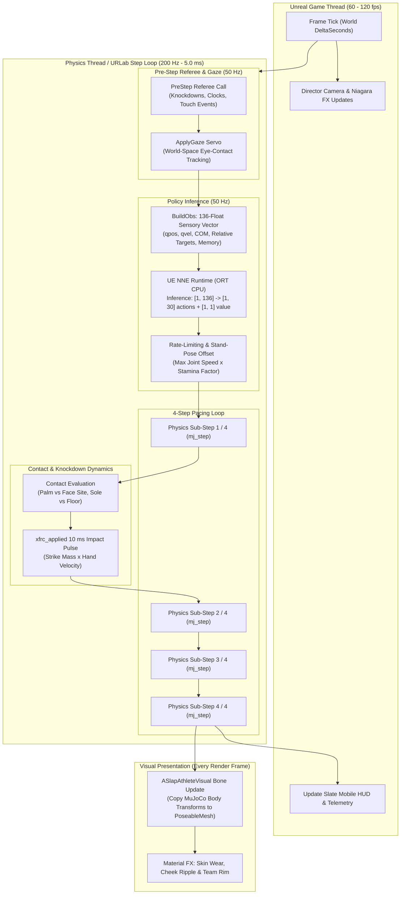
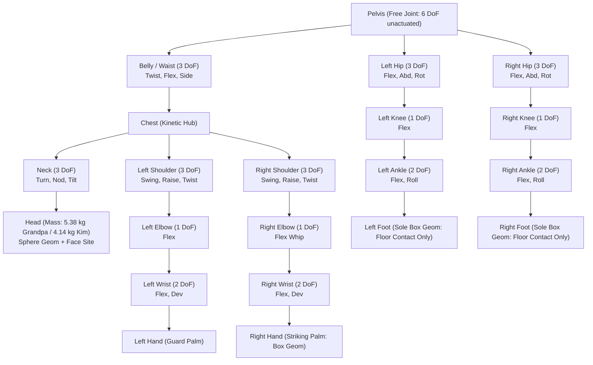

# Architecture Overview & Game Loop: Unreal Engine 5 + URLab + MuJoCo + NNE

> **Document Version:** `20261025`  
> **Engine:** Unreal Engine 5.8 | **Physics Simulator:** MuJoCo 3.10.0 (pinned) | **Inference:** UE NNE (ORT CPU) | **Plugin:** UnrealRoboticsLab (URLab)  
> **Target Branch:** `master`

---

## Tier 1 (Quick Look)

* **Core Philosophy:** *MuJoCo moves the athletes; Unreal only draws them.* Unreal's built-in Chaos physics engine is turned completely off for all athletes, the podium, the mat, and arena props.
* **Physics & Tick Decoupling:** Physics steps at a deterministic 200 Hz (every 5.0 ms) inside MuJoCo C-API via URLab. The AI brain evaluates at 50 Hz (every 4th physics step / 20 ms) using Unreal's Neural Network Engine (NNE). Unreal's Game and Render threads run independently at 60–120+ fps, displaying the latest physics state snapshot with latency under 5 ms.
* **Zero Chaos Collisions:** 84+ primitive scene components have collision and physics disabled (`CollisionEnabled::NoCollision`, `bSimulatePhysics = false`). Collision detection, impact impulses, knockdowns, and foot placements are calculated natively within MuJoCo.
* **One Brain, Multiple Roles:** Athletes share a continuous neural network architecture that operates in three distinct tactical roles: Attacker/Striker (+1), Defender/Absorber (-1), or Guard/Neutral (0).
* **Deterministic Simulation Parity:** Replay runs between standalone Python MuJoCo simulation and Unreal URLab execution achieve sub-millimeter positional parity (0.017 mm max over 5 seconds; 0.000 cm live match parity).
* **Broadcast-Ready Presentation:** Skinned character meshes (`SK_Grandpa`, `SK_Kim`) update bone transforms directly from MuJoCo bodies via `UPoseableMeshComponent`, augmented with Niagara impact spray, camera shake, cheek ripple World Position Offset (WPO), audio synthesizers, and 9:16 mobile portrait framing.

---

## Tier 2 (Core Mechanics)

### 1. Decision & Simulation Loop

The execution pipeline processes sensory data, evaluates policy decisions, advances rigid-body physics, and updates the visual presentation in strict lockstep.



### 2. URLab to Learning Agents & NNE Mapping

The architecture implements a direct mapping between Unreal's robotics runtime (`URLab`), Epic's `Learning Agents` patterns, and neural inference via `NNE`:

* **Learning Agents Interactor Mapping:**
  * **Observation Sensor:** Implemented in `USlapController::BuildObs()`. Serializes 136 continuous scalar values (joint deltas, joint velocities $\times 0.1$, pelvis height, gravity direction in pelvis frame, pelvis linear/angular velocity, previous action array, role flag, turn timer, opponent relative head/hand offsets, temporal history buffers, athlete stamina, and neck damage).
  * **Action Actuator:** Implemented in `USlapController::Decide()`. Maps 30 neural action outputs ($[-1, 1]$) into bounded target joint angles, passed through a joint speed rate-limiter and set as position actuator controls (`mjData::ctrl`).
  * **Reward & Episode Termination:** Managed in `PreStep()` and `EndTurn()`. Evaluates boundary conditions (footbox boundaries of $20 \times 25$ cm), knockdown conditions (non-sole contacts on floor/podium), strike touch contacts, and turn timers (30.0 s).
* **NNE CPU Model Instance:**
  * Instantiated as `UE::NNE::IModelInstanceCPU`.
  * Runs ONNX graphs directly on the physics thread without CPU-to-GPU roundtrip latency.
  * Inputs: Tensor `obs` with shape `[1, 136]` (float32).
  * Outputs: Tensor `actions` with shape `[1, 30]` (motor controls) and Tensor `value` with shape `[1, 1]` (critic state evaluation for live HUD momentum bar).

### 3. Controls & Joint Drive Map

Each athlete is equipped with 30 controllable soft motor degrees of freedom (DoF):



* **Joint Actuator Characteristics:**
  * **PD Control Formulation:** Each motor acts as a spring-damper tracking brain-selected goals:
    * $\text{Torque} = K_p \cdot (\theta_{\text{target}} - \theta) - K_v \cdot \dot{\theta}$
    * $K_p = \frac{\tau_{\text{max}}}{0.35\text{ rad}}$ (full rated torque delivered at $0.35$ rad / $20^\circ$ error).
    * Damping ratio $\zeta = 0.8$ derived from stand-pose link inertia to eliminate body oscillation.
  * **Arm Armature Optimization:** Arm armature is reduced to $0.005$ kg$\cdot$m$^2$ (down from the default $0.02$) to ensure rapid arm whip during slap acceleration.
  * **Rate Limiting:** Brain targets cannot jump instantaneously; per-joint max angular speeds (9.0–25.0 rad/s) scaled by athlete stamina limit position delta per 20 ms step.

### 4. Goals & Scoring Rules

Matches follow the official Power Slap competitive ruleset implemented identically in Python (`training/match.py`) and C++ (`USlapController`):

* **Match Structure:**
  * 3 standard rounds per match; 1 strike per athlete per round.
  * Initial coin toss determines who strikes first.
  * Turn clock: 30.0 seconds allowed to initiate and land a strike.
  * Recovery window: 5.0 seconds after strike contact before referee call and scoring.
* **Knockdowns & KOs:**
  * **Knockdown Condition:** Any non-sole geometry touching the floor or the central podium (except defender palms which are permitted to brace on the podium).
  * **KO Victory:** Defender knockdown resulting from a legal strike immediately ends the match by Knockout.
  * **Striker Self-Knockdown:** A striker losing balance and touching the podium or floor commits a severe foul (-1 point).
* **Fouls (-1 Point Penalty per card):**
  * Stepping outside the designated foot box ($20 \times 25$ cm) during windup or strike.
  * Striker knockdown during execution.
  * Exceeding the 30-second turn clock without striking.
* **10-Point-Must Scoring System:**
  * Three independent judges score each completed round based on hand velocity, head snap ($g$), stagger distance ($>5$ cm COM displacement), and defensive survival.
  * Round winner receives 10 points; opponent receives 9 points (or 8 points for heavy staggers with double composite impact score).

---

## Tier 3 (Setup Guide)

### 1. Unreal Engine Editor Component Configuration

To configure an arena level pairing in Unreal Engine 5.8:

* **1. MjManager Configuration:**
  * Place an `AMjManager` actor in the level named `MjManager`.
  * Select its `UMjPhysicsEngine` component in the Details panel:
    * `bSaveDebugXml` = `True` (exports `Saved/URLab/scene_compiled.mjb` used by verification scripts).
    * `bIsPaused` = `False` (automatically runs physics on Play in Editor / Game startup).
    * `AutoCreateSimulateWidget` = `False` (prevents default URLab debug HUD from overlapping portrait framing).
* **2. Arena Articulation Blueprint:**
  * Import pairing MJCF (e.g. `training/models/grandpa_vs_kim_arena.xml`) into `/Game/Arena/`.
  * Add the `USlapController` component to the generated Blueprint root:
    * `Mode` = `Policy` (or `Replay` for deterministic replay checks).
    * `Brain` = Load asset `/Game/Brains/grandpa_final_vs_kim`.
    * `BlueBrain` = Load asset `/Game/Brains/kim_final_vs_grandpa`.
    * `Fingerprint` = `training/models/grandpa_fingerprint.json`.
    * `BlueFingerprint` = `training/models/kim_fingerprint.json`.
    * `DefenderRole` = `-1` (enables active strike anticipation and head evasion for L3+ trained brains).
    * `PostMatchHold` = `4.0` s.
    * `TurnHold` = `2.0` s.
* **3. Skinned Visual Athlete Setup:**
  * Spawn two `ASlapAthleteVisual` actors: `AthleteRed` and `AthleteBlue`.
  * Set `BodyPrefix` on Red to `"red_"` and on Blue to `"blue_"`.
  * In the `PoseableMeshComponent`:
    * Assign `SK_Grandpa` to Red and `SK_Kim` to Blue.
    * Assign `M_Grandpa` / `M_Kim` skin materials to slot 0.
    * Assign `MI_TeamRed` to Red overlay material; `MI_TeamBlue` to Blue overlay material.

### 2. Tick Groups & Substepping Hierarchy

* **Tick Group Sequencing:**
  * `MjPhysicsEngine`: Executes in `TG_PrePhysics`. Intercepts tick, triggers 4 internal sub-steps of `mj_step()`, and processes `USlapController::ComputeAndApply()`.
  * `USlapController`: Computes policy inference every 4th physics step inside the physics tick loop.
  * `ASlapAthleteVisual`: Executes in `TG_PostPhysics` on the Game Thread. Reads bone body locations (`mjData::xpos`, `mjData::xquat`) from the completed physics step and updates the poseable mesh hierarchy.
  * `ASlapHUD`: Executes in `TG_PostUpdateWork`. Safely copies thread-safe `FSlapHud` telemetry under mutex lock.

### 3. Collision Profiles & Chaos Audit

* **Strict Chaos Isolation Audit:**
  * Every actor placed in the arena must pass the Chaos audit routine (`Scripts/build_scene.py`):
    ```python
    for actor in editor_actor_subsystem.get_all_level_actors():
        for comp in actor.get_components_by_class(unreal.PrimitiveComponent):
            comp.set_collision_enabled(unreal.CollisionEnabled.NO_COLLISION)
            comp.set_simulate_physics(False)
    ```
  * Verify in the Details panel that `Collision Presets` is set to `NoCollision` across all static meshes, env geometry, and skeletal meshes.

---

*Summary: Complete UE5 URLab architecture documentation detailing 200 Hz MuJoCo simulation, 50 Hz NNE inference, joint maps, and scoring.*
