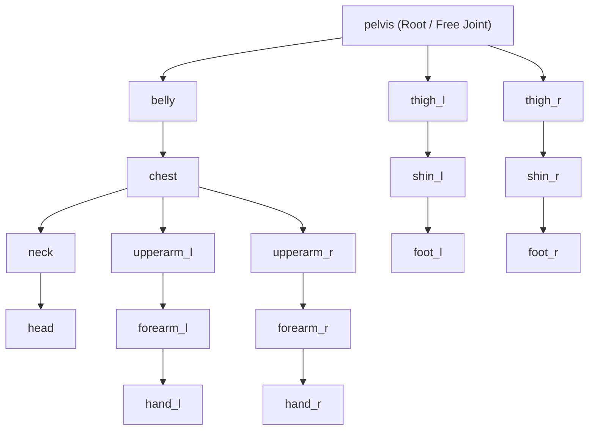

# Agent & Rig Inventory: MuJoCo, NNE, and Control Rig Specifications

> **Document Version:** `20261025`  
> **Engine:** Unreal Engine 5.8 | **Physics Engine:** MuJoCo 3.10.0 | **Neural Runtime:** NNE ORT CPU  
> **Target Branch:** `master`

---

## Tier 1 (Quick Look)

* **Roster Architecture:** Every athlete is defined by an export 3D mesh (`Content/Art/Exports/<Name>_rigged.fbx`), a biomechanical character card (`training/characters/<name>.json`), a MuJoCo definition (`training/models/<name>_solo.xml`), and an exported neural network policy (`/Game/Brains/<name>_final.onnx`).
* **Complete Neural Decoupling:** The AI policy evaluates motor intent in pure numerical coordinate space. Visual character deformation is completely decoupled: `ASlapAthleteVisual` samples rigid body positions from MuJoCo each render frame and moves bone transforms in a `UPoseableMeshComponent`.
* **Standardized 30-Motor Drive:** All humanoid characters share an identical 30-actuator kinematic topology across the waist, neck, shoulders, elbows, wrists, hips, knees, and ankles.
* **Current Production Athletes:**
  * **Grandpa (Slot 1):** 1.70 m, 78.0 kg, heavy kinetic chain power puncher (12.8 m/s clean palm strikes).
  * **Kim (Slot 2):** 1.63 m, 60.0 kg, rapid athletic counter-striker with lower center of mass (11.6 m/s snappy whip).

---

## Tier 2 (Core Mechanics)

### 1. Neural Network Policy Inventory

All models run locally on the physics thread via Unreal Engine's Neural Network Engine (NNE) CPU runtime.

| Model Asset Name | Source Path | Architecture | Obs Dim | Action Dim | Primary Training Task | Win / Clean Hit Rate |
|---|---|---|---|---|---|---|
| `grandpa_final` | `models/brains/grandpa_final.onnx` | MLP `(512, 256, 128)` ELU | 136 | 30 | L4 Self-Play Sparring | 100% (600/600 palms) |
| `grandpa_final_vs_kim` | `models/brains/grandpa_final_vs_kim.onnx` | MLP `(512, 256, 128)` ELU | 136 | 30 | Mixed-Pairing Adaptation | 100% clean, 31% KO rate |
| `kim_final` | `models/brains/kim_final.onnx` | MLP `(512, 256, 128)` ELU | 136 | 30 | L4 Low-Crouch Self-Play | 100% (600/600 palms) |
| `kim_final_vs_grandpa` | `models/brains/kim_final_vs_grandpa.onnx` | MLP `(512, 256, 128)` ELU | 136 | 30 | Asymmetric Sparring (vs Tall) | 100% clean, 22% KO rate |
| `grandpa_L0` | `models/brains/grandpa_L0.onnx` | MLP `(512, 256, 128)` ELU | 108 | 30 | L0 300 N Push Survival | 97% Upright Survival |
| `grandpa_L1_best` | `models/brains/grandpa_L1_best.onnx` | MLP `(512, 256, 128)` ELU | 108 | 30 | L1 Footbox Guard Hold | 95% In-Box Hold |
| `grandpa_L2` | `models/brains/grandpa_L2.onnx` | MLP `(512, 256, 128)` ELU | 130 | 30 | L2 Fixed Head Targeting | 94% Hits ≥8 m/s |
| `grandpa_L3` | `models/brains/grandpa_L3.onnx` | MLP `(512, 256, 128)` ELU | 130 | 30 | L3 15 N·s Impact Absorption | 93% Absorb & Balance |
| `random_brain` | `models/random_brain.onnx` | MLP `(512, 256, 128)` ELU | 108 | 30 | NNE Pipeline Verification | Dry-Run Load Test |

### 2. Observation & Action Space Mechanics

* **136-Dimensional Observation Vector:**
  * **Joint Kinematics (Index 0–59):** Indices 0–29 encode joint angle deviation from stand pose (`rad`). Indices 30–59 encode joint angular velocity scaled by $0.1$ (`rad/s`).
  * **Pelvis Spatial Orientation (Index 60–69):** Index 60 is pelvis height above floor ($Z$ in meters). Indices 61–63 encode the gravity vector in the pelvis frame ($R_{\text{pelvis}}^T \cdot [0, 0, -1]$). Indices 64–66 encode linear velocity in the heading frame. Indices 67–69 encode free-joint angular velocity scaled by $0.25$.
  * **Action Feedback (Index 70–99):** The 30 neural actions emitted on the previous decision tick.
  * **Match Role & Timers (Index 100–107):** Role identifier (+1 strike, -1 defend, 0 guard). Turn timer remaining ($1.0 \rightarrow 0.0$ over 30 s). Opponent target offset vector in heading frame ($X, Y, Z$). Opponent hand position offset vector.
  * **Temporal Memory Buffer (Index 108–125):** 3 temporal snapshot slices (sampled 5, 10, and 15 decisions ago / 100, 200, 300 ms delay) capturing opponent head and hand trajectories.
  * **Opponent Historical Strike Memory (Index 126–127):** Opponent's previous strike timing ($t / 30.0$) and peak palm velocity ($v / 10.0$).
  * **Fatigue & Biomechanical Health (Index 128–129):** Athlete current stamina factor ($1.0 \rightarrow 0.7$) and neck bracing strength factor ($1.0 \rightarrow 0.5$).
  * **Striking Palm Kinematics (Index 130–135):** Right hand palm position relative to own pelvis, and palm facing normal unit vector in world space.
* **Action Decoding Formulation:**
  * Model outputs continuous raw actions $a_j \in [-1, 1]$.
  * The target angle $\theta_{\text{target}}$ interpolates toward joint limits:
    $$\theta_{\text{target}} = \text{clip}\left(\theta_{\text{stand}} + \begin{cases} a_j \cdot (\theta_{\text{hi}} - \theta_{\text{stand}}) & a_j > 0 \\ a_j \cdot (\theta_{\text{stand}} - \theta_{\text{lo}}) & a_j \le 0 \end{cases}, \theta_{\text{lo}}, \theta_{\text{hi}}\right)$$
  * **Rate Limiter:** Limits angular step per 20 ms decision:
    $$|\theta_{\text{target}} - \theta_{\text{prev}}| \le \omega_{\text{max}, j} \times 0.02 \times \text{Stamina}$$

---

## Tier 3 (Setup Guide)

### 1. Physics & Rig Hierarchy (MuJoCo MJCF $\leftrightarrow$ Skeletal Mesh)

Each athlete skeleton matches MuJoCo bodies 1-to-1 in rest pose:

| MuJoCo Body | Bone Name | Collider Primitive | Dimensions (Grandpa) | Dimensions (Kim) | Parent Body |
|---|---|---|---|---|---|
| `pelvis` | `pelvis` | Capsule | $r=0.034$ m, $l=0.152$ m | $r=0.031$ m, $l=0.138$ m | `world` |
| `belly` | `belly` | Capsule | $r=0.038$ m, $l=0.167$ m | $r=0.035$ m, $l=0.151$ m | `pelvis` |
| `chest` | `chest` | Capsule | $r=0.010$ m, $l=0.157$ m | $r=0.009$ m, $l=0.142$ m | `belly` |
| `neck` | `neck` | Capsule | $r=0.046$ m, $l=0.046$ m | $r=0.042$ m, $l=0.041$ m | `chest` |
| `head` | `head` | Sphere | $r=0.090$ m | $r=0.082$ m | `neck` |
| `upperarm_l/r` | `upperarm_l/r` | Capsule | $r=0.073$ m, $l=0.132$ m | $r=0.066$ m, $l=0.120$ m | `chest` |
| `forearm_l/r` | `forearm_l/r` | Capsule | $r=0.034$ m, $l=0.112$ m | $r=0.031$ m, $l=0.101$ m | `upperarm_l/r` |
| `hand_l/r` | `hand_l/r` | Box | $0.042 \times 0.092 \times 0.015$ m | $0.038 \times 0.083 \times 0.014$ m | `forearm_l/r` |
| `thigh_l/r` | `thigh_l/r` | Capsule | $r=0.080$ m, $l=0.198$ m | $r=0.072$ m, $l=0.179$ m | `pelvis` |
| `shin_l/r` | `shin_l/r` | Capsule | $r=0.052$ m, $l=0.187$ m | $r=0.047$ m, $l=0.169$ m | `thigh_l/r` |
| `foot_l/r` | `foot_l/r` | Box (Sole) | $0.115 \times 0.055 \times 0.025$ m | $0.104 \times 0.050 \times 0.023$ m | `shin_l/r` |

### 2. Joint Actuator Parameter Settings

Detailed motor drive settings configured in the MJCF and mirrored in `USlapController`:

| Joint Name | Grandpa Limits (rad) | Grandpa Kp (N·m/rad) | Grandpa Kv (N·m·s/rad) | Grandpa Torque (N·m) | Kim Limits (rad) | Kim Torque (N·m) |
|---|---|---|---|---|---|---|
| `waist_twist` | `[-0.593, +0.593]` | $171.43$ | $20.03$ | $60.0$ | `[-0.698, +0.698]` | $72.0$ |
| `waist_flex` | `[-0.297, +0.890]` | $285.71$ | $57.51$ | $100.0$ | `[-0.349, +1.047]` | $120.0$ |
| `waist_side` | `[-0.445, +0.445]` | $228.57$ | $53.88$ | $80.0$ | `[-0.524, +0.524]` | $96.0$ |
| `neck_turn` | `[-1.038, +1.038]` | $57.14$ | $2.21$ | $20.0$ | `[-1.222, +1.222]` | $20.4$ |
| `neck_nod` | `[-0.593, +0.742]` | $57.14$ | $5.03$ | $20.0$ | `[-0.698, +0.873]` | $20.4$ |
| `neck_tilt` | `[-0.593, +0.593]` | $57.14$ | $4.87$ | $20.0$ | `[-0.698, +0.698]` | $20.4$ |
| `shoulder_swing` | `[-1.929, +0.593]` | $128.57$ | $2.39$ | $45.0$ | `[-2.269, +0.698]` | $54.0$ |
| `shoulder_raise` | `[-1.409, +1.187]` | $128.57$ | $11.11$ | $45.0$ | `[-1.658, +1.396]` | $54.0$ |
| `shoulder_twist` | `[-1.187, +1.187]` | $85.71$ | $1.88$ | $30.0$ | `[-1.396, +1.396]` | $36.0$ |
| `elbow` | `[0.000, +2.077]` | $100.00$ | $3.87$ | $35.0$ | `[0.000, +2.443]` | $42.0$ |
| `wrist_flex` | `[-0.890, +1.038]` | $28.57$ | $0.37$ | $10.0$ | `[-1.047, +1.222]` | $12.0$ |
| `wrist_dev` | `[-0.371, +0.371]` | $21.43$ | $0.25$ | $7.5$ | `[-0.436, +0.436]` | $9.0$ |
| `hip_flex` | `[-0.297, +1.632]` | $314.29$ | $46.87$ | $110.0$ | `[-0.349, +1.920]` | $132.0$ |
| `hip_abd` | `[-0.371, +0.593]` | $228.57$ | $39.93$ | $80.0$ | `[-0.436, +0.698]` | $96.0$ |
| `hip_rot` | `[-0.593, +0.593]` | $142.86$ | $7.14$ | $50.0$ | `[-0.698, +0.698]` | $60.0$ |
| `knee` | `[0.000, +2.077]` | $314.29$ | $17.65$ | $110.0$ | `[0.000, +2.443]` | $132.0$ |
| `ankle_flex` | `[-0.668, +0.297]` | $257.14$ | $12.86$ | $90.0$ | `[-0.785, +0.349]` | $108.0$ |
| `ankle_roll` | `[-0.297, +0.297]` | $85.71$ | $4.29$ | $30.0$ | `[-0.349, +0.349]` | $36.0$ |

### 3. Practical Editor Details Panel Setup

To verify or modify agent parameters in the Unreal Editor:

* **Open Arena Level:** Load `/Game/Levels/Arena` (or `/Game/Levels/Arena_grandpa_vs_kim`).
* **Locate Arena Blueprint Actor:** Select `Arena` in the Outliner.
* **Inspect `SlapController` Component:**
  * **Brain:** Ensure the NNE model asset is assigned (`grandpa_final_vs_kim`).
  * **Blue Brain:** Ensure Blue corner model is assigned (`kim_final_vs_grandpa`).
  * **Fingerprint:** Set to `training/models/grandpa_fingerprint.json`.
  * **Blue Fingerprint:** Set to `training/models/kim_fingerprint.json`.
  * **Defender Role:** Set to `-1` (Crucial: a setting of `0` deprives defender of head/hand targets, inducing collapse).
  * **Post Match Hold:** Set to `4.0` seconds to allow full KO viewing.
* **Inspect Visual Athletes:**
  * Select `AthleteRed` and `AthleteBlue`.
  * Verify `BodyPrefix` is set to `"red_"` and `"blue_"` respectively.
  * Verify `Mesh` component has `bNoSkeletonUpdate` = `False` and `Visibility` = `True`.

---

*Summary: Complete agent model tables, neural architecture specs, 30-DoF kinematic parameters, and editor setup guides.*
