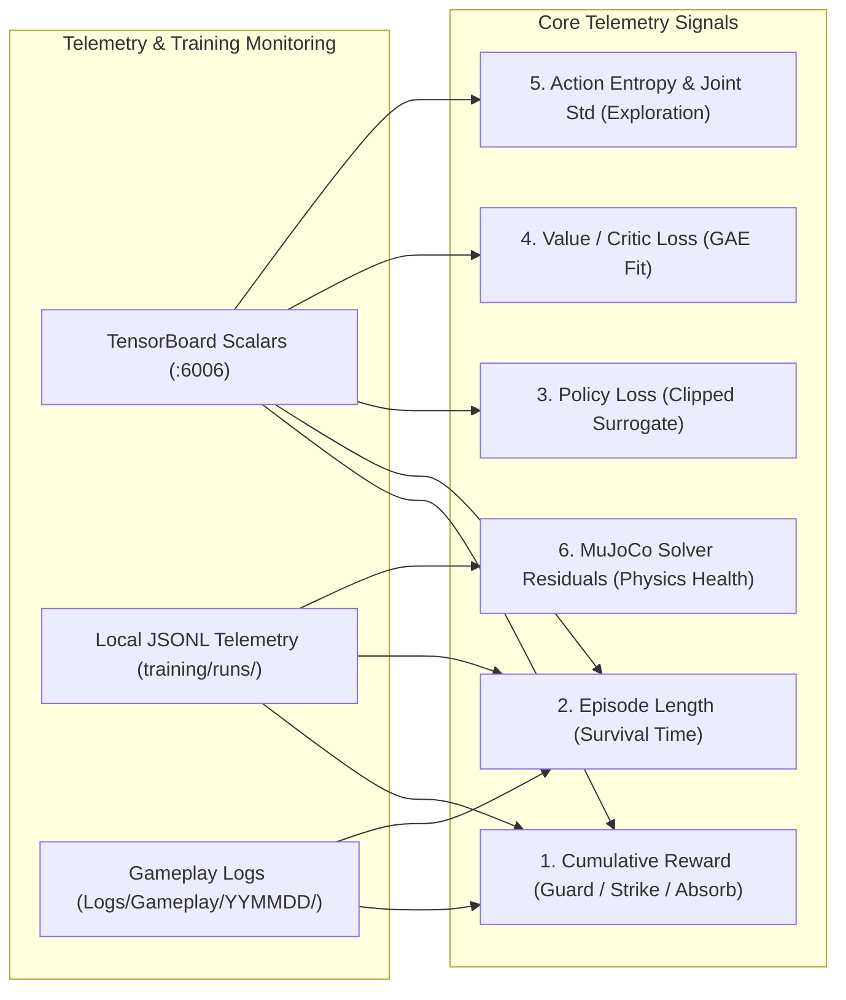

# Training Charts & Telemetry Guide: TensorBoard, URLab, and Convergence

> **Document Version:** `20261025`  
> **Training Framework:** PyTorch PPO + MuJoCo Warp / URLab | **Telemetry Format:** JSONL + TensorBoard Scalars  
> **Target Branch:** `master`

---

## Tier 1 (Quick Look)

* **Telemetry Purpose:** Translates complex numerical gradient graphs into plain-English indicators of athlete posture, slap power, and match consistency.
* **Core Rule of Progress:** Reward climbing while action entropy smoothly decreases indicates healthy motor learning. Spiking critic loss or sudden drops in episode length flag balance regressions or constraint violations.
* **Curriculum Gating:** Athletes do not advance to the next skill tier based on training time; they must pass rigorous 100-round deterministic evaluation exams (zero NaN gradients, $\ge 90$–$95\%$ pass rate) before an ONNX policy file is exported.
* **Three Universal Roles:** Telemetry tracks Guard (balance in footbox), Strike (kinetic chain slap $\ge 8$ m/s), and Absorb (impact recovery without staggering).

---

## Tier 2 (Core Mechanics)

### 1. Telemetry Metrics Breakdown



* **1. Cumulative Reward (Per-Role Return):**
  * **Guard Return:** Evaluates upright balance and foot placement inside the $20 \times 25$ cm box. A complete 30-second round corresponds to 1,500 decisions (50 Hz). A return of $2,400$–$2,500$ indicates the athlete stood perfectly planted without stepping out or falling.
  * **Strike Return:** Evaluates kinetic energy transfer, open palm orientation, and post-strike balance. A clean hit ($\ge 8.0$ m/s) that leaves the striker standing pays $100$–$114$ points.
  * **Absorb Return:** Measures recovery after a 3–15 N·s head impact. An un-staggered athlete returning their Center of Mass (COM) to within 5 cm of origin achieves $\sim 800$ reward.
* **2. Episode Length & Survival Steps:**
  * Tracks how many steps the athlete survives before a knockdown or out-of-bounds foul.
  * In early L0 training, toddlers fall within 1.9 s (95 steps). As balance consolidates, survival reaches the full 30.0 s ceiling (1,500 steps).
* **3. Policy Loss (Actor Optimization):**
  * Measures the clipped surrogate objective of the PPO policy.
  * Healthy training maintains policy loss near zero with modest fluctuations. Sharp negative spikes signify policy divergence caused by aggressive learning rates or unnormalized inputs.
* **4. Value Loss (Critic State Valuation):**
  * Reflects how accurately the critic neural head estimates future match return.
  * Spikes naturally when entering a new curriculum stage (e.g. introducing head impacts in L3), then steadily declines as the critic adapts to the new dynamics.
* **5. Action Entropy & Motor Standard Deviation ($\sigma$):**
  * Quantifies the degree of physical exploration.
  * Starts at $\sigma = 0.80$ (wide random limb exploration) and decays to $\sigma \approx 0.20$–$0.25$ upon graduation. Lower entropy produces crisp, repeatable motor execution.
* **6. MuJoCo Solver Residuals (Numerical Stability):**
  * Solved via Newton's method (`iterations="20"`, `integrator="implicitfast"`).
  * Residuals below $10^{-6}$ confirm that constraint forces and contacts are resolved without interpenetration or energy explosions.

### 2. Multi-Agent Curriculum Comparison Grid

| Skill Ladder Level | Grandpa Performance | Kim Performance | Failure Modes & Traps Handled |
|---|---|---|---|
| **L0: Basic Balance** | Graduated (97% survival under 150–300 N pushes) | Graduated (96% survival under 150–300 N pushes) | Excessive head pushes on 0.5-strength joints induced stall; push capped at 0.6x |
| **L1: Footbox Guard** | Graduated (95% inside $20 \times 25$ cm box) | Graduated (95% inside $20 \times 25$ cm box) | Podium added to training env; prevented hand collision knockdowns |
| **L2: Slap Target** | Graduated ($12.8$ m/s palm hit rate $100\%$) | Graduated ($11.6$ m/s palm hit rate $100\%$) | Action rule expanded to reach full shoulder elevation (+57° vs +4° cap) |
| **L3: Impact Absorption** | Graduated ($93\%$ recovery under 15 N·s slap) | Graduated ($91\%$ recovery under 15 N·s slap) | Active neck bracing; COM recovery required within 5 cm tolerance |
| **L4: Arena Self-Play** | Graduated (KO rate 31%, self-falls 3%) | Graduated (KO rate 22%, self-falls 2%) | Balanced strike/defend multi-role training; eliminated guard degradation |
| **L5: Match Validation** | Graduated (100 matches, 0 sim blowups) | Graduated (100 matches, 0 sim blowups) | Identical Python/Unreal event logs across all 28 telemetry events |

---

## Tier 3 (Setup Guide)

### 1. Telemetry Launch & TensorBoard Setup

To inspect training progression curves in real time:

* **1. Launch TensorBoard:**
  * Open PowerShell and activate the training virtual environment:
    ```powershell
    cd C:\Users\punko\Downloads\PoSlapUnreal\training
    .venv\Scripts\Activate.ps1
    tensorboard --logdir runs --port 6006
    ```
  * Navigate to `http://localhost:6006` in your browser.
* **2. Inspect Local JSONL Telemetry:**
  * Telemetry is recorded in `training/runs/<run_name>/telemetry.jsonl`.
  * Each record contains step count, role reward breakdown, fall rate, and hit velocity:
    ```json
    {"steps": 15000000, "guard_return": 2482.1, "strike_return": 112.4, "strike_hit": 0.94, "absorb_ok": 0.92, "fall_rate": 0.03}
    ```

### 2. Three-Stage Skill Report Generation

Per project guidelines (`AGENTS.md`), any training run lasting longer than 30 minutes must produce an HTML summary comparing three developmental stages:

* **Beginner:** First 10% of training steps.
* **Intermediate:** 45%–55% of training steps.
* **Advanced:** Final 10% of training steps.
* **Generate HTML Report:**
  ```powershell
  training/.venv/Scripts/python.exe training/report.py training/runs/<run_directory>
  ```
* **Verify Graduation Checks:**
  Before exporting an ONNX brain for Unreal Engine, execute the automated pass/fail exam:
  ```powershell
  training/.venv/Scripts/python.exe training/match.py exam training/models/brains/<brain_name>.onnx --matches 100
  ```

---

*Summary: Detailed guide to TensorBoard metrics, PPO loss behavior, multi-role rewards, and curriculum graduation gates.*
