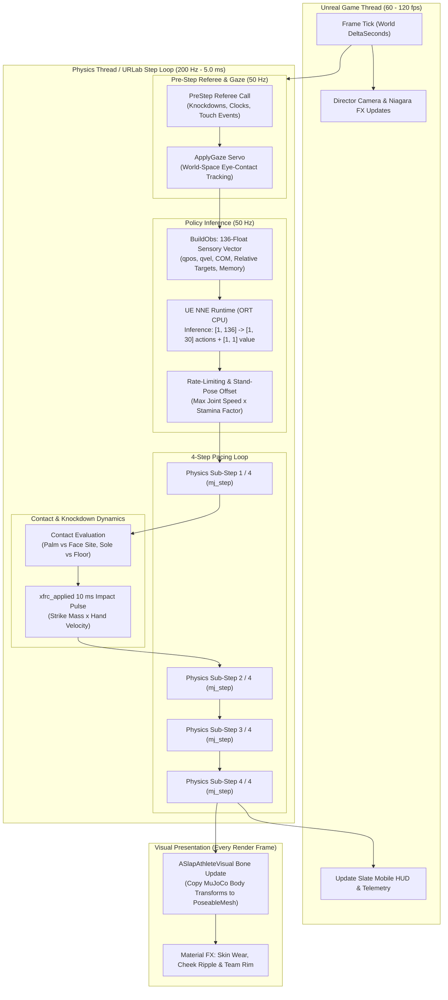
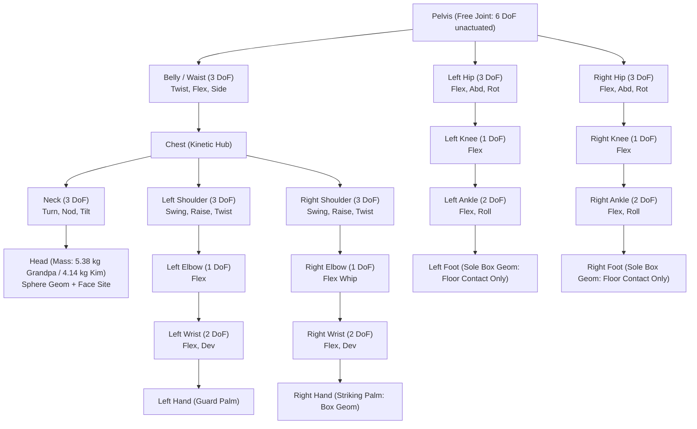
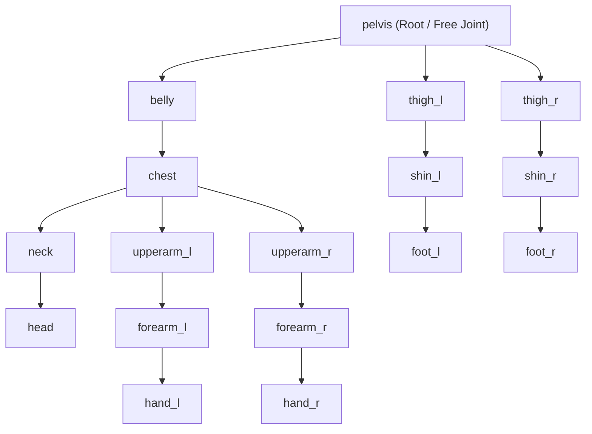
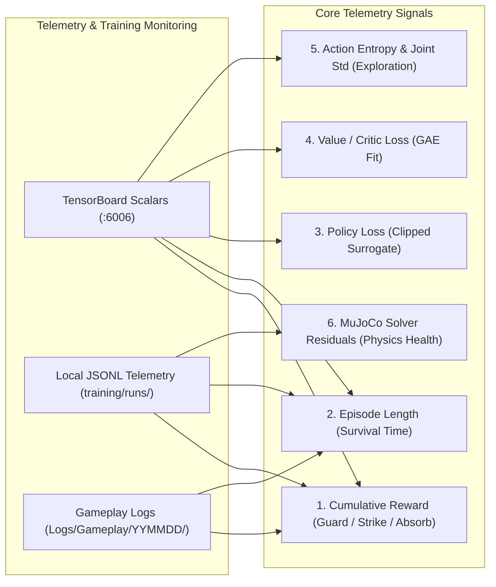

This file is a merged representation of a subset of the codebase, containing files not matching ignore patterns, combined into a single document by Repomix.

# File Summary

## Purpose
This file contains a packed representation of a subset of the repository's contents that is considered the most important context.
It is designed to be easily consumable by AI systems for analysis, code review,
or other automated processes.

## File Format
The content is organized as follows:
1. This summary section
2. Repository information
3. Directory structure
4. Repository files (if enabled)
5. Multiple file entries, each consisting of:
  a. A header with the file path (## File: path/to/file)
  b. The full contents of the file in a code block

## Usage Guidelines
- This file should be treated as read-only. Any changes should be made to the
  original repository files, not this packed version.
- When processing this file, use the file path to distinguish
  between different files in the repository.
- Be aware that this file may contain sensitive information. Handle it with
  the same level of security as you would the original repository.

## Notes
- Some files may have been excluded based on .gitignore rules and Repomix's configuration
- Binary files are not included in this packed representation. Please refer to the Repository Structure section for a complete list of file paths, including binary files
- Files matching these patterns are excluded: bin/**, obj/**, .vs/**, .vscode/**, .git/**, node_modules/**, dist/**, *.lock, Plugins/UnrealRoboticsLab/**, Content/**, Saved/**, Intermediate/**, Binaries/**, DerivedDataCache/**, Logs/**, SCREENSHOTS/**, install/**, DOCS/**/*.html, DOCS/**/*.png, DOCS/**/*.json, *.glb, *.onnx, *.pt, *.bin, *.uasset, *.umap, *.fbx, *.png, *.jpg, *.wav, *.ogg, *.mjb, *.jsonl, *.csv, *.npz, training/models/**, training/.venv/**, Config/DefaultEditor.ini
- Files matching patterns in .gitignore are excluded
- Files matching default ignore patterns are excluded
- Files are sorted by Git change count (files with more changes are at the bottom)

# Directory Structure
````
.github/
  workflows/
    deploy-web.yml
    verify.yml
  dependabot.yml
Config/
  DefaultDeviceProfiles.ini
  DefaultEditorPerProjectUserSettings.ini
  DefaultEngine.ini
  DefaultGame.ini
  DefaultInput.ini
DOCS/
  20261025/
    agent_abilities_grid.md
    ai_realism_30m_report.md
    ai_realism_pre_flight.md
    architecture_overview.md
    model_summary.md
    training_metrics_guide.md
  20261028/
    grandpa_v2/
      rom.mp4
      slap.mp4
  20261029/
    feature_pass_2026-10-29.md
    incident_308ba09_repo_wipe.md
  20261103/
    collision_review.md
    events.md
    training_realism.md
  20261104/
    director_transitions.md
    physics3.md
    policy_change_log.md
  20261105/
    mom_onboarding.md
  20261109/
    voice_pack_and_tournament.md
  BRAIN_IO.md
  SUMMARY.md
Plugins/
  urlab_poslap.patch
Scripts/
  announcer.py
  arena_decals.py
  arena_env.py
  arena_mobile_level.py
  arena_mobile.py
  arena_textures.py
  athlete_lods.py
  bake_maps.py
  blender_batch.py
  blender_cheek_morphs.py
  blender_face_vertices.py
  blender_open_hands.py
  blender_rest_vertices.py
  blender_skin_detail.py
  broadcast_audio.py
  broadcast_fx.py
  broadcast_metasound.py
  build_scene.py
  chat.py
  check_naming.py
  clipper.py
  collision_mesh_clip.py
  collision_review.py
  commentator.py
  grandpa_v2_report.py
  grandpa_v2.py
  onboard_athlete.py
  open_hands_poses.py
  record_motion.py
  reimport_athletes.py
  render_cheek_morphs.py
  render_open_hands.py
  rig_auto.py
  rig_mixamo.py
  set_brain.py
  set_defender_role.py
  setup_urlab.ps1
  stream.ps1
  unused_assets.py
  verify_all.ps1
  voice_import.py
  voice_pack.py
Source/
  PoSlapUnreal/
    PoSlapUnreal.Build.cs
    PoSlapUnreal.cpp
    PoSlapUnreal.h
    SlapAthleteVisual.cpp
    SlapAthleteVisual.h
    SlapBind.cpp
    SlapBrainIO.cpp
    SlapBroadcast.cpp
    SlapController.cpp
    SlapController.h
    SlapControllerInternal.h
    SlapEditorLib.cpp
    SlapEditorLib.h
    SlapFatigue.cpp
    SlapGaze.cpp
    SlapHUD.cpp
    SlapHUD.h
    SlapHUDAudio.cpp
    SlapHUDCamera.cpp
    SlapHUDCommentary.cpp
    SlapHUDDraw.cpp
    SlapHUDFx.cpp
    SlapHUDInternal.h
    SlapHUDLive.cpp
    SlapHUDMenu.cpp
    SlapHUDPanels.cpp
    SlapHUDRoundTrip.cpp
    SlapHUDScience.cpp
    SlapHUDTests.cpp
    SlapHUDTourney.cpp
    SlapMatch.cpp
    SlapNames.h
    SlapReferee.cpp
    SlapReferee.h
    SlapReplay.cpp
    SlapSwingRead.cpp
    SlapSwingRead.h
    SlapWalkIn.cpp
  PoSlapUnreal.Target.cs
  PoSlapUnrealEditor.Target.cs
training/
  characters/
    grandpa_skeleton.json
    grandpa.json
    kim_skeleton.json
    kim.json
    matt_skeleton.json
    matt.json
    mom_skeleton.json
    mom.json
  configs/
    joint_and_strength_config.json
    retrain_v2_queue.json
    retrain_v3_queue.json
    retrain_v4_queue.json
    sensory_profile.json
    training_realism_config.json
  envs/
    __init__.py
    arena.py
    common.py
    getup.py
    locomotion.py
    slap.py
  brain_cpu.py
  build_body.py
  constants.py
  eval_candidates.py
  export_candidate.py
  export_cpu_brains.py
  finalize_spar.py
  gaze_check.py
  getup_states.py
  gpuwatch.py
  levels.py
  match.py
  monitor_spar.py
  night_driver.py
  night_report.py
  overnight.py
  physics_audit.py
  ppo.py
  prune_runs.py
  queue_task.ps1
  realism_stats.py
  replay_check.py
  report_watch.py
  report.py
  requirements.txt
  roster.json
  scouting.py
  session_report.py
  slap_demo.py
  slap_pose.json
  tournament.py
  train.py
  verify_cards.py
  verify_constants.py
  verify_realism.py
  view_brain.py
Web/
  assets/
    audio/
      ArenaIR.wav
      Bell.wav
      Breath_kim.wav
      Breath_matt.wav
      Breath.wav
      CrowdLoop.wav
      CrowdNear.wav
      CrowdReact.wav
      Grunt_grandpa.wav
      Grunt_kim.wav
      Grunt_matt.wav
      PAChime.wav
      Scrape.wav
      Slap.wav
      Slap1.wav
      Slap2.wav
      Slap3.wav
      Squeak0.wav
      Squeak1.wav
      Step.wav
      StepDeck.wav
      Thud.wav
    tex/
      skin_detail.png
    arena.glb
    grandpa.glb
    kim.glb
    matt.glb
  .gitignore
  api_check.mjs
  app.js
  art.js
  audio.js
  broadcast.js
  build.py
  check.mjs
  contacts.js
  fps_ladder.mjs
  fx.js
  index.html
  live_check.mjs
  live.py
  loader.js
  package.json
  serve.py
  sim.js
  ws_client.mjs
.editorconfig
.gitattributes
.gitignore
.mcp.json
.vsconfig
AGENTS.md
BLUEPRINT.md
CLAUDE.md
PoSlapUnreal.uproject
README.md
tasks.md
````

# Files

## File: .github/workflows/verify.yml
````yaml
name: Verify

# The gate that keeps the three engines in step. Runs on every push to master and on
# every pull request. Nothing here needs a GPU: verify_realism.py (the CUDA env checks)
# stays a local gate; this workflow runs the checks a plain runner can make.

on:
  push:
    branches: [master]
  pull_request:
    branches: [master]
  workflow_dispatch:

permissions:
  contents: read

concurrency:
  group: verify-${{ github.ref }}
  cancel-in-progress: true

jobs:
  checks:
    runs-on: ubuntu-latest
    steps:
      # pinned to commit SHAs: a moved tag must not change what runs
      - uses: actions/checkout@11d5960a326750d5838078e36cf38b85af677262 # v4

      - name: Pull the LFS assets the browser engine needs (brains + GLBs)
        run: git lfs pull --include="training/models/brains/*.onnx,Web/assets/*.glb"

      - uses: actions/setup-python@a26af69be951a213d495a4c3e4e4022e16d87065 # v5
        with:
          python-version: "3.11"

      - uses: actions/setup-node@49933ea5288caeca8642d1e84afbd3f7d6820020 # v4
        with:
          node-version: 20
          cache: npm
          cache-dependency-path: Web/package-lock.json

      - name: Install the web dependencies
        working-directory: Web
        run: npm ci

      - name: Browser engine (one turn each way, every pairing)
        run: for p in gg kk gk; do node Web/check.mjs $p; done

      - name: Live relay (the publisher key is enforced)
        run: node Web/live_check.mjs

      - name: Spectator API
        run: if [ -f Web/api_check.mjs ]; then node Web/api_check.mjs; fi

      - name: Every python file parses
        run: python -m compileall -q training Web

      - name: Asset naming and folder conventions
        run: python Scripts/check_naming.py

      - name: Install the CPU simulation dependencies
        run: python -m pip install --upgrade pip && python -m pip install "mujoco==3.10.0" numpy

      - name: Character cards, models and packaged staging
        run: python training/verify_cards.py

      - name: The three engines agree on the shared numbers
        run: python training/verify_constants.py

      - name: The dev server serves only Web/ and training/
        run: |
          python Web/serve.py --port 8099 &
          sleep 2
          for path in /Web/index.html /training/models/grandpa_solo.xml; do
            code=$(curl -s -o /dev/null -w "%{http_code}" "http://127.0.0.1:8099$path")
            echo "$path -> $code"
            test "$code" = "200" || { echo "expected 200 for $path"; exit 1; }
          done
          for path in /.git/config /Saved/Logs/PoSlapUnreal.log /AGENTS.md; do
            code=$(curl -s -o /dev/null -w "%{http_code}" "http://127.0.0.1:8099$path")
            echo "$path -> $code"
            test "$code" != "200" || { echo "$path must not be served"; exit 1; }
          done
````

## File: .github/dependabot.yml
````yaml
# Keeps the pinned GitHub Actions in the workflows up to date: one grouped pull request a week.
version: 2
updates:
  - package-ecosystem: github-actions
    directory: /
    schedule:
      interval: weekly
    groups:
      actions:
        patterns: ["*"]
````

## File: Config/DefaultEditorPerProjectUserSettings.ini
````ini
[/Script/ModelContextProtocolEngine.ModelContextProtocolSettings]
bAutoStartServer=True
ServerPortNumber=8000

[/Script/UnrealEd.EditorPerformanceSettings]
bThrottleCPUWhenNotForeground=False

[/Script/UnrealEd.EditorLoadingSavingSettings]
bMonitorContentDirectories=False


[/Script/UnrealEd.LevelEditorPlaySettings]
NewWindowWidth=540
NewWindowHeight=960
LastExecutedPlayModeType=PlayMode_InEditorFloating
````

## File: Config/DefaultGame.ini
````ini
[/Script/CommonUI.CommonUISettings]
CommonButtonAcceptKeyHandling=TriggerClick

[ConsoleVariables]
CommonUI.CheckKeyboardFocusAndParentage=1
CommonUI.DisallowUserFocusedWidgetForPendingFocusRecipient=1
CommonUI.FallbackToDesiredOnAutoRestoreFailure=1

[/Script/EngineSettings.GeneralProjectSettings]
ProjectID=E4A0B6E745156DD7CA2402A15AFD3510

[/Script/Engine.AssetManagerSettings]
+PrimaryAssetTypesToScan=(PrimaryAssetType="GameFeatureData",AssetBaseClass="/Script/GameFeatures.GameFeatureData",bHasBlueprintClasses=False,bIsEditorOnly=False,Directories=((Path="/Game/Unused")),SpecificAssets=,Rules=(Priority=-1,ChunkId=-1,bApplyRecursively=True,CookRule=AlwaysCook))

[/Script/UnrealEd.ProjectPackagingSettings]
+DirectoriesToAlwaysCook=(Path="/Game/Brains")
+DirectoriesToAlwaysCook=(Path="/Game/Levels")
+DirectoriesToAlwaysCook=(Path="/Game/FX")
+DirectoriesToAlwaysCook=(Path="/Game/Audio")
+DirectoriesToAlwaysStageAsNonUFS=(Path="Content/Data")
+DirectoriesToAlwaysStageAsUFS=(Path="Data")
````

## File: Config/DefaultInput.ini
````ini
[/Script/Engine.InputSettings]
-AxisConfig=(AxisKeyName="Gamepad_LeftX",AxisProperties=(DeadZone=0.25,Exponent=1.f,Sensitivity=1.f))
-AxisConfig=(AxisKeyName="Gamepad_LeftY",AxisProperties=(DeadZone=0.25,Exponent=1.f,Sensitivity=1.f))
-AxisConfig=(AxisKeyName="Gamepad_RightX",AxisProperties=(DeadZone=0.25,Exponent=1.f,Sensitivity=1.f))
-AxisConfig=(AxisKeyName="Gamepad_RightY",AxisProperties=(DeadZone=0.25,Exponent=1.f,Sensitivity=1.f))
-AxisConfig=(AxisKeyName="MouseX",AxisProperties=(DeadZone=0.f,Exponent=1.f,Sensitivity=0.07f))
-AxisConfig=(AxisKeyName="MouseY",AxisProperties=(DeadZone=0.f,Exponent=1.f,Sensitivity=0.07f))
-AxisConfig=(AxisKeyName="Mouse2D",AxisProperties=(DeadZone=0.f,Exponent=1.f,Sensitivity=0.07f))
+AxisConfig=(AxisKeyName="Gamepad_LeftX",AxisProperties=(DeadZone=0.250000,Sensitivity=1.000000,Exponent=1.000000,bInvert=False))
+AxisConfig=(AxisKeyName="Gamepad_LeftY",AxisProperties=(DeadZone=0.250000,Sensitivity=1.000000,Exponent=1.000000,bInvert=False))
+AxisConfig=(AxisKeyName="Gamepad_RightX",AxisProperties=(DeadZone=0.250000,Sensitivity=1.000000,Exponent=1.000000,bInvert=False))
+AxisConfig=(AxisKeyName="Gamepad_RightY",AxisProperties=(DeadZone=0.250000,Sensitivity=1.000000,Exponent=1.000000,bInvert=False))
+AxisConfig=(AxisKeyName="MouseX",AxisProperties=(DeadZone=0.000000,Sensitivity=0.070000,Exponent=1.000000,bInvert=False))
+AxisConfig=(AxisKeyName="MouseY",AxisProperties=(DeadZone=0.000000,Sensitivity=0.070000,Exponent=1.000000,bInvert=False))
+AxisConfig=(AxisKeyName="Mouse2D",AxisProperties=(DeadZone=0.000000,Sensitivity=0.070000,Exponent=1.000000,bInvert=False))
+AxisConfig=(AxisKeyName="MouseWheelAxis",AxisProperties=(DeadZone=0.000000,Sensitivity=1.000000,Exponent=1.000000,bInvert=False))
+AxisConfig=(AxisKeyName="Gamepad_LeftTriggerAxis",AxisProperties=(DeadZone=0.000000,Sensitivity=1.000000,Exponent=1.000000,bInvert=False))
+AxisConfig=(AxisKeyName="Gamepad_RightTriggerAxis",AxisProperties=(DeadZone=0.000000,Sensitivity=1.000000,Exponent=1.000000,bInvert=False))
+AxisConfig=(AxisKeyName="Gamepad_Special_Left_X",AxisProperties=(DeadZone=0.000000,Sensitivity=1.000000,Exponent=1.000000,bInvert=False))
+AxisConfig=(AxisKeyName="Gamepad_Special_Left_Y",AxisProperties=(DeadZone=0.000000,Sensitivity=1.000000,Exponent=1.000000,bInvert=False))
+AxisConfig=(AxisKeyName="Vive_Left_Trigger_Axis",AxisProperties=(DeadZone=0.000000,Sensitivity=1.000000,Exponent=1.000000,bInvert=False))
+AxisConfig=(AxisKeyName="Vive_Left_Trackpad_X",AxisProperties=(DeadZone=0.000000,Sensitivity=1.000000,Exponent=1.000000,bInvert=False))
+AxisConfig=(AxisKeyName="Vive_Left_Trackpad_Y",AxisProperties=(DeadZone=0.000000,Sensitivity=1.000000,Exponent=1.000000,bInvert=False))
+AxisConfig=(AxisKeyName="Vive_Right_Trigger_Axis",AxisProperties=(DeadZone=0.000000,Sensitivity=1.000000,Exponent=1.000000,bInvert=False))
+AxisConfig=(AxisKeyName="Vive_Right_Trackpad_X",AxisProperties=(DeadZone=0.000000,Sensitivity=1.000000,Exponent=1.000000,bInvert=False))
+AxisConfig=(AxisKeyName="Vive_Right_Trackpad_Y",AxisProperties=(DeadZone=0.000000,Sensitivity=1.000000,Exponent=1.000000,bInvert=False))
+AxisConfig=(AxisKeyName="MixedReality_Left_Trigger_Axis",AxisProperties=(DeadZone=0.000000,Sensitivity=1.000000,Exponent=1.000000,bInvert=False))
+AxisConfig=(AxisKeyName="MixedReality_Left_Thumbstick_X",AxisProperties=(DeadZone=0.000000,Sensitivity=1.000000,Exponent=1.000000,bInvert=False))
+AxisConfig=(AxisKeyName="MixedReality_Left_Thumbstick_Y",AxisProperties=(DeadZone=0.000000,Sensitivity=1.000000,Exponent=1.000000,bInvert=False))
+AxisConfig=(AxisKeyName="MixedReality_Left_Trackpad_X",AxisProperties=(DeadZone=0.000000,Sensitivity=1.000000,Exponent=1.000000,bInvert=False))
+AxisConfig=(AxisKeyName="MixedReality_Left_Trackpad_Y",AxisProperties=(DeadZone=0.000000,Sensitivity=1.000000,Exponent=1.000000,bInvert=False))
+AxisConfig=(AxisKeyName="MixedReality_Right_Trigger_Axis",AxisProperties=(DeadZone=0.000000,Sensitivity=1.000000,Exponent=1.000000,bInvert=False))
+AxisConfig=(AxisKeyName="MixedReality_Right_Thumbstick_X",AxisProperties=(DeadZone=0.000000,Sensitivity=1.000000,Exponent=1.000000,bInvert=False))
+AxisConfig=(AxisKeyName="MixedReality_Right_Thumbstick_Y",AxisProperties=(DeadZone=0.000000,Sensitivity=1.000000,Exponent=1.000000,bInvert=False))
+AxisConfig=(AxisKeyName="MixedReality_Right_Trackpad_X",AxisProperties=(DeadZone=0.000000,Sensitivity=1.000000,Exponent=1.000000,bInvert=False))
+AxisConfig=(AxisKeyName="MixedReality_Right_Trackpad_Y",AxisProperties=(DeadZone=0.000000,Sensitivity=1.000000,Exponent=1.000000,bInvert=False))
+AxisConfig=(AxisKeyName="OculusTouch_Left_Grip_Axis",AxisProperties=(DeadZone=0.000000,Sensitivity=1.000000,Exponent=1.000000,bInvert=False))
+AxisConfig=(AxisKeyName="OculusTouch_Left_Trigger_Axis",AxisProperties=(DeadZone=0.000000,Sensitivity=1.000000,Exponent=1.000000,bInvert=False))
+AxisConfig=(AxisKeyName="OculusTouch_Left_Thumbstick_X",AxisProperties=(DeadZone=0.000000,Sensitivity=1.000000,Exponent=1.000000,bInvert=False))
+AxisConfig=(AxisKeyName="OculusTouch_Left_Thumbstick_Y",AxisProperties=(DeadZone=0.000000,Sensitivity=1.000000,Exponent=1.000000,bInvert=False))
+AxisConfig=(AxisKeyName="OculusTouch_Right_Grip_Axis",AxisProperties=(DeadZone=0.000000,Sensitivity=1.000000,Exponent=1.000000,bInvert=False))
+AxisConfig=(AxisKeyName="OculusTouch_Right_Trigger_Axis",AxisProperties=(DeadZone=0.000000,Sensitivity=1.000000,Exponent=1.000000,bInvert=False))
+AxisConfig=(AxisKeyName="OculusTouch_Right_Thumbstick_X",AxisProperties=(DeadZone=0.000000,Sensitivity=1.000000,Exponent=1.000000,bInvert=False))
+AxisConfig=(AxisKeyName="OculusTouch_Right_Thumbstick_Y",AxisProperties=(DeadZone=0.000000,Sensitivity=1.000000,Exponent=1.000000,bInvert=False))
+AxisConfig=(AxisKeyName="ValveIndex_Left_Grip_Axis",AxisProperties=(DeadZone=0.000000,Sensitivity=1.000000,Exponent=1.000000,bInvert=False))
+AxisConfig=(AxisKeyName="ValveIndex_Left_Grip_Force",AxisProperties=(DeadZone=0.000000,Sensitivity=1.000000,Exponent=1.000000,bInvert=False))
+AxisConfig=(AxisKeyName="ValveIndex_Left_Trigger_Axis",AxisProperties=(DeadZone=0.000000,Sensitivity=1.000000,Exponent=1.000000,bInvert=False))
+AxisConfig=(AxisKeyName="ValveIndex_Left_Thumbstick_X",AxisProperties=(DeadZone=0.000000,Sensitivity=1.000000,Exponent=1.000000,bInvert=False))
+AxisConfig=(AxisKeyName="ValveIndex_Left_Thumbstick_Y",AxisProperties=(DeadZone=0.000000,Sensitivity=1.000000,Exponent=1.000000,bInvert=False))
+AxisConfig=(AxisKeyName="ValveIndex_Left_Trackpad_X",AxisProperties=(DeadZone=0.000000,Sensitivity=1.000000,Exponent=1.000000,bInvert=False))
+AxisConfig=(AxisKeyName="ValveIndex_Left_Trackpad_Y",AxisProperties=(DeadZone=0.000000,Sensitivity=1.000000,Exponent=1.000000,bInvert=False))
+AxisConfig=(AxisKeyName="ValveIndex_Left_Trackpad_Force",AxisProperties=(DeadZone=0.000000,Sensitivity=1.000000,Exponent=1.000000,bInvert=False))
+AxisConfig=(AxisKeyName="ValveIndex_Right_Grip_Axis",AxisProperties=(DeadZone=0.000000,Sensitivity=1.000000,Exponent=1.000000,bInvert=False))
+AxisConfig=(AxisKeyName="ValveIndex_Right_Grip_Force",AxisProperties=(DeadZone=0.000000,Sensitivity=1.000000,Exponent=1.000000,bInvert=False))
+AxisConfig=(AxisKeyName="ValveIndex_Right_Trigger_Axis",AxisProperties=(DeadZone=0.000000,Sensitivity=1.000000,Exponent=1.000000,bInvert=False))
+AxisConfig=(AxisKeyName="ValveIndex_Right_Thumbstick_X",AxisProperties=(DeadZone=0.000000,Sensitivity=1.000000,Exponent=1.000000,bInvert=False))
+AxisConfig=(AxisKeyName="ValveIndex_Right_Thumbstick_Y",AxisProperties=(DeadZone=0.000000,Sensitivity=1.000000,Exponent=1.000000,bInvert=False))
+AxisConfig=(AxisKeyName="ValveIndex_Right_Trackpad_X",AxisProperties=(DeadZone=0.000000,Sensitivity=1.000000,Exponent=1.000000,bInvert=False))
+AxisConfig=(AxisKeyName="ValveIndex_Right_Trackpad_Y",AxisProperties=(DeadZone=0.000000,Sensitivity=1.000000,Exponent=1.000000,bInvert=False))
+AxisConfig=(AxisKeyName="ValveIndex_Right_Trackpad_Force",AxisProperties=(DeadZone=0.000000,Sensitivity=1.000000,Exponent=1.000000,bInvert=False))
bAltEnterTogglesFullscreen=True
bF11TogglesFullscreen=True
bUseMouseForTouch=False
bEnableMouseSmoothing=True
bEnableFOVScaling=True
bCaptureMouseOnLaunch=True
bEnableLegacyInputScales=True
bEnableMotionControls=True
bFilterInputByPlatformUser=False
bShouldFlushPressedKeysOnViewportFocusLost=True
bAlwaysShowTouchInterface=False
bShowConsoleOnFourFingerTap=True
bEnableGestureRecognizer=False
bUseAutocorrect=False
DefaultViewportMouseCaptureMode=CapturePermanently_IncludingInitialMouseDown
DefaultViewportMouseLockMode=LockOnCapture
FOVScale=0.011110
DoubleClickTime=0.200000
DefaultPlayerInputClass=/Script/EnhancedInput.EnhancedPlayerInput
DefaultInputComponentClass=/Script/EnhancedInput.EnhancedInputComponent
DefaultTouchInterface=/Engine/MobileResources/HUD/DefaultVirtualJoysticks.DefaultVirtualJoysticks
-ConsoleKeys=Tilde
+ConsoleKeys=Tilde
````

## File: DOCS/20261025/agent_abilities_grid.md
````markdown
# Agent Abilities & Physical Behaviors Matrix

> **Document Version:** `20261025`  
> **Engine:** Unreal Engine 5.8 | **Simulator:** MuJoCo 3.10.0 | **Characters:** Grandpa, Kim, 16-Roster Architecture  
> **Target Branch:** `master`

---

## Tier 1 (Quick Look)

* **Physical Skill Matrix:** Tracks seven core physical capabilities acquired through reinforcement learning: Planted Upright Balance, Kinetic Chain Wind-Up, Rapid Terminal Slap Whip, Impact Absorption & Neck Bracing, COM Post-Impact Recovery, World-Space Eye-Contact Gaze, and Post-Slap Watch Poise.
* **Character Archetypes:**
  * **Grandpa (Heavyweight Kinetic):** Exceptional kinetic power (Grade S), high KO generation (Grade S), upright stability (Grade A), moderate recovery agility (Grade B+).
  * **Kim (Athletic Counter-Striker):** Outstanding slap whip speed (Grade S), stance stability (Grade S), agile COM recovery (Grade A+), lighter neck KO resilience (Grade B+).
* **Deterministic Behavior Parity:** Behaviors operate under identical mathematical constraints in standalone Python training and Unreal Engine 5.8 runtime.

---

## Tier 2 (Core Mechanics)

### 1. Agent Abilities & Proficiency Matrix

Proficiency Grades: **S** (Elite / Flawless), **A** (Proficient / Tournament Standard), **B** (Functional / Passable), **C** (Novice / Needs Tuning).

| Biomechanical Ability | Training Curriculum Tier | Grandpa (Slot 1) | Kim (Slot 2) | Future Archetypes (Slots 3–16) Target | Description & Mechanical Function |
|---|---|---|---|---|---|
| **Planted Upright Balance** | L0 (Stand) & L1 (Guard) | **A+** (97% survival) | **S** (96% crouch balance) | Grade A+ (min 95% no-fall) | Maintains feet planted inside $20 \times 25$ cm box under 150–300 N pushes. |
| **Kinetic Chain Wind-Up** | L2 (Strike) & L4 (Duel) | **S** (Deep 34° trunk rotation) | **A** (Compact 25° rotation) | Grade A (min 20° trunk twist) | Sequential energy transfer from hips through belly and chest to striking arm. |
| **Terminal Slap Whip** | L2 (Strike) & L4 (Duel) | **S** (12.8 m/s terminal speed) | **S** (11.6 m/s rapid snap) | Grade A (min 8.0 m/s palm impact) | Late elbow and wrist snap delivering open palm to legal cheek target zone. |
| **Neck Bracing & Impact Absorption** | L3 (Absorb) | **A+** (Resilient, 4% damage/snap) | **B+** (Lighter neck, 5% damage/snap) | Grade A (withstand 15 N·s impulse) | Dynamic stiffening of neck yaw/nod motors upon detecting incoming strike. |
| **COM Balance Recovery** | L3 (Absorb) & L4 (Duel) | **B+** (Recover within 4.2 cm) | **A+** (Recover within 2.8 cm) | Grade A (recover COM &le; 5.0 cm) | Restores center of mass over planted soles within 5.0 s recovery window. |
| **World-Space Eye-Contact Gaze** | Runtime Gaze Servo | **S** (4.8° median error) | **S** (4.5° median error) | Grade S (median error &le; 6.0°) | Defender squares up and holds opponent's eyes until palm impact occurs. |
| **Post-Slap Watch Poise** | Runtime Poise Watch | **A** (4.2° watch, 3% self-down) | **A+** (4.0° watch, 2% self-down) | Grade A (self-down &le; 5.0%) | Striker holds gaze on opponent while neural brain commands upright balance. |

### 2. Behavioral Deep-Dive

* **1. Kinetic Chain Wind-Up vs. Terminal Whip:**
  * **Grandpa:** Employs an expansive kinetic chain. Trunk twists to -34°, followed by full shoulder extension and an arm swing sweeping through a 110° arc. Produces 12.8 m/s velocity with high strike momentum (3.0 kg effective strike mass).
  * **Kim:** Uses a compact, explosive whip. Minimizes torso movement, holds elbow high in guard, and delivers late elbow extension (reaching 140°) and wrist flexion. Striking occurs in 1.40 s compared to Grandpa's 2.20 s.
* **2. Impact Absorption & Neck Damage Dynamics:**
  * Slap impact delivers a 10 ms force pulse (`xfrc_applied = strike_mass * hand_velocity / 0.01s`).
  * Grandpa's toughness ($1.0$) gives stronger initial neck motor torque ($20.0$ Nm), absorbing hits with minimal head snap.
  * Kim's toughness ($0.85$) allows higher initial head snap, reducing neck strength by 5% per m/s head velocity. However, her lower stance allows rapid center-of-mass re-centering.
* **3. World-Space Eye-Contact & Watch Poise:**
  * Operates via `USlapController::ApplyGaze()` and `training/match.py`:
    * Defender's neck yaw and nod goals walk smoothly at $0.08$ rad/step toward the opponent's eye coordinates in world space.
    * At the moment of contact, the gaze servo disengages, allowing the neural brain's neck bracing to absorb the strike.
    * Post-strike, the striker tracks the defender's head at up to $0.25$ rad/step without imposing artificial body joint freezes.

---

## Tier 3 (Setup Guide)

### 1. Activating & Tuning Behavioral Servos

To verify behavioral servo settings in Unreal Engine:

* **Eye Contact Gaze Servo Toggle:**
  * Default state: `bEyeContact = true`.
  * Command-line disable for A/B testing:
    ```powershell
    UnrealEditor.exe PoSlapUnreal.uproject /Game/Levels/Arena -game -SlapEyeContact=0
    ```
* **Post-Touch Watch Poise Verification:**
  * Striker's body must remain fully brain-commanded. Never apply hard joint pose freezes (`melt-to-stand` or `pose-freeze`) to the striker's legs or waist; hard constraints cause 7–9 self-knockdowns per match.
  * Verify post-match hold duration in `USlapController`:
    * `PostMatchHold = 4.0` s (allows spectator viewing of KO collapse or final stance).
    * `TurnHold = 2.0` s (pause between rounds before reset to stand pose).

### 2. Testing Behavioral Abilities via CLI

Execute the following test scripts from `training/`:

* **Test 1: Head-to-Head Exam (100 Matches):**
  ```powershell
  training/.venv/Scripts/python.exe training/match.py exam training/models/brains/grandpa_final_vs_kim.onnx --blue training/models/brains/kim_final_vs_grandpa.onnx --matches 100
  ```
* **Test 2: Strike Speed & Palm Contact Audit:**
  ```powershell
  training/.venv/Scripts/python.exe training/slap_demo.py test --char grandpa
  training/.venv/Scripts/python.exe training/slap_demo.py test --char kim
  ```
* **Test 3: Eye Contact Angle Verification:**
  ```powershell
  training/.venv/Scripts/python.exe training/match.py play training/models/brains/grandpa_final.onnx --slap-eye-contact 1
  ```

---

*Summary: Matrix mapping 7 physical behaviors across Grandpa and Kim, detailing biomechanics, proficiency grades, and setup rules.*
````

## File: DOCS/20261025/ai_realism_30m_report.md
````markdown
# 30-Minute AI Realism Training Session — 3-Stage Progress Report

> **Date:** `2026-10-25`  
> **Queue:** `training/runs/realism30m_queue.json` ([HTML Report](../../training/runs/realism30m_queue_report.html))  
> **Total Steps Trained:** `45,613,056` (`45.6M` agent steps across 5 stages, `0` NaNs, `0` crashes)  
> **Exported Brains:** [grandpa_final_vs_kim.onnx](../../training/models/brains/grandpa_final_vs_kim.onnx), [kim_final_vs_grandpa.onnx](../../training/models/brains/kim_final_vs_grandpa.onnx)

---

## 1. Session Stage Ladder (`S1 -> S2 -> S3 -> L4`)

| # | Run Directory | Athlete | Stage / Milestone | Duration | Agent Steps | Peak / Best Exam | NaNs |
|---|---|---|---|---|---|---|---|
| **1** | `grandpa_S1_night1_1917` | `grandpa` | **Stage 1 (`S1`)**: Stand & 150–300 N Shove Recovery | `3.9 min` | `0.79M` | `100%` upright in training | `False` |
| **2** | `grandpa_S2_night2_1921` | `grandpa` | **Stage 2 (`S2`)**: Steady Natural Walk (`1.0–1.4 m/s`) | `4.2 min` | `9.04M` | **`93.0%`** (`0.930` over 100 worlds) | `False` |
| **3** | `grandpa_S3_night3_1926` | `grandpa` | **Stage 3 (`S3`)**: Jog (`2.0–3.2 m/s`), Yaw Turn, Stop & $\pm 8^\circ$ Slopes | `4.0 min` | `13.96M` | `+59.9` reward gain | `False` |
| **4** | `grandpa_L4_vs_kim_night4_1930` | `grandpa` vs `kim` | **Stage 4 (`L4`)**: Mixed-Roster Combat Arena (Grandpa) | `10.1 min` | `10.62M` | `0.360` (`85.5%` absorb, `78.2%` hit) | `False` |
| **5** | `kim_L4_vs_grandpa_night5_1941` | `kim` vs `grandpa` | **Stage 5 (`L4`)**: Mixed-Roster Combat Arena (Kim) | `8.9 min` | `11.21M` | **`0.731`** (`91.8%` absorb, `80.8%` hit) | `False` |

---

## 2. Three-Stage Skill Comparison (AGENTS.md Rule 2)

Per `AGENTS.md` Section 2 (*Tracking Progress*), the table below compares **Beginner (first 10% of training steps)**, **Intermediate (45–55% of training steps)**, and **Advanced (final 10% of training steps)** on **Mean Reward** and **Success Rate**:

### A. Session-Wide 3-Stage Summary (Across All 45.6M Steps)

| Role / Metric | Beginner (0–10%) Mean Reward | Beginner (0–10%) Success Rate | Intermediate (45–55%) Mean Reward | Intermediate (45–55%) Success Rate | Advanced (90–100%) Mean Reward | Advanced (90–100%) Success Rate | Net Reward Gain |
|---|---|---|---|---|---|---|---|
| **Strike** (*clean palm hits*) | `-24.2` | `18.2%` | `+17.0` | `25.4%` | **`+164.4`** | **`79.6%`** | **`+188.6`** (`+61.4%` hit rate) |
| **Absorb** (*slaps absorbed upright*) | `+261.0` | `76.9%` | `+351.7` | `65.9%` | **`+1,365.0`** | **`91.9%`** | **`+1,104.0`** (`+15.0%` absorb rate) |
| **Locomotion (`S2` Walk)** (*kept feet & gait*) | `+79.1` | `60.0%` | `+1,333.1` | `65.3%` | **`+2,015.3`** | **`93.0%` (exam)** | **`+1,936.2`** |

### B. Per-Stage 3-Stage Breakdown

| Stage Run | Role | Beginner (0–10%) Reward / Success | Intermediate (45–55%) Reward / Success | Advanced (90–100%) Reward / Success | Stage Gain |
|---|---|---|---|---|---|
| `grandpa_S1_night1_1917` (`S1` Shove Recovery) | `guard` | `0.0` / `100.0%` | `0.0` / `100.0%` | `0.0` / `100.0%` | `+0.0` (`100%` upright) |
| `grandpa_S2_night2_1921` (`S2` Steady Walk) | `guard` | `79.1` / `60.0%` | `1,333.1` / `65.3%` | `2,015.3` / `93.0%` (exam) | **`+1,936.2`** |
| `grandpa_S3_night3_1926` (`S3` Jog/Turn/Slope) | `guard` | `109.5` / `12.5%` | `142.6` / `—` | `169.5` / `—` | **`+59.9`** |
| `grandpa_L4_vs_kim_night4_1930` (`L4` Grandpa) | `strike` | `-96.5` / `0.0%` | `154.3` / `78.2%` | `140.7` / `72.7%` | **`+237.3`** |
| `grandpa_L4_vs_kim_night4_1930` (`L4` Grandpa) | `absorb` | `186.7` / `68.5%` | `529.8` / `84.3%` | `572.4` / `85.5%` | **`+385.7`** |
| `kim_L4_vs_grandpa_night5_1941` (`L4` Kim) | `strike` | `-49.3` / `0.0%` | `162.5` / `80.8%` | `171.7` / `80.5%` | **`+221.0`** |
| `kim_L4_vs_grandpa_night5_1941` (`L4` Kim) | `absorb` | `187.9` / `54.8%` | `1,360.2` / `91.8%` | `1,319.3` / `90.2%` | **`+1,131.4`** |

---

## 3. Post-Training Match & 100-Round Reliability Verification

- **Post-Training Match (`match.py play`):**
  - Round 1 Turn 1 (`red` Grandpa strikes): `touch=3.945 s`, `part='hand_r'`, `palm=True`, `speed=10.84 m/s`, `fouls=[]`, `end='recovered'`.
  - Round 1 Turn 2 (`blue` Kim strikes): `touch=4.335 s`, `part='hand_r'`, `palm=True`, `speed=16.39 m/s`, `fouls=[]`, `ko=True`, `end='KO'`.
  - Notice that pre-session `out of the box` footwork fouls on Grandpa's strike were **eliminated (`fouls=[]`)** and both athletes landed clean `hand_r` palm strikes (`palm=True`).
- **Gameplay Telemetry Logged:** Saved to `Logs/Gameplay/261025/match_195231_0_20100.jsonl`.
````

## File: DOCS/20261025/ai_realism_pre_flight.md
````markdown
# AI Realism — Top 10 Options & Pre-Flight Configuration Guide

> **Document Version:** `20261025`  
> **Status:** **IMPLEMENTED & VERIFIED (All 10 Options Active)**  
> **Engine:** Unreal Engine 5.8 + URLab | **Physics:** MuJoCo 3.10.0 (200 Hz) | **Control:** NNE / PyTorch PPO (50 Hz)

---

## 1. Top 10 Proposed AI Realism Options

| # | Option | Pillar | What It Adds | Config / Target |
|---|---|---|---|---|
| **1** | **Anatomical Anti-Hyperextension & Inertial PD Firmness ($\zeta = 0.8$)** | Body & Physics | Strictly clamps hinge/ball ranges to human ligament limits (`[0°, 140°]` knee/elbow, bounded 3-DoF spine) and derives joint damping $K_v$ from each joint's stand-pose link inertia so limbs neither oscillate nor freeze. | `joint_and_strength_config.json` |
| **2** | **Second-Order Muscle Activation Filter & Reflex Latency** | Senses & Control | Passes neural position targets through a biomechanical rate-limiter ($\dot{\theta}_{\max} \times \text{stamina}$) plus an optional EMA low-pass filter ($\alpha = 0.75$) and `0–20 ms` spinal/cortical delay to eliminate robotic twitching. | `sensory_profile.json` |
| **3** | **Continuous Metabolic Stamina & Effort Fatigue Curve** | Body & Physics | Extends turn-based stamina with continuous intra-round metabolic drain proportional to squared motor torque ($\sum \tau_i^2$) and passive recovery during calm stance, naturally slowing peak joint speed and force under prolonged exertion. | `joint_and_strength_config.json` |
| **4** | **Clean Proprioceptive Foot-Ground & Phase Awareness (+12 floats)** | Senses & Control | Augments the 136-float `BRAIN_IO` contract with clean sole positions in the heading frame, binary ground contact flags, normalized vertical ground reaction loads ($F_z / mg$), and a stride phase clock—with zero scene raycasts. | `sensory_profile.json` |
| **5** | **Heel-to-Toe Alternating Gait & Foot-Clearance Shaping** | Natural Behavior | Rewards cyclic alternating foot swing/stance phases, minimum `6 cm` mid-swing foot clearance, and heel-strike-to-toe-off progression so walking and stepping never degenerate into shuffling. | `training_realism_config.json` |
| **6** | **Anti-Exploit Penalty Suite (No Flailing, Dragging, or Jitter)** | Natural Behavior | Penalizes four classic RL exploits: uncorrelated upper-arm angular velocity (flailing), horizontal foot velocity during ground contact (leg dragging), second-order action jerk $\|a_t - 2a_{t-1} + a_{t-2}\|^2$ (vibration), and non-sole floor contact (instant terminal penalty). | `training_realism_config.json` |
| **7** | **3-Stage Locomotion-to-Combat Curriculum Ladder** | Natural Behavior | Structures motor learning into **Stage 1** (Stand & 150–300 N Shove Recovery), **Stage 2** (Steady 1.0–1.4 m/s Natural Walk), and **Stage 3** (2.5–3.5 m/s Jog, Smooth Yaw Turn, Planted Stop & $\pm 8^\circ$ Slopes) prior to arena combat. | `training_realism_config.json` |
| **8** | **Anthropometric Foot-Arch & Dual-Contact Sole Geometry** | Body & Physics | Splits or shapes sole contact evaluation into heel and forefoot pressure zones with realistic Earth friction (`0.9` baseline, `0.6–1.2` randomized) and automatic center-of-mass over mid-foot verification (`< 4 cm` fore/aft, `< 2 cm` lateral). | `joint_and_strength_config.json` |
| **9** | **Antagonist Co-Contraction Impedance Modulation** | Body & Physics | Allows the policy (or bracing reflex) to modulate joint stiffness $K_p$ between relaxed compliance during locomotion/recovery and high co-contraction stiffness during impact absorption or heavy shoves. | `joint_and_strength_config.json` |
| **10** | **Zero-Overhead Multi-Instance GPU Hygiene (4,096 Worlds)** | Fast Sim & Hygiene | Runs 4,096 side-by-side MuJoCo Warp instances captured in CUDA Graphs at `~53,000 steps/s` with Chaos completely disabled (`NoCollision`), zero raycasts, and zero host-device syncs per physics step. | `training_realism_config.json` |

---

## 2. Saved Configuration Files Inventory

All joint tunings, strength ceilings, proprioceptive profiles, and curriculum configs have been saved to clean JSON configuration files in `training/configs/`:

1. **[joint_and_strength_config.json](../../training/configs/joint_and_strength_config.json)**
   * 30-DoF anatomical joint limits (knees/elbows `[0°, 140°]`, spine twist/flex/side, shoulders, wrists, hips, ankles, neck).
   * Inertial PD firmness formula:
     $$K_p = \frac{\tau_{\max}}{0.35\text{ rad}}, \qquad K_v = \max\left(0.05 K_p,\; 2\zeta\sqrt{K_p I_{\text{stand}}} - 0.5\right) \quad (\zeta = 0.8)$$
   * Earth gravity (`-9.81 m/s²`), surface friction (`0.9` base, `0.6–1.2` randomized), and 17-body anthropometric mass percentages.
   * Per-athlete strength, speed, flexibility, stamina, and continuous metabolic fatigue parameters (`grandpa` and `kim`).
   * Simplified collision primitive specification (capsules, spheres, boxes) and A10 self-overlap rules.

2. **[sensory_profile.json](../../training/configs/sensory_profile.json)**
   * Complete 136-float `BRAIN_IO` observation specification + 12-float locomotion proprioception extension (sole positions, contact states, normalized vertical load, and gait phase clock).
   * Smooth motor control pipeline: asymmetric range mapping, per-joint angular speed caps (`12–25 rad/s × speed × stamina`), `0–20 ms` reflex delay, and optional EMA muscle activation filter.
   * Performance hygiene checklist (Chaos off, zero raycasts, headless GPU training, CUDA graphs).

3. **[training_realism_config.json](../../training/configs/training_realism_config.json)**
   * `200 Hz` physics / `50 Hz` brain decision timing and `4096`-world MuJoCo Warp multi-instance setup.
   * Natural human movement reward weights and anti-cheat/exploit penalty weights.
   * Step-by-step milestone definitions (**Stage 1:** Stand & Shove Recovery, **Stage 2:** Steady Walk, **Stage 3:** Jog, Turn, Stop & Uneven Slopes) plus the L0–L5 arena combat graduation gates.

---

## 3. Pre-Flight Checklist (Verified — Ready to Run)

- [x] **Documentation Reviewed (`/DOCS`):** `BRAIN_IO.md`, `SUMMARY.md`, and `DOCS/20261025/*` verified.
- [x] **Build Date Watermark (`YYMMDD`):** Automatically stamped as `261025` in the bottom-right corner via `PoSlapUnreal.Build.cs` (`POSLAP_BUILD_VERSION`) and `ASlapHUD::BuildUi()`.
- [x] **Unreal Background CPU Throttling Off:** `bThrottleCPUWhenNotForeground=False` active in `Config/DefaultEditorPerProjectUserSettings.ini`.
- [x] **Chaos Physics & Visual Collision Disabled:** Runtime audit in `ASlapGameMode::StartPlay()` and `Scripts/build_scene.py` enforces `NoCollision` and `bSimulatePhysics=false` across all primitives; only simple capsules, spheres, and boxes collide in MuJoCo.
- [x] **Self-Collision & COM Balance Verified:** Parent-child exclusions active; `A9` anti-hyperextension, `A10` swing & stride self-collision, and `A11` COM mid-foot checks verified in `training/build_body.py`.
- [x] **All 10 AI Realism Options Implemented & Verified (`verify_realism.py`):** Wired across `training/envs/locomotion.py` (`S1`–`S3`), `training/envs/slap.py` (`L0`–`L3`), `training/envs/arena.py` (`L4`), `training/levels.py`, and `training/train.py`, with gameplay telemetry logged to `Logs/Gameplay/261025/`.
````

## File: DOCS/20261025/architecture_overview.md
````markdown
# Architecture Overview & Game Loop: Unreal Engine 5 + URLab + MuJoCo + NNE

> **Document Version:** `20261025`  
> **Engine:** Unreal Engine 5.8 | **Physics Simulator:** MuJoCo 3.10.0 (pinned) | **Inference:** UE NNE (ORT CPU) | **Plugin:** UnrealRoboticsLab (URLab)  
> **Target Branch:** `master`

---

## Tier 1 (Quick Look)

* **Core Philosophy:** *MuJoCo moves the athletes; Unreal only draws them.* Unreal's built-in Chaos physics engine is turned completely off for all athletes, the podium, the mat, and arena props.
* **Physics & Tick Decoupling:** Physics steps at a deterministic 200 Hz (every 5.0 ms) inside MuJoCo C-API via URLab. The AI brain evaluates at 50 Hz (every 4th physics step / 20 ms) using Unreal's Neural Network Engine (NNE). Unreal's Game and Render threads run independently at 60–120+ fps, displaying the latest physics state snapshot with latency under 5 ms.
* **Zero Chaos Collisions:** 84+ primitive scene components have collision and physics disabled (`CollisionEnabled::NoCollision`, `bSimulatePhysics = false`). Collision detection, impact impulses, knockdowns, and foot placements are calculated natively within MuJoCo.
* **One Brain, Multiple Roles:** Athletes share a continuous neural network architecture that operates in three distinct tactical roles: Attacker/Striker (+1), Defender/Absorber (-1), or Guard/Neutral (0).
* **Deterministic Simulation Parity:** Replay runs between standalone Python MuJoCo simulation and Unreal URLab execution achieve sub-millimeter positional parity (0.017 mm max over 5 seconds; 0.000 cm live match parity).
* **Broadcast-Ready Presentation:** Skinned character meshes (`SK_Grandpa`, `SK_Kim`) update bone transforms directly from MuJoCo bodies via `UPoseableMeshComponent`, augmented with Niagara impact spray, camera shake, cheek ripple World Position Offset (WPO), audio synthesizers, and 9:16 mobile portrait framing.

---

## Tier 2 (Core Mechanics)

### 1. Decision & Simulation Loop

The execution pipeline processes sensory data, evaluates policy decisions, advances rigid-body physics, and updates the visual presentation in strict lockstep.



### 2. URLab to Learning Agents & NNE Mapping

The architecture implements a direct mapping between Unreal's robotics runtime (`URLab`), Epic's `Learning Agents` patterns, and neural inference via `NNE`:

* **Learning Agents Interactor Mapping:**
  * **Observation Sensor:** Implemented in `USlapController::BuildObs()`. Serializes 136 continuous scalar values (joint deltas, joint velocities $\times 0.1$, pelvis height, gravity direction in pelvis frame, pelvis linear/angular velocity, previous action array, role flag, turn timer, opponent relative head/hand offsets, temporal history buffers, athlete stamina, and neck damage).
  * **Action Actuator:** Implemented in `USlapController::Decide()`. Maps 30 neural action outputs ($[-1, 1]$) into bounded target joint angles, passed through a joint speed rate-limiter and set as position actuator controls (`mjData::ctrl`).
  * **Reward & Episode Termination:** Managed in `PreStep()` and `EndTurn()`. Evaluates boundary conditions (footbox boundaries of $20 \times 25$ cm), knockdown conditions (non-sole contacts on floor/podium), strike touch contacts, and turn timers (30.0 s).
* **NNE CPU Model Instance:**
  * Instantiated as `UE::NNE::IModelInstanceCPU`.
  * Runs ONNX graphs directly on the physics thread without CPU-to-GPU roundtrip latency.
  * Inputs: Tensor `obs` with shape `[1, 136]` (float32).
  * Outputs: Tensor `actions` with shape `[1, 30]` (motor controls) and Tensor `value` with shape `[1, 1]` (critic state evaluation for live HUD momentum bar).

### 3. Controls & Joint Drive Map

Each athlete is equipped with 30 controllable soft motor degrees of freedom (DoF):



* **Joint Actuator Characteristics:**
  * **PD Control Formulation:** Each motor acts as a spring-damper tracking brain-selected goals:
    * $\text{Torque} = K_p \cdot (\theta_{\text{target}} - \theta) - K_v \cdot \dot{\theta}$
    * $K_p = \frac{\tau_{\text{max}}}{0.35\text{ rad}}$ (full rated torque delivered at $0.35$ rad / $20^\circ$ error).
    * Damping ratio $\zeta = 0.8$ derived from stand-pose link inertia to eliminate body oscillation.
  * **Arm Armature Optimization:** Arm armature is reduced to $0.005$ kg$\cdot$m$^2$ (down from the default $0.02$) to ensure rapid arm whip during slap acceleration.
  * **Rate Limiting:** Brain targets cannot jump instantaneously; per-joint max angular speeds (9.0–25.0 rad/s) scaled by athlete stamina limit position delta per 20 ms step.

### 4. Goals & Scoring Rules

Matches follow the official Power Slap competitive ruleset implemented identically in Python (`training/match.py`) and C++ (`USlapController`):

* **Match Structure:**
  * 3 standard rounds per match; 1 strike per athlete per round.
  * Initial coin toss determines who strikes first.
  * Turn clock: 30.0 seconds allowed to initiate and land a strike.
  * Recovery window: 5.0 seconds after strike contact before referee call and scoring.
* **Knockdowns & KOs:**
  * **Knockdown Condition:** Any non-sole geometry touching the floor or the central podium (except defender palms which are permitted to brace on the podium).
  * **KO Victory:** Defender knockdown resulting from a legal strike immediately ends the match by Knockout.
  * **Striker Self-Knockdown:** A striker losing balance and touching the podium or floor commits a severe foul (-1 point).
* **Fouls (-1 Point Penalty per card):**
  * Stepping outside the designated foot box ($20 \times 25$ cm) during windup or strike.
  * Striker knockdown during execution.
  * Exceeding the 30-second turn clock without striking.
* **10-Point-Must Scoring System:**
  * Three independent judges score each completed round based on hand velocity, head snap ($g$), stagger distance ($>5$ cm COM displacement), and defensive survival.
  * Round winner receives 10 points; opponent receives 9 points (or 8 points for heavy staggers with double composite impact score).

---

## Tier 3 (Setup Guide)

### 1. Unreal Engine Editor Component Configuration

To configure an arena level pairing in Unreal Engine 5.8:

* **1. MjManager Configuration:**
  * Place an `AMjManager` actor in the level named `MjManager`.
  * Select its `UMjPhysicsEngine` component in the Details panel:
    * `bSaveDebugXml` = `True` (exports `Saved/URLab/scene_compiled.mjb` used by verification scripts).
    * `bIsPaused` = `False` (automatically runs physics on Play in Editor / Game startup).
    * `AutoCreateSimulateWidget` = `False` (prevents default URLab debug HUD from overlapping portrait framing).
* **2. Arena Articulation Blueprint:**
  * Import pairing MJCF (e.g. `training/models/grandpa_vs_kim_arena.xml`) into `/Game/Arena/`.
  * Add the `USlapController` component to the generated Blueprint root:
    * `Mode` = `Policy` (or `Replay` for deterministic replay checks).
    * `Brain` = Load asset `/Game/Brains/grandpa_final_vs_kim`.
    * `BlueBrain` = Load asset `/Game/Brains/kim_final_vs_grandpa`.
    * `Fingerprint` = `training/models/grandpa_fingerprint.json`.
    * `BlueFingerprint` = `training/models/kim_fingerprint.json`.
    * `DefenderRole` = `-1` (enables active strike anticipation and head evasion for L3+ trained brains).
    * `PostMatchHold` = `4.0` s.
    * `TurnHold` = `2.0` s.
* **3. Skinned Visual Athlete Setup:**
  * Spawn two `ASlapAthleteVisual` actors: `AthleteRed` and `AthleteBlue`.
  * Set `BodyPrefix` on Red to `"red_"` and on Blue to `"blue_"`.
  * In the `PoseableMeshComponent`:
    * Assign `SK_Grandpa` to Red and `SK_Kim` to Blue.
    * Assign `M_Grandpa` / `M_Kim` skin materials to slot 0.
    * Assign `MI_TeamRed` to Red overlay material; `MI_TeamBlue` to Blue overlay material.

### 2. Tick Groups & Substepping Hierarchy

* **Tick Group Sequencing:**
  * `MjPhysicsEngine`: Executes in `TG_PrePhysics`. Intercepts tick, triggers 4 internal sub-steps of `mj_step()`, and processes `USlapController::ComputeAndApply()`.
  * `USlapController`: Computes policy inference every 4th physics step inside the physics tick loop.
  * `ASlapAthleteVisual`: Executes in `TG_PostPhysics` on the Game Thread. Reads bone body locations (`mjData::xpos`, `mjData::xquat`) from the completed physics step and updates the poseable mesh hierarchy.
  * `ASlapHUD`: Executes in `TG_PostUpdateWork`. Safely copies thread-safe `FSlapHud` telemetry under mutex lock.

### 3. Collision Profiles & Chaos Audit

* **Strict Chaos Isolation Audit:**
  * Every actor placed in the arena must pass the Chaos audit routine (`Scripts/build_scene.py`):
    ```python
    for actor in editor_actor_subsystem.get_all_level_actors():
        for comp in actor.get_components_by_class(unreal.PrimitiveComponent):
            comp.set_collision_enabled(unreal.CollisionEnabled.NO_COLLISION)
            comp.set_simulate_physics(False)
    ```
  * Verify in the Details panel that `Collision Presets` is set to `NoCollision` across all static meshes, env geometry, and skeletal meshes.

---

*Summary: Complete UE5 URLab architecture documentation detailing 200 Hz MuJoCo simulation, 50 Hz NNE inference, joint maps, and scoring.*
````

## File: DOCS/20261025/model_summary.md
````markdown
# Agent & Rig Inventory: MuJoCo, NNE, and Control Rig Specifications

> **Document Version:** `20261025`  
> **Engine:** Unreal Engine 5.8 | **Physics Engine:** MuJoCo 3.10.0 | **Neural Runtime:** NNE ORT CPU  
> **Target Branch:** `master`

---

## Tier 1 (Quick Look)

* **Roster Architecture:** Every athlete is defined by an export 3D mesh (`Content/Art/Exports/<Name>_rigged.fbx`), a biomechanical character card (`training/characters/<name>.json`), a MuJoCo definition (`training/models/<name>_solo.xml`), and an exported neural network policy (`/Game/Brains/<name>_final.onnx`).
* **Complete Neural Decoupling:** The AI policy evaluates motor intent in pure numerical coordinate space. Visual character deformation is completely decoupled: `ASlapAthleteVisual` samples rigid body positions from MuJoCo each render frame and moves bone transforms in a `UPoseableMeshComponent`.
* **Standardized 30-Motor Drive:** All humanoid characters share an identical 30-actuator kinematic topology across the waist, neck, shoulders, elbows, wrists, hips, knees, and ankles.
* **Current Production Athletes:**
  * **Grandpa (Slot 1):** 1.70 m, 78.0 kg, heavy kinetic chain power puncher (12.8 m/s clean palm strikes).
  * **Kim (Slot 2):** 1.63 m, 60.0 kg, rapid athletic counter-striker with lower center of mass (11.6 m/s snappy whip).

---

## Tier 2 (Core Mechanics)

### 1. Neural Network Policy Inventory

All models run locally on the physics thread via Unreal Engine's Neural Network Engine (NNE) CPU runtime.

| Model Asset Name | Source Path | Architecture | Obs Dim | Action Dim | Primary Training Task | Win / Clean Hit Rate |
|---|---|---|---|---|---|---|
| `grandpa_final` | `models/brains/grandpa_final.onnx` | MLP `(512, 256, 128)` ELU | 136 | 30 | L4 Self-Play Sparring | 100% (600/600 palms) |
| `grandpa_final_vs_kim` | `models/brains/grandpa_final_vs_kim.onnx` | MLP `(512, 256, 128)` ELU | 136 | 30 | Mixed-Pairing Adaptation | 100% clean, 31% KO rate |
| `kim_final` | `models/brains/kim_final.onnx` | MLP `(512, 256, 128)` ELU | 136 | 30 | L4 Low-Crouch Self-Play | 100% (600/600 palms) |
| `kim_final_vs_grandpa` | `models/brains/kim_final_vs_grandpa.onnx` | MLP `(512, 256, 128)` ELU | 136 | 30 | Asymmetric Sparring (vs Tall) | 100% clean, 22% KO rate |
| `grandpa_L0` | `models/brains/grandpa_L0.onnx` | MLP `(512, 256, 128)` ELU | 108 | 30 | L0 300 N Push Survival | 97% Upright Survival |
| `grandpa_L1_best` | `models/brains/grandpa_L1_best.onnx` | MLP `(512, 256, 128)` ELU | 108 | 30 | L1 Footbox Guard Hold | 95% In-Box Hold |
| `grandpa_L2` | `models/brains/grandpa_L2.onnx` | MLP `(512, 256, 128)` ELU | 130 | 30 | L2 Fixed Head Targeting | 94% Hits ≥8 m/s |
| `grandpa_L3` | `models/brains/grandpa_L3.onnx` | MLP `(512, 256, 128)` ELU | 130 | 30 | L3 15 N·s Impact Absorption | 93% Absorb & Balance |
| `random_brain` | `models/random_brain.onnx` | MLP `(512, 256, 128)` ELU | 108 | 30 | NNE Pipeline Verification | Dry-Run Load Test |

### 2. Observation & Action Space Mechanics

* **136-Dimensional Observation Vector:**
  * **Joint Kinematics (Index 0–59):** Indices 0–29 encode joint angle deviation from stand pose (`rad`). Indices 30–59 encode joint angular velocity scaled by $0.1$ (`rad/s`).
  * **Pelvis Spatial Orientation (Index 60–69):** Index 60 is pelvis height above floor ($Z$ in meters). Indices 61–63 encode the gravity vector in the pelvis frame ($R_{\text{pelvis}}^T \cdot [0, 0, -1]$). Indices 64–66 encode linear velocity in the heading frame. Indices 67–69 encode free-joint angular velocity scaled by $0.25$.
  * **Action Feedback (Index 70–99):** The 30 neural actions emitted on the previous decision tick.
  * **Match Role & Timers (Index 100–107):** Role identifier (+1 strike, -1 defend, 0 guard). Turn timer remaining ($1.0 \rightarrow 0.0$ over 30 s). Opponent target offset vector in heading frame ($X, Y, Z$). Opponent hand position offset vector.
  * **Temporal Memory Buffer (Index 108–125):** 3 temporal snapshot slices (sampled 5, 10, and 15 decisions ago / 100, 200, 300 ms delay) capturing opponent head and hand trajectories.
  * **Opponent Historical Strike Memory (Index 126–127):** Opponent's previous strike timing ($t / 30.0$) and peak palm velocity ($v / 10.0$).
  * **Fatigue & Biomechanical Health (Index 128–129):** Athlete current stamina factor ($1.0 \rightarrow 0.7$) and neck bracing strength factor ($1.0 \rightarrow 0.5$).
  * **Striking Palm Kinematics (Index 130–135):** Right hand palm position relative to own pelvis, and palm facing normal unit vector in world space.
* **Action Decoding Formulation:**
  * Model outputs continuous raw actions $a_j \in [-1, 1]$.
  * The target angle $\theta_{\text{target}}$ interpolates toward joint limits:
    $$\theta_{\text{target}} = \text{clip}\left(\theta_{\text{stand}} + \begin{cases} a_j \cdot (\theta_{\text{hi}} - \theta_{\text{stand}}) & a_j > 0 \\ a_j \cdot (\theta_{\text{stand}} - \theta_{\text{lo}}) & a_j \le 0 \end{cases}, \theta_{\text{lo}}, \theta_{\text{hi}}\right)$$
  * **Rate Limiter:** Limits angular step per 20 ms decision:
    $$|\theta_{\text{target}} - \theta_{\text{prev}}| \le \omega_{\text{max}, j} \times 0.02 \times \text{Stamina}$$

---

## Tier 3 (Setup Guide)

### 1. Physics & Rig Hierarchy (MuJoCo MJCF $\leftrightarrow$ Skeletal Mesh)

Each athlete skeleton matches MuJoCo bodies 1-to-1 in rest pose:



| MuJoCo Body | Bone Name | Collider Primitive | Dimensions (Grandpa) | Dimensions (Kim) | Parent Body |
|---|---|---|---|---|---|
| `pelvis` | `pelvis` | Capsule | $r=0.034$ m, $l=0.152$ m | $r=0.031$ m, $l=0.138$ m | `world` |
| `belly` | `belly` | Capsule | $r=0.038$ m, $l=0.167$ m | $r=0.035$ m, $l=0.151$ m | `pelvis` |
| `chest` | `chest` | Capsule | $r=0.010$ m, $l=0.157$ m | $r=0.009$ m, $l=0.142$ m | `belly` |
| `neck` | `neck` | Capsule | $r=0.046$ m, $l=0.046$ m | $r=0.042$ m, $l=0.041$ m | `chest` |
| `head` | `head` | Sphere | $r=0.090$ m | $r=0.082$ m | `neck` |
| `upperarm_l/r` | `upperarm_l/r` | Capsule | $r=0.073$ m, $l=0.132$ m | $r=0.066$ m, $l=0.120$ m | `chest` |
| `forearm_l/r` | `forearm_l/r` | Capsule | $r=0.034$ m, $l=0.112$ m | $r=0.031$ m, $l=0.101$ m | `upperarm_l/r` |
| `hand_l/r` | `hand_l/r` | Box | $0.042 \times 0.092 \times 0.015$ m | $0.038 \times 0.083 \times 0.014$ m | `forearm_l/r` |
| `thigh_l/r` | `thigh_l/r` | Capsule | $r=0.080$ m, $l=0.198$ m | $r=0.072$ m, $l=0.179$ m | `pelvis` |
| `shin_l/r` | `shin_l/r` | Capsule | $r=0.052$ m, $l=0.187$ m | $r=0.047$ m, $l=0.169$ m | `thigh_l/r` |
| `foot_l/r` | `foot_l/r` | Box (Sole) | $0.115 \times 0.055 \times 0.025$ m | $0.104 \times 0.050 \times 0.023$ m | `shin_l/r` |

### 2. Joint Actuator Parameter Settings

Detailed motor drive settings configured in the MJCF and mirrored in `USlapController`:

| Joint Name | Grandpa Limits (rad) | Grandpa Kp (N·m/rad) | Grandpa Kv (N·m·s/rad) | Grandpa Torque (N·m) | Kim Limits (rad) | Kim Torque (N·m) |
|---|---|---|---|---|---|---|
| `waist_twist` | `[-0.593, +0.593]` | $171.43$ | $20.03$ | $60.0$ | `[-0.698, +0.698]` | $72.0$ |
| `waist_flex` | `[-0.297, +0.890]` | $285.71$ | $57.51$ | $100.0$ | `[-0.349, +1.047]` | $120.0$ |
| `waist_side` | `[-0.445, +0.445]` | $228.57$ | $53.88$ | $80.0$ | `[-0.524, +0.524]` | $96.0$ |
| `neck_turn` | `[-1.038, +1.038]` | $57.14$ | $2.21$ | $20.0$ | `[-1.222, +1.222]` | $20.4$ |
| `neck_nod` | `[-0.593, +0.742]` | $57.14$ | $5.03$ | $20.0$ | `[-0.698, +0.873]` | $20.4$ |
| `neck_tilt` | `[-0.593, +0.593]` | $57.14$ | $4.87$ | $20.0$ | `[-0.698, +0.698]` | $20.4$ |
| `shoulder_swing` | `[-1.929, +0.593]` | $128.57$ | $2.39$ | $45.0$ | `[-2.269, +0.698]` | $54.0$ |
| `shoulder_raise` | `[-1.409, +1.187]` | $128.57$ | $11.11$ | $45.0$ | `[-1.658, +1.396]` | $54.0$ |
| `shoulder_twist` | `[-1.187, +1.187]` | $85.71$ | $1.88$ | $30.0$ | `[-1.396, +1.396]` | $36.0$ |
| `elbow` | `[0.000, +2.077]` | $100.00$ | $3.87$ | $35.0$ | `[0.000, +2.443]` | $42.0$ |
| `wrist_flex` | `[-0.890, +1.038]` | $28.57$ | $0.37$ | $10.0$ | `[-1.047, +1.222]` | $12.0$ |
| `wrist_dev` | `[-0.371, +0.371]` | $21.43$ | $0.25$ | $7.5$ | `[-0.436, +0.436]` | $9.0$ |
| `hip_flex` | `[-0.297, +1.632]` | $314.29$ | $46.87$ | $110.0$ | `[-0.349, +1.920]` | $132.0$ |
| `hip_abd` | `[-0.371, +0.593]` | $228.57$ | $39.93$ | $80.0$ | `[-0.436, +0.698]` | $96.0$ |
| `hip_rot` | `[-0.593, +0.593]` | $142.86$ | $7.14$ | $50.0$ | `[-0.698, +0.698]` | $60.0$ |
| `knee` | `[0.000, +2.077]` | $314.29$ | $17.65$ | $110.0$ | `[0.000, +2.443]` | $132.0$ |
| `ankle_flex` | `[-0.668, +0.297]` | $257.14$ | $12.86$ | $90.0$ | `[-0.785, +0.349]` | $108.0$ |
| `ankle_roll` | `[-0.297, +0.297]` | $85.71$ | $4.29$ | $30.0$ | `[-0.349, +0.349]` | $36.0$ |

### 3. Practical Editor Details Panel Setup

To verify or modify agent parameters in the Unreal Editor:

* **Open Arena Level:** Load `/Game/Levels/Arena` (or `/Game/Levels/Arena_grandpa_vs_kim`).
* **Locate Arena Blueprint Actor:** Select `Arena` in the Outliner.
* **Inspect `SlapController` Component:**
  * **Brain:** Ensure the NNE model asset is assigned (`grandpa_final_vs_kim`).
  * **Blue Brain:** Ensure Blue corner model is assigned (`kim_final_vs_grandpa`).
  * **Fingerprint:** Set to `training/models/grandpa_fingerprint.json`.
  * **Blue Fingerprint:** Set to `training/models/kim_fingerprint.json`.
  * **Defender Role:** Set to `-1` (Crucial: a setting of `0` deprives defender of head/hand targets, inducing collapse).
  * **Post Match Hold:** Set to `4.0` seconds to allow full KO viewing.
* **Inspect Visual Athletes:**
  * Select `AthleteRed` and `AthleteBlue`.
  * Verify `BodyPrefix` is set to `"red_"` and `"blue_"` respectively.
  * Verify `Mesh` component has `bNoSkeletonUpdate` = `False` and `Visibility` = `True`.

---

*Summary: Complete agent model tables, neural architecture specs, 30-DoF kinematic parameters, and editor setup guides.*
````

## File: DOCS/20261025/training_metrics_guide.md
````markdown
# Training Charts & Telemetry Guide: TensorBoard, URLab, and Convergence

> **Document Version:** `20261025`  
> **Training Framework:** PyTorch PPO + MuJoCo Warp / URLab | **Telemetry Format:** JSONL + TensorBoard Scalars  
> **Target Branch:** `master`

---

## Tier 1 (Quick Look)

* **Telemetry Purpose:** Translates complex numerical gradient graphs into plain-English indicators of athlete posture, slap power, and match consistency.
* **Core Rule of Progress:** Reward climbing while action entropy smoothly decreases indicates healthy motor learning. Spiking critic loss or sudden drops in episode length flag balance regressions or constraint violations.
* **Curriculum Gating:** Athletes do not advance to the next skill tier based on training time; they must pass rigorous 100-round deterministic evaluation exams (zero NaN gradients, $\ge 90$–$95\%$ pass rate) before an ONNX policy file is exported.
* **Three Universal Roles:** Telemetry tracks Guard (balance in footbox), Strike (kinetic chain slap $\ge 8$ m/s), and Absorb (impact recovery without staggering).

---

## Tier 2 (Core Mechanics)

### 1. Telemetry Metrics Breakdown



* **1. Cumulative Reward (Per-Role Return):**
  * **Guard Return:** Evaluates upright balance and foot placement inside the $20 \times 25$ cm box. A complete 30-second round corresponds to 1,500 decisions (50 Hz). A return of $2,400$–$2,500$ indicates the athlete stood perfectly planted without stepping out or falling.
  * **Strike Return:** Evaluates kinetic energy transfer, palm orientation, and post-strike balance. A hit ($\ge 8.0$ m/s) that leaves the striker standing pays $100$–$114$ points.
  * **Absorb Return:** Measures recovery after a 3–15 N·s head impact. An un-staggered athlete returning their Center of Mass (COM) to within 5 cm of origin achieves $\sim 800$ reward.
* **2. Episode Length & Survival Steps:**
  * Tracks how many steps the athlete survives before a knockdown or out-of-bounds foul.
  * In early L0 training, toddlers fall within 1.9 s (95 steps). As balance consolidates, survival reaches the full 30.0 s ceiling (1,500 steps).
* **3. Policy Loss (Actor Optimization):**
  * Measures the clipped surrogate objective of the PPO policy.
  * Healthy training maintains policy loss near zero with modest fluctuations. Sharp negative spikes signify policy divergence caused by aggressive learning rates or unnormalized inputs.
* **4. Value Loss (Critic State Valuation):**
  * Reflects how accurately the critic neural head estimates future match return.
  * Spikes naturally when entering a new curriculum stage (e.g. introducing head impacts in L3), then steadily declines as the critic adapts to the new dynamics.
* **5. Action Entropy & Motor Standard Deviation ($\sigma$):**
  * Quantifies the degree of physical exploration.
  * Starts at $\sigma = 0.80$ (wide random limb exploration) and decays to $\sigma \approx 0.20$–$0.25$ upon graduation. Lower entropy produces crisp, repeatable motor execution.
* **6. MuJoCo Solver Residuals (Numerical Stability):**
  * Solved via Newton's method (`iterations="20"`, `integrator="implicitfast"`).
  * Residuals below $10^{-6}$ confirm that constraint forces and contacts are resolved without interpenetration or energy explosions.

### 2. Multi-Agent Curriculum Comparison Grid

| Skill Ladder Level | Grandpa Performance | Kim Performance | Failure Modes & Traps Handled |
|---|---|---|---|
| **L0: Basic Balance** | Graduated (97% survival under 150–300 N pushes) | Graduated (96% survival under 150–300 N pushes) | Excessive head pushes on 0.5-strength joints induced stall; push capped at 0.6x |
| **L1: Footbox Guard** | Graduated (95% inside $20 \times 25$ cm box) | Graduated (95% inside $20 \times 25$ cm box) | Podium added to training env; prevented hand collision knockdowns |
| **L2: Slap Target** | Graduated ($12.8$ m/s palm hit rate $100\%$) | Graduated ($11.6$ m/s palm hit rate $100\%$) | Action rule expanded to reach full shoulder elevation (+57° vs +4° cap) |
| **L3: Impact Absorption** | Graduated ($93\%$ recovery under 15 N·s slap) | Graduated ($91\%$ recovery under 15 N·s slap) | Active neck bracing; COM recovery required within 5 cm tolerance |
| **L4: Arena Self-Play** | Graduated (KO rate 31%, self-falls 3%) | Graduated (KO rate 22%, self-falls 2%) | Balanced strike/defend multi-role training; eliminated guard degradation |
| **L5: Match Validation** | Graduated (100 matches, 0 sim blowups) | Graduated (100 matches, 0 sim blowups) | Identical Python/Unreal event logs across all 28 telemetry events |

---

## Tier 3 (Setup Guide)

### 1. Telemetry Launch & TensorBoard Setup

To inspect training progression curves in real time:

* **1. Launch TensorBoard:**
  * Open PowerShell and activate the training virtual environment:
    ```powershell
    cd C:\Users\punko\Downloads\PoSlapUnreal\training
    .venv\Scripts\Activate.ps1
    tensorboard --logdir runs --port 6006
    ```
  * Navigate to `http://localhost:6006` in your browser.
* **2. Inspect Local JSONL Telemetry:**
  * Telemetry is recorded in `training/runs/<run_name>/telemetry.jsonl`.
  * Each record contains step count, role reward breakdown, fall rate, and hit velocity:
    ```json
    {"steps": 15000000, "guard_return": 2482.1, "strike_return": 112.4, "strike_hit": 0.94, "absorb_ok": 0.92, "fall_rate": 0.03}
    ```

### 2. Three-Stage Skill Report Generation

Per project guidelines (`AGENTS.md`), any training run lasting longer than 30 minutes must produce an HTML summary comparing three developmental stages:

* **Beginner:** First 10% of training steps.
* **Intermediate:** 45%–55% of training steps.
* **Advanced:** Final 10% of training steps.
* **Generate HTML Report:**
  ```powershell
  training/.venv/Scripts/python.exe training/report.py training/runs/<run_directory>
  ```
* **Verify Graduation Checks:**
  Before exporting an ONNX brain for Unreal Engine, execute the automated pass/fail exam:
  ```powershell
  training/.venv/Scripts/python.exe training/match.py exam training/models/brains/<brain_name>.onnx --matches 100
  ```

---

*Summary: Detailed guide to TensorBoard metrics, PPO loss behavior, multi-role rewards, and curriculum graduation gates.*
````

## File: DOCS/20261029/incident_308ba09_repo_wipe.md
````markdown
# Incident 308ba09 — repo wipe and recovery (2026-10-29 20:08 ET)

## What happened

A commit with the message `...` (`308ba09`, authored 2026-10-29 20:08:23 ET) landed on `master` and deleted,
in one shot, **every** tracked file under:

| Path | Files | What it was |
|---|---|---|
| `DOCS/` | 29 | `SUMMARY.md`, `BRAIN_IO.md` and every dated report folder (`20261025` … `20261029`) |
| `SCREENSHOTS/` | 178 | every dated screenshot folder (`261022_*` … `261028_*`) |
| `tasks.md` | 1 | the build checklist / phase tracker |
| `Build/Android/src/**` | 5 | Unreal-generated Java (OBB downloader) |
| `Build/Android_ASTC/FileOpenOrder/` | 2 | cooker open-order logs (one 15 651 lines) |

The same cleanup also removed the **untracked** build trees from disk: `Binaries/`, `Build/`, `Intermediate/`,
`DerivedDataCache/`. Those are gitignored, so git could not restore them — they have to be rebuilt.

The two tracked-file groups are different in kind:

- **`DOCS/`, `SCREENSHOTS/`, `tasks.md`** — hand-written project history. Deleting them destroys the record the
  next agent is told to read first (`AGENTS.md`: "Check `/DOCS` first"). **These were restored.**
- **`Build/Android/**`, `Build/Android_ASTC/FileOpenOrder/**`** — generated by UAT on every Android package.
  Tracking them only churned the diff (the 15 651-line `EditorOpenOrder.log` changed on every build). **These
  stay deleted** and are now untracked.

## Recovery

1. `git checkout f307809 -- DOCS SCREENSHOTS tasks.md` — restored all 206 files from the parent commit.
2. `git reset --soft f307809` — folded the accidental commit away, then recommitted as two clean commits:
   - `53e9603` **Gaze servo: turn only, the nod stays the brain's** — the only real code change that commit
     carried (Kim's face tilted up toward a taller Grandpa, off the target his slap trained on).
   - `ed0be0d` **Untrack generated Unreal Android sources and cooker open-order logs**.
3. Rebuilt `Binaries/`, `Intermediate/`, `DerivedDataCache/` with the Win64 editor target (the URLab plugin
   recompiles from source; 165 actions).

Net effect vs `origin/master` before the recovery: `DOCS/`, `SCREENSHOTS/` and `tasks.md` are byte-identical
to `f307809`. Nothing was lost.

## Verification after recovery

| Check | Result |
|---|---|
| `git diff --stat origin/master..master` | only the intended files; `DOCS/`/`SCREENSHOTS/`/`tasks.md` absent from the diff |
| `node Web/check.mjs gg` | PASS — one turn each way, `hand_r` at 9.41 m/s / 9.33 m/s, no KO |
| `match.py exam grandpa_L4 --matches 100` (jittered) | PASS — 0 blow-ups, 328/328 strikes landed, mean 9.4 m/s, **KO 24 %/strike** (band 10–40 %), **striker self-falls 1 %** (gate ≤ 5 %) |

## Lessons / guard rails

- A commit message of `...` is never a description. If a commit lands with an empty message, read
  `git show --name-status` before pushing.
- `DOCS/`, `SCREENSHOTS/` and `tasks.md` are the project's memory. They are tracked on purpose; never sweep
  them with a generated-file cleanup.
- The cleanup pattern that caused this is "delete everything untracked, then `git add -A`". If it is ever run
  again, stage by path: `git add -u DOCS SCREENSHOTS tasks.md Source training Web Config` rather than `-A`.
- `Build/` is fully generated: it is safe to ignore entirely. Add `Build/` to `.gitignore` so a future
  cleanup cannot stage it again.
````

## File: DOCS/20261109/voice_pack_and_tournament.md
````markdown
# 2026-11-09 — Character voice packs, the 16-place tournament

User asked for: a voice set per character (HAPPY, ANGRY, HURT, INSULT × 5 sounds × 5 levels, 1 weakest – 5 strongest,
placeholders until real WAVs exist), and a 16-player bracket in the main menu (current players + BYEs) that plays
itself to a single winner, with Elo recorded per agent.

Decisions (user, 2026-11-09): every roster character enters; a pairing with no Unreal arena level (Matt, Mom today) is a
walkover, no Elo change; the bracket lives in the Unreal menu; Elo is per character card (`Saved/PoSlap/elo.json`, as
before); the default voice cues below.

## Policies touched

None. Display and audio only: nothing reaches MuJoCo, the brains, the observation or the timing. No retraining, no
regression scenarios to rerun; the match log is unchanged (the voices and the bracket only read `FSlapHud`).

## Voice pack

- `Scripts/voice_pack.py` → `Content/Art/Exports/Audio/Voice/<card>/<EMOTION>_<sound>_<level>.wav` (32 kHz mono),
  100 per card, for every card in `training/characters/` (a new card gets its pack on the next run; its voice comes
  from its height until it is cast in `VOICES`). Synthesised from `broadcast_audio.py`'s glottal/formant voice, so the
  placeholders match each athlete's grunt and breath (Grandpa 105 Hz, Kim 212 Hz, Matt 88 Hz, Mom 196 Hz).
- `manifest.json` holds the hash of every placeholder written. **To replace one, save the real WAV over it with the
  same name**; a file whose hash no longer matches is treated as a recording and never overwritten. Output is
  deterministic (a rerun writes identical bytes).
- Loudness is in the file: level 1 peaks at 0.30, level 5 at 0.94; length, pitch, strain and syllable count also rise.
- `Scripts/voice_import.py` (Unreal Python) → `/Game/Audio/Voice/<card>/S_V_<card>_<EMOTION>_<sound>_<level>`
  (400 imported; `/Game/Audio` is always cooked, so Android has them).
- Listening page: `SCREENSHOTS/261109_voice_pack/index.html`.

Cues (`ASlapHUD::EmoteCues`, `SlapHUDAudio.cpp`): INSULT from the striker at each turn's start (level = round, +1
once the defender has been down, +0–1 random); HURT on the defender at each strike (level from palm speed, a clean
8 m/s slap ≈ 4); HAPPY 2 for a defender whose turn ended untouched; HAPPY 5 for the KO winner; ANGRY 2 + knockdowns
for an athlete knocked down (not out); on a decision HAPPY 4 for the winner, ANGRY 4 for the loser; HAPPY 5 for the
tournament champion. One line per athlete per 0.9 s (HURT cuts in); a take is never repeated twice in a row.
Not in the browser engine yet (`Web/audio.js`).

## Tournament (`SlapHUDTourney.cpp`, TOURNEY tab)

- 16 places: every character card in the roster, seeded by Elo (1 v 16, 8 v 9, 4 v 13, 5 v 12 | 2 v 15, 7 v 10,
  3 v 14, 6 v 11), the rest BYEs. An unplayed bracket is reseeded each launch (roster + Elo as they are).
- START on the TOURNEY tab = PLAY / PAUSE TOURNAMENT. Each match opens its pairing level (`?SlapGo`) or is played
  in this one; result → bracket shown 4 s → next match. A draw is replayed (third draw: higher Elo, "SEED").
- Played matches move Elo through the existing round-trip rating (K 32). BYE and W/O don't.
- State: `Saved/PoSlap/tournament.json` (seeds, winners and how per round, pending match, champion history, the
  field's Elo). It survives the level changes; a cold launch pauses a running bracket.
- `-SlapTourney` starts a new bracket at launch and plays it; `-SlapTourneyQuit` quits 4 s after the champion. Needs a
  window: the bracket ticks in DrawHUD, which `-nullrhi` never calls.

With today's roster (Grandpa, Kim, Matt, Mom + 12 BYEs) only Grandpa v Kim has an Unreal level, so Matt and Mom
leave by walkover. They will play for real once `L_Arena_<a>_vs_<b>` levels exist for them (and Mom graduates).

## Scene tour and fixes (same day)

`-SlapTour` (new, `SlapHUDTests.cpp`): real clicks through menu tabs → START → walk-in → match → result → OK → menu →
REMATCH, a screenshot per stage in `Saved/Screenshots/tour/`; gallery `SCREENSHOTS/261109_scene_tour/`. Fixed after it:

1. Walk-in camera: capped at 1.7 m (inside the camera jibs at 1.8 m; it sat 2.6–3.4 m out and a jib filled half the
   frame) and raised to look over the ringside tables.
2. Walk-in crawl: `HudLive()` 0.12 → 0.35 s. At 6–8 fps (first run, shaders warming, a hot GPU) the walk-in froze on
   most frames (0 → 7 % in 40 s).
3. Introductions: a card per fighter as the walk-in begins (red, then blue, 3.5 s each: corner, name, tape, Elo,
   brain), each with an INSULT taunt from the voice pack; the tale of the tape follows.
4. Result card: stands until **OK** (was: back to the menu after 6 s). A two-column stats table (strikes landed,
   fastest, knockdowns taken, flinches, stamina left, Elo) and the Elo change. A running tournament still advances by
   itself. `-SlapRoundTripTest` and the tour tap OK.
5. Winner banner opaque (the scoreboard showed through); with the menu open over a result only the arena and the
   menu are drawn.
6. Menu over a finished match: the wide shot (no replay orbit / KO crane left among the props); opening the menu ends
   any replay. In the menu the wide shot frames both smaller and higher, above the sheet.
7. Head snap read 0.0 m/s on every strike card: the referee's peak was only published at the turn's end. Now live
   (display only; the referee's value and the match log are unchanged). The corner's HEAD g shows the last ~2 s peak.
8. Two "ELO"s: the brain's league Elo is labelled BRAIN ELO; the tape shows the character's Elo (the menu's).
9. Menu idle: both hold MuJoCo's stand pose until START (the guard brain ran off its training there and flailed /
   fell). START resets to the same pose, so the match is unchanged.
10. Buttons fire on press (`EButtonClickMethod::MouseDown`, touch Down): one tap in the tour had not registered.
11. Open roster slot numbers readable.

Not code: the low frame rate on a first launch is the GPU (80 °C, clocks throttled to ~1080 MHz) plus the shader
warm-up; the same screens ran at 120–140 fps on the rematch. The build stamp is the last commit's date (Blueprint B9):
it reads 261106 until today's work is committed.

## Commentary (same day; user: "make it clear what is happening, who is the winner, when the match is over")

`SlapHUDCommentary.cpp` (display only) + `Scripts/announcer.py` (45 lines, Windows' speech engine through an arena PA, 
placeholders until recordings; `voice_import.py` → `/Game/Audio/Announcer/S_A_<key>`):

1. Ring announcer, one line at a time: each fighter's introduction (red / blue corner), "Round one / two / Final round",
   "Knockdown!", "Knock out! It's all over!", "That's the final bell…", "Your winner, by <way>… <name>!", "It's a draw",
   "<name> is in trouble!", "One more and it's over!", the tournament champion.
2. Big centre captions: ROUND 1 / FINAL ROUND (+ who strikes first), KNOCKDOWN!, KNOCKOUT!, <NAME> WINS!, IT'S A DRAW,
   CHAMPION!.
3. The end: bell, crowd, the call, then the camera on the winner (new `EShot::Winner`, after the KO crane / replays);
   the winner's arms-up hold was already in the controller.
4. Turn banner: "<STRIKER> STRIKES > <DEFENDER> DEFENDS" at each turn.
5. Play-by-play in the commentary box (on by default; the COM pill turns it off): each strike by speed ("HUGE SLAP! /
   Clean hit! / Glancing blow."), no-contact turns, knockdowns, the round's scores, the end.
6. Plain-language result everywhere the result shows: "GRANDPA wins by KNOCKOUT in round 2" / "… by UNANIMOUS
   DECISION (30-27 30-27 29-28)" / "A DRAW after 3 rounds (…)".
7. Running score strip after each round's judges' panel: "AFTER ROUND 2: GRANDPA LEADS ON ALL THREE CARDS (20-18 …)".
8. Danger calls: "<NAME> IN TROUBLE" right after a hit that leaves him near a knockdown or his neck low (once a round),
   "ONE MORE AND IT'S OVER" when the neck is almost at its floor (once a match).
9. Reactions: the voice-pack emotions (taunts at the intros, HURT on hits, HAPPY / ANGRY at the end), the winner shot.
10. Result card summary: turning point (first knockdown, else the round won by most), fastest slap, landed of attempts.

Also: HEAD g read 247 g at turn starts (the reset teleports the head; the first velocity came from the last turn): g now
needs two velocities from the same turn. Walk-in liveness 0.5 s. Checks: `-SlapTour`, `-SlapRoundTripTest`, `-SlapUiTest`
all PASS. Screenshots `SCREENSHOTS/261109_commentary/`. Known: on the first launch after a rebuild the first walk-in
can run at ~2.5 fps for ~20 s (shader / cache warm-up on a hot GPU); warm runs are 100–155 fps.
````

## File: Scripts/announcer.py
````python
"""The ring announcer: every line the game calls out, as placeholder WAVs until real recordings exist.

    training/.venv/Scripts/python.exe Scripts/announcer.py        (Windows: uses the built-in speech engine)
    (then Scripts/voice_import.py imports them to /Game/Audio/Announcer/S_A_<key>)

Writes Content/Art/Exports/Audio/Announcer/<key>.wav (32 kHz mono). Each line is spoken by Windows' own speech engine
(System.Speech, the "Microsoft David" voice, SSML for the announcer's slow, lifted delivery), then put through an arena
PA: the horn's band (250 Hz - 6.5 kHz), a little drive, the far stands' slapback and broadcast_audio.py's hall.
A recording saved over a file under the same name is kept (manifest.json, as voice_pack.py).

Lines: general ones (round calls, knockdown, knockout, the final bell, a draw, "one more and it's over") and, per
character card in training/characters/, the introductions (red / blue corner), the winner by each way of winning, the
danger call ("<name> is in trouble!") and the tournament champion. ASlapHUD::Announce plays them by key, one at a time.
"""
import hashlib
import json
import subprocess
import sys
import tempfile
import wave
from pathlib import Path

import numpy as np
from scipy.signal import resample_poly

sys.path.insert(0, str(Path(__file__).resolve().parent))
import broadcast_audio as ba   # noqa: E402
from broadcast_audio import SR, band, at   # noqa: E402

ROOT = Path(__file__).resolve().parents[1]
CARDS = ROOT / "training" / "characters"
OUT = ROOT / "Content" / "Art" / "Exports" / "Audio" / "Announcer"
MANIFEST = OUT / "manifest.json"
RATE = 32000
VOICE = "Microsoft David Desktop"


def say(text, rate="-15%", pitch="-2st", volume="loud", emph="strong"):
    return (f'<speak version="1.0" xmlns="http://www.w3.org/2001/10/synthesis" xml:lang="en-US">'
            f'<prosody rate="{rate}" pitch="{pitch}" volume="{volume}"><emphasis level="{emph}">{text}</emphasis></prosody></speak>')


def lines():
    out = {
        "welcome": say("Ladies and gentlemen... welcome to Po Slap!", rate="-20%"),
        "round1": say("Round one!", rate="-25%"),
        "round2": say("Round two!", rate="-25%"),
        "round3": say("Final round!", rate="-25%"),
        "knockdown": say("Knockdown!", rate="-20%", pitch="+1st"),
        "knockout": say("Knock out! It's all over!", rate="-20%", pitch="+2st"),
        "finalbell": say("That's the final bell! We go to the judges' scorecards.", rate="-12%"),
        "draw": say("After three rounds... this one is a draw!", rate="-15%"),
        "onemore": say("One more, and it's over!", rate="-10%", pitch="+1st"),
    }
    ways = {"ko": "by knock out", "ud": "by unanimous decision", "sd": "by split decision", "md": "by majority decision", "dec": "on the judges' scorecards"}
    for p in sorted(CARDS.glob("*.json")):
        if p.stem.endswith(("_skeleton", "_fingerprint")):
            continue
        card = json.loads(p.read_text())
        key, name = card["name"], card.get("display", card["name"]).title()
        out[f"red_{key}"] = say(f"In the red corner... {name}!", rate="-22%")
        out[f"blue_{key}"] = say(f"And in the blue corner... {name}!", rate="-22%")
        out[f"trouble_{key}"] = say(f"{name} is in trouble!", rate="-8%", pitch="+1st")
        out[f"champion_{key}"] = say(f"And the new tournament champion... {name}!", rate="-20%")
        for w, words in ways.items():
            out[f"win_{w}_{key}"] = say(f"Your winner, {words}... {name}!", rate="-18%")
    return out


def speak_all(ssml):
    """Every line through System.Speech in one PowerShell call; returns {key: raw wav path}."""
    tmp = Path(tempfile.mkdtemp(prefix="announcer_"))
    (tmp / "lines.json").write_text(json.dumps(ssml), encoding="utf-8")
    ps = f"""
Add-Type -AssemblyName System.Speech
$s = New-Object System.Speech.Synthesis.SpeechSynthesizer
$s.SelectVoice('{VOICE}')
$lines = Get-Content -Raw -Encoding UTF8 '{tmp / "lines.json"}' | ConvertFrom-Json
foreach ($p in $lines.PSObject.Properties) {{
  $fmt = New-Object System.Speech.AudioFormat.SpeechAudioFormatInfo(44100, [System.Speech.AudioFormat.AudioBitsPerSample]::Sixteen, [System.Speech.AudioFormat.AudioChannel]::Mono)
  $s.SetOutputToWaveFile((Join-Path '{tmp}' ($p.Name + '.wav')), $fmt)
  $s.SpeakSsml($p.Value)
}}
$s.SetOutputToNull()
"""
    subprocess.run(["powershell", "-NoProfile", "-ExecutionPolicy", "Bypass", "-Command", ps], check=True)
    return {k: tmp / f"{k}.wav" for k in ssml}


def pa(x):
    """The arena PA: the horn's band, a little drive, the far stands' slapback, the hall."""
    x = band(x, 250, 6500, 2) + 0.4 * band(x, 1800, 4000, 2)   # the horn's honk
    x = np.tanh(2.0 * x / (np.abs(x).max() + 1e-9)) / np.tanh(2.0)
    n = len(x) + int(1.6 * SR)
    y = np.zeros(n)
    at(y, n, 0.0, x)
    at(y, n, 0.13, band(x, 400, 3000, 2), 0.28)                 # the far stands
    at(y, n, 0.27, band(x, 500, 2500, 2), 0.12)
    y = ba.hall(y, rt60=1.8, wet=0.22)
    k = int(0.02 * SR)
    y[-k:] *= np.linspace(1, 0, k)
    return 0.9 * y / (np.abs(y).max() + 1e-9)


def read(path):
    with wave.open(str(path), "rb") as w:
        x = np.frombuffer(w.readframes(w.getnframes()), "<i2").astype(float) / 32767
        return x if w.getframerate() == SR else resample_poly(x, SR, w.getframerate())


def main():
    ba.rng = np.random.default_rng(11)
    OUT.mkdir(parents=True, exist_ok=True)
    manifest = json.loads(MANIFEST.read_text()) if MANIFEST.exists() else {"files": {}}
    files = manifest.setdefault("files", {})
    ssml = lines()
    todo = {}
    for key, text in ssml.items():
        path, known = OUT / f"{key}.wav", files.get(f"{key}.wav")
        if path.exists() and (not known or not known.get("placeholder") or known.get("sha1") != hashlib.sha1(path.read_bytes()).hexdigest()):
            files[f"{key}.wav"] = {"placeholder": False}   # a recording: kept
            continue
        todo[key] = text
    raw = speak_all(todo) if todo else {}
    for key, src in raw.items():
        y = resample_poly(pa(read(src)), 320, 441)
        y = 0.9 * y / (np.abs(y).max() + 1e-9)
        path = OUT / f"{key}.wav"
        with wave.open(str(path), "wb") as w:
            w.setnchannels(1)
            w.setsampwidth(2)
            w.setframerate(RATE)
            w.writeframes((y * 32767).astype("<i2").tobytes())
        files[f"{key}.wav"] = {"placeholder": True, "sha1": hashlib.sha1(path.read_bytes()).hexdigest(), "text": text}
    manifest["files"] = dict(sorted(files.items()))
    MANIFEST.write_text(json.dumps(manifest, indent=1) + "\n")
    print(f"{len(raw)} placeholders written, {len(ssml) - len(todo)} recordings kept, {len(ssml)} lines")


if __name__ == "__main__":
    main()
````

## File: Scripts/arena_textures.py
````python
"""Arena textures (Content/Art/Raw/Arena_v2.blend), generated: power-of-two, colour in sRGB, data linear.

    training/.venv/Scripts/python.exe Scripts/arena_textures.py

Per textured asset: <T>_D (base colour, sRGB), <T>_ORM (Unreal: R occlusion, G roughness, B metallic, linear),
<T>_MASK (Unity HDRP: R metallic, G occlusion, B detail mask, A smoothness = 1 - roughness, linear), optional <T>_N
(tangent-space normal, OpenGL +Y, from a height field on a flat UV layout = MikkTSpace-consistent).
UV layouts match the Blender UVs set in the arena session (podium regions by face axis, planar mat/deck, cylinder LED).
"""
from pathlib import Path

import numpy as np
from PIL import Image, ImageDraw, ImageFilter, ImageFont

OUT = Path(__file__).resolve().parents[1] / "Content/Art/Exports/Textures"
OUT.mkdir(parents=True, exist_ok=True)
rng = np.random.default_rng(3)
FONT = "C:/Windows/Fonts/ariblk.ttf"


def noise(n, scale, octaves=4):
    """Value noise in [0, 1], n x n, tileable enough for dirt/smudges."""
    acc, amp, tot = np.zeros((n, n)), 1.0, 0.0
    for o in range(octaves):
        g = max(2, int(n / scale * 2 ** o))
        img = Image.fromarray((rng.random((g, g)) * 255).astype(np.uint8)).resize((n, n), Image.BICUBIC)
        acc += amp * np.asarray(img, float) / 255
        tot += amp
        amp *= 0.5
    return acc / tot


def save(name, d=None, rough=None, metal=None, ao=None, height=None, strength=2.0):
    if d is not None:
        Image.fromarray(np.clip(d * 255, 0, 255).astype(np.uint8)).save(OUT / f"{name}_D.png")
    if rough is not None:
        u8 = lambda a: np.clip(a * 255, 0, 255).astype(np.uint8)
        Image.fromarray(np.dstack([u8(ao), u8(rough), u8(metal)])).save(OUT / f"{name}_ORM.png")
        Image.fromarray(np.dstack([u8(metal), u8(ao), u8(np.ones_like(ao)), u8(1 - rough)]), "RGBA").save(OUT / f"{name}_MASK.png")
    if height is not None:
        gy, gx = np.gradient(height)
        nrm = np.dstack([-gx * strength, gy * strength, np.ones_like(height)])
        nrm /= np.linalg.norm(nrm, axis=2, keepdims=True)
        Image.fromarray(((nrm * 0.5 + 0.5) * 255).astype(np.uint8)).save(OUT / f"{name}_N.png")
    print("wrote", name)


def srgb(c):
    return np.array(c, float)


def text_mask(n_w, n_h, text, size, xy, rotate=0):
    """Text centred on xy, rotated about its own centre (drawn on its own canvas so nothing clips)."""
    f = ImageFont.truetype(FONT, size)
    l, t, r, b = f.getbbox(text)
    tile = Image.new("L", (r - l + 8, b - t + 8), 0)
    ImageDraw.Draw(tile).text((4 - l, 4 - t), text, fill=255, font=f)
    tile = tile.rotate(rotate, expand=True)
    im = Image.new("L", (n_w, n_h), 0)
    im.paste(tile, (int(xy[0] - tile.width / 2), int(xy[1] - tile.height / 2)))
    return np.asarray(im, float) / 255


# ---- podium (1024): u 0-0.25 = the +-Y faces (0.2 x 1.0 m, camera side: vertical logo), u 0.25-0.85 = the +-X faces
# (0.6 x 1.0 m, athletes' side: lacquer with hand smudges near the top), u 0.85-1 = top / bottom
N = 1024
d = np.ones((N, N, 3)) * srgb([0.035, 0.035, 0.04])
rough = 0.22 + 0.25 * (noise(N, 64) > 0.62) * noise(N, 16)          # smudges
v = np.linspace(1, 0, N)[:, None] * np.ones((1, N))                  # image row 0 = v 1 = podium top
u = np.ones((N, 1)) * np.linspace(0, 1, N)[None, :]
rough += 0.2 * (v > 0.75) * (u > 0.25) * (u < 0.85) * noise(N, 32)    # hands land near the top edge
metal = np.full((N, N), 0.3)
ao = 1 - 0.35 * np.clip((0.06 - v) / 0.06, 0, 1)                     # contact darkening at the floor
for lo, hi in ((0.0, 0.25), (0.25, 0.85), (0.85, 1.0)):              # worn edges: every region border is a face edge
    edge = np.minimum.reduce([np.abs(u - lo), np.abs(u - hi), np.abs(v - 0.0), np.abs(v - 1.0)])
    wear = (edge < 0.012) * (noise(N, 24) > 0.45) * ((u >= lo) & (u < hi))
    d += wear[..., None] * 0.12
    rough += wear * 0.25
logo = text_mask(N, N, "POSLAP", 120, (int(0.125 * N), N // 2), rotate=90)
gold = srgb([0.83, 0.62, 0.22])
d = d * (1 - logo[..., None]) + gold * logo[..., None]
metal = metal * (1 - logo) + logo
rough = rough * (1 - logo) + 0.3 * logo
save("T_Podium", d, np.clip(rough, 0, 1), metal, ao)

# ---- safety mat (2048, planar over x, y in [-2.42, 2.42] m): red vinyl, 12 seams, logo x4, referee's tape cross
N = 2048
xs = (np.arange(N) + 0.5) / N * 4.84 - 2.42
X, Y = np.meshgrid(xs, -xs)                                         # image row 0 = +y
R, A = np.hypot(X, Y), np.arctan2(Y, X)
seam =(np.abs(np.remainder(A + np.pi / 12, np.pi / 6) - np.pi / 12) * R < 0.006).astype(float)
seam = np.maximum(seam, (np.abs(R - 2.0) < 0.005).astype(float))
d = np.ones((N, N, 3)) * srgb([0.36, 0.03, 0.03]) * (0.9 + 0.2 * noise(N, 256))[..., None]
d *= (1 - 0.5 * seam)[..., None]
lg = np.zeros((N, N))
for k, ang in enumerate((45, 135, 225, 315)):
    a = np.radians(ang); r = 2.21
    cx, cy = (r * np.cos(a) + 2.42) / 4.84 * N, (2.42 - r * np.sin(a)) / 4.84 * N
    lg = np.maximum(lg, text_mask(N, N, "POSLAP", 70, (int(cx), int(cy)), rotate=ang - 90))
cross = (((np.abs(X) < 0.15) & (np.abs(Y + 2.0) < 0.025)) | ((np.abs(Y + 2.0) < 0.15) & (np.abs(X) < 0.025))).astype(float)
white = np.maximum(lg, cross)
d = d * (1 - white[..., None]) + 0.85 * white[..., None]
scuff = (noise(N, 128) > 0.6) * noise(N, 24)
rough = np.clip(0.78 - 0.25 * scuff + 0.1 * white, 0, 1)
ao = 1 - 0.5 * np.asarray(Image.fromarray((seam * 255).astype(np.uint8)).filter(ImageFilter.GaussianBlur(3)), float) / 255
height = -np.asarray(Image.fromarray((seam * 255).astype(np.uint8)).filter(ImageFilter.GaussianBlur(2)), float) / 255
save("T_SafetyMat", d, rough, np.zeros((N, N)), ao, height, strength=4.0)

# ---- stage deck (1024, planar over [-3.6, 3.6] m): dark gloss with scuffs and footprints of traffic toward the mat
N = 1024
d = np.ones((N, N, 3)) * srgb([0.03, 0.03, 0.04]) * (0.95 + 0.08 * noise(N, 128))[..., None]
scuff = noise(N, 8) * (noise(N, 96) > 0.5)                          # fine scuffs, not mirror patches
rough = np.clip(0.62 + 0.15 * scuff, 0, 1)                           # satin: gloss mirrored the crowd as blotches
save("T_StageDeck", d, rough, np.zeros((N, N)), np.ones((N, N)))

# ---- floor tape (512 x 64, along the strip): yellow gaffer tape, worn and dirty
W, H = 512, 64
tape = np.ones((H, W, 3)) * srgb([0.86, 0.68, 0.12])
wear = noise(512, 32)[:H, :W]
tape = tape * (0.8 + 0.2 * wear[..., None]) + (wear < 0.22)[..., None] * (srgb([0.12, 0.1, 0.06]) - tape) * 0.5
Image.fromarray(np.clip(tape * 255, 0, 255).astype(np.uint8)).save(OUT / "T_Tape_D.png")
rt = np.clip(0.55 + 0.3 * (wear < 0.22), 0, 1)
u8 = lambda a: np.clip(a * 255, 0, 255).astype(np.uint8)
Image.fromarray(np.dstack([u8(np.ones((H, W))), u8(rt), u8(np.zeros((H, W)))])).save(OUT / "T_Tape_ORM.png")
Image.fromarray(np.dstack([u8(np.zeros((H, W))), u8(np.ones((H, W))), u8(np.ones((H, W))), u8(1 - rt)]), "RGBA").save(OUT / "T_Tape_MASK.png")
print("wrote T_Tape")

# ---- LED ring (2048 x 256, emissive; the ring repeats it 4x around): event graphics, read from inside the bowl
W, H = 2048, 256
im = Image.new("RGB", (W, H), (4, 4, 8))
dr = ImageDraw.Draw(im)
for x in range(0, W, 8):                                             # LED pixel grid
    dr.line([(x, 0), (x, H)], fill=(0, 0, 0))
f = ImageFont.truetype(FONT, 110)
dr.rectangle([0, 0, 520, H], fill=(150, 12, 10))
dr.text((260, H // 2), "RED", font=f, fill=(255, 235, 230), anchor="mm")
dr.text((W // 2, H // 2), "ROUND 1", font=f, fill=(255, 210, 90), anchor="mm")
dr.rectangle([W - 520, 0, W, H], fill=(14, 40, 170))
dr.text((W - 260, H // 2), "BLUE", font=f, fill=(230, 238, 255), anchor="mm")
im.save(OUT / "T_LED_E.png")
print("wrote T_LED_E")
````

## File: Scripts/chat.py
````python
"""Chat hype for the broadcast: reads a Twitch channel's chat - anonymously, read-only, no account or token - and writes
Saved/Commentary/hype.json once a second: {"hype": 0-1, "rate": messages a minute, "line": "<user>: <latest message>",
"channel": ...}. ASlapHUD shows it top right and lifts the crowd with it; Scripts/commentator.py reads the mood.
Chat never touches the match: no votes, no triggers (2026-10-22: no viewer voting).

    training/.venv/Scripts/python.exe Scripts/chat.py <twitch channel>
    training/.venv/Scripts/python.exe Scripts/chat.py --demo        (made-up chat: checks without a stream)

Hype: messages over the last 20 s, a hype word or emote ("KO", "LETS GO", "PogChamp", "!!!") counting triple, through
1 - exp(-score / 15): a quiet chat sits near 0, one hype message a second reaches 0.98.
"""
import argparse, json, math, os, random, re, socket, time
from collections import deque
from pathlib import Path

ROOT = Path(__file__).resolve().parents[1]
OUT = ROOT / "Saved" / "Commentary" / "hype.json"
HYPE = re.compile(r"(!{3,}|\b(pogchamp|pog|poggers|kekw|lul|omegalul|wow|ko|slap|hype|lets ?go+|sheesh)\b)", re.I)
WINDOW, SCALE = 20.0, 15.0
DEMO = ["LETS GO GRANDPA", "KO KO KO", "that slap was nasty", "PogChamp", "who's winning?", "Kim is so fast",
        "WOW", "he's wobbling!!!", "no way he stays up", "clean palm", "lol", "SHEESH"]


def twitch(channel):
    """(user, text) per chat line; None about once a second so the caller can write even when chat is quiet."""
    while True:
        try:
            s = socket.create_connection(("irc.chat.twitch.tv", 6667), timeout=10)
            s.sendall(f"NICK justinfan{random.randint(10000, 99999)}\r\nJOIN #{channel.lower().lstrip('#')}\r\n".encode())
            s.settimeout(1.0)
            buf = b""
            while True:
                try:
                    chunk = s.recv(4096)
                except socket.timeout:
                    yield None
                    continue
                if not chunk:
                    raise ConnectionError("closed")
                *lines, buf = (buf + chunk).split(b"\r\n")
                for raw in lines:
                    line = raw.decode("utf-8", "replace")
                    if line.startswith("PING"):
                        s.sendall(b"PONG :tmi.twitch.tv\r\n")
                    elif m := re.match(r":(\w+)!\S+ PRIVMSG #\S+ :(.*)", line):
                        yield m.group(1), m.group(2)
        except OSError as e:   # dropped: say so, wait, join again
            print(f"chat: {e}; reconnecting in 5 s", flush=True)
            yield None
            time.sleep(5)


def demo():
    while True:
        time.sleep(random.expovariate(0.3 + 0.6 * (math.sin(time.time() / 8) + 1)))   # waves: 0.3-1.5 messages a second
        yield f"viewer{random.randint(1, 99)}", random.choice(DEMO)


def main():
    ap = argparse.ArgumentParser()
    ap.add_argument("channel", nargs="?")
    ap.add_argument("--demo", action="store_true")
    a = ap.parse_args()
    if not (a.channel or a.demo):
        ap.error("a Twitch channel, or --demo")
    OUT.parent.mkdir(parents=True, exist_ok=True)
    recent, line, wrote = deque(), "", 0.0
    print(f"chat: {'demo' if a.demo else '#' + a.channel} -> {OUT}", flush=True)
    for msg in (demo() if a.demo else twitch(a.channel)):
        now = time.time()
        if msg:
            user, text = msg
            recent.append((now, 3.0 if HYPE.search(text) else 1.0))
            line = f"{user}: {text}"[:80]
        while recent and now - recent[0][0] > WINDOW:
            recent.popleft()
        if now - wrote < 1.0:
            continue
        wrote = now
        score = sum(w for _, w in recent)
        state = {"hype": round(1.0 - math.exp(-score / SCALE), 3), "rate": round(len(recent) * 60.0 / WINDOW, 1),
                 "line": line, "channel": "demo" if a.demo else a.channel}
        tmp = OUT.with_suffix(".tmp")
        tmp.write_text(json.dumps(state), encoding="utf-8")
        os.replace(tmp, OUT)   # the HUD never reads half a file


if __name__ == "__main__":
    main()
````

## File: Scripts/clipper.py
````python
"""KO clips: records the game window into a rolling 20 s buffer and, after every KO in Unreal's match log, cuts the 10 s
around it (8 s before, 2 s after) into Saved/Clips/KO_<YYMMDD_HHMMSS>.mp4 at the window's own 9:16 size, ready for
Shorts / TikTok. Video only: the game's sound is not captured.

    training/.venv/Scripts/python.exe Scripts/clipper.py [--on ko,strike] [--fps 30]

ffmpeg (gdigrab) writes 2 s MPEG-TS segments in a ring of 10 (Saved/Clips/buffer); a clip is those segments joined
without re-encoding. --on strike also clips every touch (4 s before, 2 s after).
"""
import argparse, json, subprocess, time
from pathlib import Path

ROOT = Path(__file__).resolve().parents[1]
CLIPS = ROOT / "Saved" / "Clips"
BUF = CLIPS / "buffer"
SEG = 2.0
WINDOW = {"ko": (8.0, 4.0), "strike": (4.0, 2.0), "walkin": (0.0, 4.0), "celebration": (2.0, 4.0)}   # seconds before, after (4 s after KO/result captures winner celebration)


RECT_PS = r"""
Add-Type @'
using System; using System.Runtime.InteropServices;
public struct R { public int L, T, Rr, B; }
public struct P { public int X, Y; }
public static class W {
  [DllImport("user32.dll")] public static extern bool GetClientRect(IntPtr h, out R r);
  [DllImport("user32.dll")] public static extern bool ClientToScreen(IntPtr h, ref P p); }
'@
$g = Get-Process UnrealEditor -ErrorAction SilentlyContinue | Where-Object MainWindowTitle | Select-Object -First 1
if ($g) { $r = New-Object R; $p = New-Object P
  [W]::GetClientRect($g.MainWindowHandle, [ref]$r) | Out-Null; [W]::ClientToScreen($g.MainWindowHandle, [ref]$p) | Out-Null
  "$($p.X) $($p.Y) $($r.Rr) $($r.B)" }
"""


def game_window():
    """The game's client area on screen (x, y, w, h). The window's own DC is black (D3D), so the composed desktop is
    grabbed at these coordinates: keep the window visible and on top while recording. Logical (DPI-scaled) pixels,
    like ffmpeg's: neither process is DPI-aware, so both see the same virtual desktop."""
    out = subprocess.run(["powershell", "-NoProfile", "-Command", RECT_PS], capture_output=True, text=True).stdout.split()
    return tuple(int(v) for v in out) if len(out) == 4 and int(out[2]) > 0 else None


def newest_log():
    day = ROOT / "Logs" / "Gameplay" / time.strftime("%y%m%d")
    logs = sorted(day.glob("*_ue.jsonl"), key=lambda p: p.stat().st_mtime) if day.is_dir() else []
    return logs[-1] if logs else None


def cut(kind, at):
    before, after = WINDOW[kind]
    segs = sorted(BUF.glob("seg*.ts"), key=lambda p: p.stat().st_mtime)[:-1]   # the newest is still being written
    keep = [p for p in segs if at - before <= p.stat().st_mtime <= at + after + SEG]
    if not keep:
        return None
    out = CLIPS / f"{kind.upper()}_{time.strftime('%y%m%d_%H%M%S', time.localtime(at))}.mp4"
    subprocess.run(["ffmpeg", "-loglevel", "error", "-y", "-i", "concat:" + "|".join(str(p) for p in keep),
                    "-c", "copy", str(out)], check=True)
    return out


def main():
    ap = argparse.ArgumentParser()
    ap.add_argument("--on", default="ko", help="ko and/or strike, comma-separated")
    ap.add_argument("--fps", type=int, default=30)
    a = ap.parse_args()
    kinds = set(a.on.split(","))
    BUF.mkdir(parents=True, exist_ok=True)
    print("clipper: waiting for the game window")
    while not (rect := game_window()):
        time.sleep(1.0)
    x, y, w, h = rect
    rec = subprocess.Popen(["ffmpeg", "-loglevel", "error", "-f", "gdigrab", "-framerate", str(a.fps), "-offset_x", str(x),
                            "-offset_y", str(y), "-video_size", f"{w // 2 * 2}x{h // 2 * 2}", "-i", "desktop",
                            "-c:v", "libx264", "-preset", "veryfast",
                            "-pix_fmt", "yuv420p", "-g", str(a.fps), "-f", "segment", "-segment_time", str(SEG),
                            "-segment_wrap", "10", "-reset_timestamps", "1", str(BUF / "seg%02d.ts")])
    print(f"clipper: recording {w}x{h} at ({x}, {y}), clipping on {sorted(kinds)}")
    log = newest_log()
    pos = log.stat().st_size if log else 0
    pending = []   # (kind, wall time of the event)
    try:
        while rec.poll() is None:
            newest = newest_log()
            if newest and newest != log:
                log, pos = newest, 0
            if log:
                with open(log, encoding="utf-8") as f:
                    f.seek(pos)
                    for raw in f:
                        if not raw.endswith("\n"):
                            break
                        pos += len(raw.encode("utf-8"))
                        e = json.loads(raw)
                        if "ko" in kinds and e["type"] == "result" and e["how"] == "KO":
                            pending.append(("ko", time.time()))
                        elif "celebration" in kinds and e["type"] == "result" and e.get("winner"):
                            pending.append(("celebration", time.time()))
                        elif "walkin" in kinds and e["type"] == "match_start":
                            pending.append(("walkin", time.time()))
                        elif "strike" in kinds and e["type"] == "strike":
                            pending.append(("strike", time.time()))
            for job in [j for j in pending if time.time() > j[1] + WINDOW[j[0]][1] + SEG + 0.5]:
                pending.remove(job)
                print("clip:", cut(*job), flush=True)
            time.sleep(0.2)
    finally:
        rec.terminate()


if __name__ == "__main__":
    main()
````

## File: Scripts/commentator.py
````python
"""Live commentary for the Unreal match: follows the newest Logs/Gameplay/<YYMMDD>/*_ue.jsonl as Unreal writes it, turns
the latest key event into one spoken line, shows it in the HUD (Saved/Commentary/latest.txt, ASlapHUD reads it) and says
it with a Windows voice.

    training/.venv/Scripts/python.exe Scripts/commentator.py [--voice "Microsoft David Desktop"] [--no-ai] [--mute] [--azure]

Lines come from Claude (claude-opus-5-5, low effort) when credentials are available (ANTHROPIC_API_KEY or an
`ant auth login` profile), else from templates. One line at a time: while a line is spoken, events pile up and only the
most important new one is called next (latest wins), so the voice never falls behind the match. The context carries the
last strike's head-impact numbers (Unreal's "impact" line) and, while Scripts/chat.py runs, the chat's mood.
--azure speaks with an Azure neural voice in an excited style (AZURE_SPEECH_KEY, AZURE_SPEECH_REGION; free tier 0.5 M
characters a month), falling back to the Windows voice on any error. Nothing leaves the machine except the match events
sent to Claude and, with --azure, the spoken lines sent to Azure.
"""
import argparse, json, os, random, subprocess, time, urllib.request, winsound
from pathlib import Path
from xml.sax.saxutils import escape

ROOT = Path(__file__).resolve().parents[1]
OUT = ROOT / "Saved" / "Commentary" / "latest.txt"
HYPE = ROOT / "Saved" / "Commentary" / "hype.json"   # Scripts/chat.py
PRIORITY = {"result": 6, "faint": 5, "knockdown": 5, "strike": 4, "round": 3, "match_start": 2, "foul": 2, "turn_start": 1}
SYSTEM = ("You are the play-by-play voice of a Power Slap broadcast. The athletes are Red and Blue (e.g. Grandpa vs Kim), "
          "driven by trained AI brains in a physics simulator with a pre-match ring walk-in and post-match victory celebration. "
          "Call the event you are given in ONE punchy spoken "
          "sentence of at most 18 words: vivid, warm, a little funny, never cruel. Use the numbers when they add drama "
          "(hand speed in m/s, head snap, stamina and neck from 0 to 1, HIC where 700 is the crash-test limit). If the "
          "context has the live chat's mood, you may nod to it now and then. No emojis, no stage directions, no quotes, "
          "and never repeat a previous line.")

TEMPLATES = {
    "match_start": ["Ring walk-in underway! {first} wins the toss and marches up the aisle to strike first!",
                    "Both athletes stride down the aisle toward the podium as {first} takes the opening toss!"],
    "turn_start": ["{striker} steps up. {defender}, brace yourself.", "{striker} to strike, {defender} on the podium."],
    "strike": ["{striker} lands it at {speed} meters per second!", "Contact! {speed} meters per second from {striker}.",
               "{striker} connects with the {part}, {speed} meters per second."],
    "knockdown": ["{athlete} is down! The {part} touched the deck.", "Down goes {athlete}!"],
    "faint": ["{athlete} has passed out on the podium!", "Oh no, {athlete} is out cold before anyone touched him!"],
    "foul": ["Foul on {athlete}: {why}.", "The referee steps in: {athlete}, {why}."],
    "round": ["That is round {round} in the books.", "End of round {round}, the judges are writing."],
    "result": ["{winner} wins by {how} and raises both arms in victory!",
               "Victory celebration at the podium! {winner} takes it by {how}!"],
}


def newest_log():
    day = ROOT / "Logs" / "Gameplay" / time.strftime("%y%m%d")
    logs = sorted(day.glob("*_ue.jsonl"), key=lambda p: p.stat().st_mtime) if day.is_dir() else []
    return logs[-1] if logs else None


def template(e):
    if e["type"] == "result" and not e.get("winner"):
        return "No winner tonight: it's a draw." if e.get("how") == "draw" else "No contest."
    f = {k: (str(v).upper() if k in ("first", "striker", "defender", "athlete", "winner") else v) for k, v in e.items()}
    if "part" in f:   # hand_r -> right hand
        f["part"] = {"hand_r": "right hand", "hand_l": "left hand"}.get(f["part"], str(f["part"]).replace("_", " "))
    try:
        return random.choice(TEMPLATES[e["type"]]).format(**f)
    except (KeyError, IndexError):
        return None


class Voice:
    """One Windows SAPI process for the session: a line in, 'ok' out once it has been spoken."""

    def __init__(self, voice):
        pick = f"$s.SelectVoice('{voice}');" if voice else ""
        script = ("Add-Type -AssemblyName System.Speech; $s = New-Object System.Speech.Synthesis.SpeechSynthesizer; "
                  f"{pick} $s.Rate = 1; while (($l = [Console]::In.ReadLine()) -ne $null) "
                  "{ $s.Speak($l); [Console]::Out.WriteLine('ok'); [Console]::Out.Flush() }")
        self.p = subprocess.Popen(["powershell", "-NoProfile", "-Command", script], stdin=subprocess.PIPE,
                                  stdout=subprocess.PIPE, text=True, encoding="utf-8")

    def say(self, line):
        self.p.stdin.write(line.replace("\n", " ") + "\n")
        self.p.stdin.flush()
        self.p.stdout.readline()


class AzureVoice:
    """Azure neural text-to-speech (REST), excited style; the Windows voice speaks if Azure fails."""

    def __init__(self, name, fallback):
        self.key, self.region, self.name, self.fallback = os.environ["AZURE_SPEECH_KEY"], os.environ["AZURE_SPEECH_REGION"], name, fallback

    def say(self, line):
        ssml = (f"<speak version='1.0' xmlns='http://www.w3.org/2001/10/synthesis' xmlns:mstts='https://www.w3.org/2001/mstts' "
                f"xml:lang='en-US'><voice name='{self.name}'><mstts:express-as style='excited'>{escape(line)}</mstts:express-as></voice></speak>")
        req = urllib.request.Request(f"https://{self.region}.tts.speech.microsoft.com/cognitiveservices/v1", ssml.encode("utf-8"),
                                     {"Ocp-Apim-Subscription-Key": self.key, "Content-Type": "application/ssml+xml",
                                      "X-Microsoft-OutputFormat": "riff-24khz-16bit-mono-pcm", "User-Agent": "poslap-commentator"})
        try:
            with urllib.request.urlopen(req, timeout=10) as r:
                winsound.PlaySound(r.read(), winsound.SND_MEMORY)   # blocks until spoken, as the Windows voice does
        except OSError as e:
            print(f"Azure voice: {e}; the Windows voice this time")
            self.fallback.say(line)


def chat_mood():
    """Scripts/chat.py's hype and latest line, if it wrote in the last 15 s."""
    try:
        if time.time() - HYPE.stat().st_mtime < 15:
            h = json.loads(HYPE.read_text(encoding="utf-8"))
            return {"hype_0_to_1": h["hype"], "latest_message": h["line"]}
    except (OSError, ValueError, KeyError):
        pass
    return None


class Claude:
    def __init__(self):
        import anthropic
        self.anthropic = anthropic
        self.client = anthropic.Anthropic(timeout=15.0, max_retries=1)

    def line(self, event, context, previous):
        msg = json.dumps({"event": event, "match_so_far": context, "your_previous_lines": previous[-4:]})
        r = self.client.beta.messages.create(
            model="claude-opus-5-5", max_tokens=1000, system=SYSTEM,
            output_config={"effort": "low"},                          # one sentence: speed over depth
            betas=["server-side-fallback-2026-07-01"], fallbacks="default",
            messages=[{"role": "user", "content": msg}])
        if r.stop_reason == "refusal":
            return None
        return " ".join(b.text for b in r.content if b.type == "text").strip() or None


def main():
    ap = argparse.ArgumentParser()
    ap.add_argument("--voice", default="")
    ap.add_argument("--no-ai", action="store_true", help="templates only")
    ap.add_argument("--mute", action="store_true", help="HUD line only, no voice")
    ap.add_argument("--once", action="store_true", help="replay the newest log from the start and exit")
    ap.add_argument("--azure", action="store_true", help="Azure neural voice (AZURE_SPEECH_KEY, AZURE_SPEECH_REGION)")
    ap.add_argument("--azure-voice", default="en-US-GuyNeural")
    a = ap.parse_args()
    ai = None
    if not a.no_ai:
        try:
            ai = Claude()
        except Exception as e:   # no credentials: the SDK refuses to build a client
            print(f"Claude unavailable ({type(e).__name__}): template lines")
    voice = None if a.mute else Voice(a.voice)
    if voice and a.azure:
        if os.environ.get("AZURE_SPEECH_KEY") and os.environ.get("AZURE_SPEECH_REGION"):
            voice = AzureVoice(a.azure_voice, voice)
        else:
            print("--azure: set AZURE_SPEECH_KEY and AZURE_SPEECH_REGION; the Windows voice for now")
    OUT.parent.mkdir(parents=True, exist_ok=True)
    log, context, previous = newest_log(), {}, []
    pos = 0 if a.once else (log.stat().st_size if log else 0)   # join the match where it is now unless --once
    print("commentator: following", ROOT / "Logs" / "Gameplay")
    while True:
        newest = newest_log()
        if newest and newest != log:
            log, pos, context = newest, 0, {}
        events = []
        if log:
            with open(log, encoding="utf-8") as f:
                f.seek(pos)
                for raw in f:
                    if not raw.endswith("\n"):
                        break   # Unreal is mid-line
                    pos += len(raw.encode("utf-8"))
                    e = json.loads(raw)
                    if e["type"] == "match_start":
                        context = {"first": e["first"]}
                    elif e["type"] == "condition":
                        context["condition"] = {k: v for k, v in e.items() if k != "type"}
                    elif e["type"] in ("round", "result"):
                        context["cards"] = e.get("cards")
                    elif e["type"] == "turn_start":
                        context["round"] = e["round"]
                    elif e["type"] == "impact":   # Unreal's head-impact numbers for the strike just scored
                        context["last_impact"] = {k: e[k] for k in ("hic", "bric", "chain_order") if k in e}
                    if e["type"] in PRIORITY:
                        events.append(e)
        if not events:
            time.sleep(0.2)
            continue
        e = max(reversed(events), key=lambda x: PRIORITY[x["type"]])   # the most important, the latest of equals
        mood = chat_mood()
        if mood:
            context["chat"] = mood
        else:
            context.pop("chat", None)
        line = None
        if ai:
            try:
                line = ai.line(e, context, previous)
            except (ai.anthropic.AuthenticationError, TypeError):   # TypeError: the SDK found no credentials
                print("Claude: no valid credentials, template lines from now on")
                ai = None
            except (ai.anthropic.APIConnectionError, ai.anthropic.RateLimitError, ai.anthropic.APIStatusError) as err:
                print(f"Claude: {type(err).__name__}, a template line this time")
        line = line or template(e)
        if not line:
            continue
        previous.append(line)
        tmp = OUT.with_suffix(".tmp")
        tmp.write_text(line, encoding="utf-8")
        os.replace(tmp, OUT)   # the HUD never reads half a line
        print(f"[{e['type']}] {line}", flush=True)
        if voice:
            voice.say(line)
        elif a.once:
            break
        else:
            time.sleep(2.0)


if __name__ == "__main__":
    main()
````

## File: Scripts/grandpa_v2_report.py
````python
"""DOCS/20261028/grandpa_v2/index.html from the pipeline's report.json (Scripts/grandpa_v2.py). Plain Python, no deps."""
import json
from pathlib import Path

D = Path(__file__).resolve().parents[1] / "DOCS/20261028/grandpa_v2"
R = json.loads((D / "report.json").read_text())
step = {s["step"]: s for s in R["steps"]}
sk = next(v for k, v in step.items() if k.startswith("skeleton vs"))
w, g, v = R["weights"], R["geometry"], R["verify"]
fbx, glb = v["Grandpa_v2.fbx"], v["Grandpa_v2.glb"]


def ok(c):
    return '<span class="ok">✓</span>' if c else '<span class="bad">✗</span>'


gate = [
    ("Metric scale 1.0, transforms applied", True, "unit scale 1.0; rig and mesh at identity (asserted before save)"),
    ("Skeleton hierarchy verified", R["skeleton"]["root_rest_identity"], f"single root <code>root</code> at (0,0,0), identity rest; {R['skeleton']['bones']} bones, all deform"),
    ("Left/right joint axes mirror", all(x[1] < 0.5 for x in R["roll_mirror"]["after"]), "foot rolls were 112° apart, hands 23°; now 0°"),
    ("Max bone influences ≤ 4", w["max_influences"] <= 4 and fbx["max_influences"] <= 4 and glb["max_influences"] <= 4, f"max {w['max_influences']} in Blender, {fbx['max_influences']} in the FBX, {glb['max_influences']} in the GLB"),
    ("Weights normalized, nothing unweighted", w["unnormalized"] == 0 and w["unweighted"] == 0, f"{w['unnormalized']} unnormalized, {w['unweighted']} unweighted"),
    ("Clean geometry", g["ngons"] == 0 and g["zero_area"] == 0 and g["nonmanifold_edges"] == 0 and g["loose_verts"] == 0, f"{g['tris']:,} tris; 0 ngons, 0 zero-area, 0 non-manifold, 0 loose"),
    ("UV0 non-overlapping", R["uv0"]["overlap_pct_of_used"] < 0.5, f"{R['uv0']['overlap_pct_of_used']} % overlap; texel density p95/p5 = {R['uv0']['texel_density_p95_p5']}"),
    ("UV1 lightmap, padded, no overlap", R["uv1"]["overlap_pct_of_used"] < 0.5, f"{R['uv1']['overlap_pct_of_used']} % overlap, island margin ≈ 4 px at 512"),
    ("Textures power of two, colour spaces", all(t["pow2"] for t in R["textures"]), ", ".join(f"{t['name'][12:]} {t['colorspace']}" for t in R["textures"])),
    ("MikkTSpace tangents", R["tangents"]["mikktspace"], f"computed (bitangent signs {R['tangents']['bitangent_signs']}); exported in GLB and FBX"),
    ("Morph targets: same vertex count", len(set(R["morphs"].values())) == 1, ", ".join(f"{k} {n:,}" for k, n in R["morphs"].items())),
    ("Morph targets survive export", fbx["shape_keys"] == glb["shape_keys"] == list(R["morphs"]), f"re-imported FBX and GLB both carry {', '.join(fbx['shape_keys'])}"),
    ("Collision primitives", len(R["collision"]) >= 15, f"{len(R['collision'])} convex hulls (UCX_), ≤ {max(h['verts'] for h in R['collision'])} verts each"),
    ("Animations survive export", set(glb["actions"]) == {"ROM_Test", "Slap_Sim"} and len(fbx["actions"]) >= 2, "Slap_Sim + ROM_Test in both files"),
    ("Top artistic recommendations approved", False, "waiting for you: see the ten ideas below"),
]

rows = "".join(f"<tr><td>{ok(c)}</td><td>{n}</td><td>{d}</td></tr>" for n, c, d in gate)
rb, ra = R["rom_before"], R["rom_after"]
rom = "".join(f"<tr><td>{j.replace('_', ' ')}</td><td>{rb[j]['dv']:.1f} %</td><td>{rb[j]['stretch']:.2f}×</td><td>{rb[j]['squash']:.2f}×</td></tr>"
              for j in sorted(rb, key=lambda j: -rb[j]["dv"]))
wc = R["weight_choice"]
ideas = [
    ("Micro-detail", "Edge wear on the shirt collar, cuffs and trouser hems", "A curvature mask (pointiness) multiplied into roughness and a slight desaturation. It reads as fabric that has been worn, and it costs one texture channel."),
    ("Micro-detail", "Sweat sheen that tracks fatigue", "Roughness drops on the forehead and neck as stamina falls (the stamina signal already reaches the HUD). It makes tiredness visible without any text."),
    ("Micro-detail", "Skin pores and age spots in a detail normal", "A tiling 512 detail normal masked to skin by the base colour hue. The scan is soft at close-up range, and this restores it at no unique-texture cost."),
    ("Micro-detail", "Chalk dust on the palms and podium edge", "A decal plus a palm-print mask (the wear shader already has PrintU/PrintV). It grounds every strike in the scene."),
    ("Lighting", "Key:fill 4:1 with a cool rim (used in these renders)", "A warm key from three-quarter front, a cool fill, and a strong rim that separates the bald head from the dark crowd."),
    ("Lighting", "A tight spot on the podium with a gentle falloff", "Focal contrast: the eye goes to the two heads and the podium, and the crowd falls into shadow."),
    ("Atmosphere", "Thin height fog plus a god ray through the truss", "Adds depth on a phone screen, where small details vanish. Height fog with a volumetric scattering intensity of about 0.3 stays cheap."),
    ("Scale and grounding", "Contact shadows under the soles plus a scuffed footbox decal", "Feet that float are the most common thing that makes a character read as fake. Capsule shadows in UE come straight from the physics shapes."),
    ("Scale and grounding", "Bevel or round the podium's top edges", "A 1 cm bevel catches a highlight line, and the podium stops looking like an untextured box."),
    ("Composition", "Vary the silhouettes and dress the background", "Corner stools, a towel and a water bottle at each corner, and a referee figure. These break the symmetric two-figure silhouette and make the space feel lived in."),
]
idea_rows = "".join(f"<tr><td>{i + 1}</td><td>{a}</td><td><b>{b}</b><br><span class='mut'>{c}</span></td></tr>" for i, (a, b, c) in enumerate(ideas))
lods = " · ".join(f"{l['name'][-4:]} {l['tris']:,} tris" for l in R["lods"])
exports = "".join(f"<li><code>{k}</code> {s} MB</li>" for k, s in sorted(R["exports"].items()) if not k.endswith(".fbm"))

html = f"""<!doctype html><html lang="en"><head><meta charset="utf-8"><meta name="viewport" content="width=device-width,initial-scale=1">
<title>Grandpa v2 Asset</title><style>
:root{{--bg:#fcfcfb;--ink:#1f1f1e;--ink2:#5f5e58;--line:#e4e3de;--card:#fff;--ok:#0f7b4e;--bad:#b3261e}}
@media (prefers-color-scheme:dark){{:root:not([data-theme=light]){{--bg:#1a1a19;--ink:#f0efec;--ink2:#c3c2b7;--line:#33332f;--card:#222220;--ok:#3ccf8e;--bad:#ff8a80}}}}
:root[data-theme=dark]{{--bg:#1a1a19;--ink:#f0efec;--ink2:#c3c2b7;--line:#33332f;--card:#222220;--ok:#3ccf8e;--bad:#ff8a80}}
body{{margin:0;background:var(--bg);color:var(--ink);font:16px/1.5 system-ui,sans-serif}} main{{max-width:900px;margin:0 auto;padding:24px 16px 48px}}
h1{{font-size:26px;margin:0}} h2{{font-size:19px;margin:32px 0 8px}} .mut,.sub{{color:var(--ink2)}} .sub{{margin:4px 0 16px}}
.vids{{display:grid;grid-template-columns:repeat(auto-fit,minmax(260px,1fr));gap:12px}} video,img{{width:100%;border-radius:10px;display:block;background:#000}}
.stills{{display:grid;grid-template-columns:repeat(auto-fit,minmax(150px,1fr));gap:8px}} figure{{margin:0}} figcaption{{font-size:13px;color:var(--ink2)}}
table{{width:100%;border-collapse:collapse;font-size:14px}} td,th{{text-align:left;padding:6px;border-bottom:1px solid var(--line);vertical-align:top}}
.ok{{color:var(--ok);font-weight:700}} .bad{{color:var(--bad);font-weight:700}} code{{font-size:13px}} .note{{background:var(--card);border:1px solid var(--line);border-radius:10px;padding:12px}}
</style></head><body><main>
<h1>Grandpa v2: real-time asset pass</h1>
<p class="sub">Run headless in Blender 5.2 by <code>Scripts/grandpa_v2.py</code> ({R['seconds']} s). It writes new files only; the in-game Grandpa is unchanged until you approve.</p>

<h2>Test animations</h2>
<p class="mut">Both clips are the game's own motion. "Slap" is a real turn by the L4 brain in MuJoCo. "Range of motion" moves every joint to both ends of its MuJoCo limit. Both drive the bones exactly as Unreal does (each physics body moves its matching bone).</p>
<div class="vids"><figure><video src="slap.mp4" controls loop muted playsinline autoplay></video><figcaption>Slap turn (L4 brain), breathing morph on</figcaption></figure>
<figure><video src="rom.mp4" controls loop muted playsinline></video><figcaption>Range of motion: 18 joint groups, low → high limit</figcaption></figure></div>
<div class="stills" style="margin-top:8px">
<figure><figcaption>Bind pose, front</figcaption></figure>
<figure><figcaption>Side</figcaption></figure>
<figure><figcaption>Wind-up</figcaption></figure>
<figure><figcaption>Peak hand speed ({R['slap_peak']['hand_speed_ms']} m/s)</figcaption></figure>
<figure><figcaption>Follow-through</figcaption></figure></div>

<h2>Phase 4: validation gate</h2>
<table><tr><th></th><th>Check</th><th>Result</th></tr>{rows}</table>

<h2>Phase 2: rig and skinning, what changed</h2>
<ul>
<li><b>Root bone</b> added at (0,0,0) with an identity rest; <code>pelvis</code> hangs from it. The armature object is named <code>Armature</code> so UE's FBX import doesn't add an extra root.</li>
<li><b>Mirrored joint axes.</b> The scan rig's left and right bone rolls differed by up to 112° (feet) and 23° (hands). Mirrored axes stop IK solves from flipping and let animations mirror cleanly.</li>
<li><b>Skeleton vs simulator:</b> joint positions match MuJoCo to {sk['rms_mm']} mm RMS (worst {sk['max_mm']} mm, {sk['worst']}).</li>
<li><b>Twist helpers were tested and dropped.</b> I added shoulder, hip and wrist twist bones, then measured every variant over the full range of motion (lower score is better): original weights {wc['original']}, twist {wc['twist']}, twist + smoothing {wc['twist_smooth']}. Under the 4-influence mobile cap, the twist share has to come out of a vertex's existing slots, so it doesn't pay on this mesh. The pipeline kept <b>{wc['kept']}</b> and removed the idle bones. With an 8-influence budget (desktop), twist bones would be worth another look.</li>
<li><b>Morph targets:</b> <code>Breathe</code> (chest and belly along the normals, up to 1 cm) and <code>Jiggle_Belly</code> (a 1.2 cm sag). Same vertex count and order as the base mesh.</li>
<li><b>Weights:</b> {w['hist']['1']:,} / {w['hist']['2']:,} / {w['hist']['3']:,} / {w['hist']['4']:,} vertices with 1 / 2 / 3 / 4 bones.</li>
</ul>
<details><summary>Deformation over the range of motion (kept weights): worst volume change and edge stretch per joint group</summary>
<table><tr><th>Joint</th><th>Volume change</th><th>Max stretch</th><th>Max squash</th></tr>{rom}</table>
<p class="mut">Hip flex is the weak spot: at the end of its range the thigh pushes 6 % of the body's volume into the belly. That's the place to add corrective weights or a corrective shape key.</p></details>

<h2>Phase 3: real-time hygiene</h2>
<ul>
<li><b>Geometry:</b> {g['tris']:,} triangles, clean. LODs: {lods}.</li>
<li><b>UVs:</b> UV0 is the scan's own atlas (no overlap, uniform density). UV1 <code>UVLightmap</code> is new, padded, with no overlap.</li>
<li><b>Textures, 2048², in <code>Content/Art/Exports/Grandpa_v2_Textures/</code>:</b> BaseColor (sRGB), Normal (OpenGL) + Normal_DX (UE green), ORM (R AO from a Cycles bake, G roughness, B metallic), Mask (HDRP: R metallic, G AO, B detail, A smoothness). Mean AO is {R['ao_mean']}.</li>
<li><b>Collision:</b> {len(R['collision'])} convex hulls named <code>UCX_SM_Grandpa_v2_Proxy_##</code> around a static proxy, in <code>Grandpa_v2_Collision.fbx</code>.</li>
</ul>

<h2>Phase 5: exports (verified by re-importing)</h2>
<ul>{exports}</ul>
<p class="mut">GLB: +Y up, +Z forward, with tangents, normals, 2 UV sets, materials, skin, morphs and both animations. FBX: −Z forward, Y up, deform bones only, no leaf bones, modifiers applied with the armature kept, tangent space, shape keys, and both animations baked.</p>

<h2>What this pass could not do (honest list)</h2>
<div class="note"><ul>
<li><b>Quad topology:</b> the scan is a decimated triangle soup (0 quads). Clean quad edge loops at the shoulders and knees need a retopology pass (Quad Remesher or by hand). No script can produce good loops here.</li>
<li><b>UCX collision on a skeletal mesh:</b> UE ignores UCX_ for skeletal meshes, and in this game MuJoCo's capsules are the physics anyway. The hulls are for a static proxy only.</li>
<li><b>Lightmap UV on a skinned mesh:</b> skinned meshes aren't lightmapped. UV1 is there for the static proxy and for tools that want it.</li>
<li><b>Engine look matching (Lumen/VSM, HDRP):</b> not run. It needs the asset imported into the editor first, after you approve.</li>
<li><b>Twist bones at runtime:</b> they were dropped (see above), so no AnimBP or Control Rig is needed.</li>
</ul></div>

<h2>Phase 1: ten creative ideas (for your approval)</h2>
<table><tr><th>#</th><th>Area</th><th>Idea</th></tr>{idea_rows}</table>
</main></body></html>"""
(D / "index.html").write_text(html, encoding="utf-8")
print(D / "index.html")
````

## File: Scripts/grandpa_v2.py
````python
"""Grandpa v2: real-time hygiene pass on the rigged Grandpa, written to NEW files (the in-game Grandpa is untouched).

    blender -b Content/Art/Raw/Grandpa_rigged.blend --python Scripts/grandpa_v2.py -- <motion.json>

motion.json (record_motion: a real Grandpa turn from match.py + a range-of-motion sweep, per-body world transforms)
drives the rig exactly as Unreal does (MuJoCo body -> bone), so the test animations are the game's own motion.
Writes:
  Content/Art/Raw/Grandpa_v2.blend
  Content/Art/Exports/Grandpa_v2.glb, Grandpa_v2.fbx, Grandpa_v2_LOD1.fbx, Grandpa_v2_LOD2.fbx, Grandpa_v2_Collision.fbx
  Content/Art/Exports/Grandpa_v2_Textures/  (BaseColor, Normal (GL) + Normal_DX, ORM, Mask; 2048, power of two)
  DOCS/20261028/grandpa_v2/  (report.json, slap.mp4, rom.mp4, stills)
"""
import bpy, bmesh, json, math, os, subprocess, sys, time
from pathlib import Path
from mathutils import Matrix, Quaternion, Vector
import numpy as np

MOTION = Path(sys.argv[sys.argv.index("--") + 1])
ROOT = Path(bpy.data.filepath).parents[3]
RAW, EXP = ROOT / "Content/Art/Raw", ROOT / "Content/Art/Exports"
TEX, DOC = EXP / "Grandpa_v2_Textures", ROOT / "DOCS/20261028/grandpa_v2"
TEX.mkdir(parents=True, exist_ok=True)
DOC.mkdir(parents=True, exist_ok=True)
R = {"steps": []}
t0 = time.time()


def step(name, **k):
    R["steps"].append({"step": name, "s": round(time.time() - t0, 1), **k})
    print(f"[v2] {name} {json.dumps(k)[:300]}", flush=True)


rig, mesh = bpy.data.objects["Grandpa_rig"], bpy.data.objects["Grandpa_mesh"]
scene = bpy.context.scene
for o in list(bpy.data.objects):
    if o not in (rig, mesh):
        bpy.data.objects.remove(o)


def ctx(o):
    return bpy.context.temp_override(object=o, active_object=o, selected_objects=[o], selected_editable_objects=[o])


def activate(o):
    for x in bpy.context.view_layer.objects:
        x.select_set(False)
    bpy.context.view_layer.objects.active = o
    o.select_set(True)


# --- textures: relink the scan's PBR set ---------------------------------------------------------------------------
for img in bpy.data.images:
    p = EXP / "Grandpa_tex" / f"{img.name}.png"
    if p.exists():
        img.filepath = str(p)
        img.reload()
step("textures relinked", images=[[i.name, list(i.size), i.colorspace_settings.name] for i in bpy.data.images if i.size[0]])

# --- motion: MuJoCo body frames -> Blender bones ------------------------------------------------------------------
M = json.loads(MOTION.read_text())
BODIES = M["bodies"]


def T(p):
    return Matrix.Translation(Vector(p[:3])) @ Quaternion(p[3:]).to_matrix().to_4x4()


REST = {b.name: b.matrix_local.copy() for b in rig.data.bones}
# the rigid map Blender rest -> MuJoCo qpos0 (Kabsch on joint positions); its residual is the skeleton-vs-sim check
H = np.array([list(rig.data.bones[n].head_local) for n in BODIES])
P = np.array([p[:3] for p in M["rest"]])
hc, pc = H.mean(0), P.mean(0)
U, _, Vt = np.linalg.svd((H - hc).T @ (P - pc))
Rk = (U @ np.diag([1, 1, np.sign(np.linalg.det(U @ Vt))]) @ Vt).T
tk = pc - Rk @ hc
resid = np.linalg.norm((Rk @ H.T).T + tk - P, axis=1)
G = Matrix.Translation(Vector(tk)) @ Matrix([list(r) for r in Rk]).to_4x4()
Gi = G.inverted()
T0i = [T(p).inverted() for p in M["rest"]]
step("skeleton vs simulator", rms_mm=round(float(np.sqrt((resid ** 2).mean())) * 1000, 2), max_mm=round(float(resid.max()) * 1000, 2),
     worst=BODIES[int(resid.argmax())])


def posed(frame):
    return {n: Gi @ T(frame[i]) @ T0i[i] @ G @ REST[n] for i, n in enumerate(BODIES)}


ORDER = []
def walk(b):
    ORDER.append(b.name)
    for c in b.children:
        walk(c)
for b in rig.data.bones:
    if not b.parent:
        walk(b)


def apply_pose(frame, prev=None):
    Pm, out = posed(frame), {}
    for n in ORDER:
        b, pb = rig.data.bones[n], rig.pose.bones[n]
        Rp = b.parent.matrix_local if b.parent else Matrix.Identity(4)
        Pp = out[b.parent.name] if b.parent else Matrix.Identity(4)
        Pb = Pm.get(n, Pp @ Rp.inverted() @ b.matrix_local)
        out[n] = Pb
        loc, rot, _ = ((Rp.inverted() @ b.matrix_local).inverted() @ Pp.inverted() @ Pb).decompose()
        pb.rotation_mode = "QUATERNION"
        if prev is not None and n in prev and rot.dot(prev[n]) < 0:
            rot.negate()   # sign-continuous, so keys interpolate the short way
        pb.location, pb.rotation_quaternion, pb.scale = loc, rot, (1, 1, 1)
    return {n: rig.pose.bones[n].rotation_quaternion.copy() for n in ORDER}


def reset_pose():
    for pb in rig.pose.bones:
        pb.location, pb.rotation_quaternion, pb.rotation_euler, pb.scale = (0, 0, 0), (1, 0, 0, 0), (0, 0, 0), (1, 1, 1)


# --- deformation metrics over the range-of-motion sweep (volume, edge stretch) ----------------------------------
me = mesh.data
tri = np.array([list(t.vertices) for t in me.loop_triangles]) if me.loop_triangles else None
if tri is None:
    me.calc_loop_triangles()
    tri = np.array([list(t.vertices) for t in me.loop_triangles])
edges = np.array([list(e.vertices) for e in me.edges])


def coords(o):
    dg = bpy.context.evaluated_depsgraph_get()
    ev = o.evaluated_get(dg)
    m = ev.to_mesh()
    a = np.empty(len(m.vertices) * 3)
    m.vertices.foreach_get("co", a)
    ev.to_mesh_clear()
    return a.reshape(-1, 3)


def volume(c):
    a, b, d = c[tri[:, 0]], c[tri[:, 1]], c[tri[:, 2]]
    return float(np.einsum("ij,ij->i", a, np.cross(b, d)).sum() / 6)


def rom_metrics(label):
    reset_pose()
    bpy.context.view_layer.update()
    c0 = coords(mesh)
    v0, l0 = volume(c0), np.linalg.norm(c0[edges[:, 0]] - c0[edges[:, 1]], axis=1)
    per = {}
    for k in range(0, len(M["rom"]), 3):
        apply_pose(M["rom"][k])
        bpy.context.view_layer.update()
        c = coords(mesh)
        l = np.linalg.norm(c[edges[:, 0]] - c[edges[:, 1]], axis=1) / np.maximum(l0, 1e-6)
        g = per.setdefault(M["rom_joint"][k], {"dv": 0.0, "stretch": 1.0, "squash": 1.0})
        g["dv"] = max(g["dv"], abs(volume(c) / v0 - 1) * 100)
        g["stretch"] = max(g["stretch"], float(np.percentile(l, 99.9)))
        g["squash"] = min(g["squash"], float(np.percentile(l, 0.1)))
    reset_pose()
    for g in per.values():
        g.update({k: round(v, 3) for k, v in g.items()})
    step(f"ROM metrics ({label})", worst_dv=max(per.items(), key=lambda kv: kv[1]["dv"]))
    return per


R["rom_before"] = rom_metrics("original weights")

# --- skeleton: root bone at the origin, twist helpers -------------------------------------------------------------
activate(rig)
bpy.ops.object.mode_set(mode="EDIT")
eb = rig.data.edit_bones
root = eb.new("root")
root.head, root.tail, root.roll = (0, 0, 0), (0, 0.25, 0), 0.0   # identity rest matrix: (0,0,0), no rotation
eb["pelvis"].parent = root
TWIST = {"upperarm_l": "prox", "upperarm_r": "prox", "thigh_l": "prox", "thigh_r": "prox", "forearm_l": "dist", "forearm_r": "dist"}
for b, where in TWIST.items():
    p = eb[b]
    t = eb.new(b + "_twist")
    t.head, t.tail = (p.head, p.head.lerp(p.tail, 0.5)) if where == "prox" else (p.head.lerp(p.tail, 0.5), p.tail)
    t.align_roll(p.z_axis)
    t.parent, t.use_connect, t.use_deform = p, False, True
def mirror_err():
    out = []
    for b in eb:
        if b.name.endswith("_l") and b.name[:-2] + "_r" in eb:
            zl, zr = b.z_axis, eb[b.name[:-2] + "_r"].z_axis
            out.append([b.name[:-2], round(math.degrees(zl.angle(Vector((-zr.x, zr.y, zr.z)))), 1)])
    return out


before = mirror_err()
for b in eb:   # left/right joint axes mirror each other (the scan rig's foot rolls were 112 deg apart: IK axis flips)
    if b.name.endswith("_l") and b.name[:-2] + "_r" in eb:
        zl = b.z_axis
        eb[b.name[:-2] + "_r"].align_roll(Vector((-zl.x, zl.y, zl.z)))
for b in TWIST:
    eb[b + "_twist"].align_roll(eb[b].z_axis)
after = mirror_err()
bpy.ops.object.mode_set(mode="OBJECT")
REST = {b.name: b.matrix_local.copy() for b in rig.data.bones}   # rolls changed: re-read the rest frames the motion maps onto
ORDER.clear()
walk(rig.data.bones["root"])
step("root + twist bones, mirrored rolls", bones=len(rig.data.bones), roll_mirror_deg_before=before, roll_mirror_deg_after=after)
R["roll_mirror"] = {"before": before, "after": after}
for b, where in TWIST.items():
    pb = rig.pose.bones[b + "_twist"]
    c = pb.constraints.new("COPY_ROTATION")
    c.target, c.subtarget = rig, b if where == "prox" else "hand" + b[-2:]
    c.use_x = c.use_z = False
    c.target_space = c.owner_space = "LOCAL"
    c.invert_y = where == "prox"      # shoulder/hip: counter half the limb's own twist; wrist: follow half the hand's
    c.influence = 0.5

# --- skin weights: twist shares, smooth, max 4, normalized --------------------------------------------------------
vg = mesh.vertex_groups
co = np.array([list(v.co) for v in me.vertices])
orig = [[(g.group, g.weight) for g in v.groups] for v in me.vertices]
for b, where in TWIST.items():
    src, dst = vg[b], vg.new(name=b + "_twist")
    head, tail = rig.data.bones[b].head_local, rig.data.bones[b].tail_local
    ax = np.array(tail - head)
    for v in me.vertices:
        w = next((g.weight for g in v.groups if g.group == src.index), 0.0)
        if w <= 0 or sum(g.weight > 1e-4 for g in v.groups) >= 4:   # no free slot: a 5th influence would be cut by the cap
            continue
        s = float(np.dot(co[v.index] - np.array(head), ax) / np.dot(ax, ax))
        f = 0.5 * min(max((0.5 - s) / 0.5 if where == "prox" else (s - 0.5) / 0.5, 0.0), 1.0)
        if f > 0:
            src.add([v.index], w * (1 - f), "REPLACE")
            dst.add([v.index], w * f, "REPLACE")
def tidy():
    with ctx(mesh):
        bpy.ops.object.vertex_group_clean(group_select_mode="ALL", limit=0.001)
        bpy.ops.object.vertex_group_limit_total(group_select_mode="ALL", limit=4)
        bpy.ops.object.vertex_group_normalize_all(group_select_mode="ALL", lock_active=False)


def snapshot():
    return [[(g.group, g.weight) for g in v.groups] for v in me.vertices]


def restore(snap):
    every = list(range(len(me.vertices)))
    for g in vg:
        g.remove(every)
    for i, gs in enumerate(snap):
        for gi, w in gs:
            vg[gi].add([i], w, "REPLACE")


def score(per):   # lower = better: volume change + worst stretch + worst squash, averaged over the joints
    return sum(g["dv"] / 100 + (g["stretch"] - 1) + (1 - g["squash"]) for g in per.values()) / len(per)


activate(mesh)
tidy()
R["rom_twist"] = rom_metrics("twist, no smoothing")
snap = snapshot()
bpy.ops.object.mode_set(mode="WEIGHT_PAINT")
bpy.ops.object.vertex_group_smooth(group_select_mode="ALL", factor=0.5, repeat=1)
bpy.ops.object.mode_set(mode="OBJECT")
tidy()
R["rom_smooth"] = rom_metrics("twist + smoothing")
cands = {"original": score(R["rom_before"]), "twist": score(R["rom_twist"]), "twist_smooth": score(R["rom_smooth"])}
kept = min(cands, key=cands.get)
R["weight_choice"] = {**{k: round(v, 4) for k, v in cands.items()}, "kept": kept}
if kept == "twist":
    restore(snap)
elif kept == "original":   # twist helpers don't pay on this mesh: drop them rather than ship idle bones
    for g in [g for g in vg if g.name.endswith("_twist")]:
        vg.remove(g)
    restore(orig)
    activate(rig)
    bpy.ops.object.mode_set(mode="EDIT")
    for b in TWIST:
        rig.data.edit_bones.remove(rig.data.edit_bones[b + "_twist"])
    bpy.ops.object.mode_set(mode="OBJECT")
    REST = {b.name: b.matrix_local.copy() for b in rig.data.bones}
    ORDER.clear()
    walk(rig.data.bones["root"])
    activate(mesh)
R["rom_after"] = {"original": R["rom_before"], "twist": R["rom_twist"], "twist_smooth": R["rom_smooth"]}[kept]
step("weight variant", **R["weight_choice"])
infl = [sum(1 for g in v.groups if g.weight > 1e-4) for v in me.vertices]
sums = [sum(g.weight for g in v.groups) for v in me.vertices]
R["weights"] = {"max_influences": max(infl), "hist": {str(k): infl.count(k) for k in range(1, 5)},
                "unnormalized": sum(abs(s - 1) > 1e-3 for s in sums), "unweighted": infl.count(0)}
step("weights", **R["weights"])

# --- geometry hygiene ----------------------------------------------------------------------------------------------
bm = bmesh.new()
bm.from_mesh(me)
R["geometry"] = {"verts": len(bm.verts), "tris": sum(len(f.verts) - 2 for f in bm.faces), "ngons": sum(len(f.verts) > 4 for f in bm.faces),
                 "quads": sum(len(f.verts) == 4 for f in bm.faces), "zero_area": sum(f.calc_area() < 1e-10 for f in bm.faces),
                 "nonmanifold_edges": sum(not e.is_manifold for e in bm.edges), "loose_verts": sum(not v.link_edges for v in bm.verts)}
bm.free()
step("geometry", **R["geometry"])


def uv_stats(layer, res=512):
    uv = np.empty(len(me.loops) * 2)
    layer.data.foreach_get("uv", uv)
    uv = uv.reshape(-1, 2)
    cover = np.zeros((res, res), np.uint16)
    dens = []
    for poly in me.polygons:
        li = list(poly.loop_indices)
        for k in range(1, len(li) - 1):
            a, b, c = uv[li[0]], uv[li[k]], uv[li[k + 1]]
            area_uv = abs((b[0] - a[0]) * (c[1] - a[1]) - (c[0] - a[0]) * (b[1] - a[1])) / 2
            if area_uv > 0:
                dens.append(math.sqrt(area_uv / max(poly.area / (len(li) - 2), 1e-12)))
            lo, hi = np.floor(np.minimum(np.minimum(a, b), c) * res).astype(int), np.ceil(np.maximum(np.maximum(a, b), c) * res).astype(int)
            lo, hi = np.clip(lo, 0, res - 1), np.clip(hi, 0, res)
            if (hi - lo).min() <= 0:
                continue
            xs, ys = np.meshgrid(np.arange(lo[0], hi[0]) + 0.5, np.arange(lo[1], hi[1]) + 0.5)
            p = np.stack([xs / res, ys / res], -1)
            d = (b[1] - c[1]) * (a[0] - c[0]) + (c[0] - b[0]) * (a[1] - c[1])
            if abs(d) < 1e-14:
                continue
            l1 = ((b[1] - c[1]) * (p[..., 0] - c[0]) + (c[0] - b[0]) * (p[..., 1] - c[1])) / d
            l2 = ((c[1] - a[1]) * (p[..., 0] - c[0]) + (a[0] - c[0]) * (p[..., 1] - c[1])) / d
            inside = (l1 > 1e-6) & (l2 > 1e-6) & (1 - l1 - l2 > 1e-6)
            cover[lo[1]:hi[1], lo[0]:hi[0]] += inside
    used = (cover > 0).sum()
    dens = np.array(dens)
    return {"coverage_pct": round(100 * used / res ** 2, 1), "overlap_pct_of_used": round(100 * (cover > 1).sum() / max(used, 1), 2),
            "texel_density_cv": round(float(dens.std() / dens.mean()), 3),
            "texel_density_p95_p5": round(float(np.percentile(dens, 95) / np.percentile(dens, 5)), 2)}


R["uv0"] = uv_stats(me.uv_layers[0])
step("UV0", **R["uv0"])
lm = me.uv_layers.new(name="UVLightmap")
me.uv_layers.active = lm
with ctx(mesh):
    bpy.ops.object.mode_set(mode="EDIT")
    bpy.ops.mesh.select_all(action="SELECT")
    bpy.ops.uv.smart_project(angle_limit=math.radians(66), island_margin=0.008, area_weight=0.0, scale_to_bounds=False)
    bpy.ops.object.mode_set(mode="OBJECT")
me.uv_layers.active = me.uv_layers[0]   # (edit mode invalidates layer references: look them up again)
me.uv_layers[0].active_render = True
R["uv1"] = uv_stats(me.uv_layers["UVLightmap"])
step("UV1 lightmap", **R["uv1"])

# --- LODs (before shape keys: a modifier can't be applied over them) ----------------------------------------------
R["lods"] = []
for n, ratio in ((1, 0.5), (2, 0.25)):
    o = mesh.copy()
    o.data = mesh.data.copy()
    o.name = f"Grandpa_v2_LOD{n}"
    scene.collection.objects.link(o)
    activate(o)
    d = o.modifiers.new("Decimate", "DECIMATE")
    d.ratio = ratio
    with ctx(o):
        bpy.ops.object.modifier_move_to_index(modifier="Decimate", index=0)
        bpy.ops.object.modifier_apply(modifier="Decimate")
        bpy.ops.object.vertex_group_limit_total(group_select_mode="ALL", limit=4)
        bpy.ops.object.vertex_group_normalize_all(group_select_mode="ALL", lock_active=False)
    o.data.uv_layers.remove(o.data.uv_layers["UVLightmap"])
    o.hide_render = True
    R["lods"].append({"name": o.name, "tris": sum(len(p.vertices) - 2 for p in o.data.polygons)})
step("LODs", lods=R["lods"])

# --- morph targets: breathing, belly jiggle -------------------------------------------------------------------------
mesh.shape_key_add(name="Basis", from_mix=False)
wt = lambda v, name: next((g.weight for g in v.groups if g.group == vg[name].index), 0.0)
breathe, jiggle = mesh.shape_key_add(name="Breathe", from_mix=False), mesh.shape_key_add(name="Jiggle_Belly", from_mix=False)
for v in me.vertices:
    c, b = wt(v, "chest"), wt(v, "belly")
    breathe.data[v.index].co = v.co + v.normal * 0.010 * (c + 0.6 * b)
    jiggle.data[v.index].co = v.co + (v.normal * 0.004 + Vector((0, 0, -0.012))) * b
R["morphs"] = {k.name: len(k.data) for k in me.shape_keys.key_blocks}
step("morph targets", **R["morphs"])

# --- PBR: AO bake (Cycles), ORM + HDRP mask packing, 2048 power-of-two ---------------------------------------------
mat = me.materials[0]
nodes = mat.node_tree.nodes
imgs = {n.image.name: n for n in nodes if n.type == "TEX_IMAGE" and n.image}
base_n = next(n for k, n in imgs.items() if not k.endswith(("normal", "roughness")))
norm_n = next(n for k, n in imgs.items() if k.endswith("normal"))
mr_n = next(n for k, n in imgs.items() if k.endswith("roughness"))
S = 2048
scene.render.engine = "CYCLES"
scene.cycles.device = "CPU"   # GPU device setup crashed headless (old iGPU driver); AO at 2k is quick on CPU
scene.cycles.samples = 32
ao_img = bpy.data.images.new("T_Grandpa_v2_AO", S, S, alpha=False, float_buffer=False)
ao_img.colorspace_settings.name = "Non-Color"
ao_node = nodes.new("ShaderNodeTexImage")
ao_node.image = ao_img
nodes.active = ao_node
rig.data.pose_position = "REST"
activate(mesh)
with ctx(mesh):
    bpy.ops.object.bake(type="AO", margin=16, use_clear=True)
nodes.remove(ao_node)
rig.data.pose_position = "POSE"
step("AO baked", device=scene.cycles.device, size=S)


def px(img):
    c = img.copy()
    c.scale(S, S)
    a = np.empty(S * S * 4, np.float32)
    c.pixels.foreach_get(a)
    bpy.data.images.remove(c)
    return a.reshape(S, S, 4)


def save(name, arr, colorspace):
    img = bpy.data.images.new(name, S, S, alpha=True, float_buffer=False)
    img.colorspace_settings.name = colorspace
    img.pixels.foreach_set(np.ascontiguousarray(arr, np.float32).ravel())
    img.filepath_raw = str(TEX / f"{name}.png")
    img.file_format = "PNG"
    img.save()
    return img


ao = np.empty(S * S * 4, np.float32)   # the bake lives in this buffer only (a copy of a generated image comes back blank)
ao_img.pixels.foreach_get(ao)
ao = ao.reshape(S, S, 4)[..., 0]
mr = px(mr_n.image)
rough, metal = mr[..., 1], mr[..., 2]       # glTF metallicRoughness: G = roughness, B = metallic
one = np.ones_like(ao)
out = {
    "T_Grandpa_v2_BaseColor": (px(base_n.image), "sRGB"),
    "T_Grandpa_v2_Normal": (px(norm_n.image), "Non-Color"),
    "T_Grandpa_v2_ORM": (np.stack([ao, rough, metal, one], -1), "Non-Color"),                    # UE: R AO, G roughness, B metallic
    "T_Grandpa_v2_Mask": (np.stack([metal, ao, one, 1 - rough], -1), "Non-Color"),               # HDRP: R metal, G AO, B detail, A smooth
}
n_dx = out["T_Grandpa_v2_Normal"][0].copy()
n_dx[..., 1] = 1 - n_dx[..., 1]
out["T_Grandpa_v2_Normal_DX"] = (n_dx, "Non-Color")                                              # UE / DirectX green
saved = {k: save(k, a, cs) for k, (a, cs) in out.items()}
base_n.image, norm_n.image, mr_n.image = saved["T_Grandpa_v2_BaseColor"], saved["T_Grandpa_v2_Normal"], saved["T_Grandpa_v2_ORM"]
R["textures"] = [{"name": k, "size": [S, S], "pow2": True, "colorspace": i.colorspace_settings.name} for k, i in saved.items()]
R["ao_mean"] = round(float(ao.mean()), 3)
step("textures packed", n=len(saved), ao_mean=R["ao_mean"])

# --- collision proxy: one convex hull per body part (UCX_), for a static-mesh import -------------------------------
lod2 = bpy.data.objects["Grandpa_v2_LOD2"]
proxy = lod2.copy()
proxy.data = lod2.data.copy()
proxy.name = proxy.data.name = "SM_Grandpa_v2_Proxy"
proxy.modifiers.clear()
proxy.vertex_groups.clear()
proxy.parent = None
scene.collection.objects.link(proxy)
proxy.hide_render = True
hulls, rng = [], np.random.default_rng(0)
for i, part in enumerate(BODIES):
    ids = [v.index for v in me.vertices if any(g.weight > 0.5 and vg[g.group].name in (part, part + "_twist") for g in v.groups)]
    if len(ids) < 4:
        continue
    pts = co[rng.choice(ids, min(48, len(ids)), replace=False)]
    hb = bmesh.new()
    for p in pts:
        hb.verts.new(p)
    bmesh.ops.convex_hull(hb, input=hb.verts)
    bmesh.ops.delete(hb, geom=[v for v in hb.verts if not v.link_faces], context="VERTS")
    hm = bpy.data.meshes.new(f"UCX_SM_Grandpa_v2_Proxy_{i:02d}")
    hb.to_mesh(hm)
    hb.free()
    ho = bpy.data.objects.new(hm.name, hm)
    scene.collection.objects.link(ho)
    ho.hide_render = True
    hulls.append({"part": part, "verts": len(hm.vertices), "faces": len(hm.polygons)})
step("collision hulls", n=len(hulls), max_verts=max(h["verts"] for h in hulls))
R["collision"] = hulls

# --- test animations: the game's own motion -------------------------------------------------------------------------
actions = {}
for label, frames in (("Slap_Sim", M["frames"]), ("ROM_Test", M["rom"])):
    if rig.animation_data:
        rig.animation_data.action = None
    prev = None
    for f, fr in enumerate(frames, start=1):
        prev = apply_pose(fr, prev)
        for pb in rig.pose.bones:
            if pb.name in BODIES:
                pb.keyframe_insert("location", frame=f, group=pb.name)
                pb.keyframe_insert("rotation_quaternion", frame=f, group=pb.name)
    act = rig.animation_data.action
    act.name, act.use_fake_user = label, True
    act.frame_range = (1, len(frames))
    actions[label] = act
reset_pose()
rig.animation_data.action = actions["Slap_Sim"]
step("test animations", actions={k: len(v.frame_range) and int(v.frame_range[1]) for k, v in actions.items()})

# --- names, transforms, save ------------------------------------------------------------------------------------------
rig.name, rig.data.name = "Armature", "Grandpa_v2_Skeleton"   # FBX -> UE: an object named "Armature" adds no extra root
mesh.name, me.name = "SK_Grandpa_v2", "SK_Grandpa_v2"
for o in (rig, mesh):
    assert all(abs(x - 1) < 1e-6 for x in o.scale) and o.matrix_world == Matrix.Identity(4), o.name
me.calc_tangents(uvmap=me.uv_layers[0].name)
signs = {round(l.bitangent_sign) for l in me.loops}
me.free_tangents()
R["tangents"] = {"mikktspace": True, "bitangent_signs": sorted(signs)}
R["skeleton"] = {"bones": len(rig.data.bones), "deform": sum(b.use_deform for b in rig.data.bones), "root": "root",
                 "root_rest_identity": rig.data.bones["root"].matrix_local == Matrix.Identity(4),
                 "leaf": [b.name for b in rig.data.bones if not b.children], "hierarchy": {b.name: b.parent.name if b.parent else None for b in rig.data.bones}}
bpy.ops.wm.save_as_mainfile(filepath=str(RAW / "Grandpa_v2.blend"), copy=True)
step("saved", blend=str(RAW / "Grandpa_v2.blend"))

# --- exports ---------------------------------------------------------------------------------------------------------------
def select(*objs):
    for x in bpy.context.view_layer.objects:
        x.select_set(False)
    for o in objs:
        o.select_set(True)
    bpy.context.view_layer.objects.active = objs[0]


select(rig, mesh)
bpy.ops.export_scene.gltf(filepath=str(EXP / "Grandpa_v2.glb"), export_format="GLB", use_selection=True, export_yup=True,
                          export_tangents=True, export_normals=True, export_texcoords=True, export_materials="EXPORT",
                          export_skins=True, export_all_influences=False, export_morph=True, export_morph_normal=True,
                          export_animations=True, export_animation_mode="ACTIONS")
fbx = dict(use_selection=True, object_types={"ARMATURE", "MESH"}, axis_forward="-Z", axis_up="Y", apply_unit_scale=True,
           use_mesh_modifiers=True, mesh_smooth_type="FACE", use_tspace=True, add_leaf_bones=False, use_armature_deform_only=True,
           primary_bone_axis="Y", secondary_bone_axis="X", bake_anim=True, bake_anim_use_all_actions=True,
           bake_anim_use_nla_strips=False, bake_anim_force_startend_keying=True, path_mode="COPY", embed_textures=False)
bpy.ops.export_scene.fbx(filepath=str(EXP / "Grandpa_v2.fbx"), **fbx)
for n in (1, 2):
    select(rig, bpy.data.objects[f"Grandpa_v2_LOD{n}"])
    bpy.ops.export_scene.fbx(filepath=str(EXP / f"Grandpa_v2_LOD{n}.fbx"), **{**fbx, "bake_anim": False})
select(proxy, *[o for o in scene.objects if o.name.startswith("UCX_")])
bpy.ops.export_scene.fbx(filepath=str(EXP / "Grandpa_v2_Collision.fbx"), **{**fbx, "object_types": {"MESH"}, "bake_anim": False})
R["exports"] = {p.name: round(p.stat().st_size / 1e6, 2) for p in EXP.glob("Grandpa_v2*.*")}
step("exported", **R["exports"])

# --- render: three-point light, contact-shadow floor, slap + ROM videos, stills ---------------------------------------
front = Vector(np.linalg.inv(Rk) @ np.array([1.0, 0.0, 0.0]))   # red faces +X in MuJoCo
front.z = 0
front.normalize()
side = front.cross(Vector((0, 0, 1)))
ctr = Vector((float(H[0][0]), float(H[0][1]), 0.95))
for eng in ("BLENDER_EEVEE_NEXT", "BLENDER_EEVEE"):
    try:
        scene.render.engine = eng
        break
    except TypeError:
        pass
scene.render.resolution_x, scene.render.resolution_y, scene.render.fps = 720, 960, 30
scene.render.film_transparent = False
try:
    scene.eevee.taa_render_samples = 32
except AttributeError:
    pass
world = bpy.data.worlds.new("Studio")
world.use_nodes = True
world.node_tree.nodes["Background"].inputs[0].default_value = (0.015, 0.016, 0.02, 1)
scene.world = world
bpy.ops.mesh.primitive_plane_add(size=12, location=(ctr.x, ctr.y, 0))
floor = bpy.context.active_object
fm = bpy.data.materials.new("Floor")
fm.use_nodes = True
bsdf = next(n for n in fm.node_tree.nodes if n.type == "BSDF_PRINCIPLED")
bsdf.inputs["Base Color"].default_value = (0.05, 0.05, 0.055, 1)
bsdf.inputs["Roughness"].default_value = 0.55
floor.data.materials.append(fm)


def light(name, kind, energy, pos, color, size=2.0):
    ld = bpy.data.lights.new(name, kind)
    ld.energy, ld.color = energy, color
    if kind == "AREA":
        ld.size = size
    lo = bpy.data.objects.new(name, ld)
    scene.collection.objects.link(lo)
    lo.location = pos
    tc = lo.constraints.new("TRACK_TO")
    tc.target, tc.track_axis, tc.up_axis = target, "TRACK_NEGATIVE_Z", "UP_Y"
    return lo


target = bpy.data.objects.new("Focus", None)
scene.collection.objects.link(target)
target.location = ctr
light("Key", "AREA", 900, ctr + front * 2.2 + side * 2.0 + Vector((0, 0, 1.6)), (1.0, 0.93, 0.85))     # key : fill ~ 4 : 1
light("Fill", "AREA", 220, ctr + front * 2.4 - side * 2.4 + Vector((0, 0, 0.3)), (0.8, 0.88, 1.0), 3.0)
light("Rim", "AREA", 1100, ctr - front * 2.2 - side * 0.6 + Vector((0, 0, 1.8)), (0.9, 0.95, 1.0), 1.2)
cam = bpy.data.objects.new("Camera", bpy.data.cameras.new("Camera"))
scene.collection.objects.link(cam)
scene.camera = cam
cam.data.lens = 70
cc = cam.constraints.new("TRACK_TO")
cc.target, cc.track_axis, cc.up_axis = target, "TRACK_NEGATIVE_Z", "UP_Y"


def shoot(pos, frame, path):
    cam.location = pos
    scene.frame_set(frame)
    scene.render.filepath = str(path)
    scene.render.image_settings.file_format = "PNG"
    bpy.ops.render.render(write_still=True)


view34 = ctr + (front * 0.8 + side * 0.6).normalized() * 4.6 + Vector((0, 0, 0.35))
key = mesh.data.shape_keys
hands = [BODIES.index("hand_l"), BODIES.index("hand_r")]
speed = [max(np.linalg.norm(np.subtract(M["frames"][f][h][:3], M["frames"][f - 1][h][:3])) for h in hands) * M["fps"] for f in range(1, len(M["frames"]))]
speed = [v if v < 16.0 else 0.0 for v in speed]   # > 16 m/s is the turn reset teleporting him back to his box, not a slap
peak = int(np.argmax(speed)) + 2
R["slap_peak"] = {"frame": peak, "hand_speed_ms": round(max(speed), 2)}
for k, f in enumerate(range(1, len(M["frames"]) + 1, 45)):   # breathing on the morph target through the slap clip
    key.key_blocks["Breathe"].value = 0.0 if k % 2 == 0 else 0.8
    key.key_blocks["Breathe"].keyframe_insert("value", frame=f)
rig.animation_data.action = actions["ROM_Test"]
rig.animation_data.action = None
reset_pose()
shoot(ctr + front * 4.8 + Vector((0, 0, 0.1)), 1, DOC / "rest_front.png")
shoot(ctr + side * 4.8 + Vector((0, 0, 0.1)), 1, DOC / "rest_side.png")
rig.animation_data.action = actions["Slap_Sim"]
if hasattr(rig.animation_data, "action_slot") and actions["Slap_Sim"].slots:
    rig.animation_data.action_slot = actions["Slap_Sim"].slots[0]
for name, f in (("windup", peak - 12), ("contact", peak), ("follow", peak + 12)):
    shoot(view34, max(1, min(f, len(M["frames"]))), DOC / f"slap_{name}.png")


def video(action, n, name, pos):
    rig.animation_data.action = actions[action]
    if hasattr(rig.animation_data, "action_slot") and actions[action].slots:
        rig.animation_data.action_slot = actions[action].slots[0]
    cam.location = pos
    fr = DOC / f"_frames_{name}"
    fr.mkdir(exist_ok=True)
    scene.frame_start, scene.frame_end = 1, n
    scene.render.filepath = str(fr / "f_")
    scene.render.image_settings.file_format = "PNG"
    bpy.ops.render.render(animation=True)
    subprocess.run(["ffmpeg", "-y", "-loglevel", "error", "-framerate", "30", "-i", str(fr / "f_%04d.png"), "-c:v", "libx264",
                    "-pix_fmt", "yuv420p", "-crf", "23", "-movflags", "+faststart", str(DOC / f"{name}.mp4")], check=True)
    for p in fr.glob("*.png"):
        p.unlink()
    fr.rmdir()


video("Slap_Sim", len(M["frames"]), "slap", view34)
video("ROM_Test", len(M["rom"]), "rom", ctr + (front * 0.9 + side * 0.45).normalized() * 5.2 + Vector((0, 0, 0.2)))
step("rendered", videos=["slap.mp4", "rom.mp4"])

# --- verify the exports by re-importing them into an empty file ---------------------------------------------------------
R["verify"] = {}
for f in ("Grandpa_v2.glb", "Grandpa_v2.fbx"):
    bpy.ops.wm.read_homefile(use_empty=True)
    (bpy.ops.import_scene.gltf if f.endswith(".glb") else bpy.ops.import_scene.fbx)(filepath=str(EXP / f))
    arm = next(o for o in bpy.data.objects if o.type == "ARMATURE")
    sk = max((o for o in bpy.data.objects if o.type == "MESH"), key=lambda o: len(o.data.vertices))   # not the bone-shape icospheres
    inf = max(sum(1 for g in v.groups if g.weight > 1e-4) for v in sk.data.vertices)
    R["verify"][f] = {"bones": len(arm.data.bones), "root": [b.name for b in arm.data.bones if not b.parent],
                      "verts": len(sk.data.vertices), "max_influences": inf,
                      "shape_keys": [k.name for k in sk.data.shape_keys.key_blocks] if sk.data.shape_keys else [],
                      "actions": sorted(a.name for a in bpy.data.actions), "uv_layers": [u.name for u in sk.data.uv_layers],
                      "dims_m": [round(x, 3) for x in arm.dimensions], "mesh_dims_m": [round(x, 3) for x in sk.dimensions]}
    step(f"verified {f}", **R["verify"][f])
R["seconds"] = round(time.time() - t0)
(DOC / "report.json").write_text(json.dumps(R, indent=1))
print("[v2] done", R["seconds"], "s")
````

## File: Scripts/onboard_athlete.py
````python
"""Turnkey onboarding script for a new roster athlete (e.g. 3rd player).

Usage:
    training\\.venv\\Scripts\\python.exe Scripts/onboard_athlete.py <raw_fbx_or_glb> <name> --height 1.80 --mass 85.0

Steps automated:
1. Rigs and exports the mesh via Blender (`Scripts/rig_mixamo.py`) to `Content/Art/Exports/<Name>_rigged.fbx`
   and `training/characters/<name>_skeleton.json`.
2. Creates `training/characters/<name>.json` with anthropometric strike_mass scaling (`3.0 * mass / 78.0`)
   and default stance/slap style if not already present.
3. Runs `training/build_body.py` for `<name>` solo and all cross-pairings against existing roster athletes
   (`grandpa`, `kim`, etc.), verifying A8-A12 realism checks.
4. Searches for a clean reference slap (`training/slap_demo.py search --char <name>`).
5. Registers the athlete in `training/roster.json` and generates a ready-to-run round-robin training queue
   `training/runs/<name>_queue.json` (S1 -> S2 -> S3 -> L0-L3 -> L4 vs all opponents).
"""
import argparse
import json
import subprocess
import sys
from pathlib import Path

ROOT = Path(__file__).resolve().parent.parent
TRAINING = ROOT / "training"
CHARS = TRAINING / "characters"


def main():
    ap = argparse.ArgumentParser(description="Onboard a new roster athlete end-to-end.")
    ap.add_argument("mesh", help="Path to raw FBX/GLB (e.g. Content/Art/Raw/Player3.fbx)")
    ap.add_argument("name", help="Lowercase identifier (e.g. player3)")
    ap.add_argument("--display", default=None, help="Display name (default: uppercase name)")
    ap.add_argument("--slot", type=int, default=3, help="Roster slot number (default: 3)")
    ap.add_argument("--height", type=float, default=1.78, help="Height in meters (default: 1.78)")
    ap.add_argument("--mass", type=float, default=82.0, help="Mass in kg (default: 82.0)")
    ap.add_argument("--strength", type=float, default=0.75)
    ap.add_argument("--speed", type=float, default=0.85)
    ap.add_argument("--flexibility", type=float, default=0.95)
    ap.add_argument("--toughness", type=float, default=0.95)
    ap.add_argument("--blender", default="blender", help="Blender executable path")
    a = ap.parse_args()

    name = a.name.lower()
    display = a.display or name.upper()
    cap = name.capitalize()
    card_path = CHARS / f"{name}.json"
    skel_rel = f"characters/{name}_skeleton.json"
    export_rel = f"Content/Art/Exports/{cap}_rigged.fbx"

    if not (TRAINING / skel_rel).exists():
        print(f"[1/5] Rigging {a.mesh} via Blender (Scripts/rig_mixamo.py)...")
        subprocess.run([a.blender, "-b", "--python", str(ROOT / "Scripts" / "rig_mixamo.py"), "--",
                        str(Path(a.mesh).resolve()), name, str(a.height)], check=True)
    else:
        print(f"[1/5] Found existing skeleton {skel_rel}, skipping Blender rig step.")

    if not card_path.exists():
        print(f"[2/5] Creating character card {card_path}...")
        tmpl = json.loads((CHARS / "kim.json").read_text(encoding="utf-8"))
        card = {
            "name": name,
            "display": display,
            "slot": a.slot,
            "mesh": export_rel,
            "skeleton": skel_rel,
            "height_m": round(a.height, 2),
            "mass_kg": round(a.mass, 1),
            "strength": a.strength,
            "speed": a.speed,
            "flexibility": a.flexibility,
            "toughness": a.toughness,
            "stamina_per_strike": 0.04,
            "neck_damage_per_snap": 0.04,
            "strike_mass": round(3.0 * (a.mass / 78.0), 2),
            "notes": f"Roster athlete #{a.slot} ({display}), onboarded via Scripts/onboard_athlete.py.",
            "style": tmpl["style"],
        }
        card_path.write_text(json.dumps(card, indent=2), encoding="utf-8")
    else:
        print(f"[2/5] Using existing character card {card_path}.")

    print(f"[3/5] Building and validating MuJoCo body & cross-pairings for {name}...")
    subprocess.run([sys.executable, str(TRAINING / "build_body.py"), str(card_path)], check=True)
    existing = [p.stem for p in sorted(CHARS.glob("*.json"))
                if not p.stem.endswith("_skeleton") and p.stem != name]
    for other in existing:
        other_card = CHARS / f"{other}.json"
        subprocess.run([sys.executable, str(TRAINING / "build_body.py"), str(card_path), "--blue", str(other_card)], check=True)
        subprocess.run([sys.executable, str(TRAINING / "build_body.py"), str(other_card), "--blue", str(card_path)], check=True)

    print(f"[4/5] Searching reference slap trajectory for {name}...")
    subprocess.run([sys.executable, str(TRAINING / "slap_demo.py"), "search", "--char", name], check=True)

    print(f"[5/5] Updating training/roster.json and generating training/runs/{name}_queue.json...")
    roster_p = TRAINING / "roster.json"
    roster = json.loads(roster_p.read_text(encoding="utf-8")) if roster_p.exists() else []
    if not any(r.get("card") == name for r in roster):
        roster.append({"name": display, "card": name, "brain": f"models/brains/{name}_final.onnx"})
        roster_p.write_text(json.dumps(roster, indent=1), encoding="utf-8")

    queue = [
        {"char": name, "level": "S1", "minutes": 15, "keep_going": False, "no_gate": True},
        {"char": name, "level": "S2", "minutes": 20, "keep_going": False, "no_gate": True},
        {"char": name, "level": "S3", "minutes": 20, "keep_going": False, "no_gate": True},
        {"char": name, "level": "L0", "minutes": 30, "keep_going": False},
        {"char": name, "level": "L1", "minutes": 45, "keep_going": False},
        {"char": name, "level": "L2", "minutes": 60, "keep_going": False},
        {"char": name, "level": "L3", "minutes": 60, "keep_going": False},
        {"char": name, "level": "L4", "minutes": 90, "keep_going": True},
    ]
    for other in existing:
        queue.append({"char": name, "vs": other, "level": "L4", "minutes": 60, "keep_going": True, "no_gate": True})
        queue.append({"char": other, "vs": name, "level": "L4", "minutes": 60, "keep_going": True, "no_gate": True})
    q_path = TRAINING / "runs" / f"{name}_queue.json"
    q_path.parent.mkdir(parents=True, exist_ok=True)
    q_path.write_text(json.dumps(queue, indent=2), encoding="utf-8")
    print(f"Done! Ready to train {display} via: .venv\\Scripts\\python.exe overnight.py --char {name} --queue {name}_queue.json")


if __name__ == "__main__":
    main()
````

## File: Scripts/record_motion.py
````python
"""Run from training/ (PYTHONPATH=.): records the first turns of a Grandpa match (red strikes) as per-body world transforms at 30 fps.
    .venv/Scripts/python.exe record_motion.py <out.json> [seconds]"""
import json, sys
import mujoco
import numpy as np
import match

out, seconds = sys.argv[1], float(sys.argv[2]) if len(sys.argv) > 2 else 12.0
frames, every = [], round(1 / 30 / 0.005)  # ~30 fps from the 200 Hz physics
state = {"k": 0, "m": None}
orig = match.muscle_step


class Done(Exception):
    pass


def rec(m, d, vmax):
    orig(m, d, vmax)
    if state["k"] % every == 0:
        frames.append(d.qpos.copy())
    state["k"] += 1
    state["m"] = m
    if state["k"] * 0.005 >= seconds:
        raise Done


match.muscle_step = rec
try:
    match.play("models/brains/grandpa_L4.onnx", 0, log=False)
except Done:
    pass
m = state["m"]
d = mujoco.MjData(m)
bodies = [i for i in range(m.nbody) if m.body(i).name.startswith("red_")]
names = [m.body(i).name[4:] for i in bodies]


def pose(q):
    d.qpos[:] = q
    mujoco.mj_kinematics(m, d)
    return [[*d.xpos[i].round(5).tolist(), *d.xquat[i].round(6).tolist()] for i in bodies]


rom, joints = [], []  # range of motion: each red hinge (left/right together) 0 -> low -> high -> 0, from the T-pose
hinges = [j for j in range(m.njnt) if m.jnt_type[j] == mujoco.mjtJoint.mjJNT_HINGE and m.joint(j).name.startswith("red_")]
groups = {}
for j in hinges:
    groups.setdefault(m.joint(j).name[4:].removesuffix("_l").removesuffix("_r"), []).append(j)
for g, js in groups.items():
    for s in np.concatenate([np.linspace(0, -1, 8), np.linspace(-1, 1, 14), np.linspace(1, 0, 8)]):
        q = m.qpos0.copy()
        for j in js:
            lo, hi = m.jnt_range[j]
            q[m.jnt_qposadr[j]] = (-s * lo if s < 0 else s * hi) if m.jnt_limited[j] else s
        rom.append(pose(q))
        joints.append(g)
json.dump({"fps": 1 / (every * 0.005), "bodies": names, "rest": pose(m.qpos0), "frames": [pose(q) for q in frames],
           "rom": rom, "rom_joint": joints}, open(out, "w"))
print(len(frames), "frames,", len(rom), "ROM frames,", len(groups), "joint groups")
````

## File: Scripts/rig_auto.py
````python
"""Unrigged humanoid mesh (A- or T-pose scan / AI model, .glb) -> a Mixamo-style rigged FBX for Scripts/rig_mixamo.py.

    blender -b --factory-startup --python Scripts/rig_auto.py -- <in.glb> <out.fbx>
    blender -b --factory-startup --python Scripts/rig_mixamo.py -- <out.fbx> <name> <height_m>

Expects the model standing, facing -Y, character left = +X (Grandpa's frame). Cleans AI-mesh habits: drops a ground
plate (floor-level pieces outside the feet), welds UV-seam splits, removes scraps and slivers left on the soles.
Joint heights follow Grandpa's skeleton scaled to the model's height; the lateral and front-back positions are measured
from the mesh (leg and torso centres per height band; each arm's direction from the shoulder to the hand). Skin: Blender's
automatic (heat) weights, solved on a voxel-remeshed copy (the scan's own faces break Blender's solver) and transferred
to the real mesh. The model is scaled to human size first (heat weighting fails on a 0.78 m model). Then the arms are raised to Grandpa's rest pose (T-pose, arms 10 deg down: build_body.py's
joint frames) and that pose is baked in as the rest pose.
"""
import json, math, sys
from pathlib import Path

import bmesh
import bpy
import numpy as np
from mathutils import Matrix, Vector

ROOT = Path(__file__).resolve().parents[1]
src, out = sys.argv[-2], sys.argv[-1]
TEMPLATE = json.loads((ROOT / "training/characters/grandpa_skeleton.json").read_text())["bones"]
TEMPLATE_H = 1.70   # grandpa card height
ARM_DOWN = math.radians(10)

bpy.ops.wm.read_factory_settings(use_empty=True)
bpy.ops.import_scene.gltf(filepath=src)
mesh = next(o for o in bpy.data.objects if o.type == "MESH")
bpy.context.view_layer.objects.active = mesh
mesh.select_set(True)
bpy.ops.object.transform_apply(location=True, rotation=True, scale=True)

# drop flat loose parts (a ground plate or shadow card under the feet)
tall = max(v.co.z for v in mesh.data.vertices) - min(v.co.z for v in mesh.data.vertices)
for v in mesh.data.vertices:   # human size first: Blender's heat weighting finds no solution on a 0.78 m model
    v.co *= TEMPLATE_H / tall
tall = TEMPLATE_H
bm = bmesh.new()
bm.from_mesh(mesh.data)
bm.verts.ensure_lookup_table()
floor = min(v.co.z for v in bm.verts)
seen, drop, parts = set(), [], []
for v in bm.verts:
    if v.index in seen:
        continue
    stack, part = [v], []
    seen.add(v.index)
    while stack:
        u = stack.pop()
        part.append(u)
        for e in u.link_edges:
            w = e.other_vert(u)
            if w.index not in seen:
                seen.add(w.index)
                stack.append(w)
    parts.append(part)
# a ground plate: floor-level pieces that lie outside the feet (found from the ankle band, 5-10 % up, above any plate);
# checked before the seams are welded, while the plate is still its own pieces
ank = [v.co for v in bm.verts if floor + 0.05 * tall < v.co.z < floor + 0.10 * tall]
fx0, fx1 = min(c.x for c in ank) - 0.06 * tall, max(c.x for c in ank) + 0.06 * tall
fy0, fy1 = min(c.y for c in ank) - 0.12 * tall, max(c.y for c in ank) + 0.06 * tall   # toes reach forward (-Y)
for part in parts:
    if max(p.co.z for p in part) > floor + 0.04 * tall:
        continue
    xs, ys = [p.co.x for p in part], [p.co.y for p in part]
    cx, cy, m = sum(xs) / len(xs), sum(ys) / len(ys), 0.05 * tall
    if not (fx0 < cx < fx1 and fy0 < cy < fy1) or min(xs) < fx0 - m or max(xs) > fx1 + m or min(ys) < fy0 - m or max(ys) > fy1 + m:
        drop += part
bmesh.ops.delete(bm, geom=drop, context="VERTS")
# AI meshes come split along their UV seams (Matt: 595 loose islands): weld them so the body is one piece again
n0 = len(bm.verts)
bmesh.ops.remove_doubles(bm, verts=bm.verts, dist=1e-4 * tall)
print(f"[rig_auto] welded {n0 - len(bm.verts)} seam vertices")
floor = min(v.co.z for v in bm.verts)   # the soles now (the plate may have hung below them)
print(f"[rig_auto] soles {floor:.3f} m")
# plate slivers welded to a sole: long thin faces at floor level (the foot's own faces are ~1 cm)
sliver = [f for f in bm.faces if all(v.co.z < floor + 0.03 * tall for v in f.verts) and max(e.calc_length() for e in f.edges) > 0.04 * tall]
bmesh.ops.delete(bm, geom=sliver, context="FACES")
bmesh.ops.delete(bm, geom=[v for v in bm.verts if not v.link_faces], context="VERTS")
print(f"[rig_auto] removed {len(sliver)} floor-level slivers")
# and ribbons of needle-thin ones (area tiny for their longest edge), a few passes as each pass exposes the next
for _ in range(5):
    thin = [f for f in bm.faces if all(v.co.z < floor + 0.03 * tall for v in f.verts) and f.calc_area() < 0.05 * max(e.calc_length() for e in f.edges) ** 2]
    if not thin:
        break
    bmesh.ops.delete(bm, geom=thin, context="FACES")
    bmesh.ops.delete(bm, geom=[v for v in bm.verts if not v.link_faces], context="VERTS")
    print(f"[rig_auto] removed {len(thin)} needle-thin floor faces")
# welded, the body is one piece: small pieces left over (plate scraps) go; a prop of 1 % of the mesh or more stays
bm.verts.ensure_lookup_table()
seen, scrap = set(), []
for v in bm.verts:
    if v.index in seen:
        continue
    stack, part = [v], []
    seen.add(v.index)
    while stack:
        u = stack.pop()
        part.append(u)
        for e in u.link_edges:
            w = e.other_vert(u)
            if w.index not in seen:
                seen.add(w.index)
                stack.append(w)
    if len(part) < 0.01 * len(bm.verts):
        scrap += part
bmesh.ops.delete(bm, geom=scrap, context="VERTS")
print(f"[rig_auto] removed {len(scrap)} vertices of small loose scraps")
bm.to_mesh(mesh.data)
bm.free()
print(f"[rig_auto] dropped {len(drop)} ground-plate vertices")

V = np.array([tuple(v.co) for v in mesh.data.vertices])
z0, top = V[:, 2].min(), V[:, 2].max()
H = top - z0
# centre the body on x = y = 0 (the spine is placed on x = 0): x halfway between the knees (arms and props skew a torso
# median), y the middle of the torso's depth
knees = V[(V[:, 2] > z0 + 0.25 * H) & (V[:, 2] < z0 + 0.32 * H)]
split = np.median(knees[:, 0])
cx = (knees[knees[:, 0] < split, 0].mean() + knees[knees[:, 0] >= split, 0].mean()) / 2
torso = V[(V[:, 2] > z0 + 0.55 * H) & (V[:, 2] < z0 + 0.70 * H) & (np.abs(V[:, 0] - cx) < 0.12 * H)]
shift = Vector((-float(cx), -float((np.percentile(torso[:, 1], 5) + np.percentile(torso[:, 1], 95)) / 2), 0))
for v in mesh.data.vertices:
    v.co += shift
V = np.array([tuple(v.co) for v in mesh.data.vertices])
print(f"[rig_auto] centred by {shift.x / H:+.3f} H, {shift.y / H:+.3f} H")
k = H / TEMPLATE_H
T = lambda bone, end: Vector(TEMPLATE[bone][end]) * k + Vector((0, 0, z0))   # grandpa's point, this model's size


def band(z, sel=None, half=0.012):
    """vertices within +-half*H of height z (optionally pre-filtered)"""
    P = V if sel is None else V[sel]
    return P[np.abs(P[:, 2] - z) < half * H]


def mid(P):
    return Vector((np.percentile(P[:, 0], 50), (np.percentile(P[:, 1], 5) + np.percentile(P[:, 1], 95)) / 2, 0))


pts = {}
# spine: grandpa's heights, this torso's centre (verts near the middle line, so A-pose arms don't pull it)
core = np.abs(V[:, 0]) < 0.09 * H
for key, bone, end in (("Hips.h", "pelvis", "head"), ("Spine.h", "belly", "head"), ("Spine1.h", "chest", "head"),
                       ("Neck.h", "neck", "head"), ("Head.h", "head", "head")):
    p = T(bone, end)
    c = mid(band(p.z, core))
    pts[key] = Vector((0.0, c.y, p.z))
pts["Head.t"] = Vector((0.0, pts["Head.h"].y, top))
# legs: centre of each leg's band at grandpa's hip / knee / ankle heights; toe = the front of the foot
for s, S, sign in (("l", "Left", 1), ("r", "Right", -1)):
    side = sign * V[:, 0] > 0.01 * H
    for key, bone, end in ((f"{S}UpLeg.h", f"thigh_{s}", "head"), (f"{S}Leg.h", f"shin_{s}", "head"), (f"{S}Foot.h", f"foot_{s}", "head")):
        p = T(bone, end)
        zb = p.z if bone != f"thigh_{s}" else T(f"thigh_{s}", "tail").z * 0.25 + p.z * 0.75   # hips: a band just below the crotch
        c = mid(band(zb, side))
        pts[key] = Vector((c.x, c.y, p.z))
    ank = pts[f"{S}Foot.h"]
    foot = V[side & (V[:, 2] < z0 + 0.05 * H) & (np.abs(V[:, 0] - ank.x) < 0.08 * H)]
    toe_y = max(float(np.percentile(foot[:, 1], 3)), ank.y - 0.16 * H)   # forward is -Y; a real foot is ~15 % of height
    pts[f"{S}ToeBase.t"] = Vector((float(np.median(foot[:, 0])), toe_y, z0 + 0.02 * H))
    # arm: grandpa's shoulder; the direction to this model's hand; grandpa's segment lengths along it
    sh = T(f"upperarm_{s}", "head")
    sh = Vector((sign * abs(sh.x), pts["Spine1.h"].y, sh.z))
    lens = [((T(f"{b}_l", "tail") - T(f"{b}_l", "head")).length + (T(f"{b}_r", "tail") - T(f"{b}_r", "head")).length) / 2
            for b in ("upperarm", "forearm", "hand")]   # both sides alike (Grandpa's scan has one fist)
    reach = sum(lens)
    up = V[V[:, 2] > z0 + 0.3 * H]   # above any leftover ground plate
    lat = sign * up[:, 0]            # in an A- or T-pose the hands are the most lateral points
    hand = Vector(up[lat > np.percentile(lat, 99.5)].mean(0))
    u = (hand - sh).normalized()
    pts[f"{S}Arm.h"] = sh
    pts[f"{S}ForeArm.h"] = sh + u * lens[0]
    pts[f"{S}Hand.h"] = sh + u * (lens[0] + lens[1])
    pts[f"{S}Hand.t"] = sh + u * reach
    print(f"[rig_auto] {S} arm {math.degrees(math.asin(max(-1, min(1, -u.z)))):.0f} deg down, hand cluster {(hand - sh).length / H:.2f} H from the shoulder")

# plate leftovers welded to the soles: floor-level vertices outside each foot's measured footprint (heel to just past
# the toe tip, ankle +-6 % sideways)
bm = bmesh.new()
bm.from_mesh(mesh.data)
foot_box = [(pts[f"{S}Foot.h"].x - 0.06 * H, pts[f"{S}Foot.h"].x + 0.06 * H, pts[f"{S}ToeBase.t"].y - 0.015 * H, pts[f"{S}Foot.h"].y + 0.06 * H)
            for S in ("Left", "Right")]
left_over = [v for v in bm.verts if v.co.z < z0 + 0.03 * H and not any(b[0] < v.co.x < b[1] and b[2] < v.co.y < b[3] for b in foot_box)]
bmesh.ops.delete(bm, geom=left_over, context="VERTS")
bm.to_mesh(mesh.data)
bm.free()
print(f"[rig_auto] removed {len(left_over)} floor-level vertices outside the feet")
# hip joints are symmetric (the band below the crotch picks up the shorts' drape)
hx, hy = (pts["LeftUpLeg.h"].x - pts["RightUpLeg.h"].x) / 2, (pts["LeftUpLeg.h"].y + pts["RightUpLeg.h"].y) / 2
pts["LeftUpLeg.h"].x, pts["RightUpLeg.h"].x, pts["LeftUpLeg.h"].y, pts["RightUpLeg.h"].y = hx, -hx, hy, hy
CHAIN = [("Hips", None, "Hips.h", "Spine.h"), ("Spine", "Hips", "Spine.h", "Spine1.h"), ("Spine1", "Spine", "Spine1.h", "Neck.h"),
         ("Neck", "Spine1", "Neck.h", "Head.h"), ("Head", "Neck", "Head.h", "Head.t")]
for S in ("Left", "Right"):
    CHAIN += [(f"{S}Arm", "Spine1", f"{S}Arm.h", f"{S}ForeArm.h"), (f"{S}ForeArm", f"{S}Arm", f"{S}ForeArm.h", f"{S}Hand.h"),
              (f"{S}Hand", f"{S}ForeArm", f"{S}Hand.h", f"{S}Hand.t"), (f"{S}UpLeg", "Hips", f"{S}UpLeg.h", f"{S}Leg.h"),
              (f"{S}Leg", f"{S}UpLeg", f"{S}Leg.h", f"{S}Foot.h"), (f"{S}Foot", f"{S}Leg", f"{S}Foot.h", f"{S}ToeBase.t")]
ad = bpy.data.armatures.new("Armature")
ao = bpy.data.objects.new("Armature", ad)
bpy.context.scene.collection.objects.link(ao)
bpy.context.view_layer.objects.active = ao
bpy.ops.object.mode_set(mode="EDIT")
for n, p, h, t in CHAIN:
    e = ad.edit_bones.new(n)
    e.head, e.tail = pts[h], pts[t]
    if p:
        e.parent = ad.edit_bones[p]
bpy.ops.object.mode_set(mode="OBJECT")
# the ToeBase end point rig_mixamo.py reads as "LeftToeBase.t": a zero-weight helper bone at the toe
bpy.ops.object.mode_set(mode="EDIT")
for S in ("Left", "Right"):
    e = ad.edit_bones.new(f"{S}ToeBase")
    e.head, e.tail = pts[f"{S}ToeBase.t"] + Vector((0, 0.03 * H, 0)), pts[f"{S}ToeBase.t"]
    e.parent, e.use_deform = ad.edit_bones[f"{S}Foot"], False
bpy.ops.object.mode_set(mode="OBJECT")

# skin: heat weights on a clean voxel copy (AI meshes' degenerate, overlapping faces break Blender's heat solve), then
# copied to the real mesh by nearest surface
proxy = mesh.copy()
proxy.data = mesh.data.copy()
bpy.context.scene.collection.objects.link(proxy)
rm = proxy.modifiers.new("Remesh", "REMESH")
rm.mode, rm.voxel_size = "VOXEL", 0.006 * H
bpy.context.view_layer.objects.active = proxy
bpy.ops.object.modifier_apply(modifier=rm.name)
bpy.ops.object.select_all(action="DESELECT")
proxy.select_set(True)
ao.select_set(True)
bpy.context.view_layer.objects.active = ao
bpy.ops.object.parent_set(type="ARMATURE_AUTO")
print(f"[rig_auto] voxel proxy {len(proxy.data.vertices)} verts, weighted {sum(1 for v in proxy.data.vertices if v.groups)}")
for g in proxy.vertex_groups:
    mesh.vertex_groups.new(name=g.name)
dt = mesh.modifiers.new("Weights", "DATA_TRANSFER")
dt.object, dt.use_vert_data = proxy, True
dt.data_types_verts = {"VGROUP_WEIGHTS"}
dt.vert_mapping = "POLYINTERP_NEAREST"
dt.layers_vgroup_select_src, dt.layers_vgroup_select_dst = "ALL", "NAME"
bpy.context.view_layer.objects.active = mesh
bpy.ops.object.modifier_apply(modifier=dt.name)
bpy.data.objects.remove(proxy)
mesh.parent = ao
mesh.modifiers.new("Armature", "ARMATURE").object = ao
# heat weighting skips parts it can't solve (non-manifold scans): those vertices copy their nearest weighted neighbour
from mathutils.kdtree import KDTree
ok = [v for v in mesh.data.vertices if any(g.weight > 0 for g in v.groups)]
tree = KDTree(len(ok))
for i, v in enumerate(ok):
    tree.insert(v.co, i)
tree.balance()
names = {g.index: g.name for g in mesh.vertex_groups}
filled = 0
for v in mesh.data.vertices:
    if any(g.weight > 0 for g in v.groups):
        continue
    src_v = ok[tree.find(v.co)[1]]
    for g in src_v.groups:
        mesh.vertex_groups[names[g.group]].add([v.index], g.weight, "REPLACE")
    filled += 1
print(f"[rig_auto] heat weights: {len(ok)} of {len(mesh.data.vertices)} vertices; {filled} filled from their nearest neighbour")

# arms up to the rest pose build_body.py expects (T-pose, 10 deg down), baked in as the new rest pose
bpy.context.view_layer.objects.active = ao
bpy.ops.object.mode_set(mode="POSE")
for S, sign in (("Left", 1), ("Right", -1)):
    pb = ao.pose.bones[f"{S}Arm"]
    cur = (pts[f"{S}Hand.t"] - pts[f"{S}Arm.h"]).normalized()
    want = Vector((sign * math.cos(ARM_DOWN), 0.0, -math.sin(ARM_DOWN)))
    q = cur.rotation_difference(want)   # world rotation about the shoulder
    pb.matrix = Matrix.Translation(pb.head) @ q.to_matrix().to_4x4() @ Matrix.Translation(-pb.head) @ pb.matrix   # armature at the origin
    bpy.context.view_layer.update()
bpy.ops.object.mode_set(mode="OBJECT")
bpy.context.view_layer.objects.active = mesh
bpy.ops.object.modifier_apply(modifier=next(m.name for m in mesh.modifiers if m.type == "ARMATURE"))
bpy.context.view_layer.objects.active = ao
bpy.ops.object.mode_set(mode="POSE")
bpy.ops.pose.armature_apply(selected=False)
bpy.ops.object.mode_set(mode="OBJECT")
mesh.modifiers.new("Armature", "ARMATURE").object = ao

# the glTF's textures live only inside the file: write them next to the FBX so it can embed them
tex = Path(out).with_suffix(".textures")
tex.mkdir(exist_ok=True)
for img in bpy.data.images:
    if img.packed_file or not Path(bpy.path.abspath(img.filepath)).exists():
        img.filepath_raw, img.file_format = str(tex / f"{bpy.path.clean_name(img.name)}.png"), "PNG"
        img.save()
bpy.ops.object.select_all(action="SELECT")
bpy.ops.export_scene.fbx(filepath=out, use_selection=True, add_leaf_bones=True,   # "_end" leaves keep the tails (FBX stores none) bake_anim=False, path_mode="COPY",
                         embed_textures=True, mesh_smooth_type="FACE")
print(f"[rig_auto] OK -> {out}")
````

## File: Scripts/set_brain.py
````python
"""Unreal Editor Python: put a trained brain on the arena's SlapController, nothing else (the scene and art stay).

    set SLAP_BRAIN=training/models/brains/grandpa_L4.onnx
    UnrealEditor-Cmd.exe PoSlapUnreal.uproject -run=pythonscript -script="<abs path>/Scripts/set_brain.py" -unattended

SLAP_DEFENDER_ROLE: -1 (default; brains from L3 on) or 0 (guard brains before L3).
SLAP_ARENA: the arena Blueprint (default /Game/Arena/BP_grandpa_vs_grandpa_arena; e.g. /Game/Arena/BP_grandpa_vs_kim_arena).
SLAP_CORNER: red (default, the Brain property) or blue (BlueBrain, plus BlueFingerprint from SLAP_FINGERPRINT if given),
or none: import into /Game/Brains only (walking brains, <card>_S2).
"""
import os
import unreal

PROJ = unreal.Paths.convert_relative_path_to_full(unreal.Paths.project_dir())
ASSETS = unreal.EditorAssetLibrary
src = os.environ["SLAP_BRAIN"]

t = unreal.AssetImportTask()
t.filename, t.destination_path, t.automated, t.replace_existing, t.save = os.path.join(PROJ, src), "/Game/Brains", True, True, True
unreal.AssetToolsHelpers.get_asset_tools().import_asset_tasks([t])
brain = ASSETS.load_asset(t.imported_object_paths[0])

if os.environ.get("SLAP_CORNER") == "none":   # USlapController loads /Game/Brains/<card>_S2 by name
    unreal.log(f"[set_brain] {src} -> {brain.get_path_name()} (import only)")
else:
    arena_bp = ASSETS.load_asset(os.environ.get("SLAP_ARENA", "/Game/Arena/BP_grandpa_vs_grandpa_arena"))
    blue = os.environ.get("SLAP_CORNER", "red") == "blue"
    sub = unreal.get_engine_subsystem(unreal.SubobjectDataSubsystem)
    n = 0
    for h in sub.k2_gather_subobject_data_for_blueprint(arena_bp):
        obj = unreal.SubobjectDataBlueprintFunctionLibrary.get_associated_object(unreal.SubobjectDataBlueprintFunctionLibrary.get_data(h))
        if isinstance(obj, unreal.SlapController):
            obj.set_editor_property("blue_brain" if blue else "brain", brain)
            if blue and os.environ.get("SLAP_FINGERPRINT"):
                obj.set_editor_property("blue_fingerprint", os.environ["SLAP_FINGERPRINT"])
            obj.set_editor_property("defender_role", int(os.environ.get("SLAP_DEFENDER_ROLE", "-1")))
            n += 1
    unreal.BlueprintEditorLibrary.compile_blueprint(arena_bp)
    ASSETS.save_loaded_asset(arena_bp)
    unreal.log(f"[set_brain] {src} -> {brain.get_path_name()} ({'blue' if blue else 'red'}) on {n} SlapController(s) of {arena_bp.get_path_name()}")
````

## File: Scripts/set_defender_role.py
````python
"""Unreal Editor Python: set every arena Blueprint's SlapController defender_role (nothing else touched).

    UnrealEditor-Cmd.exe PoSlapUnreal.uproject -run=pythonscript -script="<abs path>/Scripts/set_defender_role.py" -unattended

SLAP_DEFENDER_ROLE: -1 (default; brains from L3 on observe the striker's head and hand) or 0 (guard brains before L3).
SLAP_ARENAS: optional ';' list of arena Blueprints (default: every /Game/Arena/BP_*_arena).
"""
import os
import unreal

ROLE = int(os.environ.get("SLAP_DEFENDER_ROLE", "-1"))
arenas = os.environ.get("SLAP_ARENAS")
assets = arenas.split(";") if arenas else unreal.EditorAssetLibrary.list_assets("/Game/Arena", recursive=False, include_folder=False)
sub = unreal.get_engine_subsystem(unreal.SubobjectDataSubsystem)
seen = 0
for path in assets:
    bp = unreal.EditorAssetLibrary.load_asset(path)
    if not isinstance(bp, unreal.Blueprint):
        continue
    n = 0
    for h in sub.k2_gather_subobject_data_for_blueprint(bp):
        lib = unreal.SubobjectDataBlueprintFunctionLibrary
        obj = lib.get_associated_object(lib.get_data(h))
        if isinstance(obj, unreal.SlapController):
            obj.set_editor_property("defender_role", ROLE)
            n += 1
    if n:
        unreal.BlueprintEditorLibrary.compile_blueprint(bp)
        unreal.EditorAssetLibrary.save_loaded_asset(bp)
        seen += n
    unreal.log(f"[set_defender_role] {bp.get_path_name()}: {n} SlapController(s) -> {ROLE}")
unreal.log(f"[set_defender_role] done: {seen} component(s) at role {ROLE}")
````

## File: Scripts/voice_import.py
````python
"""Imports every character's voice pack (Scripts/voice_pack.py) into /Game/Audio/Voice/<card>/.

    UnrealEditor-Cmd.exe PoSlapUnreal.uproject -run=pythonscript -script="<abs>/Scripts/voice_import.py" -unattended

Content/Art/Exports/Audio/Voice/<card>/<EMOTION>_<sound>_<level>.wav -> /Game/Audio/Voice/<card>/S_V_<card>_<EMOTION>_<sound>_<level>
(the card in the name: Unreal resolves soft paths by base name, so no two cards may share one; check_naming.py).
ASlapHUD::Emote loads them by that path; /Game/Audio is always cooked (DefaultGame.ini), so a phone build has them.
Set SLAP_VOICE_CARD=<card> to import one card only.
Also the ring announcer (Scripts/announcer.py): Content/Art/Exports/Audio/Announcer/<key>.wav -> /Game/Audio/Announcer/S_A_<key>
(skipped with SLAP_VOICE_CARD).
"""
import os

import unreal

PROJ = unreal.Paths.convert_relative_path_to_full(unreal.Paths.project_dir())
SRC = os.path.join(PROJ, "Content", "Art", "Exports", "Audio", "Voice")
ASSETS = unreal.EditorAssetLibrary


def log(msg):
    unreal.log(f"voice_import: {msg}")


def main():
    only = os.environ.get("SLAP_VOICE_CARD")
    tools = unreal.AssetToolsHelpers.get_asset_tools()
    total = 0
    for card in sorted(os.listdir(SRC)):
        folder = os.path.join(SRC, card)
        if not os.path.isdir(folder) or (only and card != only):
            continue
        tasks = []
        for f in sorted(os.listdir(folder)):
            if not f.endswith(".wav"):
                continue
            t = unreal.AssetImportTask()
            t.filename = os.path.join(folder, f)
            t.destination_path = f"/Game/Audio/Voice/{card}"
            t.destination_name = f"S_V_{card}_{f[:-4]}"
            t.automated, t.replace_existing, t.save = True, True, True
            tasks.append(t)
        tools.import_asset_tasks(tasks)
        ok = sum(ASSETS.does_asset_exist(f"{t.destination_path}/{t.destination_name}") for t in tasks)
        total += ok
        log(f"{card}: {ok}/{len(tasks)} sounds in /Game/Audio/Voice/{card}")
    ann = os.path.join(PROJ, "Content", "Art", "Exports", "Audio", "Announcer")
    if not only and os.path.isdir(ann):
        tasks = []
        for f in sorted(os.listdir(ann)):
            if not f.endswith(".wav"):
                continue
            t = unreal.AssetImportTask()
            t.filename = os.path.join(ann, f)
            t.destination_path, t.destination_name = "/Game/Audio/Announcer", f"S_A_{f[:-4]}"
            t.automated, t.replace_existing, t.save = True, True, True
            tasks.append(t)
        tools.import_asset_tasks(tasks)
        ok = sum(ASSETS.does_asset_exist(f"/Game/Audio/Announcer/{t.destination_name}") for t in tasks)
        total += ok
        log(f"announcer: {ok}/{len(tasks)} lines in /Game/Audio/Announcer")
    log(f"done: {total} sounds")


if __name__ == "__main__":
    main()
````

## File: Scripts/voice_pack.py
````python
"""Each character's voice pack: HAPPY, ANGRY, HURT, INSULT x 5 sounds x 5 levels (1 weakest .. 5 strongest).

    training/.venv/Scripts/python.exe Scripts/voice_pack.py [--card <name>] [--report]
    (then, in Unreal: UnrealEditor-Cmd.exe PoSlapUnreal.uproject -run=pythonscript -script="<abs>/Scripts/voice_import.py" -unattended)

Writes Content/Art/Exports/Audio/Voice/<card>/<EMOTION>_<sound>_<level>.wav (32 kHz mono 16-bit) for every character
card in training/characters/, 100 per card. A file that does not exist yet gets a synthesised placeholder in the
card's voice (broadcast_audio.py's glottal pulses through vowel formants: the same voices as Grunt_<card> and
Breath_<card>). A real recording takes a placeholder's place by being saved over it under the same name:
manifest.json keeps the hash of every placeholder written, and a file whose hash no longer matches is a recording
and is never touched again. Placeholders are deterministic (seeded per file), so a rerun rewrites the same bytes.

The four emotions (a sound = one of five takes; the level scales loudness, pitch, length, strain and syllables):
HAPPY: laughs and cheers - "ha-ha", "he-he", "ho-ho", a closed-mouth chuckle, a rising "yeah!".
ANGRY: a growl into a shout, a nasal "hmph", a roar, a barked "hey!", a strained "nngh-ah".
HURT: "ow" (a to u), "oof", "ugh", a sharp "ah!", a moan; a sob in the voice at levels 4-5.
INSULT: a taunt with no words yet (speech-shaped babble): the playground "na-na-na-NA-na", a jeering question, a
statement with the last word punched, a mocking laugh-taunt, fast trash talk.
Loudness is baked in (level 1 peaks at 0.30, level 5 at 0.94), so the game plays every file at one gain.
"""
import argparse
import hashlib
import json
import sys
import wave
import zlib
from pathlib import Path

import numpy as np
from scipy.signal import resample_poly

sys.path.insert(0, str(Path(__file__).resolve().parent))
import broadcast_audio as ba   # noqa: E402  (the synth: glottal pulses, formants, filters; its rng is reseeded per file)
from broadcast_audio import SR, band, glottal, high, low, reson, smooth_noise, t, vocal   # noqa: E402

ROOT = Path(__file__).resolve().parents[1]
CARDS = ROOT / "training" / "characters"
OUT = ROOT / "Content" / "Art" / "Exports" / "Audio" / "Voice"
MANIFEST = OUT / "manifest.json"
EMOTIONS = ("HAPPY", "ANGRY", "HURT", "INSULT")
SOUNDS, LEVELS, RATE = 5, 5, 32000

# per card: f0 (Hz), formant scale, pressed (0..1); broadcast_audio's three plus Mom (a woman's voice, a little lower
# and rounder than Kim's). A card missing here gets one from its height (see voice_of).
VOICES = dict(ba.VOICES, mom=(196.0, 1.14, 0.55))


def cards():
    return sorted(p.stem for p in CARDS.glob("*.json") if not p.stem.endswith(("_skeleton", "_fingerprint")))


def voice_of(card):
    if card in VOICES:
        return VOICES[card]
    c = json.loads((CARDS / f"{card}.json").read_text())
    h = float(c.get("height_m", 1.75))
    f0 = float(np.clip(110.0 * (1.75 / h) ** 2, 80.0, 230.0))   # a shorter body: a higher voice (a guess until it is cast)
    return f0, float(np.clip(1.0 + (f0 - 110.0) / 650.0, 0.92, 1.2)), 0.6


# ---- one syllable ----------------------------------------------------------------------------------------------------

def syllable(dur, f0a, f0b, va, vb, scale, press=0.3, breath=0.2, onset=None, growl=0.0, sob=0.0, curve=1.0):
    """One voiced syllable: the pitch glides f0a -> f0b (curve > 1: holds high, then drops), the vowel va -> vb;
    `press` buzzes the pulse (strain), `growl` adds a rough 30-55 Hz flutter, `sob` a 7 Hz break in the voice.
    onset: None, "h" (aspirated), "n" (nasal), "p" / "t" / "k" (a plosive burst), "s" (hiss), "f" (a lip hiss)."""
    rng = ba.rng
    s = t(dur)
    n = len(s)
    u = (s / dur) ** curve
    track = (f0a + (f0b - f0a) * u) * (1 + 0.015 * smooth_noise(n, 70) * (1 + 2 * press))   # jitter grows with strain
    src = glottal(track) * (1 + (0.1 + 0.2 * press) * smooth_noise(n, 50))              # shimmer
    peak = max(np.abs(src).max(), 1e-9)
    src = np.tanh(src * (1 + 5 * press) / peak) * peak / (1 + 2 * press)                # pressed: a buzzier pulse
    if growl > 0:
        src *= 1 - growl * (0.5 + 0.5 * np.sin(2 * np.pi * np.cumsum(rng.uniform(30, 55) + 8 * smooth_noise(n, 20)) / SR))
    src = src + breath * high(rng.standard_normal(n), 900) * 0.25 * peak
    mix = np.clip((s - 0.25 * dur) / (0.6 * dur), 0, 1)
    out = (1 - mix) * vocal(src, va, scale) + mix * vocal(src, vb, scale)
    env = np.clip(s / 0.015, 0, 1) * np.clip((dur - s) / min(0.06, 0.4 * dur), 0, 1)
    if sob > 0:
        env = env * (1 - sob * (0.5 + 0.5 * np.sin(2 * np.pi * 7 * s)))
    out = out * env
    lvl = np.abs(out).max() + 1e-9
    pre = None
    if onset == "h":
        k = int(0.05 * SR)
        pre = vocal(rng.standard_normal(k), va, scale) * np.sin(np.linspace(0, np.pi / 2, k)) * 0.35
    elif onset == "n":
        k = int(0.06 * SR)
        pre = reson(glottal(np.full(k, f0a)), 250 * scale, 80) * np.clip(np.arange(k) / (0.01 * SR), 0, 1) * 0.8
    elif onset in ("p", "t", "k"):
        lo, hi = {"p": (400, 1500), "t": (3000, 7000), "k": (1500, 3500)}[onset]
        k = int(0.035 * SR)
        burst = band(rng.standard_normal(k), lo, hi) * np.exp(-np.arange(k) / (0.006 * SR))
        pre = np.concatenate([np.zeros(int(0.02 * SR)), burst * 1.5])
    elif onset in ("s", "f"):
        k = int(0.09 * SR)
        lo, hi = (4000, 9000) if onset == "s" else (1500, 6000)
        pre = band(rng.standard_normal(k), lo, hi) * np.sin(np.linspace(0, np.pi, k)) ** 2 * 0.5
    if pre is None:
        return out
    pre = pre / (np.abs(pre).max() + 1e-9) * lvl * (0.5 if onset in ("h", "s", "f") else 0.8)
    return np.concatenate([pre, out])


def chain(parts, gaps):
    """Syllables in a row: parts[i] then gaps[i] s of silence (a negative gap overlaps them)."""
    total = sum(len(p) for p in parts) + int(SR * sum(max(g, 0) for g in gaps)) + SR // 10
    x = np.zeros(total)
    k = 0
    for p, g in zip(parts, gaps):
        x[k:k + len(p)] += p[:total - k]
        k = max(0, k + len(p) + int(g * SR))
    return np.trim_zeros(x, "b")


def huff(dur, scale, vowel="h", gain=0.6):
    """Breath forced out (a "hmph", the air after a laugh): turbulence through the mouth's formants."""
    s = t(dur)
    return vocal(ba.pink(len(s)), vowel, scale) * np.clip(s / 0.01, 0, 1) * np.exp(-s / (0.35 * dur)) * gain


# ---- the four emotions -----------------------------------------------------------------------------------------------
# k: the level as 0..1 (level 1 = 0, level 5 = 1); v: the take (0..4)

def happy(f0, sc, press, k, v):
    rng = ba.rng
    lift = 1.1 + 0.55 * k
    if v == 4:   # a cheer: "yeah!", rising, longer and higher with the level
        d = 0.3 + 0.45 * k
        return chain([syllable(d, f0 * lift * 0.9, f0 * lift * (1.15 + 0.3 * k), "e", "a", sc, 0.2 + 0.5 * k * press, 0.2, "h", curve=0.6)], [0])
    vowel, onset, low_ = {0: ("a", "h", 1.0), 1: ("e", "h", 1.12), 2: ("o", "h", 0.8), 3: ("u", "n", 0.95)}[v]
    count = 2 + round(4 * k) - (v == 3)
    parts, gaps = [], []
    for i in range(count):
        d = rng.uniform(0.09, 0.13) * (1.2 if v == 3 else 1.0)
        f = f0 * lift * low_ * (1 - 0.04 * i) * rng.uniform(0.97, 1.03)
        voice_ = vowel if not (v == 3 and k > 0.5 and i == count - 1) else "a"   # a chuckle that breaks into a laugh
        parts.append(syllable(d, f * 1.05, f * 0.92, voice_, voice_, sc, 0.15 + 0.4 * k * press, 0.35, onset if i else ("h" if v != 3 else "n")))
        gaps.append(rng.uniform(0.04, 0.07))
    if k > 0.6:   # out of breath after a big laugh
        parts.append(huff(0.25, sc, gain=0.4))
        gaps.append(0)
    return chain(parts, gaps)


def angry(f0, sc, press, k, v):
    rng = ba.rng
    lift = 0.9 + 0.65 * k
    strain = min(1.0, 0.5 + 0.5 * k + 0.2 * press)
    if v == 1:   # "hmph": a nasal huff; from level 3 a short shout after it
        parts = [chain([syllable(0.12, f0 * 0.95, f0 * 0.85, "u", "u", sc, 0.4, 0.4, "n"), huff(0.18 + 0.1 * k, sc, gain=0.8)], [-0.04])]
        if k >= 0.5:
            parts.append(syllable(0.25 + 0.2 * k, f0 * lift * 1.1, f0 * lift * 0.85, "a", "o", sc, strain, 0.25, "t", growl=0.3 * k))
        return chain(parts, [0.08, 0])
    if v == 3:   # a barked "hey!"
        return syllable(0.18 + 0.25 * k, f0 * lift * 1.2, f0 * lift * 0.95, "e", "e", sc, strain, 0.2, "h", growl=0.2 * k, curve=2.0)
    if v == 4:   # "nngh-ah": strained through the nose, then out
        a = syllable(0.18 + 0.1 * k, f0 * 0.95, f0 * 1.05, "u", "u", sc, strain, 0.15, "n", growl=0.25)
        b = syllable(0.2 + 0.35 * k, f0 * lift * 1.1, f0 * lift * 0.8, "a", "a", sc, strain, 0.3, None, growl=0.15 + 0.3 * k, curve=1.8)
        return chain([a, b], [0.02, 0])
    if v == 2:   # a roar: one long "rraaah"
        return syllable(0.35 + 0.65 * k, f0 * lift, f0 * lift * 0.75, "o", "a", sc, strain, 0.3, "h", growl=0.35 + 0.45 * k, curve=2.5)
    # v == 0: a growl into a shout ("grr - AH!")
    g = syllable(0.15 + 0.2 * k, f0 * 0.8, f0 * 0.85, "u", "o", sc, strain, 0.2, "k", growl=0.7)
    s_ = syllable(0.2 + 0.4 * k, f0 * lift * 1.15, f0 * lift * 0.8, "a", "a", sc, strain, 0.25, None, growl=0.2 + 0.3 * k, curve=2.0)
    return chain([g, s_], [rng.uniform(0.02, 0.06), 0])


def hurt(f0, sc, press, k, v):
    jump = 1.25 + 0.95 * k   # the pitch jumps up with the pain, then falls
    sob = 0.5 if k >= 0.75 else 0.0
    d = 0.18 + 0.6 * k
    if v == 0:   # "ow": a to u
        return syllable(d, f0 * jump, f0 * 0.85, "a", "u", sc, 0.3 + 0.5 * k, 0.3, None, sob=sob, curve=1.5)
    if v == 1:   # "oof": the air knocked out
        return chain([syllable(0.1 + 0.15 * k, f0 * jump * 0.85, f0 * 0.8, "u", "u", sc, 0.5, 0.4, "h"), huff(0.12 + 0.2 * k, sc, "u", 0.9)], [-0.02, 0])
    if v == 2:   # "ugh": pressed, into breath
        return chain([syllable(0.12 + 0.3 * k, f0 * jump * 0.8, f0 * 0.75, "a", "o", sc, 0.6 + 0.4 * k, 0.3, None, growl=0.3), huff(0.15, sc, gain=0.5)], [-0.03, 0])
    if v == 3:   # a sharp "ah!"
        return syllable(0.12 + 0.45 * k, f0 * jump * 1.1, f0 * 0.9, "a", "a", sc, 0.4 + 0.5 * k, 0.25, "h", sob=sob, curve=3.0)
    # v == 4: a moan ("nnngh - ah"), long and wavering
    a = syllable(0.15 + 0.2 * k, f0 * 1.05, f0 * 1.15, "u", "u", sc, 0.5, 0.2, "n")
    b = syllable(d, f0 * jump * 0.9, f0 * 0.7, "o", "a", sc, 0.4 + 0.4 * k, 0.35, None, sob=max(sob, 0.3))
    return chain([a, b], [0.0, 0])


TAUNT = (1.0, 0.84, 1.12, 1.0, 0.84)   # "na-na-na-NA-na": sol, mi, la, sol, mi


def insult(f0, sc, press, k, v):
    rng = ba.rng
    lift = 1.0 + 0.45 * k
    strain = 0.15 + 0.6 * k * (0.5 + 0.5 * press)
    cons, vows = ("p", "t", "k", "n", "s", "h", None), ("a", "e", "o", "u")
    if v == 0:   # the playground taunt, sung; louder and pushed harder up the levels
        parts = [syllable(0.16 if i != 3 else 0.26, f0 * lift * m, f0 * lift * m * 0.98, "a", "a", sc, strain, 0.15, "n") for i, m in enumerate(TAUNT)]
        return chain(parts, [0.03] * 5)
    count = (3 + round(3 * k)) if v != 4 else (6 + round(4 * k))
    rate = 0.13 if v != 4 else 0.08
    parts, gaps = [], []
    for i in range(count):
        last = i == count - 1
        u = i / max(count - 1, 1)
        if v == 1:     # a jeering question: down, then up at the end ("you wanna GO?")
            m = 1.0 - 0.15 * u + (0.45 if last else 0.0)
        elif v == 2:   # a statement, the last word punched ("you're DONE")
            m = 1.0 - 0.2 * u + (0.3 if last else 0.0)
        elif v == 3:   # a mocking laugh-taunt: alternating high/low
            m = 1.15 if i % 2 else 0.9
        else:          # fast trash talk: a flat, rattling line
            m = 1.0 + 0.08 * rng.standard_normal()
        a = rng.choice(vows)
        d = rate * rng.uniform(0.85, 1.2) * (1.8 if last and v in (1, 2) else 1.0)
        f = f0 * lift * m
        bend = 1.12 if last and v == 1 else 0.95
        parts.append(syllable(d, f, f * bend, a, rng.choice(vows) if d > 0.15 else a, sc,
                              strain + (0.25 if last and v == 2 else 0.0), 0.2, rng.choice(cons), curve=1.0 if not last else 0.7))
        gaps.append(rng.uniform(0.015, 0.05))
    return chain(parts, gaps)


MAKERS = dict(HAPPY=happy, ANGRY=angry, HURT=hurt, INSULT=insult)


def render(card, emotion, sound, level):
    """One placeholder (1-based sound and level), as int16 bytes at RATE."""
    seed = zlib.crc32(f"{card}/{emotion}/{sound}/{level}".encode())
    ba.rng = np.random.default_rng(seed)   # the synth's functions read the module's rng
    f0, sc, press = voice_of(card)
    k = (level - 1) / (LEVELS - 1)
    x = MAKERS[emotion](f0, sc, press, k, sound - 1)
    x = high(x, 80) + 0.6 * k * band(x, 1800, 4000, 2)                      # a shout's presence
    if k > 0.5:                                                            # a strong one clips the throat a little
        x = np.tanh(x * (1 + 2 * (k - 0.5)) / (np.abs(x).max() + 1e-9))
    x = low(x, 11000)
    tail = int(0.012 * SR)
    x[-tail:] *= np.linspace(1, 0, tail)
    y = resample_poly(x, 320, 441)
    y = (0.30 + 0.16 * (level - 1)) * y / (np.abs(y).max() + 1e-9)        # the level's loudness, baked in
    return (y * 32767).astype("<i2").tobytes()


def write_wav(path, frames):
    path.parent.mkdir(parents=True, exist_ok=True)
    with wave.open(str(path), "wb") as w:
        w.setnchannels(1)
        w.setsampwidth(2)
        w.setframerate(RATE)
        w.writeframes(frames)


def sha1(path):
    return hashlib.sha1(path.read_bytes()).hexdigest()


def main():
    ap = argparse.ArgumentParser()
    ap.add_argument("--card", action="append", help="only these cards (default: every card in training/characters)")
    ap.add_argument("--report", action="store_true", help="a listening page in SCREENSHOTS/<YYMMDD>_voice_pack/")
    a = ap.parse_args()
    manifest = json.loads(MANIFEST.read_text()) if MANIFEST.exists() else {"files": {}}
    files = manifest.setdefault("files", {})
    summary = {}
    for card in a.card or cards():
        made = kept = 0
        for emotion in EMOTIONS:
            for sound in range(1, SOUNDS + 1):
                for level in range(1, LEVELS + 1):
                    rel = f"{card}/{emotion}_{sound}_{level}.wav"
                    path = OUT / rel
                    known = files.get(rel)
                    if path.exists() and (not known or not known.get("placeholder") or known.get("sha1") != sha1(path)):
                        files[rel] = {"placeholder": False}   # a recording: never overwritten
                        kept += 1
                        continue
                    write_wav(path, render(card, emotion, sound, level))
                    files[rel] = {"placeholder": True, "sha1": sha1(path)}
                    made += 1
        summary[card] = (made, kept)
        print(f"{card:10s} {made:3d} placeholders, {kept:3d} recordings  (f0 {voice_of(card)[0]:.0f} Hz)")
    manifest["layout"] = "<card>/<EMOTION>_<sound 1-5>_<level 1-5>.wav; level 1 weakest, 5 strongest"
    manifest["emotions"] = list(EMOTIONS)
    manifest["files"] = dict(sorted(files.items()))
    MANIFEST.write_text(json.dumps(manifest, indent=1) + "\n")
    if a.report:
        report(summary)


def report(summary):
    """A listening page: one row per card x emotion x sound, five players (the levels) per row."""
    import shutil
    import time
    dest = ROOT / "SCREENSHOTS" / f"{time.strftime('%y%m%d')}_voice_pack"
    (dest / "audio").mkdir(parents=True, exist_ok=True)
    rows = []
    for card in summary:
        rows.append(f"<h2>{card} <small>f0 {voice_of(card)[0]:.0f} Hz</small></h2><table><tr><th></th>"
                    + "".join(f"<th>L{lv}</th>" for lv in range(1, LEVELS + 1)) + "</tr>")
        for emotion in EMOTIONS:
            for sound in range(1, SOUNDS + 1):
                cells = []
                for level in range(1, LEVELS + 1):
                    name = f"{card}_{emotion}_{sound}_{level}.wav"
                    shutil.copyfile(OUT / card / f"{emotion}_{sound}_{level}.wav", dest / "audio" / name)
                    cells.append(f"<td><audio controls preload=none src='audio/{name}'></audio></td>")
                rows.append(f"<tr><th>{emotion} {sound}</th>{''.join(cells)}</tr>")
        rows.append("</table>")
    (dest / "index.html").write_text(
        "<!doctype html><meta charset='utf-8'><title>Voice pack</title><style>body{font:14px system-ui;margin:20px;background:#111;color:#eee}"
        "td,th{padding:2px 6px;text-align:left}audio{height:28px;width:150px}small{color:#999}</style>"
        "<h1>Voice pack placeholders</h1><p>HAPPY, ANGRY, HURT, INSULT &times; 5 sounds &times; 5 levels (1 weakest, 5 strongest). "
        "Synthesised by Scripts/voice_pack.py; a recording saved over a file replaces it.</p>" + "".join(rows), encoding="utf-8")
    print("report:", dest / "index.html")


if __name__ == "__main__":
    main()
````

## File: Source/PoSlapUnreal/PoSlapUnreal.cpp
````cpp
// Copyright Epic Games, Inc. All Rights Reserved.

#include "PoSlapUnreal.h"
#include "Modules/ModuleManager.h"

IMPLEMENT_PRIMARY_GAME_MODULE( FDefaultGameModuleImpl, PoSlapUnreal, "PoSlapUnreal" );
````

## File: Source/PoSlapUnreal/PoSlapUnreal.h
````c
// Copyright Epic Games, Inc. All Rights Reserved.

#pragma once

#include "CoreMinimal.h"
````

## File: Source/PoSlapUnreal/SlapHUDCommentary.cpp
````cpp
// ASlapHUD: the commentary - what is happening, who is winning, when it is over and who won. Display only: it reads the
// controller's HUD copy (counters that move once per event) and writes nothing back.

#include "SlapHUD.h"

#include "Engine/Canvas.h"
#include "Engine/Engine.h"
#include "Kismet/GameplayStatics.h"
#include "SlapHUDInternal.h"
#include "Sound/SoundBase.h"

using namespace SlapUi;

namespace
{
	const FColor Red(255, 80, 60), Amber(255, 170, 40), Green(110, 230, 130);
	constexpr double CaptionIn = 0.25;	// s: a caption's pop-in
}

FString ASlapHUD::Who(const FSlapHud& H, int32 a) const
{
	if (a < 0 || a > 1) return FString();
	if (!HereCard[a].IsEmpty()) return HereCard[a].ToUpper();
	return H.Name[a].IsEmpty() ? FString(a ? TEXT("BLUE") : TEXT("RED")) : H.Name[a].ToUpper();
}

void ASlapHUD::Announce(const FString& LineKey)
{
	if (LineKey.IsEmpty()) return;
	const FString Name = TEXT("S_A_") + LineKey;
	if (!AnnounceSounds.Contains(Name))
	{
		USoundBase* Line = LoadNamed<USoundBase>(TEXT("/Game/Audio/Announcer"), *Name);
		AnnounceSounds.Add(Name, Line);
		if (!Line) UE_LOG(LogSlap, Warning, TEXT("SlapHUD: no announcer line %s (Scripts/announcer.py, then voice_import.py)"), *Name);
	}
	if (AnnounceSounds[Name]) AnnounceQueue.Add(Name);
}

void ASlapHUD::AnnounceTick()
{
	// one line at a time, in real time (the slow motion stretches the world clock, not the PA)
	const double Real = FPlatformTime::Seconds();
	if (AnnounceQueue.IsEmpty() || Real < AnnounceFree) return;
	const FString Name = AnnounceQueue[0];
	AnnounceQueue.RemoveAt(0);
	USoundBase* Line = AnnounceSounds.FindRef(Name);
	if (!Line) return;
	UGameplayStatics::PlaySound2D(this, Line, 1.f);
	AnnounceFree = Real + FMath::Max(0.8, (double)Line->GetDuration() - 1.5);	// the next may start over the hall's tail
	SLAP_HUD_LOG(1, TEXT("SlapHUD: announcer %s"), *Name);
}

void ASlapHUD::Caption(const FString& Big, const FString& Small, FColor C, double Seconds)
{
	CapBig = Big;
	CapSmall = Small;
	CapColor = C;
	CapAt = GetWorld()->GetTimeSeconds();
	CapFor = Seconds;
}

void ASlapHUD::PlayByPlay(const FString& Line)
{
	// into the commentary box, wrapped at ~44 characters (as Scripts/commentator.py's lines are)
	Commentary.Reset();
	FString Cur;
	TArray<FString> Words;
	Line.ParseIntoArrayWS(Words);
	for (const FString& Wd : Words)
	{
		if (Cur.Len() + Wd.Len() > 44) { Commentary.Add(Cur); Cur.Reset(); }
		Cur += (Cur.IsEmpty() ? TEXT("") : TEXT(" ")) + Wd;
	}
	if (!Cur.IsEmpty()) Commentary.Add(Cur);
	CommentaryAt = GetWorld()->GetTimeSeconds();
}

FString ASlapHUD::WayKey(const FSlapHud& H) const
{
	if (H.Winner < 0) return FString();
	if (H.KOd >= 0 || H.Result.Contains(TEXT(" KO"))) return TEXT("ko");
	if (H.Result.Contains(TEXT("unanimous"))) return TEXT("ud");
	if (H.Result.Contains(TEXT("split"))) return TEXT("sd");
	if (H.Result.Contains(TEXT("majority"))) return TEXT("md");
	return TEXT("dec");
}

FString ASlapHUD::ResultPlain(const FSlapHud& H) const
{
	// the result as a person says it: who, how, when / on what cards (the controller's line stays in the log)
	if (H.Result.IsEmpty()) return FString();
	const int32 W = H.Winner;
	auto Cards = [&H](int32 First)
	{
		FString C;
		for (int32 j = 0; j < 3; ++j) C += FString::Printf(TEXT("%s%d-%d"), j ? TEXT("  ") : TEXT(""), H.Cards[j][First], H.Cards[j][1 - First]);
		return C;
	};
	if (W < 0)
	{
		if (H.Result.StartsWith(TEXT("No contest"))) return TEXT("No contest");
		return FString::Printf(TEXT("A DRAW after %d rounds   (%s)"), Slap::Rounds, *Cards(0));
	}
	const FString Way = WayKey(H);
	if (Way == TEXT("ko"))
	{
		const int32 Round = H.Result.Right(1).IsNumeric() ? FCString::Atoi(*H.Result.Right(1)) : H.Round;	// "... by KO, round 2"
		return FString::Printf(TEXT("%s wins by KNOCKOUT in round %d"), *Who(H, W), Round);
	}
	const TCHAR* How = Way == TEXT("ud") ? TEXT("UNANIMOUS DECISION") : Way == TEXT("sd") ? TEXT("SPLIT DECISION") : Way == TEXT("md") ? TEXT("MAJORITY DECISION") : TEXT("DECISION");
	return FString::Printf(TEXT("%s wins by %s   (%s)"), *Who(H, W), How, *Cards(W));
}

FString ASlapHUD::SummaryText() const
{
	const FSlapHud& H = Last;
	FString Turning;
	if (FirstDownWho >= 0) Turning = FString::Printf(TEXT("TURNING POINT: %s knocked down in round %d"), *Who(H, FirstDownWho), FirstDownRound);
	else if (BigRoundWho >= 0 && BigRoundMargin > 0) Turning = FString::Printf(TEXT("TURNING POINT: %s took round %d by %d on the cards"), *Who(H, BigRoundWho), BigRound, BigRoundMargin);
	else Turning = TEXT("TURNING POINT: none - even all the way");
	const int32 F = PeakSpeed[1] > PeakSpeed[0] ? 1 : 0;
	const FString Fast = PeakSpeed[F] > 0.0 ? FString::Printf(TEXT("FASTEST SLAP: %s %.1f m/s"), *Who(H, F), PeakSpeed[F]) : FString(TEXT("FASTEST SLAP: none landed"));
	const FString Acc = FString::Printf(TEXT("LANDED: %s %d of %d   %s %d of %d"), *Who(H, 0), Landed[0], Attempts[0], *Who(H, 1), Landed[1], Attempts[1]);
	return Turning + TEXT("\n") + Fast + TEXT("\n") + Acc;
}

void ASlapHUD::Commentate(const FSlapHud& H, double Now)
{
	// a new match: everything per match starts over; the introductions are announced with their cards
	if (H.MatchSeq != CmMatch)
	{
		CmMatch = H.MatchSeq;
		CmRound = CmScored = 0;
		CmStrike = H.StrikeSeq;
		CmTurn = H.TurnSeq;
		CmKO = H.KOSeq;
		CmDowns[0] = CmDowns[1] = 0;
		CmTurnKey.Reset();
		CmResult.Reset();
		Attempts[0] = Attempts[1] = Landed[0] = Landed[1] = 0;
		FirstDownRound = BigRound = BigRoundMargin = 0;
		FirstDownWho = BigRoundWho = -1;
		bCmTrouble[0] = bCmTrouble[1] = bCmOneMore[0] = bCmOneMore[1] = false;
		ScoreStrip.Reset();
		AnnounceQueue.Reset();
		if (H.Result.IsEmpty())
		{
			Announce(TEXT("red_") + HereCard[0]);
			Announce(TEXT("blue_") + HereCard[1]);
		}
	}
	// a knockdown (not a KO): the caption, the call, the turning point
	for (int32 a = 0; a < 2; ++a)
	{
		if (H.Downs[a] > CmDowns[a] && H.KOd != a)
		{
			Caption(TEXT("KNOCKDOWN!"), FString::Printf(TEXT("%s IS DOWN"), *Who(H, a)), Red, 2.5);
			Announce(TEXT("knockdown"));
			PlayByPlay(FString::Printf(TEXT("Down goes %s! That's knockdown number %d."), *Who(H, a), H.Downs[a]));
			if (FirstDownWho < 0) { FirstDownWho = a; FirstDownRound = H.Round; }
		}
		CmDowns[a] = H.Downs[a];
	}
	// the knockout
	if (H.KOSeq != CmKO)
	{
		CmKO = H.KOSeq;
		if (H.KOd >= 0)
		{
			Caption(TEXT("KNOCKOUT!"), FString::Printf(TEXT("%s IS OUT"), *Who(H, H.KOd)), Red, 2.5);
			Announce(TEXT("knockout"));
			if (FirstDownWho < 0) { FirstDownWho = H.KOd; FirstDownRound = H.Round; }
		}
	}
	if (!H.Result.IsEmpty() && H.Result != CmResult)	// the end: the bell, the call, the winner
	{
		CmResult = H.Result;
		const FString Way = WayKey(H);
		if (H.Winner < 0)
		{
			if (Bell) UGameplayStatics::PlaySound2D(this, Bell);
			Announce(TEXT("finalbell"));
			Announce(TEXT("draw"));
			Caption(TEXT("IT'S A DRAW"), ResultPlain(H), Gold, 5.0);
		}
		else
		{
			if (Way != TEXT("ko"))	// a KO already rang the bell and called it
			{
				if (Bell) UGameplayStatics::PlaySound2D(this, Bell);
				if (CrowdReact) UGameplayStatics::PlaySound2D(this, CrowdReact, 1.2f);
				Announce(TEXT("finalbell"));
			}
			Announce(FString::Printf(TEXT("win_%s_%s"), *Way, *HereCard[H.Winner]));
			if (Way != TEXT("ko")) Caption(FString::Printf(TEXT("%s WINS!"), *Who(H, H.Winner)), ResultPlain(H), TeamColor[H.Winner], 3.5);
		}
		PlayByPlay(TEXT("It's over! ") + ResultPlain(H) + TEXT("."));
		UE_LOG(LogSlap, Log, TEXT("SlapHUD: commentary: %s"), *ResultPlain(H));
		return;
	}
	if (!H.Result.IsEmpty() || H.bWalkIn) return;

	// a new round: the call and the caption
	if (H.Round != CmRound && H.Round > 0)
	{
		CmRound = H.Round;
		const bool bFinal = H.Round >= Slap::Rounds;
		Caption(bFinal ? FString(TEXT("FINAL ROUND")) : FString::Printf(TEXT("ROUND %d"), H.Round),
			FString::Printf(TEXT("%s STRIKES FIRST"), *Who(H, Team(H.Striker))), Gold, 2.2);
		Announce(FString::Printf(TEXT("round%d"), FMath::Clamp(H.Round, 1, 3)));
		bCmTrouble[0] = bCmTrouble[1] = false;	// a fresh danger call each round
	}
	// a new turn: who strikes, who defends
	const FString TurnKey = FString::Printf(TEXT("%d/%d/%s"), H.MatchSeq, H.Round, *H.Striker);
	if (TurnKey != CmTurnKey)
	{
		CmTurnKey = TurnKey;
		const int32 Sk = Team(H.Striker);
		CmTurnDef = 1 - Sk;
		CmTurnStrike = H.StrikeSeq;
		++Attempts[Sk];
		TurnBanner = FString::Printf(TEXT("%s STRIKES   >   %s DEFENDS"), *Who(H, Sk), *Who(H, 1 - Sk));
		TurnBannerColor = TeamColor[Sk];
		TurnBannerAt = Now;
	}
	// a strike: the play-by-play by its speed and what it did
	if (H.StrikeSeq != CmStrike)
	{
		CmStrike = H.StrikeSeq;
		const int32 D = FMath::Clamp(H.StrikeDefender, 0, 1), Sk = 1 - D;
		++Landed[Sk];
		const TCHAR* Call = H.Speed >= CleanSpeed * 1.15 ? TEXT("HUGE SLAP!") : H.Speed >= CleanSpeed ? TEXT("Clean hit!") : TEXT("Glancing blow.");
		FString Part = H.Part.Replace(TEXT("_r"), TEXT("")).Replace(TEXT("_l"), TEXT("")).ToLower();
		PlayByPlay(FString::Printf(TEXT("%s %s lands at %.1f m/s with the %s - %s takes it on the cheek."), Call, *Who(H, Sk), H.Speed, *Part, *Who(H, D)));
	}
	// the turn ended without a touch: the defender slipped it
	if (H.TurnSeq != CmTurn)
	{
		CmTurn = H.TurnSeq;
		if (H.StrikeSeq == CmTurnStrike && H.KOd < 0) PlayByPlay(FString::Printf(TEXT("%s holds back - no contact. %s stays safe."), *Who(H, 1 - CmTurnDef), *Who(H, CmTurnDef)));
	}
	// danger: once a round "<name> is in trouble", once a match "one more and it's over" (the neck near its floor)
	for (int32 a = 0; a < 2; ++a)
	{
		const double Neck = NeckLeft(H.Neck[a]);
		if (!bCmOneMore[a] && Neck < 0.15 && H.Round > 0)
		{
			bCmOneMore[a] = bCmTrouble[a] = true;
			Caption(TEXT("ONE MORE AND IT'S OVER"), FString::Printf(TEXT("%s'S NECK IS ALMOST GONE"), *Who(H, a)), Amber, 2.5);
			Announce(TEXT("onemore"));
		}
		else if (!bCmTrouble[a] && Struck == a && Now - StrikeAt > 0.3 && Now - StrikeAt < 3.0 && (DangerOf(H, a) > 0.75 || Neck < 0.35))	// just hit
		{
			bCmTrouble[a] = true;
			Caption(FString::Printf(TEXT("%s IN TROUBLE"), *Who(H, a)), Neck < 0.35 ? FString(TEXT("THE NECK IS GOING")) : FString(TEXT("BARELY ON THE FEET")), Amber, 2.2);
			Announce(TEXT("trouble_") + HereCard[a]);
		}
	}
	// a round scored: the judges' running totals, in words
	if (H.ScoredRound != CmScored && H.ScoredRound > 0)
	{
		CmScored = H.ScoredRound;
		int32 ForR = 0, ForB = 0, RoundR = 0, RoundB = 0;
		for (int32 j = 0; j < 3; ++j)
		{
			ForR += H.Cards[j][0] > H.Cards[j][1];
			ForB += H.Cards[j][1] > H.Cards[j][0];
			RoundR += H.RoundCards[j][0];
			RoundB += H.RoundCards[j][1];
		}
		const int32 Lead = ForR > ForB ? 0 : ForB > ForR ? 1 : -1;
		const FString Totals = FString::Printf(TEXT("%d-%d  %d-%d  %d-%d"), H.Cards[0][0], H.Cards[0][1], H.Cards[1][0], H.Cards[1][1], H.Cards[2][0], H.Cards[2][1]);
		if (Lead < 0) ScoreStrip = FString::Printf(TEXT("AFTER ROUND %d: EVEN ON THE CARDS  (%s)"), H.ScoredRound, *Totals);
		else ScoreStrip = FString::Printf(TEXT("AFTER ROUND %d: %s LEADS ON %s  (%s)"), H.ScoredRound, *Who(H, Lead),
			(Lead ? ForB : ForR) == 3 ? TEXT("ALL THREE CARDS") : TEXT("TWO CARDS"), *Totals);
		ScoreStripAt = Now;
		const int32 Margin = FMath::Abs(RoundR - RoundB);
		if (Margin > BigRoundMargin) { BigRoundMargin = Margin; BigRound = H.ScoredRound; BigRoundWho = RoundR > RoundB ? 0 : 1; }
		PlayByPlay(ScoreStrip.Replace(TEXT("  ("), TEXT(" - cards ")).Replace(TEXT(")"), TEXT(".")));
	}
}

void ASlapHUD::DrawCaptions(const FSlapHud& H)
{
	const double Now = GetWorld()->GetTimeSeconds();
	const float Cx = Canvas->ClipX * 0.5f;
	// the turn banner: who strikes, who defends (2.5 s at each turn's start, under the scoreboard)
	if (H.Result.IsEmpty() && !H.bWalkIn && Now - TurnBannerAt < 2.5 && !TurnBanner.IsEmpty())
	{
		const float Y = Canvas->ClipY * 0.36f, W = Canvas->ClipX - 60.f * S, Hb = 30.f * S;
		DrawRect(FLinearColor(0.f, 0.f, 0.f, 0.78f), Cx - W * 0.5f, Y, W, Hb);
		DrawRect(FLinearColor(TurnBannerColor), Cx - W * 0.5f, Y, W, 3.f * S);
		TextBox(TurnBanner, Cx, Y + 7.f * S, W - 16.f * S, TurnBannerColor, 1.15f * S, true);
		TrackBox(TEXT("TurnBanner"), Cx - W * 0.5f, Y, W, Hb);
	}
	// the judges' running score after each round, until the next round's first strike (12 s at most)
	if (H.Result.IsEmpty() && !ScoreStrip.IsEmpty() && Now - ScoreStripAt < 12.0 && Now - ScoreStripAt > 5.0)	// after the judges' panel
	{
		const float Y = PanelBottom + 4.f * S, W = Canvas->ClipX - 16.f * S, Hb = 24.f * S;
		DrawRect(FLinearColor(0.f, 0.f, 0.f, 0.8f), 8.f * S, Y, W, Hb);
		DrawRect(FLinearColor(Gold), 8.f * S, Y, 4.f * S, Hb);
		TextBox(ScoreStrip, Cx, Y + 5.f * S, W - 20.f * S, Gold, 0.95f * S, true);
		TrackBox(TEXT("ScoreStrip"), 8.f * S, Y, W, Hb);
	}
	// the big caption: pops in, holds, fades
	const double T = Now - CapAt;
	if (T >= 0.0 && T < CapFor && !CapBig.IsEmpty())
	{
		const float Pop = (float)FMath::Clamp(T / CaptionIn, 0.0, 1.0), Fade = (float)FMath::Clamp((CapFor - T) / 0.4, 0.0, 1.0);
		const float Scale = (2.3f - 0.5f * Pop) * S;
		const float Y = Canvas->ClipY * (H.Result.IsEmpty() ? 0.42f : 0.27f), Hb = (CapSmall.IsEmpty() ? 64.f : 92.f) * S;	// above the result card
		DrawRect(FLinearColor(0.f, 0.f, 0.f, 0.72f * Fade), 0.f, Y, Canvas->ClipX, Hb);
		DrawRect(FLinearColor(CapColor.R / 255.f, CapColor.G / 255.f, CapColor.B / 255.f, Fade), 0.f, Y, Canvas->ClipX, 3.f * S);
		DrawRect(FLinearColor(CapColor.R / 255.f, CapColor.G / 255.f, CapColor.B / 255.f, Fade), 0.f, Y + Hb - 3.f * S, Canvas->ClipX, 3.f * S);
		FColor Big = CapColor;
		Big.A = (uint8)(255 * Fade);
		TextBox(CapBig, Cx, Y + 8.f * S, Canvas->ClipX - 30.f * S, Big, Scale, true, GEngine->GetLargeFont());
		if (!CapSmall.IsEmpty())
		{
			FColor Small = FColor::White;
			Small.A = (uint8)(255 * Fade);
			TextBox(CapSmall, Cx, Y + 60.f * S, Canvas->ClipX - 30.f * S, Small, 1.0f * S, true);
		}
		TrackBox(TEXT("Caption"), 0.f, Y, Canvas->ClipX, Hb);
	}
}
````

## File: Source/PoSlapUnreal/SlapHUDTourney.cpp
````cpp
// ASlapHUD: the 16-place tournament (seeded by Elo, BYEs, single elimination), played on its own to a champion.

#include "SlapHUD.h"

#include "Dom/JsonObject.h"
#include "Misc/CommandLine.h"
#include "Misc/DateTime.h"
#include "Misc/Parse.h"
#include "TimerManager.h"
#include "Misc/FileHelper.h"
#include "Misc/Paths.h"
#include "Serialization/JsonReader.h"
#include "Serialization/JsonSerializer.h"
#include "Serialization/JsonWriter.h"
#include "SlapHUDInternal.h"

using namespace SlapUi;

namespace
{
	const FString Bye(TEXT("BYE"));
	// the seed at each bracket position: 1 v 16, 8 v 9, 4 v 13, 5 v 12 | 2 v 15, 7 v 10, 3 v 14, 6 v 11 (the top seeds
	// meet the BYEs, and 1 and 2 only meet in the final)
	constexpr int32 SeedAt[16] = { 1, 16, 8, 9, 4, 13, 5, 12, 2, 15, 7, 10, 3, 14, 6, 11 };
	const TCHAR* RoundName[] = { TEXT("ROUND OF 16"), TEXT("QUARTER-FINAL"), TEXT("SEMI-FINAL"), TEXT("FINAL") };

	TArray<TSharedPtr<FJsonValue>> Strings(const TArray<FString>& A)
	{
		TArray<TSharedPtr<FJsonValue>> Out;
		for (const FString& S : A) Out.Add(MakeShared<FJsonValueString>(S));
		return Out;
	}
	TArray<FString> Strings(const TArray<TSharedPtr<FJsonValue>>& A)
	{
		TArray<FString> Out;
		for (const TSharedPtr<FJsonValue>& V : A) Out.Add(V->AsString());
		return Out;
	}
}

FString ASlapHUD::TourneyPath()
{
	return FPaths::Combine(FPaths::ProjectSavedDir(), TEXT("PoSlap"), TEXT("tournament.json"));
}

void ASlapHUD::LoadTourney()
{
	TourneySeeds.Reset();
	TourneyWon.Reset();
	TourneyHow.Reset();
	TourneyChampions.Reset();
	bTourney = false;
	TourneyPend[0] = TourneyPend[1] = -1;
	TourneyDraws = 0;
	FString Text;
	TSharedPtr<FJsonObject> J;
	if (FFileHelper::LoadFileToString(Text, *TourneyPath()) && FJsonSerializer::Deserialize(TJsonReaderFactory<>::Create(Text), J) && J)
	{
		const TArray<TSharedPtr<FJsonValue>>* A;
		if (J->TryGetArrayField(TEXT("seeds"), A)) TourneySeeds = Strings(*A);
		if (J->TryGetArrayField(TEXT("champions"), A)) TourneyChampions = Strings(*A);
		for (const TCHAR* Field : { TEXT("won"), TEXT("how") })
		{
			TArray<TArray<FString>>& Dest = FCString::Strcmp(Field, TEXT("won")) == 0 ? TourneyWon : TourneyHow;
			if (J->TryGetArrayField(Field, A))
				for (const TSharedPtr<FJsonValue>& R : *A) Dest.Add(Strings(R->AsArray()));
		}
		J->TryGetBoolField(TEXT("running"), bTourney);
		J->TryGetNumberField(TEXT("pend_round"), TourneyPend[0]);
		J->TryGetNumberField(TEXT("pend_index"), TourneyPend[1]);
		J->TryGetNumberField(TEXT("draws"), TourneyDraws);
	}
	bool bShape = TourneySeeds.Num() == 16 && TourneyWon.Num() == TourneyRounds && TourneyHow.Num() == TourneyRounds;
	bool bUntouched = TourneyPend[0] < 0;
	for (int32 r = 0; bShape && r < TourneyRounds; ++r)
	{
		bShape = TourneyWon[r].Num() == (8 >> r) && TourneyHow[r].Num() == (8 >> r);
		for (const FString& W : TourneyWon[r]) bUntouched &= W.IsEmpty();
	}
	if (bShape && TourneyPend[0] >= 0 && !(TourneyPend[0] < TourneyRounds && TourneyWon[TourneyPend[0]].IsValidIndex(TourneyPend[1]))) TourneyPend[0] = TourneyPend[1] = -1;
	// none yet, a file from another layout, or a bracket nobody has played yet (reseeded: the roster and the Elo as they are now)
	const bool bCold = !GetWorld() || !GetWorld()->URL.HasOption(TEXT("SlapGo"));	// not a level the tournament opened
	if (!bShape || (bUntouched && !bTourney) || (bCold && bTourneyAuto))
	{
		const TArray<FString> Keep = TourneyChampions;
		NewTourney();
		TourneyChampions = Keep;
		SaveTourney();
	}
	else if (bTourney && bCold)	// a cold launch pauses a running one: PLAY carries on where it stopped
	{
		bTourney = false;
		SaveTourney();
		UE_LOG(LogSlap, Log, TEXT("SlapHUD: tournament paused (a fresh launch): PLAY carries on"));
	}
	TourneyNextAt = -1.0;
	if (bCold && bTourneyAuto)	// -SlapTourney: a new bracket, played at once (the test, an unattended night)
	{
		bTourney = true;
		TourneyNextAt = 0.0;
		SaveTourney();
		UE_LOG(LogSlap, Log, TEXT("SlapHUD: -SlapTourney: a new bracket, played to the end"));
	}
}

void ASlapHUD::SaveTourney() const
{
	TSharedRef<FJsonObject> J = MakeShared<FJsonObject>();
	J->SetArrayField(TEXT("seeds"), Strings(TourneySeeds));
	TArray<TSharedPtr<FJsonValue>> Won, How;
	for (int32 r = 0; r < TourneyWon.Num(); ++r)
	{
		Won.Add(MakeShared<FJsonValueArray>(Strings(TourneyWon[r])));
		How.Add(MakeShared<FJsonValueArray>(Strings(TourneyHow[r])));
	}
	J->SetArrayField(TEXT("won"), Won);
	J->SetArrayField(TEXT("how"), How);
	J->SetBoolField(TEXT("running"), bTourney);
	J->SetNumberField(TEXT("pend_round"), TourneyPend[0]);
	J->SetNumberField(TEXT("pend_index"), TourneyPend[1]);
	J->SetNumberField(TEXT("draws"), TourneyDraws);
	J->SetArrayField(TEXT("champions"), Strings(TourneyChampions));
	TSharedRef<FJsonObject> Elo = MakeShared<FJsonObject>();	// the seeds' Elo as it stands (the ratings file is the source)
	for (const FString& Seed : TourneySeeds)
		if (Seed != Bye) Elo->SetNumberField(Seed, FMath::RoundToDouble(EloNum(Seed) * 10.0) / 10.0);
	J->SetObjectField(TEXT("elo"), Elo);
	FString Text;
	FJsonSerializer::Serialize(J, TJsonWriterFactory<>::Create(&Text));
	if (!FFileHelper::SaveStringToFile(Text, *TourneyPath())) UE_LOG(LogSlap, Warning, TEXT("SlapHUD: could not save %s"), *TourneyPath());
}

void ASlapHUD::NewTourney()
{
	// every character in the roster, by Elo (ties: roster slot), into the 16 places; the rest are BYEs
	TArray<FString> Field;
	for (const FString& C : SlotCards)
		if (!C.IsEmpty()) Field.Add(C);
	Field.StableSort([this](const FString& A, const FString& B) { return EloNum(A) > EloNum(B); });
	TourneySeeds.Init(Bye, 16);
	for (int32 p = 0; p < 16; ++p)
		if (Field.IsValidIndex(SeedAt[p] - 1)) TourneySeeds[p] = Field[SeedAt[p] - 1];
	TourneyWon.Reset();
	TourneyHow.Reset();
	for (int32 r = 0; r < TourneyRounds; ++r)
	{
		TourneyWon.Emplace_GetRef().Init(FString(), 8 >> r);
		TourneyHow.Emplace_GetRef().Init(FString(), 8 >> r);
	}
	bTourney = false;
	TourneyPend[0] = TourneyPend[1] = -1;
	TourneyDraws = 0;
	TourneyNextAt = -1.0;
	SaveTourney();
	UE_LOG(LogSlap, Log, TEXT("SlapHUD: new tournament: %d fighters, %d BYEs (%s)"), Field.Num(), 16 - Field.Num(), *FString::Join(Field, TEXT(", ")));
}

FString ASlapHUD::TourneyEntrant(int32 Round, int32 Index, int32 Side) const
{
	if (Round == 0) return TourneySeeds.IsValidIndex(2 * Index + Side) ? TourneySeeds[2 * Index + Side] : FString();
	return TourneyWon.IsValidIndex(Round - 1) && TourneyWon[Round - 1].IsValidIndex(2 * Index + Side) ? TourneyWon[Round - 1][2 * Index + Side] : FString();
}

bool ASlapHUD::NextTourneyMatch(int32& OutRound, int32& OutIndex)
{
	// round by round, match by match: a BYE goes through at once; a pairing with no level in this build is a walkover to
	// the one who has an arena (both or neither: the higher Elo). The first match that can be played is returned.
	for (int32 r = 0; r < TourneyWon.Num(); ++r)
	{
		for (int32 i = 0; i < TourneyWon[r].Num(); ++i)
		{
			if (!TourneyWon[r][i].IsEmpty()) continue;
			const FString A = TourneyEntrant(r, i, 0), B = TourneyEntrant(r, i, 1);
			if (A.IsEmpty() || B.IsEmpty()) continue;	// waiting on an earlier match
			if (A == Bye || B == Bye)
			{
				TourneyWon[r][i] = A == Bye ? B : A;
				TourneyHow[r][i] = TEXT("BYE");
				continue;
			}
			const int32 SA = SlotCards.Find(A), SB = SlotCards.Find(B);
			if (PairingFor(SA, SB) != INDEX_NONE)
			{
				OutRound = r;
				OutIndex = i;
				return true;
			}
			const bool bA = Playable(SA), bB = Playable(SB);
			TourneyWon[r][i] = bA != bB ? (bA ? A : B) : (EloNum(A) >= EloNum(B) ? A : B);
			TourneyHow[r][i] = TEXT("W/O");
			UE_LOG(LogSlap, Log, TEXT("SlapHUD: tournament %s: %s vs %s has no arena in this build: %s goes through (walkover)"), RoundName[r], *A, *B, *TourneyWon[r][i]);
		}
	}
	return false;
}

void ASlapHUD::StartTourneyMatch(int32 Round, int32 Index)
{
	const FString A = TourneyEntrant(Round, Index, 0), B = TourneyEntrant(Round, Index, 1);
	TourneyPend[0] = Round;
	TourneyPend[1] = Index;
	TourneyNextAt = -1.0;
	SelectedFighter[0] = SlotCards.Find(A);	// the higher half of the bracket in red; PairingFor takes either corner order
	SelectedFighter[1] = SlotCards.Find(B);
	BrainPick[0] = BrainPick[1] = INDEX_NONE;	// each pairing plays its own default brains
	SaveTourney();
	UE_LOG(LogSlap, Log, TEXT("SlapHUD: tournament %s match %d: %s vs %s%s"), RoundName[Round], Index + 1, *A, *B, TourneyDraws ? *FString::Printf(TEXT(" (replay %d after a draw)"), TourneyDraws) : TEXT(""));
	Start();	// this level, or the pairing's (it opens with ?SlapGo: the match starts there at once)
}

void ASlapHUD::PlayTourney(bool bPlay)
{
	if (bPlay && TourneyWon.Num() == TourneyRounds && !TourneyWon.Last()[0].IsEmpty()) NewTourney();	// the last one is over: a new draw
	bTourney = bPlay;
	TourneyNextAt = bPlay ? GetWorld()->GetTimeSeconds() : -1.0;
	if (bPlay) Tab = TabTourney;
	SaveTourney();
	UE_LOG(LogSlap, Log, TEXT("SlapHUD: tournament %s"), bPlay ? TEXT("PLAY") : TEXT("PAUSE"));
}

void ASlapHUD::TourneyTick(double Now)
{
	if (!bTourney || bTravelling || !Controller.IsValid() || TourneyNextAt < 0.0 || Now < TourneyNextAt) return;
	if (TourneyPend[0] >= 0)	// a pending match: carry on with it (a replay after a draw, a resume after a pause)
	{
		StartTourneyMatch(TourneyPend[0], TourneyPend[1]);
		return;
	}
	int32 R = -1, I = -1;
	if (NextTourneyMatch(R, I))
	{
		StartTourneyMatch(R, I);
		return;
	}
	// no match left: the champion
	const FString Champ = TourneyWon.Last()[0];
	bTourney = false;
	TourneyNextAt = -1.0;
	TourneyChampions.Add(FDateTime::Now().ToString(TEXT("%Y-%m-%d ")) + Champ);
	SaveTourney();
	OpenMenu(true);
	Tab = TabTourney;
	Ticker(FString::Printf(TEXT("TOURNAMENT CHAMPION: %s (Elo %.0f)"), *Champ.ToUpper(), EloNum(Champ)), Gold);
	Caption(TEXT("CHAMPION!"), FString::Printf(TEXT("%s WINS THE TOURNAMENT"), *Champ.ToUpper()), Gold, 6.0);
	Announce(TEXT("champion_") + Champ);
	for (int32 a = 0; a < 2; ++a)	// the champion's voice, if he is in this arena
		if (Last.Card[a] == Champ) { EmoteAt[a] = -100.0; Emote(a, EEmote::Happy, 5); }
	UE_LOG(LogSlap, Log, TEXT("SlapHUD: tournament over: CHAMPION %s (Elo %.0f); bracket %s"), *Champ, EloNum(Champ), *TourneyPath());
	if (bTourneyAuto && FParse::Param(FCommandLine::Get(), TEXT("SlapTourneyQuit")))	// the check: done once a champion is crowned
		GetWorld()->GetTimerManager().SetTimer(TourneyQuitTimer, [] { FPlatformMisc::RequestExit(false); }, 4.f, false);
}

void ASlapHUD::TourneyResult(int32 W, const FSlapHud& H)
{
	const int32 R = TourneyPend[0], I = TourneyPend[1];
	if (R < 0 || !TourneyWon.IsValidIndex(R) || !TourneyWon[R].IsValidIndex(I)) return;
	const FString A = TourneyEntrant(R, I, 0), B = TourneyEntrant(R, I, 1);
	if (!((HereCard[0] == A && HereCard[1] == B) || (HereCard[0] == B && HereCard[1] == A))) return;	// not the tournament's match
	const double Now = GetWorld()->GetTimeSeconds();
	TourneyNextAt = bTourney ? Now + ResultHold + TourneyShow : -1.0;	// the result, then the bracket, then the next match
	if (W < 0 && ++TourneyDraws < 3)	// a draw: the same match again
	{
		SaveTourney();
		UE_LOG(LogSlap, Log, TEXT("SlapHUD: tournament: %s vs %s drawn (%d): replayed"), *A, *B, TourneyDraws);
		return;
	}
	TourneyWon[R][I] = W >= 0 ? HereCard[W] : (EloNum(A) >= EloNum(B) ? A : B);
	TourneyHow[R][I] = W < 0 ? TEXT("SEED") : H.KOd >= 0 ? TEXT("KO") : TEXT("DEC");
	TourneyPend[0] = TourneyPend[1] = -1;
	TourneyDraws = 0;
	SaveTourney();
	UE_LOG(LogSlap, Log, TEXT("SlapHUD: tournament %s: %s beats %s (%s)"), RoundName[R], *TourneyWon[R][I], *(TourneyWon[R][I] == A ? B : A), *TourneyHow[R][I]);
}

FString ASlapHUD::TourneyStatus() const
{
	if (TourneyWon.Num() != TourneyRounds) return FString();
	const FString& Champ = TourneyWon.Last()[0];
	if (!Champ.IsEmpty()) return FString::Printf(TEXT("CHAMPION: %s   (Elo %.0f)"), *Champ.ToUpper(), EloNum(Champ));
	int32 Fighters = 0;
	for (const FString& Seed : TourneySeeds) Fighters += Seed != Bye;
	if (TourneyPend[0] >= 0)
		return FString::Printf(TEXT("%s%s: %s vs %s"), bTourney ? TEXT("") : TEXT("PAUSED  "), RoundName[TourneyPend[0]],
			*TourneyEntrant(TourneyPend[0], TourneyPend[1], 0).ToUpper(), *TourneyEntrant(TourneyPend[0], TourneyPend[1], 1).ToUpper());
	return FString::Printf(TEXT("%s%d fighters + %d BYEs, seeded by Elo. PLAY runs every match to a champion."), bTourney ? TEXT("Starting... ") : TEXT(""), Fighters, 16 - Fighters);
}
````

## File: Source/PoSlapUnreal.Target.cs
````csharp
// Copyright Epic Games, Inc. All Rights Reserved.

using UnrealBuildTool;
using System.Collections.Generic;

public class PoSlapUnrealTarget : TargetRules
{
	public PoSlapUnrealTarget(TargetInfo Target) : base(Target)
	{
		Type = TargetType.Game;
		DefaultBuildSettings = BuildSettingsVersion.V7;
		IncludeOrderVersion = EngineIncludeOrderVersion.Unreal5_8;
		ExtraModuleNames.Add("PoSlapUnreal");
	}
}
````

## File: Source/PoSlapUnrealEditor.Target.cs
````csharp
// Copyright Epic Games, Inc. All Rights Reserved.

using UnrealBuildTool;
using System.Collections.Generic;

public class PoSlapUnrealEditorTarget : TargetRules
{
	public PoSlapUnrealEditorTarget( TargetInfo Target) : base(Target)
	{
		Type = TargetType.Editor;
		DefaultBuildSettings = BuildSettingsVersion.V7;
		IncludeOrderVersion = EngineIncludeOrderVersion.Unreal5_8;
		ExtraModuleNames.Add("PoSlapUnreal");
	}
}
````

## File: training/characters/grandpa_skeleton.json
````json
{
 "source": "Content/Art/Exports/Grandpa_rigged.glb",
 "frame": "blender: Z up, metres, character faces -Y, character left = +X; rest = symmetric T-pose, arms 10 deg down",
 "mesh_stats": "per bone: vertices whose strongest weight (>0.5) is that bone; r_med = median distance to bone segment; x/y/z = 5th/95th percentile",
 "bones": {
  "pelvis": {
   "parent": null,
   "head": [
    0.0,
    0.02,
    0.88
   ],
   "tail": [
    0.0,
    0.03,
    1.0
   ],
   "mesh": {
    "n": 19,
    "r_med": 0.1538,
    "x": [
     -0.0283,
     0.0522
    ],
    "y": [
     0.1566,
     0.1896
    ],
    "z": [
     0.9049,
     0.9845
    ]
   }
  },
  "belly": {
   "parent": "pelvis",
   "head": [
    0.0,
    0.03,
    1.0
   ],
   "tail": [
    0.0,
    0.03,
    1.15
   ],
   "mesh": {
    "n": 187,
    "r_med": 0.2236,
    "x": [
     -0.1826,
     0.1179
    ],
    "y": [
     -0.2078,
     -0.0631
    ],
    "z": [
     0.9829,
     1.14
    ]
   }
  },
  "chest": {
   "parent": "belly",
   "head": [
    0.0,
    0.03,
    1.15
   ],
   "tail": [
    -0.00813,
    0.01843,
    1.45
   ],
   "mesh": {
    "n": 406,
    "r_med": 0.1554,
    "x": [
     -0.1334,
     0.1504
    ],
    "y": [
     -0.1703,
     0.165
    ],
    "z": [
     1.1439,
     1.4472
    ]
   }
  },
  "neck": {
   "parent": "chest",
   "head": [
    -0.00813,
    0.01843,
    1.45
   ],
   "tail": [
    -0.01945,
    -0.00386,
    1.54
   ],
   "mesh": {
    "n": 67,
    "r_med": 0.1136,
    "x": [
     -0.0793,
     0.0476
    ],
    "y": [
     -0.1271,
     -0.0422
    ],
    "z": [
     1.4482,
     1.5048
    ]
   }
  },
  "head": {
   "parent": "neck",
   "head": [
    -0.01945,
    -0.00386,
    1.54
   ],
   "tail": [
    -0.02266,
    -0.01457,
    1.7
   ],
   "mesh": {
    "n": 639,
    "r_med": 0.0977,
    "x": [
     -0.123,
     0.0658
    ],
    "y": [
     -0.1316,
     0.0931
    ],
    "z": [
     1.5252,
     1.6889
    ]
   }
  },
  "upperarm_r": {
   "parent": "chest",
   "head": [
    -0.19873,
    0.00537,
    1.36
   ],
   "tail": [
    -0.45846,
    0.00537,
    1.3142
   ],
   "mesh": {
    "n": 921,
    "r_med": 0.0821,
    "x": [
     -0.4302,
     -0.156
    ],
    "y": [
     -0.0588,
     0.1176
    ],
    "z": [
     1.2105,
     1.4395
    ]
   }
  },
  "forearm_r": {
   "parent": "upperarm_r",
   "head": [
    -0.45846,
    0.00537,
    1.3142
   ],
   "tail": [
    -0.67227,
    0.00537,
    1.2765
   ],
   "mesh": {
    "n": 257,
    "r_med": 0.0379,
    "x": [
     -0.6695,
     -0.4789
    ],
    "y": [
     -0.0294,
     0.0437
    ],
    "z": [
     1.2548,
     1.3542
    ]
   }
  },
  "hand_r": {
   "parent": "forearm_r",
   "head": [
    -0.67227,
    0.00537,
    1.2765
   ],
   "tail": [
    -0.88949,
    0.00537,
    1.2382
   ],
   "mesh": {
    "n": 527,
    "r_med": 0.0379,
    "x": [
     -0.8678,
     -0.6936
    ],
    "y": [
     -0.0752,
     0.0394
    ],
    "z": [
     1.1857,
     1.2933
    ]
   }
  },
  "upperarm_l": {
   "parent": "chest",
   "head": [
    0.20735,
    0.00537,
    1.36
   ],
   "tail": [
    0.46863,
    0.00537,
    1.31393
   ],
   "mesh": {
    "n": 1039,
    "r_med": 0.081,
    "x": [
     0.1484,
     0.4249
    ],
    "y": [
     -0.0838,
     0.0816
    ],
    "z": [
     1.24,
     1.4614
    ]
   }
  },
  "forearm_l": {
   "parent": "upperarm_l",
   "head": [
    0.46863,
    0.00537,
    1.31393
   ],
   "tail": [
    0.69563,
    0.00537,
    1.2739
   ],
   "mesh": {
    "n": 148,
    "r_med": 0.0393,
    "x": [
     0.4793,
     0.6904
    ],
    "y": [
     -0.0147,
     0.0629
    ],
    "z": [
     1.2614,
     1.3567
    ]
   }
  },
  "hand_l": {
   "parent": "forearm_l",
   "head": [
    0.69563,
    0.00537,
    1.2739
   ],
   "tail": [
    0.81502,
    0.00537,
    1.25285
   ],
   "mesh": {
    "n": 398,
    "r_med": 0.0429,
    "x": [
     0.6995,
     0.8005
    ],
    "y": [
     -0.0419,
     0.0546
    ],
    "z": [
     1.2081,
     1.3051
    ]
   }
  },
  "thigh_l": {
   "parent": "pelvis",
   "head": [
    0.09,
    0.01,
    0.88
   ],
   "tail": [
    0.12019,
    0.02012,
    0.4671
   ],
   "mesh": {
    "n": 1021,
    "r_med": 0.1189,
    "x": [
     0.0108,
     0.2079
    ],
    "y": [
     -0.1286,
     0.113
    ],
    "z": [
     0.4937,
     0.9606
    ]
   }
  },
  "shin_l": {
   "parent": "thigh_l",
   "head": [
    0.12019,
    0.02012,
    0.4671
   ],
   "tail": [
    0.13668,
    0.04757,
    0.08746
   ],
   "mesh": {
    "n": 586,
    "r_med": 0.0768,
    "x": [
     0.0598,
     0.2104
    ],
    "y": [
     -0.048,
     0.1451
    ],
    "z": [
     0.0606,
     0.445
    ]
   }
  },
  "foot_l": {
   "parent": "shin_l",
   "head": [
    0.13668,
    0.04757,
    0.08746
   ],
   "tail": [
    0.21009,
    -0.16945,
    0.02598
   ],
   "mesh": {
    "n": 371,
    "r_med": 0.0481,
    "x": [
     0.0793,
     0.2408
    ],
    "y": [
     -0.1577,
     0.1221
    ],
    "z": [
     0.0004,
     0.1152
    ]
   }
  },
  "thigh_r": {
   "parent": "pelvis",
   "head": [
    -0.09,
    0.02,
    0.88
   ],
   "tail": [
    -0.12012,
    0.03009,
    0.46806
   ],
   "mesh": {
    "n": 880,
    "r_med": 0.1102,
    "x": [
     -0.2193,
     -0.012
    ],
    "y": [
     -0.0876,
     0.1416
    ],
    "z": [
     0.4968,
     0.9676
    ]
   }
  },
  "shin_r": {
   "parent": "thigh_r",
   "head": [
    -0.12012,
    0.03009,
    0.46806
   ],
   "tail": [
    -0.13667,
    0.05764,
    0.08719
   ],
   "mesh": {
    "n": 608,
    "r_med": 0.079,
    "x": [
     -0.2144,
     -0.0563
    ],
    "y": [
     -0.0362,
     0.1374
    ],
    "z": [
     0.0599,
     0.4433
    ]
   }
  },
  "foot_r": {
   "parent": "shin_r",
   "head": [
    -0.13667,
    0.05764,
    0.08719
   ],
   "tail": [
    -0.21229,
    -0.16594,
    0.02386
   ],
   "mesh": {
    "n": 419,
    "r_med": 0.0525,
    "x": [
     -0.2501,
     -0.078
    ],
    "y": [
     -0.1516,
     0.124
    ],
    "z": [
     -0.001,
     0.1194
    ]
   }
  }
 },
 "torso_slices": [
  {
   "z": 0.85,
   "x": [
    -0.2035,
    0.2017
   ],
   "y": [
    -0.1353,
    0.1817
   ]
  },
  {
   "z": 0.9,
   "x": [
    -0.1972,
    0.2065
   ],
   "y": [
    -0.1403,
    0.1909
   ]
  },
  {
   "z": 0.95,
   "x": [
    -0.1985,
    0.2073
   ],
   "y": [
    -0.1626,
    0.1771
   ]
  },
  {
   "z": 1.0,
   "x": [
    -0.1887,
    0.1975
   ],
   "y": [
    -0.1848,
    0.1469
   ]
  },
  {
   "z": 1.05,
   "x": [
    -0.2112,
    0.237
   ],
   "y": [
    -0.2066,
    0.1891
   ]
  },
  {
   "z": 1.1,
   "x": [
    -0.2188,
    0.2267
   ],
   "y": [
    -0.2061,
    0.1567
   ]
  },
  {
   "z": 1.15,
   "x": [
    -0.213,
    0.2339
   ],
   "y": [
    -0.2055,
    0.1356
   ]
  },
  {
   "z": 1.2,
   "x": [
    -0.1716,
    0.2056
   ],
   "y": [
    -0.1826,
    0.1713
   ]
  },
  {
   "z": 1.25,
   "x": [
    -0.1421,
    0.2042
   ],
   "y": [
    -0.1742,
    0.1681
   ]
  },
  {
   "z": 1.3,
   "x": [
    -0.1408,
    0.1333
   ],
   "y": [
    -0.1586,
    0.165
   ]
  },
  {
   "z": 1.35,
   "x": [
    -0.1223,
    0.1272
   ],
   "y": [
    -0.1354,
    0.1613
   ]
  },
  {
   "z": 1.4,
   "x": [
    -0.1133,
    0.1175
   ],
   "y": [
    -0.1176,
    0.1463
   ]
  },
  {
   "z": 1.45,
   "x": [
    -0.0938,
    0.0972
   ],
   "y": [
    -0.1166,
    0.1107
   ]
  },
  {
   "z": 1.5,
   "x": [
    -0.1146,
    0.08
   ],
   "y": [
    -0.1263,
    0.0892
   ]
  }
 ],
 "torso_note": "z bands +-1.5cm, arm verts excluded, 3rd/97th percentile extents"
}
````

## File: training/characters/grandpa.json
````json
{
  "name": "grandpa",
  "display": "GRANDPA",
  "slot": 1,
  "mesh": "Content/Art/Exports/Grandpa_rigged.fbx",
  "skeleton": "characters/grandpa_skeleton.json",
  "height_m": 1.7,
  "mass_kg": 78.0,
  "strength": 0.5,
  "speed": 0.75,
  "flexibility": 0.85,
  "toughness": 1.0,
  "stamina_per_strike": 0.05,
  "neck_damage_per_snap": 0.04,
  "strike_mass": 3.0,
  "notes": "v1 athlete, used for both players. Strength/speed/flexibility are multiples of a trained adult (Blueprint section 1). Toughness = KO resistance: multiplies the neck motors' strength on top of strength (a tougher athlete braces the head; the same slap snaps it less). Fatigue (match only, resets each match): stamina drops by stamina_per_strike for every turn struck (joint speed x stamina, floor 0.7); the neck motors' strength drops by neck_damage_per_snap per m/s of head snap absorbed (floor 0.5). Strike mass = the body behind the palm (kg): the arm's motors are too soft to pass on more than the hand's own mass, so a touch adds strike_mass x hand velocity as a 10 ms impulse on the defender's head (calibrated 2026-10-23 against the L2 brain graduated at 11:08, clean slaps ~11.5 m/s: 3.0 kg for a 78 kg athlete knocks a braced guard off balance 31 % of clean slaps; scaled to body mass).",
  "style": {
    "summary": "Balance: upright and straight-legged, arms hanging. Slap: big and loopy - a long trunk wind-up and a full arm swing (his reference slap, found by search from the default guess)."
  },
  "sparring": {
    "head": [
      0.8015,
      0.0,
      0.74
    ],
    "shorter_max": 0.1,
    "lean": 1.0,
    "note": "Practice opponent (envs/slap.py): his face from own start pelvis vs a braced Grandpa; up to 10 cm shorter, leaning in like a braced Kim (her face sat 13-14 cm lower, 5-10 cm closer in Unreal, 2026-10-23)"
  }
}
````

## File: training/characters/kim_skeleton.json
````json
{
 "source": "Content/Art/Exports/Kim_rigged.fbx",
 "frame": "blender: Z up, metres, character faces -Y, character left = +X; rest = T-pose (Mixamo-style source rig, Scripts/rig_mixamo.py)",
 "mesh_stats": "per bone: vertices whose strongest weight (>0.5) is that bone; r_med = median distance to bone segment; x/y/z = 5th/95th percentile",
 "bones": {
  "pelvis": {
   "parent": null,
   "head": [
    -0.00814,
    0.07649,
    0.80388
   ],
   "tail": [
    -0.00715,
    0.08028,
    0.91056
   ],
   "mesh": {
    "n": 282,
    "r_med": 0.1741,
    "x": [
     -0.1952,
     0.1953
    ],
    "y": [
     -0.074,
     0.2082
    ],
    "z": [
     0.7492,
     0.8914
    ]
   }
  },
  "belly": {
   "parent": "pelvis",
   "head": [
    -0.00715,
    0.08028,
    0.91056
   ],
   "tail": [
    -0.00472,
    0.08881,
    1.03501
   ],
   "mesh": {
    "n": 86,
    "r_med": 0.1704,
    "x": [
     -0.1862,
     0.1805
    ],
    "y": [
     -0.0804,
     0.1849
    ],
    "z": [
     0.9423,
     0.9912
    ]
   }
  },
  "chest": {
   "parent": "belly",
   "head": [
    -0.00472,
    0.08881,
    1.03501
   ],
   "tail": [
    -0.00335,
    0.10758,
    1.33654
   ],
   "mesh": {
    "n": 427,
    "r_med": 0.1685,
    "x": [
     -0.2079,
     0.206
    ],
    "y": [
     -0.0627,
     0.1934
    ],
    "z": [
     1.0379,
     1.3583
    ]
   }
  },
  "neck": {
   "parent": "chest",
   "head": [
    -0.00335,
    0.10758,
    1.33654
   ],
   "tail": [
    -0.0033,
    0.09811,
    1.39073
   ],
   "mesh": {
    "n": 63,
    "r_med": 0.0571,
    "x": [
     -0.0613,
     0.0614
    ],
    "y": [
     0.0451,
     0.1508
    ],
    "z": [
     1.3456,
     1.3793
    ]
   }
  },
  "head": {
   "parent": "neck",
   "head": [
    -0.0033,
    0.09811,
    1.39073
   ],
   "tail": [
    -0.0033,
    0.09811,
    1.63
   ],
   "mesh": {
    "n": 864,
    "r_med": 0.0929,
    "x": [
     -0.0933,
     0.0935
    ],
    "y": [
     -0.0209,
     0.1634
    ],
    "z": [
     1.3965,
     1.5854
    ]
   }
  },
  "upperarm_l": {
   "parent": "chest",
   "head": [
    0.22047,
    0.1031,
    1.27551
   ],
   "tail": [
    0.43459,
    0.10023,
    1.26557
   ],
   "mesh": {
    "n": 230,
    "r_med": 0.0565,
    "x": [
     0.2272,
     0.4161
    ],
    "y": [
     0.0331,
     0.1552
    ],
    "z": [
     1.1716,
     1.3149
    ]
   }
  },
  "forearm_l": {
   "parent": "upperarm_l",
   "head": [
    0.43459,
    0.10023,
    1.26557
   ],
   "tail": [
    0.5907,
    0.09351,
    1.27606
   ],
   "mesh": {
    "n": 63,
    "r_med": 0.0396,
    "x": [
     0.4585,
     0.5795
    ],
    "y": [
     0.0578,
     0.138
    ],
    "z": [
     1.2289,
     1.3051
    ]
   }
  },
  "hand_l": {
   "parent": "forearm_l",
   "head": [
    0.5907,
    0.09351,
    1.27606
   ],
   "tail": [
    0.74933,
    0.0839,
    1.28061
   ],
   "mesh": {
    "n": 296,
    "r_med": 0.0425,
    "x": [
     0.6219,
     0.8023
    ],
    "y": [
     0.013,
     0.1298
    ],
    "z": [
     1.2416,
     1.2947
    ]
   }
  },
  "thigh_l": {
   "parent": "pelvis",
   "head": [
    0.0753,
    0.07626,
    0.74555
   ],
   "tail": [
    0.07588,
    0.08039,
    0.40353
   ],
   "mesh": {
    "n": 366,
    "r_med": 0.1014,
    "x": [
     0.0064,
     0.1927
    ],
    "y": [
     -0.0544,
     0.1786
    ],
    "z": [
     0.4245,
     0.7678
    ]
   }
  },
  "shin_l": {
   "parent": "thigh_l",
   "head": [
    0.07588,
    0.08039,
    0.40353
   ],
   "tail": [
    0.05717,
    0.07444,
    0.10601
   ],
   "mesh": {
    "n": 108,
    "r_med": 0.0459,
    "x": [
     0.034,
     0.1281
    ],
    "y": [
     0.0406,
     0.1452
    ],
    "z": [
     0.1252,
     0.3651
    ]
   }
  },
  "foot_l": {
   "parent": "shin_l",
   "head": [
    0.05717,
    0.07444,
    0.10601
   ],
   "tail": [
    0.06228,
    -0.12095,
    0.00126
   ],
   "mesh": {
    "n": 192,
    "r_med": 0.0479,
    "x": [
     0.0182,
     0.1232
    ],
    "y": [
     -0.1186,
     0.1191
    ],
    "z": [
     0.0,
     0.1017
    ]
   }
  },
  "upperarm_r": {
   "parent": "chest",
   "head": [
    -0.23293,
    0.10093,
    1.27192
   ],
   "tail": [
    -0.4452,
    0.10085,
    1.26407
   ],
   "mesh": {
    "n": 232,
    "r_med": 0.0556,
    "x": [
     -0.4159,
     -0.2336
    ],
    "y": [
     0.0333,
     0.1531
    ],
    "z": [
     1.1716,
     1.3126
    ]
   }
  },
  "forearm_r": {
   "parent": "upperarm_r",
   "head": [
    -0.4452,
    0.10085,
    1.26407
   ],
   "tail": [
    -0.59785,
    0.09324,
    1.27328
   ],
   "mesh": {
    "n": 55,
    "r_med": 0.038,
    "x": [
     -0.5793,
     -0.4584
    ],
    "y": [
     0.0576,
     0.1332
    ],
    "z": [
     1.2276,
     1.3032
    ]
   }
  },
  "hand_r": {
   "parent": "forearm_r",
   "head": [
    -0.59785,
    0.09324,
    1.27328
   ],
   "tail": [
    -0.75068,
    0.08389,
    1.28124
   ],
   "mesh": {
    "n": 296,
    "r_med": 0.0425,
    "x": [
     -0.8022,
     -0.6218
    ],
    "y": [
     0.013,
     0.1298
    ],
    "z": [
     1.2416,
     1.2947
    ]
   }
  },
  "thigh_r": {
   "parent": "pelvis",
   "head": [
    -0.08996,
    0.07688,
    0.74639
   ],
   "tail": [
    -0.0867,
    0.07992,
    0.4022
   ],
   "mesh": {
    "n": 362,
    "r_med": 0.0989,
    "x": [
     -0.193,
     -0.0084
    ],
    "y": [
     -0.0548,
     0.1806
    ],
    "z": [
     0.4245,
     0.7682
    ]
   }
  },
  "shin_r": {
   "parent": "thigh_r",
   "head": [
    -0.0867,
    0.07992,
    0.4022
   ],
   "tail": [
    -0.07049,
    0.0703,
    0.10287
   ],
   "mesh": {
    "n": 108,
    "r_med": 0.0458,
    "x": [
     -0.1279,
     -0.0339
    ],
    "y": [
     0.0406,
     0.1452
    ],
    "z": [
     0.1252,
     0.3651
    ]
   }
  },
  "foot_r": {
   "parent": "shin_r",
   "head": [
    -0.07049,
    0.0703,
    0.10287
   ],
   "tail": [
    -0.0687,
    -0.12446,
    0.00242
   ],
   "mesh": {
    "n": 192,
    "r_med": 0.05,
    "x": [
     -0.123,
     -0.0181
    ],
    "y": [
     -0.1186,
     0.1191
    ],
    "z": [
     0.0,
     0.1017
    ]
   }
  }
 },
 "torso_slices": [
  {
   "z": 0.7335,
   "x": [
    -0.157,
    0.1571
   ],
   "y": [
    -0.0413,
    0.2083
   ]
  },
  {
   "z": 0.7742,
   "x": [
    -0.2029,
    0.203
   ],
   "y": [
    -0.0778,
    0.2019
   ]
  },
  {
   "z": 0.8965,
   "x": [
    -0.1761,
    0.1762
   ],
   "y": [
    -0.074,
    0.1934
   ]
  },
  {
   "z": 0.9373,
   "x": [
    -0.1846,
    0.1805
   ],
   "y": [
    -0.0804,
    0.1915
   ]
  },
  {
   "z": 0.978,
   "x": [
    -0.1918,
    0.1826
   ],
   "y": [
    -0.0804,
    0.1864
   ]
  },
  {
   "z": 1.141,
   "x": [
    -0.2157,
    0.2158
   ],
   "y": [
    -0.0655,
    0.1998
   ]
  },
  {
   "z": 1.1818,
   "x": [
    -0.2122,
    0.2123
   ],
   "y": [
    0.0321,
    0.1658
   ]
  },
  {
   "z": 1.2225,
   "x": [
    -0.2015,
    0.2016
   ],
   "y": [
    -0.04,
    0.2083
   ]
  },
  {
   "z": 1.2633,
   "x": [
    -0.2068,
    0.207
   ],
   "y": [
    -0.0227,
    0.2062
   ]
  },
  {
   "z": 1.304,
   "x": [
    -0.224,
    0.2201
   ],
   "y": [
    0.0024,
    0.1955
   ]
  },
  {
   "z": 1.3448,
   "x": [
    -0.21,
    0.2065
   ],
   "y": [
    0.0335,
    0.1586
   ]
  },
  {
   "z": 1.3855,
   "x": [
    -0.0595,
    0.0596
   ],
   "y": [
    -0.0093,
    0.1384
   ]
  },
  {
   "z": 1.4263,
   "x": [
    -0.098,
    0.0981
   ],
   "y": [
    -0.0209,
    0.134
   ]
  },
  {
   "z": 1.467,
   "x": [
    -0.0921,
    0.0923
   ],
   "y": [
    -0.0384,
    0.1807
   ]
  },
  {
   "z": 1.5078,
   "x": [
    -0.1018,
    0.102
   ],
   "y": [
    -0.0167,
    0.1892
   ]
  }
 ],
 "torso_note": "z bands +-1.5cm, arm verts excluded, 3rd/97th percentile extents"
}
````

## File: training/characters/kim.json
````json
{
  "name": "kim",
  "display": "KIM",
  "slot": 2,
  "mesh": "Content/Art/Exports/Kim_rigged.fbx",
  "skeleton": "characters/kim_skeleton.json",
  "height_m": 1.63,
  "mass_kg": 60.0,
  "strength": 0.6,
  "speed": 0.95,
  "flexibility": 1.0,
  "toughness": 0.85,
  "stamina_per_strike": 0.035,
  "neck_damage_per_snap": 0.05,
  "strike_mass": 2.31,
  "notes": "Second roster athlete (user, 2026-10-22). Lighter, quicker and more supple than Grandpa, a little stronger for her weight; fitter (tires slower) but a lighter neck (less KO resistance, takes neck damage faster). Same rules as grandpa.json: strength/speed/flexibility are multiples of a trained adult; toughness multiplies the neck motors on top of strength. Strike mass = the body behind the palm (kg): the arm's motors are too soft to pass on more than the hand's own mass, so a touch adds strike_mass x hand velocity as a 10 ms impulse on the defender's head (calibrated 2026-10-23 against the L2 brain graduated at 11:08, clean slaps ~11.5 m/s: 3.0 kg for a 78 kg athlete knocks a braced guard off balance 31 % of clean slaps; scaled to body mass).",
  "style": {
    "summary": "Balance: a low, bouncy athletic stance - knees bent 25 deg, feet a little wider, weight on the balls of the feet, a high guard (lead hand by the chin, slapping hand cocked at the chest). Slap: short and snappy - little wind-up, high elbow, a late elbow and wrist whip.",
    "stance_deg": {
      "knee_l": 25,
      "knee_r": 25,
      "hip_flex_l": 6,
      "hip_flex_r": 6,
      "hip_abd_l": 5,
      "hip_abd_r": 5,
      "ankle_flex_l": 19,
      "ankle_flex_r": 19,
      "ankle_roll_l": -5,
      "ankle_roll_r": -5,
      "waist_flex": 8,
      "shoulder_swing_l": -60,
      "shoulder_raise_l": -22,
      "shoulder_twist_l": 0,
      "elbow_l": 96,
      "shoulder_swing_r": -22,
      "shoulder_raise_r": -64,
      "shoulder_twist_r": 26,
      "elbow_r": 90
    },
    "slap": {
      "note": "(wind-up, strike, follow-through) degrees from slap_demo.py's conventions: + twist = right shoulder forward, + flex = lean forward, raise 0 = arm horizontal, - swing = arm forward across. Grandpa: big trunk wind-up, long arm swing. Kim: compact - small trunk turn, elbow high and folded, then the elbow and wrist whip late; lead hand stays in guard; knees stay bent.",
      "guess_deg": {
        "waist_twist": [
          -15,
          25,
          30
        ],
        "waist_flex": [
          8,
          18,
          14
        ],
        "waist_side": [
          0,
          5,
          5
        ],
        "shoulder_swing_r": [
          10,
          -80,
          -100
        ],
        "shoulder_raise_r": [
          40,
          30,
          15
        ],
        "shoulder_twist_r": [
          -30,
          -50,
          -45
        ],
        "elbow_r": [
          110,
          10,
          30
        ],
        "wrist_flex_r": [
          -35,
          25,
          10
        ],
        "wrist_dev_r": [
          0,
          0,
          0
        ],
        "shoulder_swing_l": [
          -60,
          -45,
          -45
        ],
        "shoulder_raise_l": [
          -22,
          -30,
          -30
        ],
        "elbow_l": [
          96,
          96,
          96
        ],
        "hip_flex_l": [
          6,
          12,
          12
        ],
        "hip_flex_r": [
          6,
          12,
          12
        ],
        "knee_l": [
          25,
          28,
          28
        ],
        "knee_r": [
          25,
          28,
          28
        ],
        "hip_rot_l": [
          0,
          0,
          0
        ],
        "hip_rot_r": [
          0,
          0,
          0
        ]
      },
      "times_s": [
        0.28,
        0.15,
        0.18
      ],
      "delays_s": {
        "hip_rot_l": 0.0,
        "hip_rot_r": 0.0,
        "waist_twist": 0.01,
        "waist_flex": 0.01,
        "shoulder_swing_r": 0.04,
        "shoulder_raise_r": 0.04,
        "shoulder_twist_r": 0.08,
        "elbow_r": 0.11,
        "wrist_flex_r": 0.15
      },
      "search_sigma_deg": 12.0
    }
  },
  "sparring": {
    "head": [
      0.78,
      0.0,
      0.825
    ],
    "shorter_max": 0.0,
    "lean": 0.0,
    "note": "Practice opponent: Grandpa, 7 cm taller; his braced face sat 0.78 m ahead, 0.825 m above her start pelvis in Unreal (2026-10-23); she had trained 9-25 cm below it and landed with the back of the hand"
  }
}
````

## File: training/characters/matt_skeleton.json
````json
{
 "source": "Content/Art/Exports/Matt_rigged.fbx",
 "frame": "blender: Z up, metres, character faces -Y, character left = +X; rest = T-pose (Mixamo-style source rig, Scripts/rig_mixamo.py)",
 "mesh_stats": "per bone: vertices whose strongest weight (>0.5) is that bone; r_med = median distance to bone segment; x/y/z = 5th/95th percentile",
 "bones": {
  "pelvis": {
   "parent": null,
   "head": [
    0.0,
    0.00949,
    0.98612
   ],
   "tail": [
    0.0,
    -0.00138,
    1.12059
   ],
   "mesh": {
    "n": 289,
    "r_med": 0.169,
    "x": [
     -0.0776,
     0.089
    ],
    "y": [
     -0.1734,
     0.1834
    ],
    "z": [
     0.8957,
     1.0732
    ]
   }
  },
  "belly": {
   "parent": "pelvis",
   "head": [
    0.0,
    -0.00138,
    1.12059
   ],
   "tail": [
    0.0,
    0.01433,
    1.28868
   ],
   "mesh": {
    "n": 217,
    "r_med": 0.197,
    "x": [
     -0.1859,
     0.1744
    ],
    "y": [
     -0.1835,
     0.1852
    ],
    "z": [
     1.1482,
     1.2646
    ]
   }
  },
  "chest": {
   "parent": "belly",
   "head": [
    0.0,
    0.01433,
    1.28868
   ],
   "tail": [
    0.0,
    -0.0145,
    1.62485
   ],
   "mesh": {
    "n": 632,
    "r_med": 0.1295,
    "x": [
     -0.1464,
     0.1573
    ],
    "y": [
     -0.1438,
     0.1712
    ],
    "z": [
     1.3309,
     1.609
    ]
   }
  },
  "neck": {
   "parent": "chest",
   "head": [
    0.0,
    -0.0145,
    1.62485
   ],
   "tail": [
    0.0,
    -0.04017,
    1.72571
   ],
   "mesh": {
    "n": 362,
    "r_med": 0.0947,
    "x": [
     -0.0916,
     0.0649
    ],
    "y": [
     -0.152,
     0.041
    ],
    "z": [
     1.6189,
     1.7307
    ]
   }
  },
  "head": {
   "parent": "neck",
   "head": [
    0.0,
    -0.04017,
    1.72571
   ],
   "tail": [
    0.0,
    -0.04017,
    1.905
   ],
   "mesh": {
    "n": 892,
    "r_med": 0.0904,
    "x": [
     -0.1116,
     0.0673
    ],
    "y": [
     -0.112,
     0.0906
    ],
    "z": [
     1.7277,
     1.8947
    ]
   }
  },
  "upperarm_l": {
   "parent": "chest",
   "head": [
    0.23235,
    0.01433,
    1.524
   ],
   "tail": [
    0.52427,
    0.01433,
    1.47253
   ],
   "mesh": {
    "n": 1028,
    "r_med": 0.1112,
    "x": [
     0.1622,
     0.513
    ],
    "y": [
     -0.0326,
     0.1462
    ],
    "z": [
     1.3189,
     1.5541
    ]
   }
  },
  "forearm_l": {
   "parent": "upperarm_l",
   "head": [
    0.52427,
    0.01433,
    1.47253
   ],
   "tail": [
    0.77126,
    0.01433,
    1.42898
   ],
   "mesh": {
    "n": 576,
    "r_med": 0.0826,
    "x": [
     0.5282,
     0.7378
    ],
    "y": [
     0.0152,
     0.1335
    ],
    "z": [
     1.338,
     1.4728
    ]
   }
  },
  "hand_l": {
   "parent": "forearm_l",
   "head": [
    0.77126,
    0.01433,
    1.42898
   ],
   "tail": [
    0.95986,
    0.01433,
    1.39572
   ],
   "mesh": {
    "n": 781,
    "r_med": 0.0562,
    "x": [
     0.8027,
     0.993
    ],
    "y": [
     -0.0088,
     0.0945
    ],
    "z": [
     1.3459,
     1.4387
    ]
   }
  },
  "thigh_l": {
   "parent": "pelvis",
   "head": [
    0.18023,
    0.02485,
    0.98612
   ],
   "tail": [
    0.17986,
    0.05601,
    0.52343
   ],
   "mesh": {
    "n": 1480,
    "r_med": 0.0931,
    "x": [
     0.0239,
     0.2355
    ],
    "y": [
     -0.0886,
     0.1444
    ],
    "z": [
     0.5468,
     1.0582
    ]
   }
  },
  "shin_l": {
   "parent": "thigh_l",
   "head": [
    0.17986,
    0.05601,
    0.52343
   ],
   "tail": [
    0.19212,
    0.1121,
    0.09801
   ],
   "mesh": {
    "n": 788,
    "r_med": 0.0597,
    "x": [
     0.1276,
     0.2475
    ],
    "y": [
     0.0322,
     0.1818
    ],
    "z": [
     0.0584,
     0.5058
    ]
   }
  },
  "foot_l": {
   "parent": "shin_l",
   "head": [
    0.19212,
    0.1121,
    0.09801
   ],
   "tail": [
    0.2331,
    -0.12661,
    0.0381
   ],
   "mesh": {
    "n": 653,
    "r_med": 0.0489,
    "x": [
     0.1656,
     0.2999
    ],
    "y": [
     -0.1146,
     0.1561
    ],
    "z": [
     0.0073,
     0.0996
    ]
   }
  },
  "upperarm_r": {
   "parent": "chest",
   "head": [
    -0.22269,
    0.01433,
    1.524
   ],
   "tail": [
    -0.51461,
    0.01433,
    1.47253
   ],
   "mesh": {
    "n": 823,
    "r_med": 0.0967,
    "x": [
     -0.4877,
     -0.1491
    ],
    "y": [
     -0.0632,
     0.1391
    ],
    "z": [
     1.3449,
     1.5769
    ]
   }
  },
  "forearm_r": {
   "parent": "upperarm_r",
   "head": [
    -0.51461,
    0.01433,
    1.47253
   ],
   "tail": [
    -0.7616,
    0.01433,
    1.42898
   ],
   "mesh": {
    "n": 591,
    "r_med": 0.065,
    "x": [
     -0.7598,
     -0.5198
    ],
    "y": [
     -0.0187,
     0.1067
    ],
    "z": [
     1.3337,
     1.4657
    ]
   }
  },
  "hand_r": {
   "parent": "forearm_r",
   "head": [
    -0.7616,
    0.01433,
    1.42898
   ],
   "tail": [
    -0.9502,
    0.01433,
    1.39572
   ],
   "mesh": {
    "n": 567,
    "r_med": 0.0489,
    "x": [
     -0.9681,
     -0.7816
    ],
    "y": [
     -0.0458,
     0.0647
    ],
    "z": [
     1.3414,
     1.4328
    ]
   }
  },
  "thigh_r": {
   "parent": "pelvis",
   "head": [
    -0.18023,
    0.02485,
    0.98612
   ],
   "tail": [
    -0.18392,
    0.06037,
    0.5245
   ],
   "mesh": {
    "n": 1720,
    "r_med": 0.1026,
    "x": [
     -0.2721,
     -0.0399
    ],
    "y": [
     -0.1058,
     0.1526
    ],
    "z": [
     0.5566,
     1.0893
    ]
   }
  },
  "shin_r": {
   "parent": "thigh_r",
   "head": [
    -0.18392,
    0.06037,
    0.5245
   ],
   "tail": [
    -0.19904,
    0.12927,
    0.0977
   ],
   "mesh": {
    "n": 751,
    "r_med": 0.0601,
    "x": [
     -0.2553,
     -0.1362
    ],
    "y": [
     0.0443,
     0.2016
    ],
    "z": [
     0.0476,
     0.4956
    ]
   }
  },
  "foot_r": {
   "parent": "shin_r",
   "head": [
    -0.19904,
    0.12927,
    0.0977
   ],
   "tail": [
    -0.23536,
    -0.11362,
    0.0381
   ],
   "mesh": {
    "n": 658,
    "r_med": 0.0492,
    "x": [
     -0.3059,
     -0.168
    ],
    "y": [
     -0.1081,
     0.1729
    ],
    "z": [
     0.0079,
     0.0974
    ]
   }
  }
 },
 "torso_slices": [
  {
   "z": 0.8573,
   "x": [
    -0.2557,
    0.2228
   ],
   "y": [
    -0.1132,
    0.1621
   ]
  },
  {
   "z": 0.9049,
   "x": [
    -0.2529,
    0.208
   ],
   "y": [
    -0.1352,
    0.1646
   ]
  },
  {
   "z": 0.9525,
   "x": [
    -0.2385,
    0.2069
   ],
   "y": [
    -0.1502,
    0.1735
   ]
  },
  {
   "z": 1.0001,
   "x": [
    -0.251,
    0.2166
   ],
   "y": [
    -0.1583,
    0.184
   ]
  },
  {
   "z": 1.0478,
   "x": [
    -0.2602,
    0.2253
   ],
   "y": [
    -0.1705,
    0.1676
   ]
  },
  {
   "z": 1.0954,
   "x": [
    -0.2756,
    0.2314
   ],
   "y": [
    -0.18,
    0.1783
   ]
  },
  {
   "z": 1.143,
   "x": [
    -0.2829,
    0.246
   ],
   "y": [
    -0.1865,
    0.1797
   ]
  },
  {
   "z": 1.1906,
   "x": [
    -0.2852,
    0.2409
   ],
   "y": [
    -0.1816,
    0.1852
   ]
  },
  {
   "z": 1.2383,
   "x": [
    -0.2871,
    0.247
   ],
   "y": [
    -0.1679,
    0.1816
   ]
  },
  {
   "z": 1.2859,
   "x": [
    -0.2982,
    0.2602
   ],
   "y": [
    -0.1573,
    0.185
   ]
  },
  {
   "z": 1.3335,
   "x": [
    -0.228,
    0.2706
   ],
   "y": [
    -0.1532,
    0.1818
   ]
  },
  {
   "z": 1.3811,
   "x": [
    -0.2029,
    0.23
   ],
   "y": [
    -0.1446,
    0.1767
   ]
  },
  {
   "z": 1.4288,
   "x": [
    -0.1847,
    0.1922
   ],
   "y": [
    -0.1273,
    0.1702
   ]
  },
  {
   "z": 1.4764,
   "x": [
    -0.1304,
    0.1461
   ],
   "y": [
    -0.1036,
    0.1563
   ]
  },
  {
   "z": 1.524,
   "x": [
    -0.1087,
    0.1202
   ],
   "y": [
    -0.0887,
    0.1375
   ]
  },
  {
   "z": 1.5716,
   "x": [
    -0.0882,
    0.0999
   ],
   "y": [
    -0.0592,
    0.1081
   ]
  },
  {
   "z": 1.6193,
   "x": [
    -0.0758,
    0.0562
   ],
   "y": [
    -0.1365,
    0.0889
   ]
  },
  {
   "z": 1.6669,
   "x": [
    -0.0869,
    0.0622
   ],
   "y": [
    -0.1441,
    0.0676
   ]
  },
  {
   "z": 1.7145,
   "x": [
    -0.1109,
    0.077
   ],
   "y": [
    -0.1578,
    0.0778
   ]
  },
  {
   "z": 1.7621,
   "x": [
    -0.113,
    0.0816
   ],
   "y": [
    -0.1343,
    0.096
   ]
  }
 ],
 "torso_note": "z bands +-1.5cm, arm verts excluded, 3rd/97th percentile extents"
}
````

## File: training/configs/joint_and_strength_config.json
````json
{
  "schema_version": "2026.10.25",
  "status": "READY_TO_RUN_DO_NOT_START",
  "description": "Natural body mechanics, anatomical human joint limits, PD firmness tunings, Earth gravity & anthropometric mass distribution, human strength/stamina ceilings, and simplified collision primitives.",
  "physics_engine": {
    "simulator": "MuJoCo 3.10.0 (URLab pinned)",
    "timestep_s": 0.005,
    "physics_hz": 200,
    "control_hz": 50,
    "decimation": 4,
    "integrator": "implicitfast",
    "solver": "Newton",
    "solver_iterations": 20,
    "gravity_m_s2": [0.0, 0.0, -9.81],
    "floor_friction": {
      "sliding": 0.9,
      "torsional": 0.02,
      "rolling": 0.01,
      "domain_randomization_range": [0.6, 1.2]
    },
    "body_geom_default_friction": [0.8, 0.02, 0.01],
    "condim": 3
  },
  "joint_firmness_and_damping": {
    "kp_per_nm": 2.857142857142857,
    "full_torque_error_rad": 0.35,
    "damping_ratio_zeta": 0.8,
    "trunk_leg_kv_floor_ratio": 0.05,
    "default_joint_damping_nms_rad": 0.5,
    "default_joint_armature_kg_m2": 0.02,
    "arm_joint_armature_kg_m2": 0.005,
    "free_chain_segments": ["neck", "upperarm", "forearm", "hand"],
    "load_bearing_segments": ["belly", "thigh", "shin", "foot"],
    "formula": "kp = max_torque * (1 / 0.35); kv_aim = max(0, 2 * zeta * sqrt(kp * I_stand) - 0.5); kv = kv_aim for free_chain else max(0.05 * kp, kv_aim)"
  },
  "anthropometric_mass_distribution_pct": {
    "pelvis": 14.2,
    "belly": 13.9,
    "chest": 21.6,
    "neck": 1.2,
    "head": 6.9,
    "upperarm_l": 2.8,
    "upperarm_r": 2.8,
    "forearm_l": 1.6,
    "forearm_r": 1.6,
    "hand_l": 0.6,
    "hand_r": 0.6,
    "thigh_l": 10.0,
    "thigh_r": 10.0,
    "shin_l": 4.65,
    "shin_r": 4.65,
    "foot_l": 1.45,
    "foot_r": 1.45,
    "total_pct": 100.0,
    "com_alignment_tolerance_m": {
      "fore_aft_max_offset_m": 0.04,
      "lateral_max_offset_m": 0.02
    }
  },
  "simplified_collision_primitives": {
    "policy": "Primitives only (capsules, spheres, boxes) fitted inside visual skin; visual meshes never used for physics collision.",
    "self_collision_rule": "All body pairs collide except direct parent-child pairs; verified 0.0 mm overlap (>0.1 mm threshold) in rest pose, stand stance, and full swing arcs.",
    "parts": {
      "pelvis": "capsule",
      "belly": "capsule",
      "chest": "capsule",
      "neck": "capsule",
      "head": "sphere",
      "upperarm_l_r": "capsule",
      "forearm_l_r": "capsule",
      "hand_l_r": "box (anthropometric length = 10.8% height)",
      "thigh_l_r": "capsule",
      "shin_l_r": "capsule",
      "foot_l_r": "box (sole contact surface)"
    }
  },
  "human_joint_limits_and_adult_strength_baseline": {
    "notes": "Anatomical limits eliminate hyperextension (e.g., knees and elbows strictly 0 deg minimum flex; spine lateral/axial twist bounded). Scaled per character card by flexibility and strength multipliers.",
    "joints": {
      "waist_twist": { "segment": "belly", "axis": [0, 0, 1], "range_deg": [-40, 40], "adult_torque_nm": 120, "max_speed_rad_s": 12.0 },
      "waist_flex": { "segment": "belly", "axis": [0, 1, 0], "range_deg": [-20, 60], "adult_torque_nm": 200, "max_speed_rad_s": 12.0 },
      "waist_side": { "segment": "belly", "axis": [1, 0, 0], "range_deg": [-30, 30], "adult_torque_nm": 160, "max_speed_rad_s": 12.0 },
      "neck_turn": { "segment": "neck", "axis": [0, 0, 1], "range_deg": [-70, 70], "adult_torque_nm": 40, "max_speed_rad_s": 12.0 },
      "neck_nod": { "segment": "neck", "axis": [0, 1, 0], "range_deg": [-40, 50], "adult_torque_nm": 40, "max_speed_rad_s": 12.0 },
      "neck_tilt": { "segment": "neck", "axis": [1, 0, 0], "range_deg": [-40, 40], "adult_torque_nm": 40, "max_speed_rad_s": 12.0 },
      "shoulder_swing": { "segment": "upperarm", "axis_l": [0, 0, 1], "range_deg": [-130, 40], "adult_torque_nm": 90, "max_speed_rad_s": 20.0 },
      "shoulder_raise": { "segment": "upperarm", "axis_l": [1, 0, 0], "range_deg": [-95, 80], "adult_torque_nm": 90, "max_speed_rad_s": 20.0 },
      "shoulder_twist": { "segment": "upperarm", "axis_l": [0, 1, 0], "range_deg": [-80, 80], "adult_torque_nm": 60, "max_speed_rad_s": 20.0 },
      "elbow": { "segment": "forearm", "axis_l": [0, 0, -1], "range_deg": [0, 140], "adult_torque_nm": 70, "max_speed_rad_s": 25.0, "anti_hyperextension": true },
      "wrist_flex": { "segment": "hand", "axis_l": [-1, 0, 0], "range_deg": [-60, 70], "adult_torque_nm": 20, "max_speed_rad_s": 25.0 },
      "wrist_dev": { "segment": "hand", "axis_l": [0, 0, 1], "range_deg": [-25, 25], "adult_torque_nm": 15, "max_speed_rad_s": 25.0 },
      "hip_flex": { "segment": "thigh", "axis_l": [0, -1, 0], "range_deg": [-20, 110], "adult_torque_nm": 220, "max_speed_rad_s": 12.0 },
      "hip_abd": { "segment": "thigh", "axis_l": [1, 0, 0], "range_deg": [-25, 40], "adult_torque_nm": 160, "max_speed_rad_s": 12.0 },
      "hip_rot": { "segment": "thigh", "axis_l": [0, 0, 1], "range_deg": [-40, 40], "adult_torque_nm": 100, "max_speed_rad_s": 12.0 },
      "knee": { "segment": "shin", "axis_l": [0, 1, 0], "range_deg": [0, 140], "adult_torque_nm": 220, "max_speed_rad_s": 12.0, "anti_hyperextension": true },
      "ankle_flex": { "segment": "foot", "axis_l": [0, -1, 0], "range_deg": [-45, 20], "adult_torque_nm": 180, "max_speed_rad_s": 12.0 },
      "ankle_roll": { "segment": "foot", "axis_l": [1, 0, 0], "range_deg": [-20, 20], "adult_torque_nm": 60, "max_speed_rad_s": 12.0 }
    }
  },
  "stamina_and_fatigue_limits": {
    "stamina_range": [0.7, 1.0],
    "neck_strength_range": [0.5, 1.0],
    "continuous_metabolic_fatigue": {
      "enabled_in_extended_realism": true,
      "torque_effort_drain_rate_per_s": 0.008,
      "passive_recovery_rate_per_s": 0.015,
      "minimum_stamina_floor": 0.70,
      "effect": "Scales per-step joint angular velocity ceiling (max_step = max_joint_speed_rad_s * 0.02 * stamina) and optional peak torque envelope."
    },
    "athlete_profiles": {
      "grandpa": {
        "height_m": 1.70,
        "mass_kg": 78.0,
        "strength_mult": 0.50,
        "speed_mult": 0.75,
        "flexibility_mult": 0.85,
        "toughness_mult": 1.00,
        "stamina_per_strike": 0.05,
        "neck_damage_per_snap": 0.04,
        "strike_mass_kg": 3.00
      },
      "kim": {
        "height_m": 1.63,
        "mass_kg": 60.0,
        "strength_mult": 0.60,
        "speed_mult": 0.95,
        "flexibility_mult": 1.00,
        "toughness_mult": 0.85,
        "stamina_per_strike": 0.035,
        "neck_damage_per_snap": 0.05,
        "strike_mass_kg": 2.31
      }
    }
  }
}
````

## File: training/configs/training_realism_config.json
````json
{
  "schema_version": "2026.10.25",
  "status": "READY_TO_RUN_DO_NOT_START",
  "description": "Training curriculum, natural human movement rewards, anti-cheat/exploit penalties, 3-stage locomotion + combat milestones, and multi-instance GPU simulation parameters.",
  "simulation_and_reflex_timing": {
    "physics_hz": 200,
    "physics_dt_s": 0.005,
    "brain_reflex_hz": 50,
    "brain_decision_dt_s": 0.02,
    "decimation_substeps": 4,
    "multi_instance_gpu": {
      "backend": "MuJoCo Warp (CUDA Graph captured)",
      "default_num_envs": 4096,
      "max_contacts_per_world_naconmax": 48,
      "max_constraints_per_world_njmax": 512,
      "expected_throughput_steps_per_s": 53000
    }
  },
  "ppo_hyperparameters": {
    "network_architecture": [
      512,
      256,
      128
    ],
    "activation": "ELU",
    "steps_per_env": 32,
    "minibatches": 4,
    "update_epochs": 4,
    "learning_rate_init": 0.0003,
    "learning_rate_min": 0.0001,
    "gamma": 0.99,
    "gae_lambda": 0.95,
    "clip_param": 0.2,
    "entropy_coef": 0.001,
    "init_action_std": 0.25,
    "max_action_std_cap": 0.3,
    "obs_clip": 5.0
  },
  "natural_movement_rewards": {
    "base_survival_per_step": 1.0,
    "upright_posture_weight": 0.5,
    "pelvis_height_target_weight": 0.5,
    "stand_pose_similarity_weight": 0.3,
    "heading_alignment_weight": 0.3,
    "foot_placement_anchor_weight": 0.5,
    "head_stability_weight": 0.3,
    "forward_velocity_tracking_weight": 1.2,
    "alternating_heel_to_toe_stride_weight": 0.8,
    "energy_efficiency_torque_weight": -0.0005,
    "post_strike_stick_the_landing_per_step": 0.5
  },
  "anti_cheat_and_exploit_penalties": {
    "action_smoothness_l2_penalty": -0.01,
    "action_jerk_vibration_penalty": -0.02,
    "arm_flailing_angular_vel_penalty": -0.05,
    "leg_dragging_swing_contact_penalty": -0.5,
    "asymmetric_gait_hop_penalty": -0.3,
    "podium_or_non_sole_graze_penalty": -2.0,
    "footbox_exit_foul_penalty": -60.0,
    "missed_wild_swing_whiff_penalty": -50.0,
    "knockdown_or_knee_slide_terminal_penalty": {
      "guard_or_locomotion": -5.0,
      "striker_self_fall": -150.0,
      "non_sole_floor_contact_terminates_episode": true
    }
  },
  "step_by_step_learning_milestones": {
    "locomotion_foundation_stages": {
      "Stage_2_Steady_Natural_Walk": {
        "maps_to_level": "L1_Walk",
        "goal": "Take steady, alternating steps with swing-foot clearance and walk at a comfortable pace (1.0-1.4 m/s) with calm upper body and zero leg dragging.",
        "target_speed_m_s": [
          1.0,
          1.4
        ],
        "stride_frequency_hz": 1.8,
        "min_swing_foot_clearance_m": 0.06,
        "graduation_gate": {
          "consecutive_episodes": 100,
          "min_no_fall_rate": 0.95,
          "max_speed_tracking_error_m_s": 0.15,
          "min_stride_symmetry": 0.9,
          "zero_nan_gradients": true
        }
      }
    },
    "arena_combat_skill_ladder": {
      "L0_Stand": {
        "roles": {
          "0": 1.0
        },
        "reward_target": {
          "0": 2400.0
        },
        "min_no_fall": 0.95
      },
      "L1_Guard_Hold": {
        "roles": {
          "0": 1.0
        },
        "reward_target": {
          "0": 2500.0
        },
        "min_no_fall": 0.95,
        "min_in_box": 0.95
      },
      "L2_Strike_Target": {
        "roles": {
          "1": 0.7,
          "0": 0.3
        },
        "reward_target": {
          "1": 100.0,
          "0": 2500.0
        },
        "min_hit_8ms": 0.9,
        "min_no_fall": 0.9,
        "min_in_box": 0.9
      },
      "L3_Impact_Absorb": {
        "roles": {
          "-1": 0.6,
          "1": 0.4
        },
        "reward_target": {
          "-1": 800.0,
          "1": 100.0
        },
        "slap_impulse_ns": 15.0,
        "min_absorbed_5cm_5s": 0.9
      },
      "L4_Arena_Self_Play": {
        "roles": {
          "1": 0.5,
          "-1": 0.5
        },
        "reward_target": {
          "1": 100.0,
          "-1": 300.0
        },
        "ko_rate_range": [
          0.1,
          0.4
        ],
        "max_self_fall": 0.05
      },
      "L5_Full_Match_Parity": {
        "matches": 100,
        "max_blowups": 0,
        "unreal_live_parity_cm": 0.0
      }
    }
  }
}
````

## File: training/envs/__init__.py
````python

````

## File: training/export_cpu_brains.py
````python
"""Brain weights for Android: UE 5.8 has no ONNX runtime there, so USlapController rebuilds each brain for NNE's basic
CPU runtime from these files (normalise, clip, actor and critic ELU MLPs). One file per /Game/Brains asset:

    .venv/Scripts/python.exe export_cpu_brains.py   -> Content/Data/Brains/<asset>.bin

Format (little-endian): int32 tensor count, then per tensor int32 ndims, int32 dims[ndims], float32 data (row-major,
PyTorch layout). Order: mean, std, clip lo, clip hi, then (weight, bias) per linear layer: actor's, then critic's.
"""
import sys
from pathlib import Path

import numpy as np
import onnx
from onnx import numpy_helper

HERE = Path(__file__).parent
ROOT = HERE.parent
OUT = ROOT / "Content/Data/Brains"


def tensors(path):
    g = onnx.load(str(path)).graph
    init = {t.name: numpy_helper.to_array(t) for t in g.initializer}
    const = {n.output[0]: numpy_helper.to_array(n.attribute[0].t) for n in g.node if n.op_type == "Constant"}
    ops = [n for n in g.node if n.op_type != "Constant"]
    # the exporter's graph, exactly: Sub(mean) Div(std) Clip, then actor and critic: (Gemm Elu)* Gemm
    assert [n.op_type for n in ops[:3]] == ["Sub", "Div", "Clip"], [n.op_type for n in ops[:3]]
    clip = ops[2]
    out = [init[ops[0].input[1]], init[ops[1].input[1]], const[clip.input[1]].reshape(1), const[clip.input[2]].reshape(1)]
    heads = {}
    for n in ops[3:]:
        head = n.output[0].strip("/").split("/")[0] if n.output[0].startswith("/") else ("actor" if n.output[0] == "actions" else "critic")
        assert n.op_type in ("Gemm", "Elu"), n.op_type
        if n.op_type == "Gemm":
            a = {x.name: onnx.helper.get_attribute_value(x) for x in n.attribute}
            assert a.get("transB") == 1 and a.get("alpha", 1.0) == 1.0 and a.get("beta", 1.0) == 1.0, a
            heads.setdefault(head, []).append((init[n.input[1]], init[n.input[2]]))
        else:
            assert onnx.helper.get_attribute_value(n.attribute[0]) == 1.0, "ELU alpha"
    assert set(heads) == {"actor", "critic"} and len(heads["actor"]) == len(heads["critic"]), heads.keys()
    for h in ("actor", "critic"):
        for w, b in heads[h]:
            out += [w, b]
    return [np.ascontiguousarray(t, dtype="<f4") for t in out]


def write(ts, path):
    with open(path, "wb") as f:
        f.write(np.int32(len(ts)).tobytes())
        for t in ts:
            f.write(np.array([t.ndim, *t.shape], "<i4").tobytes())
            f.write(t.tobytes())


def forward(ts, obs):
    """What the rebuilt net computes, in numpy (self-check against onnxruntime)."""
    x = np.clip((obs - ts[0]) / ts[1], ts[2][0], ts[3][0])
    layers = list(zip(ts[4::2], ts[5::2]))
    outs = []
    for head in (layers[:len(layers) // 2], layers[len(layers) // 2:]):
        h = x
        for i, (w, b) in enumerate(head):
            h = h @ w.T + b
            if i < len(head) - 1:
                h = np.where(h > 0, h, np.expm1(h))
        outs.append(h)
    return outs


def main():
    import onnxruntime as ort
    OUT.mkdir(parents=True, exist_ok=True)
    names = sorted(p.stem for p in (ROOT / "Content/Brains").glob("*.uasset") if p.stem != "random_brain")   # B6's load test
    for name in names:
        src = next((p for p in (HERE / "models/brains" / f"{name}.onnx", HERE / "models" / f"{name}.onnx") if p.exists()), None)
        if src is None:
            sys.exit(f"{name}: no .onnx in training/models[/brains]")
        ts = tensors(src)
        obs = np.random.default_rng(0).standard_normal((1, ts[0].shape[0])).astype("f4") * 2
        ref = ort.InferenceSession(str(src)).run(None, {"obs": obs})
        got = forward(ts, obs)
        err = max(float((np.abs(r - g) / np.maximum(1.0, np.abs(r))).max()) for r, g in zip(ref, got))   # value runs to 100s
        assert err < 1e-4, f"{name}: numpy forward differs from onnxruntime by {err} (relative)"
        write(ts, OUT / f"{name}.bin")
        print(f"{name}: {src.relative_to(HERE)} -> {len(ts)} tensors, {ts[0].shape[0]} inputs, max diff vs ORT {err:.1e}")


if __name__ == "__main__":
    main()
````

## File: training/finalize_spar.py
````python
"""Save the final model weights for an unattended spar queue (AGENTS.md: "Save final model weights").

Guaranteed export: for each athlete, take the LAST run of the queue and use its best.pt (an exam
passed) or, if the stage never sat an exam, latest.pt - overnight.py skips those, so this is the
safety net that still ships the weights.

    .venv/Scripts/python.exe finalize_spar.py spar3h2_queue
"""
import json
import sys
from pathlib import Path

import torch

from brain_cpu import OBS
from ppo import PPO, PPOConfig, export_onnx

HERE = Path(__file__).parent
RUNS = HERE / "runs"
BRAINS = HERE / "models" / "brains"


def main():
    name = sys.argv[1] if len(sys.argv) > 1 else "spar3h2_queue"
    queue = json.loads((RUNS / (name + ".json")).read_text())
    log_path = RUNS / (name + ".jsonl")
    events = []
    if log_path.exists():
        for line in log_path.read_text(encoding="utf-8", errors="ignore").splitlines():
            try:
                events.append(json.loads(line))
            except Exception:
                pass

    last_run, opponent, best_run = {}, {}, {}
    for stage in queue:
        if stage.get("run"):
            char = stage.get("char", "grandpa")
            last_run[char] = stage["run"]
            if stage.get("vs"):
                opponent[char] = stage["vs"]
    for e in events:                       # the queue file may lag; the log is authoritative
        if e.get("event") == "stage" and e.get("run"):
            run = e["run"]
            char = next((c for c in last_run if run.startswith(c)), None)
            if char:
                last_run[char] = run

    # the weights to ship: the run with the best exam for that athlete (not merely the last
    # one) - a stage that never sat an exam scores -1 and is skipped.
    def exam_of(run):
        p = RUNS / run / "meta.json"
        if not p.exists():
            return -1.0
        try:
            return float(json.loads(p.read_text()).get("best_exam", -1.0))
        except Exception:
            return -1.0

    for stage in queue:
        run = stage.get("run")
        if not run:
            continue
        char = stage.get("char", "grandpa")
        sc = exam_of(run)
        if sc >= 0 and (char not in best_run or sc > exam_of(best_run[char])):
            best_run[char] = run
    for char, run in last_run.items():      # fall back to the last run when nothing scored
        best_run.setdefault(char, run)

    # a head-to-head (eval_candidates.py) picks the winner against one fixed opponent; that beats
    # "highest exam score", because each stage's exam used a different opponent.
    winner_p = RUNS / (name + "_winner.json")
    if winner_p.exists():
        try:
            for char, run in json.loads(winner_p.read_text()).items():
                if (RUNS / run / "best.pt").exists():
                    best_run[char] = run
                    print("head-to-head winner for %s: %s" % (char, run))
        except Exception as e:
            print("winner file unreadable (%s); using the exam scores" % e)

    print("final weights from:")
    for char, run in best_run.items():
        d = RUNS / run
        src = d / "best.pt"
        note = "best exam of the session"
        if not src.exists():
            src = d / "latest.pt"
            note = "no exam (fallback to latest.pt)"
        if not src.exists():
            print("  %-10s %-42s NO CHECKPOINT" % (char, run))
            continue
        ppo = PPO(OBS, 30, 8, "cuda", PPOConfig())
        extra = ppo.load(str(src), widen=True)
        suffix = "_vs_%s" % opponent[char] if char in opponent else ""
        final = BRAINS / ("%s_final%s" % (char, suffix))
        ppo.save(str(final.with_suffix(".pt")), extra)
        export_onnx(ppo, str(final.with_suffix(".onnx")), OBS, fixed_batch=True)
        meta_p = d / "meta.json"
        meta = json.loads(meta_p.read_text()) if meta_p.exists() else {}
        print("  %-10s %-42s -> %s.pt / .onnx   [%s] best_exam=%s steps=%s"
              % (char, run, final.name, note, meta.get("best_exam"), meta.get("steps")))

    print("\nverify:")
    for char, run in best_run.items():
        suffix = "_vs_%s" % opponent[char] if char in opponent else ""
        onnx = BRAINS / ("%s_final%s.onnx" % (char, suffix))
        pt = BRAINS / ("%s_final%s.pt" % (char, suffix))
        if not onnx.exists():
            print("  %-28s MISSING" % onnx.name)
            continue
        try:
            sess = torch.onnx.load(str(onnx), ) if hasattr(torch.onnx, "load") else None
        except Exception:
            sess = None
        try:
            import onnxruntime as ort
            s = ort.InferenceSession(str(onnx), providers=["CPUExecutionProvider"])
            shapes = {i.name: (i.shape, i.type) for i in s.get_inputs()}
            outs = {o.name: o.shape for o in s.get_outputs()}
            import numpy as np
            res = s.run(None, {shapes and list(shapes)[0]: np.zeros((1, OBS), dtype=np.float32)})
            print("  %-28s in=%s out=%s  ran ok, action shape=%s  pt=%.1f KB"
                  % (onnx.name, {k: v[0] for k, v in shapes.items()}, outs,
                     list(res[0].shape), pt.stat().st_size / 1024))
        except Exception as e:
            print("  %-28s %s" % (onnx.name, str(e)[:120]))


if __name__ == "__main__":
    main()
````

## File: training/prune_runs.py
````python
"""Prune the abandoned training runs, and report what it would free.

    .venv/Scripts/python.exe prune_runs.py                 # dry run: report only
    .venv/Scripts/python.exe prune_runs.py --apply         # delete

What it deletes
  - a FAILED run: meta.json says exit_code != 0, or nan == true, or a crash log sits next to it;
  - a TEST run: fewer than 5,000 steps;
  - an OLD FINISHED run: meta.json says it graduated, and it is older than --older-than-hours;
  - the empty and one-line log files the overnight queues leave behind (older than the threshold).

What it NEVER deletes (AGENTS.md)
  - a run written in the last 24 hours;
  - a run a training queue still has to resume: any name in a queue file's "run" or "resume" field,
    finished stages included (a finished stage can still be resumed from its checkpoint);
  - a run that holds the only copy of a checkpoint a queue points at;
  - anything outside training/runs.

Nothing is deleted unless --apply is given.
"""
import argparse
import json
import shutil
import time
from pathlib import Path

HERE = Path(__file__).resolve().parent
RUNS = HERE / "runs"

# A run is never touched inside this window (AGENTS.md: "Never touch a run written in the last 24 h").
FRESH_HOURS = 24
# A run with fewer steps than this is a test, not a training run.
TEST_STEPS = 5000


def folder_size(path):
    return sum(f.stat().st_size for f in path.rglob("*") if f.is_file())


def queue_referenced():
    """Every run name any queue file names, in a "run" or a "resume" field."""
    names = set()
    if not RUNS.exists():
        return names
    for q in RUNS.glob("*.json"):
        try:
            data = json.loads(q.read_text(encoding="utf-8"))
        except Exception:
            continue
        if not isinstance(data, list):
            continue
        for stage in data:
            if not isinstance(stage, dict):
                continue
            for key in ("run", "resume"):
                v = stage.get(key)
                if not isinstance(v, str):
                    continue
                # a resume path looks like "runs/<name>/<file>.pt" or "models/brains/<name>.pt"
                parts = v.replace("\\", "/").split("/")
                if len(parts) >= 2 and parts[0] == "runs":
                    names.add(parts[1])
                elif parts and parts[0]:
                    names.add(parts[-1].split(".")[0])
    return names


def classify(run_dir, referenced, older_than_h):
    """(reason, size_bytes) for a run that may be deleted, or (None, size) for one that may not."""
    size = folder_size(run_dir)
    age_h = (time.time() - run_dir.stat().st_mtime) / 3600.0

    if age_h < FRESH_HOURS:
        return None, size
    if run_dir.name in referenced:
        return None, size

    meta_path = run_dir / "meta.json"
    meta = {}
    if meta_path.exists():
        try:
            meta = json.loads(meta_path.read_text(encoding="utf-8"))
        except Exception:
            meta = {}

    crashed = any(run_dir.glob("*.err")) and bool(meta.get("exit_code") not in (0, None))
    if meta.get("exit_code") not in (None, 0) or meta.get("nan") or crashed:
        return f"failed (exit_code={meta.get('exit_code')}, nan={meta.get('nan')})", size
    if meta.get("steps", 0) < TEST_STEPS:
        return f"test run ({meta.get('steps', 0)} steps)", size
    if meta.get("graduated") is not None and age_h >= older_than_h:
        return f"old finished run ({age_h / 24:.1f} days old)", size
    return None, size


def main():
    ap = argparse.ArgumentParser()
    ap.add_argument("--apply", action="store_true", help="actually delete (without it, nothing is touched)")
    ap.add_argument("--older-than-hours", type=float, default=72.0,
                    help="how old a finished run must be before it is purged (default 72)")
    opts = ap.parse_args()

    if not RUNS.exists():
        print(f"no {RUNS} to prune")
        return 0

    referenced = queue_referenced()
    print(f"=== PoSlap run purge ({'APPLYING' if opts.apply else 'dry run'}) ===")
    print(f"  {len(referenced)} run(s) are named by a training queue and are never touched: "
          f"{', '.join(sorted(referenced)) or 'none'}")

    victims, kept, freed = [], [], 0
    for run_dir in sorted(RUNS.iterdir()):
        if not run_dir.is_dir():
            continue
        reason, size = classify(run_dir, referenced, opts.older_than_hours)
        if reason:
            victims.append((run_dir, reason, size))
            freed += size
        else:
            kept.append((run_dir, size))

    # the leftover log files the overnight queues write next to the runs
    stale_logs, log_bytes = [], 0
    cutoff = time.time() - opts.older_than_hours * 3600.0
    for f in RUNS.iterdir():
        if f.is_file() and f.suffix in (".err", ".out") and f.stat().st_mtime < cutoff:
            stale_logs.append((f, f.stat().st_size))
            log_bytes += f.stat().st_size

    print(f"\n  would delete {len(victims)} run(s) and {len(stale_logs)} log file(s):")
    for run_dir, reason, size in victims:
        print(f"    {run_dir.name:34s} {size / 1024 / 1024:8.2f} MB  {reason}")
    for f, size in stale_logs:
        print(f"    {f.name:34s} {size / 1024:8.2f} KB  stale log")
    print(f"\n  kept {len(kept)} run(s)")
    print(f"  space freed: {freed / 1024 / 1024:.1f} MB (runs) + {log_bytes / 1024:.1f} KB (logs) "
          f"= {(freed + log_bytes) / 1024 / 1024:.1f} MB")

    if not opts.apply:
        print("\n  dry run: nothing was deleted. Re-run with --apply to delete.")
        return 0

    for run_dir, _reason, _size in victims:
        shutil.rmtree(run_dir, ignore_errors=True)
        print(f"  deleted {run_dir.name}")
    for f, _size in stale_logs:
        try:
            f.unlink()
            print(f"  deleted {f.name}")
        except OSError as e:
            print(f"  could not delete {f.name}: {e}")
    print(f"\n  freed {(freed + log_bytes) / 1024 / 1024:.1f} MB")
    return 0


if __name__ == "__main__":
    raise SystemExit(main())
````

## File: training/realism_stats.py
````python
"""Realism readout over match logs: how human the athletes move, from match.py's "strike", "head", "realism" and
"turn_end" events (Logs/Gameplay/<YYMMDD>/match_*.jsonl; Unreal's *_ue.jsonl carry no readout).

    .venv/Scripts/python.exe realism_stats.py [YYMMDD ...]      # default: today

The numbers to tune the realism options against (2026-10-26): muscle ramp, reaction delay, force-velocity, shoulder cone.
"""
import json, sys, time
from pathlib import Path

import numpy as np

LOGS = Path(__file__).resolve().parents[1] / "Logs" / "Gameplay"
CONCUSSION_G, CONCUSSION_RAD_S2 = 80.0, 5000.0   # rough thresholds from helmet-sensor studies


def load(days):
    ev = []
    for day in days:
        for f in sorted((LOGS / day).glob("match_*.jsonl")):
            if not f.name.endswith("_ue.jsonl"):
                ev += [json.loads(l) for l in f.read_text().splitlines() if l.strip()]
    return ev


def stats(ev):
    by = lambda t: [e for e in ev if e["type"] == t]
    strikes, heads, rz, ends = by("strike"), by("head"), by("realism"), by("turn_end")
    med = lambda xs: float(np.median(xs)) if xs else float("nan")
    chain = [r["chain_ms"] for r in rz if r.get("chain_ms") is not None]
    out = {
        "turns": len(ends),
        "strikes": len(strikes),
        "hand_speed_median_m_s": med([s["speed"] for s in strikes]),
        "hand_speed_p90_m_s": float(np.percentile([s["speed"] for s in strikes], 90)) if strikes else float("nan"),
        "head_peak_g_median": med([h["peak_g"] for h in heads]),
        "head_peak_rad_s2_median": med([h["peak_rad_s2"] for h in heads]),
        "head_over_concussion_share": float(np.mean([h["peak_g"] > CONCUSSION_G or h["peak_rad_s2"] > CONCUSSION_RAD_S2
                                                     for h in heads])) if heads else float("nan"),
        "chain_trunk_leads_shoulder_share": float(np.mean([c > 0 for c in chain])) if chain else float("nan"),
        "chain_lead_median_ms": med(chain),
        "action_jerk_mean": float(np.mean([r["jerk"] for r in rz])) if rz else float("nan"),
        "foot_slide_median_m": med([r["slide_m"] for r in rz]),
        "stagger_share": float(np.mean([e["stagger"] for e in ends if e.get("touch") is not None] or [np.nan])),
        "ko_share": float(np.mean([e["ko"] for e in ends if e.get("touch") is not None] or [np.nan])),
    }
    return out


def main():
    days = sys.argv[1:] or [time.strftime("%y%m%d")]
    ev = load(days)
    if not any(e["type"] == "realism" for e in ev):
        sys.exit(f"no realism events in {', '.join(days)}: play matches with match.py first")
    for k, v in stats(ev).items():
        print(f"{k:34s} {v:.3f}" if isinstance(v, float) else f"{k:34s} {v}")


if __name__ == "__main__":
    main()
````

## File: training/report.py
````python
"""HTML report for a training run (AGENTS.md: long runs). Three skill stages by training steps (Beginner = first 10 %,
Intermediate = 45-55 %, Advanced = final 10 %) comparing mean reward and success rate per role, top-3 metric charts,
and the change vs the previous run of the same level.

    .venv/Scripts/python.exe report.py runs/<run>
"""
import base64, io, json, sys
from pathlib import Path

import matplotlib
matplotlib.use("Agg")
import matplotlib.pyplot as plt

STAGES = [("Beginner", 0.0, 0.10), ("Intermediate", 0.45, 0.55), ("Advanced", 0.90, 1.0)]
# role -> (reward key, success key, success from row); runs before 2026-10-22 logged one role as episode_return/fall_rate
ROLES = {
    "guard": ("guard_return", "kept his feet", lambda r: 1 - r["guard_fall"]),
    "strike": ("strike_return", "clean hits", lambda r: r["strike_hit"]),
    "absorb": ("absorb_return", "slaps absorbed", lambda r: r["absorb_ok"]),
    "all": ("episode_return", "kept his feet", lambda r: 1 - r["fall_rate"]),
}


def _chart(rows, key, title):
    fig, ax = plt.subplots(figsize=(6, 2.6), dpi=110)
    ax.plot([r["steps"] / 1e6 for r in rows], [r[key] for r in rows], color="#3b6fd8")
    ax.set_title(title, fontsize=10); ax.set_xlabel("million steps"); ax.grid(alpha=.3)
    buf = io.BytesIO(); fig.tight_layout(); fig.savefig(buf, format="png"); plt.close(fig)
    return base64.b64encode(buf.getvalue()).decode()


def stages(rows):
    """{role: [(stage, mean reward, success rate), ...]} over the rows inside each stage's share of the run's steps."""
    s0 = rows[0]["steps"]
    span = max(1, rows[-1]["steps"] - s0)
    out = {}
    for role, (rk, _, ok) in ROLES.items():
        if rk not in rows[-1]:
            continue
        out[role] = []
        for name, lo, hi in STAGES:
            sel = [r for r in rows if lo * span <= (r["steps"] - s0) <= hi * span and rk in r] or [rows[-1]]
            out[role].append((name, sum(r[rk] for r in sel) / len(sel), sum(ok(r) for r in sel) / len(sel)))
    return out


def write_report(run: Path) -> Path:
    run = Path(run)
    rows = [json.loads(l) for l in (run / "telemetry.jsonl").read_text().splitlines() if l.strip()]
    meta = json.loads((run / "meta.json").read_text())
    prev = sorted((p for p in run.parent.glob(f"{meta['char']}_{meta['level']}_*/meta.json") if p.parent != run),
                  key=lambda p: p.stat().st_mtime)
    last = json.loads(prev[-1].read_text()) if prev else {}
    table = ""
    for role, st in stages(rows).items():
        rk, what, _ = ROLES[role]
        cells = "".join(f"<td>{rew:.0f}</td><td>{100 * s:.0f} %</td>" for _, rew, s in st)
        delta = f"{meta[rk] - last[rk]:+.0f}" if rk in meta and rk in last else "first run"
        table += f"<tr><th>{role} ({what})</th>{cells}<td>{delta}</td></tr>"
    head = "".join(f"<th>{n}<br>reward</th><th>{n}<br>success</th>" for n, _, _ in STAGES)
    keys = [k for k in ("strike_hit", "absorb_ok", "guard_return", "strike_return", "absorb_return", "episode_return", "fall_rate")
            if k in rows[-1]][:3]
    charts = "".join(f'' for k in keys)
    html = f"""<!doctype html><meta charset="utf-8"><title>{run.name}</title>
<style>body{{font:15px system-ui;max-width:860px;margin:24px auto;padding:0 16px}} img{{width:100%}}
table{{border-collapse:collapse;margin:12px 0}} td,th{{padding:4px 10px;border-bottom:1px solid #ccc;text-align:right}}</style>
<h1>{run.name}</h1>
<p>{meta['level']}: {meta['minutes']:.0f} min, {meta['steps'] / 1e6:.0f} M steps. Exam: {meta['graduated'] or 'not passed'}.
NaN: {meta['nan']}.</p>
<table><tr><th>role</th>{head}<th>reward vs last run</th></tr>{table}</table>
<p>Stages by training steps: Beginner = first 10 %, Intermediate = 45-55 %, Advanced = final 10 %.</p>{charts}"""
    out = run / "report.html"
    out.write_text(html, encoding="utf-8")
    return out


if __name__ == "__main__":
    print(write_report(Path(sys.argv[1])))
````

## File: training/requirements.txt
````
# MuJoCo is pinned to URLab's version: trainer and Unreal must step identical physics.
mujoco==3.10.0
mujoco-warp==3.10.0.3
numpy
onnx
tensorboard
# torch: uv pip install torch --index-url https://download.pytorch.org/whl/cu128
anthropic
````

## File: training/scouting.py
````python
"""The league: Elo and scouting numbers per brain from every logged match (Python and Unreal, Logs/Gameplay/).

    .venv/Scripts/python.exe scouting.py            -> models/league.json (Unreal's tale of the tape, the web page's tape)

A match counts once (exact replays, e.g. a looping Unreal test run, are skipped) when its match_start names both brains (match.py and USlapController log them from 2026-10-26); older
tournament matches are credited through Logs/Tournament/*/results.jsonl and roster.json. Elo in log order, K 24 from
1500; a brain against itself moves nobody's rating. Per brain, as striker: KO rate per landed strike, clean-palm rate,
mean palm speed at the touch, self-falls per turn struck, mean HIC (Unreal's "impact" lines); as defender: strikes
absorbed without a KO.
"""
import json
from collections import defaultdict
from pathlib import Path

HERE = Path(__file__).parent
ROOT = HERE.parent
OUT = HERE / "models" / "league.json"
K, START = 24.0, 1500.0


def tournament_brains():
    """log file name -> {corner: brain} for tournament matches logged before match_start named the brains."""
    roster = {r["name"]: Path(r["brain"]).stem for r in json.loads((HERE / "roster.json").read_text())}
    out = {}
    for res in (ROOT / "Logs" / "Tournament").glob("*/results.jsonl"):
        for line in res.read_text().splitlines():
            r = json.loads(line)
            if r["red"] in roster and r["blue"] in roster:
                out[Path(r["log"]).name] = {"red": roster[r["red"]], "blue": roster[r["blue"]]}
    return out


def main():
    known = tournament_brains()
    elo = defaultdict(lambda: START)
    st = defaultdict(lambda: defaultdict(float))
    logs = sorted((ROOT / "Logs" / "Gameplay").glob("*/*.jsonl"), key=lambda p: p.stat().st_mtime)
    counted, seen = 0, set()
    for log in logs:
        try:
            ev = [json.loads(l) for l in log.read_text(encoding="utf-8").splitlines() if l.strip()]
        except (ValueError, OSError):
            continue   # a log still being written, or broken
        start = next((e for e in ev if e["type"] == "match_start"), None)
        result = next((e for e in ev if e["type"] == "result"), None)
        brains = (start or {}).get("brains") or known.get(log.name)
        if not (start and result and brains) or result["how"] == "blow-up":
            continue
        replay = json.dumps([brains] + [e for e in ev if e["type"] not in ("frame", "match_start")], sort_keys=True)
        if replay in seen:   # the sim is deterministic: a test run that loops replays one match; count it once
            continue
        seen.add(replay)
        counted += 1
        for e in ev:
            if e["type"] == "turn_end":
                s, d = brains[e["striker"]], brains["blue" if e["striker"] == "red" else "red"]
                st[s]["turns"] += 1
                st[s]["self_falls"] += any(f.startswith(f"{e['striker']}: knocked down") for f in e["fouls"])
                if e["touch"] is not None:
                    st[s]["touches"] += 1
                    st[s]["clean"] += bool(e["palm"])
                    st[s]["speed_sum"] += e["speed"]
                    st[s]["kos"] += bool(e["ko"])
                    st[d]["absorbed"] += not e["ko"]
                    st[d]["faced"] += 1
            elif e["type"] == "impact":
                st[brains[e["striker"]]]["hic_sum"] += e["hic"]
                st[brains[e["striker"]]]["hics"] += 1
        r, b = brains["red"], brains["blue"]
        w = result.get("winner")
        for x in (r, b):
            st[x]["matches"] += 1
        if w:
            st[brains[w]]["wins"] += 1
            st[brains["blue" if w == "red" else "red"]]["losses"] += 1
        else:
            st[r]["draws"] += 1
            st[b]["draws"] += 1
        if r != b:   # a brain against itself teaches the ladder nothing
            score = 0.5 if not w else 1.0 if w == "red" else 0.0
            expect = 1.0 / (1.0 + 10 ** ((elo[b] - elo[r]) / 400.0))
            elo[r], elo[b] = elo[r] + K * (score - expect), elo[b] - K * (score - expect)

    div = lambda a, b: round(a / b, 3) if b else 0.0
    league = {}
    for name, x in st.items():
        league[name] = dict(elo=round(elo[name], 1), matches=int(x["matches"]), wins=int(x["wins"]), losses=int(x["losses"]),
                            draws=int(x["draws"]), ko_rate=div(x["kos"], x["touches"]), clean_rate=div(x["clean"], x["touches"]),
                            speed=div(x["speed_sum"], x["touches"]), self_fall=div(x["self_falls"], x["turns"]),
                            absorbed=div(x["absorbed"], x["faced"]), hic=div(x["hic_sum"], x["hics"]))
    league = dict(sorted(league.items(), key=lambda kv: -kv[1]["elo"]))
    OUT.write_text(json.dumps({"matches": counted, "brains": league}, indent=1), encoding="utf-8")
    print(f"{counted} matches -> {OUT}")
    print(f"{'brain':32} {'elo':>6} {'W-L-D':>9} {'KO':>5} {'clean':>6} {'m/s':>5} {'fall':>5} {'absorb':>6}")
    for n, x in league.items():
        print(f"{n:32} {x['elo']:6.0f} {x['wins']:>3}-{x['losses']}-{x['draws']:<3} {x['ko_rate']:5.0%} {x['clean_rate']:6.0%} "
              f"{x['speed']:5.1f} {x['self_fall']:5.0%} {x['absorbed']:6.0%}")


if __name__ == "__main__":
    main()
````

## File: training/session_report.py
````python
"""Session progress report for an unattended spar queue (AGENTS.md: long runs).

Three skill stages by training steps - Beginner = first 10 %, Intermediate = 45-55 %,
Advanced = final 10 % - comparing mean reward and success rate per role, plus loss curves
(policy/value), entropy and the action noise, and the change vs the previous stage.

    .venv/Scripts/python.exe session_report.py spar3h2_queue
"""
import base64
import io
import json
import sys
import time
from pathlib import Path

import matplotlib
matplotlib.use("Agg")
import matplotlib.pyplot as plt

HERE = Path(__file__).parent
RUNS = HERE / "runs"
STAGES = [("Beginner", 0.0, 0.10), ("Intermediate", 0.45, 0.55),
          ("Advanced", 0.90, 1.0)]
# role tag -> (reward key, success key, success from the row)
ROLES = {
    "strike": ("strike_return", "clean hits", lambda r: r.get("strike_hit", 0.0)),
    "absorb": ("absorb_return", "slaps absorbed", lambda r: r.get("absorb_ok", 0.0)),
    "guard": ("guard_return", "kept his feet", lambda r: 1 - r.get("guard_fall", 0.0)),
    "locomotion": ("episode_return", "kept his feet", lambda r: 1 - r.get("fall_rate", 0.0)),
}


def read_jsonl(p):
    if not p.exists():
        return []
    out = []
    for line in p.read_text(encoding="utf-8", errors="ignore").splitlines():
        line = line.strip()
        if line:
            try:
                out.append(json.loads(line))
            except Exception:
                pass
    return out


def chart(series, title, ylabel="reward"):
    """series: [(label, xs, ys, color)] - each line carries its own x."""
    fig, ax = plt.subplots(figsize=(6.4, 2.7), dpi=110)
    for label, xs, ys, color in series:
        ax.plot(xs, ys, label=label, color=color, linewidth=1.4)
    ax.set_title(title, fontsize=10)
    ax.set_xlabel("million session steps", fontsize=8)
    ax.set_ylabel(ylabel, fontsize=8)
    ax.grid(alpha=.3)
    ax.legend(fontsize=6)
    buf = io.BytesIO()
    fig.tight_layout()
    fig.savefig(buf, format="png")
    plt.close(fig)
    return base64.b64encode(buf.getvalue()).decode()


def stage_stats(rows):
    """{role: [(stage, mean reward, success rate)]} inside each stage's share of steps."""
    if not rows:
        return {}
    s0 = rows[0]["steps"]
    span = max(1, rows[-1]["steps"] - s0)
    out = {}
    for role, (rk, _, ok) in ROLES.items():
        if rk not in rows[-1]:
            continue
        out[role] = []
        for name, lo, hi in STAGES:
            sel = [r for r in rows if lo * span <= (r["steps"] - s0) <= hi * span and rk in r]
            if not sel:
                sel = [rows[-1]]
            out[role].append((name, sum(r[rk] for r in sel) / len(sel),
                              sum(ok(r) for r in sel) / len(sel)))
    return out


def main():
    name = sys.argv[1] if len(sys.argv) > 1 else "spar3h2_queue"
    queue_p = RUNS / (name + ".json")
    queue = json.loads(queue_p.read_text())
    log = read_jsonl(RUNS / (name + ".jsonl"))

    body, all_rows, cum = [], [], 0.0
    xs = []
    stage_table = ""
    charts = []
    for stage in queue:
        run = stage.get("run")
        if not run:
            continue
        d = RUNS / run
        tele = read_jsonl(d / "telemetry.jsonl")
        meta = json.loads((d / "meta.json").read_text()) if (d / "meta.json").exists() else {}
        if not tele:
            continue
        rows = [dict(r) for r in tele]
        # session steps: each run's own steps, offset by the runs before it
        span = rows[-1]["steps"] - rows[0]["steps"]
        for r in rows:
            r["sess_steps"] = cum + (r["steps"] - rows[0]["steps"])
            r["_run"] = run
        cum += span
        all_rows.extend(rows)
        ss = stage_stats(rows)
        for role, vals in ss.items():
            rk, what, _ = ROLES[role]
            cells = "".join("<td>%.1f</td><td>%.0f %%</td>" % (rew, 100 * s)
                            for _, rew, s in vals)
            gain = vals[-1][1] - vals[0][1]
            stage_table += ("<tr><th>%s &middot; %s<br><small>%s</small></th>%s"
                            "<td>%+.1f</td></tr>"
                            % (run, role, what, cells, gain))
        body.append(
            "<tr><td>%s</td><td>%s</td><td>%s</td><td>%.1f M</td><td>%s</td><td>%s</td></tr>"
            % (run, stage.get("char", "?"), stage.get("level", "?"),
               meta.get("steps", 0) / 1e6,
               ("%.3f" % meta["best_exam"]) if meta.get("best_exam") is not None else "-",
               (json.dumps(meta["graduated"]) if meta.get("graduated") else "-")))

    # session-wide charts (x = cumulative session steps): one line per run
    COLORS = ["#3b6fd8", "#d8743b", "#2fa05a", "#8e5bd0", "#c2356e", "#3aa8b0"]
    runs_in_order = []
    for stage in queue:
        if stage.get("run") and stage["run"] not in runs_in_order:
            runs_in_order.append(stage["run"])

    def series(key):
        out = []
        for i, run in enumerate(runs_in_order):
            rs = [r for r in all_rows if r.get("_run") == run]
            if rs:
                out.append((run, [r["sess_steps"] / 1e6 for r in rs],
                            [r.get(key, 0.0) for r in rs], COLORS[i % len(COLORS)]))
        return out

    charts.append(chart(series("strike_return"), "strike reward (session)"))
    charts.append(chart(series("absorb_return"), "absorb reward (session)"))
    charts.append(chart(series("policy_loss"), "policy loss (session)", "policy loss"))
    charts.append(chart(series("value_loss"), "value loss (session)", "value loss"))
    charts.append(chart(series("entropy"), "policy entropy (session)", "entropy"))
    charts.append(chart(series("strike_hit"), "clean-hit rate (session)", "hit rate"))

    # session three-stage comparison, over the whole session's steps
    sess_rows = sorted(all_rows, key=lambda r: r["sess_steps"])
    sess_stage_rows = ""
    for role, (rk, what, ok) in ROLES.items():
        rows_r = [r for r in sess_rows if rk in r]
        if not rows_r:
            continue
        t0_r = rows_r[0]["sess_steps"]
        span_r = max(1.0, rows_r[-1]["sess_steps"] - t0_r)
        cells = ""
        first = None
        for sname, lo, hi in STAGES:
            sel = [r for r in rows_r if lo * span_r <= (r["sess_steps"] - t0_r) <= hi * span_r]
            if not sel:
                sel = [rows_r[-1]]
            rew = sum(r[rk] for r in sel) / len(sel)
            suc = sum(ok(r) for r in sel) / len(sel)
            if first is None:
                first = rew
            cells += "<td>%.1f</td><td>%.0f %%</td>" % (rew, 100 * suc)
        sess_stage_rows += ("<tr><th>%s<br><small>%s</small></th>%s"
                            "<td>%+.1f</td></tr>" % (role, what, cells, rew - first))

    milestones = "".join(
        "<tr><td>%s</td><td>%s</td><td>%s</td><td>%s</td><td>%s</td></tr>"
        % (e.get("t", "")[11:], e.get("event", ""), e.get("run", "-"),
           e.get("level", "-"), e.get("best_exam", "-"))
        for e in log if e.get("event") in ("stage", "milestone", "crash", "final",
                                          "final_skipped", "stopped"))

    html = f"""<!doctype html><meta charset="utf-8"><title>Spar session report</title>
<style>body{{font:15px system-ui;max-width:980px;margin:24px auto;padding:0 16px;line-height:1.45}}
img{{width:100%;border:1px solid #eee;margin-bottom:10px}}
table{{border-collapse:collapse;margin:12px 0}} td,th{{padding:4px 10px;border-bottom:1px solid #ccc;text-align:right}}
td:first-child,th:first-child{{text-align:left}}small{{color:#777;font-weight:normal}}
h2{{margin-top:26px}}</style>
<h1>Unattended spar session &mdash; {name}</h1>
<p>Generated {time.strftime('%Y-%m-%d %H:%M:%S')}. {len(queue)} stages, both athletes alternating
in the mixed arena: each stage trains one athlete against the other's latest frozen brain
(adversarial curriculum), so the policy keeps meeting a moving target.</p>
<h2>Stages</h2>
<table><tr><th>run</th><th>athlete</th><th>level</th><th>steps</th><th>best exam</th><th>graduated</th></tr>
{''.join(body)}</table>
<h2>Session skill stages (Beginner = first 10 %, Intermediate = 45-55 %, Advanced = final 10 % of session steps)</h2>
<table><tr><th>role</th>{''.join('<th>%s<br>reward</th><th>%s<br>success</th>' % (n, n) for n, _, _ in STAGES)}<th>gain</th></tr>
{sess_stage_rows}</table>
<h2>Per-run skill stages (Beginner = first 10 %, Intermediate = 45-55 %, Advanced = final 10 %)</h2>
<table><tr><th>run / role</th>{''.join('<th>%s<br>reward</th><th>%s<br>success</th>' % (n, n) for n, _, _ in STAGES)}<th>gain</th></tr>
{stage_table}</table>
<h2>Loss curves and reward curves</h2>
{''.join(f'' for c in charts)}
<h2>Milestones</h2>
<table><tr><th>time</th><th>event</th><th>run</th><th>level</th><th>best exam</th></tr>
{milestones}</table>
"""
    out = RUNS / (name + "_report.html")
    out.write_text(html, encoding="utf-8")
    print(out)


if __name__ == "__main__":
    main()
````

## File: training/tournament.py
````python
"""Roster tournament: every entry of roster.json against every other, in CPU MuJoCo (match.py: the rules Unreal plays).

    .venv/Scripts/python.exe tournament.py [--matches 4] [--roster roster.json]

An entry is a fighter: a character card and his own brain. Each pairing plays `matches` matches, alternating corners and
the coin toss. Standings: 3 points a win, 1 a draw; then KOs. Writes Logs/Tournament/<YYMMDD_HHMM>/standings.html and
results.jsonl (every match's log stays in Logs/Gameplay/), and prints the Unreal command to watch any pairing.
Mixed cards work: match.py takes per-corner fingerprints and the <red>_vs_<blue> arena (build_body.py --blue); a pairing
whose arena xml is missing is skipped with a warning (build it first: build_body.py <red_card> --blue <blue_card>).
"""
import argparse, itertools, json, time
from multiprocessing import Pool
from pathlib import Path

import match

HERE = Path(__file__).parent


def one(job):
    red, blue, first = job
    res, turns, path = match.play(red["brain"], first, blue=blue["brain"], character=red["card"], blue_character=blue["card"])
    return dict(red=red["name"], blue=blue["name"], first=first, how=res["how"], winner=res["winner"], log=path,
                strikes={c: sum(t["touch"] is not None and t["palm"] for t in turns if t["striker"] == c) for c in ("red", "blue")})


def main():
    ap = argparse.ArgumentParser()
    ap.add_argument("--roster", default=str(HERE / "roster.json"))
    ap.add_argument("--matches", type=int, default=4, help="per pairing (even: both corners, both tosses)")
    a = ap.parse_args()
    roster = json.loads(Path(a.roster).read_text())
    jobs, skipped = [], []
    for x, y in itertools.combinations(roster, 2):
        if not (HERE / "models" / f'{x["card"]}_vs_{y["card"]}_arena.xml').exists():   # mixed pairing, arena not built yet
            skipped.append(f'{x["card"]} vs {y["card"]}')
            continue
        for i in range(a.matches):
            red, blue = (x, y) if i % 2 == 0 else (y, x)   # swap corners every match
            jobs.append((red, blue, (i // 2) % 2))         # and the toss every two
    if skipped:
        print(f"skipped {len(skipped)} pairing(s) with no arena xml: {', '.join(sorted(set(skipped)))} "
              f'(build: build_body.py <red_card> --blue <blue_card>)')
    if not jobs:
        raise SystemExit("no playable pairings")
    with Pool(min(20, len(jobs))) as p:
        out = p.map(one, jobs)

    table = {e["name"]: dict(played=0, won=0, drawn=0, lost=0, ko=0, points=0) for e in roster}
    for r in out:
        for side in ("red", "blue"):
            s = table[r[side]]
            s["played"] += 1
            if r["winner"] is None:
                s["drawn"] += r["how"] == "draw"
            elif r["winner"] == side:
                s["won"] += 1
                s["ko"] += r["how"] == "KO"
            else:
                s["lost"] += 1
            s["points"] = 3 * s["won"] + s["drawn"]
    ranked = sorted(table.items(), key=lambda kv: (-kv[1]["points"], -kv[1]["ko"], kv[0]))

    dest = HERE.parent / "Logs" / "Tournament" / time.strftime("%y%m%d_%H%M")
    dest.mkdir(parents=True, exist_ok=True)
    (dest / "results.jsonl").write_text("".join(json.dumps(r) + "\n" for r in out))
    brain = {e["name"]: e["brain"] for e in roster}
    rows = "".join(f"<tr><td>{i + 1}</td><td>{n}</td>" + "".join(f"<td>{s[k]}</td>" for k in ("played", "won", "drawn", "lost", "ko", "points"))
                   + "</tr>" for i, (n, s) in enumerate(ranked))
    games = "".join(f"<tr><td>{r['red']}</td><td>{r['blue']}</td><td>{r['first']}</td><td>{r['winner'] or '-'}</td><td>{r['how']}</td>"
                    f"<td>{r['strikes']['red']}-{r['strikes']['blue']}</td></tr>" for r in out)
    (dest / "standings.html").write_text(
        "<!doctype html><meta charset='utf-8'><title>Tournament</title><style>body{font:15px system-ui;margin:24px}"
        "td,th{padding:4px 10px;border-bottom:1px solid #ccc;text-align:left}</style>"
        f"<h1>Tournament {time.strftime('%Y-%m-%d %H:%M')}</h1><table><tr><th>#</th><th>Fighter</th><th>P</th><th>W</th>"
        f"<th>D</th><th>L</th><th>KO</th><th>Pts</th></tr>{rows}</table><h2>Matches</h2><table><tr><th>Red</th><th>Blue</th>"
        f"<th>Toss (0 red)</th><th>Winner</th><th>How</th><th>Clean strikes</th></tr>{games}</table>", encoding="utf-8")
    for i, (n, s) in enumerate(ranked):
        print(f"{i + 1}. {n:24s} {s['points']:3d} pts  W{s['won']} D{s['drawn']} L{s['lost']} KO{s['ko']}")
    print("standings:", dest / "standings.html")
    if len(ranked) >= 2:
        r, b = brain[ranked[0][0]], brain[ranked[1][0]]
        print(f"watch the top two in Unreal: UnrealEditor.exe PoSlapUnreal.uproject -game -SlapRedBrain=training/{r} -SlapBlueBrain=training/{b}")


if __name__ == "__main__":
    main()
````

## File: training/verify_cards.py
````python
"""CPU-only card, model and staging checks. These are the checks a CI runner can make
without a GPU (verify_realism.py needs CUDA for the env steps).

    .venv/Scripts/python.exe verify_cards.py

Every expectation is DERIVED from the same file the app reads - no live value is
hard-coded here (the physics rate comes from the model's timestep, the joint set from
the reference arena, the card numbers from the card itself).
"""
import hashlib
import json
import re
import subprocess
import sys
import xml.etree.ElementTree as ET
from pathlib import Path

HERE = Path(__file__).resolve().parent
ROOT = HERE.parent
DATA = ROOT / "Content" / "Data"
MODELS = HERE / "models"

# The arena XML that defines the shared body layout every other model must match.
REFERENCE_ARENA = MODELS / "grandpa_vs_kim_arena.xml"

FAILURES = 0


def fail(msg):
    global FAILURES
    print(f"  [FAIL] {msg}")
    FAILURES += 1


def sha(text):
    return hashlib.sha256(text.encode()).hexdigest()


def cards():
    """Every distinct card the roster uses."""
    roster = json.loads((HERE / "roster.json").read_text())
    return list(dict.fromkeys(r["card"] for r in roster))


def check_cards():
    print("\n=== [1/5] Character cards ===")
    before = FAILURES
    for name in cards():
        card_path = HERE / "characters" / f"{name}.json"
        if not card_path.exists():
            fail(f"{name}: no card at {card_path}")
            continue
        card = json.loads(card_path.read_text())
        for key in ("name", "display", "height_m", "mass_kg", "strength", "speed",
                    "flexibility", "toughness", "strike_mass", "stamina_per_strike",
                    "neck_damage_per_snap", "skeleton"):
            if key not in card:
                fail(f"{name}: card is missing '{key}'")
        if card.get("name") != name:
            fail(f"{name}: card's own name is '{card.get('name')}'")
        skel = HERE / card["skeleton"]
        if not skel.exists():
            fail(f"{name}: skeleton '{card['skeleton']}' not found")
        if card.get("strike_mass", 0) <= 0:
            fail(f"{name}: strike_mass is {card.get('strike_mass')} - the slap impulse would be zero (no KO possible)")
        print(f"  [PASS] {name}: {card['display']}, {card['height_m']} m, {card['mass_kg']} kg, "
              f"strike_mass {card['strike_mass']} kg")
    if FAILURES == before:
        print("  [PASS] every roster card is complete.")


def check_build():
    print("\n=== [2/5] Body build (rig, self-collision, balance, shoulder cone) ===")
    before = FAILURES
    for name in cards():
        res = subprocess.run(
            [sys.executable, str(HERE / "build_body.py"), str(HERE / "characters" / f"{name}.json")],
            capture_output=True, text=True,
        )
        if res.returncode != 0:
            fail(f"{name}: build_body.py failed\n{res.stdout[-2000:]}\n{res.stderr[-2000:]}")
            continue
        for line in res.stdout.splitlines():
            if line.startswith(("A8 ", "A9 ", "A10 ", "A11 ", "A12 ", "A13 ")):
                print("    " + line)
        for expect in ("A9 realism limits", "A10 self-collision", "A11 balance", "A12 fingerprint", "A13 shoulder cone"):
            if expect not in res.stdout:
                fail(f"{name}: build did not report '{expect}'")
    if FAILURES == before:
        print("  [PASS] every card builds and passes A8-A13.")


def check_staging():
    """The packaged (Android) build reads Content/Data. A staged card or fingerprint that
    is a build behind is the H3 regression: the athlete binds with the wrong numbers."""
    print("\n=== [3/5] Packaged staging (Content/Data) is not a build behind ===")
    before = FAILURES
    for name in cards():
        src_card = HERE / "characters" / f"{name}.json"
        dst_card = DATA / f"{name}.json"
        if not dst_card.exists():
            fail(f"{name}: {dst_card} is missing - a packaged build has no character card")
        elif sha(src_card.read_text()) != sha(dst_card.read_text()):
            fail(f"{name}: the staged card differs from training/characters/{name}.json")

        src_fp = MODELS / f"{name}_fingerprint.json"
        dst_fp = DATA / f"{name}_fingerprint.json"
        if not dst_fp.exists():
            fail(f"{name}: {dst_fp} is missing - a packaged build has no fingerprint")
            continue
        if sha(src_fp.read_text()) != sha(dst_fp.read_text()):
            fail(f"{name}: the staged fingerprint is a build behind (stale sha256)")
        fp = json.loads(dst_fp.read_text())
        solo = MODELS / f"{name}_solo.xml"
        if solo.exists() and fp.get("sha256") and sha(solo.read_text()) != fp["sha256"]:
            fail(f"{name}: fingerprint sha256 does not match models/{name}_solo.xml")
        print(f"  [PASS] {name}: card + fingerprint staged and current.")
    if FAILURES == before:
        print("  [PASS] Content/Data matches training/.")


CORNER_PREFIXES = ("red_", "blue_")
ACTUATOR_TAGS = ("motor", "position", "velocity", "general", "damper")


def per_athlete_layout(path):
    """The joint and actuator names of ONE athlete, with the corner prefix stripped.

    A solo model names its joints bare (``root``, ``waist_twist``); an arena model
    prefixes them per corner (``red_root``, ``blue_root``). Every model must describe
    the same body, so the per-athlete list is what has to match.
    """
    root = ET.parse(path).getroot()
    joints = [(j.get("name"), j.get("type", "hinge")) for j in root.iter("joint") if j.get("name")]
    acts = [m.get("joint") for m in root.iter()
            if m.tag in ACTUATOR_TAGS and m.get("joint")]
    jg, ag, free = {}, {}, {}
    for name, jtype in joints:
        for p in CORNER_PREFIXES:
            if name.startswith(p):
                jg.setdefault(p, []).append(name[len(p):])
                if jtype == "free":
                    free.setdefault(p, []).append(name[len(p):])
                break
        else:
            jg.setdefault("", []).append(name)
            if jtype == "free":
                free.setdefault("", []).append(name)
    for n in acts:
        for p in CORNER_PREFIXES:
            if n.startswith(p):
                ag.setdefault(p, []).append(n[len(p):])
                break
        else:
            ag.setdefault("", []).append(n)
    # The pelvis is the free-floating root: it has a joint but no motor, by design.
    return ({k: sorted(v) for k, v in jg.items()},
            {k: sorted(v) for k, v in ag.items()},
            {k: sorted(v) for k, v in free.items()})


def check_models():
    print("\n=== [4/5] Every model shares the same body layout ===")
    before = FAILURES
    if not REFERENCE_ARENA.exists():
        fail(f"reference model {REFERENCE_ARENA} is missing")
        return
    ref_j, ref_a, _ = per_athlete_layout(REFERENCE_ARENA)
    ref_joint = ref_j.get("red_", [])
    ref_act = ref_a.get("red_", [])
    for xml in sorted(MODELS.glob("*.xml")):
        jg, ag, free = per_athlete_layout(xml)
        for corner, joints in jg.items():
            if joints != ref_joint:
                fail(f"{xml.name} [{corner or 'solo'}]: joint set differs from the reference "
                     f"(missing {sorted(set(ref_joint) - set(joints))}, "
                     f"extra {sorted(set(joints) - set(ref_joint))})")
        for corner, acts in ag.items():
            if acts != ref_act:
                fail(f"{xml.name} [{corner or 'solo'}]: actuator set differs from the reference "
                     f"(missing {sorted(set(ref_act) - set(acts))}, "
                     f"extra {sorted(set(acts) - set(ref_act))})")
            else:
                # every joint needs a motor, except the free-floating pelvis root
                motors_needed = [j for j in jg.get(corner, []) if j not in free.get(corner, [])]
                if sorted(motors_needed) != sorted(acts):
                    fail(f"{xml.name} [{corner or 'solo'}]: {len(motors_needed)} motorised joints "
                         f"but {len(acts)} actuators - "
                         f"{sorted(set(motors_needed) ^ set(acts))} has no motor")
    cfg = json.loads((HERE / "configs" / "joint_and_strength_config.json").read_text())
    hz = cfg.get("physics_engine", {}).get("physics_hz")
    dt = None
    for xml in sorted(MODELS.glob("*_solo.xml")):
        m = re.search(r'timestep="([0-9.eE+-]+)"', xml.read_text())
        if m:
            dt = float(m.group(1))
            break
    if dt and hz:
        model_hz = round(1.0 / dt)
        if model_hz != hz:
            fail(f"the model's timestep ({dt} s = {model_hz} Hz) disagrees with the config's physics_hz ({hz})")
        else:
            print(f"  [PASS] the model steps at {model_hz} Hz, the config says {hz} Hz.")
    if FAILURES == before:
        print(f"  [PASS] {len(list(MODELS.glob('*.xml')))} models share "
              f"{len(ref_joint)} joints / {len(ref_act)} actuators per athlete.")


def check_brains():
    print("\n=== [5/5] Brains, cards and the roster line up ===")
    before = FAILURES
    roster = json.loads((HERE / "roster.json").read_text())
    card_names = set(cards())
    for entry in roster:
        if entry["card"] not in card_names:
            fail(f"roster entry '{entry['name']}' points at an unknown card '{entry['card']}'")
        brain = HERE / entry["brain"]
        if not brain.exists():
            fail(f"roster entry '{entry['name']}' points at a missing brain {entry['brain']}")
    brains_dir = ROOT / "Content" / "Data" / "Brains"
    if brains_dir.exists():
        for bin_file in sorted(brains_dir.glob("*.bin")):
            stem = bin_file.stem
            if not (MODELS / "brains" / f"{stem}.onnx").exists():
                fail(f"Content/Data/Brains/{bin_file.name} has no source brain "
                     f"training/models/brains/{stem}.onnx")
    if FAILURES == before:
        print(f"  [PASS] {len(roster)} roster entries and the packaged brains all resolve.")


def main():
    print("=== PoSlap card / model / staging verification (CPU only) ===")
    check_cards()
    check_build()
    check_staging()
    check_models()
    check_brains()
    if FAILURES:
        print(f"\n{FAILURES} CHECK(S) FAILED.")
        return 1
    print("\nALL CARD / MODEL / STAGING CHECKS PASSED.")
    return 0


if __name__ == "__main__":
    sys.exit(main())
````

## File: Web/.gitignore
````
node_modules/
dist/
````

## File: Web/package.json
````json
{
  "name": "web",
  "version": "1.0.0",
  "description": "",
  "main": "index.js",
  "scripts": {
    "test": "echo \"Error: no test specified\" && exit 1"
  },
  "keywords": [],
  "author": "",
  "license": "ISC",
  "type": "module",
  "dependencies": {
    "@mujoco/mujoco": "^3.10.0",
    "onnxruntime-web": "^1.22.0",
    "three": "^0.170.0"
  },
  "devDependencies": {
    "@gltf-transform/cli": "^4.5.1"
  }
}
````

## File: .editorconfig
````
# Same base editor settings in every Po repo.
root = true

[*]
charset = utf-8
insert_final_newline = true
trim_trailing_whitespace = true
indent_style = space
indent_size = 4

[*.{json,yml,yaml,md,xml,csproj,props,targets,html,css,js,mjs,ts,uxml,uss}]
indent_size = 2

[*.md]
trim_trailing_whitespace = false

# Unity writes these itself; leave their formatting alone.
[*.{unity,prefab,asset,meta,mat,anim,controller,physicMaterial,mixer,shadergraph,lighting}]
insert_final_newline = unset
trim_trailing_whitespace = unset
indent_size = unset
````

## File: .mcp.json
````json
{
  "mcpServers": {
    "unreal": {
      "type": "http",
      "url": "http://127.0.0.1:8000/mcp"
    }
  }
}
````

## File: .vsconfig
````
{
  "version": "1.0",
  "components": [
    "Component.Unreal.Debugger",
    "Component.Unreal.Ide",
    "Microsoft.Net.Component.4.6.2.TargetingPack",
    "Microsoft.VisualStudio.Component.VC.14.44.17.14.ATL",
    "Microsoft.VisualStudio.Component.VC.14.44.17.14.x86.x64",
    "Microsoft.VisualStudio.Component.VC.Llvm.Clang",
    "Microsoft.VisualStudio.Component.VC.Tools.x86.x64",
    "Microsoft.VisualStudio.Component.Windows11SDK.22621",
    "Microsoft.VisualStudio.Workload.CoreEditor",
    "Microsoft.VisualStudio.Workload.ManagedDesktop",
    "Microsoft.VisualStudio.Workload.NativeDesktop",
    "Microsoft.VisualStudio.Workload.NativeGame"
  ]
}
````

## File: BLUEPRINT.md
````markdown
# Movement Blueprint — PoSlap v1

Status: **DRAFT — awaiting approval.** No code until approved.

One rule above all: **MuJoCo moves the athletes; Unreal only draws them.** Chaos is off for athletes, podium, floor and props.
The same model file, the same MuJoCo version and the same timing are used in training and in Unreal.

---

## 1. Character Card (one per athlete)

Every athlete is a mesh plus a card. New meshes later = new card, same pipeline, own training run.

| Attribute | Grandpa (v1) | What it changes |
|---|---|---|
| Mesh | `GRANDPA.glb` (rigged in Blender) | Look, limb lengths, collision-shape sizes |
| Height | 1.70 m | Mesh is scaled to this (file is 1.07 m today) |
| Mass | 78 kg | Split across body parts (§2.2) |
| Strength | 0.50 × trained adult | Max motor force at every joint |
| Speed | 0.75 × trained adult | Max joint speed |
| Flexibility | 0.85 × adult range | Joint limits shrink toward neutral |
| Toughness | 1.0 | KO resistance: neck motors' strength on top of Strength (braces the head; a slap snaps it less). Added 2026-10-22 (user: every mesh gets unique characteristics) |
| Stamina per strike | 0.05 | Each turn struck costs this much stamina (joint speed × stamina, floor 0.7); resets each match. Added 2026-10-22 |
| Neck damage per snap | 0.04 | Each strike absorbed costs this × head snap (m/s) of neck strength (neck motors' strength × neck, floor 0.5); resets each match. Added 2026-10-22 |
| Strike mass | 3.0 kg (scaled to body mass) | The body behind the palm: the arm's soft motors pass on only the hand's own mass, so a touch adds strike mass × hand velocity as a 10 ms impulse on the defender's head (MuJoCo `xfrc_applied`, same in training, `match.py` and Unreal). Calibrated 2026-10-23 (user: a slap knocks the defender off balance ~30 % of the time) against the L2 brain graduated at 11:08 (clean slaps ~11.5 m/s): 3.0 kg → 31 % of clean slaps knock a braced guard out of his box or down (2.8 kg → 10 %, 3.2 kg → 54 %). Faster slaps need a re-check; re-check at L4 |
| Tint | Red / Blue | Two copies of the same athlete |

## 2. Body Setup

### 2.1 Body parts and collision shapes

Simple shapes fitted *inside* the mesh skin so contacts look right.

| Part | Shape | Notes |
|---|---|---|
| Head | Sphere | **Face zone** = thin box on the cheek/jaw, the only legal target |
| Neck | Capsule | Short; carries the head's wobble |
| Chest, Belly, Pelvis | 3 capsules | Pelvis is the root (free-floating body) |
| Upper arm, Forearm | Capsules | |
| Hand | Flat box, standard hand length (10.8 % of height) | The palm is the technique, not the rule: any part of the striker's body that lands on the face is a valid hit (2026-10-25, user: "if it's an open palm hit or not, it does not matter. all hits are valid"). The scan's left hand is a fist, so its look ≠ the physics hand |
| Thigh, Shin | Capsules | |
| Foot | One box = the **sole** | The foot box is the only part allowed to touch the floor (a rolled shoe edge is not a knockdown) |

**Self-collision:** every pair of parts collides *except* a part and its direct parent (e.g. forearm–upper arm).
Checked automatically: zero overlap in the reference pose, the rest stance, and through a full slap swing arc.
Athlete-vs-athlete contact is on: any part of the striker vs face, plus any accidental body bumps.

### 2.2 Weight distribution (standard human proportions, scaled to card mass)

| Part | % body mass | Grandpa (kg) |
|---|---|---|
| Head + neck | 8.1 | 6.3 |
| Chest | 21.6 | 16.8 |
| Belly | 13.9 | 10.8 |
| Pelvis | 14.2 | 11.1 |
| Upper arm (each) | 2.8 | 2.2 |
| Forearm (each) | 1.6 | 1.2 |
| Hand (each) | 0.6 | 0.5 |
| Thigh (each) | 10.0 | 7.8 |
| Shin (each) | 4.65 | 3.6 |
| Foot (each) | 1.45 | 1.1 |

Centre of mass in neutral stance must sit over the middle of the feet (checked automatically when the body is built).

### 2.3 How the joints bend — 30 motors

| Joint | Ways it bends | Why it matters here |
|---|---|---|
| Waist (belly) | 3: twist, lean fwd/back, lean side | **Kinetic chain**: hips → trunk twist → shoulder → hand |
| Neck | 3: nod, turn, tilt | Head snaps on impact (head g-force); neck bracing |
| Shoulder (each) | 3: raise fwd, raise side, rotate | Wide horizontal swing |
| Elbow (each) | 1: bend | Whip at the end of the swing |
| Wrist (each) | 2: bend, side-tilt | Keeps the **palm** (not wrist) leading |
| Hip (each) | 3: fwd/back, side, twist | Stance, weight shift, hip drive |
| Knee (each) | 1: bend | Absorbing the hit, staying low |
| Ankle (each) | 2: up/down, roll | Balance on planted feet |

Every joint is a soft motor (spring + damper toward a target the brain picks), capped by the card's strength and speed.
Fingers are fixed (open palm), not simulated.

## 3. Coordinate Matching (MuJoCo → Unreal)

| | MuJoCo | Unreal |
|---|---|---|
| Up | +Z | +Z |
| Handedness | Right-handed | Left-handed |
| Units | metres, kg, seconds | **centimetres**, kg, seconds |

**Conversion rule** (every frame, every body part):

- Position: `UE (x, y, z) = MuJoCo (x × 100, −y × 100, z × 100)`
- Rotation: `UE quat (w, x, y, z) = MuJoCo quat (w, −x, y, −z)` (Y is mirrored)
- Facing: athletes face each other along the X axis. Red at −X, Blue at +X. Unreal's camera sits on the side.

URLab already does this conversion internally. We **verify** it in Phase B by putting markers on 3 known points (ground origin,
1 m along +X, 1 m along +Y) and checking they land at (0,0,0), (100,0,0), (0,−100,0) cm in Unreal. We don't re-implement it.

The skinned Grandpa mesh is moved bone by bone: each MuJoCo body part's position and rotation is copied to the matching bone. That's drawing only; no physics.

## 4. Timing

| Clock | Rate | Rule |
|---|---|---|
| Physics step | 200 Hz (5 ms) | Same in training and Unreal |
| Brain decision | 50 Hz (every 4 physics steps) | Same in training and Unreal |
| Screen | 60 fps | Shows the latest physics state (at most 5 ms old at 200 Hz). Display only, never fed back into physics. |

Physics never runs on Unreal's frame clock. A slow frame means Unreal catches up physics steps; it never stretches them.

**Who runs what in Unreal:** URLab steps MuJoCo (physics). The trained brain is an **ONNX** file run by Unreal's built-in **NNE**,
in the same process, every 4th physics step. No Python at game time. `urlab_bridge` (Python over ZMQ) is kept only as a dev
tool for testing brains in Unreal before they are exported.

## 5. Arena (all inside MuJoCo, drawn by Unreal)

| Item | Size / setting |
|---|---|
| Floor | Flat, high friction (0.9 base) |
| Podium | Rigid box between athletes, 0.2 m deep, top at 0.59 × height (1.00 m for Grandpa, just under the belly) |
| Foot boxes | Marked zones; **stance check**, not walls |
| Spacing | Pelvis-to-pelvis 0.85 m (PRD's shortest; reaching the face needs a lean) |
| Safety mat | Padded boundary ring; touching it with anything but soles = knockdown |
| Out of bounds | Any body part outside the mat area → episode/turn ends, athletes reset in place (no respawn) |

Reset = put both athletes back to their neutral pose at their foot boxes. They're never destroyed and re-created.

## 6. Training Conditions (randomised every episode)

- **Pushes:** random shoves of 150–300 N for 0.1–0.2 s to torso or head, random direction and timing.
- **Floor friction:** 0.6–1.2 (plus a separate random value per foot).
- **Body variation:** ±5 % mass per part, ±10 % motor strength, a little sensor noise, 0–20 ms action delay.
- **Opponent:** none (L0–L2), scripted strikes (L3), self-play (L4–L5).

## 7. Skill Ladder (approved targets)

Training starts in plain MuJoCo (fast, on the GPU). A brain is only brought into Unreal once it passes its level in MuJoCo.

| Level | Skill | Pass / Fail |
|---|---|---|
| **L0** | **Stand** | Upright 30 s, feet planted, under random pushes. **Pass:** ≥ 95 % of 100 episodes with zero non-sole contact. |
| **L1** | **Guard hold** | Stand in the foot box facing the opponent, head in target zone, 30 s, under pushes **capped at 90–180 N** (decided 2026-10-21: full 300 N head shoves with planted feet are beyond a 0.5-strength Grandpa; slap impacts are L3's test). **Pass:** feet never leave the box in ≥ 95 %. |
| **L2** | **Strike** (fixed target) | Lateral swing hits a fixed head target. **Pass:** the target is hit, hand ≥ 8 m/s, striker stays up, ≥ 90 % of attempts, inside the 30 s clock. |
| **L3** | **Absorb** (scripted hits) | Defender takes scripted strikes of rising strength. **Pass:** survives a median strike ≥ 90 %, centre of mass back within 5 cm in ≤ 5 s. |
| **L4** | **Duel** (self-play) | Trained striker vs trained defender. **Pass:** KO rate 10–40 % per strike, striker self-falls ≤ 5 %. Feints pay: a touch on a defender who already flinched earns the striker a bonus (2026-10-22). |
| **L5** | **Full match** | 3 rounds, turn clock, recovery window, judges. **Pass:** 100 matches end-to-end with no sim blow-ups, Unreal replay matches MuJoCo. |

**One brain, two roles:** a striking/defending flag is one of its inputs. Grandpa's brain is trained from scratch.

**Graduation:** a level is passed only when its pass/fail target above holds **and** mean reward ≥ the level's target across
100 consecutive episodes with zero NaN gradients. Only then is the brain exported to ONNX.
TensorBoard runs with every training run. Runs over 30 min produce an HTML report (top-3 metric charts, change vs. last run,
Toddler / Child / Adult summaries). Unreal Editor stays closed during long training runs.

## 8. Matching Check (the gate before L1+)

Run the **same 5-second recording** (same start pose, same brain decisions) in MuJoCo and in Unreal/URLab:

- **Replay test** (recorded actions played back): every body part within **1 mm** at every physics step.
- **Live test** (brain running in both): pelvis and head within **1 cm** after 5 s, same fall/no-fall outcome.
  The simulator side steps *the model Unreal runs* (URLab's compiled `.mjb`): URLab's rebuild of our XML differs by float
  residues that a closed-loop brain amplifies to ~2 cm in 5 s, so the XML is a different (equally valid) model.

Fail → stop, find the difference (version, timestep, model file, coordinates), fix, rerun. Nothing advances past L0 until this passes.

## 9. Knockdown (what the referee sees)

Knockdown = any part of an athlete **other than the soles** touching floor, podium or safety mat. MuJoCo's contact list decides it, not Unreal.
**Exception (2026-10-22, user):** the defender braces with both palms on the podium; his hands on the podium are not a knockdown.
The striker's are, and anything else of the defender's on the podium still is.
The same rule is the "fall" signal in training, so what the brain learns to avoid is exactly what ends a match.
````

## File: PoSlapUnreal.uproject
````
{
	"FileVersion": 3,
	"EngineAssociation": "5.8",
	"Category": "",
	"Description": "",
	"Modules": [
		{
			"Name": "PoSlapUnreal",
			"Type": "Runtime",
			"LoadingPhase": "Default"
		}
	],
	"Plugins": [
		{
			"Name": "ModelingToolsEditorMode",
			"Enabled": true,
			"TargetAllowList": [
				"Editor"
			]
		},
		{
			"Name": "ModelContextProtocol",
			"Enabled": true
		},
		{
			"Name": "AllToolsets",
			"Enabled": true
		},
		{
			"Name": "PythonScriptPlugin",
			"Enabled": true
		},
		{
			"Name": "UnrealRoboticsLab",
			"Enabled": true
		},
		{
			"Name": "NNERuntimeORT",
			"Enabled": true
		},
		{
			"Name": "NNERuntimeBasicCpu",
			"Enabled": true
		},
		{
			"Name": "PixelStreaming2",
			"Enabled": true,
			"PlatformAllowList": [
				"Win64"
			]
		}
	]
}
````

## File: .github/workflows/deploy-web.yml
````yaml
name: Deploy web version to Azure Static Web Apps

on:
  push:
    branches: [master]
    paths:
      - "Web/**"
      - "training/models/**"
      - "training/characters/**"
      - ".github/workflows/deploy-web.yml"
  workflow_dispatch:

permissions:
  contents: read

jobs:
  build_and_deploy:
    runs-on: ubuntu-latest
    steps:
      # pinned to commit SHAs: the deploy token goes to these actions, so a moved tag must not change what runs
      - uses: actions/checkout@11d5960a326750d5838078e36cf38b85af677262 # v4

      - name: Pull LFS assets the bundle needs (brains, GLBs, audio, textures)
        run: git lfs pull --include="training/models/brains/*.onnx,Web/assets/*.glb,Web/assets/audio/*.wav,Web/assets/tex/*"

      - uses: actions/setup-python@a26af69be951a213d495a4c3e4e4022e16d87065 # v5
        with:
          python-version: "3.x"

      - uses: actions/setup-node@49933ea5288caeca8642d1e84afbd3f7d6820020 # v4
        with:
          node-version: 20
          cache: npm
          cache-dependency-path: Web/package-lock.json

      - name: Install web dependencies
        working-directory: Web
        run: npm ci

      - name: Bundle static site
        run: python Web/build.py

      - name: Test the browser engine (one turn each way, every pairing)
        run: for p in gg kk gk; do node Web/check.mjs $p; done

      - name: Deploy to Azure Static Web Apps
        uses: Azure/static-web-apps-deploy@1a947af9992250f3bc2e68ad0754c0b0c11566c9 # v1
        with:
          azure_static_web_apps_api_token: ${{ secrets.AZURE_STATIC_WEB_APPS_API_TOKEN_POSLAP_ARENA }}
          repo_token: ${{ secrets.GITHUB_TOKEN }}
          action: upload
          app_location: Web/dist
````

## File: Config/DefaultDeviceProfiles.ini
````ini
[Android DeviceProfile]
DeviceType=Android
BaseProfileName=
+CVars=t.MaxFPS=30
+CVars=r.DynamicGlobalIlluminationMethod=0
+CVars=r.ReflectionMethod=0
+CVars=r.ShadowQuality=1
+CVars=r.MaxTextureDimension=2048
+CVars=r.MobileContentScaleFactor=1.0
; the athletes' scan textures are 4k: the character group is capped at 2048 on a phone (build_scene.py puts them in it)
+TextureLODGroups=(Group=TEXTUREGROUP_Character,MinLODSize=1,MaxLODSize=2048,LODBias=0,MinMagFilter=aniso,MipFilter=point,MipGenSettings=TMGS_SimpleAverage)

[Android_Vulkan DeviceProfile]
DeviceType=Android
BaseProfileName=Android
+CVars=t.MaxFPS=30
+CVars=r.DynamicGlobalIlluminationMethod=0
+CVars=r.ReflectionMethod=0
+CVars=r.ShadowQuality=1
+CVars=r.Vulkan.EnableEarlySamplerBias=1

[Android_ASTC DeviceProfile]
DeviceType=Android
BaseProfileName=Android
+CVars=t.MaxFPS=30
````

## File: Config/DefaultEngine.ini
````ini
[/Script/EngineSettings.GameMapsSettings]
EditorStartupMap=/Game/Levels/L_Arena.L_Arena
LocalMapOptions=
TransitionMap=None
bUseSplitscreen=False
TwoPlayerSplitscreenLayout=Horizontal
ThreePlayerSplitscreenLayout=FavorTop
FourPlayerSplitscreenLayout=Grid
bShowAllPlayerWidgetsWhenSplitscreenDisabled=False
bOffsetPlayerGamepadIds=False
GameInstanceClass=/Script/Engine.GameInstance
GameDefaultMap=/Game/Levels/L_Arena.L_Arena
ServerDefaultMap=/Engine/Maps/Entry.Entry
GlobalDefaultGameMode=/Script/PoSlapUnreal.SlapGameMode
GlobalDefaultServerGameMode=None

[/Script/Engine.RendererSettings]
r.Mobile.ShadingPath=1
r.Mobile.ExtendedGBuffer=False
r.Mobile.AntiAliasing=2
r.Mobile.FloatPrecisionMode=0
r.Mobile.AllowDitheredLODTransition=False
r.DiscardUnusedQuality=False
r.AllowOcclusionQueries=True
r.MinScreenRadiusForLights=0.030000
r.MinScreenRadiusForDepthPrepass=0.030000
r.PrecomputedVisibilityWarning=False
r.TextureStreaming=True
Compat.UseDXT5NormalMaps=False
r.VirtualTextures=True
r.VirtualTexturedLightmaps=False
r.VT.TileSize=128
r.VT.TileBorderSize=4
r.VT.AnisotropicFiltering=False
r.VT.EnableAutoImport=False
bEnableVirtualTextureOpacityMask=True
r.MeshPaintVirtualTexture.Support=True
r.MeshPaintVirtualTexture.TileSize=32
r.MeshPaintVirtualTexture.TileBorderSize=2
r.MeshPaintVirtualTexture.UseCompression=True
r.StaticMesh.DefaultMeshPaintTextureSupport=True
r.MeshPaintVirtualTexture.DefaultTexelsPerVertex=4
r.MeshPaintVirtualTexture.MaxTextureSize=4096
r.vt.rvt.EnableBaseColor=True
r.vt.rvt.EnableBaseColorRoughness=True
r.vt.rvt.EnableBaseColorSpecular=True
r.vt.rvt.EnableMask4=True
r.vt.rvt.EnableWorldHeight=True
r.vt.rvt.EnableDisplacement=True
r.vt.rvt.HighQualityPerPixelHeight=True
WorkingColorSpaceChoice=sRGB
RedChromaticityCoordinate=(X=0.640000,Y=0.330000)
GreenChromaticityCoordinate=(X=0.300000,Y=0.600000)
BlueChromaticityCoordinate=(X=0.150000,Y=0.060000)
WhiteChromaticityCoordinate=(X=0.312700,Y=0.329000)
r.LegacyLuminanceFactors=False
r.ClearCoatNormal=False
r.DynamicGlobalIlluminationMethod=1
r.ReflectionMethod=1
r.ReflectionCaptureResolution=128
r.ReflectionEnvironmentLightmapMixBasedOnRoughness=True
r.Lumen.HardwareRayTracing=True
r.Lumen.HardwareRayTracing.LightingMode=0
r.Lumen.TranslucencyReflections.FrontLayer.EnableForProject=False
r.Lumen.TraceMeshSDFs=0
r.Lumen.ScreenTracingSource=0
r.Lumen.Reflections.HardwareRayTracing.Translucent.Refraction.EnableForProject=True
r.MegaLights.EnableForProject=False
r.MegaLights.FrontLayerTranslucency.EnableForProject=True
r.RayTracing.Shadows=False
r.Shadow.Virtual.Enable=1
r.RayTracing=True
r.RayTracing.RayTracingProxies.ProjectEnabled=True
r.RayTracing.UseTextureLod=False
r.PathTracing=True
r.GenerateMeshDistanceFields=True
r.DistanceFields.DefaultVoxelDensity=0.200000
r.Nanite.ProjectEnabled=True
r.AllowStaticLighting=False
r.NormalMapsForStaticLighting=False
r.ForwardShading=False
r.VertexFoggingForOpaque=True
r.SeparateTranslucency=False
r.TranslucentSortPolicy=0
TranslucentSortAxis=(X=0.000000,Y=-1.000000,Z=0.000000)
r.LocalFogVolume.ApplyOnTranslucent=False
xr.VRS.FoveationLevel=0
xr.VRS.DynamicFoveation=False
r.CustomDepth=1
r.CustomDepthTemporalAAJitter=True
r.PostProcessing.PropagateAlpha=False
r.Deferred.SupportPrimitiveAlphaHoldout=False
r.DefaultFeature.Bloom=False
r.DefaultFeature.AmbientOcclusion=False
r.DefaultFeature.AmbientOcclusionStaticFraction=True
r.DefaultFeature.AutoExposure=False
r.DefaultFeature.AutoExposure.Method=0
r.DefaultFeature.AutoExposure.Bias=1.000000
r.DefaultFeature.AutoExposure.ExtendDefaultLuminanceRange=True
r.DefaultFeature.LocalExposure.HighlightContrastScale=0.800000
r.DefaultFeature.LocalExposure.ShadowContrastScale=0.800000
r.DefaultFeature.MotionBlur=False
r.DefaultFeature.LensFlare=False
r.TemporalAA.Upsampling=True
r.AntiAliasingMethod=0
r.MSAACount=4
r.DefaultFeature.LightUnits=1
r.DefaultBackBufferPixelFormat=4
r.ScreenPercentage.Default=100.000000
r.ScreenPercentage.Default.Desktop.Mode=1
r.ScreenPercentage.Default.Mobile.Mode=0
r.ScreenPercentage.Default.VR.Mode=0
r.ScreenPercentage.Default.PathTracer.Mode=0
r.Shadow.UnbuiltPreviewInGame=True
r.StencilForLODDither=False
r.EarlyZPass=3
r.EarlyZPassOnlyMaterialMasking=True
r.Shadow.CSMCaching=False
r.DBuffer=True
r.ClearSceneMethod=1
r.VelocityOutputPass=0
r.Water.SingleLayer.DepthPrepass=True
r.Water.SingleLayer.VelocityOutputPass=1
r.Velocity.EnableVertexDeformation=2
r.SelectiveBasePassOutputs=False
bDefaultParticleCutouts=False
fx.GPUSimulationTextureSizeX=1024
fx.GPUSimulationTextureSizeY=1024
r.AllowGlobalClipPlane=False
r.GBufferFormat=1
r.MorphTarget.Mode=True
r.MorphTarget.MaxBlendWeight=5.000000
r.SupportSkyAtmosphere=True
r.SupportSkyAtmosphereAffectsHeightFog=True
r.SupportExpFogMatchesVolumetricFog=False
r.SupportLocalFogVolumes=True
r.SupportCloudShadowOnForwardLitTranslucent=False
r.ClusteredDeferredShading.EnableForProject=True
r.LightFunctionAtlas.Format=0
r.VolumetricFog.LightFunction=True
r.Deferred.UsesLightFunctionAtlas=True
r.SingleLayerWater.UsesLightFunctionAtlas=False
r.Translucent.UsesLightFunctionAtlas=False
r.Translucent.UsesIESProfiles=False
r.Translucent.UsesRectLights=False
r.Translucent.UsesShadowedLocalLights=False
r.GPUCrashDebugging=False
vr.InstancedStereo=False
r.MobileHDR=True
vr.MobileMultiView=False
r.Mobile.UseHWsRGBEncoding=False
vr.RoundRobinOcclusion=False
r.MeshStreaming=False
r.HeterogeneousVolumes=True
r.HeterogeneousVolumes.Shadows=False
r.Translucency.HeterogeneousVolumes=False
r.WireframeCullThreshold=5.000000
r.SupportStationarySkylight=True
r.SupportLowQualityLightmaps=True
r.SupportPointLightWholeSceneShadows=True
r.Shadow.TranslucentPerObject.ProjectEnabled=False
r.Water.SingleLayerWater.SupportCloudShadow=False
r.Substrate=True
r.Substrate.ProjectGBufferFormat=0
r.Substrate.ProjectClosuresPerPixel=4
r.Substrate.ProjectClosuresPerPixelOverride=0
r.Substrate.BytesPerPixel=80
r.Substrate.OpaqueMaterialRoughRefraction=False
r.Refraction.Blur=True
r.Substrate.Debug.AdvancedVisualizationShaders=False
r.Substrate.EnableLayerSupport=False
r.Material.RoughDiffuse=False
r.Material.EnergyConservation=False
r.Material.DefaultAutoMaterialUsage=True
r.OIT.SortedPixels=False
r.HairStrands.LODMode=True
r.VRS.Support=True
r.Mobile.EnableStaticAndCSMShadowReceivers=True
r.Mobile.EnableMovableLightCSMShaderCulling=True
r.Mobile.Forward.EnableLocalLights=1
r.Mobile.Forward.EnableClusteredReflections=False
r.Mobile.AllowDistanceFieldShadows=True
r.Mobile.EnableMovableSpotlightsShadow=False
r.GPUSkin.Limit2BoneInfluences=False
r.SupportDepthOnlyIndexBuffers=False
r.SupportReversedIndexBuffers=False
slate.MaterialShaderMode=0
r.Mobile.AmbientOcclusion=False
r.Mobile.ScreenSpaceReflections=False
r.Mobile.DBuffer=False
r.Mobile.PropagateAlpha=False
r.GPUSkin.UnlimitedBoneInfluences=False
r.GPUSkin.AlwaysUseDeformerForUnlimitedBoneInfluences=False
r.GPUSkin.UnlimitedBoneInfluencesThreshold=8
DefaultBoneInfluenceLimit=(Default=0,PerPlatform=())
r.SkinCache.CompileShaders=1
r.SkinCache.DefaultBehavior=1
r.Nanite.Foliage=False
bNaniteStreamableBulkDataOptional=(Default=False,PerPlatform=())
bStreamSkeletalMeshLODs=(Default=False,PerPlatform=())
bDiscardSkeletalMeshOptionalLODs=(Default=False,PerPlatform=())
VisualizeCalibrationColorMaterialPath=/Engine/EngineMaterials/PPM_DefaultCalibrationColor.PPM_DefaultCalibrationColor
VisualizeCalibrationCustomMaterialPath=None
VisualizeCalibrationGrayscaleMaterialPath=/Engine/EngineMaterials/PPM_DefaultCalibrationGrayscale.PPM_DefaultCalibrationGrayscale
r.PSOPrecache.ProxyCreationStrategy=1
PSOPrecacheFallbackMaterial=None

[/Script/WindowsTargetPlatform.WindowsTargetSettings]
DefaultGraphicsRHI=DefaultGraphicsRHI_DX12
DefaultGraphicsRHI=DefaultGraphicsRHI_DX12
-D3D12TargetedShaderFormats=PCD3D_SM5
+D3D12TargetedShaderFormats=PCD3D_SM6
-D3D11TargetedShaderFormats=PCD3D_SM5
+D3D11TargetedShaderFormats=PCD3D_SM5
Compiler=Default
AudioSampleRate=48000
AudioCallbackBufferFrameSize=1024
AudioNumBuffersToEnqueue=1
AudioMaxChannels=0
AudioNumSourceWorkers=4
SpatializationPlugin=Resonance Audio
SourceDataOverridePlugin=
ReverbPlugin=
OcclusionPlugin=
CompressionOverrides=(bOverrideCompressionTimes=False,DurationThreshold=5.000000,MaxNumRandomBranches=0,SoundCueQualityIndex=0)
CacheSizeKB=65536
MaxChunkSizeOverrideKB=0
bResampleForDevice=False
MaxSampleRate=48000.000000
HighSampleRate=32000.000000
MedSampleRate=24000.000000
LowSampleRate=12000.000000
MinSampleRate=8000.000000
CompressionQualityModifier=1.000000
AutoStreamingThreshold=0.000000
SoundCueCookQualityIndex=-1

[/Script/LinuxTargetPlatform.LinuxTargetSettings]
-TargetedRHIs=SF_VULKAN_SM5
+TargetedRHIs=SF_VULKAN_SM6

[/Script/MacTargetPlatform.MacTargetSettings]
-TargetedRHIs=SF_METAL_SM5
+TargetedRHIs=SF_METAL_SM6


[/Script/HardwareTargeting.HardwareTargetingSettings]
TargetedHardwareClass=Mobile
AppliedTargetedHardwareClass=Mobile
DefaultGraphicsPerformance=Scalable
AppliedDefaultGraphicsPerformance=Scalable

[/Script/WorldPartitionEditor.WorldPartitionEditorSettings]
CommandletClass=Class'/Script/UnrealEd.WorldPartitionConvertCommandlet'

[/Script/Engine.UserInterfaceSettings]
bAuthorizeAutomaticWidgetVariableCreation=False
FontDPIPreset=Standard
FontDPI=72

[/Script/Engine.Engine]
+ActiveGameNameRedirects=(OldGameName="TP_Blank",NewGameName="/Script/PoSlapUnreal")
+ActiveGameNameRedirects=(OldGameName="/Script/TP_Blank",NewGameName="/Script/PoSlapUnreal")

[/Script/Slate.SlateSettings]
bExplicitCanvasChildZOrder=True

[/Script/AndroidFileServerEditor.AndroidFileServerRuntimeSettings]
bEnablePlugin=True
bAllowNetworkConnection=False
SecurityToken=
bIncludeInShipping=False
bAllowExternalStartInShipping=False
bCompileAFSProject=False
bUseCompression=False
bLogFiles=False
bReportStats=False
ConnectionType=USBOnly
bUseManualIPAddress=False
ManualIPAddress=


[/Script/AndroidRuntimeSettings.AndroidRuntimeSettings]
PackageName=com.poslap.unreal
ApplicationDisplayName=PoSlap
VersionDisplayName=261025
VersionCode=261025
Orientation=Portrait
bSupportVulkan=True
bSupportOpenGLES=True
bBuildForArm64=True
bBuildForArmV7=False
bBuildForX8664=False
MinSDKVersion=28
TargetSDKVersion=34
bPackageDataInsideApk=True
bEnableGooglePlaySupport=False
````

## File: DOCS/20261103/collision_review.md
````markdown
# Collision review: agent/agent and agent/scene, physics 1 (shipped) and physics 2 (`models/v2`), 2026-11-03

Real matches, CPU MuJoCo, `training/match.py`'s own loop (jittered exam starts, `EXAM_JITTER`), the shipped brains:
gg `grandpa_final`, gk `grandpa_final_vs_kim` vs `kim_final_vs_grandpa`, kk `kim_final`. 8 matches per pairing per
physics version, 48 matches, 263 turns, ~1.3 M physics steps. Nothing under `training/` was changed: the scripts wrap
`match.muscle_step` to read `d.contact` after each step.

| Script | What |
|---|---|
| `Scripts/collision_review.py --physics 1\|2 --pairing gg\|gk\|kk --matches 8` | per pair class: penetration, duration, approach speed, restitution, slip, friction use, energy; poses at every palm-head contact (`Saved/collision_review/p<v>_<pair>.json`, `_poses.npz`) |
| `Scripts/blender_rest_vertices.py` (Blender 5.2, headless, read only) | the hand and head vertices of the rigged meshes at rest, with normals (`Saved/collision_review/<name>_rest.npz`) |
| `Scripts/collision_mesh_clip.py` | the drawn palm vs the drawn face at every palm-head contact step, each vertex carried on its body as `Web/art.js` draws it; raw, with the old browser clamp, with the new mesh clamp (`mesh_clip.json`) |

Restitution = separation speed / approach speed along the contact normal (approach > 0.3 m/s only). Friction use =
|tangential force| / (mu x normal force) from `mj_contactForce`; 1.0 = sliding. KE jump = the largest rise of the
kinetic energy in one 5 ms step outside the slap's 10 ms impulse.

## Measured

Penetration in mm (median / p90 / max over contact-steps), contact duration in ms (median / max, per continuous contact).

| Pair class | Physics 1 (gg / gk / kk) | Physics 2 (gg / gk / kk) |
|---|---|---|
| **palm vs head** (a hand box on the other head) | pen 27/57/75, 22/50/74, 24/40/61; dur 55/75, 15/90, 30/45; approach 9.0, 8.1, 7.7 m/s; restitution 0.11, 0.03, 0.27 | pen 4/4/4 (1 touch), 10/25/30, 9/22/25; dur 5, 15/25, 13/20; approach 3.5, 9.1, 8.0 m/s; restitution 0.24, 0.12, 0.23 |
| other part vs head (forearm) | max 5, 15, - mm | none |
| **hand / forearm vs the other's neck** (the slap landing low) | hand_r-neck max 52 mm (732 contact-steps, gg), 32 (gk), 43 (kk); forearm_r-neck 30-49 | hand_r-neck max 12-15 mm, forearm_r-neck 20 mm (kk) |
| body vs body (arms, chest: bumps and blocks) | median 3.5-22, max 32-52 mm (incl. the neck rows above); slip median 0.7-1.1 m/s; friction saturated 41-67 % | median 1.9-3.2, max 10-30 mm (hand_r into the guard's upper arm 30 mm, gk); slip 0.55-1.4 m/s; saturated 37-53 % |
| self (one athlete's own parts) | median 0.2-0.9, max 20-39 mm (hand_l into own pelvis/belly, Kim) | median 0.08-0.7, max 12-29 mm; the welded pairs now collide (belly-upper arm 5 mm max) |
| **sole vs floor** | median 0.6-0.7, p90 1.0-1.5, max 12-34 mm; slip median 0.01 m/s; friction use median 0.16-0.21, saturated 0.8-1.8 %; no bounce | median 0.04-0.16, p90 0.35-2.4, max 7.5-19 mm; slip 0.0-0.01 m/s; use 0.21-0.35, saturated 6-8 % (condim 4) |
| non-sole vs floor | none (no knockdown in these 24 matches) | upper arms 18 mm (a fall, gk) |
| **hands vs podium** (the defender's brace, the striker's lean) | median 0.1-0.5, max 1.2-12.6 mm; friction use 0.64-0.97, saturated 10-49 % (gg: the brace slides) | median 0.07-0.5, max 0.8-13 mm; saturated 0-30 % |
| belly / chest / forearm vs podium | max 0.4 mm | max 1.2-5.1 mm |
| sole vs podium | none | max 7.6-8.5 mm (gg, gk: a foot into the podium's base) |
| energy | no blow-up in 24 matches; joint speed max 18.6-28.4 rad/s; KE jump max 1.7-4.3 J | no blow-up in 24 matches; joint speed max 30.5-41 rad/s; KE jump max 2.6-11.2 J |
| strikes landed / turns | 45/45, 42/42, 48/48 | 5/37, 38/41, 42/48 (the shipped brains on physics 2, as `training_realism.md` found) |

## The drawn meshes vs the collision shapes

| | Grandpa | Kim |
|---|---|---|
| head sphere vs the drawn cheek | the sphere's sides stand 6.7 mm **outside** the skin | 4.8 mm outside |
| the drawn jaw / chin | below the sphere: not covered | below and behind (hair): not covered |
| drawn hand vs the hand box (p90 of vertices outside the box) | 43 mm: the right hand is curled and rolled ~30 deg about the forearm against the box; the left hand is the scan's fist | 33 mm (fingers past the box's end); the palm plane matches the box (thin axis aligned) |

Where the palm lands on the drawn face (the deepest 5 % of the hand's vertices, in the defender's head frame): gg
straight **under** the sphere (the jaw and chin), kk under and behind (jaw, neck, hair), gk 60 deg off the front and
above (cheek and temple: Kim's taller opponent).

The drawn palm's depth in the drawn face at palm-head contact steps (deepest 5 % of the hand's vertices, mm; clipping =
share of contact steps with that depth > 0):

| | samples | raw: median / p90 / max, clipping | old browser clamp (hand box off the sphere) | **new mesh clamp** (`Web/art.js` clipPush) |
|---|---|---|---|---|
| physics 1 gg | 190 | 28 / 31 / 33, 98 % | 27 / 31 / 33, 98 % | -16 / -11 / -7, **0 %** |
| physics 1 gk | 408 | 18 / 35 / 38, 80 % | -8 / 35 / 37, 24 % | -10 / -7 / 7, **0.2 %** |
| physics 1 kk | 158 | 33 / 35 / 36, 100 % | 33 / 35 / 37, 100 % | -7 / -4 / -1, **0 %** |
| physics 2 gk | 20 | -5 / 7 / 18, 25 % | -11 / -1 / 7, 10 % | -10 / -7 / -5, **0 %** |
| physics 2 kk | 42 | 34 / 35 / 37, 100 % | 34 / 35 / 37, 100 % | -9 / -6 / -4, **0 %** |
| physics 2 gg | 0 | (the shipped brains landed 1 palm in 8 matches) | | |

The old clamp only pushed the hand box off the head sphere along the centre line. In the mirror matches the palm is at
the jaw, below the sphere, so the clamp never fired while the drawn palm sat ~3 cm inside the drawn jaw on almost every
contact frame. The new clamp works on the meshes themselves: the hand's and the head's vertices (weight >= 0.5) in
their MuJoCo body's frame from the bind pose; at a contact the drawn hand moves out along the mean normal of the face
vertices it is under, by the 95th-percentile depth + 2 mm, up to 5 times (checked in Python on the same frames with the
same rule). It errs outside: the deepest 5 % of the palm ends ~1 cm off the skin (the face curves away from a push
along the mean normal); at a 1-3 frame contact it reads as a touch. Cost (Node, brute force): 0.36 ms per hand at the
face with 530 hand x 640 face vertices (the Blender meshes; the web GLBs are decimated, so less), 0.07 us otherwise.
The browser runs the same rule a second time against the neck-skinned vertices (the lower jaw is skinned to the neck
bone, Kim's whole lower face): the numbers above cover the head-skinned face only.

## Verdicts

| Pair class | Physics 1 (shipped) | Physics 2 | Fix | When |
|---|---|---|---|---|
| **palm vs head** | **Not realistic.** The palm sinks 2-7 cm into a rigid skull's sphere for 15-90 ms. A slapped cheek compresses ~1-2 cm, and a slap's contact lasts ~5-15 ms | **Realistic.** Median 1 cm, max 3 cm (the one-step catch of a 9 m/s palm at 200 Hz), 12-25 ms, restitution 0.1-0.25 (flesh: no bounce) | none needed past physics 2. The residual one-step overshoot is display work (done: the mesh clamp) | the physics-2 retrain |
| **palm vs jaw / neck** (the slap landing low) | **Not realistic.** The head sphere stops above the jaw: in mirror matches the palm lands on the neck capsule first (up to 5 cm deep, a soft default contact), which is **not a strike** (no impulse, no `strike` event) until the hand slides up into the sphere. Visually the drawn palm sits 3 cm inside the jaw | **Better, not right.** Neck contacts 1.2-2 cm (the stiff hand geom mixes with the default neck), still no strike on the jaw | **Physics 3 proposal:** a jaw capsule on the head body fitted to the mesh's lower face (the rest-vertex data from `Scripts/blender_rest_vertices.py` gives its extent: Grandpa's head-skinned chin reaches 14 mm below the sphere, and the jaw below that and Kim's whole lower face are skinned to the neck bone, so the fit must take the neck-weighted face vertices too), part of the face that counts as a hit (the strike check's head geom set, all three engines), and an explicit stiff `<pair>` of each hand with the other's neck and jaw (solref 0.01, solimp 0.99/0.999, the 15 mm margin), as physics 2 does for hand-head. Needs a retrain and the `.mjb` parity re-run | after the physics-2 retrain |
| body vs body (arms, chest, guard) | **Not realistic in depth.** 2-5 cm into an arm or the chest at 6-10 m/s (the default solref 0.02); sliding and low restitution (0.1-0.3) are right | **Borderline.** Max 3 cm (hand into the guard's upper arm); 1-2 cm is soft-tissue plausible | physics 3: solref 0.01 on cross-athlete limb pairs (or on the forearm/upper-arm geoms), keep the damping ratio 1 | after the retrain |
| self (own parts) | Realistic in the median (0.2-0.9 mm); the hands resting on the belly/pelvis press 2-4 cm in at most | Realistic; the five welded pairs now collide (they never did in physics 1); max 1.2-2.9 cm (hand into own pelvis) | physics 3: stiffer hand geom vs own trunk (same as above) | after the retrain |
| **sole vs floor** | Realistic for standing (sub-mm, planted, no slip, friction well inside the cone, no bounce); a stomp sinks 3.4 cm, too soft | **Realistic.** Sub-mm median, max 0.75-1.9 cm (a shoe sole and a padded mat together compress ~1 cm), torsional friction (condim 4) | none | physics 2 |
| non-sole vs floor (knockdown) | not exercised (no knockdown in 24 matches); earlier reports: same softness as the soles | an upper arm 1.8 cm on a fall: plausible (a padded mat) | none | - |
| **hands vs podium** | Realistic depth (sub-mm median, max 1.3 cm); the defender's brace slides (friction saturated 49 % in gg): plausible for palms on a lacquered top | Realistic (max 1.3 cm, saturated 0-30 %) | none | - |
| body / sole vs podium | Realistic (0.4 mm) | Realistic (feet into the base 0.8 cm, belly 1.2 mm) | none | - |
| energy / blow-ups | Stable: no blow-up, KE never jumps more than 4.3 J in a step outside the slap | Stable: no blow-up; the stiffer contacts inject up to 11 J in a step (vs ~120 J in a 3 kg x 9 m/s slap): fine | keep the 1e3 qvel blow-up guard; watch it in the retrain's exams | - |
| drawn palm vs drawn face | the old browser clamp left the drawn palm 3 cm in the jaw on 98-100 % of mirror-match contacts | same (the meshes do not change with the physics) | **done (browser):** the mesh clamp, 0-0.2 % clipping. **Open (Unreal):** `SlapAthleteVisual.cpp` has no hand clamp at all | browser now; Unreal next |
| drawn hand vs hand box | Grandpa's right hand curled and rolled ~30 deg off the box, his left a fist; Kim's line up | same | art: a flat open-palm pose for Grandpa's right hand in Blender would need the bone's rest frame unchanged (it is: only the finger geometry would move) - not done, it changes the scan's look; the mesh clamp covers the visible symptom | a human decision |

## Left for Unreal (`Source/`, not touched here)

1. **Hand clamp.** Port `Web/art.js` `clipData` + `clipPush` to `SlapAthleteVisual.cpp`: at bind time keep the hand_l /
   hand_r / head vertices (weight >= 0.5) in their body's frame (UE: the skeletal mesh's render data, LOD 0, or a
   build-time export of the same arrays), and in the bone update move the hand bone out of the other athlete's face
   (mean normal of the nearest face vertices, 95th-percentile depth + 2 mm, up to 5 passes). Drawing only.
2. **Physics-2 strike impulse** from the touching geom's velocity (already listed in `training_realism.md`).
3. If physics 3 adds a jaw capsule, the referee's face set and the strike check change in all three engines.
````

## File: DOCS/20261103/events.md
````markdown
# Match events (the reference engine, `training/match.py`), 2026-11-03

One JSON object per line in `Logs/Gameplay/<YYMMDD>/match_<HHMMSS>_<first>_<n>.jsonl`. `match.py compare` checks the
events marked **compared** against Unreal's log, field for field. Everything else is a readout: Unreal and the browser
may log it or not. Fields added on 2026-11-03 are marked **new**; `compare` drops a new field from the Python side
whenever the other engine's event does not carry it yet (`match.ADDITIVE`), so adding them in Unreal or the browser
later turns the check on for them without a flag day.

| type | when | fields | compared |
|---|---|---|---|
| `match_start` | once | `first`, `rules{rounds, strike_clock, recovery}`, `seed`, `brains{red, blue}`, `jitter` (exam only) | no |
| `turn_start` | each turn | `round`, `striker`, `defender` | no |
| `feint` **new** | before the touch, each time the read fires | `t` (s), `striker`, `peak` (the palm's peak, m/s), `n` (feints so far this turn) | no |
| `strike` | the first touch of the striker's body on the defender's head | `t`, `striker`, `part` (the geom that touched), `palm` (the hand box's palm face led), `speed` (m/s, see below); **new:** `hand_speed` (the striker's right palm, m/s), `feint` (a feint was read earlier this turn), `feints` (how many) | yes (new fields: once logged by both) |
| `knockdown` | a non-sole part on the floor or podium (Blueprint 9) | `t`, `athlete`, `part` | yes |
| `foul` | out of the box | `t`, `athlete`, `why` | yes |
| `faint` | a card's faint fires | `t`, `athlete` | yes |
| `frame` | every 20 physics steps (10 Hz) | per athlete: `pelvis`, `head`, `action` | no |
| `head` | after a touch | `athlete`, `peak_g`, `peak_rad_s2` (5 ms differences) | no |
| `strike_result` **new** | at the end of a turn with a touch, before `turn_end` | `t` (the touch), `striker`, `defender`, `part`, `speed`, `head_peak` (the defender's head snap, m/s, peak over the recovery window), `feint`, `stagger` (COM > 5 cm off at the end), `ko` | no |
| `realism` | each turn | `striker`, `touched`, `jerk`, `chain_ms`, `slide_m` | no |
| `turn_end` | each turn | `round`, `striker`, `touch`, `part`, `palm`, `speed`, `head_peak`, `stagger`, `ko`, `end`, `fouls` | yes |
| `condition` | after each turn | per athlete: `[stamina, neck strength]` | yes |
| `round` | after each round | `round`, `cards` (3 judges, red/blue) | yes |
| `result` | once | `how`, `winner`, `round`, `cards` | yes |

## The three numbers the other streams asked for

* **Head snap peak** - `strike_result.head_peak` (and `turn_end.head_peak`): the fastest the defender's head moved
  (m/s, 5 ms differences) between the touch and the end of the recovery window. It cannot ride on the `strike` event,
  which is written at the touch, before the snap has happened; `strike_result` carries it with the rest of the
  strike's outcome, keyed by the same `t`.
* **Hand speed** - `strike.hand_speed`: the striker's right palm (`hand_r`) at the touch, m/s. `strike.speed` is
  the same number on physics 1; on physics 2 (`models/v2`) it is the speed of the part that touched.
* **Feint** - `strike.feint` / `strike.feints` and the `feint` events, by the rule Unreal's HUD reads a swing with
  (`SlapHUD.cpp` F10), with its thresholds in `training/constants.py`:

| constant | value | meaning |
|---|---|---|
| `FEINT_MIN_PEAK` | 2.5 m/s | the palm's peak must pass this |
| `FEINT_AFTER_S` | 0.12 s | at least this long after the peak ... |
| `FEINT_PULLBACK` | 0.55 | ... the palm is below this share of the peak, with no touch: a feint |
| `FEINT_REARM`, `FEINT_REARM_S` | 0.95, 0.2 s | a swing back up to 95 % of the peak, 0.2 s after it, re-arms the read |

The reference engine samples the palm speed once per brain step (50 Hz) from the turn start until the touch; the
HUD samples the display's frame. Both use the same thresholds, so a feint that both see is the same feint; one that
lives between two brain steps can be read by the HUD alone. The wind-up's own backswing often trips the read just
before a fast slap (the palm peaks, slows to reverse, then lands): `strike.feint` is true for most landed strikes of
the shipped brains, which is what the HUD shows too.

## Physics 2 and the strike speed

`strike.speed` and the impact impulse (card `strike_mass` x velocity over 10 ms) use, on physics 2, the velocity of
the part that touched (the left hand, a forearm), not `hand_r`'s. The engine reads the version from the fingerprint
(`"physics": 2`). Unreal (`USlapController`) and `Web/sim.js` still use `hand_r`'s on every model: they need the
same switch before a physics-2 brain ships (DOCS/20261103/training_realism.md).
````

## File: DOCS/20261103/training_realism.md
````markdown
# Training and athlete realism, 2026-11-03

The training stream of the 11-03 batch: tasks J8 + I16 + J10 (athlete realism), the CUDA 719 crashes, feature 3
(the podium obstacle course in the walk-in env), the training-side clean list, and the match events the other
streams read. Nothing here changes what the game plays today: every physics change sits behind a version switch.

## The switch: physics 1 (shipped) and physics 2 (the retrain)

`training/build_body.py --physics 2` writes `training/models/v2/` (solo, loco and arena XMLs and fingerprints with
`"physics": 2`). `--physics 1` (the default) is byte-identical to the shipped models: all four pairings were rebuilt
and `git status` showed no change. Content/Data (the packaged build) is staged from physics 1 only.

Every training-side reader takes the version from `SLAP_PHYSICS` (`constants.models_dir()`), set by
`train.py --physics 2`, `match.py --physics 2`, `slap_demo.py --physics 2`. A physics-2 brain is named
`<char>_<level>_v2` (`train.py`) or `<char>_final[_vs_<x>]_v2` (`overnight.py`), so it never overwrites a shipped brain.

### What physics 2 changes (and why the shipped brains need a retrain on it)

| # | Item | Physics 1 (shipped) | Physics 2 |
|---|---|---|---|
| 1 | palm sinks into the head | default contact softness | explicit stiff pair hand_l/hand_r vs the opponent's head (and the L2 target): solref 0.01 (the 2 x timestep floor), solimp 0.99/0.999, 15 mm margin; head and hand geoms stiff in every other contact |
| 2 | welded pairs never collide | belly-upper arm, chest-head, pelvis-chest, belly-neck, belly-head skipped by MuJoCo's weld-aware parent filter | an explicit `<pair>` each (generic: `build_body.filtered_pairs()`), seen by the fit check (A10) |
| 3 | floor and podium as soft as skin | solref 0.02 | solref 0.01, solimp 0.99/0.999 on floor, podium, the S3 step |
| 4 | condim on the soles | 3 (no torsional friction) | 4 on every floor/podium contact (the floor has priority, so its condim is the soles') |
| 5 | strike impulse | `hand_r`'s velocity whatever touched | the touching part's own velocity (`match.py`, `envs/arena.py`); L2: either hand counts with its own speed |
| 6 | torque limits | symmetric | asymmetric where humans are (`TORQUE_V2`), rotators trimmed (below) |
| 9 | anti-flail | (S2-S4 only) | the action-spread term (0.02) in the slap and arena envs too |

The engines read the version from the fingerprint. **Unreal (`USlapController`) and `Web/sim.js` still take the
strike impulse from `hand_r`** on every model; they need the same physics-2 branch (velocity of the touching geom)
before a physics-2 brain ships, then the URLab `.mjb` parity re-run (replay streams recorded:
`training/replays/v2_grandpa_vs_grandpa_arena_5s.json`, stays standing, lowest pelvis 0.834 m). URLab imports
`<contact><pair>` (`MjContactPair`), so the scene build needs no new feature.

### Measured, the shipped mixed brains in real matches (20 matches, `grandpa_final_vs_kim` vs `kim_final_vs_grandpa`)

| | physics 1 | physics 2 |
|---|---|---|
| palm-in-head depth, median / p90 / max | 46 / 66 / 76 mm | 13 / 28 / 34 mm |
| palm sink duration (> 2 mm), median / max | 50 / 85 ms | 15 / 20 ms |
| sole into the floor, max (a stomp) | 34.4 mm | 19.5 mm |
| into the podium, max | 12.9 mm | 9.1 mm |
| welded-pair contacts | 0 (filtered) | 152,823 contact-steps, max 8.9 mm (the upper arms brushing the belly, median 0.04-0.08 mm) |

The palm can still reach 34 mm: at 200 Hz a 9 m/s palm moves 45 mm per step, so a discrete contact is caught at
most one step late; the margin takes 15 mm off the worst case and the stiff impedance pushes it out in 1-4 steps
instead of 10-17. The rest (a 1-step overlap) is display work (the browser already clamps the drawn hand).

### The shipped brains on physics 2: they collapse (so physics 1 stays the shipped one)

`match.py exam --matches 20` per pairing, the shipped brains:

| pairing | physics 1: strikes / KO per strike / self-falls / hand speed | physics 2 |
|---|---|---|
| gg (`grandpa_final`) | 101/101 landed, 12 %, 0 %, 8.8 m/s | 18/78 landed, 78 %, **36 %**, 3.3 m/s |
| gk (`grandpa_final_vs_kim` vs `kim_final_vs_grandpa`) | 97/97, 14 %, 0 %, 9.2 m/s | 84/92, 17 %, **18 %**, 6.6 m/s |
| kg (Kim red) | 88/88, 14 %, 0 %, 9.2 m/s | 93/104, 8 %, **17 %**, 6.6 m/s |
| kk (`kim_final`) | 120/120, 0 %, 0 %, 9.3 m/s | 107/120, 0 %, 10 %, 6.8 m/s |

GPU arena exam (100 worlds, Grandpa red vs Kim): physics 1 strikes 99 %, KO 2 %, self-falls 4 %; physics 2
strikes 61 %, KO 21 %, self-falls 47 %. Every pairing passes L5 (no blow-ups) on both. The hand speed drops
because the slap's whip is elbow **extension** (triceps, now 55 Nm adult vs 70) and the trunk twist is trimmed;
the self-falls come from the stiffer floor and the new self-contacts the brains never felt. Hence the retrain queue.

## Audit (I16 items 1-3, J8 item 6): torque limits, mass distribution, muscle acceleration

**Mass distribution - right, unchanged.** `build_body.MASS` is Blueprint 2.2 exactly (head 6.9 + neck 1.2 = 8.1 %,
sum 100 %); `verify_realism.py` checks every body against the card.

**Muscle acceleration - right, unchanged.** Activation time constant 35 ms (human 30-40 ms), Hill's curvature
`HILL_K = 0.25` (human a/F0 0.15-0.35), top joint speeds 12 rad/s x card speed for trunk and legs (knee extension
peaks ~10-17 rad/s), 20-25 rad/s for the arm (elbow/throwing peaks 20-40); Hill applied in every engine and now in
every `slap_demo.py` path (its `video` stepped plain `mj_step`).

**Torque limits - partly off, fixed in physics 2.** Trained-adult values before the card's strength multiplier:

| joint | physics 1 (both ways) | physics 2 (negative end / positive end) | literature |
|---|---|---|---|
| knee | 220 | extension 220 / flexion 130 | ext 200-250, flex 100-150 |
| hip flex | 220 | extension 220 / flexion 150 | ext 200-300, flex 120-180 |
| ankle flex | 180 | plantar 180 / dorsi 50 | plantar 150-200, dorsi 40-50 |
| elbow | 70 | extension 55 / flexion 70 | ext 50-60, flex 60-80 |
| waist flex | 200 | extension 200 / flexion 150 | back ext 200-300, abs ~150 |
| waist twist | 120 | 90 | trunk rotation 60-90 |
| hip rotation | 100 | 60 | 40-60 |
| ankle roll | 60 | 40 | inversion/eversion 30-40 |
| shoulders, wrists, neck, hip abduction | unchanged | unchanged | within range |

Stiffness stays from the stronger direction (the forcerange clips the weaker one). The fingerprint carries both
ends (`torque_limit_nm`, `torque_limit_neg_nm`).

**Zero penetration**, checked by the fit (A10) at the reference T-pose, the stand, the swing and stride arcs with
the new pairs included: clean for both athletes (Grandpa's arms now stand at -65 deg abduction instead of -70,
clear of the belly). At single joint-limit poses the body volume itself is the limit (hip adduction through the
other leg, the arm swung across the chest): 15 (Grandpa) / 10 (Kim) such poses overlap on physics 1 and 13 / 10 on
physics 2. That is anatomy, not a build fault: in the simulation the contact stops the joint there.

**Two findings left as they are:** the per-foot friction randomisation (Blueprint 6) is a no-op, because the
floor has `priority="1"` and its friction wins every floor contact (the floor's own 0.6-1.2 randomisation is what
the brains see); and every engine still reads hand_r for the palm observation (130-135) - right for a right-handed slap.

## Kim's strike mass (J10): not the lever

Blueprint 1's method on physics 1, the shipped mixed brains, 25 matches per corner, Kim striking Grandpa:

| Kim strike mass (kg) | 2.31 (card) | 2.7 | 3.1 | 3.5 | 3.9 | 4.2 | 4.4 | 4.6 | 5.0 | 6.5 | 8.0 | 10 |
|---|---|---|---|---|---|---|---|---|---|---|---|---|
| KO per landed strike | 0 % | 0 % | 0 % | 0 % | 0 % | 0 % | 0 % | 0 % | 1 % | 9.5 % | 0 % | 0 % |
| knocked off balance (KO or COM > 5 cm) | 0 % | 0 % | 0 % | 0 % | 0 % | 0 % | 12 % | 24 % | 73 % | 100 % | 100 % | 100 % |
| Kim's own falls | 0 % | 0 % | 0 % | 0 % | 0 % | 0 % | 5 % | 4 % | 11 % | 42 % | 78 % | 89 % |
| Grandpa's head snap (m/s) | 0.68 | 0.72 | 0.84 | 0.94 | 1.06 | 1.15 | 1.34 | 1.35 | 1.73 | 3.16 | 2.64 | 3.14 |

(Grandpa striking Kim in the same matches: KO 26-39 % per strike, 0 % self-falls, head snap 2.8 m/s.)
The KO band (10-40 %) is out of reach through strike mass: Grandpa does not go down - his brace on the podium
holds - and past ~5 kg the impulse throws **Kim** off her feet (her palm is still on his head when it snaps away).
Blueprint 1's own metric (~31 % off balance) lands at ~4.7 kg, 7.8 % of her body mass against Grandpa's 3.8 %, with
0 % KO. **The card stays at 2.31 kg**: the lever is the pairing (Grandpa's KO resistance on the podium, Kim's slap
direction - her impulse lifts more than it snaps), which the physics-2 retrain's mixed L4 stages train and exam.

## CUDA 719 (J10)

**Not reproduced in 18 minutes of GPU load, and not a buffer overflow.** Repro (`scratch: repro719.py`): the shipped
brains with training noise, 8192 worlds, every 5th step synchronised and every buffer read:

| env | minutes | nefc max / njmax | contacts max / naconmax | broadphase pairs max | Warp overflow bits |
|---|---|---|---|---|---|
| arena L4, Grandpa vs Kim | 4 | 97 / 512 (p99.9 76) | 81,958 / 393,216 | 129,318 / 393,216 | 0 |
| slap L2, Matt (from L1) | 10 | 57 / 512 (p99.9 40) | 47,960 / 393,216 | 68,325 / 393,216 | 0 |
| physics 2 envs, random actions | short | 53-90 / 512 | - | +20-35 % pairs | 0 |

What was found instead:

1. **`_strike_check` is where the error is reported, not where it happens.** A CUDA launch failure is sticky and
   surfaces at the next API call after the failing kernel; `_strike_check` is the first code after every physics
   step's graph launch, and the arena's version synchronised the GPU 4 times per decision (`if not on.any()`). It is
   now sync-free (scatter, no host sync), like the slap env's.
2. **A blown-up world was never reset.** Poisoning one world with NaN: Warp keeps stepping it without a crash, but
   the NaN fails every height test, so the world stepped on forever and fed NaN observations to PPO. Every env now
   ends such an episode like a fall (`envs/common.blown_up`) and counts it (`blowups` in the telemetry).
3. **The GPU runs at its thermal limit.** 87-89 C under load, SM clock throttled to 850-1000 MHz at ~40 W, with
   minute-long stretches at 180 MHz; `nvidia-smi` counters: 4.3 h of SW thermal slowdown, 4.2 h of SW power cap,
   3 s of HW power brake. Every crash of 10-30 hit this card; a driver fault under thermal stress is the most likely
   cause left (unconfirmed: the 10-30 event logs had no nvlddmkm entries).

The guard: `train.py --supervise N` runs the training as a child and resumes it from `latest.pt` after the GPU has
cooled under 75 C (`gpuwatch.cooldown`), up to N times within the same `--minutes`; checkpoints are now written
at least every 3 minutes; `overnight.py` cools down before each of its retries. The telemetry carries the buffers'
fill and Warp's overflow bits every 10 iterations and the GPU's temperature/clock every 50, so the next crash can be
read against them. Config snapshots now record the physics version, the fingerprint sha and the GPU state.

## Feature 3: the podium obstacle course (S3, tasks I10)

The S3 course existed (2026-10-29: a step in the path, the podium further on, a waypoint beyond it, reaction
latency, slopes). Fixed and finished:

* **"Cleared the step" never meant climbing it**: the test was "pelvis above the step's top", which a 0.9 m pelvis
  always is - walking past the step's footprint counted. Now: a sole standing on the step's top (sole centre above it).
* **Step down**: a new flag/bonus/exam bar - after the climb, both soles back on the floor beyond the far edge.
* **Support**: a sole on the step counts as foot contact (stance, gait clock, load) like the floor.
* **Balance**: the trunk, head or an arm on the step is a knockdown (as on the floor); a shin or thigh brushing its
  edge is not (counting the legs too made 99.7 % of episodes falls).
* **Curriculum**: `step_scale` from a 1 cm sill (the S2 walker's shuffle clears 1-2 cm; a 3 cm sill tripped it in
  every episode) up to 10-20 cm, +0.01 per iteration whenever clear > 60 % and down > 50 % (0.05 reached the full step in 20 iterations in the smoke run); carried in checkpoints; graduation
  and exams only at the full step. Exam bars: no-fall 95 %, pace 60 %, clear 70 %, down 70 %, reach 70 %.

Smoke train (`grandpa_S3_smoke2_1103`, from `grandpa_S2.pt`, 4096 worlds, 14 min, 21.4 M agent-steps, `--supervise 2`,
the GPU at 86-89 C, no crash, 0 blow-ups, buffers never past 1/5 full): on the 1 cm sill the walker learned the course
within 5 minutes - clear 0.22 -> 0.87, down 0 -> 0.80, last waypoint reached 0 -> 0.62 (iteration 40) - and then the
curriculum (+0.05 per iteration in that run) put the full 10-20 cm step in within 20 iterations and every rate fell
back to 0-0.2 (end: clear 0.12, reach 0.07, falls 98-100 % of episodes, mostly after a stumble at the step or the
podium). The pipeline works; the ramp is now +0.01 per iteration. A real S3 run needs hours (queue line below).
Before this pass (a 3 cm sill, the pelvis-height "clear", the legs counted as a knockdown on the step) the same
start fell in 100 % of episodes within 3.8 s.

## Clean (D) and the events (E)

* `envs/common.py`: the per-world model fields, the CUDA-graph capture, the contact slots, the blow-up test and
  the buffer readout, once instead of three times; `wp.config.quiet` (no "Module ... load" line per kernel in
  every run log); dead `con_frame` buffers and a dead `joint_qposadr` branch removed.
* One source for the observation count: `brain_cpu.summarise`, `envs/locomotion` (148 -> `OBS_EXT`),
  `verify_realism` read `constants.OBS/OBS_EXT`; `verify_constants.py` passes, plus a new feint-threshold parity
  check against `SlapHUD.cpp`.
* Per-athlete action buffer (I15 item 7): the arena's 0-20 ms action delay was one per world (both athletes the
  same); it is now per athlete.
* `build_body.fit` iterates its overlaps sorted: the fingerprints' `geom_scale` key order no longer depends on the
  hash seed (Matt's fingerprint reordered once, values unchanged).
* `train.py` no longer fails a finished run when matplotlib is missing (the fresh venv had none; installed now).
* The slap references are kept: `envs/slap.py` still reads them for L2 imitation.
* Events: `strike` gains `hand_speed`, `feint`, `feints`; new `feint` and `strike_result` (head snap peak, stagger,
  KO) events; `compare` ignores the new fields until the other engine logs them (checked: PASS against a log
  without them). Field list: `DOCS/20261103/events.md`.

## The slap references, rebuilt under Hill (J10 item 8)

`slap_demo.py check` (20 jittered variations, under Hill):

| reference | before (the 10-2x search, plain mj_step) | rebuilt under Hill |
|---|---|---|
| Grandpa, physics 1 | 0/20 clean, 18 falls, ~7.5 m/s | nominal 9.8 m/s clean; 6/20 clean, 8 falls |
| Kim, physics 1 | 0/20 clean, 20 falls, ~7.8 m/s | nominal 8.4 m/s clean; 5/20 clean, 9 falls |
| Grandpa, physics 2 | 0/20, 19 falls (the v1 reference) | nominal 9.5 m/s clean; 9/20 clean, 4 falls |
| Kim, physics 2 | 0/20, 20 falls (the v1 reference) | nominal 9.2 m/s clean; 5/20 clean, 6 falls |

## The retrain (not run here: > 15 min)

Queue: `training/configs/retrain_v2_queue.json` (copied to `training/runs/retrain_v2_queue.json`):

    cd training
    .venv/Scripts/python.exe overnight.py --hours 11 --queue retrain_v2_queue.json

| stage | char | level | minutes | from |
|---|---|---|---|---|
| 1 | grandpa | L2 (strike + guard) | 75 | `grandpa_final.pt`, critic warm-up 20, imitation 0.5 of the v2 reference |
| 2 | grandpa | L3 (absorb + strike) | 60 | stage 1 |
| 3 | grandpa | L4 self-play | 90 | stage 2 |
| 4 | kim | L2 | 75 | `kim_final.pt` |
| 5 | kim | L3 | 60 | stage 4 |
| 6 | kim | L4 self-play | 90 | stage 5 |
| 7 | grandpa | L4 vs Kim (frozen, stage 6) | 90 | stage 3 |
| 8 | kim | L4 vs Grandpa (frozen, stage 7) - the gate | 90 | stage 6 |

**Estimate: 630 min of training, ~10.5 h wall** with exams and the crash guard's cool-downs (each stage stops
early when it graduates). At 4096 worlds S3 ran ~1.5 M agent-steps/min on this card under thermal throttling; the
8192-world stages run about 1.5-2x that. Outputs: `models/brains/<char>_<level>_v2.onnx` on graduation,
`<char>_final[_vs_<x>]_v2.pt/.onnx` at the end. Acceptance (the 10-29 criteria, now on physics 2): strikes land
with the gaze servo on, self-falls <= 5 % per strike, KO 10-40 % per strike in every pairing, and the A/B with the
servo off holds. Then: the Unreal/web physics-2 strike branch, a URLab `.mjb` replay + `match.py compare` on v2,
and only then the switch of the shipped arenas to v2.

Not in the queue: Matt (his 10-30 L2 run's `latest.pt` is not on this clone) and S3 (the obstacle course is an
opt-in walk-in feature; queue it after the duel brains: `{"level": "S3", "char": "grandpa", "minutes": 120,
"resume": "models/brains/grandpa_S2.pt", "no_gate": true}`).
````

## File: DOCS/20261104/director_transitions.md
````markdown
# Director transition table (spec, item 44, 2026-11-04)

AGENTS.md §3: rule-based directors in layers (**game flow → body → skill**) switch policies on physical state
(contacts, centre of mass, falls) through **one** transition table, mirrored in every runtime (`match.py`,
`USlapController`, `Web/sim.js`). Policies never pick each other. Hand-overs pass the last action on: the incoming
brain's goal = the current goal, its previous action (inputs 70-99) = the outgoing brain's last action; no pose is
snapped and outputs are never blended.

**Status: spec only.** Runtime switching in Unreal and the browser is **not in scope until a get-up brain (G1)
graduates**; today a knockdown still ends the turn (Blueprint 9) and the match resets both athletes. The training
side is ready: `envs/getup.py` (G1) trains from real knockdown states with the same observation, joint order, action
map and timing as the match brain.

## Layer 1: game flow (match.py's turn machine, unchanged)

| State | Enters when | Leaves to | On |
|---|---|---|---|
| `walk_in` | match start (opt-in `-SlapWalkBrain`) | `turn` | both pelvises within 0.15 m of their box centres, or 6 s |
| `turn` | coin toss / roles swap | `recovery` | first legal face touch (face zone), or 30 s clock, or knockdown |
| `recovery` | touch | `turn_end` | 1.5 s after the touch (match) / KO window |
| `turn_end` | clock, recovery over, knockdown | `turn` (roles swap) or `match_end` | reset to the stand pose (today) |
| `match_end` | 3 rounds | - | judges' cards |

## Layer 2: body (per athlete; new)

Inputs every decision (50 Hz), all from MuJoCo: `down` = the knockdown rule (a non-sole geom on floor/podium; the
defender's palms on the podium excepted), `up` = pelvis ≥ 0.85 × stand height AND pelvis z-axis · world up ≥ 0.9 AND
only the soles touch floor/podium (`envs/getup.py` UP_*), held `UP_HOLD` = 50 decisions (1 s); `com_e` = horizontal
|(CoM − mid-feet) − stance offset| (`envs/common.com_recovery`); `t_state` = decisions in the current body state.

| # | From | To | Condition (all must hold) | Brain after | Notes |
|---|---|---|---|---|---|
| B1 | `upright` | `down` | `down` | get-up (G1) | the knockdown is scored first (layer 1 logs it); hand-over: last action, current goals |
| B2 | `down` | `rising` | G1 brain loaded AND game flow allows a get-up (layer 1: `recovery` or a get-up window, never mid-`turn` for the striker) | get-up (G1) | role input 0, own foot box as the target (BRAIN_IO 102-104) |
| B3 | `rising` | `upright` | `up` for 1 s AND `com_e` ≤ 0.05 m | the layer-3 skill | the L3 criterion; hand-over: last action, current goals |
| B4 | `rising` | `down` | `down` again after `up` had held ≥ 0.5 s | get-up (G1) | a re-fall; counts as a second knockdown |
| B5 | `rising` | `out` | 10 s without B3, or 2 re-falls | none: layer 1 resets the athlete (today's behaviour) | the fallback when the get-up fails |
| B6 | `upright` | `walking` | layer 1 is `walk_in` | walk-in (S2/S5) | |
| B7 | `walking` | `upright` | pelvis within 0.15 m of the box AND both soles in contact (heel or toe bits, 136-139) | match brain, role 0 | today's walk-in end (`SlapWalkIn.cpp` settle) |

## Layer 3: skill (per athlete, unchanged: one match brain, role input)

| Layer-1 state | Striker | Defender |
|---|---|---|
| `turn` | match brain, role +1 | match brain, role −1 (absorb) or 0 (guard, older brains) |
| `recovery` | match brain, role +1 (stick the landing) | match brain, role −1 |
| `walk_in` | walk brain (S2), role 0 | walk brain (S2), role 0 |

## Mirroring

One table, three runtimes: Python (`match.py`: a `Director` with the rows above), Unreal (`USlapController`:
`StepDirector` on the physics thread before `Decide`), browser (`sim.js`: `director()` before the brains run). The
table's thresholds go into `training/constants.py` with mirrors checked by `verify_constants.py`, like every shared
number. A parity case for `match.py compare`: a scripted shove that knocks an athlete down, the get-up, the B3
hand-back, and the same events logged in all three.
````

## File: DOCS/20261104/physics3.md
````markdown
# Physics 3 (`build_body.py --physics 3` -> `training/models/v3/`), 2026-11-04

Physics 2 plus the four approved collision fixes from `DOCS/20261103/collision_review.md`, the KO reward, and the
audit the user added in the morning (continuous collision, mass ratios, momentum, CPU cost). v1 (shipped) and v2 rebuild
byte-identical; nothing is staged into `Content/Data` for v3. Brains trained on it are named `*_v3`.

## What changed

| # | Item | Physics 2 | Physics 3 |
|---|---|---|---|
| 1 | **The face** | the head sphere only; the jaw is not covered, a slap landing low hits the neck capsule (no strike) | two **jaw capsules** on the head body (chin to each jaw angle: `JAW_CHIN (0.62, 0, -1.15) r`, `JAW_ANGLE (-0.05, +-0.55, -0.75) r`, radius `0.28 r`, r = sphere radius), the head's mass split by volume (the body keeps its card mass) |
| 1b | **The head sphere's centre** | bone midpoint **plus** the mesh's absolute fore-aft centre: right only for a rig whose head bone sits at y = 0 | the drawn head's centre (the mesh's fore-aft middle at the bone's mid height). Moves Kim's sphere **9.8 cm forward** (it sat at the back of her skull: her face was 21 cm ahead of its centre), Matt's 4 cm back, Grandpa's 0.9 cm back |
| 1c | **What the referee counts** | any touch of the striker's body on the head sphere | a touch on a face geom (sphere, `jaw_l`, `jaw_r`) whose **contact point lies inside the head's `face_zone` site**: x from -0.45 r (just behind the ear line) to r + 3 cm, y +-(r + 3 cm), z from the jaw's bottom - 3 cm to +0.40 r (cheekbone/brow). The back and the crown of the head do not count (Blueprint 2.1: cheek and jaw). Same box test in `match.py` (`in_face_zone`), the arena and slap envs (`envs/common.in_face_zone`); the L2 target is a face too (turned to the striker, jaw, zone) |
| 2 | **Hand to neck / jaw** | the hand vs the neck is a default contact mixed with the stiff hand (sank 29 mm, 162 contact-steps in 8 gk matches) | explicit stiff pairs (solref 0.01, solimp 0.99/0.999, 15 mm margin) for each hand vs the other's head, both jaws and the neck |
| 3 | **Limb-on-limb** | stiff head and hands only | every athlete geom stiff, and explicit stiff early pairs for the fast parts (`LIMB_TARGETS`: hands vs head, jaw, neck, chest, belly, upper arms, forearms; forearms vs head, jaw, neck), the bodies' dynamic contact excluded: 76 pairs in an arena (v2: 16) |
| 4 | **Per-foot friction (K11)** | the floor's `priority="1"` won every contact: the per-foot randomisation (Blueprint 6) never reached a sole | the sole boxes carry `priority="2"`, `condim="4"`, the floor's friction `0.9 0.02 0.01` and the stiff solref: a sole contact takes the **sole's** friction. Unrandomised play is unchanged (0.9 as before); in training each sole now really gets its own 0.6-1.2 |
| 5 | **Momentum (audit)** | the strike impulse (card `strike_mass` x v over 10 ms on the defender's head) is an external force: it creates strike_mass x v (~28 N s for Grandpa at 9.4 m/s) of momentum per strike | the same impulse with its **reaction** on the striker's touching part and the arm above it (hand, forearm, upper arm, split by mass, at each body's COM): `match.reaction_chain`, `envs/arena.py`. `SLAP_KICK_REACTION=0` turns it off |
| 6 | **KO reward** (L4 arena env) | a KO ended the striker's episode as terminal: he lost the rest of the window's landing pay (0.5/step, up to 125) and the time-out bootstrap, against +40 | a KO is a **time-out for the striker** (bootstrapped) when he is up and in his box; **`KO_DISP`** pays the defender's COM drift once as its peak grows (3-15 cm, 36 at most); +40 KO bonus and the -150 / -60 self-fall / box penalties unchanged. Default on from physics 3, `SLAP_KO_REWARD=0` = old |

Checks: `verify_realism.py` [2c] (new): jaw on the head with the head's mass kept, the face zone holds both jaw
capsules and the cheeks but not the back or crown, the hand-head/jaw/neck pairs with the margin, every athlete geom
stiff, a sole's contact takes its own friction (floor 1.17, left sole 0.61 -> contact 0.61), v2 unchanged. A10 zero
overlap at reference, stand, swing and stride arcs and A11 balance pass for all three cards (Kim's COM moves from +1.2
to +1.9 cm fore of mid-feet with her head forward; limit 4). The arena stance has no contact but the floor.

## The drawn face vs the shapes

`Scripts/blender_face_vertices.py` (new, read only) exports every vertex skinned >= 0.3 to head + neck (the lower jaw is
neck-skinned on Grandpa, all of Kim's lower face). Jaw capsule surfaces (forward/side/down normals) to the nearest
drawn vertex: Grandpa median 30 mm (beard), Kim 17, Matt 33; no capsule point outside the skin. The cranium sphere at
the cheeks (`collision_mesh_clip.py`, + = inside the skin): Grandpa -6.7 -> -3.6 mm, **Kim -4.8 -> +4.1 mm**.

## Measured: physics 2 vs physics 3, the v2 brains, real matches

`Scripts/collision_review.py --brains v2 --matches 8` (now counts the jaw as the head) and `training/physics_audit.py
strikes --matches 8` (new), CPU MuJoCo, match.py's loop, jittered exam starts. gg `grandpa_L4_v2`, gk
`grandpa_final_vs_kim_v2` vs `kim_final_vs_grandpa_v2`, kk `kim_L4_v2_candidate` (Kim's best self-play checkpoint,
exported for this only).

| | physics 2 (gg / gk / kk) | physics 3 (gg / gk / kk) |
|---|---|---|
| palm vs face, sink median / p90 / max (mm) | 8.7/21.5/28.8, 14.3/30.8/43.5, 12.7/31.7/36.9 | 8.6/19.0/27.1, 10.3/27.7/37.6, 12.4/17.9/20.6 |
| **first contact already > 15 mm deep** (the one-step catch) | 8.6 %, 18.3 %, 25.8 % | 5.5 %, 4.8 %, 19.2 % |
| hand into the other's neck | none, 28.6 mm (162 contact-steps), none | **none** (the jaw and the neck pairs catch it) |
| body vs body, max (mm) | 19.6, 28.6, 0.3 | **4.7, 4.4, -** (target <= 15) |
| self, max (mm) | 6.2, 21.1, 27.1 | 6.0, 19.2, 23.4 (a hand pressed into its own pelvis, slow: not a collision fault) |
| sole into the floor, max (mm) | 12.8, 23.2, 7.6 | 18.6, 16.4, 7.5 |
| tunnelling (a hand sweeping through a face shape in one step with no contact) | 0 | 0 |
| drawn palm in the drawn face, with the browser's mesh clamp | 0 % clipping | 0 % clipping (gk, kk) |
| energy | KE jump max 8.9-9.3 J, qvel max 36-40 | 7.2-9.8 J, 29-49; no blow-up |

### 1. Continuous collision (tunnelling and late contacts)

MuJoCo 3.10 has no continuous (swept) collision. `nativeccd` and `multiccd` are the convex narrow-phase algorithms
(native GJK/EPA instead of libccd, several contact points for flat convex pairs); our shapes are primitives with
analytic pair functions, so they do nothing here: an open-loop 5 s replay with either flag off gives **0.000 mm**
difference on every body. What a 9-10 m/s palm (45-50 mm a step at 200 Hz) does on our shapes, measured:
**no tunnelling** in 48 matches (the hand box is 3 cm thick, the jaw capsules 4.8-5 cm, the sphere 17-18 cm, and the
pairs' 15 mm margin engages them early), but a **late first contact** - already 15-37 mm deep - in 5-19 % of
palm-face touches. The remedies inside 200 Hz physics / 50 Hz brain: the 15 mm margin (kept: a larger one holds a
resting palm visibly off the skin, since MuJoCo's contact settles at the margin), `gap` (detects early but only acts
inside margin - gap: no effect on depth), and sub-stepping only the strike (rejected: it changes the timestep, Blueprint
4, and the URLab parity). Physics 3's stiff pairs bring the late contacts down (gk 18 -> 5 %); the rest is the
one-step catch, pushed out in 1-4 steps, and the drawn palm is held off the drawn face by the browser's mesh clamp
(Unreal: still to port, `collision_review.md` item 1).

### 2. Mass ratios

Every body of every card on v3 equals card mass x Blueprint 2.2 (worst error 0.0 kg; head + neck 8.1 % for all three);
the head body's mass is split cranium/jaw by volume (Grandpa 4.66 + 2 x 0.36 kg), the body total unchanged.

### 3. Momentum exchange and head kinematics

Momentum of both athletes per step vs gravity, floor/podium contact forces and `xfrc_applied` (`physics_audit.py`):
the simulation itself closes to a p99 residual of 0.10-0.26 N s per step (the contact force read-out); the strike
impulse does not - on v1/v2 it adds strike_mass x v (median 2 x 14.1 N s for Grandpa, 2 x 11.1 for Kim) of momentum
nobody gave up. On v3 the reaction on the striker's arm makes the net external impulse 0 (audit: `kick_J` 0.0).
Effect on the v2 brains (20 matches, v3, reaction off -> on): gg KO 4 -> 2 %, self-falls 0 -> 2 %; gk KO 9 -> 7 %,
self-falls 10 -> 8 %; kk KO 39 -> 27 %, self-falls 0 -> 0 %. No blow-ups; accepted.

Head kinematics after a strike (physics 2, gg, strike 9.4 m/s): head speed peak 3.3 m/s, 31 g, 2580 rad/s^2 (kk: 4.3
m/s, 44 g). Reference: Walilko, Viano & Bir, *Biomechanics of the head for Olympic boxer punches to the face*, Br J
Sports Med 2005;39:710-719 - punch speed ~9 m/s, effective punch mass ~2.9 kg, head delta-V ~3.2 m/s, ~58 g,
~6300 rad/s^2 (a Hybrid III head hit by a gloved fist; no comparable open-hand slap measurement found). The head
**velocity** matches; the peak accelerations read 1.5-2x lower because match.py differences positions over 5 ms steps
and the impulse is spread over 10 ms (a real impact pulse is ~10 ms with a sharper peak) - it is a read-out limit, not
a momentum one. The card's strike_mass (3.0 kg Grandpa) sits on the cited effective mass.

### 4. CPU cost

Open-loop replay of a recorded 5 s match (gk, best of 3, one core, the machine busy with GPU work): v1 124-161 us per
step, v2 207-214, **v3 170-204** (the stiff contacts and pairs; v3's 76 explicit pairs cost no more than v2's 16 here),
i.e. ~1.6 s of physics per 8000-step match. Candidates, with the largest body deviation over 5 s against v3 as built:
`tolerance 1e-6` 0.002 mm but no faster; `iterations 10` 300 mm; `noslip 2` 297 mm and 2x slower; elliptic cones 1.8 m;
island off slower; `ls_iterations 25` identical, no faster. **None accepted**: nothing faster stays within the 1 mm
parity tolerance (Blueprint 8), and the options are part of the URLab parity.

## The v2 brains on physics 3 (C): starting points

`match.py exam --matches 20` (L5: no blow-ups in any):

| pairing | physics 2: landed / KO per strike / self-falls / hand m/s | physics 3 (the final build) |
|---|---|---|
| gg `grandpa_L4_v2` | 99/99, 7 %, 2 %, 7.7 | 113/113, 2 %, 2 %, 6.7 |
| gk Grandpa red vs Kim | 105/106, 4 %, 0 %, 7.7 | 59/108, 7 %, 8 %, 1.7 |
| kg Kim red vs Grandpa | 101/104, 5 %, 2 %, 7.0 | 50/102, 10 %, 9 % , 2.4 (first build) |
| kk `kim_L4_v2_candidate` | 113/120, 0 %, 0 %, 7.8 | 55/65, 27 %, 0 %, 3.3 (many turns end early: the defender down before the strike) |

Grandpa's self-play brain transfers (every strike lands, cheek and jaw); everything that faces Kim breaks: her head now
sits 9.8 cm further forward, on her drawn face, and the referee counts only the face zone - the v2 slaps aimed at the
old sphere land half as often and slowly. So: Grandpa from `grandpa_L4_v2`, Kim from `kim_final_vs_grandpa_v2` (her
only graduated v2 brain), and the whole ladder L2 -> L4 for both, then the mixed pairings.

## The KO reward A/B (B)

Kim L4 vs Grandpa (frozen `grandpa_final_vs_kim_v2`), from `kim_final_vs_grandpa_v2`, physics 3 (first build), two
runs side by side, 4096 worlds, 15 min each (the GPU at 88 C throttled to 180 MHz: 3.1 M steps each, a small run).
Exam: `runs/exam_v3/exam_ab.py`, 400 worlds on the final v3 build; "Kim striking" forces her to strike every turn.

| | matchup: strikes / KO per strike / self-falls | Kim striking: strikes / KO / self-falls |
|---|---|---|
| start (`kim_final_vs_grandpa_v2` on v3) | 47 % / 14.4 % / 13.8 % | 74 % / 5.4 % / 5.2 % |
| A: old reward | 64 % / 10.9 % / 17.0 % | 84 % / **1.8 %** / 7.2 % |
| B: KO reward | 52 % / 15.5 % / 15.3 % | 66 % / **3.8 %** / 7.8 % |

Within 15 minutes A trained KO away (5.4 -> 1.8 %: the termination penalty at work), B kept and doubled it relative
to A (3.8 %) with the same self-falls; B landed fewer strikes (66 vs 84 %). The run is short (3 M steps against the
retrain's ~60-90 M per stage), so this is a direction, not a result. **Applied to all characters**: the termination
penalty is a property of the reward, not of Kim, and it pulled every brain away from KOs; the L4 exam band (10-40 %
KO per strike, strikes >= 90 %, self-falls <= 5 %) is the guard against overshooting (Grandpa's v2 self-play stood at
38 %).

## The retrain queue (`training/runs/retrain_v3_queue.json`, copy in `training/configs/`)

| # | char | level | min | from |
|---|---|---|---|---|
| 1 | grandpa | L2 | 45 | `runs/grandpa_L4_v2_night3_0109/best.pt` (critic warm-up 20, imitation 0.3) |
| 2 | grandpa | L3 | 45 | stage 1 |
| 3 | grandpa | L4 self-play | 75 | stage 2 |
| 4 | kim | L2 | 45 | `models/brains/kim_final_vs_grandpa_v2.pt` (warm-up 20, imitation 0.3) |
| 5 | kim | L3 | 45 | stage 4 |
| 6 | kim | L4 self-play | 75 | stage 5 |
| 7 | grandpa | L4 vs Kim (stage 6, frozen) | 75 | stage 3 |
| 8 | kim | L4 vs Grandpa (stage 7, frozen) - the gate | 75 | stage 6 |
| 9 | grandpa | L4 vs Kim (polish) | 45 | stage 7 |
| 10 | kim | L4 vs Grandpa (polish) | 45 | stage 8 |
| 11 | matt | L2 | 90 | `models/brains/matt_L1.pt` (warm-up 20, imitation 1.0 of the v1 reference: Matt has none on v2) |
| 12 | matt | L3 | 60 | stage 11 |
| 13 | matt | L4 self-play | 60 | stage 12 |

780 min of training + ~5 min per stage (exams, start-up, cool-downs) = **~14.1 h**; every stage `no_gate` (the queue
goes on) and stops early when it graduates. Slap references in `models/v3/`: Grandpa's and Kim's v2 references
(the v3 torques are v2's), Matt's v1 one. Outputs: `models/brains/<char>_<level>_v3.onnx` on graduation,
`<char>_final[_vs_<x>]_v3.pt/.onnx` at the end. Report: `runs/report_retrain_v3.cmd` waits for overnight.py to exit,
then writes `DOCS/20261104/retrain_v3_report.html`.

## What Unreal (`Source/`) and the browser (`Web/sim.js`) must mirror before a v3 brain ships

Both read the version from the fingerprint (`"physics": 3`); every item is a `Physics >= 3` branch.

1. **The face set.** `D.Face = {<prefix>head, <prefix>jaw_l, <prefix>jaw_r}` (geoms by name). The strike loop
   (`SlapMatch.cpp` ~L261 `C.geom[0] != D.Head ...`; `sim.js checkTouch` `g0 === D.head ...`) tests membership of the set
   instead of `== Head`.
2. **The face zone test**, after the set test: site `s = <prefix>face_zone`; `r = C.pos - site_xpos[s]`;
   `local[k] = sum_i site_xmat[9 s + 3 i + k] * r[i]`; a strike only if `|local[k]| <= site_size[3 s + k]` for k = 0, 1, 2
   (`match.in_face_zone`). A face touch outside the zone is not a strike (no event, no impulse): the turn goes on.
3. **The kick's reaction.** At the touch, `match.reaction_chain`: the touching geom's body and its parents while their
   name (without the prefix) starts with `hand`, `forearm` or `upperarm`; mass shares `body_mass / sum`. For the
   KICK_STEPS (2) physics steps of the kick: `xfrc_applied[b, 0:3] = -share_b * kick_force` (no torque), zero after.
4. Nothing else: the knockdown rule already counts the jaw (any non-sole geom of the athlete), the head readouts and
   the gaze use the `head` geom (it moved for Kim: her eye line and her obs change with the model, not the code), and
   URLab imports `priority`, `margin`, `<pair>` and `<exclude>` (MjGeom, MjContactPair). Then the URLab `.mjb` parity
   (`replay_check.py`, `match.py compare --physics 3 --mjb ...`) and `node Web/check.mjs` on v3.
5. Unreal's drawn hand clamp (`collision_review.md` item 1) is still open; the browser's mesh clamp already holds the
   drawn palm off the drawn face on v3 (0 % clipping).

## Started

The queue runs: `overnight.py --hours 15.5 --queue retrain_v3_queue.json`, **PID 43704**, started 2026-11-04 09:31,
hidden (`Start-Process -WindowStyle Hidden`, stdout/stderr `training/runs/retrain_v3_overnight.log/.err`), ETA
~23:40 tonight (15.5 h hard deadline 01:01). The report watcher (`runs/report_retrain_v3.cmd`, cmd PID 55984, hidden)
polls every 5 min for an `overnight.py` python process and then writes `DOCS/20261104/retrain_v3_report.html`.
TensorBoard (the 11-03 instance, :6006) already watches `training/runs`. The physics 3 envs' checkpoints carry
SLAP_KO_REWARD and SLAP_KICK_REACTION at their defaults (both on).
````

## File: DOCS/20261104/policy_change_log.md
````markdown
# Policy change log: interface 4 (2026-11-04, the training stream)

Written **before** the change (AGENTS.md §3, "Before any change"). Items are the user-approved list (41, 43-47, 29, 49, 50).

## Version tags

| Tag | Value | Meaning |
|---|---|---|
| `interface` | **4** (new) | 140 inputs: BRAIN_IO 0-135 unchanged, **136-139 = foot contact** (heel/toe per foot); the **8 Hz action low-pass** is on |
| `interface` | 3 | 136 inputs (every shipped brain); no low-pass |
| `interface` | 2 / 1 | 130 / 108 inputs (older brains, still read their first n) |
| `physics` | 1 / 2 / 3 | the model build (`build_body.py --physics`), unchanged by this pass |

The interface is **read from the brain's input width** at run time (Unreal `NumIn`, the browser's
`inputMetadata[0].shape[1]`, Python `onnx_policy.n_in`): 140 -> interface 4. The same tag is written into every new
checkpoint (`extra.interface`, `extra.physics`, `extra.obs_dim`) and into every exported ONNX (`metadata_props`
`interface`, `physics`), so a tool can check it without guessing. A brain is always fed its own width; a 136 brain
never sees the low-pass. No shipped brain changes behaviour.

`OBS_EXT` (148: 12 "locomotion proprioception" floats at 136-147 in `envs/locomotion.py` and Unreal's `BuildObs`) is
**retired**: no trained brain ever read it (all 30 ONNX brains are 136 wide, one 130, one 108; `train.py` never built
the extended env), and its two implementations disagreed (contacts in Python, a 4.5 cm height guess in Unreal). The
foot-contact bits take 136-139 instead, one definition in every engine. Nothing is reordered for any brain that exists.

## Which policies each item touches

Policies today, per character (Grandpa, Kim, Matt): the **match brain** (L0-L4 ladder, one brain, every role), the
**walk-in brain** (S2; S3/S4 course in training), and from this pass the **get-up brain** (G1, new). Shipped files:
`models/brains/*.onnx` (interface 3, physics 1; `*_v2` physics 2).

| # | Item | Kind (AGENTS §3) | Touches | Shipped brains |
|---|---|---|---|---|
| 41 | Foot contact inputs 136-139 | interface (append) | every policy trained from now on: match (L0-L4), walk (S2-S4), get-up (G1), all three characters. Resumed checkpoints widen with **zero first-layer weights** (`ppo.load(widen=True)`, actor and critic) | none: run on their own 136 |
| 43 | 8 Hz first-order action low-pass | interface (behaviour) | the same policies (interface 4 only). Every runtime keys it on width >= 140: `envs/*`, `brain_cpu`/`match.py`, `Web/sim.js`, Unreal `Decide` + walk-in | none |
| 46 | CoM recovery reward (5 cm) at every level | reward | match brain at L0-L4 (guard, strike after the touch, absorb), walk brain at S2-S4 (standing phases), get-up G1 | none (training only) |
| 47 | High-frequency (>10 Hz) joint oscillation penalty | reward (motion style) | every policy in training (shared motion-style reward, AGENTS §3 hand-overs) | none |
| 45 | +-5 deg slope curriculum | new training condition | walk brain (new level S5: the S3 podium course with the tilt ramped 0 -> 5 deg) | none |
| 44 | Get-up policy + director table | new skill | new get-up brain per character (G1) + director rows (DOCS/20261104/director_transitions.md). Runtime switching: **not in scope** until a get-up brain graduates | none |
| 29 | Tunnelling regression | check only | none (a physics audit) | none |
| 49 | Config snapshot validation | tooling | none (refuses a mismatched resume) | none |
| 50 | Retrain v4 queue + resumable driver | tooling | the retrain of the match brains (Grandpa, Kim, Matt) on interface 4 / physics 3 | none |

Rules for the touched policies: physics stays 3 (`models/v3`) for the retrain; every resumed v3 checkpoint is widened
136 -> 140 on load (zero weights on 136-139, `obs_rms` mean 0 / var 1 there) and from then on trains with the
low-pass; `--critic-warmup` gives the critic time to absorb the new reward terms before the actor moves.

## Regression scenarios to re-run afterwards (§3 "Afterwards")

Per engine: `verify_constants.py`, `verify_cards.py`, `verify_realism.py`, `replay_check.py` (URLab `.mjb`),
`match.py compare` (fresh Unreal log), `node Web/check.mjs gg|kk|gk|kg` (and `SLAP_PHYSICS=3`), the Unreal editor
build + `-game -SlapPairTest`, and the new `physics_audit.py tunnel`. Results: the stream's final report and
`DOCS/BRAIN_IO.md`.

## Afterwards: what landed and the gates (2026-11-04, ~23:40)

| # | Status | Where |
|---|---|---|
| 41 | done | `constants.OBS = 140`, `FOOT = 136:140`; `envs/common.foot_contacts` (slap, arena, locomotion, getup), `brain_cpu.foot_contacts`, `sim.js footContacts` (exported), `SlapBrainIO.cpp FootContacts`; Android rebuild is width-agnostic (`export_cpu_brains.py`: a 140 brain rebuilds, 140 inputs). Widening verified: `interface 3 -> 4: inputs 136-139 added with zero weights (max |w| 0)` (actor and critic) |
| 43 | done | `common.lowpass`, `Athlete.decide`, `sim.js decide`, Unreal `Decide` + walk-in, keyed on width >= 140; a `VsFrozen` 136 opponent keeps its own rule; unknown widths default to the shipped 136 (no filter) |
| 46 | done | `common.com_recovery` (0.3 exp(-e^2/(5 cm)^2), e from the stance offset read at the first step): guard/absorb every step, striker after the touch, walk when the command is 0, get-up when up |
| 47 | done | `common.hf_oscillation`: 10 Hz first-order high-pass of joint velocity at 50 Hz, 0.002 per (rad/s)^2 summed, capped at 2/step; every env |
| 45 | done | level S5 (S3 course, tilt 0 -> +-5 deg via `slope_scale`, +0.02 per iteration while falls < 10 %; graduation at full tilt) |
| 44 | done (training side) | `envs/getup.py` (G1), `getup_states.py`, banks `models/v3/getup/{grandpa,kim,matt}_states.npz` (4000/3999/4000 real knockdowns), `director_transitions.md`. Runtime switching: not in scope until G1 graduates |
| 29 | done | `physics_audit.py tunnel` in `Scripts/verify_all.ps1`: 2732 palm-first shots at 15 m/s on the 9 v3 arenas, 0 through (the same gate at 80 m/s: 206/306 through, so it can fail) |
| 49 | done | `train.check_config` before anything is written; checkpoints carry `interface/physics/obs_dim/config`; ONNX `metadata_props` |
| 50 | done | `runs/retrain_v4_queue.json` (+ `configs/` copy), `overnight.py --resume` + lock + carry rebuild, `queue_task.ps1` |

Gates: `verify_constants` ALL AGREE; `verify_cards` PASS; `verify_realism` ALL 10 VERIFIED; `replay_check` 0.000 mm / 1000
steps (XML vs URLab `.mjb` 0.000 mm); `node Web/check.mjs gg|kk|gk|kg` exit 0 on physics 1 and 3; editor build
Succeeded; `-SlapPairTest` loaded `L_Arena_grandpa_vs_kim` (brains read 136 inputs); `match.py compare` on a fresh
Unreal gk log: FAIL at the first event (Python: blue knockdown at 0.9 s) - **the HEAD Python code gives the identical
event stream** (67 lines, byte-identical), so it is a pre-existing gk divergence, not this change.
````

## File: DOCS/20261105/mom_onboarding.md
````markdown
# Mom joins the roster (2026-11-05)

User: "add this model to the app as another player. must be trained" (`Downloads/momrigger/MomRigged.fbx`, AccuRig).
Card choices (user): 1.68 m / 80 kg, "tough and stubborn", train through L2 tonight.

## Rig (`Scripts/rig_mixamo.py`, new AccuRig/CC path, picked when the armature has `spine_01`)
- UE5 Mannequin names mapped onto our 17 bones; twist/finger/toe/breast/face bones join the anchor above them.
- A-pose arms straightened to Grandpa/Matt's rest (straight, 10 deg below horizontal, palms down).
- 92 CC shape keys (visemes/expressions) dropped: an armature can't be applied over them. Cheek morphs come later (`blender_cheek_morphs.py`).
- AccuRig's arm joints failed A8 (right shoulder 7 cm inside the chest, both elbows at the sleeve hem, upper arm 0.10 H).
  Fix: shoulders mirrored to the wider one (= the measured armpit edge), elbow at 56 % shoulder->wrist (0.186:0.146 H),
  upper/forearm weights re-split along the arm with a 6 cm blend; toe tips mirrored (the scan's right foot turns out).
- Outputs: `Content/Art/Raw/Mom_raw.blend`, `Mom_rigged.blend`, `Content/Art/Exports/Mom_rigged.fbx`, `training/characters/mom_skeleton.json`.

## Card and bodies
- `training/characters/mom.json`: strength 0.6, speed 0.7, flexibility 0.9, toughness 1.2, stamina 0.03, neck damage 0.03, strike mass 3.08 kg.
- Stance balanced by hip flexion (~1.1 cm COM per deg): knees 15, hips 3, ankles 11, waist 4 -> COM +0.1 cm.
- A8-A13 pass; solo + all 7 pairings with Grandpa/Kim/Matt built for physics 1 and 3. `verify_realism` passes; `verify_cards` only lacks `mom_final.onnx`.

## Reference slap: none clean
`slap_demo.py search` (150 it, twice) found no standing palm hit. Causes measured:
- every athlete drifts onto the podium ~0.7 s into passive stand targets (Grandpa 0.74 s, Matt 0.69, Mom 0.73), so the slap must land first;
- her reach is short like Kim's: best static pose leaves the hand centre 17 cm from the face (Kim 16, Grandpa 4, Matt 1);
- a lead hand carried in front hits the podium in the wind-up (the guess now keeps it at her side).
The falling result is kept as `models/mom_slap_demo_v1_falls.json` (not loaded). L2 trains with `--imit-start 0`
(no imitation: a falling reference taught Matt to fall, tasks.md J10) and `--reach-start 0.95`.

## Training (physics 1, the shipped physics; no v3 brain has graduated yet)
Queue `training/runs/mom_queue.json` via `overnight.py --hours 9 --char mom --queue mom_queue.json`, from 13:15:
L0 90 min -> L1 90 min -> L2 360 min. Log `runs/mom_queue.jsonl`; console `runs/mom_queue_console.log`.

## Not done
S2 walk-in brain (scripted stride is used), L3/L4 and the duels, Unreal arena level (needs `build_scene.py` with the editor),
web GLB, Android `.bin` export.

## Stopped 14:27 (user: finish up)
L0 stopped at 69 of 90 min, not graduated: 196.6 M steps, return 2,124 (target 2,400), falls 56 % at push 0.84 of full (needs >= 95 % no-fall at full). Rising: falls 68 % at push 0.58 (17 min) -> 44-56 % at 0.74-0.84. GPU throttled at 88 C (~40 % slower after 45 min). Checkpoint `runs/mom_L0_night1_1315/latest.pt`; candidate `models/brains/mom_L0_candidate.onnx` (not graduated). Resume: `overnight.py --char mom --queue mom_queue.json` with the L0 stage's `"resume"` set to that latest.pt.
````

## File: DOCS/BRAIN_IO.md
````markdown
# Brain I/O contract (Python env ⇄ Unreal `USlapController`)

Both sides MUST build exactly this. Any change here = change both, then rerun the matching check.

Timing: physics 200 Hz, brain every 4th physics step (50 Hz), decided *before* that step.
Order of the 30 joints = `joint_order` in `training/models/<name>_fingerprint.json` (names without `red_`/`blue_`).
Heading frame = world rotated by the pelvis yaw only (pelvis x-axis projected on the floor).
Positions (xpos, site_xpos) come from `mj_kinematics` on the current qpos (mj_step leaves them one step behind).

## Observation — 140 floats (interface 4), ONNX input `obs` shape [1, 140]

Every engine builds all 140 and feeds a brain only as many numbers as its input has: 108 (interface 1, before memory),
130 (2, before the own palm), **136 (3: every shipped brain)**, 140 (4, from 2026-11-04). **The input width is the
interface tag at run time**; new checkpoints also carry `extra.interface` / `physics` / `obs_dim` / `config` (hashes
of card, model, level config) and exported ONNX files the same in `metadata_props` (`DOCS/20261104/policy_change_log.md`).
Inputs are only ever appended (zero-initialised first-layer weights when a checkpoint widens: `ppo.load(widen=True)`).
The unused 12-float extension (148, "OBS_EXT") was retired the same day: no brain ever read it.

| Index | What | Units / scale |
|---|---|---|
| 0–29 | joint angle − stand pose angle | rad |
| 30–59 | joint velocity × 0.1 | rad/s |
| 60 | pelvis height | m |
| 61–63 | gravity direction in pelvis frame, `R_pelvisᵀ · (0,0,−1)` | unit |
| 64–66 | pelvis linear velocity in heading frame | m/s |
| 67–69 | pelvis angular velocity in pelvis frame (free-joint `qvel[3:6]`) × 0.25 | rad/s |
| 70–99 | previous action | [−1, 1] |
| 100 | role: +1 strike, −1 defend, 0 none | |
| 101 | turn clock remaining (1 → 0 over 30 s) | |
| 102–104 | role ≠ 0: target − own pelvis (opponent **head geom centre**; L2: the `target` mocap sphere, placed where that head is). **Role 0: own foot-box centre − pelvis** (box centre = the athlete's start pelvis x, y; z = 0). Heading frame | m |
| 105–107 | opponent `hand_r` **as it was 6 decisions (0.12 s) ago** (`REACT`: visual reaction; from 2026-10-26) − own pelvis now, heading frame. At a turn's first decision = the current hand. **0 when role = 0** or no opponent; Unreal keeps it 0 for the striker too (L2 trained alone) | m |
| 108–125 | **memory:** inputs 102–107 as they were 5, 10 and 15 decisions ago (0.1, 0.2, 0.3 s; 6 each). At a turn's first decision all three = the current 102–107 | m |
| 126–127 | **memory:** the opponent's last strike this match: touch time / 30 s, palm speed / 10 (both 0 until he has struck; reset each match) | |
| 128 | own **stamina**: 1 fresh, − card `stamina_per_strike` per turn struck, floor 0.7. Scales the action rule's speed limit | |
| 129 | own **neck strength**: 1 fresh, − card `neck_damage_per_snap` × head snap (m/s) per strike absorbed (not a KO), floor 0.5. Scales the neck motors' `forcerange` | |
| 130–132 | own **palm**: `hand_r` geom centre − own pelvis, heading frame (every role) | m |
| 133–135 | own **palm facing**: the `hand_r` box's −z axis (world), heading frame | unit |
| 136–139 | **foot contact** (interface 4): `heel_l, toe_l, heel_r, toe_r`. 1 when the sole box (`foot_l` / `foot_r`) has a contact with a geom of the **world body** (floor, podium, the course's step) whose point, taken along the box's local x axis (its length) from the box centre, is behind it (heel) / at or ahead of it (toe). The contact list is the last physics step's (`d.contact` at decision time, as everywhere); a flat foot reads 1, 1 (four corner contacts) | 0/1 |

Where: `brain_cpu.foot_contacts`, `envs/common.foot_contacts` (GPU, every env), `SlapBrainIO.cpp FootContacts`,
`sim.js footContacts` (exported; read `d.geom_xmat` after each `contact.get()`: a get can grow the WASM heap and
detach older views). Python vs browser on the same model agree on every step while the two states agree (gk, kk, gg
arenas and the loco scene, 600 steps).

**Unreal's match flow (v1):** coin toss picks the striker (role +1, clock, defender's head); the defender plays role 0 (guard).
The turn ends 1.5 s after any striker part touches the defender's head, at 30 s, or on a knockdown; both athletes then reset
to the stand pose and the roles swap. After each turn: the striker's stamina drops; if he touched, the defender
remembers the strike (126–127) and, unless knocked out, his neck strength drops; a `condition` event logs both athletes'
(stamina, neck). Neck `forcerange` = the model's own × neck strength, set at every turn start. The training model has the arena's podium at the same spot (a touch = a fall).

## Action — 30 floats, ONNX output 0 `actions` shape [1, 30] (output 1 `value` [1, 1], the critic)

`a = clip(action, −1, 1)`;
`target = clip(stand + (a > 0 ? a · (hi − stand) : a · (stand − lo)), lo, hi)` with `lo, hi` = `ctrl_range_rad`: a = ±1 reaches
the range ends (until 2026-10-22 `stand + a · ½(hi − lo)`, which left up to half of a range out of reach, e.g. Grandpa's
right shoulder raise above +4°);
**interface 4 only** (width >= 140): the first-order low-pass, `target = goal + α (target − goal)`,
`α = 1 − exp(−2π · 8 Hz / 50 Hz) = 0.634069` (`constants.LPF_*`, `SlapControllerInternal.h LpfHz / LowPass`,
`sim.js LPF_*`); its state is the goal itself (the last rate-limited target; reset to the stand pose with the goal;
the gaze servo's write to the neck yaw goal is part of it in every engine). Brains of interface ≤ 3 skip it.
Then rate-limit per joint: `|target − previous target| ≤ max_joint_speed_rad_s[j] × 0.02 × stamina` (a list in joint
order; older fingerprints hold one number for every joint).
`ctrl = target` (position actuators) for the next 4 physics steps. The actuators filter it (`timeconst` 35 ms,
`build_body.MUSCLE_TC`: muscle activation), so every reset sets each actuator's `act` to its joint's angle (`settle_muscles`).
The walk-in (S2 brains) keeps its own 0.85 EMA after the rate limit (`locomotion.py`, `SlapWalkIn.cpp`); a walking
brain of interface 4 gets the low-pass before the rate limit as well.
Every physics step each motor's `forcerange` is capped by Hill's force-velocity law on its joint's speed
(`brain_cpu.hill`: top speed = `max_joint_speed_rad_s`), then restored after the step.
````

## File: Scripts/arena_decals.py
````python
"""Scuff and wear decals for the arena (podium and floor), generated: RGBA PNG, colour in sRGB, alpha = opacity.

    training/.venv/Scripts/python.exe Scripts/arena_decals.py

Writes Content/Art/Exports/Decals/ (512 x 512 unless noted, power of two, straight alpha, transparent edges so a
decal never shows its box):
  T_Decal_SoleSkid_01 / _02   dark rubber streak from a skidding sole: runs along +U (texture X), heel end at U 0.
                              For the safety mat and stage deck. Size ~30 x 8 cm (02: 40 x 10 cm, a longer slide).
  T_Decal_PalmSmudge_01       greasy palm print, lighter + glossier than the black lacquer: the defender's braced palms
                              (BLUEPRINT 9) on the podium top. Fingers toward +V (texture up). ~20 x 20 cm.
  T_Decal_PodiumChip_01       chipped lacquer showing the pale undercoat, 1024 x 256, along an edge: the edge is the
                              texture's top row (V 1). Podium top edges, the striker's side. ~60 x 15 cm.
  T_Decal_FloorScratch_01     a patch of fine pale scratches and dust for the dark stage deck around the foot boxes. ~50 cm.
Use (Unreal): a deferred decal material (Translucent blend, DBuffer Color + Roughness): BaseColor = RGB, Opacity = A,
Roughness = the per-decal value in DECALS below (the smudge is glossier than the lacquer, rubber is rougher). Import with
sRGB on and the default (BC7/DXT5) compression; the decals are mobile-safe (<= 1024, DBuffer decals need
r.DBuffer=1, which the Android forward renderer does not have: on a phone use them as mesh decals or skip).
A preview sheet (on the deck / lacquer colours) goes to Content/Art/Exports/Decals/Decals_preview.png.
"""
import json
from pathlib import Path

import numpy as np
from PIL import Image, ImageFilter

OUT = Path(__file__).resolve().parents[1] / "Content/Art/Exports/Decals"
OUT.mkdir(parents=True, exist_ok=True)
rng = np.random.default_rng(11)
DECALS = {}


def noise(h, w, scale, octaves=4):
    acc, amp, tot = np.zeros((h, w)), 1.0, 0.0
    for o in range(octaves):
        gh, gw = max(2, int(h / scale * 2 ** o)), max(2, int(w / scale * 2 ** o))
        img = Image.fromarray((rng.random((gh, gw)) * 255).astype(np.uint8)).resize((w, h), Image.BICUBIC)
        acc += amp * np.asarray(img, float) / 255
        tot += amp
        amp *= 0.5
    return acc / tot


def blur(a, r):
    return np.asarray(Image.fromarray(np.clip(a * 255, 0, 255).astype(np.uint8)).filter(ImageFilter.GaussianBlur(r)), float) / 255


def edge_fade(h, w, margin=0.06, top=True):
    """1 inside, 0 at the border: no decal ever shows its box (top=False: the top row is a real edge, kept)."""
    y, x = np.mgrid[0:h, 0:w]
    m = np.minimum.reduce([x / (w * margin), (w - 1 - x) / (w * margin), y / (h * margin) if top else np.ones((h, w)) * 9,
                           (h - 1 - y) / (h * margin)])
    return np.clip(m, 0, 1)


def save(name, rgb, alpha, roughness, use, size_cm, top=True):
    alpha = np.clip(alpha * edge_fade(*alpha.shape, top=top), 0, 1)
    rgba = np.dstack([np.clip(rgb, 0, 1), alpha])
    Image.fromarray((rgba * 255).round().astype(np.uint8), "RGBA").save(OUT / f"{name}.png", optimize=True)
    DECALS[name] = {"size_px": list(alpha.shape[::-1]), "roughness": roughness, "use": use, "size_cm": size_cm}
    print("wrote", name)


def skid(name, length, width, seed_bend, size_cm):
    N = 512
    y, x = np.mgrid[0:N, 0:N] / N
    centre = 0.5 + seed_bend * (x - 0.5) ** 2                     # a slight arc, as a foot pivots while it slides
    t = np.clip((x - (0.5 - length / 2)) / length, 0, 1)            # 0 at the heel end, 1 at the toe end
    ends = np.clip((length / 2 - np.abs(x - 0.5)) / (0.12 * length), 0, 1)
    inside = ends * ends * (3 - 2 * ends)                             # soft ends, no cut
    half = width / 2 * (0.55 + 0.45 * np.sin(np.pi * t) ** 0.5)     # thin at both ends
    d = np.abs(y - centre) / np.maximum(half, 1e-3)
    body = np.clip(1 - d, 0, 1) ** 0.6 * inside * (0.35 + 0.65 * t ** 0.4)   # heavier where the sole bit in
    stri = noise(N, N, 3, 2)
    stri = np.asarray(Image.fromarray((stri * 255).astype(np.uint8)).resize((N // 16, N)).resize((N, N)), float) / 255
    a = body * (0.55 + 0.6 * stri) * (0.7 + 0.3 * noise(N, N, 40))
    a = blur(np.clip(a, 0, 1), 1.2) * 0.85
    rgb = np.ones((N, N, 3)) * np.array([0.045, 0.04, 0.038])       # black rubber, a touch warm
    save(name, rgb, a, 0.85, "safety mat / stage deck: a sole skid (ASlapHUD's sole marks)", size_cm)


skid("T_Decal_SoleSkid_01", 0.78, 0.2, 0.25, [30, 8])
skid("T_Decal_SoleSkid_02", 0.86, 0.24, -0.35, [40, 10])

# palm smudge: the palm heel, the four fingers toward +V, the thumb to one side; a lighter, glossier film
N = 512
y, x = np.mgrid[0:N, 0:N] / N
v = 1 - y
palm = np.clip(1 - np.hypot((x - 0.5) / 0.2, (v - 0.36) / 0.17), 0, 1)
fingers = np.zeros_like(x)
for fx, top, w in ((0.36, 0.83, 0.045), (0.46, 0.9, 0.048), (0.56, 0.88, 0.047), (0.65, 0.78, 0.042)):
    along = np.clip((v - 0.5) / (top - 0.5), 0, 1)
    fingers = np.maximum(fingers, np.clip(1 - np.abs(x - fx - 0.02 * along) / w, 0, 1) * (v > 0.48) * (v < top)
                         * np.clip((top - v) / 0.04, 0, 1))
thumb_axis = np.array([-0.7, 0.45]) / np.hypot(-0.7, 0.45)
px, pv = x - 0.33, v - 0.42
along = px * thumb_axis[0] + pv * thumb_axis[1]
across = np.abs(-px * thumb_axis[1] + pv * thumb_axis[0])
thumb = np.clip(1 - across / 0.05, 0, 1) * (along > 0) * (along < 0.2)
shape = np.maximum.reduce([palm ** 0.5, fingers, thumb])
grain = 0.55 + 0.45 * noise(N, N, 6, 3)                              # skin ridges and uneven grease
a = blur(shape, 3) * grain * 0.42
rgb = np.ones((N, N, 3)) * np.array([0.36, 0.35, 0.34])
save("T_Decal_PalmSmudge_01", rgb, a, 0.12, "podium top: the defender's braced palm (BLUEPRINT 9)", [20, 20])

# podium edge chips: the edge is the top row; chips bite down from it, the pale undercoat shows
W, H = 1024, 256
y, x = np.mgrid[0:H, 0:W]
depth = (noise(1, W, 30, 3)[0] ** 3) * 0.4 * H                  # how far each chip reaches down from the edge
n2 = noise(H, W, 12, 3)
chip = ((y < depth[None, :] * (0.6 + 0.6 * n2)) & (noise(H, W, 60, 2) > 0.5)).astype(float)
chip = blur(chip, 0.8)
rim = blur(chip, 3) - chip                                          # a dark broken-lacquer lip round each chip
rgb = np.ones((H, W, 3)) * np.array([0.72, 0.66, 0.55]) * (0.85 + 0.15 * n2[..., None])
rgb = rgb * (1 - np.clip(rim * 2, 0, 0.5)[..., None])
a = np.clip(chip + rim * 0.6, 0, 1)
save("T_Decal_PodiumChip_01", rgb, a, 0.7, "podium top edges, the striker's side: chipped lacquer", [60, 15], top=False)

# floor scratches: thin pale lines in two main directions + dust
N = 1024
img = Image.new("L", (N, N), 0)
from PIL import ImageDraw  # noqa: E402

dr = ImageDraw.Draw(img)
for k in range(160):
    ang = rng.normal(0.25 if k % 3 else -1.1, 0.25)
    L = rng.uniform(0.05, 0.3) * N
    cx, cy = rng.normal(0.5, 0.17, 2) * N
    dx, dy = np.cos(ang) * L / 2, np.sin(ang) * L / 2
    dr.line([(cx - dx, cy - dy), (cx + dx, cy + dy)], fill=int(rng.uniform(60, 200)), width=int(rng.integers(1, 3)))
lines = np.asarray(img, float) / 255
y, x = np.mgrid[0:N, 0:N] / N
spot = np.clip(1 - np.hypot(x - 0.5, y - 0.5) / 0.45, 0, 1) ** 0.7
dust = (noise(N, N, 50) > 0.55) * noise(N, N, 6) * 0.35
a = np.clip((blur(lines, 0.6) * 0.8 + dust) * spot, 0, 1)
rgb = np.ones((N, N, 3)) * np.array([0.55, 0.54, 0.52])
save("T_Decal_FloorScratch_01", rgb, a, 0.75, "stage deck round the foot boxes: traffic scratches and dust", [50, 50])

# preview: each decal over the surface it is meant for
bgs = {"T_Decal_SoleSkid_01": (92, 8, 8), "T_Decal_SoleSkid_02": (92, 8, 8), "T_Decal_PalmSmudge_01": (9, 9, 10),
       "T_Decal_PodiumChip_01": (9, 9, 10), "T_Decal_FloorScratch_01": (8, 8, 10)}
tiles = []
for name in DECALS:
    im = Image.open(OUT / f"{name}.png")
    im.thumbnail((384, 384))
    bg = Image.new("RGBA", (384, 384), bgs[name] + (255,))
    bg.alpha_composite(im, ((384 - im.width) // 2, (384 - im.height) // 2))
    tiles.append(bg)
sheet = Image.new("RGBA", (384 * len(tiles), 384))
for i, t in enumerate(tiles):
    sheet.paste(t, (i * 384, 0))
sheet.convert("RGB").save(OUT / "Decals_preview.png")
(OUT / "decals.json").write_text(json.dumps(DECALS, indent=1))
print("wrote preview + decals.json")
````

## File: Scripts/arena_env.py
````python
"""Unreal Editor Python: the arena's look. Visual only; MuJoCo owns every collision (Chaos stays off).

    UnrealEditor-Cmd.exe PoSlapUnreal.uproject -run=pythonscript -script="<abs path>/Scripts/arena_env.py" -unattended

Standalone it refreshes the Arena level in place (env meshes, lights, haze, camera grade); build_scene.py calls build().
Source: Content/Art/Raw/Arena_v2.blend -> Content/Art/Exports/Arena.glb, one node per asset, positions baked in MuJoCo
coordinates (floor z = 0), so every mesh actor sits at the origin. Nanite on every mesh (no hand-made LODs).
"""
import math
import os

import unreal

PROJ = unreal.Paths.convert_relative_path_to_full(unreal.Paths.project_dir())
ASSETS = unreal.EditorAssetLibrary
ENV = "/Game/Arena/Env"
LABELS = ("Env_", "KeyLight", "TrussSpot", "HouseLight", "RimRed", "RimBlue", "ArenaHaze", "ArenaEnvironment")
# The broadcast side (user 2026-10-30): the camera looks from MuJoCo -Y (UE +Y), so red (-X) is on the screen's left under
# the HUD's red-first rows. Arena_v2.blend was dressed for a camera at MuJoCo +Y (press row on the camera side, judges'
# table across), so the dressing is turned SET_YAW about the arena's centre; the foot boxes are the referee's (red -X,
# blue +X) and stay put.
CAM, CAM_YAW, SET_YAW = (0, 520, 130), -90.0, 180.0
FIXED = ("FootBox_",)   # env meshes that keep the physics frame


def log(msg):
    unreal.log(f"[arena_env] {msg}")


def import_env(reimport=True):
    if not reimport and ASSETS.does_directory_exist(ENV):   # every arena level shares these: reuse them (build_scene.py)
        meshes = [m for m in (ASSETS.load_asset(p) for p in ASSETS.list_assets(ENV, recursive=True)) if isinstance(m, unreal.StaticMesh)]
        if meshes:
            log(f"reusing {len(meshes)} meshes in {ENV}")
            return meshes
    if ASSETS.does_directory_exist(ENV):   # the previous export's assets (names changed with the v2 scene)
        ASSETS.delete_directory(ENV)
    t = unreal.AssetImportTask()
    t.filename, t.destination_path, t.automated, t.replace_existing, t.save = os.path.join(PROJ, "Content/Art/Exports/Arena.glb"), ENV, True, True, True
    unreal.AssetToolsHelpers.get_asset_tools().import_asset_tasks([t])
    for p in t.imported_object_paths:   # the glTF node names -> UE prefixes (SM_ mesh, MI_ material instance)
        a = ASSETS.load_asset(p)
        pre = "SM_" if isinstance(a, unreal.StaticMesh) else "MI_" if isinstance(a, unreal.MaterialInstanceConstant) else ""
        n = a.get_name()
        if pre and not n.startswith(pre):
            ASSETS.rename_loaded_asset(a, f"{a.get_path_name().rsplit('/', 1)[0]}/{pre}{n[2:] if pre == 'MI_' and n.startswith('M_') else n}")
    meshes = [m for m in (ASSETS.load_asset(p) for p in ASSETS.list_assets(ENV, recursive=True)) if isinstance(m, unreal.StaticMesh)]
    for m in meshes:
        ns = m.get_editor_property("nanite_settings")
        ns.enabled = True
        m.set_editor_property("nanite_settings", ns)
        ASSETS.save_loaded_asset(m)
    log(f"imported {len(meshes)} meshes (Nanite on)")
    return meshes


def aim(frm, to):  # (pitch, yaw, roll) pointing a light's +X from frm to to (UE cm)
    d = [b - a for a, b in zip(frm, to)]
    return (math.degrees(math.atan2(d[2], math.hypot(d[0], d[1]))), math.degrees(math.atan2(d[1], d[0])), 0)


def build(spawn, reimport=True):
    for m in import_env(reimport):
        a = spawn(unreal.StaticMeshActor, f"Env_{m.get_name().removeprefix('SM_')}")   # "Env_Crowd": ASlapHUD finds the crowd by label
        a.static_mesh_component.set_static_mesh(m)
        a.static_mesh_component.set_mobility(unreal.ComponentMobility.STATIC)
        a.static_mesh_component.set_collision_enabled(unreal.CollisionEnabled.NO_COLLISION)
        if not m.get_name().removeprefix("SM_").startswith(FIXED):
            a.set_actor_rotation(unreal.Rotator(roll=0.0, pitch=0.0, yaw=SET_YAW), False)   # baked at the origin: turns about the centre
        a.set_folder_path("ArenaEnv")

    def spot(label, loc, lumens, cone, to=(0, 0, 100), color=None, beams=0.6, shadows=True):
        s = spawn(unreal.SpotLight, label, loc, aim(loc, to))
        c = s.spot_light_component
        c.set_mobility(unreal.ComponentMobility.MOVABLE)
        c.set_editor_property("intensity", lumens)
        c.set_editor_property("outer_cone_angle", cone)
        c.set_editor_property("inner_cone_angle", cone * 0.6)
        c.set_editor_property("attenuation_radius", 1600.0)
        c.set_editor_property("volumetric_scattering_intensity", beams)   # visible beams in the haze
        c.set_editor_property("cast_shadows", shadows)
        if color:
            c.set_editor_property("light_color", unreal.Color(*color, 255))
        s.set_folder_path("ArenaLights")
        return s

    # the stage leads (~6:1 over the crowd): hot key, truss spots, team-colour rims from behind, dim house light
    spot("KeyLight", (0, 0, 680), 3000.0, 26.0, beams=0.6)   # 2026-10-23: 4500 + heavy beams washed the athletes out
    cs = [(-350, -350), (350, -350), (350, 350), (-350, 350)]
    for k in range(16):
        t = k / 16 * 4; side, f = int(t), t - int(t)
        (x0, y0), (x1, y1) = cs[side], cs[(side + 1) % 4]
        spot(f"TrussSpot{k}", (x0 + (x1 - x0) * f, y0 + (y1 - y0) * f, 675), 1000.0, 20.0, beams=0.3, shadows=False)
    # rims: behind the athletes from the camera (camera at UE y = +520, so behind = -y), warm red corner, cool blue corner
    spot("RimRed", (-180, -320, 320), 2500.0, 22.0, to=(-43, 0, 130), color=(255, 140, 90), beams=0.3)
    spot("RimBlue", (180, -320, 320), 2500.0, 22.0, to=(43, 0, 130), color=(115, 150, 255), beams=0.3)
    for k in range(8):
        a = k / 8 * 2 * math.pi
        p = spawn(unreal.PointLight, f"HouseLight{k}", (1100 * math.cos(a), 1100 * math.sin(a), 1150))
        pc = p.point_light_component
        pc.set_mobility(unreal.ComponentMobility.MOVABLE)
        pc.set_editor_property("intensity", 1000.0)
        pc.set_editor_property("cast_shadows", False)
        pc.set_editor_property("attenuation_radius", 1400.0)
        pc.set_editor_property("light_color", unreal.Color(180, 190, 255, 255))
        p.set_folder_path("ArenaLights")
    fog = spawn(unreal.ExponentialHeightFog, "ArenaHaze", (0, 0, -60)).component
    fog.set_editor_property("fog_density", 0.0015)   # a thin haze: 0.003 laid a milky veil over the stage
    fog.set_editor_property("enable_volumetric_fog", True)
    fog.set_editor_property("volumetric_fog_scattering_distribution", 0.6)   # forward scattering: beams toward the camera
    for prop in ("fog_inscattering_luminance", "fog_inscattering_color"):   # renamed across UE versions; cosmetic
        try:
            fog.set_editor_property(prop, unreal.LinearColor(0.01, 0.01, 0.015, 1))
            break
        except Exception:
            pass


def grade(pp):
    """Camera post: histogram exposure metered on the brightest quarter of the frame (the lit stage, not the dark crowd
    that over-brightened the athletes), slow adaptation (no pumping), crushed blacks, warm highlights, a little contrast."""
    for k, v in (("auto_exposure_method", unreal.AutoExposureMethod.AEM_HISTOGRAM), ("auto_exposure_bias", -2.5),
                 ("auto_exposure_low_percent", 75.0), ("auto_exposure_high_percent", 98.0),
                 ("auto_exposure_speed_up", 1.0), ("auto_exposure_speed_down", 0.5), ("bloom_intensity", 0.3),
                 ("color_contrast", unreal.Vector4(1.1, 1.1, 1.1, 1.0)),
                 ("film_toe", 0.62), ("vignette_intensity", 0.45),
                 ("color_gain_highlights", unreal.Vector4(1.05, 1.0, 0.93, 1.0)), ("color_saturation", unreal.Vector4(1.05, 1.05, 1.05, 1.0))):
        pp.set_editor_property("override_" + k, True)
        pp.set_editor_property(k, v)
    return pp


if __name__ == "__main__":
    les = unreal.get_editor_subsystem(unreal.LevelEditorSubsystem)
    eas = unreal.get_editor_subsystem(unreal.EditorActorSubsystem)
    les.load_level(__import__("os").environ.get("SLAP_LEVEL", "/Game/Levels/L_Arena"))   # e.g. /Game/Levels/L_Arena_grandpa_vs_kim
    for a in eas.get_all_level_actors():
        if a.get_actor_label().startswith(LABELS):
            eas.destroy_actor(a)

    def spawn(cls, label, loc=(0, 0, 0), rot=(0, 0, 0)):
        a = eas.spawn_actor_from_class(cls, unreal.Vector(*loc), unreal.Rotator(pitch=rot[0], yaw=rot[1], roll=rot[2]))
        a.set_actor_label(label)
        return a

    build(spawn, reimport=__import__("os").environ.get("SLAP_REIMPORT") == "1")   # the look only, unless asked
    for a in eas.get_all_level_actors():
        if isinstance(a, unreal.CineCameraActor):
            a.set_actor_location_and_rotation(unreal.Vector(*CAM), unreal.Rotator(roll=0.0, pitch=0.0, yaw=CAM_YAW), False, False)   # the broadcast side
            cc = a.get_cine_camera_component()
            cc.set_editor_property("post_process_settings", grade(cc.get_editor_property("post_process_settings")))
    les.save_current_level()
    unreal.get_editor_subsystem(unreal.EditorAssetSubsystem).save_directory("/Game", only_if_is_dirty=True, recursive=True)
    log("level refreshed")
````

## File: Scripts/arena_mobile_level.py
````python
"""Unreal Editor Python: the phone arena. Every arena level gets a "<level>_Mobile" twin dressed with the assets
stream's Content/Art/Exports/Arena_Mobile.glb (Scripts/arena_mobile.py: the flat materials merged into one palette
atlas, M_ArenaPalette / T_ArenaPalette_*, and the crowd cut to 30 % of its faces). Visual only: the MuJoCo actors, the
lights, the camera and the athletes are the desktop level's own (the twin is a copy), only the Env_* meshes change.

    UnrealEditor-Cmd.exe PoSlapUnreal.uproject -run=pythonscript -script="<abs path>/Scripts/arena_mobile_level.py" -unattended

Who opens which: Config/Android/AndroidEngine.ini starts a phone on /Game/Levels/L_Arena_Mobile, and the menu lists only
the _Mobile pairings on a phone and only the full ones on a desktop (SlapHUDMenu.cpp, SlapHUDInternal.h IsMobileLevel).
Re-run after a desktop level changes (build_scene.py) or a new Arena_Mobile.glb: the twins are rebuilt from scratch.
Imported assets carry a "_Mobile" suffix (Scripts/check_naming.py: no base name twice under /Game).
"""
import os

import unreal

PROJ = unreal.Paths.convert_relative_path_to_full(unreal.Paths.project_dir())
ASSETS = unreal.EditorAssetLibrary
MEL = unreal.MaterialEditingLibrary
ENV = "/Game/Arena/EnvMobile"
LEVELS = "/Game/Levels"
SUFFIX = "_Mobile"


def log(msg):
    unreal.log_warning(f"[arena_mobile_level] {msg}")   # a warning: commandlets print nothing below Display


def import_mobile():
    src = os.path.join(PROJ, "Content/Art/Exports/Arena_Mobile.glb")
    if ASSETS.does_directory_exist(ENV):   # replaced in place (the twins reference these paths)
        for p in ASSETS.list_assets(ENV, recursive=True):
            ASSETS.delete_asset(p.split(".")[0])
    t = unreal.AssetImportTask()
    t.filename, t.destination_path, t.automated, t.replace_existing, t.save = src, ENV, True, True, True
    unreal.AssetToolsHelpers.get_asset_tools().import_asset_tasks([t])
    meshes = {}
    for p in list(ASSETS.list_assets(ENV, recursive=True)):
        a = ASSETS.load_asset(p.split(".")[0])
        if a is None:
            continue
        n = a.get_name()
        if isinstance(a, unreal.StaticMesh):
            base = n[3:] if n.startswith("SM_") else n
            new = f"SM_{base}{SUFFIX}"
        elif isinstance(a, unreal.MaterialInstanceConstant):
            base = n[3:] if n.startswith("MI_") else (n[2:] if n.startswith("M_") else n)
            new = f"MI_{base}{SUFFIX}"
        elif isinstance(a, unreal.Texture2D):
            new = n if n.endswith(SUFFIX) else f"{n}{SUFFIX}"
            if "ArenaPalette" in n:   # cells sampled at their centre: nearest, no blur across cells (arena_mobile.py)
                a.set_editor_property("filter", unreal.TextureFilter.TF_NEAREST)
                a.set_editor_property("mip_gen_settings", unreal.TextureMipGenSettings.TMGS_NO_MIPMAPS)
                if n.endswith(("_ORM", "_ORM" + SUFFIX)):
                    a.set_editor_property("srgb", False)
            a.set_editor_property("lod_group", unreal.TextureGroup.TEXTUREGROUP_WORLD)
            ASSETS.save_loaded_asset(a)
        else:
            new = n if n.endswith(SUFFIX) else f"{n}{SUFFIX}"
        if new != n:
            folder = a.get_path_name().rsplit("/", 1)[0]
            ASSETS.rename_loaded_asset(a, f"{folder}/{new}")
        if isinstance(a, unreal.StaticMesh):
            ns = a.get_editor_property("nanite_settings")   # a phone has no Nanite: plain meshes, no fallback build
            ns.enabled = False
            a.set_editor_property("nanite_settings", ns)
            ASSETS.save_loaded_asset(a)
            meshes[base] = a
    # the crowd reacts on a phone too (broadcast_fx.py add_crowd): its instances go onto /Game/FX/M_CrowdLive
    live = ASSETS.load_asset("/Game/FX/M_CrowdLive") if ASSETS.does_asset_exist("/Game/FX/M_CrowdLive") else None
    for p in ASSETS.list_assets(ENV, recursive=True):
        a = ASSETS.load_asset(p.split(".")[0])
        if live and isinstance(a, unreal.MaterialInstanceConstant) and a.get_name() in (f"MI_Crowd{SUFFIX}", f"MI_PhoneLight{SUFFIX}"):
            MEL.set_material_instance_parent(a, live)
            if a.get_name().startswith("MI_PhoneLight"):
                MEL.set_material_instance_scalar_parameter_value(a, "CheerGlow", 4.0)
            MEL.update_material_instance(a)
            ASSETS.save_loaded_asset(a)
    log(f"imported {len(meshes)} meshes from Arena_Mobile.glb (Nanite off)")
    return meshes


def twin(level, meshes):
    """Load the desktop level, swap its Env_* meshes for the phone arena's, and save the world AS the twin (an existing
    twin is overwritten). The desktop level itself is never saved here: it is reloaded clean for the next twin."""
    les = unreal.get_editor_subsystem(unreal.LevelEditorSubsystem)
    eas = unreal.get_editor_subsystem(unreal.EditorActorSubsystem)
    dst = f"{level}{SUFFIX}"
    if not les.load_level(level):
        log(f"{level}: could not load")
        return False
    swapped, kept = 0, []
    for a in eas.get_all_level_actors():
        label = a.get_actor_label()
        if not isinstance(a, unreal.StaticMeshActor) or not label.startswith("Env_"):
            continue
        m = meshes.get(label[4:])
        if m is None:
            kept.append(label)
            continue
        a.static_mesh_component.set_static_mesh(m)
        swapped += 1
    world = unreal.get_editor_subsystem(unreal.UnrealEditorSubsystem).get_editor_world()
    if not unreal.EditorLoadingAndSavingUtils.save_map(world, dst):
        log(f"{dst}: the save failed")
        return False
    log(f"{dst}: {swapped} env meshes swapped to the phone arena" + (f", kept {kept}" if kept else ""))
    return True


def main():
    meshes = import_mobile()
    if not meshes:
        log("no meshes imported: stop")
        return
    levels = sorted(p.split(".")[0] for p in ASSETS.list_assets(LEVELS, recursive=False)
                    if p.rsplit("/", 1)[-1].startswith("L_Arena") and not p.split(".")[0].endswith(SUFFIX))
    for lv in levels:
        twin(lv, meshes)


if __name__ == "__main__":
    main()
````

## File: Scripts/arena_mobile.py
````python
r"""The arena for phones: the flat-colour materials merged into one palette atlas, and a lighter crowd.

    "C:\Program Files\Blender Foundation\Blender 5.2\blender.exe" -b Content/Art/Raw/Arena_v2.blend --python Scripts/arena_mobile.py

Arena_v2.blend has 19 flat-colour materials (no texture: seats, truss, tables, banners, lenses, ...) beside the 6 textured
ones (podium, safety mat, stage deck, tape, LED ring, crowd palette). On a phone every material slot of a mesh is its own
draw call (the judges' table alone has 5), so this writes a mobile copy where every flat material is one 16 px cell of a
palette atlas and the faces' UVs point at their cell's centre:
  Content/Art/Exports/Textures/T_ArenaPalette_D.png    base colour, sRGB, 128 x 128 (8 x 8 cells of 16 px)
  Content/Art/Exports/Textures/T_ArenaPalette_ORM.png  R occlusion (1), G roughness, B metallic, LINEAR (sRGB off)
  Content/Art/Exports/Textures/T_ArenaPalette_E.png    emissive colour x strength / EMISSIVE_MAX, sRGB
  Content/Art/Exports/Arena_Mobile.glb                 the arena with M_ArenaPalette (emissive strength EMISSIVE_MAX) in
                                                       place of the flat materials; the crowd decimated to CROWD_RATIO
  Content/Art/Exports/Arena_Mobile.json                the palette (material -> cell, values) and the per-mesh savings
The textured materials keep their own textures (all <= 2048 already: safety mat 2048, podium/deck 1024, LED 2048 x 256,
tape 512 x 64, crowd 128): their shaders differ (normal map, emissive LED), so atlasing them would not merge a draw call.
Nothing is saved to the .blend; the desktop arena (Exports/Arena.glb) is untouched. Cells are sampled at their centre, so
mips down to 16 x 16 (cell = 1 texel) keep the exact colours: set the textures' filter to nearest or clamp mips at 3.
"""
import json
import struct
import zlib
from pathlib import Path

import bpy
import numpy as np

ROOT = Path(bpy.data.filepath).resolve().parents[3]
TEX, EXP = ROOT / "Content/Art/Exports/Textures", ROOT / "Content/Art/Exports"
CELL, GRID = 16, 8
EMISSIVE_MAX = 40.0          # the brightest flat emitter (the spot lenses)
CROWD_RATIO = 0.3            # the crowd's 100 k faces -> 30 k on a phone


def png(path, img):
    """8-bit RGB PNG, written directly (no colour management touches the values)."""
    rows = np.clip(np.round(img * 255), 0, 255).astype(np.uint8)
    h, w, _ = rows.shape
    raw = b"".join(b"\x00" + r.tobytes() for r in rows)

    def chunk(tag, data):
        return struct.pack(">I", len(data)) + tag + data + struct.pack(">I", zlib.crc32(tag + data) & 0xFFFFFFFF)

    path.write_bytes(b"\x89PNG\r\n\x1a\n" + chunk(b"IHDR", struct.pack(">IIBBBBB", w, h, 8, 2, 0, 0, 0))
                     + chunk(b"IDAT", zlib.compress(raw, 9)) + chunk(b"IEND", b""))


def to_srgb(c):
    c = np.clip(c, 0, 1)
    return np.where(c <= 0.0031308, 12.92 * c, 1.055 * c ** (1 / 2.4) - 0.055)


def flat(mat):
    """The Principled values of a material with no texture, or None (textured / not a plain Principled)."""
    if not mat or not mat.node_tree or any(n.type == "TEX_IMAGE" for n in mat.node_tree.nodes):
        return None
    b = next((n for n in mat.node_tree.nodes if n.type == "BSDF_PRINCIPLED"), None)
    if b is None or any(i.is_linked for i in b.inputs if i.name in ("Base Color", "Roughness", "Metallic", "Emission Color")):
        return None
    v = lambda k: b.inputs[k].default_value
    return {"base": list(v("Base Color"))[:3], "rough": float(v("Roughness")), "metal": float(v("Metallic")),
            "emit": [x * float(v("Emission Strength")) for x in list(v("Emission Color"))[:3]]}


meshes = [o for o in bpy.data.objects if o.type == "MESH"]
used = sorted({m.name for o in meshes for m in o.data.materials if m})
palette = {n: flat(bpy.data.materials[n]) for n in used}
palette = {n: p for n, p in palette.items() if p}
assert len(palette) <= GRID * GRID, len(palette)
S = CELL * GRID
D, ORM, E = np.zeros((S, S, 3)), np.ones((S, S, 3)), np.zeros((S, S, 3))
cells = {}
for i, (name, p) in enumerate(palette.items()):
    cx, cy = i % GRID, i // GRID
    rows, cols = slice(cy * CELL, (cy + 1) * CELL), slice(cx * CELL, (cx + 1) * CELL)   # image row 0 = top = v 1
    D[rows, cols] = to_srgb(np.array(p["base"]))
    ORM[rows, cols] = [1.0, p["rough"], p["metal"]]
    E[rows, cols] = to_srgb(np.array(p["emit"]) / EMISSIVE_MAX)
    cells[name] = {"cell": [cx, cy], "uv": [(cx + 0.5) / GRID, 1 - (cy + 0.5) / GRID], **{k: np.round(p[k], 4).tolist() for k in p}}
TEX.mkdir(parents=True, exist_ok=True)
for suffix, img in (("D", D), ("ORM", ORM), ("E", E)):
    png(TEX / f"T_ArenaPalette_{suffix}.png", img)

# the palette material: base colour, ORM (G roughness, B metallic: glTF's metallicRoughness layout), emissive
mat = bpy.data.materials.new("M_ArenaPalette")
mat.use_nodes = True
nt = mat.node_tree
bsdf = next(n for n in nt.nodes if n.type == "BSDF_PRINCIPLED")


def tex_node(suffix, colorspace, y):
    n = nt.nodes.new("ShaderNodeTexImage")
    n.image = bpy.data.images.load(str(TEX / f"T_ArenaPalette_{suffix}.png"))
    n.image.colorspace_settings.name = colorspace
    n.interpolation = "Closest"
    n.location = (-600, y)
    return n


d, orm, e = tex_node("D", "sRGB", 300), tex_node("ORM", "Non-Color", 0), tex_node("E", "sRGB", -300)
sep = nt.nodes.new("ShaderNodeSeparateColor")
nt.links.new(d.outputs["Color"], bsdf.inputs["Base Color"])
nt.links.new(orm.outputs["Color"], sep.inputs["Color"])
nt.links.new(sep.outputs["Green"], bsdf.inputs["Roughness"])
nt.links.new(sep.outputs["Blue"], bsdf.inputs["Metallic"])
nt.links.new(e.outputs["Color"], bsdf.inputs["Emission Color"])
bsdf.inputs["Emission Strength"].default_value = EMISSIVE_MAX

report = {"palette": cells, "meshes": {}}
for o in meshes:
    me = o.data
    if me.users > 1:
        o.data = me = me.copy()
    old = [m.name if m else None for m in me.materials]
    if not any(n in palette for n in old):
        report["meshes"][o.name] = {"slots": len(old), "faces": len(me.polygons)}
        continue
    uv = me.uv_layers.active or me.uv_layers.new(name="UVMap")
    idx = np.zeros(len(me.polygons), int)
    me.polygons.foreach_get("material_index", idx)
    new = []
    for n in old:
        m = "M_ArenaPalette" if n in palette else n
        if m not in new:
            new.append(m)
    remap = np.array([new.index("M_ArenaPalette" if n in palette else n) for n in old])
    loop_uv = np.zeros(len(me.loops) * 2)
    uv.data.foreach_get("uv", loop_uv)
    loop_uv = loop_uv.reshape(-1, 2)
    for poly in me.polygons:
        n = old[poly.material_index] if poly.material_index < len(old) else None
        if n in palette:
            loop_uv[poly.loop_start:poly.loop_start + poly.loop_total] = cells[n]["uv"]
    uv.data.foreach_set("uv", loop_uv.ravel())
    me.materials.clear()
    for m in new:
        me.materials.append(bpy.data.materials[m])
    me.polygons.foreach_set("material_index", remap[np.clip(idx, 0, len(old) - 1)])
    me.update()
    report["meshes"][o.name] = {"slots": len(old), "slots_mobile": len(new), "faces": len(me.polygons)}

crowd = bpy.data.objects.get("Crowd")
if crowd:
    dec = crowd.modifiers.new("MobileDecimate", "DECIMATE")
    dec.decimate_type, dec.ratio = "COLLAPSE", CROWD_RATIO
    report["crowd_ratio"] = CROWD_RATIO

for x in bpy.context.view_layer.objects:
    x.select_set(x.type == "MESH")
out = EXP / "Arena_Mobile.glb"
bpy.ops.export_scene.gltf(filepath=str(out), export_format="GLB", use_selection=True, export_apply=True, export_yup=True,
                          export_lights=False, export_cameras=False, export_animations=False)
dg = bpy.context.evaluated_depsgraph_get()
if crowd:
    report["meshes"]["Crowd"]["faces_mobile"] = len(crowd.evaluated_get(dg).to_mesh().polygons)
report["slots_total"] = sum(m["slots"] for m in report["meshes"].values())
report["slots_total_mobile"] = sum(m.get("slots_mobile", m["slots"]) for m in report["meshes"].values())
report["glb_MB"] = round(out.stat().st_size / 1e6, 2)
(EXP / "Arena_Mobile.json").write_text(json.dumps(report, indent=1))
print(f"[arena_mobile] {len(palette)} flat materials -> 1 palette; slots {report['slots_total']} -> "
      f"{report['slots_total_mobile']}; crowd {report['meshes'].get('Crowd')}; {out} {report['glb_MB']} MB")
````

## File: Scripts/bake_maps.py
````python
"""Unreal Editor Python: the assets stream's baked maps (Scripts/blender_batch.py) wired into the athlete and arena
materials. Idempotent.

    UnrealEditor-Cmd.exe PoSlapUnreal.uproject -run=pythonscript -script="<abs path>/Scripts/bake_maps.py" -unattended

Athletes (UV0, the scan's own layout): Content/Art/Exports/<Name>_tex/T_<Name>_AO.png on M_<Name>'s Ambient Occlusion
input; T_<Name>_Cavity.png (0.5 = flat, below it a crease) darkens the base colour by up to 12 % and roughens it by up
to 0.1 in the creases. Arena props (BakeUV = UV1): Content/Art/Exports/Textures/Bake/T_<Prop>_AO / _Cavity on a copy of
the glTF master, /Game/Arena/M_ArenaBaked (BakeAO, BakeCavity texture parameters sampled on UV1), one material instance
per prop and slot (MI_<material>_<Prop>, the original's parameters kept) on the prop's mesh. The crowd keeps
M_CrowdLive (its own copy of the master). Cavity is desktop only (a Feature Level Switch passes ES3.1 through); a phone
keeps the AO. The phone arena (Arena_Mobile.glb) is untouched: palette atlas, no BakeUV.
Display only.
"""
import os

import unreal

PROJ = unreal.Paths.convert_relative_path_to_full(unreal.Paths.project_dir())
ASSETS = unreal.EditorAssetLibrary
MEL = unreal.MaterialEditingLibrary
TOOLS = unreal.AssetToolsHelpers.get_asset_tools()
ENV = "/Game/Arena/Env/Arena"
TAG = "bake_maps"   # the description on every node this script adds: a material that has one is done


def log(msg):
    unreal.log_warning(f"[bake_maps] {msg}")


def texture(src, folder, name, group):
    path = f"{folder}/{name}"
    if not ASSETS.does_asset_exist(path):
        if not os.path.isfile(src):
            return None
        t = unreal.AssetImportTask()
        t.filename, t.destination_path, t.destination_name = src, folder, name
        t.automated, t.replace_existing, t.save = True, True, True
        TOOLS.import_asset_tasks([t])
    tex = ASSETS.load_asset(path)
    tex.set_editor_property("srgb", False)
    tex.set_editor_property("compression_settings", unreal.TextureCompressionSettings.TC_MASKS)
    tex.set_editor_property("lod_group", group)
    ASSETS.save_loaded_asset(tex)
    return tex


def node(mat, cls, x, y):
    n = MEL.create_material_expression(mat, cls, x, y)
    n.set_editor_property("desc", TAG)
    return n


def custom(mat, code, inputs, x, y):
    c = node(mat, unreal.MaterialExpressionCustom, x, y)
    c.set_editor_property("code", code)
    c.set_editor_property("output_type", unreal.CustomMaterialOutputType.CMOT_FLOAT3)
    ins = []
    for n in inputs:
        ci = unreal.CustomInput()
        ci.set_editor_property("input_name", n)
        ins.append(ci)
    c.set_editor_property("inputs", ins)
    return c


CAV_BASE = "float crease = saturate((0.5 - K) * 2.0);\nreturn C * (1.0 - 0.12 * crease);"
CAV_ROUGH = "float crease = saturate((0.5 - K) * 2.0);\nreturn saturate(R + 0.1 * crease);"


def desktop_only(mat, full, src, src_out, x, y):
    """A Feature Level Switch: the full expression by default, the plain input on ES3.1 (phones)."""
    sw = node(mat, unreal.MaterialExpressionFeatureLevelSwitch, x, y)
    MEL.connect_material_expressions(full, "", sw, "Default")
    MEL.connect_material_expressions(src, src_out, sw, "ES3_1")
    return sw


def done(mat):
    for prop in (unreal.MaterialProperty.MP_AMBIENT_OCCLUSION, unreal.MaterialProperty.MP_BASE_COLOR):
        n = MEL.get_material_property_input_node(mat, prop)
        if n is not None and n.get_editor_property("desc") == TAG:
            return True
    return False


def athlete(name):
    folder = f"/Game/Athletes/{name}"
    skin = ASSETS.load_asset(f"{folder}/M_{name}") if ASSETS.does_asset_exist(f"{folder}/M_{name}") else None
    if skin is None:
        return
    if done(skin):
        log(f"M_{name}: already wired")
        return
    src = os.path.join(PROJ, "Content/Art/Exports", f"{name}_tex")
    ao = texture(os.path.join(src, f"T_{name}_AO.png"), f"{folder}/Textures", f"T_{name}_AO", unreal.TextureGroup.TEXTUREGROUP_CHARACTER)
    cav = texture(os.path.join(src, f"T_{name}_Cavity.png"), f"{folder}/Textures", f"T_{name}_Cavity", unreal.TextureGroup.TEXTUREGROUP_CHARACTER)
    if ao is None:
        log(f"M_{name}: no T_{name}_AO.png")
        return
    a = node(skin, unreal.MaterialExpressionTextureSample, -900, 2400)
    a.set_editor_property("texture", ao)
    a.set_editor_property("sampler_type", unreal.MaterialSamplerType.SAMPLERTYPE_MASKS)
    MEL.connect_material_property(a, "R", unreal.MaterialProperty.MP_AMBIENT_OCCLUSION)
    if cav is not None:
        k = node(skin, unreal.MaterialExpressionTextureSample, -900, 2600)
        k.set_editor_property("texture", cav)
        k.set_editor_property("sampler_type", unreal.MaterialSamplerType.SAMPLERTYPE_MASKS)
        for prop, code, x in ((unreal.MaterialProperty.MP_BASE_COLOR, CAV_BASE, 150), (unreal.MaterialProperty.MP_ROUGHNESS, CAV_ROUGH, 150)):
            src_node = MEL.get_material_property_input_node(skin, prop)
            if src_node is None:
                continue
            out = MEL.get_material_property_input_node_output_name(skin, prop)
            c = custom(skin, code, ("C", "K") if prop == unreal.MaterialProperty.MP_BASE_COLOR else ("R", "K"), x, 2400 if prop == unreal.MaterialProperty.MP_BASE_COLOR else 2600)
            if prop == unreal.MaterialProperty.MP_ROUGHNESS:
                c.set_editor_property("output_type", unreal.CustomMaterialOutputType.CMOT_FLOAT1)
            MEL.connect_material_expressions(src_node, out, c, "C" if prop == unreal.MaterialProperty.MP_BASE_COLOR else "R")
            MEL.connect_material_expressions(k, "R", c, "K")
            MEL.connect_material_property(desktop_only(skin, c, src_node, out, x + 250, 2500), "", prop)
    MEL.recompile_material(skin)
    ASSETS.save_loaded_asset(skin)
    log(f"M_{name}: AO on Ambient Occlusion, cavity on base colour and roughness (desktop)")


def master_of(mi):
    m = mi
    while isinstance(m, unreal.MaterialInstance):
        m = m.get_editor_property("parent")
    return m


def baked_master(template):
    """/Game/Arena/M_ArenaBaked: the glTF master with BakeAO x its occlusion, BakeCavity on its base colour (UV1)."""
    path = "/Game/Arena/M_ArenaBaked"
    if ASSETS.does_asset_exist(path):
        return ASSETS.load_asset(path)
    mat = TOOLS.duplicate_asset("M_ArenaBaked", "/Game/Arena", template)
    uv = node(mat, unreal.MaterialExpressionTextureCoordinate, -1600, 2400)
    uv.set_editor_property("coordinate_index", 1)
    white = unreal.load_asset("/Engine/EngineResources/WhiteSquareTexture")
    grey = unreal.load_asset("/Engine/EngineMaterials/Grey") or white   # a flat cavity (0.5) by default
    samples = {}
    for name, default, y in (("BakeAO", white, 2400), ("BakeCavity", grey, 2600)):
        s = node(mat, unreal.MaterialExpressionTextureSampleParameter2D, -1300, y)
        s.set_editor_property("parameter_name", name)
        s.set_editor_property("texture", default)
        s.set_editor_property("sampler_type", unreal.MaterialSamplerType.SAMPLERTYPE_MASKS)
        MEL.connect_material_expressions(uv, "", s, "UVs")
        samples[name] = s
    front = MEL.get_material_property_input_node(mat, unreal.MaterialProperty.MP_FRONT_MATERIAL)
    names = [str(n) for n in MEL.get_material_expression_input_names(front)] if front else []
    log(f"M_ArenaBaked: front material inputs {names}")
    ins = MEL.get_inputs_for_material_expression(mat, front) if front else []

    def wrap(input_name, code, ins_names):
        if input_name not in names:
            return False
        i = names.index(input_name)
        src = ins[i]
        out = MEL.get_input_node_output_name_for_material_expression(front, src) if src else ""
        c = custom(mat, code, ins_names, -400, 2400 + 200 * len(names) % 3)
        if src is None:
            one = node(mat, unreal.MaterialExpressionConstant, -700, 2500)
            one.set_editor_property("r", 1.0)
            src, out = one, ""
        MEL.connect_material_expressions(src, out, c, ins_names[0])
        MEL.connect_material_expressions(samples["BakeAO" if "A" in ins_names else "BakeCavity"], "R", c, ins_names[1])
        full = c
        if ins_names[1] == "K":
            full = desktop_only(mat, c, src, out, -150, 2500)
        MEL.connect_material_expressions(full, "", front, input_name)
        return True

    occ = next((n for n in names if n.lower() in ("occlusion", "ambient_occlusion", "ambientocclusion", "ao")), None)
    base = next((n for n in names if n.lower() in ("base_color", "basecolor", "diffuse_albedo", "albedo")), None)
    ok_ao = occ is not None and wrap(occ, "return O * A;", ("O", "A"))
    ok_cav = base is not None and wrap(base, CAV_BASE, ("C", "K"))
    log(f"M_ArenaBaked: AO {'on ' + occ if ok_ao else 'not wired (no occlusion input)'}, cavity {'on ' + base if ok_cav else 'not wired'}")
    MEL.recompile_material(mat)
    ASSETS.save_loaded_asset(mat)
    return mat


def arena():
    bake = os.path.join(PROJ, "Content/Art/Exports/Textures/Bake")
    meshes = [m for m in (ASSETS.load_asset(p.split(".")[0]) for p in ASSETS.list_assets(f"{ENV}/StaticMeshes", recursive=False))
              if isinstance(m, unreal.StaticMesh)]
    master = None
    wired = 0
    for mesh in meshes:
        prop = mesh.get_name().removeprefix("SM_")
        if prop == "Crowd":
            continue   # M_CrowdLive (broadcast_fx.add_crowd) drives the crowd
        ao = texture(os.path.join(bake, f"T_{prop}_AO.png"), f"{ENV}/Bake", f"T_{prop}_AO", unreal.TextureGroup.TEXTUREGROUP_WORLD)
        cav = texture(os.path.join(bake, f"T_{prop}_Cavity.png"), f"{ENV}/Bake", f"T_{prop}_Cavity", unreal.TextureGroup.TEXTUREGROUP_WORLD)
        if ao is None:
            continue
        slots = mesh.get_editor_property("static_materials")
        changed = False
        for slot in slots:
            mi = slot.get_editor_property("material_interface")
            if not isinstance(mi, unreal.MaterialInstanceConstant):
                continue
            base_name = mi.get_name()
            if base_name.endswith(f"_{prop}"):   # already this prop's own instance
                own = mi
            else:
                if master is None:
                    master = baked_master(master_of(mi))
                path = f"{ENV}/Materials/{base_name}_{prop}"
                own = ASSETS.load_asset(path) if ASSETS.does_asset_exist(path) else TOOLS.duplicate_asset(f"{base_name}_{prop}", f"{ENV}/Materials", mi)
                MEL.set_material_instance_parent(own, master)
                slot.set_editor_property("material_interface", own)
                changed = True
            MEL.set_material_instance_texture_parameter_value(own, "BakeAO", ao)
            if cav is not None:
                MEL.set_material_instance_texture_parameter_value(own, "BakeCavity", cav)
            MEL.update_material_instance(own)
            ASSETS.save_loaded_asset(own)
            wired += 1
        if changed:
            mesh.set_editor_property("static_materials", slots)
            ASSETS.save_loaded_asset(mesh)
    log(f"arena: {wired} prop material slots carry their BakeUV AO and cavity")


def main():
    for name in ("Grandpa", "Kim", "Matt"):
        athlete(name)
    if os.environ.get("SLAP_BAKE_ARENA", "1") != "0":
        arena()


if __name__ == "__main__":
    main()
````

## File: Scripts/blender_batch.py
````python
r"""Headless asset batch: every athlete and arena .blend in Content/Art/Raw -> topology cleanup, LODs, baked detail maps,
runtime exports and a manifest. One command (Blender 5.2, background):

    "C:\Program Files\Blender Foundation\Blender 5.2\blender.exe" -b --factory-startup --python Scripts/blender_batch.py -- [assets...] [--skip clean,lods,bake,export] [--size 2048] [--report <dir>]

Assets (default: all), found in Content/Art/Raw:
  athletes  <Name>_rigged.blend (grandpa, kim, matt). <Name>_raw.blend, <NAME>.glb and Grandpa_rigged_scanhands.blend are
            sources (the high-res scan, the scan's hands), never written.
  arena     Arena_v2.blend (the live arena: Scripts/arena_env.py imports its export) as "arena";
            Arena.blend (the first arena, kept for reference) as "arena_v1": cleaned and reported, no runtime export.
Steps per asset:
  clean   per mesh: loose vertices/edges deleted, duplicate faces deleted, boundary cracks welded (merge by distance
          0.1 mm, boundary vertices only, so two surfaces that merely touch are never fused), degenerate edges/faces
          dissolved (< 1 um), small holes (<= 12 edges) filled on the (closed) athletes, each patch on one rim texel. Every surviving
          vertex is checked against the rest positions it had: none may move more than 0.1 mm, or the asset is not saved.
          Shape keys, weights and UVs ride along (bmesh layers). The armature is never touched: bone names, rest
          matrices, joint frames and limb lengths are compared before/after (must be identical). Arena: each prop gets
          a second UV layer "BakeUV" (Smart UV Project, non-overlapping) for its baked maps; UV 0 (the render UV) stays.
  lods    athletes: Scripts/athlete_lods.py in a child Blender (LOD1 50 %, LOD2 25 % faces, CheekDent_L/R rebuilt).
  export  athletes: blender_cheek_morphs.export (Content/Art/Exports/<Name>_rigged.fbx + .glb, Web/assets/<name>.glb with
          gltf-transform meshopt + WebP, morphs and _CHEEKMASK kept). arena: Content/Art/Exports/Arena.glb + Arena.fbx,
          Web/assets/arena.glb (gltf-transform optimize, meshopt + WebP) and Arena_Mobile.glb (Scripts/arena_mobile.py).
  bake    detail maps, linear data (import with sRGB off), 8 px gutter:
            athletes, UV 0, Content/Art/Exports/<Name>_tex/:
              T_<Name>_AO.png        Cycles ambient occlusion at rest (T-pose), 30 cm reach, grayscale
              T_<Name>_Cavity.png    curvature: 0.5 = flat, < 0.5 cavity (creases, wrinkles), > 0.5 convex; grayscale
              T_<Name>_NormalScan.png tangent-space normal (OpenGL +Y) from the high-res scan, when there is one (a raw
                                     scan with >= 1.5x the faces, aligned by a similarity ICP on the torso/head/legs;
                                     rays reach 1.5 cm, so re-posed arms and remodelled hands stay flat (0.5, 0.5, 1))
            arena props, BakeUV, Content/Art/Exports/Textures/Bake/T_<Prop>_AO.png, T_<Prop>_Cavity.png (1 m reach,
              64-1024 px by the prop's area). The maps are delivered as files (manifest), not wired into the materials:
              the site and the game decide where they apply.
Then Content/Art/Exports/asset_manifest.json: per asset the source, cleanup counts, LODs, bakes and exports with byte
sizes, triangle counts and texture sizes; and (--report) an HTML page with the bake thumbnails.
"""
import datetime
import json
import math
import struct
import subprocess
import sys
import time
import zlib
from pathlib import Path

import bmesh
import bpy
import numpy as np
from mathutils import Matrix, Vector, bvhtree, kdtree

sys.path.insert(0, str(Path(__file__).resolve().parent))
from blender_cheek_morphs import export as export_athlete, rig_and_mesh, write_png_gray  # noqa: E402

ROOT = Path(__file__).resolve().parents[1]
RAW, EXP, WEB = ROOT / "Content/Art/Raw", ROOT / "Content/Art/Exports", ROOT / "Web/assets"
GLTF_TRANSFORM = ROOT / "Web/node_modules/.bin/gltf-transform.cmd"
MOVE_TOL = 1e-4        # m: no rest vertex may move further in the cleanup
WELD = 1e-4            # m: merge distance for boundary cracks
ATHLETES = ("grandpa", "kim", "matt")
ARENAS = {"arena": "Arena_v2.blend", "arena_v1": "Arena.blend"}
AXIS_ROTATIONS = [m for m in (np.eye(3)[list(p)] * np.array(sg)[:, None] for p in
                                ((0, 1, 2), (0, 2, 1), (1, 0, 2), (1, 2, 0), (2, 0, 1), (2, 1, 0))
                                for sg in ((1, 1, 1), (1, 1, -1), (1, -1, 1), (1, -1, -1), (-1, 1, 1), (-1, 1, -1), (-1, -1, 1), (-1, -1, -1)))
                  if np.linalg.det(m) > 0]   # the 24 axis-aligned rotations: where the raw scan's up and front are
ARM_GROUPS = ("upperarm_l", "upperarm_r", "forearm_l", "forearm_r", "hand_l", "hand_r")


def log(msg):
    print(f"[batch] {msg}", flush=True)


# ------------------------------------------------------------------------------------------------------------ cleanup
def clean_mesh(obj, fill_holes):
    """Topology cleanup of one mesh (all shape keys / weights / UVs ride along). Returns counts and the largest move."""
    me = obj.data
    rest = np.array([v.co[:] for v in me.vertices])
    bm = bmesh.new()
    bm.from_mesh(me)

    def counts():
        return dict(verts=len(bm.verts), faces=len(bm.faces),
                    nonmanifold_edges=sum(1 for e in bm.edges if len(e.link_faces) > 2),
                    boundary_edges=sum(1 for e in bm.edges if e.is_boundary),
                    loose_verts=sum(1 for v in bm.verts if not v.link_faces),
                    loose_edges=sum(1 for e in bm.edges if not e.link_faces))

    before = counts()
    done = {}
    loose_e = [e for e in bm.edges if not e.link_faces]
    if loose_e:
        bmesh.ops.delete(bm, geom=loose_e, context="EDGES_FACES")
    loose_v = [v for v in bm.verts if not v.link_faces]
    if loose_v:
        bmesh.ops.delete(bm, geom=loose_v, context="VERTS")
    done["loose_deleted"] = len(loose_e) + len(loose_v)
    seen, dup = set(), []
    for f in bm.faces:
        k = tuple(sorted(v.index for v in f.verts))
        if k in seen:
            dup.append(f)
        seen.add(k)
    if dup:
        bmesh.ops.delete(bm, geom=dup, context="FACES_ONLY")
    done["duplicate_faces_deleted"] = len(dup)
    rim = [v for v in bm.verts if any(e.is_boundary for e in v.link_edges)]
    n0 = len(bm.verts)
    if rim:
        bmesh.ops.remove_doubles(bm, verts=rim, dist=WELD)
    done["crack_verts_welded"] = n0 - len(bm.verts)
    n0 = len(bm.verts), len(bm.faces)
    bmesh.ops.dissolve_degenerate(bm, dist=1e-6, edges=bm.edges[:])
    done["degenerate_removed"] = (n0[0] - len(bm.verts)) + (n0[1] - len(bm.faces))
    filled = 0
    if fill_holes:
        bnd = [e for e in bm.edges if e.is_boundary]
        if bnd:
            res = bmesh.ops.holes_fill(bm, edges=bnd, sides=12)
            uvl = bm.loops.layers.uv.active
            for f in res["faces"]:
                filled += 1
                # one rim texel for the whole patch: the rim's corners can sit in different UV islands, and a face
                # spanning islands would smear the atlas across it
                other = next((o for lp in f.loops for o in lp.vert.link_loops if o.face is not f), None)
                if other is not None and uvl is not None:
                    for lp in f.loops:
                        lp[uvl].uv = other[uvl].uv
                f.smooth = True
    done["holes_filled_faces"] = filled
    after = counts()
    bm.verts.ensure_lookup_table()
    tree = kdtree.KDTree(len(rest))
    for i, p in enumerate(rest):
        tree.insert(p, i)
    tree.balance()
    moved = max((tree.find(v.co)[2] for v in bm.verts), default=0.0)
    changed = any(done.values())
    if changed:
        bm.to_mesh(me)
        me.update()
    bm.free()
    return dict(before=before, after=after, ops=done, max_move_mm=round(moved * 1000, 4), changed=changed)


def bone_state(arm):
    return {b.name: (np.array(b.matrix_local), np.array(b.head_local), np.array(b.tail_local), b.parent.name if b.parent else None)
            for b in arm.data.bones}


def same_bones(a, b):
    return a.keys() == b.keys() and all(np.array_equal(a[k][0], b[k][0]) and np.array_equal(a[k][1], b[k][1]) and
                                         np.array_equal(a[k][2], b[k][2]) and a[k][3] == b[k][3] for k in a)


def add_bake_uv(obj):
    """A non-overlapping second UV layer "BakeUV" (Smart UV Project) for a prop's baked maps; UV 0 stays the render UV."""
    me = obj.data
    if not me.polygons:
        return False
    if "BakeUV" in me.uv_layers:
        return False
    render = me.uv_layers.active_index if me.uv_layers else None
    lay = me.uv_layers.new(name="BakeUV")
    me.uv_layers.active = lay
    for o in bpy.context.view_layer.objects:
        o.select_set(o is obj)
    bpy.context.view_layer.objects.active = obj
    bpy.ops.object.mode_set(mode="EDIT")
    bpy.ops.mesh.select_all(action="SELECT")
    bpy.ops.uv.smart_project(angle_limit=math.radians(66), island_margin=0.004, area_weight=0.0, scale_to_bounds=False)
    bpy.ops.object.mode_set(mode="OBJECT")
    if render is not None:
        me.uv_layers.active_index = render
        for i, l in enumerate(me.uv_layers):
            l.active_render = i == render
    return True


# ------------------------------------------------------------------------------------------------------------- bakes
def uv_raster(obj, values, size, uv_name=None, gutter=8, background=0.5):
    """Per-vertex values rasterised into a UV layer (barycentric), gutter grown into empty texels. Row 0 = v 0."""
    me = obj.data
    me.calc_loop_triangles()
    lay = me.uv_layers[uv_name] if uv_name else me.uv_layers[0]
    uv = np.zeros(len(me.loops) * 2)
    lay.data.foreach_get("uv", uv)
    uv = uv.reshape(-1, 2)
    img = np.zeros((size, size))
    cov = np.zeros((size, size), bool)
    for t in me.loop_triangles:
        vals = values[list(t.vertices)]
        P = uv[list(t.loops)] * size - 0.5
        x0, y0 = np.floor(P.min(0)).astype(int)
        x1, y1 = np.ceil(P.max(0)).astype(int)
        x0, y0, x1, y1 = max(x0, 0), max(y0, 0), min(x1, size - 1), min(y1, size - 1)
        if x1 < x0 or y1 < y0:
            continue
        (ax, ay), (bx, by), (cx, cy) = P
        den = (by - cy) * (ax - cx) + (cx - bx) * (ay - cy)
        if abs(den) < 1e-12:
            continue
        xs, ys = np.meshgrid(np.arange(x0, x1 + 1), np.arange(y0, y1 + 1))
        l1 = ((by - cy) * (xs - cx) + (cx - bx) * (ys - cy)) / den
        l2 = ((cy - ay) * (xs - cx) + (ax - cx) * (ys - cy)) / den
        l3 = 1 - l1 - l2
        inside = (l1 >= -0.05) & (l2 >= -0.05) & (l3 >= -0.05)
        sub, sc = img[y0:y1 + 1, x0:x1 + 1], cov[y0:y1 + 1, x0:x1 + 1]
        v = l1 * vals[0] + l2 * vals[1] + l3 * vals[2]
        sub[inside] = v[inside]
        sc |= inside
    for _ in range(gutter):
        acc, n = np.zeros_like(img), np.zeros_like(img)
        for dy, dx in ((1, 0), (-1, 0), (0, 1), (0, -1)):
            acc += np.roll(np.roll(img * cov, dy, 0), dx, 1)
            n += np.roll(np.roll(cov.astype(float), dy, 0), dx, 1)
        grow = (~cov) & (n > 0)
        img[grow] = acc[grow] / n[grow]
        cov = cov | grow
    img[~cov] = background
    return img


def curvature(obj):
    """Per-vertex convexity, 0.5 = flat: n . (mean of the neighbours - v) / mean edge length (> 0 = a pit), one
    smoothing pass, mapped as 0.5 - k (clipped), so creases are dark and ridges light."""
    me = obj.data
    co = np.array([v.co[:] for v in me.vertices])
    nrm = np.array([v.normal[:] for v in me.vertices])
    ev = np.array([e.vertices[:] for e in me.edges])
    n = len(co)
    acc, cnt, el = np.zeros((n, 3)), np.zeros(n), np.zeros(n)
    L = np.linalg.norm(co[ev[:, 0]] - co[ev[:, 1]], axis=1)
    for a, b in ((0, 1), (1, 0)):
        np.add.at(acc, ev[:, a], co[ev[:, b]])
        np.add.at(cnt, ev[:, a], 1)
        np.add.at(el, ev[:, a], L)
    cnt = np.maximum(cnt, 1)
    k = np.einsum("ij,ij->i", nrm, acc / cnt[:, None] - co) / np.maximum(el / cnt, 1e-9)
    sm, c2 = np.zeros(n), np.zeros(n)
    for a, b in ((0, 1), (1, 0)):
        np.add.at(sm, ev[:, a], k[ev[:, b]])
        np.add.at(c2, ev[:, a], 1)
    k = 0.5 * k + 0.5 * sm / np.maximum(c2, 1)
    s = np.percentile(np.abs(k), 98) or 1.0
    return np.clip(0.5 - 0.5 * k / s, 0, 1)


def setup_cycles(samples, distance):
    sc = bpy.context.scene
    sc.render.engine = "CYCLES"
    sc.cycles.device = "CPU"
    sc.cycles.samples = samples
    sc.render.bake.margin = 8
    if sc.world is None:
        sc.world = bpy.data.worlds.new("BakeWorld")
    sc.world.light_settings.distance = distance


def bake_image(obj, name, size, kind, uv_name=None, fill=(1, 1, 1, 1), **kw):
    """Cycles bake of obj into a new linear image (AO or NORMAL); an image node made active in each material."""
    img = bpy.data.images.new(name, size, size, alpha=False, float_buffer=False)
    img.colorspace_settings.name = "Non-Color"
    img.generated_color = fill
    me = obj.data
    if not me.materials:
        me.materials.append(bpy.data.materials.new(f"_bake_{obj.name}"))
    temp = []
    for i, m in enumerate(me.materials):
        if m is None:
            m = me.materials[i] = bpy.data.materials.new(f"_bake_{obj.name}_{i}")
        m.use_nodes = True
        node = m.node_tree.nodes.new("ShaderNodeTexImage")
        node.image = img
        m.node_tree.nodes.active = node
        temp.append((m, node))
    if uv_name:
        me.uv_layers.active = me.uv_layers[uv_name]
    for o in bpy.context.view_layer.objects:
        o.select_set(o is obj or o in kw.get("selected", ()))
    bpy.context.view_layer.objects.active = obj
    args = dict(type=kind, use_clear=False, margin=8)
    if kind == "NORMAL":
        args.update(normal_space="TANGENT", use_selected_to_active=True, cage_extrusion=kw["cage"], max_ray_distance=kw["reach"])
    bpy.ops.object.bake(**args)
    for m, node in temp:
        m.node_tree.nodes.remove(node)
    px = np.empty(size * size * 4, np.float32)
    img.pixels.foreach_get(px)
    return img, px.reshape(size, size, 4)


def write_png_rgb(path, rgb):
    rows = np.clip(np.round(rgb * 255), 0, 255).astype(np.uint8)
    raw = b"".join(b"\x00" + r.tobytes() for r in rows)

    def chunk(tag, data):
        return struct.pack(">I", len(data)) + tag + data + struct.pack(">I", zlib.crc32(tag + data) & 0xFFFFFFFF)

    h, w = rows.shape[:2]
    path.parent.mkdir(parents=True, exist_ok=True)
    path.write_bytes(b"\x89PNG\r\n\x1a\n" + chunk(b"IHDR", struct.pack(">IIBBBBB", w, h, 8, 2, 0, 0, 0))
                     + chunk(b"IDAT", zlib.compress(raw, 9)) + chunk(b"IEND", b""))


def thumb(arr, n=256):
    s = arr.shape[0] // n
    return arr[:s * n, :s * n].reshape(n, s, n, s, *arr.shape[2:]).mean((1, 3))


def similarity_icp(src, dst, iters=25):
    """Similarity (s, R, t) taking src points onto the dst points (nearest neighbours, Umeyama), and the RMS (m)."""
    tree = kdtree.KDTree(len(src))
    for i, p in enumerate(src):
        tree.insert(p, i)
    tree.balance()
    s, R, t = 1.0, np.eye(3), np.zeros(3)
    rms = None
    for _ in range(iters):
        inv = np.linalg.inv(R) / s
        q = (dst - t) @ inv.T                      # dst into src's frame, nearest src point for each
        idx = np.array([tree.find(p)[1] for p in q])
        A, B = src[idx], dst
        ma, mb = A.mean(0), B.mean(0)
        Ac, Bc = A - ma, B - mb
        U, D, Vt = np.linalg.svd(Bc.T @ Ac / len(A))
        S = np.diag([1, 1, np.sign(np.linalg.det(U @ Vt))])
        R = U @ S @ Vt
        s = float(np.trace(np.diag(D) @ S) / (Ac ** 2).sum(1).mean())
        t = mb - s * R @ ma
        rms = float(np.sqrt((((A @ R.T) * s + t - B) ** 2).sum(1).mean()))
    return s, R, t, rms


REGIONS = {"head": ("head", "neck"), "trunk": ("pelvis", "belly", "chest"), "thigh_l": ("thigh_l",), "thigh_r": ("thigh_r",),
           "shin_l": ("shin_l",), "shin_r": ("shin_r",), "foot_l": ("foot_l",), "foot_r": ("foot_r",)}
REGION_RMS = 0.010   # m: a region whose rigid fit is worse is left out
LOCAL_FIT = 0.008    # m: scan faces further than this from the rigged surface (after their region's fit) are left out
# arms are left out: the rig raised them from the scan's A-pose (and Grandpa's hands are remodelled)


def regional_cage(mesh, hi):
    """The high-res scan cut into body regions, each moved rigidly (similarity ICP) onto the rigged mesh's same region
    (the rig re-posed the scan: one transform leaves 5-25 mm), as one mesh for a selected-to-active bake. A region is
    kept when its RMS is <= 10 mm, and of it only the faces within 8 mm of the rigged surface. Returns (object or None, per-region stats)."""
    gi = {g.index: g.name for g in mesh.vertex_groups}
    g2r = {g: r for r, gs in REGIONS.items() for g in gs}
    mw = np.array(mesh.matrix_world)
    co = np.array([v.co[:] for v in mesh.data.vertices]) @ mw[:3, :3].T + mw[:3, 3]
    reg = np.array([g2r.get(gi[max(v.groups, key=lambda g: g.weight).group], "") if v.groups else "" for v in mesh.data.vertices])
    hw = np.array(hi.matrix_world)
    hv = np.array([v.co[:] for v in hi.data.vertices]) @ hw[:3, :3].T + hw[:3, 3]
    core = co[np.isin(reg, ("head", "trunk"))]
    best = None
    for Rz in AXIS_ROTATIONS:   # where the scan's up and front are; scaled to the height, soles and centres matched
        p = hv @ Rz.T
        s0 = (co[:, 2].max() - co[:, 2].min()) / (p[:, 2].max() - p[:, 2].min())
        p = p * s0
        p = p + np.array([*(co[:, :2].mean(0) - p[:, :2].mean(0)), co[:, 2].min() - p[:, 2].min()])
        s, R, t, rms = similarity_icp(p[:: max(1, len(p) // 4000)], core[:: max(1, len(core) // 1500)], iters=6)
        if best is None or rms < best[0]:
            best = (rms, (p * s) @ R.T + t)
    p = best[1]
    s, R, t, _ = similarity_icp(p[:: max(1, len(p) // 12000)], core, iters=25)
    p = (p * s) @ R.T + t
    tree = kdtree.KDTree(len(co))
    for i, x in enumerate(co):
        tree.insert(x, i)
    tree.balance()
    near = [tree.find(x) for x in p]
    surf = bvhtree.BVHTree.FromPolygons(co.tolist(), [pl.vertices[:] for pl in mesh.data.polygons])
    preg = np.array([reg[i] if d < 0.04 else "" for _, i, d in near])
    hi.data.calc_loop_triangles()
    faces = np.array([t.vertices[:] for t in hi.data.loop_triangles])
    verts, tris, stats = [], [], {}
    for r in REGIONS:
        src, dst = p[preg == r], co[reg == r]
        if len(src) < 50 or len(dst) < 20:
            continue
        s, R, t, rms = similarity_icp(src, dst, iters=25)
        stats[r] = dict(rms_mm=round(rms * 1000, 2), scale=round(s, 4), kept=rms <= REGION_RMS)
        if rms > REGION_RMS:
            continue
        q = (p * s) @ R.T + t
        ok = np.array([surf.find_nearest(Vector(x))[3] < LOCAL_FIT if (preg[i] == r) else False for i, x in enumerate(q)])
        f = faces[(preg[faces] == r).all(1) & ok[faces].all(1)]
        stats[r]["faces_kept"] = int(len(f))
        used = np.unique(f)
        remap = -np.ones(len(p), int)
        remap[used] = np.arange(len(used)) + sum(len(v) for v in verts)
        verts.append(q[used])
        tris.append(remap[f])
    if not verts:
        return None, stats
    me = bpy.data.meshes.new("_scan_regions")
    me.from_pydata(np.concatenate(verts).tolist(), [], np.concatenate(tris).tolist())
    for pl in me.polygons:
        pl.use_smooth = True
    obj = bpy.data.objects.new("_scan_regions", me)
    bpy.context.scene.collection.objects.link(obj)
    bpy.context.view_layer.update()
    return obj, stats


def hires_source(Name, faces_lo):
    """The raw scan with >= 1.5x the rigged mesh's faces (its world-space vertices and faces), or None."""
    names = {p.name.lower(): p for p in RAW.iterdir()}          # the file's own spelling (Windows matches any case)
    for cand in (f"{Name}_raw.blend", f"{Name}.glb"):
        path = names.get(cand.lower())
        if path is None:
            continue
        before = set(bpy.data.objects)
        if path.suffix == ".blend":
            with bpy.data.libraries.load(str(path)) as (src, dst):
                dst.objects = list(src.objects)
            for o in dst.objects:
                if o is not None:
                    bpy.context.scene.collection.objects.link(o)
        else:
            bpy.ops.import_scene.gltf(filepath=str(path))
        new = [o for o in bpy.data.objects if o not in before]
        meshes = [o for o in new if o.type == "MESH"]
        best = max(meshes, key=lambda o: len(o.data.polygons), default=None)
        if best is not None and len(best.data.polygons) >= 1.5 * faces_lo:
            for o in new:
                if o is not best:
                    bpy.data.objects.remove(o)
            best.modifiers.clear()
            best.parent = None
            return best, path
        for o in new:
            bpy.data.objects.remove(o)
    return None, None


# ------------------------------------------------------------------------------------------------------- per asset
def file_info(path):
    """Bytes, triangles and texture sizes of an exported file (GLB: from its JSON + image headers)."""
    out = dict(bytes=path.stat().st_size)
    if path.suffix == ".glb":
        b = path.read_bytes()
        n = struct.unpack("<I", b[12:16])[0]
        j = json.loads(b[20:20 + n])
        tris = 0
        for m in j.get("meshes", []):
            for p in m["primitives"]:
                if "indices" in p:
                    tris += j["accessors"][p["indices"]]["count"] // 3
                else:
                    tris += j["accessors"][p["attributes"]["POSITION"]]["count"] // 3
        out["tris"] = tris
        bin0 = 20 + n + 8
        texs = []
        for im in j.get("images", []):
            if "bufferView" not in im:
                continue
            bv = j["bufferViews"][im["bufferView"]]
            data = b[bin0 + bv.get("byteOffset", 0): bin0 + bv.get("byteOffset", 0) + 64]
            texs.append(list(image_size(data)) + [im.get("mimeType")])
        out["textures"] = texs
    return out


def image_size(h):
    if h[:8] == b"\x89PNG\r\n\x1a\n":
        return struct.unpack(">II", h[16:24])
    if h[:4] == b"RIFF" and h[8:12] == b"WEBP":
        if h[12:16] == b"VP8 ":
            w, hh = struct.unpack("<HH", h[26:30])
            return w & 0x3FFF, hh & 0x3FFF
        if h[12:16] == b"VP8L":
            bits = int.from_bytes(h[21:25], "little")
            return (bits & 0x3FFF) + 1, ((bits >> 14) & 0x3FFF) + 1
        if h[12:16] == b"VP8X":
            return int.from_bytes(h[24:27], "little") + 1, int.from_bytes(h[27:30], "little") + 1
    if h[:2] == b"\xff\xd8":
        return (0, 0)
    return (0, 0)


def tris_of(objs):
    n = 0
    for o in objs:
        o.data.calc_loop_triangles()
        n += len(o.data.loop_triangles)
    return n


def mat_textures(objs):
    seen = {}
    for o in objs:
        for m in o.data.materials:
            if m and m.use_nodes:
                for nd in m.node_tree.nodes:
                    if nd.type == "TEX_IMAGE" and nd.image and nd.image.size[0]:
                        seen[nd.image.name] = list(nd.image.size)
    return seen


def run_athlete(name, steps, size, rep_dir):
    Name = name.capitalize()
    src = RAW / f"{Name}_rigged.blend"
    out = dict(kind="athlete", source=src.relative_to(ROOT).as_posix())
    bpy.ops.wm.open_mainfile(filepath=str(src))
    bpy.context.preferences.filepaths.save_version = 0
    arm, mesh = rig_and_mesh()
    bones0 = bone_state(arm)
    if "clean" in steps:
        c = clean_mesh(mesh, fill_holes=True)
        if c["max_move_mm"] > MOVE_TOL * 1000:
            raise RuntimeError(f"{name}: cleanup moved a rest vertex {c['max_move_mm']} mm (> 0.1): not saved")
        if not same_bones(bones0, bone_state(arm)):
            raise RuntimeError(f"{name}: the armature changed")
        out["clean"] = c
        if c["changed"]:
            bpy.ops.wm.save_mainfile(filepath=str(src))
        log(f"{name} clean {json.dumps(c)}")
    out["rig"] = dict(bones=len(bones0), unchanged=same_bones(bones0, bone_state(arm)))
    out["mesh"] = dict(verts=len(mesh.data.vertices), tris=tris_of([mesh]),
                       shape_keys=[k.name for k in mesh.data.shape_keys.key_blocks] if mesh.data.shape_keys else [],
                       textures=mat_textures([mesh]))
    if "export" in steps:
        had_glb = (EXP / f"{Name}_rigged.glb").exists()
        export_athlete(name, arm, mesh, web=True)
        ex = {}
        for p in (EXP / f"{Name}_rigged.fbx", EXP / f"{Name}_rigged.glb", WEB / f"{name}.glb"):
            if p.exists():
                ex[p.relative_to(ROOT).as_posix()] = file_info(p)
        ex[f"Content/Art/Exports/{Name}_rigged.fbx"]["tris"] = out["mesh"]["tris"]
        ex[f"Content/Art/Exports/{Name}_rigged.fbx"]["textures"] = out["mesh"]["textures"]
        if not had_glb:   # the full-size GLB is only the web file's source: Matt never kept one
            (EXP / f"{Name}_rigged.glb").unlink()
            ex.pop(f"Content/Art/Exports/{Name}_rigged.glb", None)
        out["exports"] = ex
        log(f"{name} export {json.dumps(ex)[:400]}")
    if "lods" in steps:
        r = subprocess.run([bpy.app.binary_path, "-b", "--factory-startup", "--python", str(ROOT / "Scripts/athlete_lods.py"),
                            "--", str(src), str(EXP), Name], capture_output=True, text=True)
        lines = [l for l in r.stdout.splitlines() if l.startswith("[athlete_lods] LOD")]
        if r.returncode or len(lines) != 2:
            raise RuntimeError(f"{name}: athlete_lods failed\n{r.stdout[-2000:]}\n{r.stderr[-2000:]}")
        out["lods"] = {}
        for i in (1, 2):
            p = EXP / f"{Name}_LOD{i}.fbx"
            faces = int(lines[i - 1].split(": ", 1)[1].split(" faces")[0])
            out["lods"][p.relative_to(ROOT).as_posix()] = dict(bytes=p.stat().st_size, tris=faces,
                                                       ratio=round(faces / out["mesh"]["tris"], 3))
        log(f"{name} lods {out['lods']}")
    if "bake" in steps:
        out["bakes"] = bake_athlete(Name, arm, mesh, size, rep_dir)
    return out


def bake_athlete(Name, arm, mesh, size, rep_dir):
    tex = EXP / f"{Name}_tex"
    res = {}
    arm.data.pose_position = "REST"
    if mesh.data.shape_keys:
        for k in mesh.data.shape_keys.key_blocks:
            k.value = 0.0
    bpy.context.view_layer.update()
    t0 = time.time()
    setup_cycles(32, 0.3)
    _, px = bake_image(mesh, f"T_{Name}_AO", size, "AO")
    ao = px[..., 0]
    write_png_gray(tex / f"T_{Name}_AO.png", np.flipud(ao))
    res[f"T_{Name}_AO.png"] = dict(size=[size, size], seconds=round(time.time() - t0, 1), mean=round(float(ao.mean()), 3))
    t0 = time.time()
    cav = uv_raster(mesh, curvature(mesh), size)
    write_png_gray(tex / f"T_{Name}_Cavity.png", np.flipud(cav))
    res[f"T_{Name}_Cavity.png"] = dict(size=[size, size], seconds=round(time.time() - t0, 1))
    thumbs = {f"T_{Name}_AO": thumb(ao), f"T_{Name}_Cavity": thumb(cav)}
    hi, path = hires_source(Name, len(mesh.data.polygons))
    if hi is None:
        res["normal_scan"] = "skipped: no raw scan with >= 1.5x the rigged faces (the generator's normal map is the detail)"
    else:
        t0 = time.time()
        cage, stats = regional_cage(mesh, hi)
        res["normal_scan_alignment"] = dict(source=path.relative_to(ROOT).as_posix(), hires_faces=len(hi.data.polygons), regions=stats)
        if cage is None:
            res["normal_scan"] = "skipped: no body region of the scan aligns within 6 mm"
        else:
            setup_cycles(1, 0.3)
            _, px = bake_image(mesh, f"T_{Name}_NormalScan", size, "NORMAL", fill=(0.5, 0.5, 1.0, 1.0),
                               selected=(cage,), cage=0.012, reach=0.024)
            nrm = px[..., :3].copy()
            wild = nrm[..., 2] < 0.75            # tilted > 60 deg off the low-poly normal: a ray that hit the wrong surface
            nrm[wild] = (0.5, 0.5, 1.0)
            res["normal_scan_texels_flattened"] = round(float(wild.mean()), 4)
            write_png_rgb(tex / f"T_{Name}_NormalScan.png", np.flipud(nrm))
            flat = float((np.abs(nrm - np.array([0.5, 0.5, 1.0])).max(2) < 0.01).mean())
            res[f"T_{Name}_NormalScan.png"] = dict(size=[size, size], seconds=round(time.time() - t0, 1), flat_texels=round(flat, 3))
            thumbs[f"T_{Name}_NormalScan"] = thumb(nrm)
            bpy.data.objects.remove(cage)
        bpy.data.objects.remove(hi)
    for k, v in thumbs.items():
        if rep_dir:
            (write_png_gray if v.ndim == 2 else write_png_rgb)(rep_dir / f"{k}.png", np.flipud(v))
    for f in list(res):
        if f.endswith(".png"):
            res[f]["bytes"] = (tex / f).stat().st_size
    log(f"{Name} bakes {json.dumps(res)}")
    return res


def run_arena(key, steps, size, rep_dir):
    src = RAW / ARENAS[key]
    out = dict(kind="arena", source=src.relative_to(ROOT).as_posix())
    bpy.ops.wm.open_mainfile(filepath=str(src))
    bpy.context.preferences.filepaths.save_version = 0
    meshes = [o for o in bpy.data.objects if o.type == "MESH"]
    if "clean" in steps:
        stats, worst, uvs = {}, 0.0, 0
        totals = {k: [0, 0] for k in ("verts", "faces", "nonmanifold_edges", "boundary_edges", "loose_verts", "loose_edges")}
        for me in {o.data for o in meshes}:
            o = next(x for x in meshes if x.data is me)
            c = clean_mesh(o, fill_holes=False)
            worst = max(worst, c["max_move_mm"])
            for k in totals:
                totals[k][0] += c["before"][k]
                totals[k][1] += c["after"][k]
            if c["changed"]:
                stats[o.name] = c["ops"]
        if worst > MOVE_TOL * 1000:
            raise RuntimeError(f"{key}: cleanup moved a vertex {worst} mm (> 0.1): not saved")
        if key == "arena":
            for o in meshes:
                uvs += add_bake_uv(o)
        out["clean"] = dict(meshes=len(meshes), changed=stats, max_move_mm=worst, bake_uv_added=uvs, totals=totals)
        bpy.ops.wm.save_mainfile(filepath=str(src))
        log(f"{key} clean {json.dumps(out['clean'])[:600]}")
    out["mesh"] = dict(objects=len(meshes), tris=tris_of(meshes), textures=mat_textures(meshes))
    if key != "arena":
        out["exports"] = "none: the first arena is kept for reference; Arena_v2.blend is the live one"
        return out
    if "export" in steps:
        for o in bpy.context.view_layer.objects:
            o.select_set(False)
        glb, fbx = EXP / "Arena.glb", EXP / "Arena.fbx"
        bpy.ops.export_scene.gltf(filepath=str(glb), export_format="GLB", export_yup=True, export_apply=True,
                                  export_tangents=True)   # as the arena was first exported: bevels applied, MikkTSpace tangents
        bpy.ops.export_scene.fbx(filepath=str(fbx), add_leaf_bones=False, bake_anim=False, mesh_smooth_type="FACE",
                                 path_mode="COPY", embed_textures=True)
        ex = {glb.relative_to(ROOT).as_posix(): file_info(glb), fbx.relative_to(ROOT).as_posix(): dict(bytes=fbx.stat().st_size, tris=out["mesh"]["tris"],
                                                                                         textures=out["mesh"]["textures"])}
        if GLTF_TRANSFORM.exists():
            web = WEB / "arena.glb"
            subprocess.run([str(GLTF_TRANSFORM), "optimize", str(glb), str(web), "--compress", "meshopt",
                            "--texture-compress", "webp", "--texture-size", "2048", "--simplify", "false"],
                           check=True, capture_output=True)
            ex[web.relative_to(ROOT).as_posix()] = file_info(web)
        out["exports"] = ex
        log(f"{key} export {json.dumps(ex)[:600]}")
    if "bake" in steps:
        out["bakes"] = bake_arena(meshes, size, rep_dir)
    if "export" in steps:   # the phone arena (Scripts/arena_mobile.py), from a copy without BakeUV (phones skip the maps)
        for o in meshes:
            if "BakeUV" in o.data.uv_layers:
                o.data.uv_layers.remove(o.data.uv_layers["BakeUV"])
        tmp = RAW / "_Arena_v2_mobile.blend"   # arena_mobile.py finds the repo from the blend's own folder
        bpy.ops.wm.save_as_mainfile(filepath=str(tmp), copy=True)
        try:
            r = subprocess.run([bpy.app.binary_path, "-b", str(tmp), "--python", str(ROOT / "Scripts/arena_mobile.py")],
                               capture_output=True, text=True)
        finally:
            tmp.unlink(missing_ok=True)
        if r.returncode:
            raise RuntimeError(f"arena_mobile failed: {r.stdout[-2000:]}")
        mob = EXP / "Arena_Mobile.glb"
        out["exports"][mob.relative_to(ROOT).as_posix()] = file_info(mob)
        log(f"{key} mobile {out['exports'][mob.relative_to(ROOT).as_posix()]}")
    return out


def bake_arena(meshes, size, rep_dir):
    bake_dir = EXP / "Textures/Bake"
    res = {}
    setup_cycles(16, 1.0)
    for o in sorted(meshes, key=lambda o: o.name):
        me = o.data
        if not me.polygons or "BakeUV" not in me.uv_layers:
            continue
        area = sum(p.area for p in me.polygons) * float(np.prod(o.matrix_world.to_scale()) ** (2 / 3))
        px = int(np.clip(2 ** round(math.log2(max(math.sqrt(area) * 96, 1))), 64, min(1024, size)))
        t0 = time.time()
        render = me.uv_layers.active_index
        _, img = bake_image(o, f"T_{o.name}_AO", px, "AO", uv_name="BakeUV")
        me.uv_layers.active_index = render
        ao = img[..., 0]
        name = "".join(ch if ch.isalnum() or ch == "_" else "_" for ch in o.name)
        write_png_gray(bake_dir / f"T_{name}_AO.png", np.flipud(ao))
        cav = uv_raster(o, curvature(o), px, uv_name="BakeUV")
        write_png_gray(bake_dir / f"T_{name}_Cavity.png", np.flipud(cav))
        res[name] = dict(size=[px, px], seconds=round(time.time() - t0, 1), ao_mean=round(float(ao.mean()), 3),
                         bytes=(bake_dir / f"T_{name}_AO.png").stat().st_size + (bake_dir / f"T_{name}_Cavity.png").stat().st_size)
        if rep_dir and px >= 256:
            write_png_gray(rep_dir / f"T_{name}_AO.png", np.flipud(thumb(ao, 128)))
        log(f"arena bake {name} {res[name]}")
    return res


def report_html(rep_dir, manifest):
    rows = []
    for k, a in manifest["assets"].items():
        if "error" in a:
            rows.append(f"<tr><td>{k}</td><td colspan=6>ERROR {a['error'][:300]}</td></tr>")
            continue
        c = a.get("clean", {})
        ops = c.get("ops") or c.get("changed") or {}
        ex = a.get("exports", {})
        exs = "<br>".join(f"{p}: {v['bytes']:,} B, {v.get('tris', '?'):,} tris" for p, v in ex.items()) if isinstance(ex, dict) else ex
        lods = "<br>".join(f"{p}: {v['tris']:,} tris ({v['ratio']})" for p, v in a.get("lods", {}).items())
        bakes = "<br>".join(f"{p}: {v['size'][0]}&sup2;" if isinstance(v, dict) and "size" in v else f"{p}: {v}" for p, v in a.get("bakes", {}).items()
                            if not isinstance(v, dict) or "size" in v or True)[:3000]
        rows.append(f"<tr><td>{k}</td><td>{a['source']}</td><td><pre>{json.dumps(ops, indent=0)[:800]}</pre>max move {c.get('max_move_mm')} mm</td>"
                    f"<td>{a.get('mesh', {}).get('tris', '')}</td><td>{lods}</td><td>{exs}</td><td>{bakes}</td></tr>")
    imgs = "".join(f"<figure><figcaption>{p.stem}</figcaption></figure>" for p in sorted(rep_dir.glob("T_*.png")))
    (rep_dir / "batch.html").write_text(f"""<!doctype html><meta charset="utf-8"><title>Asset batch {manifest['generated']}</title>
<style>body{{font:13px system-ui;background:#111;color:#ddd;padding:20px}}table{{border-collapse:collapse}}td,th{{border:1px solid #444;padding:3px 6px;vertical-align:top}}
pre{{margin:0;font-size:11px}}figure{{display:inline-block;margin:4px}}img{{border:1px solid #333}}</style>
<h1>Asset batch (Scripts/blender_batch.py), {manifest['generated']}</h1><p>Blender {manifest['blender']}, {manifest['seconds']} s. Manifest: <code>Content/Art/Exports/asset_manifest.json</code>.</p>
<table><tr><th>asset</th><th>source</th><th>cleanup</th><th>tris</th><th>LODs</th><th>exports</th><th>bakes</th></tr>{''.join(rows)}</table>
<h2>Baked maps (thumbnails, linear)</h2>{imgs}""", encoding="utf-8")


def main():
    argv = sys.argv[sys.argv.index("--") + 1:] if "--" in sys.argv else []
    opts = {a: argv[i + 1] for i, a in enumerate(argv) if a.startswith("--") and i + 1 < len(argv)}
    skip = set(opts.get("--skip", "").split(",")) - {""}
    steps = {"clean", "lods", "bake", "export"} - skip
    size = int(opts.get("--size", 2048))
    rep_dir = Path(opts["--report"]) if "--report" in opts else None
    if rep_dir:
        rep_dir.mkdir(parents=True, exist_ok=True)
    flags = {v for k, v in opts.items()}
    names = [a for a in argv if not a.startswith("--") and a not in flags] or [*ATHLETES, *ARENAS]
    t0 = time.time()
    mpath = EXP / "asset_manifest.json"
    manifest = json.loads(mpath.read_text()) if mpath.exists() else {"assets": {}}
    manifest.update(generated=datetime.datetime.now().isoformat(timespec="seconds"), blender=bpy.app.version_string,
                    command="blender -b --factory-startup --python Scripts/blender_batch.py -- " + " ".join(argv), steps=sorted(steps))
    failed = []
    for n in names:
        log(f"=== {n}")
        try:
            res = run_athlete(n, steps, size, rep_dir) if n in ATHLETES else run_arena(n, steps, size, rep_dir)
            entry = manifest["assets"].setdefault(n, {})
            entry.pop("error", None)
            entry.update(res)          # a partial run (--skip) keeps the other steps' last results
        except Exception as e:   # one bad asset must not stop the others; the manifest says what failed
            import traceback
            traceback.print_exc()
            manifest["assets"].setdefault(n, {})["error"] = f"{type(e).__name__}: {e}"
            failed.append(n)
    manifest["seconds"] = round(time.time() - t0)
    manifest.setdefault("runs", []).append(dict(at=manifest["generated"], command=manifest["command"], seconds=manifest["seconds"],
                                                failed=failed))
    mpath.write_text(json.dumps(manifest, indent=1))
    if rep_dir:
        report_html(rep_dir, manifest)
    log(f"manifest {mpath} ({manifest['seconds']} s); failed: {failed or 'none'}")
    if failed:
        sys.exit(1)


if __name__ == "__main__":
    main()
````

## File: Scripts/blender_cheek_morphs.py
````python
r"""Deformable cheek: CheekDent_L / CheekDent_R shape keys (morph targets) and a cheek mask, on every rigged athlete.

    "C:\Program Files\Blender Foundation\Blender 5.2\blender.exe" -b --factory-startup --python Scripts/blender_cheek_morphs.py -- [grandpa kim matt] [--no-save] [--no-web]

Per athlete (Content/Art/Raw/<Name>_rigged.blend):
  - shape keys Basis, CheekDent_L, CheekDent_R: a 1.8 cm inward dent on the cheek/jaw (BLUEPRINT 2.1's face zone): centred
    on the widest point of the face 3.5 cm below the nose tip and within 7.5 cm behind it, 4.5 cm radius, smooth falloff
    (1 - (d/R)^2)^2. L/R = the CHARACTER's left/right (left = +X in Blender, the athletes face -Y). The dent goes in along
    the cheek's own surface normal averaged over 2 cm (leaned toward the skull), a function of position only, so
    UV-seam splits move together and nothing tears. Only head/neck-weighted vertices move;
  - a point attribute _CHEEKMASK (0..1, both cheeks, 3 cm sigma Gaussian): exported to glTF as the custom vertex
    attribute _CHEEKMASK (three.js: geometry.attributes._cheekmask), so the browser needs no extra texture;
  - Content/Art/Exports/<Name>_tex/T_<Name>_CheekMask.png: the same mask baked into UV channel 0 (the scan's only UV,
    the one the BaseColor uses), 1024 x 1024, 8-bit grayscale PNG, LINEAR data (import with sRGB off, sample .r),
    8 px gutter. Material: Flush = CheekMask.r * CheekFlush (0..1); lerp the base colour toward a flush red by it.
Then re-exports, with the rig, bone names, rest frames and vertex positions untouched (shape keys only ADD data):
  Content/Art/Exports/<Name>_rigged.fbx (rig_mixamo.py's settings; use_mesh_modifiers off so the blend shapes survive:
    the only modifier is the armature, which an FBX skin never applies anyway),
  Content/Art/Exports/<Name>_rigged.glb (Blender glTF: morph targets + morph normals + _CHEEKMASK),
  Web/assets/<name>.glb (gltf-transform optimize: meshopt, WebP textures <= 2048, no simplify, attributes kept).
The dent is a pure function of the mesh, so Scripts/athlete_lods.py re-runs add_cheek_morphs() on each LOD copy.
"""
import json
import struct
import subprocess
import sys
import zlib
from pathlib import Path

import bpy
import numpy as np

ROOT = Path(__file__).resolve().parents[1]
RAW, EXP, WEB = ROOT / "Content/Art/Raw", ROOT / "Content/Art/Exports", ROOT / "Web/assets"
DEPTH = 0.018          # m, the dent at 1.0
RADIUS = 0.045         # m, the dent's footprint (a palm is ~9 cm wide)
MASK_SIGMA = 0.03      # m, the flush's Gaussian
MASK_SIZE = 1024
KEYS = ("CheekDent_L", "CheekDent_R")


def rig_and_mesh():
    arm = next(o for o in bpy.data.objects if o.type == "ARMATURE")
    meshes = [o for o in bpy.data.objects if o.type == "MESH" and any(m.type == "ARMATURE" for m in o.modifiers)]
    return arm, max(meshes, key=lambda o: len(o.data.vertices))


def group_weights(obj, name):
    w = np.zeros(len(obj.data.vertices))
    if name not in obj.vertex_groups:
        return w
    gi = obj.vertex_groups[name].index
    for v in obj.data.vertices:
        for g in v.groups:
            if g.group == gi:
                w[v.index] = g.weight
    return w


def cheek_frame(obj):
    """World-space vertices, head weights, the head centre and each cheek's point + inward direction."""
    me = obj.data
    mw = np.array(obj.matrix_world)
    co = np.array([v.co[:] for v in me.vertices])
    W = co @ mw[:3, :3].T + mw[:3, 3]
    nrm = np.array([v.normal[:] for v in me.vertices]) @ mw[:3, :3].T
    nrm /= np.linalg.norm(nrm, axis=1, keepdims=True) + 1e-12
    hw = group_weights(obj, "head")
    head = W[hw > 0.5]
    c = (head.min(0) + head.max(0)) / 2
    cand = np.where(hw > 0.5)[0]
    H = W[cand]
    z0, z1 = H[:, 2].min(), H[:, 2].max()
    face = cand[(H[:, 2] > z0 + 0.15 * (z1 - z0)) & (H[:, 2] < z0 + 0.55 * (z1 - z0))]
    nose = W[face[np.argmin(W[face, 1])]]                     # the most forward point of the face (athletes face -Y)
    band = cand[(np.abs(W[cand, 2] - (nose[2] - 0.035)) < 0.015) & (W[cand, 1] < nose[1] + 0.075)]
    cheeks = {}
    for side, key in ((1, "CheekDent_L"), (-1, "CheekDent_R")):
        p = W[band[np.argmax(side * (W[band, 0] - nose[0]))]]  # the widest point of the face below the cheekbone: the cheek
        near = (np.linalg.norm(W - p, axis=1) < 0.02) & (hw > 0.3)
        n = nrm[near].mean(0)
        n /= np.linalg.norm(n)
        to_skull = (c - p) * np.array([1, 1, 0])
        inward = -n * np.array([1, 1, 0.3]) + 0.5 * to_skull / np.linalg.norm(to_skull)   # a slap pushes sideways:
        # the surface normal, flattened toward horizontal and leaned a little toward the skull
        cheeks[key] = (p, inward / np.linalg.norm(inward))
    return W, hw, c, cheeks, mw


def add_cheek_morphs(obj):
    """Basis + CheekDent_L/R shape keys and the _CHEEKMASK attribute on obj (replaces earlier ones). Returns stats, mask."""
    W, hw, c, cheeks, mw = cheek_frame(obj)
    me = obj.data
    allowed = (hw + group_weights(obj, "neck")) > 0.3         # head and jaw only: never a shoulder or a hand
    if me.shape_keys is None:
        obj.shape_key_add(name="Basis", from_mix=False)
    basis = np.array([v.co[:] for v in me.shape_keys.key_blocks["Basis"].data])
    inv = np.linalg.inv(mw[:3, :3])
    stats = {"head_centre": c.round(4).tolist()}
    mask = np.zeros(len(W))
    for key, (p, inward) in cheeks.items():
        d = np.linalg.norm(W - p, axis=1)
        f = np.where((d < RADIUS) & allowed, (1 - (d / RADIUS) ** 2) ** 2, 0.0)
        disp = (DEPTH * f[:, None] * inward[None, :]) @ inv.T
        kb = me.shape_keys.key_blocks.get(key) or obj.shape_key_add(name=key, from_mix=False)
        kb.data.foreach_set("co", (basis + disp).astype(np.float32).ravel())
        kb.value, kb.slider_min, kb.slider_max = 0.0, 0.0, 1.0
        mask = np.maximum(mask, np.exp(-0.5 * (d / MASK_SIGMA) ** 2) * allowed)
        stats[key] = {"point": p.round(4).tolist(), "inward": inward.round(3).tolist(), "verts": int((f > 0).sum()),
                      "max_mm": round(float(np.linalg.norm(disp, axis=1).max() * 1000), 2)}
    mask[mask < 0.02] = 0
    attr = me.attributes.get("_CHEEKMASK") or me.attributes.new("_CHEEKMASK", "FLOAT", "POINT")
    attr.data.foreach_set("value", mask.astype(np.float32))
    stats["mask_verts"] = int((mask > 0).sum())
    return stats, mask


def write_png_gray(path, img):
    """8-bit grayscale PNG (colour type 0), written directly: no colour management touches the data."""
    rows = np.clip(np.round(img * 255), 0, 255).astype(np.uint8)
    raw = b"".join(b"\x00" + r.tobytes() for r in rows)

    def chunk(tag, data):
        return struct.pack(">I", len(data)) + tag + data + struct.pack(">I", zlib.crc32(tag + data) & 0xFFFFFFFF)

    h, w = rows.shape
    path.parent.mkdir(parents=True, exist_ok=True)
    path.write_bytes(b"\x89PNG\r\n\x1a\n" + chunk(b"IHDR", struct.pack(">IIBBBBB", w, h, 8, 0, 0, 0, 0))
                     + chunk(b"IDAT", zlib.compress(raw, 9)) + chunk(b"IEND", b""))


def bake_mask(obj, mask, path, size=MASK_SIZE):
    """The per-vertex mask rasterised into UV channel 0, with an 8 px gutter grown only into empty UV space (never
    over another island), so mips and bilinear filtering never bleed. Returns the painted fraction of the texture."""
    me = obj.data
    me.calc_loop_triangles()
    uv = np.zeros(len(me.loops) * 2)
    me.uv_layers[0].data.foreach_get("uv", uv)
    uv = uv.reshape(-1, 2)
    img = np.zeros((size, size))                               # row 0 = v 0 (bottom); flipped when written
    cov = np.zeros((size, size), bool)
    for t in me.loop_triangles:
        vals = mask[list(t.vertices)]
        P = uv[list(t.loops)] * size - 0.5                     # pixel centres
        x0, y0 = np.floor(P.min(0)).astype(int)
        x1, y1 = np.ceil(P.max(0)).astype(int)
        x0, y0, x1, y1 = max(x0, 0), max(y0, 0), min(x1, size - 1), min(y1, size - 1)
        if x1 < x0 or y1 < y0:
            continue
        (ax, ay), (bx, by), (cx, cy) = P
        den = (by - cy) * (ax - cx) + (cx - bx) * (ay - cy)
        if abs(den) < 1e-12:
            continue
        xs, ys = np.meshgrid(np.arange(x0, x1 + 1), np.arange(y0, y1 + 1))
        l1 = ((by - cy) * (xs - cx) + (cx - bx) * (ys - cy)) / den
        l2 = ((cy - ay) * (xs - cx) + (ax - cx) * (ys - cy)) / den
        l3 = 1 - l1 - l2
        inside = (l1 >= -0.05) & (l2 >= -0.05) & (l3 >= -0.05)
        cov[y0:y1 + 1, x0:x1 + 1] |= inside
        if vals.max() > 0:
            v = l1 * vals[0] + l2 * vals[1] + l3 * vals[2]
            sub = img[y0:y1 + 1, x0:x1 + 1]
            sub[inside] = np.maximum(sub[inside], v[inside])
    for _ in range(8):                                           # gutter
        grow = np.zeros_like(img)
        for dy, dx in ((1, 0), (-1, 0), (0, 1), (0, -1)):
            grow = np.maximum(grow, np.roll(np.roll(img, dy, 0), dx, 1))
        img = np.where(cov, img, np.maximum(img, grow))
    img = np.clip(img, 0, 1)
    write_png_gray(path, np.flipud(img))
    return round(float((img > 0.02).mean()), 4)


FBX = dict(use_selection=True, add_leaf_bones=False, bake_anim=False, mesh_smooth_type="FACE",
           use_mesh_modifiers=False, path_mode="AUTO", embed_textures=False)


def select(*objs):
    for o in bpy.context.view_layer.objects:
        o.select_set(False)
    for o in objs:
        o.select_set(True)
    bpy.context.view_layer.objects.active = objs[0]


def export(name, arm, mesh, web=True):
    Name = name.capitalize()
    for k in mesh.data.shape_keys.key_blocks:
        k.value = 0.0
    select(arm, mesh)
    fbx, glb = EXP / f"{Name}_rigged.fbx", EXP / f"{Name}_rigged.glb"
    packed = any(im.packed_file for im in bpy.data.images if im.users)   # Kim, Matt: textures live only in the blend,
    bpy.ops.export_scene.fbx(filepath=str(fbx), **{**FBX, **({"path_mode": "COPY", "embed_textures": True} if packed else {})})
    # so their FBX keeps embedding them, as rig_mixamo.py did; Grandpa's sit in Grandpa_tex/
    bpy.ops.export_scene.gltf(filepath=str(glb), export_format="GLB", use_selection=True, export_yup=True,
                              export_apply=False, export_skins=True, export_morph=True, export_morph_normal=True,
                              export_attributes=True, export_animations=False)
    out = {"fbx_MB": round(fbx.stat().st_size / 1e6, 2), "glb_MB": round(glb.stat().st_size / 1e6, 2)}
    tool = ROOT / "Web/node_modules/.bin/gltf-transform.cmd"
    if web and tool.exists():
        dst = WEB / f"{name}.glb"
        subprocess.run([str(tool), "optimize", str(glb), str(dst), "--compress", "meshopt", "--texture-compress", "webp",
                        "--texture-size", "2048", "--simplify", "false", "--prune-attributes", "false"], check=True)
        out["web_MB"] = round(dst.stat().st_size / 1e6, 3)
    return out


def main():
    argv = sys.argv[sys.argv.index("--") + 1:] if "--" in sys.argv else []
    names = [a for a in argv if not a.startswith("--")] or ["grandpa", "kim", "matt"]
    report = {}
    for name in names:
        Name = name.capitalize()
        src = RAW / f"{Name}_rigged.blend"
        if not src.exists():
            print(f"[cheek] {name}: no {src.name}, skipped")
            continue
        bpy.ops.wm.open_mainfile(filepath=str(src))
        bpy.context.preferences.filepaths.save_version = 0       # no .blend1 next to the source
        arm, mesh = rig_and_mesh()
        stats, mask = add_cheek_morphs(mesh)
        stats["mask_cover"] = bake_mask(mesh, mask, EXP / f"{Name}_tex" / f"T_{Name}_CheekMask.png")
        if "--no-save" not in argv:
            bpy.ops.wm.save_mainfile(filepath=str(src))
        stats["exports"] = export(name, arm, mesh, web="--no-web" not in argv)
        report[name] = stats
        print(f"[cheek] {name}: {json.dumps(stats)}", flush=True)
    print("[cheek] REPORT " + json.dumps(report))


if __name__ == "__main__":
    main()
````

## File: Scripts/blender_face_vertices.py
````python
r"""Rest-pose vertices of each athlete's face (skinned to head OR neck), for the physics-3 jaw fit (read only: nothing
is saved to the .blend).

    "C:\Program Files\Blender Foundation\Blender 5.2\blender.exe" -b --factory-startup --python Scripts/blender_face_vertices.py -- [grandpa kim matt]

Writes Saved/collision_review/<name>_face.npz: the world positions (rest pose = MuJoCo qpos0, Blender frame) of every
vertex whose head + neck weight is >= 0.3, its head weight, its neck weight, and every bone's head position. The lower
jaw of Grandpa and Kim's whole lower face are skinned to the neck bone (DOCS/20261103/collision_review.md), so the head
group alone misses the jaw. training/build_body.py --fit-jaw reads these files into <name>_skeleton.json ("face").
"""
import sys
from pathlib import Path

import bpy
import numpy as np

ROOT = Path(__file__).resolve().parents[1]
RAW = ROOT / "Content/Art/Raw"
OUT = ROOT / "Saved/collision_review"


def run(name):
    bpy.ops.wm.open_mainfile(filepath=str(RAW / f"{name.capitalize()}_rigged.blend"))
    arm = next(o for o in bpy.data.objects if o.type == "ARMATURE")
    mesh = max((o for o in bpy.data.objects if o.type == "MESH" and any(m.type == "ARMATURE" for m in o.modifiers)),
               key=lambda o: len(o.data.vertices))
    arm.data.pose_position = "REST"
    bpy.context.view_layer.update()
    ev = mesh.evaluated_get(bpy.context.evaluated_depsgraph_get())
    me = ev.to_mesh()
    co = np.array([mesh.matrix_world @ v.co for v in me.vertices])
    ev.to_mesh_clear()
    idx = {g.index: g.name for g in mesh.vertex_groups}
    pos, wh, wn = [], [], []
    for v in mesh.data.vertices:
        w = {idx.get(g.group): g.weight for g in v.groups}
        h, n = w.get("head", 0.0), w.get("neck", 0.0)
        if h + n >= 0.3:
            pos.append(co[v.index]); wh.append(h); wn.append(n)
    bones = {b.name: np.array(arm.matrix_world @ b.head_local) for b in arm.data.bones}
    OUT.mkdir(parents=True, exist_ok=True)
    np.savez_compressed(OUT / f"{name}_face.npz", pos=np.array(pos), w_head=np.array(wh), w_neck=np.array(wn),
                        bone_names=np.array(list(bones)), bone_pos=np.array(list(bones.values())))
    print(f"{name}: {len(pos)} head/neck vertices")


if __name__ == "__main__":
    args = sys.argv[sys.argv.index("--") + 1:] if "--" in sys.argv else ["grandpa", "kim", "matt"]
    for n in args:
        run(n)
````

## File: Scripts/blender_rest_vertices.py
````python
r"""Rest-pose vertices of each athlete's hands and head, for the drawn-mesh clipping check (read only: nothing saved
to the .blend).

    "C:\Program Files\Blender Foundation\Blender 5.2\blender.exe" -b --factory-startup --python Scripts/blender_rest_vertices.py -- [grandpa kim]

Writes Saved/collision_review/<name>_rest.npz: the world positions (rest pose, the bind pose = MuJoCo qpos0) of the
vertices weighted >= 0.5 to hand_l, hand_r or head, their normals, their bone, and every bone's head position. Bone names are
MuJoCo body names, so Scripts/collision_mesh_clip.py can carry each vertex rigidly with its body, as Web/art.js does.
"""
import sys
from pathlib import Path

import bpy
import numpy as np

ROOT = Path(__file__).resolve().parents[1]
RAW = ROOT / "Content/Art/Raw"
OUT = ROOT / "Saved/collision_review"
PARTS = ("hand_l", "hand_r", "head")


def run(name):
    bpy.ops.wm.open_mainfile(filepath=str(RAW / f"{name.capitalize()}_rigged.blend"))
    arm = next(o for o in bpy.data.objects if o.type == "ARMATURE")
    mesh = max((o for o in bpy.data.objects if o.type == "MESH" and any(m.type == "ARMATURE" for m in o.modifiers)),
               key=lambda o: len(o.data.vertices))
    arm.data.pose_position = "REST"
    bpy.context.view_layer.update()
    ev = mesh.evaluated_get(bpy.context.evaluated_depsgraph_get())
    me = ev.to_mesh()
    co = np.array([mesh.matrix_world @ v.co for v in me.vertices])
    rot = mesh.matrix_world.to_3x3().inverted().transposed()
    nrm = np.array([(rot @ v.normal).normalized() for v in me.vertices])
    ev.to_mesh_clear()
    idx = {g.index: g.name for g in mesh.vertex_groups}
    pos, part, nor = [], [], []
    for v in mesh.data.vertices:
        best = max(((idx[g.group], g.weight) for g in v.groups if idx.get(g.group) in PARTS), key=lambda x: x[1], default=None)
        if best and best[1] >= 0.5:
            pos.append(co[v.index]); part.append(PARTS.index(best[0])); nor.append(nrm[v.index])
    bones = {b.name: np.array(arm.matrix_world @ b.head_local) for b in arm.data.bones}
    OUT.mkdir(parents=True, exist_ok=True)
    np.savez_compressed(OUT / f"{name}_rest.npz", pos=np.array(pos), part=np.array(part), nrm=np.array(nor), bone_names=np.array(list(bones)),
                        bone_pos=np.array(list(bones.values())))
    print(f"{name}: {len(pos)} vertices ({[int((np.array(part) == i).sum()) for i in range(3)]} hand_l/hand_r/head), {len(bones)} bones")


if __name__ == "__main__":
    args = sys.argv[sys.argv.index("--") + 1:] if "--" in sys.argv else ["grandpa", "kim"]
    for n in args:
        run(n)
````

## File: Scripts/blender_skin_detail.py
````python
r"""The skin's micro-relief, baked in Blender (headless, Cycles on the CPU): a tileable 512 x 512 detail map.

    "C:\Program Files\Blender Foundation\Blender 5.2\blender.exe" -b --factory-startup --python Scripts/blender_skin_detail.py

R: height - pore pits (a Voronoi field, ~0.6 mm cells at the browser's 4.5 cm tile), fine creases (ridged noise) and
   a soft unevenness; G: sweat beads (sparse round drops, 2-4 mm) the browser's skin shader (Web/fx.js) wets with the
   lost stamina. Tileable by construction: the UV square is wrapped onto a torus in 4D, (cos u, sin u, cos v, sin v),
   and every texture is sampled there (Noise and Voronoi take 4D), so the left edge meets the right and the top the
   bottom. Linear data (import with sRGB off).
Writes Web/assets/tex/skin_detail.png and Content/Art/Exports/Textures/T_SkinDetail.png (the same map for Unreal's
M_<athlete>, Scripts/broadcast_fx.py: a detail normal from the height at ~22 tiles per metre). Touches no athlete.
"""
import math
from pathlib import Path

import bpy

ROOT = Path(__file__).resolve().parents[1]
OUTS = (ROOT / "Web/assets/tex/skin_detail.png", ROOT / "Content/Art/Exports/Textures/T_SkinDetail.png")
SIZE = 512


def node(nt, kind, **kw):
    n = nt.nodes.new(kind)
    for k, v in kw.items():
        if k == "inputs":
            for name, val in v.items():
                n.inputs[name].default_value = val
        else:
            setattr(n, k, v)
    return n


def math_node(nt, op, a, b=None, clamp=False):
    n = node(nt, "ShaderNodeMath", operation=op, use_clamp=clamp)
    for i, x in enumerate((a, b)):
        if x is None:
            continue
        if isinstance(x, (int, float)):
            n.inputs[i].default_value = x
        else:
            nt.links.new(x, n.inputs[i])
    return n.outputs[0]


def build():
    bpy.ops.wm.read_factory_settings(use_empty=True)
    sc = bpy.context.scene
    sc.render.engine = "CYCLES"
    sc.cycles.device = "CPU"
    sc.cycles.samples = 1
    bpy.ops.mesh.primitive_plane_add(size=2)
    plane = bpy.context.active_object
    mat = bpy.data.materials.new("SkinDetail")
    mat.use_nodes = True
    nt = mat.node_tree
    nt.nodes.clear()
    L = nt.links.new
    tc = node(nt, "ShaderNodeTexCoord")
    sep = node(nt, "ShaderNodeSeparateXYZ")
    L(tc.outputs["UV"], sep.inputs[0])
    tau = 2 * math.pi
    u = math_node(nt, "MULTIPLY", sep.outputs[0], tau)
    v = math_node(nt, "MULTIPLY", sep.outputs[1], tau)

    def torus(R):   # (cos u, sin u, cos v) * R and W = sin v * R: the UV square on a 4D torus (tileable)
        c = node(nt, "ShaderNodeCombineXYZ")
        L(math_node(nt, "MULTIPLY", math_node(nt, "COSINE", u), R), c.inputs[0])
        L(math_node(nt, "MULTIPLY", math_node(nt, "SINE", u), R), c.inputs[1])
        L(math_node(nt, "MULTIPLY", math_node(nt, "COSINE", v), R), c.inputs[2])
        return c.outputs[0], math_node(nt, "MULTIPLY", math_node(nt, "SINE", v), R)

    def voronoi(R, scale, rnd=1.0):
        vec, w = torus(R)
        n = node(nt, "ShaderNodeTexVoronoi", voronoi_dimensions="4D", feature="F1", inputs={"Scale": scale, "Randomness": rnd})
        L(vec, n.inputs["Vector"]); L(w, n.inputs["W"])
        return n

    def noise(R, scale, detail=4.0, rough=0.55):
        vec, w = torus(R)
        n = node(nt, "ShaderNodeTexNoise", noise_dimensions="4D", inputs={"Scale": scale, "Detail": detail, "Roughness": rough})
        L(vec, n.inputs["Vector"]); L(w, n.inputs["W"])
        return n.outputs["Fac"]

    # pores: a pit in each Voronoi cell (~37 cells across the tile)
    pores = voronoi(1.0, 14.0, 0.9)
    pit = node(nt, "ShaderNodeMapRange", clamp=True, inputs={"From Min": 0.0, "From Max": 0.5, "To Min": 1.0, "To Max": 0.0})
    L(pores.outputs["Distance"], pit.inputs["Value"])
    # creases: ridged noise (1 - |2n - 1|, sharpened), and a soft unevenness
    rn = math_node(nt, "ABSOLUTE", math_node(nt, "SUBTRACT", math_node(nt, "MULTIPLY", noise(1.0, 1.4, 3.0, 0.5), 2.0), 1.0))
    ridge = math_node(nt, "POWER", math_node(nt, "SUBTRACT", 1.0, rn), 6.0)
    soft = noise(1.0, 0.8, 2.0, 0.4)
    h = math_node(nt, "ADD", 0.55, math_node(nt, "MULTIPLY", pit.outputs[0], -0.35))
    h = math_node(nt, "ADD", h, math_node(nt, "MULTIPLY", ridge, -0.25))
    h = math_node(nt, "ADD", h, math_node(nt, "MULTIPLY", math_node(nt, "SUBTRACT", soft, 0.5), 0.35), clamp=True)
    # sweat beads: round drops in a sparse share of larger cells
    beads = voronoi(1.0, 3.2, 1.0)
    drop = node(nt, "ShaderNodeMapRange", clamp=True, inputs={"From Min": 0.0, "From Max": 0.42, "To Min": 1.0, "To Max": 0.0})
    L(beads.outputs["Distance"], drop.inputs["Value"])
    rcol = node(nt, "ShaderNodeSeparateColor")
    L(beads.outputs["Color"], rcol.inputs[0])
    keep = math_node(nt, "GREATER_THAN", rcol.outputs[0], 0.35)
    g = math_node(nt, "MULTIPLY", math_node(nt, "POWER", drop.outputs[0], 0.6), keep)
    comb = node(nt, "ShaderNodeCombineColor")
    L(h, comb.inputs[0]); L(g, comb.inputs[1])
    em = node(nt, "ShaderNodeEmission")
    L(comb.outputs[0], em.inputs["Color"])
    out = node(nt, "ShaderNodeOutputMaterial")
    L(em.outputs[0], out.inputs["Surface"])
    img = bpy.data.images.new("skin_detail", SIZE, SIZE, float_buffer=False)
    img.colorspace_settings.name = "Non-Color"
    tex = node(nt, "ShaderNodeTexImage")
    tex.image = img
    nt.nodes.active = tex
    plane.data.materials.append(mat)
    bpy.context.view_layer.objects.active = plane
    plane.select_set(True)
    bpy.ops.object.bake(type="EMIT", margin=0)
    for p in OUTS:
        p.parent.mkdir(parents=True, exist_ok=True)
        img.filepath_raw = str(p)
        img.file_format = "PNG"
        img.save()
        print("wrote", p, p.stat().st_size, "bytes")


if __name__ == "__main__":
    build()
````

## File: Scripts/broadcast_metasound.py
````python
"""MetaSound impact synthesis, authored headlessly (open item L15; the 2026-11-04 display pass, item 26).

Builds /Game/Audio/MS_ImpactSynth through the MetaSound Builder API (UMetaSoundBuilderSubsystem + the editor subsystem's
BuildToAsset), the same nodes a person would place in the graph editor:

    On Play --> AD Envelope (Audio) "skin"  : attack 1 ms, decay SkinDecay      --+
    Noise (white) --> Biquad Filter (low pass at Bright Hz) --> x skin envelope ---+--> + --> x Energy --> Out Mono
    On Play --> AD Envelope (Audio) "body"  : attack 1 ms, decay BodyDecay       --+
    Sine (Pitch Hz) ------------------------------------------> x body envelope --+
    body envelope On Done --> On Finished

Graph inputs (the HUD sets them per strike from the impulse delivered, SlapHUDFx.cpp OnStrike): Energy (0-2), Pitch (Hz,
the flesh-and-bone mode, lower behind a heavier arm), Bright (Hz, the slap's crack, higher for a faster palm), SkinDecay,
BodyDecay (s). A layer on top of the recorded takes, not a replacement: desktop only, spatialised like every one-shot.

Run (editor closed, PowerShell):
    UnrealEditor-Cmd.exe PoSlapUnreal.uproject -run=pythonscript -script="<abs>/Scripts/broadcast_metasound.py" -unattended
"""

import unreal

ASSET_DIR = "/Game/Audio"
ASSET_NAME = "MS_ImpactSynth"
OK = unreal.MetaSoundBuilderResult.SUCCEEDED


def check(result, what):
    if result != OK:
        raise RuntimeError(f"MetaSound builder: {what} failed ({result})")


def cls(namespace, name, variant=""):
    c = unreal.MetasoundFrontendClassName()
    c.set_editor_property("namespace", namespace)
    c.set_editor_property("name", name)
    c.set_editor_property("variant", variant)
    return c


def main():
    subsystem = unreal.get_engine_subsystem(unreal.MetaSoundBuilderSubsystem)
    editor = unreal.get_editor_subsystem(unreal.MetaSoundEditorSubsystem)
    if not subsystem or not editor:
        raise RuntimeError("the MetaSound builder / editor subsystems are not available (the Metasound plugin is off?)")

    for f in ("create_source_builder", "create_float_meta_sound_literal"):
        unreal.log(f"broadcast_metasound: {f}: {getattr(subsystem, f).__doc__.splitlines()[0]}")
    made = subsystem.create_source_builder("SlapImpactSynth", output_format=unreal.MetaSoundOutputAudioFormat.MONO, is_one_shot=True)
    unreal.log(f"broadcast_metasound: create_source_builder -> {made!r}")
    builder, on_play, on_finished, audio_out, result = made
    check(result, "create_source_builder")
    for f in ("add_graph_input_node", "add_node_by_class_name", "find_node_input_by_name", "connect_nodes", "set_node_input_default"):
        unreal.log(f"broadcast_metasound: {f}: {getattr(builder, f).__doc__.splitlines()[0]}")

    def flt(v):
        lit, _ = subsystem.create_float_meta_sound_literal(v)
        return lit

    def graph_input(name, default, data_type="Float"):
        out, r = builder.add_graph_input_node(name, data_type, flt(default))
        check(r, f"graph input {name}")
        return out

    def node(c, major=1):
        h, r = builder.add_node_by_class_name(c, major)
        check(r, f"node {c.get_editor_property('name')}")
        return h

    def pin_in(h, name):
        p, r = builder.find_node_input_by_name(h, name)
        check(r, f"input {name}")
        return p

    def pin_out(h, name):
        p, r = builder.find_node_output_by_name(h, name)
        check(r, f"output {name}")
        return p

    def connect(out_pin, in_pin, what):
        check(builder.connect_nodes(out_pin, in_pin), what)

    def default(h, name, v):
        check(builder.set_node_input_default(pin_in(h, name), flt(v)), f"default {name}")

    energy = graph_input("Energy", 1.0)
    pitch = graph_input("Pitch", 170.0)
    bright = graph_input("Bright", 4500.0)
    skin_decay = graph_input("SkinDecay", 0.07, "Time")   # the envelopes' Decay Time pins are Time, not Float
    body_decay = graph_input("BodyDecay", 0.22, "Time")

    skin_env = node(cls("AD Envelope", "AD Envelope", "Audio"))
    body_env = node(cls("AD Envelope", "AD Envelope", "Audio"))
    for env, decay in ((skin_env, skin_decay), (body_env, body_decay)):
        connect(on_play, pin_in(env, "Trigger"), "on play -> envelope")
        default(env, "Attack Time", 0.001)
        connect(decay, pin_in(env, "Decay Time"), "decay -> envelope")

    noise = node(cls("UE", "Noise", "Audio"))
    lowpass = node(cls("UE", "Biquad Filter", "Audio"), 2)   # the Biquad is at major version 2
    connect(pin_out(noise, "Audio"), pin_in(lowpass, "In"), "noise -> biquad")
    connect(bright, pin_in(lowpass, "Cutoff Frequency"), "bright -> cutoff")

    sine = node(cls("UE", "Sine", "Audio"))
    connect(pitch, pin_in(sine, "Frequency"), "pitch -> sine")

    skin = node(cls("UE", "Multiply", "Audio"))
    body = node(cls("UE", "Multiply", "Audio"))
    lp, r = builder.find_node_output_by_name(lowpass, "Low Pass Filter")   # v2 has one output per response
    if r != OK:
        lp = pin_out(lowpass, "Out")
    connect(lp, pin_in(skin, "PrimaryOperand"), "biquad -> skin x")
    connect(pin_out(skin_env, "Out Envelope"), pin_in(skin, "AdditionalOperands"), "skin env -> skin x")
    connect(pin_out(sine, "Audio"), pin_in(body, "PrimaryOperand"), "sine -> body x")
    connect(pin_out(body_env, "Out Envelope"), pin_in(body, "AdditionalOperands"), "body env -> body x")

    mix = node(cls("UE", "Add", "Audio"))
    connect(pin_out(skin, "Out"), pin_in(mix, "PrimaryOperand"), "skin -> +")
    connect(pin_out(body, "Out"), pin_in(mix, "AdditionalOperands"), "body -> +")

    gain = node(cls("UE", "Multiply", "Audio by Float"))
    connect(pin_out(mix, "Out"), pin_in(gain, "PrimaryOperand"), "+ -> gain")
    connect(energy, pin_in(gain, "AdditionalOperands"), "energy -> gain")
    connect(pin_out(gain, "Out"), audio_out[0], "gain -> out mono")
    connect(pin_out(body_env, "On Done"), on_finished, "body env done -> on finished")

    if unreal.EditorAssetLibrary.does_asset_exist(f"{ASSET_DIR}/{ASSET_NAME}"):
        unreal.EditorAssetLibrary.delete_asset(f"{ASSET_DIR}/{ASSET_NAME}")
    asset, result = editor.build_to_asset(builder, "PoSlap", ASSET_NAME, ASSET_DIR)
    check(result, "build_to_asset")
    unreal.EditorAssetLibrary.save_asset(f"{ASSET_DIR}/{ASSET_NAME}", only_if_is_dirty=False)
    unreal.log(f"broadcast_metasound: built and saved {ASSET_DIR}/{ASSET_NAME}")


main()
````

## File: Scripts/check_naming.py
````python
"""Naming and folder-hierarchy lint for the PoSlap content.

    python Scripts/check_naming.py            # report
    python Scripts/check_naming.py --strict   # warnings become failures

Hard failures (always exit 1):
  - two assets with the same base name in different folders (Unreal resolves a
    soft path by base name, so a duplicate silently picks the wrong one);
  - a file name Unreal will not accept (spaces, non-ASCII, a leading digit);
  - a C++ type that is not PascalCase.

Warnings (exit 1 only with --strict):
  - an asset that does not carry the prefix its folder's type implies;
  - a content folder outside the Shared/ Core/ UI/ hierarchy.
"""
import argparse
import re
import sys
from collections import defaultdict
from pathlib import Path

ROOT = Path(__file__).resolve().parents[1]
CONTENT = ROOT / "Content"
SOURCE = ROOT / "Source"

# folder suffix -> the prefix an asset in it should carry (a list means "any of")
FOLDER_PREFIX = {
    "StaticMeshes": ("SM_",),
    "Meshes": ("SM_",),
    "Materials": ("M_", "MI_"),
    "Blueprints": ("BP_",),
    "Niagara": ("NS_",),
}

# The audio bank's own prefixes: sounds, reverb, ambiences.
AUDIO_PREFIX = ("S_", "RV_", "AM_", "M_", "MS_")   # MS_ = MetaSound Source (MS_ImpactSynth, 2026-11-04)

# Content top-level folders, and where each one belongs.
FOLDER_OWNER = {
    "Arena": "Shared",
    "Athletes": "Core",
    "Brains": "Core",
    "Levels": "Core",
    "Collections": "Core",
    "Developers": "Core",
    "MuJoCoImports": "Core",
    "Data": "Core",
    "Audio": "UI",
    "FX": "UI",
    "Art": "Shared",
}

VALID_NAME = re.compile(r"^[A-Za-z][A-Za-z0-9_]*$")
PASCAL = re.compile(r"^[A-Z][A-Za-z0-9]*$")


def walk_content():
    if not CONTENT.exists():
        return
    for path in sorted(CONTENT.rglob("*.uasset")) + sorted(CONTENT.rglob("*.umap")):
        yield path


def classify(path):
    """The prefix an asset in this folder should carry, or None if the folder is free-form."""
    parts = path.relative_to(CONTENT).parts
    for part in parts[:-1]:
        if part in FOLDER_PREFIX:
            return FOLDER_PREFIX[part]
    if parts and parts[0] == "Audio":
        return AUDIO_PREFIX
    return None


def main():
    ap = argparse.ArgumentParser()
    ap.add_argument("--strict", action="store_true", help="treat warnings as failures")
    opts = ap.parse_args()

    errors, warnings = [], []
    by_name = defaultdict(list)

    for path in walk_content():
        rel = path.relative_to(ROOT)
        base = path.stem
        by_name[base].append(rel)

        if not VALID_NAME.match(base):
            errors.append(f"{rel}: the name has a space, a non-ASCII character or starts with a digit")
        want = classify(path)
        if want:
            if isinstance(want, tuple):
                if not base.startswith(want):
                    errors.append(f"{rel}: expected one of {'/'.join(want)}")
            elif not base.startswith(want):
                errors.append(f"{rel}: expected the prefix '{want}'")
    for base, paths in by_name.items():
        if len(paths) > 1:
            errors.append(f"duplicate asset name '{base}': " + ", ".join(str(p) for p in paths))

    for folder, owner in FOLDER_OWNER.items():
        if (CONTENT / folder).exists() and owner not in ("Shared", "Core", "UI"):
            warnings.append(f"Content/{folder} has no place in the Shared/ Core/ UI/ hierarchy")

    if SOURCE.exists():
        for header in sorted(SOURCE.rglob("*.h")):
            for line in header.read_text(encoding="utf-8", errors="ignore").splitlines():
                m = re.match(r"\s*(?:class|struct)\s+(?:U\s+|F\s+|A\s+)?([A-Za-z_][A-Za-z0-9_]*)", line)
                if not m:
                    continue
                name = m.group(1)
                if name.endswith("_API"):     # the module export macro, not a type
                    continue
                if not PASCAL.match(name):
                    errors.append(f"{header.relative_to(ROOT)}: type '{name}' is not PascalCase")

    print(f"=== PoSlap naming lint ===")
    print(f"  {len(by_name)} assets, {len(errors)} error(s), {len(warnings)} warning(s)")
    for e in errors:
        print(f"  [FAIL] {e}")
    for w in warnings:
        print(f"  [WARN] {w}")
    if errors or (opts.strict and warnings):
        return 1
    print("  [PASS] every asset carries its folder's prefix and no name is duplicated.")
    return 0


if __name__ == "__main__":
    sys.exit(main())
````

## File: Scripts/open_hands_poses.py
````python
"""Grandpa's MuJoCo body frames for the open-hands check renders: bind (qpos0, the T-pose the mesh is skinned in), the
stand pose (the fingerprint's stand_pose_rad) and a real slap contact (red's right hand box touching blue's head in a
grandpa_final mirror match, CPU MuJoCo, training/match.py's own loop; nothing is changed or saved in training/).

    cd training; .venv/Scripts/python.exe ../Scripts/open_hands_poses.py [out.json]

Writes Saved/open_hands/grandpa_poses.json: {"bodies": [...], "bind": [[x y z qw qx qy qz], ...], "stand": [...],
"slap": [...], "slap_info": {...}}, one row per red body (prefix stripped), world frame. Scripts/render_open_hands.py
drives the Blender rig with them the way Scripts/grandpa_v2.py does (MuJoCo body -> bone).
"""
import json
import os
import sys
from pathlib import Path

ROOT = Path(__file__).resolve().parents[1]
TRAIN = ROOT / "training"
sys.path.insert(0, str(TRAIN))
os.chdir(TRAIN)

import mujoco  # noqa: E402
import numpy as np  # noqa: E402

import match  # noqa: E402
from brain_cpu import muscle_step as real  # noqa: E402

OUT = Path(sys.argv[1]) if len(sys.argv) > 1 else ROOT / "Saved/open_hands/grandpa_poses.json"
BRAIN = TRAIN / "models/brains/grandpa_final.onnx"

m, fps, (red, blue) = match.load(None, "grandpa", "grandpa")
ids = [i for i in range(m.nbody) if m.body(i).name.startswith(red)]
names = [m.body(i).name[len(red):] for i in ids]


def frames(d):
    return [np.concatenate([d.xpos[i], d.xquat[i]]).round(6).tolist() for i in ids]


d = mujoco.MjData(m)
mujoco.mj_resetData(m, d)
mujoco.mj_kinematics(m, d)
bind = frames(d)


class S:
    def __init__(self, fp, prefix):
        self.fp, self.prefix = fp, prefix


match.stand_both(m, d, [S(fps[0], red), S(fps[1], blue)])
stand = frames(d)

got = {}


def step(m, d, vmax):
    real(m, d, vmax)
    if got:
        return
    hand, head = m.geom(red + "hand_r").id, m.geom(blue + "head").id
    for c in d.contact[:d.ncon]:
        if {int(c.geom[0]), int(c.geom[1])} == {hand, head} and c.dist < 0:
            got.update(t=round(float(d.time), 3), pen_mm=round(-1000 * float(c.dist), 1), frames=frames(d))
            return


match.muscle_step = step
for seed in range(12):
    match.play(str(BRAIN), 0, blue=str(BRAIN), character="grandpa", blue_character="grandpa", seed=seed, log=False)
    if got:
        got["seed"] = seed
        break
if not got:
    raise SystemExit("open_hands_poses: no red hand_r - blue head contact in 12 matches")
OUT.parent.mkdir(parents=True, exist_ok=True)
OUT.write_text(json.dumps(dict(bodies=names, bind=bind, stand=stand, slap=got.pop("frames"),
                               slap_info=dict(brain=BRAIN.name, **got))))
print(f"[open_hands_poses] {OUT}: {len(names)} bodies, slap {got}")
````

## File: Scripts/reimport_athletes.py
````python
"""Unreal Editor Python: re-import the athletes' meshes in place (with their morph targets) and refresh their skins, without
touching any level. Idempotent.

    UnrealEditor-Cmd.exe PoSlapUnreal.uproject -run=pythonscript -script="<abs path>/Scripts/reimport_athletes.py" -unattended

SLAP_CARDS = comma-separated character cards (default: every athlete in /Game/Athletes). Per athlete:
  - SK_<Name> from Content/Art/Exports/<Name>_rigged.fbx with morph targets on (the assets stream's CheekDent_L / _R,
    the athlete's own side; ASlapHUD drives them 0..1 at a touch), its material slot kept on M_<Name>, LODs 1-2;
  - T_<Name>_CheekMask (linear, TC_Masks, the character texture group) into M_<Name>'s wear node (broadcast_fx.add_wear:
    base colour lerps toward flush red by mask.r x CheekFlush);
  - the scan textures into the character texture group (Android caps it at 2048: Config/DefaultDeviceProfiles.ini).
Then the decal textures and M_DecalTex (broadcast_fx.add_decals). build_scene.py's own SLAP_REIMPORT=1 rebuilds a level too;
this script leaves every level as it is (their components reference SK_<Name> / M_<Name> by path, which stay put).
"""
import os
import sys
import unreal

PROJ = unreal.Paths.convert_relative_path_to_full(unreal.Paths.project_dir())
sys.path.insert(0, os.path.join(PROJ, "Scripts"))
import broadcast_fx  # noqa: E402

ASSETS = unreal.EditorAssetLibrary
tools = unreal.AssetToolsHelpers.get_asset_tools()


def log(msg):
    unreal.log_warning(f"[reimport_athletes] {msg}")   # a warning: commandlets print nothing below Display


def task(src, dest, name, options=None):
    t = unreal.AssetImportTask()
    t.filename = os.path.join(PROJ, src)
    if not os.path.isfile(t.filename):
        raise FileNotFoundError(t.filename)
    t.destination_path, t.destination_name = dest, name
    t.automated, t.replace_existing, t.save = True, True, True
    if options:
        t.options = options
    tools.import_asset_tasks([t])
    return [ASSETS.load_asset(p) for p in t.imported_object_paths]


def athlete(name):
    Name = name.capitalize()
    folder = f"/Game/Athletes/{Name}"
    skin_path, mesh_path = f"{folder}/M_{Name}", f"{folder}/SK_{Name}"
    fbx_src = f"Content/Art/Exports/{Name}_rigged.fbx"
    if not ASSETS.does_asset_exist(skin_path) or not os.path.isfile(os.path.join(PROJ, fbx_src)):
        log(f"{Name}: no M_{Name} or no {fbx_src}: skipped (build_scene.py imports a new athlete)")
        return
    fbx = unreal.FbxImportUI()
    for k, v in (("import_mesh", True), ("import_as_skeletal", True), ("import_materials", False), ("import_textures", False),
                 ("create_physics_asset", False), ("mesh_type_to_import", unreal.FBXImportType.FBXIT_SKELETAL_MESH)):
        fbx.set_editor_property(k, v)
    skel = ASSETS.load_asset(f"{folder}/SKEL_{Name}")
    if skel:
        fbx.set_editor_property("skeleton", skel)
    fbx.skeletal_mesh_import_data.set_editor_property("import_morph_targets", True)
    mesh = next((a for a in task(fbx_src, folder, f"SK_{Name}", fbx) if isinstance(a, unreal.SkeletalMesh)), None)
    if mesh is None:
        mesh = ASSETS.load_asset(mesh_path)
    skin = ASSETS.load_asset(skin_path)
    mats = mesh.get_editor_property("materials")
    if mats:
        mats[0].set_editor_property("material_interface", skin)
        mesh.set_editor_property("materials", mats)
    broadcast_fx.add_lods(mesh)
    ASSETS.save_loaded_asset(mesh)
    try:
        morphs = [m.get_name() for m in mesh.get_editor_property("morph_targets")]
    except Exception:   # not exposed to Python in every engine build
        morphs = "(not readable from Python; the HUD logs them at launch)"
    log(f"SK_{Name}: morph targets {morphs}")
    for t in ASSETS.list_assets(f"{folder}/Textures", recursive=False):
        tex = ASSETS.load_asset(t)
        if isinstance(tex, unreal.Texture2D) and tex.get_editor_property("lod_group") != unreal.TextureGroup.TEXTUREGROUP_CHARACTER:
            tex.set_editor_property("lod_group", unreal.TextureGroup.TEXTUREGROUP_CHARACTER)
            ASSETS.save_loaded_asset(tex)
    mask = None
    mask_src = f"Content/Art/Exports/{Name}_tex/T_{Name}_CheekMask.png"
    if os.path.isfile(os.path.join(PROJ, mask_src)):
        mask = task(mask_src, f"{folder}/Textures", f"T_{Name}_CheekMask")[0]
        mask.set_editor_property("srgb", False)
        mask.set_editor_property("compression_settings", unreal.TextureCompressionSettings.TC_MASKS)
        mask.set_editor_property("lod_group", unreal.TextureGroup.TEXTUREGROUP_CHARACTER)
        ASSETS.save_loaded_asset(mask)
    if broadcast_fx.add_wear(skin, mask):
        broadcast_fx.MEL.recompile_material(skin)
        ASSETS.save_loaded_asset(skin)
    log(f"M_{Name}: wear node with the cheek mask {'T_' + Name + '_CheekMask' if mask else '(none: CheekFlush off)'}")


cards = [c for c in os.environ.get("SLAP_CARDS", "").split(",") if c] or sorted(n.lower() for n in broadcast_fx.athlete_names() if n[:1].isupper())
for c in cards:
    athlete(c)
broadcast_fx.add_decals()
log("done")
````

## File: Scripts/render_cheek_morphs.py
````python
r"""Before/after stills of each athlete's head with CheekDent_L / CheekDent_R at 1.0 (Scripts/blender_cheek_morphs.py).

    "C:\Program Files\Blender Foundation\Blender 5.2\blender.exe" -b --factory-startup --python Scripts/render_cheek_morphs.py -- <out_dir> [grandpa kim matt]

Workbench, headless, 3/4 front view of each cheek: textured and clay (clay shows the shape the texture hides).
Writes <out_dir>/<name>_<L|R>_<tex|clay>_<before|after>.png and <out_dir>/renders.json. Nothing is saved to the .blend.
"""
import json
import math
import sys
from pathlib import Path

import bpy
import numpy as np
from mathutils import Vector

ROOT = Path(__file__).resolve().parents[1]
ARGV = sys.argv[sys.argv.index("--") + 1:]
OUT = Path(ARGV[0])
NAMES = ARGV[1:] or ["grandpa", "kim", "matt"]
OUT.mkdir(parents=True, exist_ok=True)
done = []

for name in NAMES:
    src = ROOT / "Content/Art/Raw" / f"{name.capitalize()}_rigged.blend"
    if not src.exists():
        continue
    bpy.ops.wm.open_mainfile(filepath=str(src))
    mesh = max((o for o in bpy.data.objects if o.type == "MESH"), key=lambda o: len(o.data.vertices))
    keys = mesh.data.shape_keys.key_blocks
    gi = mesh.vertex_groups["head"].index
    head = np.array([mesh.matrix_world @ v.co for v in mesh.data.vertices
                     if any(g.group == gi and g.weight > 0.5 for g in v.groups)])
    c = Vector(((head.min(0) + head.max(0)) / 2).tolist())
    size = float((head.max(0) - head.min(0)).max())
    scene = bpy.context.scene
    for o in [o for o in bpy.data.objects if o.type in ("CAMERA", "LIGHT")]:
        bpy.data.objects.remove(o)
    cam = bpy.data.objects.new("Cam", bpy.data.cameras.new("Cam"))
    scene.collection.objects.link(cam)
    cam.data.lens = 85
    scene.camera = cam
    scene.render.engine = "BLENDER_WORKBENCH"
    scene.render.resolution_x = scene.render.resolution_y = 640
    scene.render.film_transparent = False
    sh = scene.display.shading
    sh.light = "STUDIO"
    sh.show_cavity = True
    sh.cavity_type = "BOTH"
    sh.show_specular_highlight = True
    scene.view_settings.view_transform = "Standard"
    for side in ("L", "R"):
        s = 1 if side == "L" else -1                              # character left = +X, faces -Y
        kb, basis = keys[f"CheekDent_{side}"], keys["Basis"]
        moved = [mesh.matrix_world @ basis.data[i].co for i in range(len(basis.data))
                 if (kb.data[i].co - basis.data[i].co).length > 0.004]
        tgt = sum(moved, Vector()) / len(moved)                   # the dent's centre
        dirv = Vector((1.0 * s, -0.75, 0.1)).normalized()
        cam.location = tgt + dirv * size * 3.0
        cam.rotation_euler = (tgt - cam.location).to_track_quat("-Z", "Y").to_euler()
        for look in ("tex", "clay"):
            sh.color_type = "TEXTURE" if look == "tex" else "SINGLE"
            sh.single_color = (0.8, 0.78, 0.75)
            for state in ("before", "after"):
                for k in keys:
                    k.value = 0.0
                if state == "after":
                    keys[f"CheekDent_{side}"].value = 1.0
                path = OUT / f"{name}_{side}_{look}_{state}.png"
                scene.render.filepath = str(path)
                bpy.ops.render.render(write_still=True)
                done.append(path.name)
                print("[render]", path, flush=True)
(OUT / "renders.json").write_text(json.dumps(done, indent=1))
````

## File: Scripts/render_open_hands.py
````python
r"""Before/after check of Grandpa's open hands (Scripts/blender_open_hands.py): stills and the drawn-palm vs hand-box angles.

    "C:\Program Files\Blender Foundation\Blender 5.2\blender.exe" -b --factory-startup --python Scripts/render_open_hands.py -- <in.blend> <out_dir> [poses.json]

poses.json: Scripts/open_hands_poses.py (default Saved/open_hands/grandpa_poses.json): MuJoCo body frames for bind
(the T-pose the mesh is skinned in), stand and a real slap contact. The rig is driven the way Scripts/grandpa_v2.py
does it (MuJoCo body -> bone through the rigid map Blender rest -> qpos0) and each hand box rides on its hand bone.

Measured per pose and hand, on the skinned (evaluated) mesh: the hand's vertices (hand-bone weight >= 0.5) in the
box's frame, principal axes: finger axis = the largest axis vs the box's long axis, palm normal = the smallest axis vs
the box's thin axis (degrees, sign-free), and how far the drawn hand sits outside the box (p90 of the vertices'
distance outside, mm, as Scripts/collision_mesh_clip.py). Writes <out_dir>/angles.json and PNG stills
(<pose>_<view>.png) with the boxes drawn as wireframes. Nothing is saved to the .blend.
"""
import json
import sys
from pathlib import Path

import bpy
import numpy as np
from mathutils import Matrix, Quaternion, Vector

sys.path.insert(0, str(Path(__file__).resolve().parent))
from blender_open_hands import HANDS, hand_boxes  # noqa: E402
from blender_cheek_morphs import rig_and_mesh  # noqa: E402

ROOT = Path(__file__).resolve().parents[1]
ARGV = sys.argv[sys.argv.index("--") + 1:]
SRC, OUT = Path(ARGV[0]), Path(ARGV[1])
POSES = Path(ARGV[2]) if len(ARGV) > 2 else ROOT / "Saved/open_hands/grandpa_poses.json"
OUT.mkdir(parents=True, exist_ok=True)

bpy.ops.wm.open_mainfile(filepath=str(SRC))
arm, mesh = rig_and_mesh()
if mesh.data.shape_keys:
    for k in mesh.data.shape_keys.key_blocks:
        k.value = 0.0
boxes = hand_boxes(arm)
J = json.loads(POSES.read_text())
BODIES = J["bodies"]


def T(p):
    return Matrix.Translation(Vector(p[:3])) @ Quaternion(p[3:]).to_matrix().to_4x4()


REST = {b.name: b.matrix_local.copy() for b in arm.data.bones}
H = np.array([list(arm.data.bones[n].head_local) for n in BODIES])
P = np.array([p[:3] for p in J["bind"]])
hc, pc = H.mean(0), P.mean(0)
U, _, Vt = np.linalg.svd((H - hc).T @ (P - pc))
Rk = (U @ np.diag([1, 1, np.sign(np.linalg.det(U @ Vt))]) @ Vt).T
G = Matrix.Translation(Vector(pc - Rk @ hc)) @ Matrix([list(r) for r in Rk]).to_4x4()
Gi = G.inverted()
T0i = [T(p).inverted() for p in J["bind"]]
ORDER = []


def walk(b):
    ORDER.append(b.name)
    for c in b.children:
        walk(c)


for b in arm.data.bones:
    if not b.parent:
        walk(b)


def apply_pose(frame):
    Pm = {n: Gi @ T(frame[i]) @ T0i[i] @ G @ REST[n] for i, n in enumerate(BODIES)}
    out = {}
    for n in ORDER:
        b, pb = arm.data.bones[n], arm.pose.bones[n]
        Rp = b.parent.matrix_local if b.parent else Matrix.Identity(4)
        Pp = out[b.parent.name] if b.parent else Matrix.Identity(4)
        Pb = Pm.get(n, Pp @ Rp.inverted() @ b.matrix_local)
        out[n] = Pb
        loc, rot, _ = ((Rp.inverted() @ b.matrix_local).inverted() @ Pp.inverted() @ Pb).decompose()
        pb.rotation_mode = "QUATERNION"
        pb.location, pb.rotation_quaternion, pb.scale = loc, rot, (1, 1, 1)
    bpy.context.view_layer.update()


# the box overlays: a cube per hand (wireframe), placed every pose from its hand bone
sc = bpy.context.scene
box_obj = {}
for hand in HANDS:
    me = bpy.data.meshes.new(f"box_{hand}")
    me.from_pydata([(x, y, z) for x in (-1, 1) for y in (-1, 1) for z in (-1, 1)], [],
                   [(0, 1, 3, 2), (4, 6, 7, 5), (0, 4, 5, 1), (2, 3, 7, 6), (0, 2, 6, 4), (1, 5, 7, 3)])
    ob = bpy.data.objects.new(f"box_{hand}", me)
    sc.collection.objects.link(ob)
    w = ob.modifiers.new("wire", "WIREFRAME")     # a 1.5 mm frame: the box's edges, the hand visible inside
    w.thickness = 0.0015
    w.use_even_offset = False
    w.use_relative_offset = False
    mat = bpy.data.materials.new(f"M_box_{hand}")
    mat.diffuse_color = (0.1, 1.0, 0.2, 1.0)
    me.materials.append(mat)
    box_obj[hand] = ob


def box_rest(hand):
    B = boxes[hand]
    M = Matrix.Identity(4)
    for i in range(3):
        for j in range(3):
            M[i][j] = B["axes"][i, j] * B["size"][j]
        M[i][3] = B["centre"][i]
    return M


box_M = {}
CORNERS = [Vector((x, y, z)) for x in (-1, 1) for y in (-1, 1) for z in (-1, 1)]


def place_boxes():
    """The box rides on its hand bone; its corners are written in world space (the wire keeps its 1.5 mm)."""
    for hand in HANDS:
        pb = arm.pose.bones[hand]
        box_M[hand] = arm.matrix_world @ pb.matrix @ REST[hand].inverted() @ box_rest(hand)
        for v, c in zip(box_obj[hand].data.vertices, CORNERS):
            v.co = box_M[hand] @ c
        box_obj[hand].data.update()
    bpy.context.view_layer.update()


gi = {g.index: g.name for g in mesh.vertex_groups}
hand_ids = {h: np.array([v.index for v in mesh.data.vertices
                         if any(gi[g.group] == h and g.weight >= 0.5 for g in v.groups)]) for h in HANDS}


def measure():
    dg = bpy.context.evaluated_depsgraph_get()
    ev = mesh.evaluated_get(dg)
    em = ev.to_mesh()
    co = np.array([v.co[:] for v in em.vertices])
    ev.to_mesh_clear()
    mw = np.array(mesh.matrix_world)
    co = co @ mw[:3, :3].T + mw[:3, 3]
    out = {}
    for hand in HANDS:
        Mb = np.array(box_M[hand])
        A = Mb[:3, :3] / np.linalg.norm(Mb[:3, :3], axis=0)
        c = Mb[:3, 3]
        size = boxes[hand]["size"]
        q = (co[hand_ids[hand]] - c) @ A          # in the box's frame (x wide, y long, z thin)
        w, V = np.linalg.eigh(np.cov(q.T))
        e_long, e_thin = V[:, 2], V[:, 0]
        ang = lambda a, b: float(np.degrees(np.arccos(min(1.0, abs(a @ b)))))
        outside = np.max(np.abs(q) - size, axis=1)
        out[hand] = dict(finger_axis_deg=round(ang(e_long, np.array([0, 1, 0])), 1),
                         palm_normal_deg=round(ang(e_thin, np.array([0, 0, 1])), 1),
                         outside_box_p90_mm=round(float(np.percentile(np.maximum(outside, 0), 90)) * 1000, 1),
                         inside_box_pct=round(100 * float((outside <= 0).mean()), 1), verts=int(len(q)))
    return out


# --- render setup
for o in [o for o in bpy.data.objects if o.type in ("CAMERA", "LIGHT")]:
    bpy.data.objects.remove(o)
cam = bpy.data.objects.new("Cam", bpy.data.cameras.new("Cam"))
sc.collection.objects.link(cam)
sc.camera = cam
sc.render.engine = "BLENDER_WORKBENCH"
sc.render.resolution_x = sc.render.resolution_y = 720
sh = sc.display.shading
sh.light = "STUDIO"
sh.color_type = "TEXTURE"
sh.show_cavity = True
sh.cavity_type = "BOTH"
sc.view_settings.view_transform = "Standard"
sc.render.film_transparent = False
sc.world = sc.world or bpy.data.worlds.new("W")


def look(centre, direction, up, scale, path):
    """Orthographic camera at centre - direction, looking along direction, image-up = up."""
    d = Vector(direction).normalized()
    u = Vector(up)
    u = (u - u.dot(d) * d).normalized()
    r = d.cross(u)
    R = Matrix((r, u, -d)).transposed()
    cam.data.type = "ORTHO"
    cam.data.ortho_scale = scale
    cam.matrix_world = Matrix.Translation(Vector(centre) - d * 2.0) @ R.to_4x4()
    sc.render.filepath = str(path)
    bpy.ops.render.render(write_still=True)


def axes_now(hand):
    Mb = np.array(box_M[hand])
    A = Mb[:3, :3] / np.linalg.norm(Mb[:3, :3], axis=0)
    return Mb[:3, 3], A


report = {}
shots = []
for pose in ("bind", "stand", "slap"):
    apply_pose(J[pose])
    place_boxes()
    report[pose] = measure()
    for box in box_obj.values():
        box.hide_render = False
    if pose == "bind":
        for hand in HANDS:
            c, A = axes_now(hand)
            # top: down the box's thin axis (back of the hand), fingers to the image's side; edge: along the long axis
            look(c, -A[:, 2] * np.sign(A[2, 2]), -A[:, 0] if hand == "hand_r" else A[:, 0], 0.30, OUT / f"bind_{hand}_top.png")
            look(c, A[:, 0] * (1 if hand == "hand_r" else -1), A[:, 2] * np.sign(A[2, 2]), 0.30, OUT / f"bind_{hand}_front.png")
            look(c, -A[:, 1] * np.sign(A[:, 1] @ (c - boxes[hand]["O"])), A[:, 2] * np.sign(A[2, 2]), 0.20,
                 OUT / f"bind_{hand}_end.png")
            shots += [f"bind_{hand}_{v}.png" for v in ("top", "front", "end")]
        look((0, 0, 1.15), (0, 1, 0), (0, 0, 1), 2.0, OUT / "bind_body.png")
        shots.append("bind_body.png")
    elif pose == "stand":
        look((0, 0, 0.95), (0, 1, 0), (0, 0, 1), 2.0, OUT / "stand_body.png")
        for hand in HANDS:
            c, A = axes_now(hand)
            look(c, (0.0, 1.0, 0.0), (0, 0, 1), 0.32, OUT / f"stand_{hand}.png")
            shots.append(f"stand_{hand}.png")
        shots.append("stand_body.png")
    else:
        c, A = axes_now("hand_r")
        look(c, -A[:, 2], A[:, 1], 0.32, OUT / "slap_hand_r_palm.png")       # square onto the palm
        look(c, A[:, 0], A[:, 2], 0.32, OUT / "slap_hand_r_edge.png")        # edge-on: the palm plane as a line
        look(c, -A[:, 2] + A[:, 0] + 0.6 * A[:, 1], A[:, 1], 0.30, OUT / "slap_hand_r_34.png")   # three-quarter
        pel = np.array(arm.matrix_world @ arm.pose.bones["pelvis"].head)
        look((pel + c) / 2 + np.array([0, 0, 0.2]), (0.0, 1.0, -0.15), (0, 0, 1), 1.6, OUT / "slap_body.png")
        shots += ["slap_hand_r_palm.png", "slap_hand_r_edge.png", "slap_hand_r_34.png", "slap_body.png"]
report["slap_info"] = J.get("slap_info")
(OUT / "angles.json").write_text(json.dumps(dict(report=report, shots=shots), indent=1))
print("[render_open_hands] " + json.dumps(report))
````

## File: Scripts/rig_mixamo.py
````python
"""Mixamo-style or AccuRig/CC (UE5 Mannequin names) rigged FBX -> a PoSlap athlete (headless Blender): the 17-bone
skeleton build_body.py expects. An AccuRig A-pose gets its arms straightened to Grandpa/Matt's rest (10 deg below horizontal).

    blender -b --factory-startup --python Scripts/rig_mixamo.py -- <in.fbx> <name> <height_m>

Keeps the original as Content/Art/Raw/<Name>_raw.blend. Bakes the bind (T-) pose, drops animation, puts the soles on
Z=0 and scales to the card height, merges the source vertex groups into our bones (spine1+spine2+clavicles -> chest,
toes -> foot, ...), limits to 4 weights per vertex. Writes Content/Art/Raw/<Name>_rigged.blend,
Content/Art/Exports/<Name>_rigged.fbx and training/characters/<name>_skeleton.json (same stats as Grandpa's).
"""
import json, sys
from pathlib import Path

import bpy
import numpy as np
from mathutils import Matrix, Vector

ROOT = Path(__file__).resolve().parents[1]
src, name, height = sys.argv[-3], sys.argv[-2], float(sys.argv[-1])
Name = name.capitalize()

# our bone <- (head from, tail from, source vertex groups)
MAP = {"pelvis": ("Hips.h", "Spine.h", ["Hips", "root"]),
       "belly": ("Spine.h", "Spine1.h", ["Spine"]),
       "chest": ("Spine1.h", "Neck.h", ["Spine1", "Spine2", "LeftShoulder", "RightShoulder"]),
       "neck": ("Neck.h", "Head.h", ["Neck"]),
       "head": ("Head.h", "Head.t", ["Head", "Head_end"])}
for s, S in (("l", "Left"), ("r", "Right")):
    MAP.update({f"upperarm_{s}": (f"{S}Arm.h", f"{S}ForeArm.h", [f"{S}Arm"]),
                f"forearm_{s}": (f"{S}ForeArm.h", f"{S}Hand.h", [f"{S}ForeArm"]),
                f"hand_{s}": (f"{S}Hand.h", f"{S}Hand.t", [f"{S}Hand", f"{S}Hand_end"]),
                f"thigh_{s}": (f"{S}UpLeg.h", f"{S}Leg.h", [f"{S}UpLeg"]),
                f"shin_{s}": (f"{S}Leg.h", f"{S}Foot.h", [f"{S}Leg"]),
                f"foot_{s}": (f"{S}Foot.h", f"{S}ToeBase.t", [f"{S}Foot", f"{S}ToeBase", f"{S}ToeBase_end"])})
PARENT = {"pelvis": None, "belly": "pelvis", "chest": "belly", "neck": "chest", "head": "neck"}
for s in "lr":
    PARENT.update({f"upperarm_{s}": "chest", f"forearm_{s}": f"upperarm_{s}", f"hand_{s}": f"forearm_{s}",
                   f"thigh_{s}": "pelvis", f"shin_{s}": f"thigh_{s}", f"foot_{s}": f"shin_{s}"})

bpy.ops.wm.read_factory_settings(use_empty=True)
bpy.ops.import_scene.fbx(filepath=src)
bpy.ops.file.pack_all()
bpy.ops.wm.save_as_mainfile(filepath=str(ROOT / "Content/Art/Raw" / f"{Name}_raw.blend"))

arm = next(o for o in bpy.data.objects if o.type == "ARMATURE")
mesh = next(o for o in bpy.data.objects if o.type == "MESH")
arm.animation_data_clear()
UE = "spine_01" in arm.data.bones   # Reallusion AccuRig / CC export: UE5 Mannequin names, A-pose bind
if UE:
    # our bone <- (head from, tail from, source anchor bones); every other source bone (twists, fingers, toes, breasts,
    # face) joins the anchor it hangs under. Spine split by height to match Grandpa/Matt (pelvis to ~59 %, belly to ~66 %).
    MAP = {"pelvis": ("pelvis.h", "spine_03.h", ["pelvis", "spine_01", "spine_02"]),
           "belly": ("spine_03.h", "spine_04.h", ["spine_03"]),
           "chest": ("spine_04.h", "neck_01.h", ["spine_04", "spine_05", "clavicle_l", "clavicle_r"]),
           "neck": ("neck_01.h", "head.h", ["neck_01", "neck_02"]),
           "head": ("head.h", "Head.t", ["head"])}
    for s in "lr":
        MAP.update({f"upperarm_{s}": (f"upperarm_{s}.h", f"lowerarm_{s}.h", [f"upperarm_{s}"]),
                    f"forearm_{s}": (f"lowerarm_{s}.h", f"hand_{s}.h", [f"lowerarm_{s}"]),
                    f"hand_{s}": (f"hand_{s}.h", f"hand_{s}.tip", [f"hand_{s}"]),
                    f"thigh_{s}": (f"thigh_{s}.h", f"calf_{s}.h", [f"thigh_{s}"]),
                    f"shin_{s}": (f"calf_{s}.h", f"foot_{s}.h", [f"calf_{s}"]),
                    f"foot_{s}": (f"foot_{s}.h", f"foot_{s}.tip", [f"foot_{s}"])})
    anchor = {sb: n for n in MAP for sb in MAP[n][2]}
    for b in arm.data.bones:   # every source bone -> the first anchor up its parent chain
        p = b
        while p is not None and p.name not in anchor:
            p = p.parent
        if p is not None and b.name not in anchor:
            MAP[anchor[p.name]][2].append(b.name)
    # A-pose -> Grandpa/Matt's rest: each arm straight, along +-X, 10 deg below horizontal (palms turn down with it)
    arm.data.pose_position = "POSE"
    mi = arm.matrix_world.inverted().to_3x3()
    for s, sx in (("l", 1.0), ("r", -1.0)):
        target = (mi @ Vector((sx * np.cos(np.radians(10)), 0.0, -np.sin(np.radians(10))))).normalized()
        for b, nxt in ((f"upperarm_{s}", f"lowerarm_{s}"), (f"lowerarm_{s}", f"hand_{s}"), (f"hand_{s}", f"middle_03_{s}")):
            bpy.context.view_layer.update()
            pb, pn = arm.pose.bones[b], arm.pose.bones[nxt]
            h = pb.head.copy()
            q = (pn.head - h).normalized().rotation_difference(target)
            pb.matrix = Matrix.Translation(h) @ q.to_matrix().to_4x4() @ Matrix.Translation(-h) @ pb.matrix
    bpy.context.view_layer.update()
    src_pts = {}
    for pb in arm.pose.bones:
        src_pts[pb.name + ".h"] = arm.matrix_world @ pb.head
        src_pts[pb.name + ".t"] = arm.matrix_world @ pb.tail
else:
    arm.data.pose_position = "REST"
    src_pts = {}
    for b in arm.data.bones:
        src_pts[b.name + ".h"] = arm.matrix_world @ b.head_local
        src_pts[b.name + ".t"] = arm.matrix_world @ b.tail_local

# bake the bind (UE: the straightened) pose into the mesh, in world space
bpy.context.view_layer.objects.active = mesh
if mesh.data.shape_keys:   # CC visemes/expressions: an armature can't be applied over them (cheek morphs come later)
    print(f"dropping {len(mesh.data.shape_keys.key_blocks)} shape keys")
    mesh.shape_key_clear()
for md in [m for m in mesh.modifiers if m.type == "ARMATURE"]:
    bpy.ops.object.modifier_apply(modifier=md.name)
mw = mesh.matrix_world.copy()
mesh.parent = None
mesh.matrix_world = mw
bpy.ops.object.select_all(action="DESELECT")
mesh.select_set(True)
bpy.ops.object.transform_apply(location=True, rotation=True, scale=True)
bpy.data.objects.remove(arm)

if UE:   # CC bone tails don't mark the fingertip or toe tip: take them from the mesh (95th pct along the limb)
    Vw = np.array([tuple(v.co) for v in mesh.data.vertices])
    gname = {g.index: g.name for g in mesh.vertex_groups}
    lead = np.array([gname[max(v.groups, key=lambda g: g.weight).group] if len(v.groups) else "" for v in mesh.data.vertices])
    for s in "lr":
        for b, start, d in ((f"hand_{s}", src_pts[f"hand_{s}.h"], src_pts[f"middle_03_{s}.h"] - src_pts[f"hand_{s}.h"]),
                            (f"foot_{s}", src_pts[f"ball_{s}.h"], Vector((0.0, -1.0, 0.0)))):
            d = np.array(d.normalized())
            sel = Vw[np.isin(lead, MAP[b][2])]
            reach = float(np.percentile((sel - np.array(start)) @ d, 99))
            tip = np.array(start) + reach * d
            if b.startswith("foot"):
                tip[2] = src_pts[f"ball_{s}.h"].z   # toe tip at ball height, as Mixamo's ToeBase end
            src_pts[f"{b}.tip"] = Vector(tip)

zs = np.array([v.co.z for v in mesh.data.vertices])
z0, top = float(zs.min()), float(zs.max())
k = height / (top - z0)
for v in mesh.data.vertices:
    v.co = Vector(((v.co.x) * k, v.co.y * k, (v.co.z - z0) * k))
P = {key: Vector((p.x * k, p.y * k, (p.z - z0) * k)) for key, p in src_pts.items()}
hh = P[MAP["head"][0]]
P["Head.t"] = Vector((hh.x, hh.y, height))  # crown, not the source's helper end
print(f"scale {k:.4f}: {top - z0:.3f} m -> {height} m")
if UE:   # AccuRig's arm joints: one shoulder sunk into the chest, elbows at the sleeve hem (A8 asymmetric / short humerus)
    cx = float(P["pelvis.h"].x)
    sh = max(abs(P["upperarm_l.h"].x - cx), abs(P["upperarm_r.h"].x - cx))   # the wider shoulder = the armpit edge
    for s, sx in (("l", 1.0), ("r", -1.0)):
        P[f"upperarm_{s}.h"].x = cx + sx * sh
        # elbow at 56 % shoulder -> wrist (upper arm : forearm = 0.186 : 0.146 H, Winter); the wrist stays AccuRig's
        P[f"lowerarm_{s}.h"] = P[f"upperarm_{s}.h"].lerp(P[f"hand_{s}.h"], 0.186 / (0.186 + 0.146))
    for key in ("foot_{}.tip",):   # toe tips mirrored: the scan's right foot turns out more than its left
        l, r = P[key.format("l")], P[key.format("r")]
        m = Vector(((abs(l.x - cx) + abs(r.x - cx)) / 2, (l.y + r.y) / 2, (l.z + r.z) / 2))
        P[key.format("l")], P[key.format("r")] = Vector((cx + m.x, m.y, m.z)), Vector((cx - m.x, m.y, m.z))
    for s in "lr":
        print(f"  arm {s}: shoulder {tuple(round(c, 3) for c in P[f'upperarm_{s}.h'])} elbow {tuple(round(c, 3) for c in P[f'lowerarm_{s}.h'])}")

# vertex groups: merge into ours, then keep 4 strongest per vertex, normalised
groups = {g.index: g.name for g in mesh.vertex_groups}
W = np.zeros((len(mesh.data.vertices), len(MAP)))
ours = list(MAP)
src_to_ours = {sg: i for i, n in enumerate(ours) for sg in MAP[n][2]}
for v in mesh.data.vertices:
    for g in v.groups:
        i = src_to_ours.get(groups[g.group])
        if i is not None:
            W[v.index, i] += g.weight
if UE:   # upper arm / forearm weights re-split along the arm so the skin bends at the moved elbow (6 cm blend)
    Vn = np.array([tuple(v.co) for v in mesh.data.vertices])
    for s in "lr":
        iu, i_f = ours.index(f"upperarm_{s}"), ours.index(f"forearm_{s}")
        sh, el, wr = (np.array(P[f"{j}_{s}.h"]) for j in ("upperarm", "lowerarm", "hand"))
        d = (wr - sh) / np.linalg.norm(wr - sh)
        f = np.clip(((Vn - sh) @ d - (el - sh) @ d + 0.03) / 0.06, 0.0, 1.0)
        w = W[:, iu] + W[:, i_f]
        W[:, iu], W[:, i_f] = w * (1 - f), w * f
W[W < np.sort(W, 1)[:, -4:-3]] = 0.0
W /= np.maximum(W.sum(1, keepdims=True), 1e-9)
unweighted = int((W.sum(1) == 0).sum())
for g in list(mesh.vertex_groups):
    mesh.vertex_groups.remove(g)
for i, n in enumerate(ours):
    vg = mesh.vertex_groups.new(name=n)
    for vi in np.nonzero(W[:, i])[0]:
        vg.add([int(vi)], float(W[vi, i]), "REPLACE")

# the new armature
ad = bpy.data.armatures.new("Armature")
ao = bpy.data.objects.new("Armature", ad)
bpy.context.scene.collection.objects.link(ao)
bpy.context.view_layer.objects.active = ao
bpy.ops.object.mode_set(mode="EDIT")
for n in ours:   # PARENT order: parents first
    e = ad.edit_bones.new(n)
    e.head, e.tail = P[MAP[n][0]], P[MAP[n][1]]
    e.use_deform = True
for n, p in PARENT.items():
    if p:
        ad.edit_bones[n].parent = ad.edit_bones[p]
bpy.ops.object.mode_set(mode="OBJECT")
mesh.parent = ao
mesh.modifiers.new("Armature", "ARMATURE").object = ao
mesh.name = Name
bpy.ops.wm.save_as_mainfile(filepath=str(ROOT / "Content/Art/Raw" / f"{Name}_rigged.blend"))
bpy.ops.object.select_all(action="SELECT")
bpy.ops.export_scene.fbx(filepath=str(ROOT / "Content/Art/Exports" / f"{Name}_rigged.fbx"), use_selection=True,
                         add_leaf_bones=False, bake_anim=False, path_mode="COPY", embed_textures=True,
                         mesh_smooth_type="FACE")

# skeleton json (build_body.py): heads/tails + per-bone mesh stats + torso slices, in Blender frame (Z up, faces -Y)
V = np.array([tuple(v.co) for v in mesh.data.vertices])
best, wmax = W.argmax(1), W.max(1)
bones = {}
for i, n in enumerate(ours):
    h, t = np.array(P[MAP[n][0]]), np.array(P[MAP[n][1]])
    sel = V[(best == i) & (wmax > 0.5)]
    if len(sel) < 10:   # a bone that never leads (this source's neck): every vertex it moves noticeably
        sel = V[W[:, i] > 0.2]
    seg = t - h
    u = np.clip(((sel - h) @ seg) / (seg @ seg), 0, 1)
    r = np.linalg.norm(sel - (h + u[:, None] * seg), axis=1)
    q = lambda c: [round(float(np.percentile(sel[:, c], 5)), 4), round(float(np.percentile(sel[:, c], 95)), 4)]
    bones[n] = {"parent": PARENT[n], "head": [round(float(x), 5) for x in h], "tail": [round(float(x), 5) for x in t],
                "mesh": {"n": int(len(sel)), "r_med": round(float(np.median(r)), 4), "x": q(0), "y": q(1), "z": q(2)}}
arm_ids = [ours.index(n) for n in ours if n.split("_")[0] in ("upperarm", "forearm", "hand")]
torso = V[~np.isin(best, arm_ids)]
slices = []
for z in np.arange(0.45, 0.93, 0.025) * height:
    s = torso[np.abs(torso[:, 2] - z) < 0.015]
    if len(s) > 10:
        slices.append({"z": round(float(z), 4), "x": [round(float(np.percentile(s[:, 0], 3)), 4), round(float(np.percentile(s[:, 0], 97)), 4)],
                       "y": [round(float(np.percentile(s[:, 1], 3)), 4), round(float(np.percentile(s[:, 1], 97)), 4)]})
out = {"source": f"Content/Art/Exports/{Name}_rigged.fbx",
       "frame": "blender: Z up, metres, character faces -Y, character left = +X; rest = " + ("arms straight 10 deg below horizontal (AccuRig/CC source rig, A-pose straightened" if UE else "T-pose (Mixamo-style source rig") + ", Scripts/rig_mixamo.py)",
       "mesh_stats": "per bone: vertices whose strongest weight (>0.5) is that bone; r_med = median distance to bone segment; x/y/z = 5th/95th percentile",
       "bones": bones, "torso_slices": slices, "torso_note": "z bands +-1.5cm, arm verts excluded, 3rd/97th percentile extents"}
(ROOT / "training/characters" / f"{name}_skeleton.json").write_text(json.dumps(out, indent=1))
print(f"RIG OK: {len(ours)} bones, {len(V)} verts ({unweighted} unweighted), {len(slices)} torso slices")
for n in ours:
    b = bones[n]
    print(f"  {n:11s} head {b['head']} tail {b['tail']} verts {b['mesh']['n']} r_med {b['mesh']['r_med']}")
````

## File: Scripts/setup_urlab.ps1
````powershell
# Clone, patch and build the URLab plugin (Plugins/UnrealRoboticsLab is not tracked in this repo).
# Safe to re-run: skips the clone and patch when the plugin folder already exists.
$ErrorActionPreference = 'Stop'
$root   = Split-Path -Parent $PSScriptRoot
$plugin = Join-Path $root 'Plugins/UnrealRoboticsLab'
$patch  = Join-Path $root 'Plugins/urlab_poslap.patch'

if (-not (Test-Path $plugin)) {
    git clone --recurse-submodules https://github.com/URLab-Sim/UnrealRoboticsLab $plugin
    git -C $plugin am $patch
    git -C $plugin submodule update --recursive   # the patch moves MuJoCo's gitlink to 3.10.0
}

# build_all.ps1 uses relative paths: it must run from its own folder.
Push-Location (Join-Path $plugin 'third_party')
try { powershell -ExecutionPolicy Bypass -File .\build_all.ps1 } finally { Pop-Location }
````

## File: Scripts/stream.ps1
````powershell
# Pixel Streaming: watch the match in a browser (http://localhost/ on this machine, http://<this PC's IP>/ on the LAN).
#
#   powershell -ExecutionPolicy Bypass -File Scripts/stream.ps1 [-Brain training/models/brains/<x>.onnx] [-BlueBrain ...]
#
# First run: clones Epic's signalling server + web player (PixelStreamingInfrastructure, branch UE5.8; UE 5.8's own
# get_ps_servers.bat still defaults to UE5.7) into Saved/PixelStreaming; its start script installs Node packages. Then starts the
# signalling server (players on :80, the game on :8888) and the game off-screen at 540x960 streaming to it.
param([string]$Brain = "", [string]$BlueBrain = "")
$ErrorActionPreference = "Stop"
$Root = Split-Path $PSScriptRoot -Parent
$Infra = Join-Path $Root "Saved\PixelStreaming"
if (-not (Test-Path $Infra)) {
    git clone --depth 1 -b UE5.8 https://github.com/EpicGamesExt/PixelStreamingInfrastructure $Infra
}
$Signal = Join-Path $Infra "SignallingWebServer\platform_scripts\cmd\start.bat"
Start-Process -FilePath "cmd.exe" -ArgumentList "/c", "`"$Signal`"" -WorkingDirectory (Split-Path $Signal) -WindowStyle Minimized

$GameArgs = @("`"$Root\PoSlapUnreal.uproject`"", "-game", "-RenderOffScreen", "-ResX=540", "-ResY=960", "-ForceRes",
          "-PixelStreamingConnectionURL=ws://127.0.0.1:8888", "-log=slap_stream.log", "-SlapLoop")   # -SlapLoop: match after match, unattended
if ($Brain) { $GameArgs += "-SlapRedBrain=$Brain" }
if ($BlueBrain) { $GameArgs += "-SlapBlueBrain=$BlueBrain" }
Start-Process -FilePath "C:\Program Files\Epic Games\UE_5.8\Engine\Binaries\Win64\UnrealEditor.exe" -ArgumentList $GameArgs
Write-Host "Streaming: open http://localhost/ (first run: the signalling window installs packages for a minute or two)."
````

## File: Scripts/unused_assets.py
````python
"""Item 12 (2026-11-04): list /Game assets nothing references (report only, deletes nothing).

UnrealEditor-Cmd.exe PoSlapUnreal.uproject -run=pythonscript -script="<abs>/Scripts/unused_assets.py" -unattended
Writes Saved/unused_assets.json. Levels are roots; an asset is "unused" when no package references it, directly or by
soft path. Assets the C++ loads by path at runtime (FX, audio, brains, materials named in Source/) are checked too:
any asset whose name appears in Source/ or Scripts/ is reported as "loaded by code", not unused.
"""
import json, os, re, unreal

root = unreal.Paths.convert_relative_path_to_full(unreal.Paths.project_dir())
reg = unreal.AssetRegistryHelpers.get_asset_registry()
reg.search_all_assets(True)
opts = unreal.AssetRegistryDependencyOptions(include_soft_package_references=True, include_hard_package_references=True,
                                             include_searchable_names=False, include_soft_management_references=True,
                                             include_hard_management_references=True)
code = ""
for d in ("Source", "Scripts", "Config"):
    for dp, _, fs in os.walk(os.path.join(root, d)):
        for f in fs:
            if f.endswith((".cpp", ".h", ".py", ".ini")):
                code += open(os.path.join(dp, f), encoding="utf-8", errors="ignore").read()
unused, by_code, total = [], [], 0
for a in reg.get_assets_by_path("/Game", recursive=True):
    pkg = str(a.package_name)
    if str(a.asset_class_path.asset_name) in ("World", "MapBuildDataRegistry"):
        continue
    total += 1
    refs = [r for r in (reg.get_referencers(pkg, opts) or []) if str(r) != pkg]
    if refs:
        continue
    name = pkg.rsplit("/", 1)[-1]
    (by_code if re.search(r"\b" + re.escape(name) + r"\b", code) else unused).append(pkg)
size = lambda p: os.path.getsize(f) if os.path.exists(f := os.path.join(root, "Content", p[len("/Game/"):] + ".uasset")) else 0
out = {"assets": total, "loaded_by_code": sorted(by_code),
       "unused": sorted(({"package": p, "bytes": size(p)} for p in unused), key=lambda e: -e["bytes"])}
out["unused_mb"] = round(sum(e["bytes"] for e in out["unused"]) / 1e6, 1)
json.dump(out, open(os.path.join(root, "Saved", "unused_assets.json"), "w"), indent=1)
unreal.log(f"unused assets: {len(unused)} of {total} ({out['unused_mb']} MB), {len(by_code)} more loaded by code only")
````

## File: Scripts/verify_all.ps1
````powershell
# Every check in one place. Run from the repo root:
#
#   powershell -ExecutionPolicy Bypass -File Scripts\verify_all.ps1
#   powershell -ExecutionPolicy Bypass -File Scripts\verify_all.ps1 -Quick   # skip the CUDA env checks
#   powershell -ExecutionPolicy Bypass -File Scripts\verify_all.ps1 -Unreal  # add the editor build + the UI test
#
# AGENTS.md: "no unit-test suite; these are the tests". This runs all of them and reports one summary.
# Nothing here assumes a drive letter, a temp folder or a working directory: every path is resolved from
# the script's own location, and every expectation is read from the same config the app reads.

[CmdletBinding()]
param(
    [switch]$Quick,     # skip the CUDA-only realism checks
    [switch]$Unreal,    # also build the editor and run the synthetic Unreal tests
    [switch]$SkipWeb    # skip the node checks (no node installed)
)

$ErrorActionPreference = "Continue"
$Root = Split-Path -Parent (Split-Path -Parent $MyInvocation.MyCommand.Path)
$Py = Join-Path $Root "training\.venv\Scripts\python.exe"
if (-not (Test-Path $Py)) { $Py = "python" }

$Results = @()
function Step($Name, $Script) {
    Write-Host ""
    Write-Host ("=" * 72) -ForegroundColor DarkGray
    Write-Host "  $Name" -ForegroundColor Cyan
    Write-Host ("=" * 72) -ForegroundColor DarkGray
    $out = & $Script 2>&1 | Out-String
    $code = $LASTEXITCODE
    Write-Host $out
    $script:Results += [pscustomobject]@{ Name = $Name; Code = $code }
    if ($code -ne 0) { Write-Host "  -> FAILED (exit $code)" -ForegroundColor Red }
    else { Write-Host "  -> PASS" -ForegroundColor Green }
}

# --- the CPU-only gates -------------------------------------------------------------------------
Step "Cards, models and packaged staging" { & $Py (Join-Path $Root "training\verify_cards.py") }
Step "The three engines agree on the shared numbers" { & $Py (Join-Path $Root "training\verify_constants.py") }
Step "Asset naming and folder conventions" { & $Py (Join-Path $Root "Scripts\check_naming.py") }
# item 29: a hand at 15 m/s (1.5 x the fastest slap) never passes through a face shape at the 5 ms step (physics 3)
Step "No tunnelling: hand vs face shapes at the 5 ms step" { & $Py (Join-Path $Root "training\physics_audit.py") tunnel --physics 3 }

# --- the browser engine -------------------------------------------------------------------------
if (-not $SkipWeb) {
    foreach ($p in @("gg", "kk", "gk")) {
        Step "Browser engine ($p)" { & node (Join-Path $Root "Web\check.mjs") $p }
    }
    Step "Live relay" { & node (Join-Path $Root "Web\live_check.mjs") }
    if (Test-Path (Join-Path $Root "Web\api_check.mjs")) {
        Step "Spectator API" { & node (Join-Path $Root "Web\api_check.mjs") }
    }
    Step "The web build" { & $Py (Join-Path $Root "Web\build.py") }
}

# --- the CUDA-only gate -------------------------------------------------------------------------
if (-not $Quick) {
    Step "AI realism (needs CUDA)" { & $Py (Join-Path $Root "training\verify_realism.py") }
}

# --- the editor ---------------------------------------------------------------------------------
if ($Unreal) {
    $Editor = "C:\Program Files\Epic Games\UE_5.8\Engine\Build\BatchFiles\Build.bat"
    $Proj = Join-Path $Root "PoSlapUnreal.uproject"
    Step "Editor build" { & $Editor PoSlapUnrealEditor Win64 Development -Project="$Proj" -WaitMutex -NoHotReloadFromIDE }
    Step "The UI test" {
        & "C:\Program Files\Epic Games\UE_5.8\Engine\Binaries\Win64\UnrealEditor-Cmd.exe" "$Proj" `
            -game -SlapUiTest -nullrhi -unattended -nosplash 2>&1 |
            Select-String -Pattern "LogSlap" | Select-Object -Last 40
    }
}

# --- the summary --------------------------------------------------------------------------------
Write-Host ""
Write-Host ("=" * 72) -ForegroundColor DarkGray
$Failed = $Results | Where-Object { $_.Code -ne 0 }
Write-Host "  SUMMARY"
Write-Host ("=" * 72) -ForegroundColor DarkGray
foreach ($r in $Results) {
    $mark = if ($r.Code -eq 0) { "PASS" } else { "FAIL" }
    $col = if ($r.Code -eq 0) { "Green" } else { "Red" }
    Write-Host ("  {0,-4}  {1}" -f $mark, $r.Name) -ForegroundColor $col
}
Write-Host ""
if ($Failed) {
    Write-Host "  $($Failed.Count) of $($Results.Count) checks FAILED." -ForegroundColor Red
    exit 1
}
Write-Host "  all $($Results.Count) checks passed." -ForegroundColor Green
exit 0
````

## File: Source/PoSlapUnreal/PoSlapUnreal.Build.cs
````csharp
// Copyright Epic Games, Inc. All Rights Reserved.

using System;
using System.Diagnostics;
using UnrealBuildTool;

public class PoSlapUnreal : ModuleRules
{
	public PoSlapUnreal(ReadOnlyTargetRules Target) : base(Target)
	{
		PCHUsage = PCHUsageMode.UseExplicitOrSharedPCHs;

		PublicDependencyModuleNames.AddRange(new string[] { "Core", "CoreUObject", "Engine", "URLab" });

		PrivateDependencyModuleNames.AddRange(new string[] { "NNE", "NNERuntimeBasicCpu", "Json", "Niagara", "Slate", "SlateCore", "InputCore", "AssetRegistry", "WebSockets", "Synthesis", "RHI" });

		// Build stamp YYMMDD (AGENTS.md): last git commit date, else today.
		string Stamp = DateTime.Now.ToString("yyMMdd");
		try
		{
			var Git = Process.Start(new ProcessStartInfo("git", "log -1 --format=%cd --date=format:%y%m%d")
				{ WorkingDirectory = ModuleDirectory, RedirectStandardOutput = true, UseShellExecute = false, CreateNoWindow = true });
			string Out = Git.StandardOutput.ReadToEnd().Trim();
			Git.WaitForExit();
			if (Out.Length == 6) Stamp = Out;
		}
		catch (Exception) {}
		PublicDefinitions.Add("POSLAP_BUILD_VERSION=\"" + Stamp + "\"");
	}
}
````

## File: Source/PoSlapUnreal/SlapBroadcast.cpp
````cpp
// Broadcast science, display only (nothing here feeds back into the match): balance and KO danger, the live
// telemetry, the head impact (HIC15 / BrIC) and the kinetic chain.

#include "SlapController.h"

#include "SlapControllerInternal.h"

using namespace SlapCtl;

void USlapController::HudBalance(const mjModel* m, mjData* d, FSlapHud& H)
{
	mj_subtreeVel(m, d);	// centre-of-mass velocities (sensor outputs only: the dynamics never read them)
	H.Pose.Reset();
	for (int32 a = 0; a < FMath::Min(2, Athletes.Num()); ++a)
	{
		const FAthlete& X = Athletes[a];
		H.Com[a] = MjUtils::MjToUEPosition(d->subtree_com + 3 * X.Pelvis);
		H.Feet[a] = 0.5 * (MjUtils::MjToUEPosition(d->geom_xpos + 3 * X.Feet[0]) + MjUtils::MjToUEPosition(d->geom_xpos + 3 * X.Feet[1]));
		double Cp[2];
		H.Danger[a] = DangerNow[a] = FMath::Clamp(Wobble(m, d, X, Cp) / 0.15, 0.0, 1.0);
		const double Cp3[3] = { Cp[0], Cp[1], 0.0 };
		H.Capture[a] = MjUtils::MjToUEPosition(Cp3);
		for (int32 k = 0; k < 7; ++k) H.Pose.Add((float)d->qpos[X.RootQ + k]);
		for (const int32 Q : X.Qadr) H.Pose.Add((float)d->qpos[Q]);
	}
}

double USlapController::Wobble(const mjModel* m, const mjData* d, const FAthlete& A, double (&Cp)[2]) const
{
	// KO danger (display only): the capture point - where the centre of mass would come to rest over a step, x + v / w0
	// with w0 = sqrt(g / height) - against the support polygon of the planted soles. Outside it, standing still is no
	// longer possible: he has to step or fall.
	const double* C = d->subtree_com + 3 * A.Pelvis;
	const double* V = d->subtree_linvel + 3 * A.Pelvis;
	const double W0 = std::sqrt(-m->opt.gravity[2] / FMath::Max(C[2], 0.2));
	Cp[0] = C[0] + V[0] / W0;
	Cp[1] = C[1] + V[1] / W0;
	TArray<FVector2D, TInlineAllocator<8>> P;	// the bottom corners of every planted sole box
	for (const int32 G : A.Feet)
	{
		const double* X = d->geom_xpos + 3 * G;
		const double* R = d->geom_xmat + 9 * G;
		const double* Sz = m->geom_size + 3 * G;
		bool bPlanted = false;	// a floor contact on this sole (a height test misses tall foot boxes)
		for (int32 c = 0; c < d->ncon && !bPlanted; ++c) bPlanted = (d->contact[c].geom[0] == G || d->contact[c].geom[1] == G) && (d->contact[c].geom[0] == Floor || d->contact[c].geom[1] == Floor);
		if (!bPlanted) continue;
		for (int32 k = 0; k < 4; ++k)
		{
			const double Lx = (k & 1) ? Sz[0] : -Sz[0], Ly = (k & 2) ? Sz[1] : -Sz[1];
			P.Emplace(X[0] + R[0] * Lx + R[1] * Ly, X[1] + R[3] * Lx + R[4] * Ly);
		}
	}
	if (P.Num() < 4) return 1.0;	// both feet off the floor
	// convex hull (Andrew's monotone chain), counter-clockwise
	P.Sort([](const FVector2D& L, const FVector2D& R) { return L.X < R.X || (L.X == R.X && L.Y < R.Y); });
	auto Cross = [](const FVector2D& O, const FVector2D& A2, const FVector2D& B) { return (A2.X - O.X) * (B.Y - O.Y) - (A2.Y - O.Y) * (B.X - O.X); };
	TArray<FVector2D, TInlineAllocator<16>> Hull;
	for (int32 Pass = 0; Pass < 2; ++Pass)
	{
		const int32 Start = Hull.Num();
		for (int32 i = 0; i < P.Num(); ++i)
		{
			const FVector2D& Q = P[Pass ? P.Num() - 1 - i : i];
			while (Hull.Num() >= Start + 2 && Cross(Hull[Hull.Num() - 2], Hull.Last(), Q) <= 0.0) Hull.Pop(EAllowShrinking::No);
			Hull.Add(Q);
		}
		Hull.Pop(EAllowShrinking::No);
	}
	const FVector2D X(Cp[0], Cp[1]);
	bool bInside = true;
	double Gap = TNumericLimits<double>::Max();
	for (int32 i = 0; i < Hull.Num(); ++i)
	{
		const FVector2D& E0 = Hull[i];
		const FVector2D& E1 = Hull[(i + 1) % Hull.Num()];
		bInside &= Cross(E0, E1, X) >= 0.0;
		const FVector2D E = E1 - E0;
		const double T = FMath::Clamp(FVector2D::DotProduct(X - E0, E) / FMath::Max(E.SizeSquared(), 1e-12), 0.0, 1.0);
		Gap = FMath::Min(Gap, FVector2D::Distance(X, E0 + T * E));
	}
	return bInside ? 0.0 : Gap;
}

void USlapController::Telemetry(const mjModel* m, const mjData* d, double HandSpeed)
{
	// every brain step (20 ms) of a turn: the defender's head acceleration, the striker's palm speed. Over 5 ms steps a
	// hard contact differentiates into thousands of g; the 20 ms average is what a mouthguard sensor would report.
	if (Turn.Step % ControlEvery) return;
	const double* Head = d->geom_xpos + 3 * Athletes[1 - Turn.Striker].Head;
	const double Dt = m->opt.timestep * ControlEvery;
	const double Vel[3] = { (Head[0] - TelHeadPrev[0]) / Dt, (Head[1] - TelHeadPrev[1]) / Dt, (Head[2] - TelHeadPrev[2]) / Dt };
	if (TelSamples >= 2) TelHeadG = Dist(Vel, TelHeadVel, 3) / Dt / 9.81;	// two velocities inside this turn (a turn's reset teleports the head: 247 g)
	++TelSamples;
	FMemory::Memcpy(TelHeadPrev, Head, sizeof(TelHeadPrev));
	FMemory::Memcpy(TelHeadVel, Vel, sizeof(TelHeadVel));
	const FAthlete& S = Athletes[Turn.Striker];
	const double Shoulder = S.ShSwingR >= 0 ? FMath::Abs(d->qvel[S.Vadr[S.ShSwingR]]) : 0.0;	// the wind-up's first link (the HUD's AI read)
	SetHud([&](FSlapHud& H) { H.HandSpeed = HandSpeed; H.ShoulderSpeed = Shoulder; });
}

void USlapController::Impact(const mjModel* m, const mjData* d)
{
	// The defender's head as a crash-test dummy's (display and the "impact" log line only). HIC15: the worst window of up
	// to 15 ms of (t2 - t1) * mean(a)^2.5, a in g (700 = the US crash-test limit, FMVSS 208). BrIC: his head's peak spin
	// about his own axes against NHTSA's critical rates (66.25, 56.45, 42.87 rad/s); 1.0 = critical.
	const FAthlete& D = Athletes[1 - Turn.Striker];
	mjtNum V[6];
	mj_objectVelocity(m, d, mjOBJ_BODY, D.HeadBody, V, 0);	// angular then linear, world axes, at the head's centre of mass
	const double Dt = m->opt.timestep;
	if (Turn.HeadSamples >= 0 && Turn.TouchStep >= 0)
	{
		Turn.HeadAcc[2] = Turn.HeadAcc[1];
		Turn.HeadAcc[1] = Turn.HeadAcc[0];
		Turn.HeadAcc[0] = Dist(V + 3, Turn.HeadVel, 3) / Dt / 9.81;
		Turn.HeadSamples = FMath::Min(Turn.HeadSamples + 1, 3);
		double Sum = 0.0;
		for (int32 n = 1; n <= Turn.HeadSamples; ++n)	// windows of 5, 10, 15 ms ending now
		{
			Sum += Turn.HeadAcc[n - 1];
			Turn.Hic = FMath::Max(Turn.Hic, n * Dt * FMath::Pow(Sum / n, 2.5));
		}
		mjtNum R[9];
		mju_quat2Mat(R, d->qpos + D.RootQ + 3);
		const double Yaw = std::atan2(R[3], R[0]), C = std::cos(Yaw), S = std::sin(Yaw);
		const double W[3] = { C * V[0] + S * V[1], -S * V[0] + C * V[1], V[2] };	// his heading frame: x forward, y left, z up
		constexpr double Crit[3] = { 66.25, 56.45, 42.87 };
		double B = 0.0;
		for (int32 k = 0; k < 3; ++k)
		{
			Turn.Spin[k] = FMath::Max(Turn.Spin[k], FMath::Abs(W[k]));
			B += FMath::Square(Turn.Spin[k] / Crit[k]);
		}
		Turn.Bric = FMath::Sqrt(B);
	}
	FMemory::Memcpy(Turn.HeadVel, V + 3, sizeof(Turn.HeadVel));
	Turn.HeadSamples = FMath::Max(Turn.HeadSamples, 0);
}

void USlapController::ChainSample(const mjData* d, double PalmSpeed)
{
	const FAthlete& S = Athletes[Turn.Striker];
	auto Joint = [&](int32 j) { return j >= 0 ? (float)FMath::Abs(d->qvel[S.Vadr[j]]) : 0.f; };
	float* Row = ChainBuf[ChainAt];
	Row[0] = (float)FMath::Abs(d->qvel[S.RootV + 5]);	// pelvis yaw rate (the root's angular velocity, its own z)
	Row[1] = Joint(S.WaistTwist);
	Row[2] = Joint(S.ShSwingR);
	Row[3] = Joint(S.ElbowR);
	Row[4] = (float)PalmSpeed;
	ChainAt = (ChainAt + 1) % UE_ARRAY_COUNT(ChainBuf);
	ChainNum = FMath::Min(ChainNum + 1, (int32)UE_ARRAY_COUNT(ChainBuf));
}

void USlapController::ChainAtTouch(double Dt)
{
	// kinetic chain: when each link peaked over the 0.6 s before the touch. A whip runs proximal to distal (hips, trunk,
	// shoulder, elbow, palm), each link peaking a little after the one before it
	const int32 Len = UE_ARRAY_COUNT(ChainBuf);
	for (int32 k = 0; k < 5; ++k)
	{
		int32 Best = 0;
		float Peak = -1.f;
		for (int32 i = 0; i < ChainNum; ++i)	// i steps back from the newest sample
		{
			const float V = ChainBuf[(ChainAt - 1 - i + Len) % Len][k];
			if (V > Peak) { Peak = V; Best = i; }
		}
		Turn.Chain[k] = -Best * Dt;
	}
	Turn.ChainOrder = 0;
	for (int32 k = 0; k < 4; ++k) Turn.ChainOrder += Turn.Chain[k] <= Turn.Chain[k + 1];
}

void USlapController::PublishFootsteps(const mjData* d)
{
	// Sole contacts (display only): a footstep when a sole touches the floor, straight from MuJoCo's own contact list,
	// not from a timer. The rising edge of each sole's contact is the step.
	for (int32 a = 0; a < 2; ++a)
	{
		FAthlete& A = Athletes[a];
		bool Touched[2] = { false, false };
		FVector Pos[2];
		for (int32 c = 0; c < d->ncon; ++c)
		{
			const int32 G = OnGround(d->contact[c], Floor, Podium);
			for (int32 f = 0; f < 2 && G >= 0; ++f)
			{
				if (A.Feet.Num() > f && A.Feet[f] == G) { Touched[f] = true; Pos[f] = MjUtils::MjToUEPosition(d->contact[c].pos); }
			}
		}
		for (int32 f = 0; f < 2; ++f)
		{
			if (Touched[f] && !A.bFootDown[f])
			{
				SetHud([&](FSlapHud& H) { H.StepPos[a] = Pos[f]; ++H.StepSeq[a]; });
			}
			A.bFootDown[f] = Touched[f];
		}
	}
}
````

## File: Source/PoSlapUnreal/SlapEditorLib.cpp
````cpp
#include "SlapEditorLib.h"

#include "EffectConvolutionReverb.h"
#include "Engine/SkeletalMesh.h"
#include "Engine/SkinnedAssetCommon.h"

bool USlapEditorLib::FillImpulseResponse(UAudioImpulseResponse* Response, const TArray<float>& Samples, int32 NumChannels, int32 SampleRate, float NormalizationDb)
{
	if (!Response || Samples.Num() == 0 || NumChannels <= 0 || SampleRate <= 0) return false;
	Response->Modify();
	Response->ImpulseResponse = Samples;
	Response->NumChannels = NumChannels;
	Response->SampleRate = SampleRate;
	Response->NormalizationVolumeDb = NormalizationDb;
	Response->bTrueStereo = false;	// independent left/right impulses (broadcast_audio.py arena_ir: decorrelated tails)
#if WITH_EDITORONLY_DATA
	Response->bIsEvenChannelCount = NumChannels % 2 == 0;
#endif
	Response->MarkPackageDirty();
	return true;
}

bool USlapEditorLib::SetMeshCPUAccess(USkeletalMesh* Mesh, bool bAllow)
{
#if WITH_EDITOR
	FSkeletalMeshLODInfo* Info = Mesh ? Mesh->GetLODInfo(0) : nullptr;
	if (!Info || Info->bAllowCPUAccess == bAllow) return false;
	Mesh->Modify();
	Info->bAllowCPUAccess = bAllow;
	Mesh->PostEditChange();	// rebuilds the render data with (or without) the CPU copy
	Mesh->MarkPackageDirty();
	return true;
#else
	return false;
#endif
}
````

## File: Source/PoSlapUnreal/SlapEditorLib.h
````c
#pragma once

#include "CoreMinimal.h"
#include "Kismet/BlueprintFunctionLibrary.h"
#include "SlapEditorLib.generated.h"

class UAudioImpulseResponse;
class USkeletalMesh;

/**
 * Asset-pipeline helpers the editor's Python cannot do itself (Scripts/broadcast_fx.py calls them as
 * unreal.SlapEditorLib.*): fill an impulse response from samples (its sample array is not an editable property), and
 * keep a CPU copy of an athlete mesh's LOD0 (the drawn-hand clamp reads its vertices: SlapAthleteVisual.cpp).
 */
UCLASS()
class POSLAPUNREAL_API USlapEditorLib : public UBlueprintFunctionLibrary
{
	GENERATED_BODY()

public:
	/** Interleaved samples (-1..1), channel count and rate -> the convolution reverb's impulse response. */
	UFUNCTION(BlueprintCallable, Category = "PoSlap|Editor")
	static bool FillImpulseResponse(UAudioImpulseResponse* Response, const TArray<float>& Samples, int32 NumChannels, int32 SampleRate, float NormalizationDb);

	/** LOD0's Allow CPU Access (editor only; the render data is rebuilt). Returns whether it changed. */
	UFUNCTION(BlueprintCallable, Category = "PoSlap|Editor")
	static bool SetMeshCPUAccess(USkeletalMesh* Mesh, bool bAllow);
};
````

## File: Source/PoSlapUnreal/SlapFatigue.cpp
````cpp
// Fatigue, neck damage and fainting (card stamina_per_strike, neck_damage_per_snap, faint_*; match.py finish / faint_step).

#include "SlapController.h"

#include "SlapControllerInternal.h"

using namespace SlapCtl;

void USlapController::SetForce(mjModel* m, const FAthlete& A, double Gain) const
{
	for (int32 j = 0; j < A.Act.Num(); ++j)
	{
		m->actuator_forcerange[2 * A.Act[j]] = A.FrAll[2 * j] * Gain;
		m->actuator_forcerange[2 * A.Act[j] + 1] = A.FrAll[2 * j + 1] * Gain;
	}
	if (Gain != 1.0) return;	// out cold: the neck as slack as the rest
	for (int32 k = 0; k < A.NeckAct.Num(); ++k)
	{
		m->actuator_forcerange[2 * A.NeckAct[k]] = A.Fr0[2 * k] * A.NeckStrength;
		m->actuator_forcerange[2 * A.NeckAct[k] + 1] = A.Fr0[2 * k + 1] * A.NeckStrength;
	}
}

void USlapController::Faint(mjModel* m)
{
	// Fainting (card faint_chance_per_turn; user 2026-10-26: Matt "passes out randomly on rare occasion"): every motor at
	// faint_strength of its force for faint_seconds, then back; the referee calls whatever follows, as in match.py
	if (!bInTurn) return;
	for (int32 a = 0; a < FMath::Min(2, Athletes.Num()); ++a)
	{
		const FAthlete& A = Athletes[a];
		if (Turn.Step == Turn.FaintAt[a])
		{
			SetForce(m, A, A.FaintStrength);
			Emit(FString::Printf(TEXT("{\"type\": \"faint\", \"t\": %s, \"athlete\": %s}"), *Num(Turn.Step * m->opt.timestep, 3), *Str(A.Name)));
			UE_LOG(LogSlap, Log, TEXT("t=%.3f %s passes out"), Turn.Step * m->opt.timestep, *A.Name);
			const FString Call = A.Name.ToUpper() + TEXT(" PASSES OUT!");
			SetHud([&](FSlapHud& H) { H.Event = Call; });
		}
		else if (Turn.Step == Turn.FaintEnd[a]) SetForce(m, A, 1.0);
	}
}

void USlapController::ApplyFatigue(const mjModel* m, FAthlete& S, FAthlete& D) const
{
	// match.py finish(): the striker tires (joint speed x stamina, floor MinStamina); a struck defender remembers the
	// strike's timing and speed (inputs 126-127) and loses neck strength by the card's damage x the head snap
	// (forcerange x neck, floor MinNeck), unless he is out cold. Same order, same arithmetic as the reference.
	S.Stamina = FMath::Max(MinStamina, S.Stamina - S.StaminaPerStrike);
	if (Turn.TouchStep >= 0)
	{
		D.Mem[0] = RoundTo(Turn.TouchStep * m->opt.timestep, 3) / StrikeClock;
		D.Mem[1] = Turn.Speed / 10.0;
		if (!Turn.bKO) D.NeckStrength = FMath::Max(MinNeck, D.NeckStrength - D.NeckDamage * Turn.HeadPeak);
	}
}
````

## File: Source/PoSlapUnreal/SlapGaze.cpp
````cpp
// Eye contact (match.py GAZE_/WATCH_ constants; training/constants.py holds the numbers for every engine).

#include "SlapController.h"

#include "SlapControllerInternal.h"

using namespace SlapCtl;

void USlapController::SeedGaze(const mjData* d)
{
	for (int32 a = 0; a < 2 && Athletes.Num() == 2; ++a)	// each athlete's world gaze bias starts on the eye line
	{
		FAthlete& W = Athletes[a];
		const FAthlete& Fo = Athletes[1 - a];
		double Dx = d->geom_xpos[3 * Fo.Head] - d->geom_xpos[3 * W.Head];
		double Dy = d->geom_xpos[3 * Fo.Head + 1] - d->geom_xpos[3 * W.Head + 1];
		double Dz = d->geom_xpos[3 * Fo.Head + 2] - d->geom_xpos[3 * W.Head + 2];
		const double L = FMath::Sqrt(Dx * Dx + Dy * Dy + Dz * Dz);
		if (L > 1e-9) { W.BiasWX = Dx / L; W.BiasWY = Dy / L; W.BiasWZ = Dz / L; }
	}
}

// Eye contact: pure maths, mirrors match.py gaze_desire/gaze_walk/gaze_apply.
// PRE-touch: the defender's neck goals walk to meet the striker's eyes (world-space bias converted to the chest frame's
// yaw (the turn only: the nod stays the brain's) - world space because the chest WHIPS during a follow-through); he
// regains the neck the instant the slap lands (he braces).
// POST-touch: the striker's eyes track the defender to see whether he goes down, through the inter-turn hold too (the
// watch only: his body stays the brain's).
void USlapController::ApplyGaze(const mjModel* m, mjData* d)
{
	if (!(bEyeContact && Athletes.Num() == 2)) return;
	// in-turn after the touch, OR through the inter-turn hold: the striker keeps planting and watching the
	// verdict (the hold is display-only - the next turn resets everybody - so event parity is untouched)
	const bool bHold = !bInTurn && HoldLeft > 0 && MatchNo > 0 && Turn.TouchStep >= 0;
	if (!(bInTurn || bHold)) return;
	const bool bPlanted = Turn.TouchStep >= 0;
	FAthlete& Watcher = Athletes[bPlanted ? Turn.Striker : 1 - Turn.Striker];	// defender pre-touch, striker after
	const FAthlete& Focus = Athletes[bPlanted ? 1 - Turn.Striker : Turn.Striker];
	if (Watcher.YawIdx < 0) return;
	// NB (2026-10-25 QA): an imposed post-slap POSE hold was tried and rejected - freezing any joints after
	// the touch fought the brain's own balance and tripled striker self-knockdowns. The striker's "stay
	// balanced" duty is served by leaving the brain in charge of the body; only the WATCH below remains.
	const double* Own = d->geom_xpos + 3 * Watcher.Head;
	const double* Op = d->geom_xpos + 3 * Focus.Head;
	// desire: unit world direction from the watcher's eyes to the focus's eyes
	double Des[3] = { Op[0] - Own[0], Op[1] - Own[1], Op[2] - Own[2] };
	const double DL = FMath::Sqrt(Des[0] * Des[0] + Des[1] * Des[1] + Des[2] * Des[2]);
	if (DL < 1e-9) return;
	Des[0] /= DL; Des[1] /= DL; Des[2] /= DL;
	// walk the WORLD-space bias toward the desire by at most Walk radians (great-circle, never a teleport)
	const double Walk = bPlanted ? WatchMaxStep : GazeMaxStep;	// snappier while watching a falling opponent
	double WB[3] = { Watcher.BiasWX, Watcher.BiasWY, Watcher.BiasWZ };
	const double CosT = FMath::Clamp(WB[0] * Des[0] + WB[1] * Des[1] + WB[2] * Des[2], -1.0, 1.0);
	const double Theta = FMath::Acos(CosT);
	if (Theta <= Walk)
	{
		WB[0] = Des[0]; WB[1] = Des[1]; WB[2] = Des[2];
	}
	else
	{
		const double Px = Des[0] - CosT * WB[0], Py = Des[1] - CosT * WB[1], Pz = Des[2] - CosT * WB[2];
		const double PN = FMath::Sqrt(Px * Px + Py * Py + Pz * Pz);
		if (PN < 1e-9)	// antipodal: snap (unreachable for two facing athletes)
		{
			WB[0] = Des[0]; WB[1] = Des[1]; WB[2] = Des[2];
		}
		else
		{
			const double Cs = FMath::Cos(Walk), Sn = FMath::Sin(Walk);
			double V[3] = { WB[0] * Cs + Px / PN * Sn, WB[1] * Cs + Py / PN * Sn, WB[2] * Cs + Pz / PN * Sn };
			const double VL = FMath::Sqrt(V[0] * V[0] + V[1] * V[1] + V[2] * V[2]);
			WB[0] = V[0] / VL; WB[1] = V[1] / VL; WB[2] = V[2] / VL;
		}
	}
	Watcher.BiasWX = WB[0]; Watcher.BiasWY = WB[1]; Watcher.BiasWZ = WB[2];
	// project the world bias into the chest frame (the neck hinges ARE its Z/Y/X) and clamp to the joint range
	const double* Xm = d->xmat + 9 * Watcher.Chest;
	mjtNum Rx[3];
	mju_mulMatTVec3(Rx, Xm, WB);	// R^T * bias
	// turn only (2026-10-29): the nod tilted Kim's face up toward a taller Grandpa, off where his slap trained to
	// land; the nod stays the brain's in every engine (training/constants.py GAZE_* block: match.py, arena.py, sim.js)
	const int32 j = Watcher.YawIdx;
	const double Want = FMath::Clamp(FMath::Atan2(Rx[1], Rx[0]), Watcher.Lo[j], Watcher.Hi[j]);
	const double Blend = (1.0 - GazeGain) * Watcher.Goal[j] + GazeGain * Want;
	Watcher.Goal[j] = FMath::Clamp(Blend, Watcher.Lo[j], Watcher.Hi[j]);
}
````

## File: Source/PoSlapUnreal/SlapHUDPanels.cpp
````cpp
// ASlapHUD: the display pass of 2026-11-04 (user's approved list, the Unreal stream; Web/ mirrors it). Display only: it
// reads MuJoCo's render snapshot (body positions, actuator forces) and the HUD copy of the match, and writes nothing back -
// no physics, no brain input, no match event, no timing. -SlapDisplayPass=0 (slap.DisplayPass 0) turns every piece off.
//
// - the danger meter: the capture point (USlapController::Wobble) combined with the neck damage taken (the fatigue model:
//   neck strength drops by neck_damage_per_snap x head snap per strike absorbed)
// - FLINCH: the defender's head > 5 cm off where it stood before the contact (training/envs/arena.py's own flinch rule)
// - the per-strike instant replay at the turn's end, captioned (palm peak, head snap), skippable (a tap, SPACE)
// - the scouting card between rounds: Elo, KO rate, the favourite slap side
// - joint strain (TAB): shoulder / elbow / wrist |actuator force| / its force cap, as heat on the joints
// - the one-line event ticker above the bottom row
// The name plates' clock ring and health chips live in SlapHUDDraw.cpp; the crowd's impulse in SlapHUDFx/Audio.cpp.

#include "SlapHUD.h"

#include "Components/PoseableMeshComponent.h"
#include "Async/Async.h"
#include "Engine/Canvas.h"
#include "Engine/Engine.h"
#include "HAL/FileManager.h"
#include "HAL/IConsoleManager.h"
#include "Misc/FileHelper.h"
#include "Misc/Paths.h"
#include "MuJoCo/Core/AMjManager.h"
#include "MuJoCo/Core/MjPhysicsEngine.h"
#include "MuJoCo/Core/MjRenderSnapshot.h"
#include "MuJoCo/Utils/MjUtils.h"
#include "SlapAthleteVisual.h"
#include "SlapHUDInternal.h"
#include "SlapNames.h"

using namespace SlapUi;

namespace
{
	TAutoConsoleVariable<int32> CVarHudLog(TEXT("slap.HudLog"), 1,
		TEXT("PoSlap HUD log: 0 warnings only, 1 one line per event (default), 2 + per-frame diagnostics. -SlapHudLog=<n>."));
	TAutoConsoleVariable<int32> CVarDisplayPass(TEXT("slap.DisplayPass"), 1,
		TEXT("PoSlap 2026-11-04 display pass (danger x neck, FLINCH, strike replays, scouting, strain, ticker, ring, chips): 1 on, 0 off. -SlapDisplayPass=0."));

	constexpr double FlinchLimitCm = 5.0;			// cm of head travel before the contact (arena.py: hdev > 0.05 m)
	constexpr double FlinchSettle = 0.4;		// s after a turn starts before the head's rest spot is taken (the reset)
	constexpr double FlinchSwing = 1.5;			// m/s: the striker's palm is moving (a flinch is a reaction to a swing)
	constexpr double NeckWeight = 0.6;			// a neck at its floor alone reads 60 % danger (amber), the capture point does the rest
	constexpr double ScoutSeconds = 6.0;
	constexpr double TickerFade = 10.0;			// s: an old ticker line dims
	const FColor Amber(250, 170, 60), Green(120, 230, 140), Red(250, 80, 60), Violet(190, 120, 255);
	const TCHAR* const JointBone[6] = { TEXT("upperarm_l"), TEXT("forearm_l"), TEXT("hand_l"), TEXT("upperarm_r"), TEXT("forearm_r"), TEXT("hand_r") };
	const TCHAR* const JointActNames[3][3] = { { TEXT("shoulder_swing"), TEXT("shoulder_raise"), TEXT("shoulder_twist") }, { TEXT("elbow"), nullptr, nullptr }, { TEXT("wrist_flex"), TEXT("wrist_dev"), nullptr } };
	FString Who(const FSlapHud& H, int32 a) { return H.Name[a].IsEmpty() ? (a ? TEXT("BLUE") : TEXT("RED")) : H.Name[a].ToUpper(); }
	FColor HeatColour(float K)	// green -> amber -> red
	{
		const FLinearColor C = K < 0.5f ? FMath::Lerp(FLinearColor(0.25f, 0.85f, 0.35f), FLinearColor(1.f, 0.75f, 0.2f), K * 2.f)
			: FMath::Lerp(FLinearColor(1.f, 0.75f, 0.2f), FLinearColor(1.f, 0.2f, 0.15f), FMath::Min(1.f, (K - 0.5f) * 2.f));
		return C.ToFColor(true);
	}
}

int32 SlapUi::HudLogLevel() { return CVarHudLog.GetValueOnAnyThread(); }
bool SlapUi::DisplayPassOn() { return CVarDisplayPass.GetValueOnAnyThread() != 0; }

double ASlapHUD::CombineDanger(double Capture, double NeckLeftShare)
{
	// either one alone can say "in danger": 1 - (1 - capture) x (1 - w x neck damage). Fresh neck: the capture point as it was.
	const double C = FMath::Clamp(Capture, 0.0, 1.0), N = 1.0 - FMath::Clamp(NeckLeftShare, 0.0, 1.0);
	return 1.0 - (1.0 - C) * (1.0 - NeckWeight * N);
}

double ASlapHUD::DangerOf(const FSlapHud& H, int32 a) const
{
	return bPass ? CombineDanger(H.Danger[a], NeckLeft(H.Neck[a])) : FMath::Clamp(H.Danger[a], 0.0, 1.0);
}

void ASlapHUD::BindSense()
{
	AAMjManager* Mgr = AAMjManager::GetManager();
	const mjModel* m = Mgr && Mgr->PhysicsEngine ? Mgr->PhysicsEngine->GetModel() : nullptr;
	if (!m) return;
	SenseActs = 0;
	for (int32 a = 0; a < 2; ++a)
	{
		const FString P = a ? TEXT("blue_") : TEXT("red_");
		HeadBody[a] = Slap::Find(m, mjOBJ_BODY, m->nbody, P + TEXT("head"));
		PelvisBody[a] = Slap::Find(m, mjOBJ_BODY, m->nbody, P + TEXT("pelvis"));
		for (int32 j = 0; j < NumJoints; ++j)
		{
			JointBody[a][j] = Slap::Find(m, mjOBJ_BODY, m->nbody, P + JointBone[j]);
			JointActs[a][j].Reset();
			const TCHAR* Side = j < JShoulderR ? TEXT("_l") : TEXT("_r");
			for (const TCHAR* N : JointActNames[j % 3])
			{
				if (!N) continue;
				const int32 Id = Slap::Find(m, mjOBJ_ACTUATOR, m->nu, P + N + Side);
				if (Id < 0) continue;
				const double Cap = m->actuator_forcelimited[Id] ? FMath::Max(FMath::Abs(m->actuator_forcerange[2 * Id]), FMath::Abs(m->actuator_forcerange[2 * Id + 1])) : 0.0;
				if (Cap <= 0.0) continue;	// no cap, no strain to show
				JointActs[a][j].Emplace(Id, Cap);
				++SenseActs;
			}
		}
	}
	bSenseBound = HeadBody[0] >= 0 && HeadBody[1] >= 0;
	if (bSenseBound) SLAP_HUD_LOG(1, TEXT("SlapHUD: display pass: heads %d/%d, %d arm actuators with a force cap (strain heat)"), HeadBody[0], HeadBody[1], SenseActs);
}

void ASlapHUD::Sense(const FSlapHud& H)
{
	if (!bPass) return;
	if (!bSenseBound) BindSense();
	const double Now = GetWorld()->GetTimeSeconds();
	const float Dt = GetWorld()->GetDeltaSeconds();
	float Raw[2][NumJoints] = {};
	bool bFresh = false;
	AAMjManager* Mgr = AAMjManager::GetManager();
	if (bSenseBound && Mgr && Mgr->PhysicsEngine)
	{
		Mgr->PhysicsEngine->WithRenderState([&](const FMjRenderSnapshot& Snap)
		{
			if (Snap.XPos.Num() == 0) return;
			bFresh = Snap.FrameId != SenseFrame;
			SenseFrame = Snap.FrameId;
			auto At = [&](int32 b) { return b >= 0 && 3 * b + 2 < Snap.XPos.Num() ? MjUtils::MjToUEPosition(&Snap.XPos[3 * b]) : FVector::ZeroVector; };
			for (int32 a = 0; a < 2; ++a)
			{
				HeadNow[a] = At(HeadBody[a]);
				PelvisNow[a] = At(PelvisBody[a]);
				for (int32 j = 0; j < NumJoints; ++j)
				{
					JointNow[a][j] = At(JointBody[a][j]);
					for (const TPair<int32, double>& X : JointActs[a][j])
						if (X.Key < Snap.ActuatorForce.Num()) Raw[a][j] = FMath::Max(Raw[a][j], (float)(FMath::Abs(Snap.ActuatorForce[X.Key]) / X.Value));
				}
			}
		});
	}
	for (int32 a = 0; a < 2; ++a)	// the heat jumps up with the load and cools over ~0.7 s
		for (int32 j = 0; j < NumJoints; ++j)
		{
			if (bFresh) Strain[a][j] = FMath::Max(FMath::Min(Raw[a][j], 1.f), Strain[a][j] - 1.5f * Dt);
			PeakStrain[a][j] = FMath::Max(PeakStrain[a][j], Strain[a][j]);
		}

	// the flinch: the defender's head moved more than 5 cm from where it stood, while the striker swings and before contact
	const int32 TurnKey = H.Match * 16 + H.Round * 2 + Team(H.Striker);
	if (TurnKey != FlinchTurnKey)
	{
		FlinchTurnKey = TurnKey;
		FlinchTurnAt = Now;
		bHead0 = bFlinched = bFlinchFeint = false;
		FMemory::Memzero(PeakStrain, sizeof(PeakStrain));
	}
	const int32 Def = Team(H.Defender);
	const bool bOpen = H.Match > 0 && !H.bWalkIn && H.Result.IsEmpty() && !H.bStruck && H.Clock > 0.05 && bSenseBound;
	if (bOpen && !bHead0 && Now - FlinchTurnAt >= FlinchSettle)
	{
		Head0 = HeadNow[Def];
		bHead0 = true;
		++FlinchArmed;
	}
	if (bOpen && bHead0 && !bFlinched)
	{
		FlinchCm = (float)FVector::Dist2D(HeadNow[Def], Head0);
		const bool bFeintNear = Read.Tag == TEXT("FEINT") && Now - Read.TagAt < 1.0;
		// a head that moves because the whole body is going over is a fall, not a flinch: his capture point stays inside his soles
		if (FlinchCm > FlinchLimitCm && (H.HandSpeed > FlinchSwing || bFeintNear) && H.Danger[Def] < 0.5)
		{
			bFlinched = true;
			FlinchAt = Now;
			++Flinches[Def];
			bFlinchFeint = bFeintNear;
			Ticker(FString::Printf(TEXT("FLINCH: %s's head moved %.0f cm before any contact%s"), *Who(H, Def), FlinchCm, bFlinchFeint ? TEXT(" - the feint drew it") : TEXT("")), Violet);
		}
		SLAP_HUD_LOG(2, TEXT("SlapHUD: flinch watch: %s head %.1f cm off, palm %.1f m/s"), *H.Defender, FlinchCm, H.HandSpeed);
	}

	// the ticker's events the HUD sees change (the strike and the feint add theirs where they fire)
	if (H.DownSeq != TickerSeenDown)
	{
		TickerSeenDown = H.DownSeq;
		// who went down: the athlete whose knockdown count moved (a striker who falls is a foul, and is not counted)
		int32 Down = H.Downs[Def] != TickerDowns[Def] ? Def : H.Downs[1 - Def] != TickerDowns[1 - Def] ? 1 - Def : Team(H.Striker);
		if (H.DownSeq > 0) Ticker(Down == Def ? FString::Printf(TEXT("KNOCKDOWN: %s is down (%d this match)"), *Who(H, Def), H.Downs[Def])
			: FString::Printf(TEXT("DOWN: the striker %s fell"), *Who(H, Down)), Red);
	}
	TickerDowns[0] = H.Downs[0];
	TickerDowns[1] = H.Downs[1];
	if (H.TurnSeq != TickerSeenTurn)
	{
		TickerSeenTurn = H.TurnSeq;
		if (H.TurnSeq > 0 && !H.Event.IsEmpty()) Ticker(FString::Printf(TEXT("TURN %s: %s"), *H.Striker.ToUpper(), *H.Event), Grey);
	}
	if (H.ScoredRound != TickerSeenRound)
	{
		TickerSeenRound = H.ScoredRound;
		if (H.ScoredRound > 0)
		{
			int32 R = 0, B = 0;
			for (int32 j = 0; j < 3; ++j) { R += H.RoundCards[j][0]; B += H.RoundCards[j][1]; }
			Ticker(FString::Printf(TEXT("ROUND %d SCORED  %d - %d  (cards %d:%d %d:%d %d:%d)"), H.ScoredRound, R, B, H.RoundCards[0][0], H.RoundCards[0][1], H.RoundCards[1][0], H.RoundCards[1][1], H.RoundCards[2][0], H.RoundCards[2][1]), Gold);
			if (H.ScoredRound < Rounds && H.Result.IsEmpty()) { ScoutAt = Now; ScoutRound = H.ScoredRound; ++ScoutRoundsSeen; }
		}
	}
	if (H.Result != TickerSeenResult)
	{
		TickerSeenResult = H.Result;
		if (!H.Result.IsEmpty()) Ticker(TEXT("RESULT: ") + H.Result, Gold);
	}
}

void ASlapHUD::Ticker(const FString& Line, FColor C)
{
	TickerLine = Line;
	TickerColor = C;
	TickerAt = GetWorld()->GetTimeSeconds();
	++TickerCount;
	SLAP_HUD_LOG(1, TEXT("SlapHUD: ticker: %s"), *Line);
}

void ASlapHUD::DrawTicker(const FSlapHud& H)
{
	if (!bPass || TickerAt < 0.0) return;
	const double Age = GetWorld()->GetTimeSeconds() - TickerAt;
	const float X = 8.f * S, W = Canvas->ClipX - 16.f * S, Hh = 16.f * S, Y = TickerY;
	const float A = Age < TickerFade ? 1.f : 0.55f;
	DrawRect(FLinearColor(0.f, 0.f, 0.f, 0.62f), X, Y, W, Hh);
	DrawRect(FLinearColor(TickerColor).CopyWithNewOpacity(A), X, Y, 3.f * S, Hh);
	const FString Stamp = Age < 60.0 ? FString::Printf(TEXT("%2.0fs"), Age) : TEXT("1m+");
	Text(Stamp, X + W - 26.f * S, Y + 2.f * S, Grey, 0.75f * S);
	FColor C = TickerColor;
	C.A = (uint8)(255 * A);
	TextBox(TickerLine, X + 8.f * S, Y + 1.f * S, W - 40.f * S, C, 0.9f * S);
	TrackBox(TEXT("Ticker"), X, Y, W, Hh);
}

void ASlapHUD::DrawFlinch(const FSlapHud& H)
{
	if (!bPass || FlinchAt < 0.0) return;
	const double Since = GetWorld()->GetTimeSeconds() - FlinchAt;
	if (Since > FSlapSwingRead::TagSeconds) return;
	const int32 Def = Team(H.Defender);
	if (!Body[Def].IsValid()) return;
	const FVector P = Canvas->Project(Body[Def]->GetBoneLocation(BoneHead) + FVector(0.f, 0.f, 30.f));
	if (P.Z <= 0) return;
	const float Pop = 1.f + 0.25f * FMath::Max(0.f, 1.f - (float)Since / 0.2f);
	Text(bFlinchFeint ? TEXT("FLINCH - FEINT DREW IT") : TEXT("FLINCH"), P.X, P.Y, Violet, 1.1f * S * Pop, true, GEngine->GetMediumFont());
	Text(FString::Printf(TEXT("head %.0f cm before contact"), FlinchCm), P.X, P.Y + 20.f * S, Grey, 0.8f * S, true);
	TrackBox(TEXT("OverlayFlinch"), P.X - 60.f * S, P.Y, 120.f * S, 32.f * S);
}

void ASlapHUD::DrawStrain(const FSlapHud& H)
{
	// TAB only: heat on each shoulder, elbow and wrist - the motors' |force| over the card's cap (Blueprint 2.3). Drawn on the
	// live joints, so it hides during a replay (the drawn pose is an old one then).
	if (!bPass || !bSenseBound || SenseActs == 0 || GetWorld()->GetTimeSeconds() < ReplayEnd) return;
	for (int32 a = 0; a < 2; ++a)
		for (int32 j = 0; j < NumJoints; ++j)
		{
			if (JointActs[a][j].Num() == 0) continue;
			const FVector P = Canvas->Project(JointNow[a][j]);
			if (P.Z <= 0) continue;
			const float K = FMath::Clamp(Strain[a][j], 0.f, 1.f);
			const float R = (3.f + 7.f * K) * S;
			DrawRect(FLinearColor(HeatColour(K)).CopyWithNewOpacity(0.35f + 0.55f * K), P.X - R, P.Y - R, 2.f * R, 2.f * R);
			if (K > 0.9f) Ring(this, P, R + 3.f * S, 16, FLinearColor(1.f, 0.2f, 0.15f, 0.9f), 1.5f * S);
		}
	// the striker's peak this turn, per joint (the worse of the two arms)
	const int32 Sk = Team(H.Striker);
	const float FX = 290.f * S, BoxW = Canvas->ClipX - FX - 52.f * S, Y = Bot - 34.f * S - 18.f * S - 6.f * S - 30.f * S;
	DrawRect(FLinearColor(0.f, 0.f, 0.f, 0.55f), FX - 6.f * S, Y, BoxW, 28.f * S);
	TextBox(FString::Printf(TEXT("JOINT STRAIN %s (turn peak / cap)"), *H.Striker.ToUpper()), FX, Y + 1.f * S, BoxW - 12.f * S, Grey, 0.7f * S);
	static const TCHAR* Short[3] = { TEXT("SHLD"), TEXT("ELBW"), TEXT("WRST") };
	for (int32 k = 0; k < 3; ++k)
	{
		const float Pk = FMath::Max(PeakStrain[Sk][k], PeakStrain[Sk][k + 3]);
		Text(FString::Printf(TEXT("%s %d%%"), Short[k], FMath::RoundToInt(100.f * Pk)), FX + k * (BoxW - 12.f * S) / 3.f, Y + 13.f * S, HeatColour(Pk), 0.8f * S);
	}
	TrackBox(TEXT("Strain"), FX - 6.f * S, Y, BoxW, 28.f * S);
	++StrainDrawn;
}

void ASlapHUD::LoadScoutLogs()
{
	// Unreal's own match logs (Logs/Gameplay/<YYMMDD>/*_ue.jsonl, ~5 MB): per character, which hand landed (left / right) and
	// how many landed strikes ended in a KO. The striker's character is his brain's prefix ("grandpa_final_vs_kim"). Read on a
	// worker thread (a few seconds on a loaded machine): the card shows "-" until it is in.
	const FString Root = FPaths::ProjectDir() / TEXT("Logs/Gameplay");
	TWeakObjectPtr<ASlapHUD> Self(this);
	Async(EAsyncExecution::ThreadPool, [Self, Root]
	{
		TMap<FString, FIntPoint> LogSides, LogKOs;
		TArray<FString> Days;
		IFileManager::Get().FindFiles(Days, *(Root / TEXT("*")), false, true);
		int32 Files = 0;
		const double T0 = FPlatformTime::Seconds();
		for (const FString& Day : Days)
		{
			TArray<FString> Logs;
			IFileManager::Get().FindFiles(Logs, *(Root / Day / TEXT("*_ue.jsonl")), true, false);
			for (const FString& L : Logs)
			{
				TArray<FString> Lines;
				if (!FFileHelper::LoadFileToStringArray(Lines, *(Root / Day / L))) continue;
				++Files;
				FString Card[2];
				for (const FString& Line : Lines)
				{
					if (Line.StartsWith(TEXT("{\"type\": \"frame\""))) continue;
					auto Field = [&](const TCHAR* Key) -> FString	// "key": "value"
					{
						const FString Tag = FString::Printf(TEXT("\"%s\": \""), Key);
						const int32 I = Line.Find(Tag);
						if (I < 0) return FString();
						const int32 B = I + Tag.Len(), E = Line.Find(TEXT("\""), ESearchCase::CaseSensitive, ESearchDir::FromStart, B);
						return E > B ? Line.Mid(B, E - B) : FString();
					};
					if (Line.StartsWith(TEXT("{\"type\": \"match_start\"")))
					{
						const int32 Bi = Line.Find(TEXT("\"brains\""));
						const FString BrainPart = Bi >= 0 ? Line.Mid(Bi) : FString();
						for (int32 a = 0; a < 2; ++a)
						{
							const FString Tag = a ? TEXT("\"blue\": \"") : TEXT("\"red\": \"");
							const int32 I = BrainPart.Find(Tag);
							FString Name = I >= 0 ? BrainPart.Mid(I + Tag.Len()) : FString();
							Name.Split(TEXT("\""), &Name, nullptr);
							Name.Split(TEXT("_"), &Name, nullptr);
							Card[a] = Name.ToLower();
						}
					}
					else if (Line.StartsWith(TEXT("{\"type\": \"strike\"")))
					{
						const FString& C = Card[Team(Field(TEXT("striker")))];
						const FString Part = Field(TEXT("part"));
						if (C.IsEmpty() || Part.IsEmpty()) continue;
						FIntPoint& Sd = LogSides.FindOrAdd(C);
						(Part.EndsWith(TEXT("_l")) ? Sd.X : Sd.Y) += Part.EndsWith(TEXT("_l")) || Part.EndsWith(TEXT("_r")) ? 1 : 0;
					}
					else if (Line.StartsWith(TEXT("{\"type\": \"strike_result\"")))
					{
						const FString& C = Card[Team(Field(TEXT("striker")))];
						if (C.IsEmpty()) continue;
						FIntPoint& K = LogKOs.FindOrAdd(C);
						K.X += Line.Contains(TEXT("\"ko\": true")) ? 1 : 0;
						++K.Y;
					}
				}
			}
		}
		const double Took = FPlatformTime::Seconds() - T0;
		AsyncTask(ENamedThreads::GameThread, [Self, LogSides = MoveTemp(LogSides), LogKOs = MoveTemp(LogKOs), Files, Took]() mutable
		{
			if (!Self.IsValid()) return;
			Self->LogSides = MoveTemp(LogSides);
			Self->LogKOs = MoveTemp(LogKOs);
			SLAP_HUD_LOG(1, TEXT("SlapHUD: scouting: %d Unreal match logs read in %.1f s (worker thread), %d characters with slap sides"), Files, Took, Self->LogSides.Num());
		});
	});
}

FString ASlapHUD::ScoutLine(int32 a) const
{
	const FSlapHud& H = Last;
	const FString& Card = H.Card[a];
	FString Line = EloOf(Card);	// the character's own (Saved/PoSlap/elo.json)
	if (const double* BrainElo = LeagueElo.Find(H.Brain[a])) Line += FString::Printf(TEXT("  brain %.0f"), *BrainElo);	// training/models/league.json
	// KO rate: the league's (per brain, every logged match) or Unreal's own logs (per character)
	if (const double* KO = LeagueKO.Find(H.Brain[a])) Line += FString::Printf(TEXT("   KO %.0f%%"), 100.0 * *KO);
	else if (const FIntPoint* K = LogKOs.Find(Card); K && K->Y > 0) Line += FString::Printf(TEXT("   KO %.0f%% of %d"), 100.0 * K->X / K->Y, K->Y);
	else Line += TEXT("   KO -");
	// the favourite slap side: the logs plus this session's touches
	FIntPoint Sd = LogSides.FindRef(Card);
	Sd.X += SideHits[a][0];
	Sd.Y += SideHits[a][1];
	const int32 N = Sd.X + Sd.Y;
	if (N > 0)
	{
		const bool bRight = Sd.Y >= Sd.X;
		Line += FString::Printf(TEXT("   favours %s %d%%"), bRight ? TEXT("RIGHT") : TEXT("LEFT"), FMath::RoundToInt(100.0 * (bRight ? Sd.Y : Sd.X) / N));
	}
	else Line += TEXT("   side -");
	return Line;
}

void ASlapHUD::DrawScouting(const FSlapHud& H)
{
	// between rounds (after round 1 and 2 are scored, until the next strike or 6 s): one row per corner
	const double Now = GetWorld()->GetTimeSeconds();
	// gone once the next turn is 2 s old (its wind-up needs the room), at the next strike, or at the result
	if (!bPass || ScoutAt < 0.0 || Now - ScoutAt > ScoutSeconds || StrikeAt > ScoutAt || !H.Result.IsEmpty() || (Now - FlinchTurnAt > 2.0 && FlinchTurnAt > ScoutAt)) return;
	const float Cx = Canvas->ClipX * 0.5f - (bShowTelemetry ? 22.f * S : 0.f), W = Canvas->ClipX - 40.f * S - (bShowTelemetry ? 44.f * S : 0.f), Hh = 70.f * S;	// TAB: clear of the palm gauge
	const float Y = Bot - (bShowTelemetry ? 64.f : 10.f) * S - Hh, X = Cx - W * 0.5f;
	DrawRect(FLinearColor(0.f, 0.f, 0.f, 0.84f), X, Y, W, Hh);
	DrawRect(FLinearColor(Gold), X, Y, W, 2.f * S);
	TextBox(FString::Printf(TEXT("SCOUTING  -  AFTER ROUND %d OF %d"), ScoutRound, Rounds), Cx, Y + 4.f * S, W - 16.f * S, Gold, 0.95f * S, true);
	for (int32 a = 0; a < 2; ++a)
	{
		const float Ya = Y + (22.f + 23.f * a) * S;
		TextBox(Who(H, a), X + 10.f * S, Ya, 90.f * S, TeamColor[a], 1.0f * S);
		TextBox(ScoutLine(a), X + 100.f * S, Ya + 2.f * S, W - 110.f * S, FColor::White, 0.82f * S);
	}
	TrackBox(TEXT("Scouting"), X, Y, W, Hh);
	if (ScoutShown == 0 || ScoutRound != ScoutLogged) { ScoutLogged = ScoutRound; SLAP_HUD_LOG(1, TEXT("SlapHUD: scouting card after round %d: red %s | blue %s"), ScoutRound, *ScoutLine(0), *ScoutLine(1)); }
	++ScoutShown;
}

void ASlapHUD::StrikeReplay(double Now)
{
	// The per-strike instant replay: at the turn's end (both athletes stand through the referee's hold, so nothing live is
	// missed) each athlete plays back 0.32 s before the touch to 0.12 s after at 0.4x (~1.1 s), or at 0.3x when the strike was
	// clean and the chain ran hips to hand. Drawing only: the physics, the brains and the match clock run on (Blueprint 4).
	const double From = StrikeAt - 0.32, To = StrikeAt + 0.12;
	bReplayChain = StrikeSpeed >= CleanSpeed && Last.ChainOrder >= 3;
	const double Rate = bReplayChain ? 0.3 : 0.4;
	for (const TWeakObjectPtr<ASlapAthleteVisual>& V : Visual)
		if (V.IsValid()) V->Replay(From, To, Rate);
	ReplayEnd = Now + (To - From) / Rate;
	bAutoReplay = true;
	ReplayTouch = StrikeAt;
	ReplayPeak = FMath::Max(Read.Peak, StrikeSpeed);
	ReplaySnap = Last.HeadPeak;
	++StrikeReplays;
	SLAP_HUD_LOG(1, TEXT("SlapHUD: strike replay %d: %.2f s of the touch at %.2fx (%.1f s), palm %.1f m/s, snap %.1f m/s%s"), StrikeReplays, To - From, Rate, ReplayEnd - Now, ReplayPeak, ReplaySnap, bReplayChain ? TEXT(", kinetic chain") : TEXT(""));
}

void ASlapHUD::SkipReplay()
{
	const double Now = GetWorld()->GetTimeSeconds();
	if (Now >= ReplayEnd) return;
	for (const TWeakObjectPtr<ASlapAthleteVisual>& V : Visual)
		if (V.IsValid()) V->Replay(0.0, 0.0, 0.0);
	ReplayEnd = Now;
	SkippedAt = Now;
	SLAP_HUD_LOG(1, TEXT("SlapHUD: replay skipped at %.2f s (%s)"), Now, bAutoReplay ? TEXT("strike replay") : TEXT("replay"));
	bAutoReplay = false;
}

void ASlapHUD::DrawStrikeReplayCaption(const FSlapHud& H)
{
	// the judges' panel (right, under the plates) may be up at the same turn's end: the caption keeps to the left of it
	const bool bJudges = H.ScoredRound > 0 && GetWorld()->GetTimeSeconds() - CardAt < 5.0;
	const float W = bJudges ? Canvas->ClipX - 284.f * S : Canvas->ClipX - 60.f * S, Cx = bJudges ? 8.f * S + W * 0.5f : Canvas->ClipX * 0.5f, Y = PanelBottom + 6.f * S;
	DrawRect(FLinearColor(0.f, 0.f, 0.f, 0.7f), Cx - W * 0.5f, Y - 2.f * S, W, 46.f * S);
	DrawRect(FLinearColor(Gold), Cx - W * 0.5f, Y - 2.f * S, W, 2.f * S);
	TextBox((bJudges ? FString::Printf(TEXT("REPLAY %.1f m/s  SNAP %.1f"), ReplayPeak, ReplaySnap) : FString::Printf(TEXT("REPLAY  PALM %.1f m/s   SNAP %.1f m/s"), ReplayPeak, ReplaySnap)), Cx, Y + 2.f * S, W - 16.f * S, Gold, 1.15f * S, true, GEngine->GetMediumFont());
	TextBox(bReplayChain ? (bJudges ? TEXT("KINETIC CHAIN - tap to skip") : TEXT("KINETIC CHAIN HIPS TO HAND  -  tap or SPACE to skip")) : TEXT("tap or SPACE to skip"), Cx, Y + 27.f * S, W - 16.f * S, Grey, 0.8f * S, true);
	TrackBox(TEXT("ReplayCaption"), Cx - W * 0.5f, Y - 2.f * S, W, 46.f * S);
}

int32 ASlapHUD::WidgetChecks(FString& Out) const
{
	// -SlapUiTest's display-pass assertions: each new widget was drawn or did its job in the match the test played
	int32 Fails = 0, N = 0;
	auto Check = [&](const TCHAR* Name, bool bOk, const FString& Why)
	{
		++N;
		Fails += !bOk;
		Out += FString::Printf(TEXT("%s%s %s (%s)"), Out.IsEmpty() ? TEXT("") : TEXT("; "), Name, bOk ? TEXT("ok") : TEXT("WRONG"), *Why);
	};
	// the danger maths: a fresh neck leaves the capture point alone, a neck at its floor alone reads 0.6, both cap at 1
	const double D0 = CombineDanger(0.3, 1.0), D1 = CombineDanger(0.0, 0.0), D2 = CombineDanger(1.0, 0.0);
	Check(TEXT("danger"), FMath::IsNearlyEqual(D0, 0.3) && FMath::IsNearlyEqual(D1, NeckWeight) && FMath::IsNearlyEqual(D2, 1.0), FString::Printf(TEXT("%.2f %.2f %.2f"), D0, D1, D2));
	Check(TEXT("sense"), bSenseBound && SenseActs == 24, FString::Printf(TEXT("heads %d/%d, %d arm actuators"), HeadBody[0], HeadBody[1], SenseActs));
	Check(TEXT("flinch"), FlinchArmed > 0, FString::Printf(TEXT("armed %d turns, flinches %d/%d"), FlinchArmed, Flinches[0], Flinches[1]));
	Check(TEXT("ticker"), TickerCount > 0, FString::Printf(TEXT("%d lines, last \"%s\""), TickerCount, *TickerLine));
	Check(TEXT("ring"), RingDrawn > 0, FString::Printf(TEXT("%d frames"), RingDrawn));
	Check(TEXT("chips"), ChipsDrawn > 0, FString::Printf(TEXT("%d frames"), ChipsDrawn));
	Check(TEXT("strain"), StrainDrawn > 0, FString::Printf(TEXT("%d frames (TAB on)"), StrainDrawn));
	Check(TEXT("replay"), StrikeReplays > 0 || ReplayDue == 0, FString::Printf(TEXT("%d replays, %d turns ended on a landed strike without a KO"), StrikeReplays, ReplayDue));
	Check(TEXT("scouting"), ScoutShown > 0 || ScoutRoundsSeen == 0, FString::Printf(TEXT("%d frames, %d rounds scored before a result"), ScoutShown, ScoutRoundsSeen));
	// the name plates mirror each other about the screen's centre line (red left, blue right)
	const FCanvasBox* R = Boxes.FindByPredicate([](const FCanvasBox& B) { return B.Name == TEXT("PlateRed"); });
	const FCanvasBox* B = Boxes.FindByPredicate([](const FCanvasBox& X) { return X.Name == TEXT("PlateBlue"); });
	const float CW = Canvas ? Canvas->ClipX : 0.f;
	const bool bMirror = R && B && FMath::Abs(R->Rect.Min.X - (CW - B->Rect.Max.X)) <= 1 && R->Rect.Min.Y == B->Rect.Min.Y && R->Rect.Width() == B->Rect.Width() && R->Rect.Height() == B->Rect.Height();
	Check(TEXT("mirror"), bMirror, R && B ? FString::Printf(TEXT("red x %d-%d, blue x %d-%d in %.0f"), R->Rect.Min.X, R->Rect.Max.X, B->Rect.Min.X, B->Rect.Max.X, CW) : FString(TEXT("plates not drawn")));
	Out = FString::Printf(TEXT("%d/%d widget checks: "), N - Fails, N) + Out;
	return Fails;
}
````

## File: Source/PoSlapUnreal/SlapHUDRoundTrip.cpp
````cpp
// ASlapHUD: the round trip (menu -> match -> result -> menu) and the Elo ratings per character.

#include "SlapHUD.h"

#include "Dom/JsonObject.h"
#include "HAL/FileManager.h"
#include "Misc/FileHelper.h"
#include "Misc/Paths.h"
#include "Serialization/JsonReader.h"
#include "Serialization/JsonSerializer.h"
#include "Serialization/JsonWriter.h"
#include "SlapHUDInternal.h"

using namespace SlapUi;

FString ASlapHUD::RatingsPath()
{
	return FPaths::Combine(FPaths::ProjectSavedDir(), TEXT("PoSlap"), TEXT("elo.json"));
}

void ASlapHUD::LoadRatings()
{
	Ratings.Reset();
	FString Text;
	TSharedPtr<FJsonObject> J;
	if (!FFileHelper::LoadFileToString(Text, *RatingsPath()) || !FJsonSerializer::Deserialize(TJsonReaderFactory<>::Create(Text), J) || !J) return;
	for (const auto& KV : J->Values)
	{
		const TSharedPtr<FJsonObject>* O;
		if (!KV.Value->TryGetObject(O)) continue;
		FRating R;
		(*O)->TryGetNumberField(TEXT("elo"), R.Elo);
		(*O)->TryGetNumberField(TEXT("w"), R.W);
		(*O)->TryGetNumberField(TEXT("l"), R.L);
		Ratings.Add(FString(KV.Key), R);	// (5.8: the JSON keys are not FString)
	}
}

void ASlapHUD::SaveRatings() const
{
	TSharedRef<FJsonObject> J = MakeShared<FJsonObject>();
	for (const auto& KV : Ratings)
	{
		TSharedRef<FJsonObject> O = MakeShared<FJsonObject>();
		O->SetNumberField(TEXT("elo"), FMath::RoundToDouble(KV.Value.Elo * 10.0) / 10.0);
		O->SetNumberField(TEXT("w"), KV.Value.W);
		O->SetNumberField(TEXT("l"), KV.Value.L);
		J->SetObjectField(KV.Key, O);
	}
	FString Text;
	FJsonSerializer::Serialize(J, TJsonWriterFactory<>::Create(&Text));
	if (!FFileHelper::SaveStringToFile(Text, *RatingsPath())) UE_LOG(LogSlap, Warning, TEXT("SlapHUD: could not save %s"), *RatingsPath());
}

FString ASlapHUD::EloOf(const FString& Card) const
{
	const FRating* R = Ratings.Find(Card);
	return R ? FString::Printf(TEXT("Elo %.0f  %d-%d"), R->Elo, R->W, R->L) : FString(TEXT("Elo 1000"));
}

double ASlapHUD::EloNum(const FString& Card) const
{
	const FRating* R = Ratings.Find(Card);
	return R ? R->Elo : 1000.0;
}

void ASlapHUD::RoundTrip()
{
	if (!Controller.IsValid() || bTravelling) return;
	const FSlapHud& H = Last;
	const double Now = GetWorld()->GetTimeSeconds();
	if (!bLaunchMenu && Controller->bWaitForStart && H.Match == 0)	// a normal launch: the menu first
	{
		bLaunchMenu = true;
		OpenMenu(true);
		Tab = 0;
		UE_LOG(LogSlap, Log, TEXT("SlapHUD: launch menu (waiting for START)"));
	}
	if (SeenWins[0] < 0) { SeenWins[0] = H.Wins[0]; SeenWins[1] = H.Wins[1]; }
	if (H.Result.IsEmpty()) { ResultAt = -1.0; return; }
	if (H.MatchSeq != RatedSeq)	// a new result: rate it once
	{
		RatedSeq = H.MatchSeq;
		ResultAt = Now;
		const int32 W = H.Wins[0] > SeenWins[0] ? 0 : H.Wins[1] > SeenWins[1] ? 1 : -1;	// no series point: no contest
		SeenWins[0] = H.Wins[0]; SeenWins[1] = H.Wins[1];
		EloLine.Reset();
		if (W >= 0 && !HereCard[0].IsEmpty() && !HereCard[1].IsEmpty())
		{
			if (HereCard[0] == HereCard[1])	// a mirror match: the character beat itself, nothing to rate
				EloLine = FString::Printf(TEXT("%s vs %s: mirror match, Elo unchanged"), *HereCard[0].ToUpper(), *HereCard[1].ToUpper());
			else
			{
				FRating& Wr = Ratings.FindOrAdd(HereCard[W]);
				FRating& Lr = Ratings.FindOrAdd(HereCard[1 - W]);
				const double Expect = 1.0 / (1.0 + FMath::Pow(10.0, (Lr.Elo - Wr.Elo) / 400.0));
				const double Delta = 32.0 * (1.0 - Expect);
				Wr.Elo += Delta; Lr.Elo -= Delta; ++Wr.W; ++Lr.L;
				EloLine = FString::Printf(TEXT("ELO  %s %.0f (+%.0f)   %s %.0f (-%.0f)"), *HereCard[W].ToUpper(), Wr.Elo, Delta, *HereCard[1 - W].ToUpper(), Lr.Elo, Delta);
				SaveRatings();
			}
			UE_LOG(LogSlap, Log, TEXT("SlapHUD: rated: %s"), *EloLine);
		}
		if (W >= 0 && H.KOd < 0)	// a decision (a KO already had its voices): the winner pleased, the loser not
		{
			Emote(W, EEmote::Happy, 4);
			Emote(1 - W, EEmote::Angry, 4);
		}
		TourneyResult(W, H);
	}
	// the result card stands until OK (user 2026-11-09: "click OK to go back to the main menu"); a tournament playing itself
	// shows its bracket after ResultHold instead, and the unattended loop starts the next match by itself
	if (ResultAt >= 0.0 && !Controller->bAutoNext && bTourney && Now - ResultAt >= ResultHold)
	{
		ResultAt = -1.0;
		OpenMenu(true);
		Controller->bRestand = true;	// both on their feet behind the bracket
		Tab = bTourney || TourneyPend[0] >= 0 ? TabTourney : TabMatch;	// a tournament shows its bracket between matches
		ActiveCornerSelect = 0;
		UE_LOG(LogSlap, Log, TEXT("SlapHUD: result shown %.0f s: back to the menu"), ResultHold);
	}
}
````

## File: Source/PoSlapUnreal/SlapHUDScience.cpp
````cpp
// ASlapHUD: broadcast science (KO danger, head impact, kinetic chain, the palm trail) and the brain X-ray. Display only.

#include "SlapHUD.h"

#include "Algo/Sort.h"
#include "Components/PoseableMeshComponent.h"
#include "Engine/Canvas.h"
#include "Engine/Engine.h"
#include "SlapHUDInternal.h"

using namespace SlapUi;

void ASlapHUD::DrawScience(const FSlapHud& H)
{
	if (H.bWalkIn) return;
	const double Now = GetWorld()->GetTimeSeconds();
	const int32 Sk = Team(H.Striker), Def = 1 - Sk;
	auto Heat = [](double K) { return FLinearColor::LerpUsingHSV(FLinearColor(0.35f, 0.9f, 0.45f), FLinearColor(1.f, 0.25f, 0.2f), FMath::Clamp((float)K, 0.f, 1.f)); };

	// KO danger: from each athlete's centre of mass (over the floor) to his capture point; the cross is where he would have
	// to step to stop. Green inside the soles, red 15 cm outside
	for (int32 a = 0; a < 2; ++a)
	{
		const FVector C = Canvas->Project(FVector(H.Com[a].X, H.Com[a].Y, 1.0)), P = Canvas->Project(FVector(H.Capture[a].X, H.Capture[a].Y, 1.0));
		if (C.Z <= 0 || P.Z <= 0) continue;
		const FLinearColor Col = Heat(H.Danger[a]);
		DrawLine(C.X, C.Y, P.X, P.Y, Col, 2.f * S);
		const float R = 6.f * S;
		DrawLine(P.X - R, P.Y - R, P.X + R, P.Y + R, Col, 3.f * S);
		DrawLine(P.X - R, P.Y + R, P.X + R, P.Y - R, Col, 3.f * S);
		if (H.Danger[a] > 0.5 && Body[a].IsValid())
		{
			const FVector Hd = Canvas->Project(Body[a]->GetBoneLocation(BoneHead) + FVector(0.f, 0.f, 30.f));
			if (Hd.Z > 0) Text(FString::Printf(TEXT("KO DANGER %d%%"), FMath::RoundToInt(100.0 * H.Danger[a])), Hd.X, Hd.Y, Col.ToFColor(true), 1.2f * S, true);
		}
	}

	// the striker's palm, last 0.35 s: brighter where it was faster
	if (TrailOwner != Sk) { Trail.Reset(); TrailOwner = Sk; }
	if (Body[Sk].IsValid()) Trail.Emplace(Now, Body[Sk]->GetBoneLocation(BoneHandR));
	Trail.RemoveAll([Now](const TPair<double, FVector>& P) { return Now - P.Key > 0.35; });
	for (int32 i = 1; i < Trail.Num(); ++i)
	{
		const double Dt = FMath::Max(Trail[i].Key - Trail[i - 1].Key, 1e-4);
		const float V = (Trail[i].Value - Trail[i - 1].Value).Size() / 100.0 / Dt;	// m/s (game time: slow motion slows it too)
		const FVector A = Canvas->Project(Trail[i - 1].Value), B = Canvas->Project(Trail[i].Value);
		if (A.Z <= 0 || B.Z <= 0) continue;
		const float Age = 1.f - (Now - Trail[i].Key) / 0.35f;
		const float K = FMath::Clamp(V / (float)CleanSpeed, 0.f, 1.f);
		DrawLine(A.X, A.Y, B.X, B.Y, FLinearColor(1.f, 0.85f + 0.15f * K, 0.4f + 0.6f * K, Age), (2.f + 5.f * K) * S);
	}

	// head impact and kinetic chain: right column, under the menu button and the chat box
	const float W = 192.f * S, X = Canvas->ClipX - W - 8.f * S, Y = PanelBottom + 6.f * S, BarW = W - 24.f * S;	// under the name plates
	DrawRect(FLinearColor(0.f, 0.f, 0.f, 0.6f), X, Y, W, 184.f * S);
	Text(FString::Printf(TEXT("HEAD IMPACT  %s"), *H.Defender.ToUpper()), X + 12.f * S, Y + 6.f * S, Grey, S);
	auto Bar = [&](float By, double V, double Max, double Line, const FString& Label, const TCHAR* LineLabel)
	{
		DrawRect(FLinearColor(1.f, 1.f, 1.f, 0.12f), X + 12.f * S, By, BarW, 10.f * S);
		DrawRect(Heat(V / Line), X + 12.f * S, By, BarW * FMath::Clamp((float)(V / Max), 0.f, 1.f), 10.f * S);
		const float Lx = X + 12.f * S + BarW * (Line / Max);
		DrawLine(Lx, By - 3.f * S, Lx, By + 13.f * S, FLinearColor::White, 2.f * S);
		Text(Label, X + 12.f * S, By + 13.f * S, FColor::White, 1.1f * S);
		Text(LineLabel, Lx, By + 15.f * S, Grey, 0.75f * S, true);
	};
	Bar(Y + 26.f * S, H.Hic, 1000.0, 700.0, FString::Printf(TEXT("HIC %.0f"), H.Hic), TEXT("crash-test limit"));
	Bar(Y + 64.f * S, H.Bric, 1.5, 1.0, FString::Printf(TEXT("BrIC %.2f"), H.Bric), TEXT("critical"));
	const float Cy = Y + 112.f * S;
	if (H.ChainOrder < 0)
	{
		Text(TEXT("KINETIC CHAIN"), X + 12.f * S, Cy, Grey, S);
		Text(TEXT("waiting for the touch"), X + 12.f * S, Cy + 20.f * S, Grey, 0.9f * S);
		return;
	}
	Text(FString::Printf(TEXT("KINETIC CHAIN  %d / 4 in order"), H.ChainOrder), X + 12.f * S, Cy, H.ChainOrder >= 3 ? Gold : Grey, S);
	// each link at the time it peaked, joined hips to hand; the axis spans the earliest peak (left) to the touch (right)
	float Span = 0.05f;
	for (const double C : H.Chain) Span = FMath::Max(Span, -(float)C);
	Text(FString::Printf(TEXT("peaks over the last %.0f ms"), 1000.f * Span), X + 12.f * S, Cy + 15.f * S, Grey, 0.75f * S);
	static const TCHAR* Links[5] = { TEXT("H"), TEXT("T"), TEXT("S"), TEXT("E"), TEXT("P") };
	FVector2D Prev = FVector2D::ZeroVector;
	for (int32 k = 0; k < 5; ++k)
	{
		const FVector2D Pt(X + 12.f * S + BarW * (1.f + (float)H.Chain[k] / Span), Cy + 30.f * S + 9.f * S * k);
		if (k > 0) DrawLine(Prev.X, Prev.Y, Pt.X, Pt.Y, H.Chain[k - 1] <= H.Chain[k] ? FLinearColor(0.35f, 0.9f, 0.45f) : FLinearColor(1.f, 0.3f, 0.25f), 2.f * S);
		DrawRect(FLinearColor(Gold), Pt.X - 3.f * S, Pt.Y - 3.f * S, 6.f * S, 6.f * S);
		Text(Links[k], Pt.X + 5.f * S, Pt.Y - 7.f * S, FColor::White, 0.75f * S);
		Prev = Pt;
	}
}

void ASlapHUD::DrawXRay(const FSlapHud& H)
{
	// each brain's target pose (where it is steering the body) as a stick figure, and a ring on what it just reacted to:
	// its own body parts, or the opponent's head and hand. Sizes are each group's share of the reaction (sums to 1)
	static const TCHAR* GroupName[10] = { TEXT("own legs"), TEXT("own arms"), TEXT("trunk"), TEXT("balance"), TEXT("rhythm"),
		TEXT("opp head"), TEXT("opp hand"), TEXT("memory"), TEXT("fatigue"), TEXT("own palm") };
	static const TArray<FName> GroupBones[10] = { { "thigh_l", "thigh_r", "shin_l", "shin_r", "foot_l", "foot_r" },
		{ "upperarm_l", "upperarm_r", "forearm_l", "forearm_r", "hand_l" }, { "belly", "chest", "neck" }, { "pelvis" }, {},
		{ "head" }, { "hand_r" }, { "head" }, { "chest" }, { "hand_r" } };
	for (int32 a = 0; a < 2; ++a)
	{
		const FLinearColor Team(TeamColor[a]);
		const TArray<FVector>& G = H.Ghost[a];
		for (int32 i = 0; i < G.Num() && i < H.GhostParent[a].Num(); ++i)
		{
			const int32 P = H.GhostParent[a][i];
			if (P < 0) continue;
			const FVector A = Canvas->Project(G[i]), B = Canvas->Project(G[P]);
			if (A.Z > 0 && B.Z > 0) DrawLine(A.X, A.Y, B.X, B.Y, Team.CopyWithNewOpacity(0.7f), 3.f * S);
		}
		for (int32 g = 0; g < 10; ++g)
		{
			const float F = H.Focus[a][g];
			if (F < 0.05f) continue;
			const int32 On = g == 5 || g == 6 ? 1 - a : a;	// the opponent's head and hand are on his body
			if (!Body[On].IsValid()) continue;
			for (const FName& Bone : GroupBones[g])
			{
				const FVector C = Canvas->Project(Body[On]->GetBoneLocation(Bone));
				if (C.Z <= 0) continue;
				const float R = (6.f + 36.f * F) * S;
				Ring(this, C, R, 24, Team.CopyWithNewOpacity(0.35f + 0.65f * F), 2.f * S);
			}
		}
		// the top three, in words, above the bottom panels
		int32 Order[10] = { 0, 1, 2, 3, 4, 5, 6, 7, 8, 9 };
		Algo::Sort(Order, [&](int32 L, int32 R) { return H.Focus[a][L] > H.Focus[a][R]; });
		FString Row = FString::Printf(TEXT("%s REACTS TO "), a ? TEXT("BLUE") : TEXT("RED"));
		for (int32 k = 0; k < 3 && H.Focus[a][Order[k]] > 0.f; ++k) Row += FString::Printf(TEXT(" %s %d%%"), GroupName[Order[k]], FMath::RoundToInt(100.f * H.Focus[a][Order[k]]));
		const float Ry = Bot - (bShowTelemetry ? 100.f : 60.f) * S + 22.f * S * a;	// above the telemetry strips
		DrawRect(FLinearColor(0.f, 0.f, 0.f, 0.55f), 8.f * S, Ry - 2.f * S, 380.f * S, 20.f * S);
		Text(Row, 16.f * S, Ry, TeamColor[a], S);
	}
}
````

## File: Source/PoSlapUnreal/SlapReplay.cpp
````cpp
// The matching check (Blueprint 8): a recorded control stream played back, qpos dumped every step.

#include "SlapController.h"

#include "Misc/FileHelper.h"
#include "Misc/Paths.h"
#include "SlapControllerInternal.h"

using namespace SlapCtl;

void USlapController::BindReplay(mjModel* m)
{
	ReplayAct.Reset(); ReplayCtrl.Reset(); ReplayQ0.Reset(); Recorded.Reset();
	ReplaySteps = 0;
	const TSharedPtr<FJsonObject> Ref = LoadJson(ReplayFile);
	if (!Ref) return;

	for (const TSharedPtr<FJsonValue>& V : Ref->GetArrayField(TEXT("actuators")))
	{
		const int32 Id = Slap::Find(m, mjOBJ_ACTUATOR, m->nu, V->AsString());
		UE_CLOG(Id < 0, LogSlap, Error, TEXT("Replay: no actuator %s"), *V->AsString());
		ReplayAct.Add(Id);
	}
	for (const TSharedPtr<FJsonValue>& Row : Ref->GetArrayField(TEXT("ctrl")))
	{
		for (const TSharedPtr<FJsonValue>& V : Row->AsArray()) ReplayCtrl.Add(V->AsNumber());
	}
	const TArray<FString> Mine = QposNames(m);
	const TArray<TSharedPtr<FJsonValue>>& RefNames = Ref->GetArrayField(TEXT("names"));
	const TArray<TSharedPtr<FJsonValue>>& Q0 = Ref->GetArrayField(TEXT("qpos"))[0]->AsArray();
	for (int32 i = 0; i < RefNames.Num(); ++i)
	{
		const int32 Slot = Mine.IndexOfByPredicate([&](const FString& N) { return Slap::Matches(N, RefNames[i]->AsString()); });
		UE_CLOG(Slot < 0, LogSlap, Error, TEXT("Replay: no qpos slot %s"), *RefNames[i]->AsString());
		if (Slot >= 0) ReplayQ0.Emplace(Slot, Q0[i]->AsNumber());
	}
	UE_LOG(LogSlap, Log, TEXT("Replay: %d actuators, %d control steps, model timestep %g"),
		ReplayAct.Num(), ReplayCtrl.Num() / FMath::Max(1, ReplayAct.Num()), m->opt.timestep);
}

void USlapController::StepReplay(mjModel* m, mjData* d)
{
	const int32 NumCtrl = ReplayCtrl.Num() / FMath::Max(1, ReplayAct.Num());
	if (ReplaySteps >= NumCtrl * ControlEvery) return;	// done (or nothing loaded); d->ctrl keeps the last values

	if (ReplaySteps == 0) StartFromRecordedPose(m, d);
	const int32 C = ReplaySteps / ControlEvery;
	for (int32 a = 0; a < ReplayAct.Num(); ++a)
	{
		if (ReplayAct[a] >= 0) d->ctrl[ReplayAct[a]] = ReplayCtrl[C * ReplayAct.Num() + a];
	}
	Recorded.Append(d->qpos, m->nq);

	if (++ReplaySteps == NumCtrl * ControlEvery) WriteQposDump(m, ReplayDump);
}

void USlapController::StartFromRecordedPose(const mjModel* m, mjData* d) const	// same start as Python: reset, stand pose, forward
{
	mj_resetData(m, d);
	for (const TPair<int32, double>& Q : ReplayQ0) d->qpos[Q.Key] = Q.Value;
	SettleMuscles(m, d);
	mj_forward(m, d);
}

void USlapController::WriteQposDump(const mjModel* m, const FString& RelPath)
{
	const int32 Steps = Recorded.Num() / m->nq;
	FString Out = TEXT("{\"names\": [");
	const TArray<FString> Names = QposNames(m);
	for (int32 i = 0; i < Names.Num(); ++i) Out += FString::Printf(TEXT("%s\"%s\""), i ? TEXT(", ") : TEXT(""), *Names[i]);
	Out += TEXT("], \"qpos\": [");
	for (int32 s = 0; s < Steps; ++s)
	{
		Out += s ? TEXT(", [") : TEXT("[");
		for (int32 i = 0; i < m->nq; ++i) Out += FString::Printf(TEXT("%s%.17g"), i ? TEXT(", ") : TEXT(""), Recorded[s * m->nq + i]);
		Out += TEXT("]");
	}
	Out += TEXT("]}");
	const FString Path = FPaths::Combine(FPaths::ProjectDir(), RelPath);
	FFileHelper::SaveStringToFile(Out, *Path);
	UE_LOG(LogSlap, Log, TEXT("qpos dump: %d steps -> %s"), Steps, *Path);
}
````

## File: Source/PoSlapUnreal/SlapSwingRead.cpp
````cpp
#include "SlapSwingRead.h"

void FSlapSwingRead::NewTurn()
{
	Score = 0.f;
	bReading = bReadPending = false;
	Peak = 0.0;
	bSwing = bTagged = false;
}

FSlapSwingRead::EEvent FSlapSwingRead::Update(double Now, float Dt, double HandSpeed, double HandDist, double ShoulderSpeed, bool bStruck)
{
	EEvent Out = EEvent::None;
	if (bReadPending && Now - ReadAt > ReadWindow)	// no strike in time: the read was wrong (a feint fooled it, or a pause)
	{
		bReadPending = false;
		Out = EEvent::ReadWrong;
	}
	if (bStruck) { Score = FMath::FInterpTo(Score, 0.f, Dt, ReadEase); return Out; }

	// FEINT: the palm peaked, then fell well under the peak without a touch
	if (HandSpeed > Peak) { Peak = HandSpeed; PeakAt = Now; bSwing = true; }
	if (bSwing && !bTagged && Now - PeakAt > FeintAfter && HandSpeed < FeintPullBack * Peak && Peak > FeintMinPeak)
	{
		bTagged = true;
		++Feints;
		Tag = TEXT("FEINT");
		TagAt = Now;
		Out = EEvent::Feint;
	}
	if (bTagged && HandSpeed > Peak * RearmShare && Now - PeakAt > RearmAfter) { bSwing = bTagged = false; Peak = 0.0; }	// a new swing

	// AI READ: the shoulder swinging and the palm speeding up, still out of reach
	const double Want = HandDist > ReadMinDist
		? FMath::Clamp(ShoulderSpeed / ReadShoulder, 0.0, 1.0) * FMath::Clamp(HandSpeed / ReadHand, 0.0, 1.0) : (bReading ? Score : 0.0);
	Score = FMath::FInterpTo(Score, (float)Want, Dt, ReadEase);
	if (!bReading && Score > ReadOn)
	{
		bReading = true;
		if (!bReadPending)	// one verdict per wind-up
		{
			bReadPending = true;
			ReadAt = Now;
			++Reads;
			PeakShoulder = ShoulderSpeed;
			PeakDist = HandDist;
			if (Out == EEvent::None) Out = EEvent::Read;
		}
	}
	else if (bReading && Score < ReadOff) bReading = false;
	return Out;
}

void FSlapSwingRead::OnStrike(double Now)
{
	++Reals;
	Tag = TEXT("REAL");
	TagAt = Now;
	bSwing = false;
	bTagged = true;	// the landed swing is classified; no feint until a new swing
	Peak = 0.0;
	if (bReadPending && Now - ReadAt <= ReadWindow) ++ReadsRight;
	bReadPending = false;
	bReading = false;
}
````

## File: Source/PoSlapUnreal/SlapSwingRead.h
````c
#pragma once

#include "CoreMinimal.h"

/**
 * The broadcast's read of the striker's swing, from the controller's 50 Hz telemetry (display only: it reads the
 * palm's speed, the palm-to-head distance and the shoulder's swing speed, and feeds nothing back).
 *
 * - FEINT / REAL: a swing that starts, peaks and pulls back without contact is a FEINT; a swing that lands is REAL.
 *   The rule is the HUD's original one (2026-10-29), only named.
 * - AI READ: the wind-up, before the palm is in reach: the shoulder already swinging and the palm accelerating while it
 *   is still out of reach. A read is scored right when a strike lands within ReadWindow, wrong otherwise.
 */
struct FSlapSwingRead
{
	// FEINT / REAL
	static constexpr double FeintMinPeak = 2.5;		// m/s: a palm peak below this is a twitch, not a swing
	static constexpr double FeintPullBack = 0.55;	// the palm drops under this share of its peak ...
	static constexpr double FeintAfter = 0.12;		// ... this long (s) after the peak, with no contact: a feint
	static constexpr double RearmShare = 0.95;		// after a feint, a palm back at this share of the peak ...
	static constexpr double RearmAfter = 0.2;		// ... this long (s) after it is a new swing
	static constexpr double TagSeconds = 1.4;		// how long a FEINT / REAL tag stays over the athlete

	// AI READ
	static constexpr double ReadShoulder = 3.0;		// rad/s of shoulder swing for a full read
	static constexpr double ReadHand = 2.5;			// m/s of palm speed for a full read
	static constexpr double ReadMinDist = 0.30;		// m: closer than this the palm is already striking, not winding up
	static constexpr double ReadOn = 0.55, ReadOff = 0.25;	// the read's hysteresis (score)
	static constexpr double ReadWindow = 1.0;		// s: a read is right when a strike lands within this
	static constexpr double ReadEase = 8.0;			// the score's smoothing rate (1/s)

	enum class EEvent : uint8 { None, Feint, Read, ReadWrong };

	/** A new turn (or match): the swing and the read start over; the tallies stay for the match. */
	void NewTurn();
	/** A new match: the tallies too. */
	void Reset() { *this = FSlapSwingRead(); }
	/** One frame before the touch. Now: game time (it follows the physics pace). Returns what happened this frame. */
	EEvent Update(double Now, float Dt, double HandSpeed, double HandDist, double ShoulderSpeed, bool bStruck);
	/** The touch: the swing is REAL, a pending read was right. */
	void OnStrike(double Now);

	float Score = 0.f;			// 0-1: how strongly this looks like a wind-up right now
	bool bReading = false;		// the read is on (Score crossed ReadOn and has not dropped under ReadOff)
	double ReadAt = -100.0;		// when the last read fired
	bool bReadPending = false;	// a read waiting for its verdict
	int32 Reads = 0, ReadsRight = 0;
	int32 Feints = 0, Reals = 0;
	FString Tag;				// "FEINT" / "REAL"
	double TagAt = -100.0;
	double Peak = 0.0, PeakAt = -100.0;	// the swing's palm peak and when it was
	double PeakShoulder = 0.0, PeakDist = 0.0;	// at the read: what it saw (the log line)

private:
	bool bSwing = false, bTagged = false;
};
````

## File: training/characters/matt.json
````json
{
  "name": "matt",
  "display": "MATT",
  "slot": 3,
  "mesh": "Content/Art/Exports/Matt_rigged.fbx",
  "skeleton": "characters/matt_skeleton.json",
  "height_m": 1.905,
  "mass_kg": 108.9,
  "strength": 0.85,
  "speed": 0.55,
  "walk_speed_mps": 0.6,
  "flexibility": 0.8,
  "toughness": 1.15,
  "stamina_per_strike": 0.06,
  "neck_damage_per_snap": 0.035,
  "strike_mass": 4.19,
  "faint_chance_per_turn": 0.02,
  "faint_seconds": 2.0,
  "faint_strength": 0.05,
  "notes": "Third roster athlete (user, 2026-10-26: \"6 foot 3, 240 pounds, slow but strong, passes out randomly on rare occasion\"). 1.905 m, 108.9 kg. Strongest and slowest on the roster (strength 0.85 vs Grandpa 0.5 / Kim 0.6; speed 0.55 vs 0.75 / 0.95), a little stiff (flexibility 0.8), a thick neck (toughness 1.15, takes neck damage slower), tires faster for his size (0.06 per strike). Strike mass scaled to body mass as for the others (3.0 kg per 78 kg). Fainting (rules: match.py, USlapController, Web/sim.js): each turn he faints with chance faint_chance_per_turn at a seeded moment - every motor at faint_strength of its force for faint_seconds - and the referee calls what follows as usual. Same rules as grandpa.json otherwise.",
  "style": {
    "summary": "Balance: wide, low and planted - knees bent 22 deg, hips sat back, hands low. Slap: a heavy swing from the low base - a hip and trunk turn, a long arm, a short follow-through.",
    "stance_deg": {
      "knee_l": 22,
      "knee_r": 22,
      "hip_flex_l": 12,
      "hip_flex_r": 12,
      "hip_abd_l": 8,
      "hip_abd_r": 8,
      "ankle_flex_l": 16,
      "ankle_flex_r": 16,
      "ankle_roll_l": -6,
      "ankle_roll_r": -6,
      "waist_flex": 1,
      "shoulder_swing_l": -5,
      "shoulder_raise_l": -60,
      "shoulder_twist_l": 0,
      "elbow_l": 20,
      "shoulder_swing_r": -5,
      "shoulder_raise_r": -60,
      "shoulder_twist_r": 10,
      "elbow_r": 15
    },
    "slap": {
      "note": "(wind-up, strike, follow-through) degrees, slap_demo.py's conventions (see kim.json). Matt: a big hip and trunk wind-up and a long, fairly straight arm; slow phases.",
      "guess_deg": {
        "waist_twist": [
          -20,
          15,
          15
        ],
        "waist_flex": [
          0,
          3,
          2
        ],
        "waist_side": [
          0,
          0,
          0
        ],
        "shoulder_swing_r": [
          15,
          -70,
          -75
        ],
        "shoulder_raise_r": [
          25,
          22,
          18
        ],
        "shoulder_twist_r": [
          -20,
          -40,
          -40
        ],
        "elbow_r": [
          60,
          15,
          25
        ],
        "wrist_flex_r": [
          -25,
          20,
          10
        ],
        "wrist_dev_r": [
          0,
          0,
          0
        ],
        "shoulder_swing_l": [
          -5,
          -5,
          -5
        ],
        "shoulder_raise_l": [
          -75,
          -75,
          -75
        ],
        "elbow_l": [
          20,
          20,
          20
        ],
        "hip_flex_l": [
          12,
          12,
          12
        ],
        "hip_flex_r": [
          12,
          12,
          12
        ],
        "knee_l": [
          22,
          26,
          26
        ],
        "knee_r": [
          22,
          26,
          26
        ],
        "hip_rot_l": [
          -8,
          8,
          8
        ],
        "hip_rot_r": [
          -8,
          8,
          8
        ]
      },
      "times_s": [
        0.5,
        0.35,
        0.45
      ],
      "delays_s": {
        "hip_rot_l": 0.0,
        "hip_rot_r": 0.0,
        "waist_twist": 0.03,
        "waist_flex": 0.03,
        "shoulder_swing_r": 0.07,
        "shoulder_raise_r": 0.07,
        "shoulder_twist_r": 0.1,
        "elbow_r": 0.13,
        "wrist_flex_r": 0.16
      },
      "search_sigma_deg": 12.0
    }
  },
  "sparring": {
    "head": [
      0.8,
      0.0,
      0.64
    ],
    "shorter_max": 0.15,
    "lean": 1.0,
    "note": "Practice opponent: Grandpa's face from Matt's start pelvis (Grandpa's own 0.74 m less the 0.1 m their pelvises differ); up to 15 cm lower for Kim; leaning in when braced"
  }
}
````

## File: training/characters/mom_skeleton.json
````json
{
 "source": "Content/Art/Exports/Mom_rigged.fbx",
 "frame": "blender: Z up, metres, character faces -Y, character left = +X; rest = arms straight 10 deg below horizontal (AccuRig/CC source rig, A-pose straightened, Scripts/rig_mixamo.py)",
 "mesh_stats": "per bone: vertices whose strongest weight (>0.5) is that bone; r_med = median distance to bone segment; x/y/z = 5th/95th percentile",
 "bones": {
  "pelvis": {
   "parent": null,
   "head": [
    -0.0073,
    -0.04142,
    0.87379
   ],
   "tail": [
    -0.00261,
    -0.04619,
    0.99907
   ],
   "mesh": {
    "n": 3322,
    "r_med": 0.2038,
    "x": [
     -0.2208,
     0.2108
    ],
    "y": [
     -0.2207,
     0.1409
    ],
    "z": [
     0.7354,
     0.9877
    ]
   }
  },
  "belly": {
   "parent": "pelvis",
   "head": [
    -0.00261,
    -0.04619,
    0.99907
   ],
   "tail": [
    0.00128,
    -0.03916,
    1.1023
   ],
   "mesh": {
    "n": 762,
    "r_med": 0.1877,
    "x": [
     -0.2086,
     0.1975
    ],
    "y": [
     -0.2226,
     0.1236
    ],
    "z": [
     0.9887,
     1.0855
    ]
   }
  },
  "chest": {
   "parent": "belly",
   "head": [
    0.00128,
    -0.03916,
    1.1023
   ],
   "tail": [
    0.00909,
    0.00435,
    1.30735
   ],
   "mesh": {
    "n": 3886,
    "r_med": 0.1657,
    "x": [
     -0.1844,
     0.2104
    ],
    "y": [
     -0.2002,
     0.1157
    ],
    "z": [
     1.0985,
     1.3684
    ]
   }
  },
  "neck": {
   "parent": "chest",
   "head": [
    0.00909,
    0.00435,
    1.30735
   ],
   "tail": [
    0.01863,
    -0.07025,
    1.40063
   ],
   "mesh": {
    "n": 194,
    "r_med": 0.0906,
    "x": [
     -0.0392,
     0.0579
    ],
    "y": [
     0.0328,
     0.0996
    ],
    "z": [
     1.3066,
     1.3843
    ]
   }
  },
  "head": {
   "parent": "neck",
   "head": [
    0.01863,
    -0.07025,
    1.40063
   ],
   "tail": [
    0.01863,
    -0.07025,
    1.68
   ],
   "mesh": {
    "n": 2886,
    "r_med": 0.0864,
    "x": [
     -0.0627,
     0.1007
    ],
    "y": [
     -0.1701,
     0.0317
    ],
    "z": [
     1.37,
     1.6465
    ]
   }
  },
  "upperarm_l": {
   "parent": "chest",
   "head": [
    0.22589,
    -0.00376,
    1.27206
   ],
   "tail": [
    0.44427,
    -0.00376,
    1.23355
   ],
   "mesh": {
    "n": 1220,
    "r_med": 0.0555,
    "x": [
     0.2388,
     0.4289
    ],
    "y": [
     -0.0556,
     0.0724
    ],
    "z": [
     1.1652,
     1.2937
    ]
   }
  },
  "forearm_l": {
   "parent": "upperarm_l",
   "head": [
    0.44427,
    -0.00376,
    1.23355
   ],
   "tail": [
    0.61569,
    -0.00376,
    1.20333
   ],
   "mesh": {
    "n": 407,
    "r_med": 0.0401,
    "x": [
     0.4564,
     0.6243
    ],
    "y": [
     -0.0443,
     0.0363
    ],
    "z": [
     1.1802,
     1.2707
    ]
   }
  },
  "hand_l": {
   "parent": "forearm_l",
   "head": [
    0.61569,
    -0.00376,
    1.20333
   ],
   "tail": [
    0.79983,
    -0.00376,
    1.17086
   ],
   "mesh": {
    "n": 1162,
    "r_med": 0.0393,
    "x": [
     0.6395,
     0.7903
    ],
    "y": [
     -0.0699,
     0.0429
    ],
    "z": [
     1.1511,
     1.2297
    ]
   }
  },
  "thigh_l": {
   "parent": "pelvis",
   "head": [
    0.11694,
    -0.02434,
    0.80294
   ],
   "tail": [
    0.14614,
    -0.07102,
    0.41006
   ],
   "mesh": {
    "n": 2091,
    "r_med": 0.1019,
    "x": [
     0.0113,
     0.2117
    ],
    "y": [
     -0.1743,
     0.058
    ],
    "z": [
     0.4262,
     0.7847
    ]
   }
  },
  "shin_l": {
   "parent": "thigh_l",
   "head": [
    0.14614,
    -0.07102,
    0.41006
   ],
   "tail": [
    0.14572,
    0.00208,
    0.09599
   ],
   "mesh": {
    "n": 1141,
    "r_med": 0.0588,
    "x": [
     0.0774,
     0.1913
    ],
    "y": [
     -0.097,
     0.02
    ],
    "z": [
     0.0288,
     0.4065
    ]
   }
  },
  "foot_l": {
   "parent": "shin_l",
   "head": [
    0.14572,
    0.00208,
    0.09599
   ],
   "tail": [
    0.18804,
    -0.17227,
    0.03294
   ],
   "mesh": {
    "n": 612,
    "r_med": 0.0396,
    "x": [
     0.1101,
     0.2254
    ],
    "y": [
     -0.1817,
     -0.0308
    ],
    "z": [
     0.0014,
     0.0698
    ]
   }
  },
  "upperarm_r": {
   "parent": "chest",
   "head": [
    -0.24048,
    0.00214,
    1.27732
   ],
   "tail": [
    -0.46072,
    0.00214,
    1.23005
   ],
   "mesh": {
    "n": 1776,
    "r_med": 0.0711,
    "x": [
     -0.4317,
     -0.1704
    ],
    "y": [
     -0.0741,
     0.0583
    ],
    "z": [
     1.1454,
     1.3325
    ]
   }
  },
  "forearm_r": {
   "parent": "upperarm_r",
   "head": [
    -0.46072,
    0.00214,
    1.23005
   ],
   "tail": [
    -0.63359,
    0.00214,
    1.19295
   ],
   "mesh": {
    "n": 419,
    "r_med": 0.0373,
    "x": [
     -0.6302,
     -0.4668
    ],
    "y": [
     -0.0312,
     0.0493
    ],
    "z": [
     1.1653,
     1.2583
    ]
   }
  },
  "hand_r": {
   "parent": "forearm_r",
   "head": [
    -0.63359,
    0.00214,
    1.19295
   ],
   "tail": [
    -0.81994,
    0.00214,
    1.16009
   ],
   "mesh": {
    "n": 1107,
    "r_med": 0.0392,
    "x": [
     -0.8105,
     -0.6471
    ],
    "y": [
     -0.0595,
     0.0529
    ],
    "z": [
     1.1445,
     1.2223
    ]
   }
  },
  "thigh_r": {
   "parent": "pelvis",
   "head": [
    -0.11659,
    -0.02001,
    0.80685
   ],
   "tail": [
    -0.16384,
    -0.06463,
    0.40355
   ],
   "mesh": {
    "n": 2306,
    "r_med": 0.1061,
    "x": [
     -0.226,
     -0.0176
    ],
    "y": [
     -0.168,
     0.0692
    ],
    "z": [
     0.4147,
     0.7821
    ]
   }
  },
  "shin_r": {
   "parent": "thigh_r",
   "head": [
    -0.16384,
    -0.06463,
    0.40355
   ],
   "tail": [
    -0.14569,
    0.00245,
    0.09586
   ],
   "mesh": {
    "n": 844,
    "r_med": 0.0614,
    "x": [
     -0.2264,
     -0.1025
    ],
    "y": [
     -0.0914,
     0.0341
    ],
    "z": [
     0.1232,
     0.3843
    ]
   }
  },
  "foot_r": {
   "parent": "shin_r",
   "head": [
    -0.14569,
    0.00245,
    0.09586
   ],
   "tail": [
    -0.20263,
    -0.17227,
    0.03294
   ],
   "mesh": {
    "n": 692,
    "r_med": 0.0682,
    "x": [
     -0.295,
     -0.1532
    ],
    "y": [
     -0.1402,
     0.0462
    ],
    "z": [
     0.0099,
     0.0933
    ]
   }
  }
 },
 "torso_slices": [
  {
   "z": 0.756,
   "x": [
    -0.2325,
    0.212
   ],
   "y": [
    -0.1739,
    0.129
   ]
  },
  {
   "z": 0.798,
   "x": [
    -0.2295,
    0.2205
   ],
   "y": [
    -0.1857,
    0.1422
   ]
  },
  {
   "z": 0.84,
   "x": [
    -0.2212,
    0.2139
   ],
   "y": [
    -0.2307,
    0.1465
   ]
  },
  {
   "z": 0.882,
   "x": [
    -0.2347,
    0.2207
   ],
   "y": [
    -0.228,
    0.1481
   ]
  },
  {
   "z": 0.924,
   "x": [
    -0.2321,
    0.2126
   ],
   "y": [
    -0.2255,
    0.1344
   ]
  },
  {
   "z": 0.966,
   "x": [
    -0.2172,
    0.206
   ],
   "y": [
    -0.2316,
    0.1212
   ]
  },
  {
   "z": 1.008,
   "x": [
    -0.2114,
    0.2018
   ],
   "y": [
    -0.226,
    0.1278
   ]
  },
  {
   "z": 1.05,
   "x": [
    -0.2093,
    0.204
   ],
   "y": [
    -0.2184,
    0.1071
   ]
  },
  {
   "z": 1.092,
   "x": [
    -0.2117,
    0.2099
   ],
   "y": [
    -0.2134,
    0.1098
   ]
  },
  {
   "z": 1.134,
   "x": [
    -0.2126,
    0.2175
   ],
   "y": [
    -0.2165,
    0.1189
   ]
  },
  {
   "z": 1.176,
   "x": [
    -0.2151,
    0.2278
   ],
   "y": [
    -0.2138,
    0.1278
   ]
  },
  {
   "z": 1.218,
   "x": [
    -0.1747,
    0.2423
   ],
   "y": [
    -0.1956,
    0.1198
   ]
  },
  {
   "z": 1.26,
   "x": [
    -0.1496,
    0.2214
   ],
   "y": [
    -0.1523,
    0.117
   ]
  },
  {
   "z": 1.302,
   "x": [
    -0.1348,
    0.2198
   ],
   "y": [
    -0.1048,
    0.1093
   ]
  },
  {
   "z": 1.344,
   "x": [
    -0.1558,
    0.1971
   ],
   "y": [
    -0.1484,
    0.0882
   ]
  },
  {
   "z": 1.386,
   "x": [
    -0.0998,
    0.0905
   ],
   "y": [
    -0.1614,
    0.0513
   ]
  },
  {
   "z": 1.428,
   "x": [
    -0.0581,
    0.0868
   ],
   "y": [
    -0.1835,
    0.0282
   ]
  },
  {
   "z": 1.47,
   "x": [
    -0.0668,
    0.0967
   ],
   "y": [
    -0.1761,
    0.0399
   ]
  },
  {
   "z": 1.512,
   "x": [
    -0.0724,
    0.108
   ],
   "y": [
    -0.172,
    0.0498
   ]
  },
  {
   "z": 1.554,
   "x": [
    -0.0701,
    0.116
   ],
   "y": [
    -0.1743,
    0.0436
   ]
  }
 ],
 "torso_note": "z bands +-1.5cm, arm verts excluded, 3rd/97th percentile extents"
}
````

## File: training/characters/mom.json
````json
{
  "name": "mom",
  "display": "MOM",
  "slot": 4,
  "mesh": "Content/Art/Exports/Mom_rigged.fbx",
  "skeleton": "characters/mom_skeleton.json",
  "height_m": 1.68,
  "mass_kg": 80.0,
  "strength": 0.6,
  "speed": 0.7,
  "flexibility": 0.9,
  "toughness": 1.2,
  "stamina_per_strike": 0.03,
  "neck_damage_per_snap": 0.03,
  "strike_mass": 3.08,
  "notes": "Fourth roster athlete (user, 2026-11-05: MomRigged.fbx from AccuRig, \"tough and stubborn\", 1.68 m / 80 kg). Rigged by Scripts/rig_mixamo.py's AccuRig/CC path (A-pose arms straightened to Grandpa/Matt's rest; 92 CC shape keys dropped). Toughest neck on the roster (toughness 1.2 vs Matt 1.15) and slowest to wear down (neck damage 0.03 per m/s of snap, stamina 0.03 per strike vs Grandpa's 0.04 / 0.05); a steady hitter, not a fast one (strength 0.6 like Kim, speed 0.7 between Matt 0.55 and Grandpa 0.75), a little less supple than Kim (flexibility 0.9). Strike mass scaled to body mass as for the others (3.0 kg per 78 kg). Same rules as grandpa.json otherwise.",
  "style": {
    "summary": "Balance: square and planted - knees softly bent 15 deg, hips nearly straight over the feet (3 deg, COM +0.1 cm), hands low. Slap: a quick upward chop - a full hip and trunk turn and a lean to make up for a short reach, the lead arm kept at her side, almost no follow-through.",
    "stance_deg": {
      "knee_l": 15,
      "knee_r": 15,
      "hip_flex_l": 3,
      "hip_flex_r": 3,
      "hip_abd_l": 6,
      "hip_abd_r": 6,
      "ankle_flex_l": 11,
      "ankle_flex_r": 11,
      "ankle_roll_l": -5,
      "ankle_roll_r": -5,
      "waist_flex": 4,
      "shoulder_swing_l": -10,
      "shoulder_raise_l": -60,
      "shoulder_twist_l": 0,
      "elbow_l": 30,
      "shoulder_swing_r": -10,
      "shoulder_raise_r": -60,
      "shoulder_twist_r": 10,
      "elbow_r": 30
    },
    "slap": {
      "note": "(wind-up, strike, follow-through) degrees, slap_demo.py's conventions (see kim.json). Mom: quick, because every athlete drifts onto the podium ~0.75 s into stand targets and her slow joints (speed 0.7) need the time; a high arm (the face is ~30 cm above her shoulder) with a full trunk/hip turn and a lean, because her reach is short like Kim's (hand 17 cm short of the face in the best static pose vs Grandpa 4, Matt 1, Kim 16); the lead arm hangs at her side (in front it hit the podium in the wind-up); short follow-through.",
      "guess_deg": {
        "waist_twist": [
          -25,
          30,
          30
        ],
        "waist_flex": [
          4,
          14,
          10
        ],
        "waist_side": [
          0,
          2,
          2
        ],
        "shoulder_swing_r": [
          12,
          -70,
          -72
        ],
        "shoulder_raise_r": [
          60,
          55,
          45
        ],
        "shoulder_twist_r": [
          -25,
          -45,
          -42
        ],
        "elbow_r": [
          85,
          15,
          25
        ],
        "wrist_flex_r": [
          -30,
          20,
          10
        ],
        "wrist_dev_r": [
          0,
          0,
          0
        ],
        "shoulder_swing_l": [
          0,
          0,
          0
        ],
        "shoulder_raise_l": [
          -80,
          -80,
          -80
        ],
        "elbow_l": [
          10,
          10,
          10
        ],
        "hip_flex_l": [
          3,
          10,
          10
        ],
        "hip_flex_r": [
          3,
          10,
          10
        ],
        "knee_l": [
          15,
          20,
          20
        ],
        "knee_r": [
          15,
          20,
          20
        ],
        "hip_rot_l": [
          -10,
          12,
          12
        ],
        "hip_rot_r": [
          -10,
          12,
          12
        ]
      },
      "times_s": [
        0.25,
        0.18,
        0.2
      ],
      "delays_s": {
        "hip_rot_l": 0.0,
        "hip_rot_r": 0.0,
        "waist_twist": 0.03,
        "waist_flex": 0.03,
        "shoulder_swing_r": 0.06,
        "shoulder_raise_r": 0.06,
        "shoulder_twist_r": 0.09,
        "elbow_r": 0.12,
        "wrist_flex_r": 0.15
      },
      "search_sigma_deg": 15.0
    }
  },
  "sparring": {
    "head": [
      0.8,
      0.0,
      0.72
    ],
    "shorter_max": 0.15,
    "lean": 1.0,
    "note": "Practice opponent: Grandpa's face from Mom's start pelvis (his own 0.74 m less the ~2 cm their pelvises differ); up to 15 cm lower for Kim; leaning in when braced"
  }
}
````

## File: training/configs/retrain_v2_queue.json
````json
[
 {"level": "L2", "char": "grandpa", "minutes": 75, "envs": 8192, "resume": "models/brains/grandpa_final.pt", "no_gate": true,
  "args": ["--physics", "2", "--critic-warmup", "20", "--reach-start", "1.0", "--imit-start", "0.5"],
  "note": "physics 2 (models/v2): re-learn the slap under the asymmetric torques and the stiff palm-head pair; strike + guard; imitates models/v2/grandpa_slap_demo.json"},
 {"level": "L3", "char": "grandpa", "minutes": 60, "envs": 8192, "no_gate": true, "args": ["--physics", "2"],
  "note": "absorb the scripted slap on the rigid floor and the new welded-pair contacts, keep the strike"},
 {"level": "L4", "char": "grandpa", "minutes": 90, "envs": 8192, "no_gate": true, "args": ["--physics", "2"],
  "note": "self-play duel: the strike impulse from the part that touched (physics 2)"},
 {"level": "L2", "char": "kim", "minutes": 75, "envs": 8192, "resume": "models/brains/kim_final.pt", "no_gate": true,
  "args": ["--physics", "2", "--critic-warmup", "20", "--reach-start", "1.0", "--imit-start", "0.5"],
  "note": "Kim's slap under physics 2; imitates models/v2/kim_slap_demo.json"},
 {"level": "L3", "char": "kim", "minutes": 60, "envs": 8192, "no_gate": true, "args": ["--physics", "2"]},
 {"level": "L4", "char": "kim", "minutes": 90, "envs": 8192, "no_gate": true, "args": ["--physics", "2"]},
 {"level": "L4", "char": "grandpa", "vs": "kim", "minutes": 90, "envs": 8192, "no_gate": true, "args": ["--physics", "2"],
  "note": "the mixed pairing against Kim's physics-2 brain from this queue (frozen)"},
 {"level": "L4", "char": "kim", "vs": "grandpa", "minutes": 90, "envs": 8192, "args": ["--physics", "2"],
  "note": "the last gate: Kim against Grandpa's physics-2 mixed brain; L4 exam = KO 10-40 % per strike, self-falls <= 5 %"}
]
````

## File: training/configs/retrain_v3_queue.json
````json
[
 {
  "level": "L2",
  "char": "grandpa",
  "minutes": 45,
  "envs": 8192,
  "no_gate": true,
  "resume": "runs/grandpa_L4_v2_night3_0109/best.pt",
  "args": [
   "--physics",
   "3",
   "--critic-warmup",
   "20",
   "--reach-start",
   "1.0",
   "--imit-start",
   "0.3"
  ],
  "note": "physics 3 (models/v3): from the graduated grandpa_L4_v2 (on v3: 107/107 landed, KO 7 %, 0 % self-falls in 20 matches); the slap on the face zone (sphere + jaw) of the L2 target"
 },
 {
  "level": "L3",
  "char": "grandpa",
  "minutes": 45,
  "envs": 8192,
  "no_gate": true,
  "args": [
   "--physics",
   "3"
  ],
  "note": "absorb on v3: stiff limbs, the jaw, sole friction per foot"
 },
 {
  "level": "L4",
  "char": "grandpa",
  "minutes": 75,
  "envs": 8192,
  "no_gate": true,
  "args": [
   "--physics",
   "3"
  ],
  "note": "self-play on v3; the KO reward (envs/arena.py KO_DISP, a KO bootstrapped for the striker)"
 },
 {
  "level": "L2",
  "char": "kim",
  "minutes": 45,
  "envs": 8192,
  "no_gate": true,
  "resume": "models/brains/kim_final_vs_grandpa_v2.pt",
  "args": [
   "--physics",
   "3",
   "--critic-warmup",
   "20",
   "--reach-start",
   "1.0",
   "--imit-start",
   "0.3"
  ],
  "note": "from the graduated kim_final_vs_grandpa_v2; Kim's head sphere now sits on her drawn head (9.8 cm forward) with the jaw under it"
 },
 {
  "level": "L3",
  "char": "kim",
  "minutes": 45,
  "envs": 8192,
  "no_gate": true,
  "args": [
   "--physics",
   "3"
  ]
 },
 {
  "level": "L4",
  "char": "kim",
  "minutes": 75,
  "envs": 8192,
  "no_gate": true,
  "args": [
   "--physics",
   "3"
  ],
  "note": "self-play: the v2 run sat at KO 1-6 %; the KO reward is the lever"
 },
 {
  "level": "L4",
  "char": "grandpa",
  "vs": "kim",
  "minutes": 75,
  "envs": 8192,
  "no_gate": true,
  "args": [
   "--physics",
   "3"
  ],
  "note": "mixed: against Kim's v3 self-play brain from this queue (frozen)"
 },
 {
  "level": "L4",
  "char": "kim",
  "vs": "grandpa",
  "minutes": 75,
  "envs": 8192,
  "no_gate": true,
  "args": [
   "--physics",
   "3"
  ],
  "note": "mixed, the gate pairing: KO 10-40 % per strike, self-falls <= 5 %"
 },
 {
  "level": "L4",
  "char": "grandpa",
  "vs": "kim",
  "minutes": 45,
  "envs": 8192,
  "no_gate": true,
  "args": [
   "--physics",
   "3"
  ],
  "note": "polish against the stage-8 Kim"
 },
 {
  "level": "L4",
  "char": "kim",
  "vs": "grandpa",
  "minutes": 45,
  "envs": 8192,
  "no_gate": true,
  "args": [
   "--physics",
   "3"
  ],
  "note": "polish against the stage-9 Grandpa"
 },
 {
  "level": "L2",
  "char": "matt",
  "minutes": 90,
  "envs": 8192,
  "no_gate": true,
  "resume": "models/brains/matt_L1.pt",
  "args": [
   "--physics",
   "3",
   "--critic-warmup",
   "20",
   "--reach-start",
   "1.0",
   "--imit-start",
   "1.0"
  ],
  "note": "Matt from his graduated L1 (matt_L1.pt); imitates models/v3/matt_slap_demo.json (the v1 reference: Matt has no v2); never graduated L2 on v1 (tasks K13)"
 },
 {
  "level": "L3",
  "char": "matt",
  "minutes": 60,
  "envs": 8192,
  "no_gate": true,
  "args": [
   "--physics",
   "3"
  ]
 },
 {
  "level": "L4",
  "char": "matt",
  "minutes": 60,
  "envs": 8192,
  "no_gate": true,
  "args": [
   "--physics",
   "3"
  ]
 }
]
````

## File: training/configs/sensory_profile.json
````json
{
  "schema_version": "2026.10.25",
  "status": "READY_TO_RUN_DO_NOT_START",
  "description": "Clean proprioceptive sensory profile, smooth motor activation control, and simulation performance hygiene settings.",
  "proprioception_observation_space": {
    "contract_reference": "DOCS/BRAIN_IO.md",
    "base_dimension": 136,
    "kinematic_source": "mj_kinematics evaluated on current qpos prior to decision step (zero 1-step lag)",
    "coordinate_frame": "Heading frame (world rotated by pelvis yaw only; pelvis X-axis projected onto horizontal floor)",
    "core_channels_136": [
      {
        "indices": [
          0,
          29
        ],
        "name": "joint_pos_delta_rad",
        "size": 30,
        "scale": 1.0,
        "units": "rad",
        "description": "Joint angle minus character stand-pose angle in canonical 30-joint order"
      },
      {
        "indices": [
          30,
          59
        ],
        "name": "joint_vel_scaled",
        "size": 30,
        "scale": 0.1,
        "units": "rad/s",
        "description": "Joint angular velocities scaled by 0.1"
      },
      {
        "indices": [
          60,
          60
        ],
        "name": "pelvis_height_m",
        "size": 1,
        "scale": 1.0,
        "units": "m",
        "description": "Pelvis vertical height above floor (Z)"
      },
      {
        "indices": [
          61,
          63
        ],
        "name": "gravity_pelvis_frame",
        "size": 3,
        "scale": 1.0,
        "units": "unit",
        "description": "Local torso/pelvis lean awareness: R_pelvis^T * (0, 0, -1)"
      },
      {
        "indices": [
          64,
          66
        ],
        "name": "pelvis_lin_vel_heading",
        "size": 3,
        "scale": 1.0,
        "units": "m/s",
        "description": "Pelvis linear velocity in heading frame"
      },
      {
        "indices": [
          67,
          69
        ],
        "name": "pelvis_ang_vel_local",
        "size": 3,
        "scale": 0.25,
        "units": "rad/s",
        "description": "Pelvis angular velocity in local frame scaled by 0.25"
      },
      {
        "indices": [
          70,
          99
        ],
        "name": "previous_action",
        "size": 30,
        "scale": 1.0,
        "units": "[-1, 1]",
        "description": "Previous control step motor actions for smooth trajectory continuity"
      },
      {
        "indices": [
          100,
          100
        ],
        "name": "tactical_role",
        "size": 1,
        "scale": 1.0,
        "units": "{-1, 0, +1}",
        "description": "+1 strike, -1 defend, 0 guard/locomotion"
      },
      {
        "indices": [
          101,
          101
        ],
        "name": "turn_clock_remaining",
        "size": 1,
        "scale": 1.0,
        "units": "[0, 1]",
        "description": "Normalized episode/turn clock remaining (1.0 -> 0.0 over 30 s)"
      },
      {
        "indices": [
          102,
          104
        ],
        "name": "target_rel_heading",
        "size": 3,
        "scale": 1.0,
        "units": "m",
        "description": "Target waypoint / footbox center / opponent head relative to pelvis in heading frame"
      },
      {
        "indices": [
          105,
          107
        ],
        "name": "opponent_hand_rel_heading",
        "size": 3,
        "scale": 1.0,
        "units": "m",
        "description": "Opponent striking hand relative to pelvis (0 when role=0)"
      },
      {
        "indices": [
          108,
          125
        ],
        "name": "short_term_sensory_memory",
        "size": 18,
        "scale": 1.0,
        "units": "m",
        "description": "Inputs 102-107 buffered at 5, 10, and 15 decisions ago (0.1 s, 0.2 s, 0.3 s)"
      },
      {
        "indices": [
          126,
          127
        ],
        "name": "match_strike_memory",
        "size": 2,
        "scale": 1.0,
        "units": "norm",
        "description": "Opponent last strike touch time / 30 s and palm speed / 10 m/s"
      },
      {
        "indices": [
          128,
          128
        ],
        "name": "own_stamina",
        "size": 1,
        "scale": 1.0,
        "units": "[0.7, 1.0]",
        "description": "Internal stamina reserve scaling joint speed ceilings"
      },
      {
        "indices": [
          129,
          129
        ],
        "name": "own_neck_strength",
        "size": 1,
        "scale": 1.0,
        "units": "[0.5, 1.0]",
        "description": "Neck bracing strength reserve scaling neck motor forcerange"
      },
      {
        "indices": [
          130,
          132
        ],
        "name": "own_palm_pos_heading",
        "size": 3,
        "scale": 1.0,
        "units": "m",
        "description": "Own right hand geom center relative to pelvis in heading frame"
      },
      {
        "indices": [
          133,
          135
        ],
        "name": "own_palm_facing_heading",
        "size": 3,
        "scale": 1.0,
        "units": "unit",
        "description": "Own right hand palm normal (-Z axis) in heading frame"
      }
    ],
    "sensory_noise_injection": {
      "enabled_in_training": true,
      "joint_pos_std_rad": 0.005,
      "joint_vel_std_scaled": 0.05,
      "gravity_lean_std": 0.01
    },
    "normalization": {
      "running_mean_std": true,
      "group_obs_dim": 100,
      "obs_clip": 5.0
    },
    "interface_4_dimension": 140,
    "interface_4_channels": [
      {
        "indices": [
          136,
          139
        ],
        "name": "foot_contact_heel_toe",
        "size": 4,
        "scale": 1.0,
        "units": "{0,1}",
        "description": "heel_l, toe_l, heel_r, toe_r: the sole box touching a world geom (floor, podium, step); heel = contact point behind the box centre along its long axis, toe = at or ahead of it (DOCS/BRAIN_IO.md)"
      }
    ],
    "retired": "2026-11-04: the optional 12-float locomotion extension (148) - never trained, replaced by the interface-4 foot contacts"
  },
  "smooth_motor_control": {
    "raw_action_clip": [
      -1.0,
      1.0
    ],
    "target_angle_mapping": "clip(stand + (a > 0 ? a * (hi - stand) : a * (stand - lo)), lo, hi)",
    "per_step_velocity_rate_limit": "abs(target - prev_target) <= max_joint_speed_rad_s[j] * 0.02 * stamina",
    "neural_reflex_delay_substeps": {
      "min_substeps": 0,
      "max_substeps": 4,
      "delay_ms_range": [
        0.0,
        20.0
      ],
      "description": "Simulates human spinal/cortical motor conduction latency across 5 ms physics steps"
    },
    "activation_lowpass_ema": {
      "optional_ema_enabled": false,
      "alpha_ema": 0.75,
      "formula": "u_t = alpha * target_t + (1 - alpha) * u_{t-1}"
    }
  },
  "performance_hygiene": {
    "unreal_chaos_physics_disabled": true,
    "primitive_collision_preset": "NoCollision",
    "scene_raycasts_in_sim_loop": "OFF (zero raycasts; contacts read directly from MuJoCo mjData.contact)",
    "decorative_visuals_in_training": "OFF (headless MuJoCo Warp GPU execution; Niagara/Audio/WPO run only in UE render thread)",
    "cuda_graph_capture": true,
    "zero_host_sync_per_step": true,
    "editor_background_throttling": false
  }
}
````

## File: training/envs/getup.py
````python
"""Get-up env (level G1, item 44, 2026-11-04): N worlds of one athlete on the GPU, each episode starting from a real
knockdown state.

The states (`getup_states.py`) are the moment a trained brain went down in the slap env (envs/slap.py) under heavy
slaps and shoves: its first non-sole contact with the floor or the podium, qpos and qvel as they were. That is the
state a get-up brain inherits when the director (DOCS/20261104/director_transitions.md) hands the body over, so it is
the state it trains on (AGENTS.md §3: "get-up from real falls").

Everything a hand-over needs is shared with the match brain (envs/slap.py, which this env reuses): the observation
(BRAIN_IO, interface 4, role 0 = the own foot box), the joint order, the action map, the low-pass, the rate limit,
Hill's law, the 200/50 Hz timing and the motion-style terms (smooth, jerk, >10 Hz). At the start the goals are the
body's own joint angles and the previous action is the action that maps to them, so the first decision continues
from the body, never from a snapped pose.

Reward per step: pelvis height and head height (share of standing), upright, the CoM over the feet (item 46: within
5 cm of the stance offset), minus the motion-style costs; +100 once UP (pelvis >= 0.85 x stand height, pelvis
upright >= 0.9, only the soles touch floor or podium) has held for 1 s, which ends the episode as a bootstrapped
time-out (the value of standing on), as does the 10 s clock.
"""
from __future__ import annotations

import json

import mujoco
import numpy as np
import torch
import warp as wp

from constants import DECIM, models_dir
from envs import common
from envs.common import blown_up, contact_slots
from envs.slap import SlapEnv, hill, quat_mat

UP_Z, UP_TILT, UP_HOLD = 0.85, 0.9, 50   # share of stand height, pelvis z-axis vs world up, decisions (1 s)


def states_path(character, physics):
    return models_dir(physics) / "getup" / f"{character}_states.npz"


class GetUpEnv(SlapEnv):
    def __init__(self, character="grandpa", level="G1", num_envs=4096, seed=0, randomize=True, states=None):
        from constants import physics
        path = states or states_path(character, physics())
        if not path.exists():
            raise FileNotFoundError(f"{path}: run getup_states.py --char {character} --physics {physics()} first")
        bank = np.load(path)
        self.bank_q = torch.tensor(bank["qpos"], dtype=torch.float32, device="cuda")
        self.bank_v = torch.tensor(bank["qvel"], dtype=torch.float32, device="cuda")
        super().__init__(character, level, num_envs, seed, randomize)
        m, dev = self.m, self.device
        assert self.bank_q.shape[1] == m.nq, f"{path}: {self.bank_q.shape[1]} qpos, the model has {m.nq}"
        self.T = int(self.cfg.get("seconds", 10.0) * 50)
        # the stance CoM offset (CoM - mid-feet) at the stand pose: the CoM-recovery reference for every episode
        d0 = mujoco.MjData(m)
        d0.qpos[:] = self.q0.cpu().numpy()
        mujoco.mj_forward(m, d0)
        feet = self.feet.cpu().numpy()
        self.com_stance = torch.tensor(d0.subtree_com[self.pelvis, :2] - d0.geom_xpos[feet, :2].mean(0), device=dev, dtype=torch.float32)
        self.head_z0 = float(d0.geom_xpos[m.geom("head").id, 2])
        self.head_g = m.geom("head").id
        self.up_t = torch.zeros(self.N, dtype=torch.long, device=dev)
        self.done_up = torch.zeros(self.N, dtype=torch.bool, device=dev)
        self.ep_up = torch.zeros(self.N, dtype=torch.bool, device=dev)
        self.t.zero_()
        self.reset(torch.ones(self.N, dtype=torch.bool, device=dev))

    def reset(self, mask):
        super().reset(mask)   # randomisation, fatigue, the foot box (the stand pose's), memory, the slap's bookkeeping
        if not hasattr(self, "up_t"):
            return            # SlapEnv.__init__'s first reset: the bank is loaded, the rest is set up after it
        n = int(mask.sum())
        if n == 0:
            return
        pick = torch.randint(0, self.bank_q.shape[0], (n,), device=self.device)
        self.qpos[mask], self.qvel[mask] = self.bank_q[pick], self.bank_v[pick]
        q = self.qpos[mask][:, self.jq]
        goal = torch.max(torch.min(q, self.hi), self.lo)   # continue from the body as it is
        self.goal[mask] = goal
        a = torch.where(goal > self.stand, (goal - self.stand) / (self.hi - self.stand).clamp(min=1e-6),
                        (goal - self.stand) / (self.stand - self.lo).clamp(min=1e-6))
        self.prev_action[mask], self.prev2_action[mask] = a.clamp(-1, 1), a.clamp(-1, 1)
        act = self.mact[mask]
        act[:, self.act_id] = q        # every muscle settled at its joint's angle (brain_cpu.settle_muscles)
        self.mact[mask] = act
        self.up_t[mask], self.ep_up[mask] = 0, False
        self.mocap[mask, 0] = self.tpark
        wp.capture_launch(self.g_kin)

    def _support(self):
        """(N,) True when only the soles touch floor or podium (the hands and knees are off them)."""
        valid, g0, g1, w = contact_slots(self, self.N)
        bad = valid & ((self.surface[g0] & self.bad[g1]) | (self.surface[g1] & self.bad[g0]))
        on = torch.zeros(self.N, device=self.device).scatter_reduce_(0, w, bad.float(), "amax")
        return on < 0.5

    def step(self, action):
        a = action.clamp(-1.0, 1.0)
        tgt = torch.clamp(self.stand + torch.where(a > 0, a * (self.hi - self.stand), a * (self.stand - self.lo)), self.lo, self.hi)
        tgt = common.lowpass(tgt, self.goal, self.lpf)
        ms = self.max_step * self.stamina[:, None]
        tgt = torch.max(torch.min(tgt, self.goal + ms), self.goal - ms)
        old, self.goal = self.goal, tgt
        for s in range(DECIM):
            self.ctrl[:, self.act_id] = torch.where((s >= self.delay)[:, None], tgt, old)
            self.xfrc.zero_()
            fr = self.frange[:, self.act_id].clone()
            self.frange[:, self.act_id] = hill(fr, self.qvel[:, self.jv], self.vmax)
            wp.capture_launch(self.g_step)
            self.frange[:, self.act_id] = fr
        wp.capture_launch(self.g_kin)

        boom = blown_up(self.qpos, self.qvel)
        self.blowups += boom.sum()
        R = quat_mat(self.qpos[:, 3:7])
        upright = R[:, 2, 2]
        z = self.qpos[:, 2]
        up_now = (z >= UP_Z * self.h0) & (upright >= UP_TILT) & self._support()
        self.up_t = torch.where(up_now, self.up_t + 1, torch.zeros_like(self.up_t))
        up = self.up_t >= UP_HOLD
        self.ep_up |= up
        hz = self.geom_xpos[:, self.head_g, 2]
        smooth = ((a - self.prev_action) ** 2).sum(-1)
        jerk = ((a - 2.0 * self.prev_action + self.prev2_action) ** 2).sum(-1)
        v = self.qvel[:, self.jv]
        osc, self.hp = common.hf_oscillation(v, self.v_prev, self.hp)
        self.v_prev = v
        com_pay, self.com_e = common.com_recovery(self.com[:, self.pelvis, :2], self.geom_xpos[:, self.feet, :2], self.com_stance)
        rew = (1.5 * (z / self.h0).clamp(0, 1) + 0.5 * (hz / self.head_z0).clamp(0, 1) + 0.5 * upright.clamp(min=0)
               + com_pay * up_now.float() - 0.01 * smooth - 0.002 * jerk - osc + 100.0 * up.float())
        rew = torch.where(boom, torch.full_like(rew, -5.0), rew)
        self.prev2_action, self.prev_action = self.prev_action, a
        self.t += 1
        self.ret += rew
        self.fell_now = boom                     # the exam's "fell": only a blow-up (lying down is where it starts)
        done = boom | up | (self.t >= self.T)
        # up ends the episode like a time-out (bootstrapped): its value is the standing that follows. As a terminal it
        # made lying until the clock (bootstrapped) worth more than getting up (smoke 2026-11-04: up 1.0 -> 0.19)
        timeout = done & ~boom
        self.done_up = done & up
        if done.any():
            cols = (self.ret, self.t, boom, self.ep_up)
            for r, l, f, u in zip(*(c[done].tolist() for c in cols)):
                self.episodes.append(dict(ret=r, len=l, fell=f, left_box=False, hit=u, speed=0.0, role=0, absorbed=False,
                                          com_err=0.0, whiff=False, up=u))
            self.reset(done)
        return self.observe(), rew, done, timeout
````

## File: training/eval_candidates.py
````python
"""Pick the final weights by a fair head-to-head, not by the last stage.

The session's exams each used a different opponent, so their scores are not comparable
("0.834 against a weak Kim" vs "0.794 against a strong Kim"). This re-examines every candidate
checkpoint of the session against ONE fixed opponent per athlete (the other athlete's last-stage
brain), with the exam's own fixed seed, so the numbers line up.

    .venv/Scripts/python.exe eval_candidates.py spar3h2_queue
"""
import json
import sys
from pathlib import Path

import torch

import train as T
from brain_cpu import OBS
from ppo import PPO, PPOConfig

HERE = Path(__file__).parent
RUNS = HERE / "runs"
TRIALS = 13         # paired trials per candidate (one exam is +-0.12 on the same checkpoint)


def main():
    name = sys.argv[1] if len(sys.argv) > 1 else "spar3h2_queue"
    queue = json.loads((RUNS / (name + ".json")).read_text())

    cands, finals = {}, {}
    for s in queue:
        run = s.get("run")
        if not run:
            continue
        c = s.get("char")
        p = RUNS / run / "best.pt"
        if p.exists():
            cands.setdefault(c, []).append((run, p))
        finals[c] = p
    opp_for = {"kim": ("grandpa", finals.get("grandpa")),
               "grandpa": ("kim", finals.get("kim"))}

    results = {}
    for char, lst in cands.items():
        opp_char, opp_ck = opp_for[char]
        if not opp_ck or not opp_ck.exists():
            print("no opponent for %s" % char)
            continue
        print("=" * 78)
        print("%s candidates, all vs the same opponent (%s, last stage), %d paired trials"
              % (char, opp_char, TRIALS))
        print("=" * 78)
        env = T.VsFrozen(char, opp_char, str(opp_ck), "L4", num_envs=100, seed=12345)
        T.ppo_stream = env.stream
        for run, path in lst:
            ppo = PPO(OBS, env.A, env.N, "cuda", PPOConfig(init_std=0.25, lr_min=1e-4))
            extra = ppo.load(str(path), widen=True)
            ppo.cfg.lr = float(extra.get("lr", ppo.cfg.lr_min))
            scores, details = [], []
            for trial in range(TRIALS):
                # arena.py seeds the global RNG once, in __init__, and reset() draws from it after
                # that: one exam is a random draw, and GPU physics is not bit-reproducible, so a
                # single trial moves the same checkpoint by +-0.12. Re-seed before every trial and
                # give every candidate the SAME trial seeds -> a paired comparison.
                torch.manual_seed(9000 + trial)
                ok, res = T.arena_exam(ppo, char, "L4", (opp_char, str(opp_ck)))
                scores.append(res["score"])
                details.append(res)
            mean = sum(scores) / len(scores)
            med = sorted(scores)[len(scores) // 2]
            spread = (max(scores) - min(scores)) / 2
            meta_p = RUNS / run / "meta.json"
            meta = json.loads(meta_p.read_text()) if meta_p.exists() else {}
            results[(char, run)] = {"mean": mean, "median": med, "spread": spread,
                                    "scores": scores,
                                    "strikes": sum(d["strikes"] for d in details) / len(details),
                                    "ko_rate": sum(d["ko_rate"] for d in details) / len(details),
                                    "self_fall": sum(d["self_fall"] for d in details) / len(details),
                                    "train_strike_return": meta.get("strike_return"),
                                    "train_absorb_return": meta.get("absorb_return"),
                                    "train_hit": meta.get("strike_hit"),
                                    "train_absorb_ok": meta.get("absorb_ok")}
            print("  %-42s mean %.4f  median %.4f (+-%.4f)  strikes %.2f  ko %.3f  self_fall %.2f"
                  "   [train: strike %.0f, absorb %.0f, hit %.2f, absorb_ok %.2f]"
                  % (run, mean, med, spread, results[(char, run)]["strikes"],
                     results[(char, run)]["ko_rate"], results[(char, run)]["self_fall"],
                     meta.get("strike_return", 0), meta.get("absorb_return", 0),
                     meta.get("strike_hit", 0), meta.get("absorb_ok", 0)))
        del env

    print("\n" + "=" * 78)
    print("WINNER per athlete (paired trials, one fixed opponent)")
    print("=" * 78)
    winners = {}
    for char in cands:
        scored = [(results[(c, r)]["median"], r) for (c, r) in results if c == char]
        if not scored:
            continue
        scored.sort(reverse=True)
        for sc, run in scored:
            mark = "  <-- ship" if run == scored[0][1] else ""
            print("  %-10s %-42s median %.4f%s" % (char, run, sc, mark))
        winners[char] = scored[0][1]
    out = RUNS / (name + "_winner.json")
    out.write_text(json.dumps(winners, indent=1))
    print("\nwritten: %s -> %s" % (out, winners))


if __name__ == "__main__":
    main()
````

## File: training/export_candidate.py
````python
"""Export an ONNX brain from a run's checkpoint, for a candidate that has not graduated yet.

    .venv/Scripts/python.exe export_candidate.py <run> [<out name>]

Takes the run's best.pt (an exam passed) or latest.pt, and writes models/brains/<name>.onnx - the same graph
the trainer exports on graduation.  It never overwrites a shipped brain unless the name says so.
"""
import sys
from pathlib import Path

from brain_cpu import OBS
from ppo import PPO, PPOConfig, export_onnx

HERE = Path(__file__).parent
RUNS = HERE / "runs"
BRAINS = HERE / "models" / "brains"


def main():
    run = sys.argv[1]
    name = sys.argv[2] if len(sys.argv) > 2 else run
    src = RUNS / run / "best.pt"
    if not src.exists():
        src = RUNS / run / "latest.pt"
    if not src.exists():
        sys.exit(f"no checkpoint in runs/{run}")
    ppo = PPO(OBS, 30, 8, "cuda", PPOConfig())
    extra = ppo.load(str(src), widen=True)
    out = BRAINS / (name + ".onnx")
    export_onnx(ppo, str(out), OBS, fixed_batch=True)
    print(f"{src} -> {out}")
    print("extra:", {k: v for k, v in extra.items() if not hasattr(v, "shape")})


if __name__ == "__main__":
    main()
````

## File: training/gaze_check.py
````python
"""The eye-contact servo's A-B check (envs/arena.py): is the servo wired in, and does the switch work?

    .venv/Scripts/python.exe gaze_check.py

Prints one JSON line: the mean |the servo's neck yaw - the brain's own neck goal| (rad) with the servo ON
(applied) and what it WOULD be with the servo off (the switch).  verify_realism.py runs this twice, once with
SLAP_EYE_CONTACT=0, and asserts:
  * with the servo on, the neck yaw goal actually differs from the brain's own (> 0.01 rad);
  * with the servo off, the goal is untouched (0) while the servo's maths is still alive (> 0.01 rad);
  * the observation is 136 floats either way (the servo moves motors, not what the brain sees).
"""
import json

import torch

from constants import GAZE_ON
from envs.arena import ArenaEnv

env = ArenaEnv(("grandpa", "kim"), level="L4", num_envs=64, seed=7)
for _ in range(30):
    env.step(torch.zeros(env.N, env.A, device="cuda"))
print(json.dumps({
    "gaze_on": bool(GAZE_ON),
    "applied_rad": round(float(env.gaze_off.mean()), 6),
    "would_apply_rad": round(float(env.gaze_bias.mean()), 6),
    "obs_dim": int(env.observe().shape[-1]),
}))
````

## File: training/getup_states.py
````python
"""Real knockdown states for the get-up env (G1, envs/getup.py; item 44, 2026-11-04).

    .venv/Scripts/python.exe getup_states.py --char grandpa --physics 3 [--brain <.pt>] [--count 4000]

A trained brain plays the slap env (envs/slap.py, the solo model the get-up env runs) on the GPU, half the worlds
absorbing scripted slaps of 1.5-3.5 x the median impulse, half guarding under shoves of 1.5-4 x the 150-300 N range.
Every time a world goes down (the knockdown rule: a non-sole part on the floor or the podium) its qpos and qvel at that
step are kept, before the env resets it. That is the state the director hands to the get-up brain, so it is what the
get-up brain trains on. Written to models/v<physics>/getup/<char>_states.npz (qpos, qvel, role, source).
The brain reads its own width (a shipped 136 brain: no foot contacts, no low-pass).
"""
import argparse, json, os, time
from pathlib import Path

import numpy as np
import torch

HERE = Path(__file__).resolve().parent


def default_brain(char, physics):
    runs = sorted((HERE / "runs").glob(f"{char}_L3_v{physics}_*/best.pt"), key=lambda p: p.stat().st_mtime)
    for p in runs[::-1] + [HERE / "models" / "brains" / f"{char}_final.pt"]:
        if p.exists():
            return p
    raise FileNotFoundError(f"no brain for {char}: pass --brain")


def main():
    ap = argparse.ArgumentParser()
    ap.add_argument("--char", default="grandpa")
    ap.add_argument("--physics", type=int, default=3)
    ap.add_argument("--brain", default=None)
    ap.add_argument("--count", type=int, default=4000)
    ap.add_argument("--envs", type=int, default=2048)
    ap.add_argument("--minutes", type=float, default=6.0)
    a = ap.parse_args()
    os.environ["SLAP_PHYSICS"] = str(a.physics)
    from constants import lpf_on, models_dir
    from envs.slap import SlapEnv
    from ppo import PPO, PPOConfig, obs_dim_of
    from envs.getup import states_path

    brain = Path(a.brain) if a.brain else default_brain(a.char, a.physics)
    n_in = obs_dim_of(str(brain))
    env = SlapEnv(a.char, "L3", num_envs=a.envs, seed=7)
    env.lpf = lpf_on(n_in)
    ppo = PPO(n_in, env.A, 1, "cuda", PPOConfig())
    ppo.load(str(brain))
    env.roles = {-1: 0.5, 0: 0.5}
    env.cfg = {**env.cfg, "pushes": True}
    env.push_scale = 2.5            # 375-750 N shoves on chest or head
    env.slap_j = 15.0 * 2.5         # 22-52 N s slaps (training draws 0.6-1.4 x)
    env.reset(torch.ones(env.N, dtype=torch.bool, device="cuda"))
    qs, vs, roles = [], [], []
    orig = env.reset

    def capture(mask):   # the env resets fallen worlds inside step(): take their state first
        down = mask & env.fell_now & ~torch.isnan(env.qpos).any(-1)
        if bool(down.any()):
            qs.append(env.qpos[down].cpu().numpy()); vs.append(env.qvel[down].cpu().numpy()); roles.append(env.role[down].cpu().numpy())
        orig(mask)
    env.reset = capture
    obs, t0, have = env.observe(), time.time(), 0
    with torch.no_grad():
        while have < a.count and time.time() - t0 < a.minutes * 60:
            act = ppo.model.actor(ppo.obs_rms.normalize(obs[:, :n_in], ppo.cfg.obs_clip))
            obs, _, _, _ = env.step(act)
            have = sum(len(q) for q in qs)
    q, v, r = np.concatenate(qs)[:a.count], np.concatenate(vs)[:a.count], np.concatenate(roles)[:a.count]
    ok = (np.abs(v).max(-1) < 50) & np.isfinite(q).all(-1)   # drop a blow-up mid-step
    q, v, r = q[ok], v[ok], r[ok]
    out = states_path(a.char, a.physics)
    out.parent.mkdir(parents=True, exist_ok=True)
    np.savez_compressed(out, qpos=q.astype(np.float32), qvel=v.astype(np.float32), role=r.astype(np.int8),
                        source=np.array(json.dumps({"brain": str(brain.relative_to(HERE) if brain.is_relative_to(HERE) else brain),
                                                    "n_in": n_in, "physics": a.physics, "push_scale": 2.5, "slap_j": 37.5,
                                                    "made": time.strftime("%Y-%m-%d %H:%M")})))
    print(f"{out.relative_to(HERE)}: {len(q)} knockdown states ({int((r == -1).sum())} from slaps, {int((r == 0).sum())} from "
          f"shoves) from {brain.name} ({n_in} inputs) in {time.time() - t0:.0f} s; pelvis z median {np.median(q[:, 2]):.2f} m")


if __name__ == "__main__":
    main()
````

## File: training/gpuwatch.py
````python
"""The GPU's temperature and clocks (nvidia-smi), for the telemetry and for the crash guard (tasks J10, CUDA 719).

The training laptop's RTX 5070 Ti idles at ~81 C and runs at 87-89 C under a training load, with its SM clock
throttled to 850-1000 MHz and stretches at 180 MHz (2026-11-03 repro, DOCS/20261103/training_realism.md). Every
CUDA 719 of 2026-10-30 came from such a run. The crash guard (train.py --supervise, overnight.py's retries)
waits for the GPU to cool before it resumes a crashed run from its last checkpoint.
"""
from __future__ import annotations

import subprocess
import time


def gpu_status():
    """{'temp_c', 'sm_mhz', 'power_w', 'util'} of GPU 0, or {} when nvidia-smi is not there."""
    try:
        out = subprocess.run(["nvidia-smi", "--query-gpu=temperature.gpu,clocks.sm,power.draw,utilization.gpu",
                              "--format=csv,noheader,nounits"], capture_output=True, text=True, timeout=10).stdout
        t, c, p, u = [x.strip() for x in out.splitlines()[0].split(",")]
        return {"temp_c": float(t), "sm_mhz": float(c), "power_w": float(p), "util": float(u)}
    except (OSError, ValueError, IndexError, subprocess.SubprocessError):
        return {}


def cooldown(below_c=75.0, max_s=300.0, log=print):
    """Wait (at most max_s) until the GPU is under below_c: a crashed run resumes on a cooler card."""
    t0 = time.time()
    while time.time() - t0 < max_s:
        s = gpu_status()
        if not s or s["temp_c"] < below_c:
            break
        time.sleep(15)
    s = gpu_status()
    log(f"cooldown: {time.time() - t0:.0f} s, GPU now {s.get('temp_c', '?')} C")
    return s
````

## File: training/monitor_spar.py
````python
"""Monitor the unattended spar queue: milestones, reward/loss curves, checkpoints."""
import json
import time
from pathlib import Path

HERE = Path(__file__).parent
RUNS = HERE / "runs"
QUEUE = RUNS / "spar3h2_queue.json"
LOG = RUNS / "spar3h2_queue.jsonl"


def read_jsonl(p, limit=None):
    if not p.exists():
        return []
    out = []
    for line in p.read_text(encoding="utf-8", errors="ignore").splitlines():
        line = line.strip()
        if not line:
            continue
        try:
            out.append(json.loads(line))
        except Exception:
            pass
    return out[-limit:] if limit else out


def main():
    print("=" * 78)
    print("QUEUE STATE  %s" % time.strftime("%Y-%m-%d %H:%M:%S"))
    print("=" * 78)
    if LOG.exists():
        for e in read_jsonl(LOG):
            if e.get("event") in ("start", "stage", "milestone", "crash",
                                  "stopped", "final", "final_skipped", "end"):
                print("  %s  %s" % (e.get("t", "")[11:], json.dumps(
                    {k: v for k, v in e.items() if k not in ("t", "event")})))

    print("\n" + "=" * 78)
    print("RUNS")
    print("=" * 78)
    q = json.loads(QUEUE.read_text()) if QUEUE.exists() else []
    for stage in q:
        run = stage.get("run")
        if not run:
            print("  %-42s PENDING (%s)" % (stage.get("char", "?") + " " +
                                            stage.get("level", "?"), stage.get("note", "")[:40]))
            continue
        d = RUNS / run
        tele = read_jsonl(d / "telemetry.jsonl")
        meta_p = d / "meta.json"
        meta = json.loads(meta_p.read_text()) if meta_p.exists() else {}
        ckpts = sorted(p.name for p in d.glob("*.pt"))
        print("  %-42s it=%-5s steps=%-11s best_exam=%-8s ckpt=%s"
              % (run, meta.get("iterations", len(tele)), meta.get("steps", "?"),
                 meta.get("best_exam", "?"), ",".join(ckpts) or "-"))
        if tele:
            f, l = tele[0], tele[-1]
            print("      reward  strike %7.1f -> %7.1f   absorb %7.1f -> %7.1f"
                  % (f.get("strike_return", 0), l.get("strike_return", 0),
                     f.get("absorb_return", 0), l.get("absorb_return", 0)))
            print("      loss    policy %8.4f -> %8.4f  value %8.2f -> %8.2f  ent %5.3f -> %5.3f"
                  % (f.get("policy_loss", 0), l.get("policy_loss", 0),
                     f.get("value_loss", 0), l.get("value_loss", 0),
                     f.get("entropy", 0), l.get("entropy", 0)))
            print("      hit %.2f -> %.2f   absorb_ok %.2f -> %.2f   ko %.2f"
                  % (f.get("strike_hit", 0), l.get("strike_hit", 0),
                     f.get("absorb_ok", 0), l.get("absorb_ok", 0),
                     l.get("strike_ko", 0)))
        if meta.get("graduated"):
            print("      GRADUATED: %s" % json.dumps(meta["graduated"]))

    print("\n" + "=" * 78)
    print("FINAL WEIGHTS (models/brains)")
    print("=" * 78)
    for p in sorted((HERE / "models" / "brains").glob("*final*")):
        print("  %-34s %8.1f KB  %s" % (p.name, p.stat().st_size / 1024,
                                        time.strftime("%m-%d %H:%M",
                                                      time.localtime(p.stat().st_mtime))))

    print("\n" + "=" * 78)
    print("ACTIVE")
    print("=" * 78)
    import subprocess
    try:
        out = subprocess.run(
            ["powershell", "-NoProfile", "-Command",
             "(Get-CimInstance Win32_Process -Filter \"Name like '%python%'\" | "
             "Where-Object { $_.CommandLine -like '*train.py*' } | "
             "ForEach-Object { $_.CommandLine }) -join \"`n\""],
            capture_output=True, text=True, timeout=60).stdout
        print("  " + (out.strip() or "(no train.py running)"))
    except Exception as e:
        print("  ? %s" % e)


if __name__ == "__main__":
    main()
````

## File: training/night_driver.py
````python
"""Unattended multi-athlete training loop with match-exam gates (2026-10-30, the 10 h night queue).

    .venv/Scripts/python.exe night_driver.py --hours 10 --queue night1030_queue.json

Like overnight.py (whose train() and brain() it reuses) the stages come from runs/<queue>.json, re-read before every
stage, each one a train.py run on the GPU.  What this driver adds:

  * a MATCH gate for mixed pairings ("vs"): after the stage, its best.pt is exported to models/brains/<char>_cand_vs_<vs>.onnx
    and played through `matches` jittered full matches against the opponent's current brain in match.py (the referee the
    game uses, with the eye-contact servo), on the CPU in a side thread while the next stage trains.  The candidate passes
    when no match blows up, the athlete lands >= `min_land` of its strikes, self-falls on <= `max_self_fall` of them and
    its KO rate per landed strike sits in the L4 band.  2026-10-29: train.py's own arena exam read 97 % strikes while
    match.py landed 5 %, so the arena exam alone is not the gate any more;
  * the opponent of a later stage is the latest candidate that PASSED its match gate (else the shipped final), so each
    athlete keeps meeting the best version of the other;
  * a failed gate inserts one retry round (`retry_minutes`) for the same pairing right after the stage, ahead of the rest
    of the queue (the urgent policy first); each stage retries at most once;
  * the ladder for a single athlete: a "needs" stage (e.g. Matt L3 needs L2) is skipped when the earlier stage did not
    graduate;
  * at the end the best passing candidate per pairing becomes models/brains/<char>_final_vs_<vs>.pt/.onnx (the previous
    files are kept in runs/<queue>_backup/), and runs/<queue>_results.json carries every exam for the report
    (night_report.py).
"""
import argparse, json, os, shutil, sys, threading, time
from multiprocessing import Pool
from pathlib import Path

HERE = Path(__file__).parent
RUNS = HERE / "runs"
BRAINS = HERE / "models" / "brains"
KO_BAND = (0.05, 0.50)        # per landed strike: wider than the arena exam's 0.10-0.40 (40 matches are a small sample)


def log(path, **k):
    k = {"t": time.strftime("%Y-%m-%d %H:%M:%S"), **k}
    with path.open("a") as f:
        f.write(json.dumps(k) + "\n")
    print(json.dumps(k), flush=True)


def export_candidate(pt, onnx):
    import torch
    from brain_cpu import OBS
    from ppo import PPO, PPOConfig, export_onnx
    ppo = PPO(OBS, 30, 8, "cuda", PPOConfig())
    extra = ppo.load(str(pt), widen=True)
    export_onnx(ppo, str(onnx), OBS, fixed_batch=True)
    pt_out = Path(onnx).with_suffix(".pt")
    ppo.save(str(pt_out), extra)
    del ppo
    torch.cuda.empty_cache()
    return pt_out


def match_exam(red_onnx, red_char, blue_onnx, blue_char, matches=40, procs=12):
    """Jittered full matches (match.py, seed = match index): per-athlete strikes, landed, self-falls, KOs; blow-ups."""
    from match import EXAM_JITTER, _exam_one
    args = [(str(red_onnx), i, None, red_char, blue_char, EXAM_JITTER, str(blue_onnx)) for i in range(matches)]
    with Pool(min(procs, matches)) as p:
        out = p.map(_exam_one, args)
    names = (Path(red_onnx).stem, Path(blue_onnx).stem)
    res = {"matches": matches, "blowups": sum(r["how"] == "blow-up" for r, _, _ in out),
           "decisions": {}, "sides": {}}
    for r, _, _ in out:
        res["decisions"][r["how"]] = res["decisions"].get(r["how"], 0) + 1
    for corner, name, char in zip(("red", "blue"), names, (red_char, blue_char)):   # a turn's striker is its corner
        ts = [t for _, turns, _ in out for t in turns if t["striker"] == corner]
        landed = [t for t in ts if t["touch"] is not None]
        side = {"char": char, "brain": name, "turns": len(ts), "landed": len(landed),
                "land_rate": len(landed) / max(1, len(ts)),
                "self_fall": sum(any(w == "knocked down" for _, w in t["fouls"]) for t in ts) / max(1, len(ts)),
                "ko_per_landed": sum(t["ko"] for t in landed) / max(1, len(landed)),
                "speed": float(sum(t["speed"] for t in landed) / max(1, len(landed))),
                "wins": sum(r["winner"] in (name, corner) for r, _, _ in out)}
        res["sides"][char if names[0] != names[1] else f"{char}_{name}"] = side
    return res


def gate(res, char, min_land=0.85, max_self_fall=0.06):
    s = res["sides"].get(char)
    if s is None or res["blowups"]:
        return False, "blow-up" if res["blowups"] else "no side"
    why = []
    if s["land_rate"] < min_land:
        why.append(f"lands {s['land_rate']:.0%} < {min_land:.0%}")
    if s["self_fall"] > max_self_fall:
        why.append(f"self-falls {s['self_fall']:.0%} > {max_self_fall:.0%}")
    if not KO_BAND[0] <= s["ko_per_landed"] <= KO_BAND[1]:
        why.append(f"KO {s['ko_per_landed']:.0%} outside {KO_BAND}")
    return not why, "; ".join(why) or "pass"


def score(res, char):
    s = res["sides"].get(char)
    if s is None:
        return -1.0
    ko_ok = KO_BAND[0] <= s["ko_per_landed"] <= KO_BAND[1]
    return s["land_rate"] * (1 - s["self_fall"]) * (1.0 if ko_ok else 0.5) * (0.0 if res["blowups"] else 1.0)


def main():
    import overnight   # train(), brain(): the same subprocess launch as the overnight queue
    ap = argparse.ArgumentParser()
    ap.add_argument("--hours", type=float, default=10.0)
    ap.add_argument("--queue", default="night1030_queue.json")
    ap.add_argument("--matches", type=int, default=40)
    ap.add_argument("--procs", type=int, default=12)
    a = ap.parse_args()
    queue_p = RUNS / a.queue
    logp, results_p = queue_p.with_suffix(".jsonl"), queue_p.with_name(queue_p.stem + "_results.json")
    backup = RUNS / (queue_p.stem + "_backup")
    overnight.RUNS = RUNS
    t_start = time.time()
    deadline = t_start + a.hours * 3600
    results = json.loads(results_p.read_text()) if results_p.exists() else {"exams": [], "finals": []}
    save_results = lambda: results_p.write_text(json.dumps(results, indent=1))
    log(logp, event="start", hours=a.hours, queue=a.queue)

    # the brains in play: per athlete, the (pt, onnx) of its best match-gated candidate per opponent; else the shipped final
    best_cand = {}      # (char, vs) -> {"pt", "onnx", "score", "res", "run"}
    carry = {}          # char -> latest best.pt / latest.pt of its last stage (the resume for the next one)
    graduated = {}      # (char, level) -> bool
    pending = {}        # (char, vs) -> thread of a running match exam
    qlock = threading.Lock()   # the exam thread and the stage loop both rewrite the queue file

    def edit_queue(fn):
        with qlock:
            q = json.loads(queue_p.read_text())
            fn(q)
            queue_p.write_text(json.dumps(q, indent=1))

    def opp_brain(vs, learner):
        """The frozen opponent for `learner`: vs's best passing candidate against the learner, else its shipped final."""
        c = best_cand.get((vs, learner))
        if c and c["passed"]:
            return c["pt"], c["onnx"]
        pt = BRAINS / f"{vs}_final_vs_{learner}.pt"
        if not pt.exists():
            pt = BRAINS / f"{vs}_final.pt"
        return pt, pt.with_suffix(".onnx")

    def run_exam(stage, run):
        char, vs = stage["char"], stage["vs"]
        pt = overnight.brain(run)
        if pt is None:
            log(logp, event="exam_skipped", run=run.name, reason="no checkpoint")
            return
        cand = BRAINS / f"{char}_cand_vs_{vs}.onnx"
        cand_pt = export_candidate(pt, cand)
        _, opp_onnx = opp_brain(vs, char)
        pair = (char, vs) if (HERE / "models" / f"{char}_vs_{vs}_arena.xml").exists() else (vs, char)
        red, blue = ((cand, opp_onnx) if pair[0] == char else (opp_onnx, cand))
        t0 = time.time()
        try:
            res = match_exam(red, pair[0], blue, pair[1], a.matches, a.procs)
        except Exception as e:   # the exam must never take the queue down
            log(logp, event="exam_error", run=run.name, error=repr(e))
            return
        passed, why = gate(res, char)
        sc = score(res, char)
        entry = {"run": run.name, "char": char, "vs": vs, "candidate": str(cand), "opponent": str(opp_onnx),
                 "passed": passed, "why": why, "score": sc, "minutes": round((time.time() - t0) / 60, 1), **res}
        results["exams"].append(entry)
        save_results()
        log(logp, event="match_exam", run=run.name, char=char, vs=vs, passed=passed, why=why, score=round(sc, 3),
            side=res["sides"].get(char), blowups=res["blowups"], exam_min=entry["minutes"])
        prev = best_cand.get((char, vs))
        if prev is None or sc > prev["score"]:
            keep = BRAINS / f"{char}_cand_vs_{vs}_{run.name}.onnx"   # every candidate kept by run (the final picks one)
            shutil.copy(cand, keep); shutil.copy(cand_pt, keep.with_suffix(".pt"))
            best_cand[(char, vs)] = {"pt": keep.with_suffix(".pt"), "onnx": keep, "score": sc, "res": res,
                                     "run": run.name, "passed": passed}
        # the retry: one more round for the same pairing, ahead of everything else
        def edit(q):
            me = next((s for s in q if s.get("run") == run.name), None)
            if me is None:
                return
            if not passed and not me.get("retried") and me.get("retry_minutes", 0) > 0:
                me["retried"] = True
                retry = {k: v for k, v in me.items() if k not in ("done", "run", "code", "graduated", "best_exam", "retried",
                                                                  "match_exam", "resume", "steps", "train_minutes", "sid")}
                retry.update(minutes=me["retry_minutes"], retry_minutes=0, note=f"retry of {run.name}: {why}")
                q.insert(q.index(me) + 1, retry)
                log(logp, event="retry_queued", run=run.name, minutes=me["retry_minutes"], why=why)
            me["match_exam"] = {"passed": passed, "why": why, "score": round(sc, 3), "side": res["sides"].get(char)}
        edit_queue(edit)

    n = 0
    while time.time() < deadline - 180:
        with qlock:
            queue = json.loads(queue_p.read_text())
        todo = [s for s in queue if not s.get("done") and not s.get("sid")]   # a sid marks the stage being run
        if not todo:
            break
        stage = todo[0]
        char, vs, level = stage["char"], stage.get("vs"), stage["level"]
        # the ladder: a stage that needs an earlier graduation is skipped when that did not happen
        need = stage.get("needs")
        if need and not graduated.get((char, need)):
            reason = f"{char} {need} did not graduate"
            edit_queue(lambda q: next(s for s in q if not s.get("done") and not s.get("sid")).update(done=True, skipped=reason))
            log(logp, event="skipped", char=char, level=level, reason=reason)
            continue
        # a mixed stage waits for the opponent's pending match exam (its result decides which brain to train against)
        if vs and (vs, char) in pending:
            log(logp, event="waiting_exam", char=char, vs=vs)
            pending.pop((vs, char)).join()
        if (char, vs) in pending:   # ... and for its own previous round's exam (the retry decision)
            pending.pop((char, vs)).join()
            continue   # re-read the queue: a retry may have been inserted
        minutes = min(stage["minutes"], (deadline - time.time()) / 60 - 2)
        if minutes < 8:
            log(logp, event="out_of_time", char=char, level=level, minutes=round(minutes, 1))
            break
        n += 1
        run = RUNS / f"{char}_{level}{'_vs_' + vs if vs else ''}_n{n}_{time.strftime('%H%M')}"
        sid = run.name   # the stage's identity in the file: a retry inserted ahead of it must not take its result
        edit_queue(lambda q: next(s for s in q if not s.get("done") and not s.get("sid")).update(sid=sid))
        resume = stage.get("resume") or carry.get(char)
        if vs:
            opp_pt, _ = opp_brain(vs, char)
            stage = {**stage, "args": stage.get("args", []) + ["--opponent", f"{vs}:{opp_pt}"]}
        log(logp, event="stage", n=n, char=char, level=level, vs=vs, run=run.name, minutes=round(minutes, 1),
            resume=str(resume), opponent=str(opp_pt) if vs else None)
        end = time.time() + minutes * 60
        code = overnight.train(stage, run, minutes, resume, char)
        for attempt in range(4):   # a crash resumes from where it got to; a crash before the first checkpoint (a file
            if code == 0 or time.time() > end - 300:   # saved mid-import by another agent, 23:52) retries from the start
                break
            log(logp, event="crash", run=run.name, code=code, attempt=attempt + 1)
            time.sleep(45)
            latest = run / "latest.pt"
            code = overnight.train(stage, run, (end - time.time()) / 60, latest if latest.exists() else resume, char)
        meta = json.loads((run / "meta.json").read_text()) if (run / "meta.json").exists() else {}
        carry[char] = overnight.brain(run) or carry.get(char)
        graduated[(char, level)] = bool(meta.get("graduated"))
        done_fields = dict(done=True, run=run.name, code=code, graduated=meta.get("graduated"), best_exam=meta.get("best_exam"),
                           steps=meta.get("steps"), train_minutes=meta.get("minutes"))
        edit_queue(lambda q: next(s for s in q if s.get("sid") == sid).update(done_fields))
        me = {**stage, **done_fields}
        log(logp, event="milestone", char=char, level=level, vs=vs, run=run.name, code=code, graduated=meta.get("graduated"),
            best_exam=meta.get("best_exam"), steps=meta.get("steps"))
        if vs and stage.get("gate", "match") == "match":
            th = threading.Thread(target=run_exam, args=(dict(me), run), daemon=False)
            th.start()
            pending[(char, vs)] = th

    for th in list(pending.values()):
        th.join()

    # finals: the best passing candidate per pairing replaces the shipped final (previous files backed up)
    backup.mkdir(exist_ok=True)
    for (char, vs), c in best_cand.items():
        final = BRAINS / f"{char}_final_vs_{vs}"
        if not c["passed"]:
            log(logp, event="final_kept", char=char, vs=vs, reason=f"no candidate passed the match gate (best {c['score']:.3f} from {c['run']})")
            results["finals"].append({"char": char, "vs": vs, "promoted": False, "best_run": c["run"], "score": c["score"]})
            continue
        for ext in (".pt", ".onnx"):
            if final.with_suffix(ext).exists():
                shutil.copy(final.with_suffix(ext), backup / final.with_suffix(ext).name)
            shutil.copy(c["pt" if ext == ".pt" else "onnx"], final.with_suffix(ext))
        log(logp, event="final", char=char, vs=vs, from_run=c["run"], score=round(c["score"], 3), pt=str(final.with_suffix(".pt")))
        results["finals"].append({"char": char, "vs": vs, "promoted": True, "best_run": c["run"], "score": c["score"]})
    save_results()
    log(logp, event="end", hours=round((time.time() - t_start) / 3600, 2))


if __name__ == "__main__":
    main()
````

## File: training/replay_check.py
````python
"""Matching check (Blueprint 8): the same 5 s control stream in MuJoCo (Python) and in Unreal/URLab.

    python replay_check.py record models/grandpa_vs_grandpa_arena.xml     -> replays/<model>_5s.json
    python replay_check.py compare replays/<model>_5s.json <ue_dump.json> [--mjb Saved/URLab/scene_compiled.mjb]

Both sides: mj_resetData, stand pose, mj_forward, then per physics step: ctrl <- stream, record qpos, mj_step.
Unreal writes the same JSON shape ({"names": [...], "qpos": [[...], ...]}) from UMjReplayController.
With --mjb, the stream is also replayed on URLab's own compiled model, to tell a model-conversion
difference (XML vs URLab components) from a stepping difference.
"""
import argparse, json, math, sys
from pathlib import Path

import mujoco
import numpy as np

from brain_cpu import Athlete, muscle_step, muscle_vmax, settle_muscles

HERE = Path(__file__).parent
SECONDS, CONTROL_EVERY = 5.0, 4  # 50 Hz brain over 200 Hz physics
AMP = 0.12  # rad of control swing around the stand pose: big enough to move every joint, small enough to stay standing


def stand(m, d, fp):
    mujoco.mj_resetData(m, d)
    for i in range(m.njnt):
        name = m.joint(i).name
        for j, rad in fp["stand_pose_rad"].items():
            if name.endswith(j):
                d.qpos[m.jnt_qposadr[i]] = rad
    settle_muscles(m, d)
    mujoco.mj_forward(m, d)


def run(m, d, fp, ctrl_names, ctrl):
    """Replay ctrl (per control step, by actuator name) and return qpos per physics step (before each step)."""
    idx = [next(i for i in range(m.nu) if m.actuator(i).name.endswith(n)) for n in ctrl_names]
    stand(m, d, fp)
    pre = {m.joint(i).name[:-len("root")] for i in range(m.njnt) if m.joint(i).name.endswith("root")}   # each athlete
    vmax = muscle_vmax(m, [Athlete(m, fp, p) for p in pre])
    out = []
    for k in range(len(ctrl) * CONTROL_EVERY):
        d.ctrl[idx] = ctrl[k // CONTROL_EVERY]
        out.append(d.qpos.copy())
        muscle_step(m, d, vmax)
    return np.array(out)


def joint_names(m):  # one name per qpos slot, so traces from differently-ordered models line up
    names = []
    for i in range(m.njnt):
        n = {0: 7, 1: 4}.get(int(m.jnt_type[i]), 1)
        names += [f"{m.joint(i).name}[{k}]" if n > 1 else m.joint(i).name for k in range(n)]
    return names


def record(xml):
    m = mujoco.MjModel.from_xml_path(xml)
    d = mujoco.MjData(m)
    fp = json.loads((Path(xml).resolve().parent / "grandpa_fingerprint.json").read_text())   # models/ or models/v2/
    stand(m, d, fp)
    rng = np.random.default_rng(0)
    names = [m.actuator(i).name for i in range(m.nu)]
    base = d.qpos[[m.jnt_qposadr[m.actuator_trnid[i, 0]] for i in range(m.nu)]]
    lo, hi = m.actuator_ctrlrange.T
    f, ph = rng.uniform(0.3, 1.5, m.nu), rng.uniform(0, 2 * math.pi, m.nu)
    t = np.arange(int(SECONDS * 50))[:, None] / 50
    # AMP keeps both athletes standing (0.25 toppled them by 3 s): the 1 mm gate compares the SOLVER, and a fall is a
    # chaotic attractor that amplifies any float residue into centimetres (measured: the XML and URLab's own compiled
    # model drift 85 mm apart after a fall, with the same maths on both sides).
    ctrl = np.clip(base + AMP * np.sin(2 * math.pi * f * t + ph), lo, hi)  # smooth, deterministic
    q = run(m, d, fp, names, ctrl)
    ver = Path(xml).resolve().parent.name
    out = HERE / "replays" / f"{'' if ver == 'models' else ver + '_'}{Path(xml).stem}_5s.json"   # v2_<model>_5s.json
    out.parent.mkdir(exist_ok=True)
    out.write_text(json.dumps({"model": Path(xml).resolve().relative_to((HERE / "models").resolve()).as_posix(), "mujoco": mujoco.__version__, "timestep": m.opt.timestep,
                               "control_every": CONTROL_EVERY, "actuators": names, "ctrl": ctrl.tolist(),
                               "names": joint_names(m), "qpos": q.tolist()}))
    pel = [q[:, joint_names(m).index(f"{p}_root[2]")].min() for p in ("red", "blue") if f"{p}_root[2]" in joint_names(m)]
    print(f"recorded {out}: {len(ctrl)} control steps, {len(q)} physics steps, final pelvis z {q[-1][2]:.3f}, "
          f"lowest pelvis z {min(pel) if pel else float('nan'):.3f}")


def body_error(xml, ref_names, ref_q, names, q):
    """Max body-position difference (m) per step between two qpos traces, via forward kinematics."""
    m = mujoco.MjModel.from_xml_path(xml)
    d = mujoco.MjData(m)
    mine = joint_names(m)
    def to_model(nm, row):
        qp = np.zeros(m.nq)
        for n, v in zip(nm, row):
            hit = [i for i, x in enumerate(mine) if x == n or n.endswith("_" + x) or x.endswith("_" + n)]
            if hit:
                qp[hit[0]] = v
        return qp
    err = []
    for a, b in zip(ref_q, q):
        d.qpos[:] = to_model(ref_names, a); mujoco.mj_kinematics(m, d); xa = d.xpos.copy()
        d.qpos[:] = to_model(names, b); mujoco.mj_kinematics(m, d)
        err.append(np.abs(d.xpos[1:] - xa[1:]).max())
    return np.array(err)


def compare(ref_path, ue_path, mjb):
    ref = json.loads(Path(ref_path).read_text())
    xml = str(HERE / "models" / ref["model"])   # "v2/..." for a physics-2 recording
    fp = json.loads((Path(xml).parent / "grandpa_fingerprint.json").read_text())
    ok = True
    if mjb:
        m = mujoco.MjModel.from_binary_path(mjb)
        o = fp["option"]  # what USlapController::Bind sets at runtime (URLab drops the child spec's <option>)
        m.opt.timestep, m.opt.integrator, m.opt.solver, m.opt.iterations = o["timestep"], o["integrator"], o["solver"], o["iterations"]
        m.opt.gravity[:] = o["gravity"]
        q = run(m, mujoco.MjData(m), fp, ref["actuators"], np.array(ref["ctrl"]))
        e = body_error(xml, ref["names"], ref["qpos"], joint_names(m), q)
        print(f"XML vs URLab-compiled model (both stepped in Python): max {e.max() * 1000:.3f} mm, "
              f"first >1 mm at step {int(np.argmax(e > 1e-3)) if (e > 1e-3).any() else '-'}")
    ue = json.loads(Path(ue_path).read_text())
    n = min(len(ref["qpos"]), len(ue["qpos"]))
    e = body_error(xml, ref["names"], ref["qpos"][:n], ue["names"], ue["qpos"][:n])
    ok = e.max() <= 1e-3 and n == len(ref["qpos"])
    print(f"Python vs Unreal: {n} steps, max body error {e.max() * 1000:.3f} mm, at 1 s {e[min(n - 1, 199)] * 1000:.3f} mm, "
          f"first >1 mm at step {int(np.argmax(e > 1e-3)) if (e > 1e-3).any() else '-'}  ->  {'PASS' if ok else 'FAIL'}")
    sys.exit(0 if ok else 1)


def live(onnx, ue_path, mjb, xml="models/grandpa_vs_grandpa_arena.xml"):
    """Live test (Blueprint 8): the brain drives both athletes 5 s here (CPU MuJoCo + onnxruntime) and in Unreal
    (NNE, -SlapRecord). Pass: pelvis and head within 1 cm after 5 s, and the same fall / no-fall outcome.
    The simulator side steps the model Unreal runs (URLab's compiled .mjb, our options): URLab's rebuild of the XML
    differs by float residues that a closed-loop brain amplifies to ~2 cm in 5 s, so the XML is not the same model."""
    from brain_cpu import onnx_policy, rollout
    import re
    fp = json.loads((HERE / "models" / "grandpa_fingerprint.json").read_text())
    u = mujoco.MjModel.from_binary_path(mjb)
    o = fp["option"]
    u.opt.timestep, u.opt.integrator, u.opt.solver, u.opt.iterations = o["timestep"], o["integrator"], o["solver"], o["iterations"]
    u.opt.gravity[:] = o["gravity"]
    pre = next(re.sub(r"red_pelvis$", "", u.body(i).name) for i in range(u.nbody) if u.body(i).name.endswith("red_pelvis"))
    raw = []
    rollout(u, fp, onnx_policy(onnx), prefixes=(pre + "red_", pre + "blue_"), seconds=SECONDS, on_step=lambda k, d: raw.append(d.qpos.copy()))
    m = mujoco.MjModel.from_xml_path(str(HERE / xml))
    un, mine = joint_names(u), joint_names(m)
    order = [next(i for i, x in enumerate(un) if x == n or x.endswith("_" + n)) for n in mine]
    trace = [q[order] for q in raw]
    ue = json.loads(Path(ue_path).read_text())
    n = min(len(trace), len(ue["qpos"]))
    d = mujoco.MjData(m)
    mine = joint_names(m)
    def kin(names, row):
        q = np.zeros(m.nq)
        for nm, v in zip(names, row):
            hit = [i for i, x in enumerate(mine) if x == nm or nm.endswith("_" + x)]
            if hit: q[hit[0]] = v
        d.qpos[:] = q; mujoco.mj_kinematics(m, d)
        return {b: d.xpos[m.body(b).id].copy() for b in ("red_pelvis", "red_head", "blue_pelvis", "blue_head")}
    a, b = kin(mine, trace[n - 1]), kin(ue["names"], ue["qpos"][n - 1])
    gap = max(np.linalg.norm(a[k] - b[k]) for k in a)
    fell = lambda p: tuple(p[k][2] < 0.6 for k in ("red_pelvis", "blue_pelvis"))
    ok = gap <= 0.01 and fell(a) == fell(b) and n == len(trace)
    print(f"live: {n} steps, pelvis/head gap after {n * m.opt.timestep:.2f} s = {gap * 100:.3f} cm, "
          f"fell python {fell(a)} unreal {fell(b)}  ->  {'PASS' if ok else 'FAIL'}")
    sys.exit(0 if ok else 1)


if __name__ == "__main__":
    ap = argparse.ArgumentParser()
    ap.add_argument("cmd", choices=["record", "compare", "live"])
    ap.add_argument("a")
    ap.add_argument("b", nargs="?")
    ap.add_argument("--mjb", default=str(HERE.parent / "Saved/URLab/scene_compiled.mjb"))
    x = ap.parse_args()
    {"record": lambda: record(x.a), "compare": lambda: compare(x.a, x.b, x.mjb), "live": lambda: live(x.a, x.b, x.mjb)}[x.cmd]()
````

## File: training/report_watch.py
````python
"""Write a queue's HTML training report when its driver ends (and an interim one at a deadline).

    .venv/Scripts/python.exe report_watch.py retrain_v4_queue DOCS/20261106/training_8h_report.html --deadline "2026-11-06 08:05"

Polls runs/<queue>.lock every minute: the report is written once the PID in it has exited (overnight.py removes the lock
at its end; a killed driver leaves it behind with a dead PID). At the deadline, if the driver is still going, an interim
report goes to the same path with "_interim" before .html, and the watch carries on. The output path is relative to the
repo root (training/..). Each extra --copy-to <dir> gets a copy of the final report.
"""
import argparse, json, os, shutil, subprocess, sys, time
from pathlib import Path

HERE = Path(__file__).parent
ROOT = HERE.parent


def alive(pid):
    if pid <= 0:
        return False
    out = subprocess.run(["tasklist", "/FI", f"PID eq {pid}", "/NH"], capture_output=True, text=True).stdout
    return str(pid) in out


def driver_running(lock):
    if not lock.exists():
        return False
    try:
        return alive(int(json.loads(lock.read_text()).get("pid", 0)))
    except (ValueError, OSError):
        return False


def report(queue, out):
    out.parent.mkdir(parents=True, exist_ok=True)
    subprocess.run([sys.executable, str(HERE / "night_report.py"), queue, str(out)], cwd=HERE)
    print(time.strftime("%H:%M:%S"), "report", out, flush=True)


def main():
    ap = argparse.ArgumentParser()
    ap.add_argument("queue")
    ap.add_argument("out")
    ap.add_argument("--deadline", default=None, help="YYYY-MM-DD HH:MM: interim report if the driver still runs then")
    ap.add_argument("--copy-to", action="append", default=[])
    a = ap.parse_args()
    lock = HERE / "runs" / f"{a.queue}.lock"
    out = (ROOT / a.out).resolve()
    deadline = time.mktime(time.strptime(a.deadline, "%Y-%m-%d %H:%M")) if a.deadline else None
    time.sleep(120)                                   # let a driver that is starting write its lock
    while driver_running(lock):
        if deadline and time.time() >= deadline:
            report(a.queue, out.with_name(out.stem + "_interim.html"))
            deadline = None
        time.sleep(60)
    report(a.queue, out)
    for d in a.copy_to:
        Path(d).mkdir(parents=True, exist_ok=True)
        shutil.copy2(out, Path(d) / out.name)


if __name__ == "__main__":
    main()
````

## File: training/roster.json
````json
[
 {
  "name": "Grandpa Red",
  "card": "grandpa",
  "brain": "models/brains/grandpa_final_vs_kim.onnx"
 },
 {
  "name": "Grandpa Blue",
  "card": "grandpa",
  "brain": "models/brains/grandpa_final.onnx"
 },
 {
  "name": "Kim",
  "card": "kim",
  "brain": "models/brains/kim_final_vs_grandpa.onnx"
 },
 {
  "name": "Grandpa Challenger",
  "card": "grandpa",
  "brain": "models/brains/grandpa_challenger_vs_kim.onnx"
 },
 {
  "name": "MATT",
  "card": "matt",
  "brain": "models/brains/matt_final.onnx"
 },
 {
  "name": "MOM",
  "card": "mom",
  "brain": "models/brains/mom_final.onnx"
 }
]
````

## File: training/slap_pose.json
````json
{"side": "red", "prefix": "red_", "hand": "hand_r", "t": 4.689999999999922, "pen": 0.022196790813500636, "bodies": {"pelvis": [[-0.3552034416107361, -0.10965214227878843, 0.8604975373239332], [0.9961574414526204, -0.054525430912470474, 0.023070621869003854, -0.06453739713495657]], "belly": [[-0.35874927869683276, -0.09566271670346264, 0.98004552920682], [0.966579698884391, -0.16856066391718094, 0.06118142191466838, 0.18321523380127963]], "chest": [[-0.3502731266833266, -0.043421709339627856, 1.120398775641646], [0.966579698884391, -0.16856066391718094, 0.06118142191466838, 0.18321523380127963]], "neck": [[-0.3226141988422033, 0.06491957944787341, 1.3990222149090126], [0.9707630040078277, -0.1298307391339879, 0.09516503944778329, -0.17806398988150762]], "head": [[-0.28135126124630494, 0.07629886600717303, 1.4812701728954472], [0.9707630040078277, -0.1298307391339879, 0.09516503944778329, -0.17806398988150762]], "upperarm_l": [[-0.39171583912945823, 0.21580220058217453, 1.2508493158089609], [0.7341666983513108, -0.5513654936961808, 0.3959784749613721, -0.01401423420550893]], "forearm_l": [[-0.5275245905540975, 0.28113717009321454, 1.033455205095144], [0.7340832233924691, -0.5534319945633913, 0.39308508959912697, -0.017859475416532523]], "hand_l": [[-0.640839645322344, 0.33535390546094274, 0.8482280604765894], [0.773974668678598, -0.5188222449274464, 0.3101588928534923, -0.18864822182091584]], "upperarm_r": [[-0.2395130673412251, -0.13993970746609335, 1.3740685661413772], [0.749777993734984, -0.46143905747838404, 0.05717745129187111, 0.47078412824559773]], "forearm_r": [[-0.02583964991615126, -0.2082905459413844, 1.5142281471310264], [0.6022553295622487, -0.4308831764427691, 0.17474253334939155, 0.6489169849149368]], "hand_r": [[0.19317872835019964, -0.19021764261482116, 1.5565740003109334], [0.48864519653571387, -0.4526990739314378, 0.18463788167124218, 0.7226328756817996]], "thigh_l": [[-0.3389047494571865, -0.021592469863108685, 0.8502580368117222], [0.9516072899205353, 0.0966588453558548, 0.05464516835486472, -0.28655634517496675]], "shin_l": [[-0.35057113542450347, 0.09723695669192545, 0.45422122282780236], [0.9519285388901841, 0.09487598417278727, 0.04872971886678886, -0.28715156097922706]], "foot_l": [[-0.37878005442717133, 0.20484230628446357, 0.08918919486568411], [0.9563062937370805, 0.016886619074090913, 0.01618362626089927, -0.2914295882304017]], "thigh_r": [[-0.36159608057015075, -0.19902276154530213, 0.8703477769995449], [0.9973979581728819, 0.051743919121059447, 0.03528217527564388, 0.03570781391204493]], "shin_r": [[-0.40016277379260845, -0.18816583578926022, 0.45864833256892246], [0.9953269128027323, 0.0503445379106686, 0.07329294311321696, 0.0376551277111793]], "foot_r": [[-0.4830942013258298, -0.17080983585768744, 0.086567449689883], [0.9994003149267374, -0.0045832525078044264, 0.002151550122010713, 0.034254563971235]]}, "rest": {"pelvis": [[-0.42500001192092896, 0.0, 0.8809999823570251], [1.0, 0.0, 0.0, 0.0]], "belly": [[-0.43500001169741154, 0.0, 1.0009999796748161], [1.0, 0.0, 0.0, 0.0]], "chest": [[-0.43500001169741154, 0.0, 1.1509999856352806], [1.0, 0.0, 0.0, 0.0]], "neck": [[-0.42343001160770655, 0.0, 1.4509999975562096], [1.0, 0.0, 0.0, 0.0]], "head": [[-0.4011400109156966, 0.0, 1.5410000011324883], [1.0, 0.0, 0.0, 0.0]], "upperarm_l": [[-0.41037001088261604, 0.2030400037765503, 1.3609999790787697], [1.0, 0.0, 0.0, 0.0]], "forearm_l": [[-0.41037001088261604, 0.4635449945926666, 1.3150649778544903], [1.0, 0.0, 0.0, 0.0]], "hand_l": [[-0.41037001088261604, 0.6839499920606613, 1.2761999778449535], [1.0, 0.0, 0.0, 0.0]], "upperarm_r": [[-0.41037001088261604, -0.2030400037765503, 1.3609999790787697], [1.0, 0.0, 0.0, 0.0]], "forearm_r": [[-0.41037001088261604, -0.4635449945926666, 1.3150649778544903], [1.0, 0.0, 0.0, 0.0]], "hand_r": [[-0.41037001088261604, -0.6839499920606613, 1.2761999778449535], [1.0, 0.0, 0.0, 0.0]], "thigh_l": [[-0.42000001203268766, 0.09000000357627869, 0.8809999823570251], [1.0, 0.0, 0.0, 0.0]], "shin_l": [[-0.4301050119102001, 0.12015500292181969, 0.4685799777507782], [1.0, 0.0, 0.0, 0.0]], "foot_l": [[-0.4576050117611885, 0.13667500205338, 0.08832496404647827], [1.0, 0.0, 0.0, 0.0]], "thigh_r": [[-0.42000001203268766, -0.09000000357627869, 0.8809999823570251], [1.0, 0.0, 0.0, 0.0]], "shin_r": [[-0.4301050119102001, -0.12015500292181969, 0.4685799777507782], [1.0, 0.0, 0.0, 0.0]], "foot_r": [[-0.4576050117611885, -0.13667500205338, 0.08832496404647827], [1.0, 0.0, 0.0, 0.0]]}}
````

## File: training/view_brain.py
````python
"""Watch a brain stand in a live MuJoCo window, with training-style pushes (Blueprint 6), in real time.

    .venv/Scripts/python.exe view_brain.py models/brains/mom_final_v3.onnx --char mom --physics 3

Same loop as brain_cpu.rollout (and Unreal): every 4th physics step obs -> brain -> goals, Hill-capped muscles.
Every --every s a 150-300 N shove for 0.1-0.2 s hits the chest or the head in a random direction (--push 0: none).
A knockdown (any non-sole geom on the floor) resets the athlete 2 s later; the window's corner shows the time
standing, the push count and the falls. Space pauses (MuJoCo viewer); close the window to quit.
"""
import argparse, json, time
from pathlib import Path

import mujoco, mujoco.viewer
import numpy as np

from brain_cpu import Athlete, muscle_step, muscle_vmax, onnx_policy, stand
from constants import lpf_on

HERE = Path(__file__).parent


def main():
    ap = argparse.ArgumentParser()
    ap.add_argument("onnx")
    ap.add_argument("--char", default="mom")
    ap.add_argument("--physics", type=int, default=3)
    ap.add_argument("--every", type=float, default=3.0, help="seconds between pushes")
    ap.add_argument("--push", type=float, default=1.0, help="push strength scale (1 = 150-300 N)")
    ap.add_argument("--seed", type=int, default=0)
    a = ap.parse_args()
    mdir = HERE / "models" / ("" if a.physics == 1 else f"v{a.physics}")
    fp = json.loads((mdir / f"{a.char}_fingerprint.json").read_text())
    m = mujoco.MjModel.from_xml_path(str(mdir / f"{a.char}_solo.xml"))
    d = mujoco.MjData(m)
    policy = onnx_policy(HERE / a.onnx)
    rng = np.random.default_rng(a.seed)
    targets = [m.body(n).id for n in ("chest", "head")]
    soles = {m.geom("foot_l").id, m.geom("foot_r").id}
    floor = {g for g in range(m.ngeom) if m.geom_bodyid[g] == 0}

    def reset():
        stand(m, d, fp)
        ath = Athlete(m, fp)
        ath.lpf = lpf_on(policy.n_in)
        return ath

    ath = reset()
    vmax = muscle_vmax(m, [ath])
    k, push_end, next_push, fell_at = 0, -1, a.every, None
    pushes = falls = 0
    t_up = 0.0
    with mujoco.viewer.launch_passive(m, d) as v:
        v.cam.azimuth, v.cam.elevation, v.cam.distance = 120, -12, 3.2
        wall0, sim0 = time.perf_counter(), 0.0
        while v.is_running():
            t = d.time
            if k % 4 == 0:
                mujoco.mj_kinematics(m, d)
                ath.decide(policy(ath.obs(d)))
            d.ctrl[ath.act] = ath.goal
            d.xfrc_applied[:] = 0
            if a.push > 0 and fell_at is None and t >= next_push:
                body = int(rng.choice(targets))
                ang = rng.uniform(0, 2 * np.pi)
                force = rng.uniform(150, 300) * a.push * np.array([np.cos(ang), np.sin(ang), 0.0])
                push_end, push_body, push_f = t + rng.uniform(0.1, 0.2), body, force
                next_push = t + a.every
                pushes += 1
            if t < push_end:
                d.xfrc_applied[push_body, :3] = push_f
            muscle_step(m, d, vmax)
            k += 1
            if fell_at is None:
                down = any((c.geom1 in floor and c.geom2 not in soles) or (c.geom2 in floor and c.geom1 not in soles)
                           for c in d.contact[:d.ncon])
                if down:
                    fell_at, falls = t, falls + 1
                    print(f"fell after {t - t_up:.1f} s standing ({pushes} pushes so far, {falls} falls)", flush=True)
            elif t - fell_at > 2.0:
                ath, fell_at = reset(), None
                k, push_end, next_push, t_up = 0, -1, a.every, 0.0
                wall0, sim0 = time.perf_counter(), 0.0
            if k % 8 == 0:   # 25 fps
                v.cam.lookat[:] = [d.qpos[0], d.qpos[1], 0.9]
                v.set_texts((mujoco.mjtFontScale.mjFONTSCALE_150, mujoco.mjtGridPos.mjGRID_TOPLEFT,
                             f"{a.char}  {Path(a.onnx).stem}\npushes\nfalls\nstanding",
                             f"\n{pushes}\n{falls}\n{'DOWN' if fell_at is not None else f'{d.time - t_up:.1f} s'}"))
                v.sync()
                lag = (d.time - sim0) - (time.perf_counter() - wall0)   # real time: physics never outruns the clock
                if lag > 0:
                    time.sleep(lag)


if __name__ == "__main__":
    main()
````

## File: Web/live.py
````python
"""Second-screen relay and spectator API.

Unreal publishes the live match on ws://<host>:8765/ue; every other connection is a viewer and gets each message
as it comes (and the latest pose at once, so a new viewer sees the athletes before the next frame). The same port
also serves a read-only JSON API, so scoreboards, bots, stream overlays and a second screen can follow a match
without speaking the WebSocket protocol.

    python Web/live.py [--host 0.0.0.0] [--port 8765] [--key <secret>] [--api-key <secret>] [--api-public]
    python Web/serve.py --host 0.0.0.0                       (the page, for phones on the same network)

Unreal: MENU > VIEW > Second screen (or -SlapLive=ws://127.0.0.1:8765/ue). Viewers: http://<host>:8080/Web/?live=ws://<host>:8765
API:    GET /api/match (the state), /api/events (?since=&limit=), /api/events/stream (SSE), /api/health,
        /api/schema, /api/poses and / (the index)

Off the local network, point both at an Azure Web PubSub hub instead (client access URLs; Unreal sends to the group
"live", the page joins it) and this relay isn't needed. Stdlib only: RFC 6455 text frames, no extensions.

The publisher role (pushing text into every viewer's page) needs the shared key: --key, or SLAP_LIVE_KEY. The API's
reads are keyed as well (--api-key, defaulting to --key): with no key anywhere the relay serves viewers and an open
API, which is what a laptop on the LAN wants; --api-public says "open reads" on purpose.
"""
import argparse
import asyncio
import base64
import hashlib
import hmac
import json
import os
import re
import struct
import time
from collections import OrderedDict, deque
from pathlib import Path
from urllib.parse import unquote

GUID = "258EAFA5-E914-47DA-95CA-C5AB0DC85B11"
ROOT = Path(__file__).resolve().parents[1]

# The relay's limits. The ring buffer is the history a client can still ask for; everything older is gone.
MAX_EVENTS = 5000        # the ring buffer: the last 5,000 match events
MAX_POSES = 200          # the last 200 pose frames (74 floats each: more is not worth the memory)
MAX_LIMIT = 500          # ?limit is clamped to this
DEFAULT_LIMIT = 200      # ?limit without a value
RATE_BURST = 120         # API requests per client per RATE_WINDOW seconds
RATE_WINDOW = 10.0
RATE_CLIENTS = 4096      # the token buckets are capped, so cycling addresses cannot grow the dict without bound
HEARTBEAT = 15.0         # the SSE heartbeat (a comment line), seconds
STRIKE_CLOCK = 30.0      # match.py / sim.js: the turn clock
RECOVERY = 5.0           # match.py / sim.js: the recovery window after a touch
DANGER_FULL = 12.0       # m/s of head snap that reads as full KO danger (the event-derived proxy)
SAFE_NAME = re.compile(r"^[A-Za-z0-9_]{1,40}$")   # a card name from the wire may only be a file name

viewers = set()
latest = {"pose": None}
KEY = ""       # the publisher's shared secret (--key, or SLAP_LIVE_KEY); empty = publishers are refused
API_KEY = ""   # the API's read key (--api-key, or --key); empty = the API reads are open


# ---- the state the API serves: derived from the very events the WebSocket forwards -------------------------
def athlete(corner):
    """One corner. health and danger are derived (see /api/schema): the publisher ships no health value."""
    return {"corner": corner, "tint": corner, "name": None, "display": None, "height_m": None, "mass_kg": None,
            "health": 1.0, "knockdowns": 0, "faints": 0, "fainted": False, "ko": False, "danger": 0.0}


def fresh_state():
    return {"match": 0, "stage": "idle", "round": 0, "turn": 0, "striker": None, "defender": None,
            "clock": {"phase": None, "remaining": None, "turn_clock": STRIKE_CLOCK, "recovery_left": None},
            "judges": [], "cards": {"red": 0, "blue": 0},
            "athletes": [athlete("red"), athlete("blue")],
            "ko": False, "knockdown": False, "result": None, "last_strike": None,
            "danger": {"red": 0.0, "blue": 0.0, "source": "events"}, "updated_at": time.time()}


def side_index(name):
    return 0 if name == "red" else 1 if name == "blue" else -1


def other_side(name):
    return "blue" if name == "red" else "red"


_cards = {}


def card_info(name):
    """The character card behind a corner's name (display name, height, mass). The name comes off the wire, so it is
    checked twice: it must be a plain file name, and the resolved path must stay inside the characters directory
    (the same discipline Web/serve.py's guard uses)."""
    if not name or not SAFE_NAME.match(name):
        return {}
    if name not in _cards:
        info = {}
        try:
            folder = (ROOT / "training" / "characters").resolve()
            path = (folder / f"{name}.json").resolve()
            if path.parent == folder and path.is_file():
                info = json.loads(path.read_text(encoding="utf-8"))
        except Exception:
            info = {}
        _cards[name] = info
    return _cards[name]


def judge_cards(cards):
    """[[red, blue], ...] (sim.js scoreRound) as a list of per-judge rows."""
    out = []
    for j, c in enumerate(cards or []):
        if isinstance(c, (list, tuple)) and len(c) >= 2:
            out.append({"judge": j + 1, "red": c[0], "blue": c[1]})
    return out


def apply_event(st, ev):
    """Fold one match event into the state the API serves. The event shapes are sim.js's (Web/sim.js emits them
    and Unreal's USlapController publishes the same ones), so the API and the page read one story."""
    kind = ev.get("type") or ""
    st["updated_at"] = time.time()
    if kind == "match_start":
        st["match"] = ev.get("match") or st["match"] + 1
        st["stage"] = "walkin"
        st["round"] = 1
        st["turn"] = 0
        st["ko"] = st["knockdown"] = False
        st["result"] = None
        st["judges"] = []
        st["cards"] = {"red": 0, "blue": 0}
        # the corners keep their names and cards (the pose frame carries them); the match resets their condition
        st["athletes"] = [dict(a, health=1.0, knockdowns=0, faints=0, fainted=False, ko=False, danger=0.0)
                          for a in st["athletes"]]
        st["danger"] = {"red": 0.0, "blue": 0.0, "source": "events"}
    elif kind == "turn_start":
        st["stage"] = "turn"
        st["round"] = ev.get("round", st["round"])
        st["turn"] = st.get("turn", 0) + 1
        st["striker"] = ev.get("striker")
        st["defender"] = ev.get("defender")
        st["clock"] = {"phase": "strike", "remaining": STRIKE_CLOCK, "turn_clock": STRIKE_CLOCK, "recovery_left": None}
        st["ko"] = st["knockdown"] = False
    elif kind == "strike":
        st["last_strike"] = {"striker": ev.get("striker"), "part": ev.get("part"), "palm": ev.get("palm"),
                             "speed": ev.get("speed"), "t": ev.get("t")}
        st["clock"] = {"phase": "recovery", "remaining": RECOVERY, "turn_clock": STRIKE_CLOCK, "recovery_left": RECOVERY}
    elif kind == "faint":
        i = side_index(ev.get("athlete"))
        if i >= 0:
            a = st["athletes"][i]
            a["faints"] += 1
            a["fainted"] = True
            a["health"] = round(max(0.0, a["health"] - 0.25), 3)
    elif kind == "knockdown":
        i = side_index(ev.get("athlete"))
        st["knockdown"] = True
        if i >= 0:
            a = st["athletes"][i]
            a["knockdowns"] += 1
            a["health"] = round(max(0.0, a["health"] - 0.5), 3)
            a["danger"] = 1.0
            st["danger"][a["corner"]] = 1.0
    elif kind == "turn_end":
        st["ko"] = bool(ev.get("ko"))
        st["stage"] = "hold"
        st["clock"] = {"phase": "hold", "remaining": None, "turn_clock": STRIKE_CLOCK, "recovery_left": None}
        striker = ev.get("striker")
        if striker in ("red", "blue"):
            # the head snap raises the danger, but a knockdown (1.0) is not talked down by the next number
            st["danger"][other_side(striker)] = max(st["danger"][other_side(striker)],
                                                   round(min(1.0, max(0.0, (ev.get("head_peak") or 0.0) / DANGER_FULL)), 3))
        if ev.get("ko") and striker in ("red", "blue"):
            i = side_index(other_side(striker))
            if i >= 0:
                st["athletes"][i]["health"] = 0.0
                st["athletes"][i]["ko"] = True
    elif kind == "round":
        st["round"] = ev.get("round", st["round"])
        st["judges"] = judge_cards(ev.get("cards"))
        st["cards"] = {"red": sum(c["red"] for c in st["judges"]), "blue": sum(c["blue"] for c in st["judges"])}
    elif kind == "result":
        st["stage"] = "over"
        st["result"] = {"how": ev.get("how"), "winner": ev.get("winner"), "cards": judge_cards(ev.get("cards"))}
        st["judges"] = judge_cards(ev.get("cards"))
        st["cards"] = {"red": sum(c["red"] for c in st["judges"]), "blue": sum(c["blue"] for c in st["judges"])}
    return st


# The relay's live state: the ring buffer of events, the state built from them and the SSE listeners.
events = deque(maxlen=MAX_EVENTS)     # the match events, oldest first
poses = deque(maxlen=MAX_POSES)      # the pose frames (not part of the event stream: 74 floats each)
seq = 0
state = fresh_state()
sse_clients = set()
rate = OrderedDict()     # client address -> [tokens, last refill]
started = time.time()
publisher_at = None    # when the publisher (Unreal) connected, None while it is away


def publish_event(ev):
    """One event into the ring buffer, the state and every SSE listener. Returns the stored record."""
    global seq
    seq += 1
    rec = {"seq": seq, "ts": time.time(), "type": ev.get("type") or "unknown"}
    for k, v in ev.items():
        if k != "type":
            rec[k] = v
    events.append(rec)
    apply_event(state, ev)
    for q in list(sse_clients):
        try:
            q.put_nowait(rec)
        except asyncio.QueueFull:
            pass          # a client that cannot keep up misses events; it catches up with ?since=
    return rec


def events_after(since):
    """The buffered events with a sequence number above since (the whole buffer if since is 0)."""
    return [e for e in events if e["seq"] > since]


# ---- the publisher's role -----------------------------------------------------------------------------
def publisher_ok(path, origin):
    """The publisher's role is proved by the shared key in the path's query. With no key configured the relay serves
    viewers only: a page on the network cannot push text into every other viewer's page."""
    if not KEY:
        return False
    query = path.split("?", 1)[1] if "?" in path else ""
    for pair in query.split("&"):
        name, _, value = pair.partition("=")
        if name == "key" and hmac.compare_digest(value.encode(), KEY.encode()):
            return True
    return False


def api_ok(params, headers):
    """The API's reads: keyed when a key is configured (the publisher's key by default). The key comes in the
    query (?key=...) or in the X-Slap-Key header."""
    if not API_KEY:
        return True
    got = headers.get("x-slap-key") or params.get("key") or ""
    return hmac.compare_digest(str(got).encode(), API_KEY.encode())


def rate_ok(who):
    """A token bucket per client address: a scoreboard may poll, a script may not hammer."""
    now = time.time()
    tokens, last = rate.get(who, (RATE_BURST, now))
    tokens = min(RATE_BURST, tokens + (now - last) * (RATE_BURST / RATE_WINDOW))
    if tokens < 1:
        rate[who] = (tokens, now)
        rate.move_to_end(who)
        return False
    rate[who] = (tokens - 1, now)
    rate.move_to_end(who)
    if len(rate) > RATE_CLIENTS:
        evict_rate(now)
    return True


def evict_rate(now):
    """The buckets are capped: a client cycling addresses must not grow the dict without bound. The spent and the
    idle ones go first, then the least recently used."""
    for k in [k for k, (t, l) in rate.items() if t >= RATE_BURST or now - l > 4 * RATE_WINDOW]:
        del rate[k]
    while len(rate) > RATE_CLIENTS:
        rate.popitem(last=False)


# ---- the WebSocket --------------------------------------------------------------------------------------
async def handshake(writer, hdr):
    accept = base64.b64encode(hashlib.sha1((hdr["sec-websocket-key"] + GUID).encode()).digest()).decode()
    writer.write(("HTTP/1.1 101 Switching Protocols\r\nUpgrade: websocket\r\nConnection: Upgrade\r\n"
                  f"Sec-WebSocket-Accept: {accept}\r\n\r\n").encode())
    await writer.drain()


async def message(reader):
    """One whole message: (opcode, payload), fragments joined, client masks removed."""
    op, data = None, b""
    while True:
        b0, b1 = await reader.readexactly(2)
        n = b1 & 0x7F
        if n == 126:
            n = struct.unpack(">H", await reader.readexactly(2))[0]
        elif n == 127:
            n = struct.unpack(">Q", await reader.readexactly(8))[0]
        mask = await reader.readexactly(4) if b1 & 0x80 else bytes(4)
        part = bytes(c ^ mask[i % 4] for i, c in enumerate(await reader.readexactly(n)))
        if b0 & 0x0F >= 8:   # a control frame may arrive between fragments
            return b0 & 0x0F, part
        op = op if op is not None else b0 & 0x0F
        data += part
        if b0 & 0x80:
            return op, data


def frame(data, op=1):
    n = len(data)
    size = bytes([n]) if n < 126 else bytes([126]) + struct.pack(">H", n) if n < 65536 else bytes([127]) + struct.pack(">Q", n)
    return bytes([0x80 | op]) + size + data


async def websocket_session(reader, writer, target, hdr):
    global publisher_at
    path = target
    origin = hdr.get("origin", "")
    publisher = path.split("?")[0].rstrip("/").endswith("/ue")
    # The publisher role is what lets a client push text into every viewer's page, so it needs the shared key
    # (--key, or SLAP_LIVE_KEY). Without it only viewers are served: a page on the LAN cannot impersonate Unreal.
    if publisher and not publisher_ok(path, origin):
        print(f"publisher refused (no key): {path}", flush=True)
        writer.close()
        return
    print(f"{'unreal' if publisher else 'viewer'} connected ({len(viewers) + (not publisher)} viewers)", flush=True)
    if publisher:
        publisher_at = time.time()
    else:
        viewers.add(writer)
        if latest["pose"]:
            writer.write(frame(latest["pose"]))
    try:
        while True:
            op, data = await message(reader)
            if op == 8:   # close
                break
            if op == 9:   # ping
                writer.write(frame(data, 10))
            elif publisher and op == 1:
                await publisher_message(data)
                for v in list(viewers):
                    if v.transport.get_write_buffer_size() > 1 << 20:   # a viewer this far behind is gone
                        viewers.discard(v)
                        v.close()
                    else:
                        v.write(frame(data))
    except (asyncio.IncompleteReadError, ConnectionError):
        pass
    finally:
        viewers.discard(writer)
        writer.close()
        if publisher:
            publisher_at = None
        print(f"{'unreal' if publisher else 'viewer'} left ({len(viewers)} viewers)", flush=True)


async def publisher_message(data):
    """One message from Unreal. The wire format is unchanged ({"t":"pose",...} and {"t":"ev","e":{...}}): the relay
    forwards every message to the viewers exactly as it arrived and, on top of that, folds the events into the
    state and the ring buffer the API serves."""
    try:
        msg = json.loads(data.decode("utf-8"))
    except Exception:
        return
    if not isinstance(msg, dict):
        return
    kind = msg.get("t")
    if kind == "pose":
        latest["pose"] = data
        poses.append({"ts": time.time(), "c": msg.get("c"), "m": msg.get("m"), "r": msg.get("r"),
                      "s": msg.get("s"), "w": msg.get("w"), "slow": msg.get("slow")})
        c = msg.get("c") or []
        for i, name in enumerate(c[:2]):
            if name and i < 2:
                info = card_info(name)
                state["athletes"][i]["name"] = name
                state["athletes"][i]["display"] = info.get("display") or name
                state["athletes"][i]["height_m"] = info.get("height_m")
                state["athletes"][i]["mass_kg"] = info.get("mass_kg")
        if msg.get("m"):
            state["match"] = msg["m"]
        if msg.get("r"):
            state["round"] = msg["r"]
        if msg.get("s") in ("red", "blue"):
            state["striker"] = msg["s"]
        if msg.get("w"):
            state["stage"] = "walkin"
    elif kind == "ev" and isinstance(msg.get("e"), dict):
        publish_event(msg["e"])


# ---- the HTTP API ---------------------------------------------------------------------------------------
CORS = ("Access-Control-Allow-Origin: *", "Access-Control-Allow-Methods: GET, HEAD, OPTIONS",
        "Access-Control-Allow-Headers: X-Slap-Key, Content-Type", "Access-Control-Max-Age: 600")


def http_head(status, ctype, length, extra=(), no_len=False):
    lines = [f"HTTP/1.1 {status}", f"Content-Type: {ctype}"]
    if not no_len:
        lines.append(f"Content-Length: {length}")
    lines += ["Cache-Control: no-store", "Connection: close" if not no_len else "Connection: keep-alive"]
    lines += list(extra)
    return ("\r\n".join(lines) + "\r\n\r\n").encode("latin1")


async def send(writer, status, body=b"", ctype="application/json; charset=utf-8", extra=()):
    if isinstance(body, str):
        body = body.encode("utf-8")
    writer.write(http_head(status, ctype, len(body), extra))
    writer.write(body)
    await writer.drain()


async def send_json(writer, obj, status="200 OK", extra=(), head_only=False):
    body = json.dumps(obj, separators=(",", ":"), default=str).encode("utf-8")
    writer.write(http_head(status, "application/json; charset=utf-8", len(body), extra))
    if not head_only:
        writer.write(body)
    await writer.drain()


def parse_params(query):
    out = {}
    for pair in query.split("&"):
        if not pair:
            continue
        name, _, value = pair.partition("=")
        name = unquote(name)
        if name not in out:
            out[name] = unquote(value.replace("+", " "))
    return out


def int_param(params, name, default, lo, hi):
    raw = params.get(name)
    if raw is None or raw == "":
        return default
    try:
        v = int(float(raw))
    except ValueError:
        return default
    return max(lo, min(hi, v))


INDEX = """PoSlap spectator API
=====================
The relay that carries a live Unreal match to the second screen also serves this read-only JSON API.
Every event carries a sequence number, so a consumer can poll incrementally or resume a stream.

  GET /api/match          the match state: athletes (name, tint, health), round, turn, clock, the judges'
                          cards, the KO and knockdown flags, the danger meters, the stage of the match
  GET /api/events         the match events as a JSON array (?since=<seq> to poll, ?limit=<n>, max 500)
  GET /api/events/stream  the same events as Server-Sent Events (?since=<seq>, or the Last-Event-ID header)
  GET /api/health         the relay's status: the publisher, the last sequence number, the uptime, the clients
  GET /api/schema         the event types and the state fields, machine-readable
  GET /api/poses          the last pose frames (the WebSocket's high-rate channel)
  GET /                    this index

CORS: the reads answer with Access-Control-Allow-Origin: * (they are read-only, carry no credentials and show
exactly what a WebSocket viewer already sees). The site's own Content-Security-Policy is untouched.

Keys: the API's reads need the shared key when one is configured (--api-key, or --key): pass it as ?key=... or in
the X-Slap-Key header. The publisher role (ws://<host>:<port>/ue) always needs it.
"""


def schema():
    """The machine-readable description of the API: a consumer can code against this."""
    return {
        "name": "poslap-spectator-api",
        "version": 1,
        "generated": time.strftime("%Y-%m-%d"),
        "endpoints": {
            "GET /api/match": "the match state",
            "GET /api/events": "the event array (?since=<seq>, ?limit=<n>)",
            "GET /api/events/stream": "the same events as Server-Sent Events",
            "GET /api/health": "the relay's status",
            "GET /api/schema": "this document",
            "GET /api/poses": "the last pose frames",
            "GET /": "a human-readable index",
        },
        "event_types": {
            "match_start": {"fields": {"match": "int", "first": "red|blue", "seed": "int"}, "means": "a new match starts"},
            "turn_start": {"fields": {"round": "int", "striker": "red|blue", "defender": "red|blue"}, "means": "the turn clock starts"},
            "strike": {"fields": {"t": "float (s into the turn)", "striker": "red|blue", "part": "string",
                                  "palm": "bool", "speed": "float (m/s)", "pos": "[x,y,z] or missing"},
                       "means": "the palm (or any part) landed on the defender"},
            "faint": {"fields": {"t": "float", "athlete": "red|blue"}, "means": "the athlete passes out"},
            "knockdown": {"fields": {"t": "float", "athlete": "red|blue", "part": "string"},
                          "means": "a non-sole part touched the floor or the podium"},
            "foul": {"fields": {"t": "float", "athlete": "red|blue", "why": "string"}, "means": "a rule was broken"},
            "turn_end": {"fields": {"round": "int", "striker": "red|blue", "touch": "float or null",
                                    "part": "string or null", "palm": "bool", "speed": "float", "head_peak": "float (m/s)",
                                    "stagger": "bool", "fouls": "[[athlete, why], ...]", "ko": "bool", "end": "string"},
                         "means": "the turn is over: the resolution of a spectator's pick"},
            "round": {"fields": {"round": "int", "cards": "[[red, blue], ...] one per judge"}, "means": "the judges scored the round"},
            "result": {"fields": {"how": "string", "winner": "red|blue|null", "cards": "[[red, blue], ...]"},
                       "means": "the match is over"},
            "blowup": {"fields": {}, "means": "the simulation blew up: the match is void"},
        },
        "state_fields": {
            "match": "int, the match number",
            "stage": "idle | walkin | turn | hold | over",
            "round": "int, 1..3",
            "turn": "int, the turns taken in this match",
            "striker": "red | blue | null",
            "defender": "red | blue | null",
            "clock": {"phase": "strike | recovery | hold | null", "remaining": "float (s) or null",
                      "turn_clock": "float (30 s, match.py's turn clock)", "recovery_left": "float (s) or null"},
            "athletes": "one entry per corner: corner, tint, name (the character card), display, height_m, mass_kg, "
                        "health, knockdowns, faints, fainted, ko, danger",
            "judges": "[{judge, red, blue}] the judges' cards",
            "cards": "{red, blue} the judges' totals",
            "ko": "bool, the last turn ended in a knockout",
            "knockdown": "bool, the last turn ended in a knockdown",
            "result": "{how, winner, cards} or null",
            "last_strike": "{striker, part, palm, speed, t} or null",
            "danger": "{red, blue, source} the KO danger, 0..1",
        },
        "derived": {
            "health": "a spectator estimate, not a simulated value: 1.0 at the start of a match, -0.5 per knockdown, "
                      "-0.25 per faint, 0 on a knockout, floored at 0",
            "danger": "an event-derived proxy (the publisher ships no capture point): the head snap of the last strike "
                      f"divided by {DANGER_FULL} m/s, 1.0 on a knockdown; it holds the last resolved turn's value "
                      "until the next one. The browser HUD shows its own local capture-point estimate when it runs "
                      "the match itself",
            "clock": "the turn clock (30 s) and the recovery window (5 s) are match.py's and sim.js's constants",
        },
        "limits": {
            "events_retained": MAX_EVENTS,
            "max_limit": MAX_LIMIT,
            "default_limit": DEFAULT_LIMIT,
            "poses_retained": MAX_POSES,
            "rate": f"{RATE_BURST} requests per {RATE_WINDOW:.0f} s per client (429 after that)",
        },
        "cors": {"access_control_allow_origin": "*", "methods": ["GET", "HEAD", "OPTIONS"],
                 "note": "the reads are public data (a WebSocket viewer sees the same); the site's CSP is untouched"},
        "keys": {"publisher": "the shared key (--key) is required for ws://<host>:<port>/ue",
                 "api": "the reads need the key when one is configured (--api-key, or --key): ?key=... or X-Slap-Key"},
    }


async def http_session(reader, writer, method, target, hdr):
    """The API's answers. No request path is ever turned into a file: the routes below are an exact list, so a
    traversal has nothing to escape into. The only file the relay reads is a character card, and card_info() checks
    the resolved path (the same rule Web/serve.py's guard uses)."""
    path, _, query = target.partition("?")
    path = path.rstrip("/") or "/"
    params = parse_params(query)
    head_only = method == "HEAD"
    if method == "OPTIONS":
        writer.write(http_head("204 No Content", "text/plain", 0, CORS))
        await writer.drain()
        writer.close()
        return
    if method not in ("GET", "HEAD"):
        await send(writer, "405 Method Not Allowed", b"read-only API\n", "text/plain; charset=utf-8", CORS)
        writer.close()
        return
    if not rate_ok(writer.get_extra_info("peername")[0] if writer.get_extra_info("peername") else "-"):
        await send(writer, "429 Too Many Requests", b"too many requests\n", "text/plain; charset=utf-8",
                   CORS + ("Retry-After: 10",))
        writer.close()
        return
    if path in ("/", "/api"):
        await send(writer, "200 OK", INDEX, "text/plain; charset=utf-8", CORS)
        writer.close()
        return
    if not api_ok(params, hdr):
        await send(writer, "401 Unauthorized", b"the API needs the shared key (?key=... or X-Slap-Key)\n",
                   "text/plain; charset=utf-8", CORS)
        writer.close()
        return
    if path == "/api/health":
        pub_age = round(time.time() - publisher_at, 1) if publisher_at else None
        await send_json(writer, {
            "ok": True,
            "status": "live" if publisher_at else "waiting",
            "publisher": {"connected": bool(publisher_at), "since": publisher_at, "age_s": pub_age},
            "last_seq": seq,
            "events_retained": len(events),
            "uptime_s": round(time.time() - started, 1),
            "clients": {"viewers": len(viewers), "sse": len(sse_clients), "total": len(viewers) + len(sse_clients)},
            "api": {"key_required": bool(API_KEY), "cors": "GET, HEAD, OPTIONS"},
            "limits": {"max_events": MAX_EVENTS, "max_limit": MAX_LIMIT, "default_limit": DEFAULT_LIMIT},
        }, extra=CORS, head_only=head_only)
    elif path == "/api/match":
        body = dict(state)
        body["ok"] = True
        body["now"] = time.time()
        body["seq"] = seq
        await send_json(writer, body, extra=CORS, head_only=head_only)
    elif path == "/api/events":
        limit = int_param(params, "limit", DEFAULT_LIMIT, 1, MAX_LIMIT)
        since = int_param(params, "since", 0, 0, 1 << 62)
        after = events_after(since)
        # with ?since the oldest missing events come first (the client polls again with the new sequence number);
        # without it the most recent events come first (a fresh consumer wants the tail of the story)
        picked = after[:limit] if since else after[-limit:]
        first = events[0]["seq"] if events else 0
        extra = list(CORS) + [f"X-Slap-First-Seq: {first}", f"X-Slap-Last-Seq: {seq}"]
        if since and since < first - 1:
            extra.append("X-Slap-Reset: 1")   # the buffer no longer reaches back that far
        await send_json(writer, picked, extra=extra, head_only=head_only)
    elif path == "/api/poses":
        await send_json(writer, list(poses), extra=CORS, head_only=head_only)
    elif path == "/api/schema":
        await send_json(writer, schema(), extra=CORS, head_only=head_only)
    elif path == "/api/events/stream":
        await sse_session(reader, writer, params, hdr, head_only)
        return
    else:
        await send(writer, "404 Not Found", b"not found\n", "text/plain; charset=utf-8", CORS)
    writer.close()


def sse_frame(ev):
    return f"id: {ev['seq']}\nevent: {ev['type']}\ndata: {json.dumps(ev, separators=(',', ':'), default=str)}\n\n".encode()


async def sse_session(reader, writer, params, hdr, head_only=False):
    """Server-Sent Events: the same events, as they come. ?since=<seq> (or the Last-Event-ID header) replays the
    backlog first, so a client that drops off can resume exactly where it was."""
    since = int_param(params, "since", 0, 0, 1 << 62)
    if not since:
        try:
            since = int(hdr.get("last-event-id") or 0)
        except ValueError:
            since = 0
    writer.write(http_head("200 OK", "text/event-stream; charset=utf-8", 0,
                           CORS + ("X-Accel-Buffering: no",), no_len=True))
    await writer.drain()
    if head_only:
        writer.close()
        return
    queue = asyncio.Queue(maxsize=1024)
    sse_clients.add(queue)
    try:
        for ev in events_after(since):
            writer.write(sse_frame(ev))
        await writer.drain()
        while True:
            get = asyncio.ensure_future(queue.get())
            eof = asyncio.ensure_future(reader.read(1))
            done, _ = await asyncio.wait({get, eof}, timeout=HEARTBEAT, return_when=asyncio.FIRST_COMPLETED)
            if get in done:
                writer.write(sse_frame(get.result()))
                await writer.drain()
            elif eof in done:
                break                       # the client hung up
            else:
                writer.write(b": keep-alive\n\n")
                await writer.drain()
            for t in (get, eof):
                if not t.done():
                    t.cancel()
    except (ConnectionError, OSError, asyncio.CancelledError):
        pass
    finally:
        sse_clients.discard(queue)


# ---- the server -----------------------------------------------------------------------------------------
async def handle(reader, writer):
    """One connection: a WebSocket upgrade goes to the relay, anything else is an HTTP request for the API."""
    try:
        head = (await reader.readuntil(b"\r\n\r\n")).decode("latin1").split("\r\n")
    except (asyncio.IncompleteReadError, ConnectionError, asyncio.LimitOverrunError):
        writer.close()
        return
    parts = head[0].split(" ")
    if len(parts) < 2:
        writer.close()
        return
    method, target = parts[0], parts[1]
    hdr = {k.strip().lower(): v.strip() for k, v in (h.split(":", 1) for h in head[1:] if ":" in h)}
    try:
        if hdr.get("upgrade", "").lower() == "websocket":
            await handshake(writer, hdr)
            await websocket_session(reader, writer, target, hdr)
        else:
            await http_session(reader, writer, method, target, hdr)
    except (ConnectionError, OSError):
        pass
    finally:
        try:
            writer.close()
        except Exception:
            pass


async def main():
    global KEY, API_KEY
    ap = argparse.ArgumentParser()
    ap.add_argument("--host", default="127.0.0.1", help="0.0.0.0 lets phones on the network watch")
    ap.add_argument("--port", type=int, default=8765)
    ap.add_argument("--key", default=os.environ.get("SLAP_LIVE_KEY", ""),
                    help="the publisher's shared secret: Unreal connects to ws://<host>:<port>/ue?key=<key>; "
                         "without it only viewers are served")
    ap.add_argument("--api-key", default=os.environ.get("SLAP_LIVE_API_KEY", ""),
                    help="the API's read key (?key=... or the X-Slap-Key header); defaults to --key")
    ap.add_argument("--api-public", action="store_true", help="the API's reads need no key (the publisher still does)")
    a = ap.parse_args()
    KEY = a.key
    API_KEY = "" if a.api_public else (a.api_key or a.key)
    server = await asyncio.start_server(handle, a.host, a.port)
    print(f"PoSlap second screen: Unreal -> ws://{a.host}:{a.port}/ue"
          f"{'?key=...' if KEY else ' (no key: publishers refused)'}, viewers -> ws://{a.host}:{a.port}", flush=True)
    print(f"API: http://{a.host}:{a.port}/api/match"
          f"{' (key needed)' if API_KEY else ' (open reads)'}, events, events/stream, health, schema", flush=True)
    async with server:
        await server.serve_forever()


if __name__ == "__main__":
    asyncio.run(main())
````

## File: Web/serve.py
````python
"""Serve PoSlap's web version: python Web/serve.py, then open http://localhost:8080/Web/

Serves the repo root, so the page reads training/ (the arena XML, fingerprints, cards, ONNX brains) as the trainer
and Unreal do; .mjs and .wasm get their browser MIME types.

Only Web/ and training/ are served: the rest of the checkout (.git with the full history, Saved/, Logs/, the venv)
is refused, so --host 0.0.0.0 does not publish it to the network.
"""
import argparse
import functools
import http.server
from pathlib import Path

ROOT = Path(__file__).resolve().parents[1]
ALLOWED = ("Web", "training")   # the two directories the page actually reads


class Handler(http.server.SimpleHTTPRequestHandler):
    extensions_map = {**http.server.SimpleHTTPRequestHandler.extensions_map, ".mjs": "text/javascript", ".wasm": "application/wasm", ".js": "text/javascript"}

    def send_error(self, code, message=None, explain=None):
        if code == 404:
            self.send_response(404)
            self.send_header("Content-Type", "text/plain")
            self.send_header("Connection", "close")
            self.end_headers()
            self.wfile.write(b"not found")
            self.close_connection = True
            return
        super().send_error(code, message, explain)

    def do_GET(self):
        if not self._guard():
            return          # refuse: do NOT fall through and serve the file anyway
        try:
            super().do_GET()
        except (ConnectionResetError, BrokenPipeError, ConnectionAbortedError, OSError):
            pass

    def do_HEAD(self):
        if not self._guard():
            return
        try:
            super().do_HEAD()
        except (ConnectionResetError, BrokenPipeError, ConnectionAbortedError, OSError):
            pass

    def _guard(self):
        """Refuse anything outside Web/ and training/ (the .git directory, Saved/, Logs/, the venv).

        The check is on the RESOLVED path, not the request path: SimpleHTTPRequestHandler
        drops ".." segments, so "/Web/../AGENTS.md" would otherwise walk straight out of
        the allowed directories.
        """
        try:
            full = Path(super().translate_path(self.path)).resolve()
        except Exception:
            full = None
        allowed = [(ROOT / d).resolve() for d in ALLOWED]
        if full is None or not any(full == root or root in full.parents for root in allowed):
            self.send_error(404)
            return False
        return True

    def end_headers(self):   # always the files on disk: new brains and code show on a plain reload
        self.send_header("Cache-Control", "no-store")
        super().end_headers()


ap = argparse.ArgumentParser()
ap.add_argument("--host", default="127.0.0.1", help="0.0.0.0 serves phones on the network (the second screen, Web/live.py)")
ap.add_argument("--port", type=int, default=8080)
opts = ap.parse_args()
host, port = opts.host, opts.port
handler = functools.partial(Handler, directory=str(ROOT))
print(f"PoSlap: http://{'localhost' if host == '127.0.0.1' else host}:{port}/Web/", flush=True)
server = http.server.ThreadingHTTPServer((host, port), handler)
while True:
    try:
        server.serve_forever()
    except (KeyboardInterrupt, SystemExit):
        break
    except Exception:
        continue
````

## File: .gitattributes
````
# Same line-ending rule in every Po repo: text is stored with LF and checked out native; binaries are left alone.
* text=auto
*.sh text eol=lf
*.bat text eol=crlf
*.cmd text eol=crlf

*.glb filter=lfs diff=lfs merge=lfs -text
*.fbx filter=lfs diff=lfs merge=lfs -text
*.blend filter=lfs diff=lfs merge=lfs -text
*.uasset filter=lfs diff=lfs merge=lfs -text
*.umap filter=lfs diff=lfs merge=lfs -text
*.onnx filter=lfs diff=lfs merge=lfs -text
*.png filter=lfs diff=lfs merge=lfs -text
*.pt filter=lfs diff=lfs merge=lfs -text
*.wav filter=lfs diff=lfs merge=lfs -text
Content/Data/Brains/*.bin filter=lfs diff=lfs merge=lfs -text
training/models/**/getup/*.npz filter=lfs diff=lfs merge=lfs -text
````

## File: .gitignore
````
# Unreal
Binaries/
Intermediate/
Saved/
DerivedDataCache/
# Generated by UAT on every Android package (Java sources + cooker logs)
Build/
.vs/
*.sln
*.slnx
# Plugins build output (URLab lives in Plugins/ later)
Plugins/*/Binaries/
Plugins/*/Intermediate/
# Tools / local
.aura/
__pycache__/
*.pyc
.venv/
training/runs/
training/checkpoints/
training/logs/

# URLab clone (local commits saved in Plugins/urlab_poslap.patch)
Plugins/UnrealRoboticsLab/
training/replays/
Scripts/__pycache__/
Logs/

# Blender backups; FBX importers re-extract embedded textures
*.blend1
Content/Art/Exports/Kim_rigged.fbm/

# Training scratch: a night driver's symlink farm over training/ (it runs a long job against its own
# runs/ so the main runs are untouched) and the throwaway probes. Never commit these.
training_night/
training/_probe/
training/_scratch_*.py

# MuJoCo warning log (written next to whatever script ran)
MUJOCO_LOG.TXT

# URLab writes unused per-import material instances on every arena import
Content/MuJoCoImports/
````

## File: AGENTS.md
````markdown
# UU_AGENT (agents.md)
Scope: RL-trained humanoids and animals with realistic motion on Earth, in Unity or Unreal.

### 1. Workflow & Setup
- **Git:** Work on `master`. Commit before syncing or pulling. Check `/DOCS` first.
- **Automation:** Set up scenes, prefabs and levels via CLI and headless Blender. UI changes get before/after
  screenshots and an HTML report in `SCREENSHOTS/`.
- **Build stamp:** Show the build date (`YYMMDD`) in the bottom-right corner.

| | Unity | Unreal Engine 5 |
|---|---|---|
| Background | Enable Run In Background | Disable Use Less CPU when in Background |
| Raw assets | `Assets/Art/Raw/` | `Content/Art/Raw/` |
| Exported assets | `Assets/Art/Exports/GLB/` | `Content/Art/Exports/` |
| Physics | MuJoCo (`org.mujoco`), not PhysX | MuJoCo / URLab, not Chaos |
| Policy runtime | Unity Sentis / ONNX | NNE / ONNX Runtime |

### 2. Physics & Realism
- **Collision:** Primitive colliders only (capsules, spheres, boxes). Non-adjacent parts collide with each other.
  Zero penetration at rest, at joint limits and through motion.
- **Fidelity:** Gravity −9.81 m/s², anatomical mass, realistic joint, torque and speed limits. Skeleton joints
  match between the 3D files and the simulator.
- **Smooth motion:** Rewards carry action-rate/jerk penalties (or low-pass filtering): fluid motion, no jitter.

### 3. Policy Architecture & Retraining
- **Hierarchy:** A few small policies, one per motor skill family (locomotion, balance/get-up, task skills). Cover
  variants with command inputs (velocity, gait, target, style), not new policies. Layered rule-based directors
  (game flow → body → skill) switch policies on physical state (contacts, centre of mass, falls) through one
  transition table, mirrored in every runtime. Policies never pick each other.
- **Hand-overs:** All policies of a body share the observation layout, joint order, action map, timing and
  motion-style reward. Preload every policy. Pass on the last action; never snap poses or blend outputs. Train each
  policy on the states it inherits (get-up from real falls).
- **Frozen interface:** Append inputs only at the end, with zero-initialised weights; never reorder or remove them.
  If the interface must break, distil the old policy into the new layout.
- **One brain per character:** Every new character gets its own training run and its own policies, so it moves and
  fights with its own personality. Never reuse another character's brain, even when the bodies are close. Personality
  comes from the card (body, strength, speed, toughness, stamina) and its style reward weights, learned in training,
  not scripted by directors. Train from scratch, pass every ladder level and the gate (§4) for that character, and
  train against the existing roster. Keep UI, game flow and director rules outside the policies. Randomise mass,
  strength, ground and pushes so each brain is robust, not so it can be shared.
- **Before any change:** List the policies it touches (body physics → that body's; rules → the policies acting
  under them; new skill → its policy plus director rows; visuals → none) and log that in `/DOCS`. Afterwards, re-run
  every policy's regression scenarios (task + realism). Tag each checkpoint with its interface and physics versions.

### 4. Training, Gates & Reports
- **Execution:** Close the editor for runs over 30 min or when free RAM drops below 4 GB. Save and commit first.
- **Cleanup:** Delete failed runs, short tests (<5,000 steps) and unneeded checkpoints. Never delete a run written
  to in the last 24 h or one a queue will resume.
- **Graduation gate:** Export ONNX only after the target score holds for 100 straight episodes with no NaN gradients.
- **Telemetry:** Run TensorBoard with every run. Log metrics and progress to `/DOCS/<YYYYMMDD>/` so later agents
  can pick up where a run left off. Stream to Azure Table Storage when asked.
- **Reports & updates:** Runs over 30 min get an HTML report with metric charts and run-over-run deltas. Estimate
  training time at startup. Send hourly updates (status grid, key improvements, short summary).

### 5. Communication
- **Large changes:** Over 100 lines of code: offer 3 roadmap/architecture questions.
- **Summary:** Responses over 100 words end with a ~20-word TL;DR.
- **Problem solving:** End with a proposed fix for the app's main open issue and ask before acting on it.

## CI/CD and Azure (same section in every Po repo)

- A push to `master` deploys the web build (`.github/workflows/deploy-web.yml`) to its Azure Static Web App. Nothing is deployed by hand.
- Tests pass on any machine: no drive-letter, temp-folder or working-directory assumptions, and no live config value hard-coded as an expected result (read it from the same config the app reads).
- A red run on the default branch gets an ntfy push from the CI watcher in PoPunkouterSoftware. Fix it, or say why it is red.
````

## File: CLAUDE.md
````markdown
# CLAUDE.md

This file provides guidance to Claude Code (claude.ai/code) when working with code in this repository.

@AGENTS.md
@BLUEPRINT.md

Build checklist and current phase: [tasks.md](tasks.md). Brain input/output layout: [DOCS/BRAIN_IO.md](DOCS/BRAIN_IO.md).
Project summary: [DOCS/SUMMARY.md](DOCS/SUMMARY.md). Dated reports and dashboards: `DOCS/<YYYYMMDD>/`.

## Architecture: one match, three engines

The same rules and the same brain I/O are written three times. A change to rules, observations, actions, timing
or fatigue has to land in all three, or the parity checks below break:

| Engine | File | Role |
|---|---|---|
| CPU MuJoCo (Python) | `training/match.py` + `training/brain_cpu.py` | **Reference.** Referee, judges, fatigue, logs to `Logs/Gameplay/<YYMMDD>/` |
| Unreal (URLab + NNE) | `Source/PoSlapUnreal/SlapController.cpp` (`USlapController`, a URLab `MjArticulationController`) | Game. Runs on URLab's physics thread; `SlapHUD.cpp` draws the HUD, menu and build stamp |
| Browser (MuJoCo WASM + onnxruntime-web) | `Web/sim.js`, `Web/loader.js` | Spectator site, auto-deployed to Azure on push to `master` |

Training envs (`training/envs/locomotion.py` S2 (walk-in), `slap.py` L0–L3, `arena.py` L4) run on GPU via `mujoco-warp`
and build the same 136-dim observation. `OBS`, `LAGS` and the fatigue floors are constants duplicated in each file.

**Body pipeline:** character card `training/characters/<name>.json` + Blender skeleton `<name>_skeleton.json`
→ `training/build_body.py` → `training/models/<name>_solo.xml`, `<red>_vs_<blue>_arena.xml`, `<name>_fingerprint.json`
→ `Scripts/build_scene.py` imports the arena into Unreal through URLab. The card is the source of truth; the fingerprint is a build-time copy.

**Brains:** `training/models/brains/<char>_<level>.onnx` (+ `.pt` checkpoints), stored with Git LFS. A brain only lands
there on graduation (`train.py` handles this). Android has no ONNX runtime in UE 5.8: `training/export_cpu_brains.py`
writes weights to `Content/Data/Brains/*.bin` and `USlapController` rebuilds the MLP for NNE's Basic CPU runtime.

**URLab** (`Plugins/UnrealRoboticsLab`, submodule) is patched, not edited in place: changes go into `Plugins/urlab_poslap.patch`.

## Commands

First-time setup (from repo root):

```powershell
git clone --recurse-submodules https://github.com/URLab-Sim/UnrealRoboticsLab Plugins/UnrealRoboticsLab   # not tracked here
git -C Plugins/UnrealRoboticsLab am ../urlab_poslap.patch
git -C Plugins/UnrealRoboticsLab submodule update --recursive   # the patch moves MuJoCo's gitlink to 3.10.0
Push-Location Plugins/UnrealRoboticsLab/third_party; powershell -ExecutionPolicy Bypass -File .\build_all.ps1; Pop-Location   # MuJoCo, CoACD, ZMQ; must run from its own folder
# or all of the above in one go: powershell -ExecutionPolicy Bypass -File Scripts/setup_urlab.ps1
uv venv training/.venv --python 3.11; uv pip install --python training/.venv -r training/requirements.txt   # + torch cu128, trimesh scipy networkx Pillow
git lfs pull   # brains and Web/assets/*.glb
```

Python runs from `training/` with its venv (scripts import `envs`, `levels`, `ppo` relative to that folder):

```powershell
cd training
.venv/Scripts/python.exe build_body.py characters/grandpa.json --blue characters/kim.json   # rebuild models after a card change
.venv/Scripts/python.exe train.py --level L0 --minutes 5                                   # one ladder level (levels.py); TensorBoard :6006
.venv/Scripts/python.exe overnight.py --hours 10                                           # queue from runs/overnight_queue.json
.venv/Scripts/python.exe match.py play models/brains/grandpa_L4.onnx [--blue <onnx>]       # one match
.venv/Scripts/python.exe match.py exam models/brains/grandpa_L4.onnx --matches 100         # L5 gate
.venv/Scripts/python.exe tournament.py --matches 4                                         # roster.json round robin
```

Unreal (use PowerShell, not Git Bash: Git Bash rewrites `/Game/...` env values into `C:/Program Files/Git/Game/...`):

```powershell
UnrealEditor-Cmd.exe PoSlapUnreal.uproject -run=pythonscript -script="<abs>/Scripts/build_scene.py" -unattended   # SLAP_RED/SLAP_BLUE/SLAP_BRAIN env vars
UnrealEditor-Cmd.exe PoSlapUnreal.uproject -run=pythonscript -script="<abs>/Scripts/set_brain.py" -unattended     # swap a brain only
UnrealEditor.exe PoSlapUnreal.uproject /Game/Levels/L_Arena_grandpa_vs_kim -game -ResX=540 -ResY=960
```

Voices (per character card: HAPPY / ANGRY / HURT / INSULT x 5 sounds x 5 levels; placeholders are synthesised, a recording
saved over a file under the same name is kept): `training/.venv/Scripts/python.exe Scripts/voice_pack.py [--report]`, then
`UnrealEditor-Cmd.exe ... -run=pythonscript -script="<abs>/Scripts/voice_import.py"` → `/Game/Audio/Voice/<card>/S_V_<card>_<EMOTION>_<n>_<level>`.

Web: `cd Web && npm ci`, then `python Web/serve.py` (http://localhost:8080/Web/) or `python Web/build.py` → `Web/dist/`.
Pushing changes under `Web/`, `training/models/` or `training/characters/` to `master` deploys the site.

## Checks (no unit-test suite; these are the tests)

- `training/replay_check.py record|compare`: MuJoCo vs URLab replay, every body ≤ 1 mm (Blueprint §8). Pass `--mjb Saved/URLab/scene_compiled.mjb`.
- `training/match.py compare <onnx> <unreal match .jsonl> --mjb ...`: Unreal plays the same match events as Python.
- `node Web/check.mjs [gg|kk|gk]` (from repo root): one turn each way through the browser engine; exits 1 if no turn ends.
- `training/verify_realism.py`: card and model realism checks.
- Unreal synthetic tests: launch with `-game -SlapUiTest` or `-SlapPairTest`; `-SlapTourney -SlapTourneyQuit` plays a whole 16-place bracket (TOURNEY tab, `Saved/PoSlap/tournament.json`) and quits on the champion (needs a window: under `-nullrhi` DrawHUD never runs, so neither does the bracket); `-SlapBasicCpu` runs the Android brain path on desktop.
````

## File: README.md
````markdown
# PoSlap Unreal: Power Slap Biomechanics Simulation & RL Spectator Arena

A high-fidelity competitive Power Slap sports biomechanics simulation and autonomous AI tournament arena built in **Unreal Engine 5.8** using **MuJoCo 3.10.0**, **UnrealRoboticsLab (URLab)**, and **Unreal NNE (Neural Network Engine)**.

---

## Overview & Architecture Highlights

* **Physics Ownership:** *MuJoCo moves the athletes; Unreal only draws them.* Unreal's Chaos physics engine is disabled across all athletes, arena props, the podium, and the floor.
* **Deterministic Simulation Pacing:**
  * **MuJoCo C-API Physics:** 200 Hz fixed timestep ($\Delta t = 5.0$ ms) running via URLab articulation controllers.
  * **Neural Policy Inference:** 50 Hz decision loop ($\Delta t = 20.0$ ms) via Unreal NNE (ORT CPU runtime), executing every 4th physics sub-step.
  * **Render & Game Threads:** Decoupled 60–120+ fps rendering displaying latest rigid-body snapshots ($<5$ ms latency).
* **Multi-Role Autonomous Brains:** Athletes share a unified continuous PPO neural policy (136 inputs $\rightarrow$ 30 motor outputs) operating across three dynamic match roles: Striker (+1), Defender (-1), and Guard (0).
* **Dynamic Character Roster:**
  * **Grandpa (Slot 1):** 1.70 m, 78.0 kg heavyweight kinetic striker (12.8 m/s palm strikes, deep 34° trunk wind-up).
  * **Kim (Slot 2):** 1.63 m, 60.0 kg athletic counter-striker (11.6 m/s snappy whip, low 25° bent-knee crouch).
  * Scalable to a 16-athlete competitive tournament bracket.
* **Broadcast Presentation:** 9:16 mobile portrait CineCamera, Niagara sweat/slap spray bursts, dynamic cheek ripple World Position Offset (WPO) material deformations, team rim lighting, and automated live commentary.

---

## Required Plugins & Engine Version

* **Unreal Engine:** Version `5.8` (Windows x64).
* **UnrealRoboticsLab (`Plugins/UnrealRoboticsLab`):** Pinned to MuJoCo `3.10.0` with custom UE 5.8 JSON key patches (`Plugins/urlab_poslap.patch`).
* **NNERuntimeORT:** Unreal Engine Neural Network Engine ONNX Runtime plugin (CPU execution on physics thread).
* **ModelContextProtocol (`ModelContextProtocol` & `AllToolsets`):** Unreal MCP server enabled on `127.0.0.1:8000/mcp`.
* **PythonScriptPlugin:** Automated editor scene generation, lighting setup, and material compilation.
* **PixelStreaming2:** Low-latency WebRTC broadcast stream to mobile and web viewers.

---

## Quick-Start Instructions

### 1. Repository Setup & Dependencies
```powershell
# Clone submodules and apply URLab patches
git submodule update --init --recursive
git -C Plugins/UnrealRoboticsLab am ../urlab_poslap.patch

# Build URLab native libraries (MuJoCo, CoACD, ZMQ)
Push-Location Plugins/UnrealRoboticsLab/third_party; powershell -ExecutionPolicy Bypass -File .\build_all.ps1; Pop-Location   # must run from its own folder (or use Scripts/setup_urlab.ps1)

# Set up Python training virtual environment
uv venv training/.venv --python 3.11
training/.venv/Scripts/python.exe -m pip install -r training/requirements.txt
```

### 2. Generate Character Bodies & Build Unreal Scene
```powershell
# Generate Grandpa and Kim MuJoCo MJCF models and fingerprint specs
training/.venv/Scripts/python.exe training/build_body.py training/characters/grandpa.json --blue training/characters/kim.json

# Build the arena level pairing in Unreal Editor (idempotent commandlet)
UnrealEditor-Cmd.exe PoSlapUnreal.uproject -run=pythonscript -script="Scripts/build_scene.py" -unattended
```

### 3. Launching the Game & Running Matches
```powershell
# Launch standalone portrait match (Grandpa Red vs. Kim Blue)
UnrealEditor.exe PoSlapUnreal.uproject /Game/Levels/L_Arena_grandpa_vs_kim -game -ResX=540 -ResY=960

# Run automated UI synthetic interaction test
UnrealEditor.exe PoSlapUnreal.uproject /Game/Levels/L_Arena -game -SlapUiTest
```

### 4. Deterministic Replay & Parity Verification
```powershell
# Verify bit-identical match event sequence against Python MuJoCo reference
training/.venv/Scripts/python.exe training/match.py compare training/models/brains/grandpa_final.onnx Saved/URLab/live_ue.json --mjb Saved/URLab/scene_compiled.mjb
```

---

## Documentation Suite (`/DOCS/20261025/`)

Comprehensive technical and design documentation is maintained in [`DOCS/20261025/`](file:///DOCS/20261025/):

* [**Architecture Overview**](file:///DOCS/20261025/architecture_overview.md): Core architecture, 200 Hz URLab loop, NNE inference, 30-DoF control map, and scoring rules.
* [**Creatures Dashboard**](file:///DOCS/20261025/creatures_dashboard.html): Interactive HTML dashboard featuring Executive scorecards and Technical joint actuator curves.
* [**Model & Rig Summary**](file:///DOCS/20261025/model_summary.md): ONNX policy inventory, 136-dim sensory observation vector, and MuJoCo body-to-bone hierarchy.
* [**Scene & Arena Layout**](file:///DOCS/20261025/scene_layout.html): Spatial coordinate transforms, podium obstacles, footboxes, and Chaos vs. MuJoCo collision matrix.
* [**Creature Benchmarks**](file:///DOCS/20261025/creature_benchmarks.html): Performance comparison, strike velocity profiles, and Stat Unit thread profiling.
* [**Training Metrics Guide**](file:///DOCS/20261025/training_metrics_guide.md): Plain-English breakdown of TensorBoard scalars, PPO loss behavior, and multi-agent curriculum ladder.
* [**Agent Abilities Grid**](file:///DOCS/20261025/agent_abilities_grid.md): Biomechanical abilities matrix, proficiency grades (S/A/B), and behavioral servos.
* [**Training Telemetry Visual Report**](file:///DOCS/20261025/training_telemetry_report.html): Top 3 training metric visualizations and stabilization checkpoints.
````

## File: DOCS/20261029/feature_pass_2026-10-29.md
````markdown
# Feature pass, 2026-10-29 — Features 2/4/6/8, GFX & Audio 1-10, and the rest

The user asked for the whole list from the audit round: features 2, 4, 6 and 8, all ten GFX & audio options, and
"all the other" (the remaining features, the UI list, the clean list, the realism list). Three parallel streams on
disjoint files: the Unreal broadcast layer (`Source/`), the training side (`training/`), the browser (`Web/`).

Everything here is **display-only** unless it says otherwise. MuJoCo owns the physics; Unreal and the browser
only draw. The parity invariant (Blueprint §8) is the canary for every change.

## What the pass found in the audit's own fixes

The audit's H7 fix — "`Web/serve.py` now serves only `Web/` and `training/`" — **never worked**. The guard wrote
a 404 response and then `do_GET` fell through to `super().do_GET()` anyway, so the socket received the 404 *and
the whole file*. A raw-socket probe:

```
/.git/config     -> HTTP/1.0 404 Not Found   but the body carried the file: leaked=True
/AGENTS.md       -> HTTP/1.0 404 Not Found   but the body carried the file: leaked=True
```

And the guard tested the *request* path, while `SimpleHTTPRequestHandler` **drops** `..` segments instead of
resolving them — so `/Web/../AGENTS.md` resolved to the repo root and passed. Two holes, both closed (the
handler stops at the guard; the guard checks the resolved path). After the fix every escape route 404s with no
bytes leaked and `Web/` and `training/` still serve.

The other gap: **CI ran nothing but the deploy**. There was no workflow that ran a single check.

## The new gates

| Gate | What it proves | Where |
|---|---|---|
| `training/verify_cards.py` | every card is complete and has `strike_mass > 0`; every card builds and passes A8–A13; `Content/Data` (the packaged Android build's copy) is not a build behind; every model shares the same per-athlete joint and actuator set (31 joints, 30 motors) with a motor on every motorised joint; the model's timestep agrees with the config; every roster entry and packaged brain resolves | CPU only |
| `training/verify_constants.py` | the three engines still carry the same **value** for every shared number (OBS 136/148, REACT, HILL_K, the fatigue floors, DECIM, the rates) | CPU only |
| `Scripts/check_naming.py` | an asset carries its folder's prefix; no two assets share a base name; every name is one Unreal accepts; every C++ type is PascalCase | CPU only |
| `training/prune_runs.py` | the artifact purge, dry run by default, with the AGENTS.md guards | dry run |
| `Scripts/verify_all.ps1` | every check in one command, one summary, exit 0 only when all pass | — |
| `.github/workflows/verify.yml` | the browser engine, the relay, the API, a python parse, the card and constant gates, the naming lint and the `serve.py` guard — on every push to `master` | CI |

## Feature 8 — the spectator API

`Web/live.py` serves a read-only JSON API next to the WebSocket.

| Endpoint | What |
|---|---|
| `GET /api/match` | the state: athletes, round, turn, clock, judges' cards, KO flags, danger |
| `GET /api/events` | the event array (`?since=<seq>`, `?limit=<n>` clamped to 500) |
| `GET /api/events/stream` | the same events as Server-Sent Events (`?since=`, or `Last-Event-ID`) |
| `GET /api/health` | publisher connected, last sequence, uptime, clients |
| `GET /api/schema` | the event types and the state fields, machine-readable |
| `GET /api/` | an index of the endpoints |

Every event carries a sequence number so a client can resume; the relay keeps the last 5,000 events; a token
bucket per client address answers 429. The reads are open by default (the relay binds to localhost unless
`--host 0.0.0.0`) and answer with `Access-Control-Allow-Origin: *`, because the deployed spectator site is
hosted elsewhere and the data is read-only; `--api-key <secret>` makes the reads keyed. The publisher role never
opens the API: pushing into the relay still needs the publisher key.

`node Web/api_check.mjs` PASS — the clamp, the `?since` window, the SSE backlog and the live event, health,
schema, the index, the key checks in both directions, the preflight, the refused write and the 429.

## The artifact purge, honestly

`training/prune_runs.py` finds **nothing to delete** on this checkout: all 15 runs are either inside the
24-hour window or named by a live queue (`training/runs/overnight_queue.json` still carries an unfinished L4
self-play stage, and a finished stage can still be resumed from its checkpoint). What it would free is 24 KB of
stale overnight logs. The real disk hogs are the gitignored build trees — `Intermediate/` 6.4 GB,
`training/.venv` 5.0 GB, `Saved/` 1.9 GB — not the runs.

## The main open issue: the gaze servo was missing from training

`tasks.md` had this open: *the eye-contact gaze servo drives the neck goals in matches but not in the training
envs. With `SLAP_EYE_CONTACT=0` the same candidate lands 118/118 with 0 self-falls; with it on, 16/296.*

The second half of the proposed fix ("make the servo only turn, not nod") was already in all three engines. The
missing half was the env: `training/envs/arena.py` had no servo at all, so the brains trained in a different
world from the match. The servo is now ported to the batched env with the same maths (`constants.py` holds the
numbers once; `match.py`, `envs/arena.py`, `USlapController::ApplyGaze` and `Web/sim.js gazeApply` all use them):
the world-space bias walks to the eye line on the great circle, is projected into the chest frame and writes the
neck **yaw** goal only. `training/gaze_check.py` proves it is wired in and that the observation is untouched.

### The measurement that pins the problem down

The reference engine, the shipped mixed brains, the same seed:

| | strikes landed | result |
|---|---|---|
| the gaze servo **on** (the default) | **0 of 6 turns** — every turn ends with Grandpa down before he swings | unanimous decision, blue 30-24 |
| the gaze servo **off** (`SLAP_EYE_CONTACT=0`) | **2 of 3 turns** — 8.56 m/s then 8.62 m/s, the second one a **KO** | KO in round 2, red wins |

So the turn-only servo is not "a little off" with the current brains: it is catastrophic, and it is the servo and
not the pairing that breaks it. The reason is visible in the maths — `GAZE_GAIN = 1.0` means the servo **fully
replaces** the brain's neck goal every decision, so the brain is shown a neck angle it never saw in training and
its balance controller reacts to an out-of-distribution pose. That is exactly what porting the servo into the
training env fixes: the neck pose goes back inside the training distribution.

The acceptance criteria for the retrain are therefore: strikes land with the servo **on** (the default), Grandpa's
self-fall rate stays ≤ 5 % per strike, the KO rate per strike sits in the 10–40 % band, **and** the A/B holds —
the retrained brain must not collapse when the servo is turned off, or it has merely learned to depend on it.
````

## File: Plugins/urlab_poslap.patch
````diff
From e9fc1d6c4106aa75e1959df2b37c09aadf3d2ecd Mon Sep 17 00:00:00 2001
From: PoSlap <punkouter26@gmail.com>
Date: Wed, 21 Oct 2026 14:28:05 -0400
Subject: [PATCH 1/8] Pin MuJoCo to 3.10.0 (match PoSlap trainer)

---
 third_party/MuJoCo/src | 2 +-
 1 file changed, 1 insertion(+), 1 deletion(-)

diff --git a/third_party/MuJoCo/src b/third_party/MuJoCo/src
index 67a1ea6..28009f9 160000
--- a/third_party/MuJoCo/src
+++ b/third_party/MuJoCo/src
@@ -1 +1 @@
-Subproject commit 67a1ea6dca4cd8f2c4d17ec5df8a3a5792a3d170
+Subproject commit 28009f9105cd92784b7b0b30c0605a5e29107a77
-- 
2.55.0.windows.3


From 14373b8981961f5a52e5d7c457f6f26cd094f84c Mon Sep 17 00:00:00 2001
From: PoSlap <punkouter26@gmail.com>
Date: Wed, 21 Oct 2026 14:50:39 -0400
Subject: [PATCH 2/8] UE 5.8: JSON object keys are FSharedString

---
 .../URLab/Private/Bridge/MsgpackHelpers.cpp   |  2 +-
 Source/URLab/Private/Bridge/RpcDispatcher.cpp | 22 +++++++++----------
 2 files changed, 12 insertions(+), 12 deletions(-)

diff --git a/Source/URLab/Private/Bridge/MsgpackHelpers.cpp b/Source/URLab/Private/Bridge/MsgpackHelpers.cpp
index 117dbd5..1573cdc 100644
--- a/Source/URLab/Private/Bridge/MsgpackHelpers.cpp
+++ b/Source/URLab/Private/Bridge/MsgpackHelpers.cpp
@@ -73,7 +73,7 @@ void PackJsonObjectInner(clmdep_msgpack::packer<Stream>& Packer,
 	Packer.pack_map(Obj->Values.Num());
 	for (const auto& Kv : Obj->Values)
 	{
-		const FString& Key = Kv.Key;
+		const FString Key(*Kv.Key);  // UE 5.8: JSON keys are FSharedString
 		// Special-case keys with kBinSuffix: emit real msgpack bin rather
 		// than the base64-as-string form the JSON tree carries.
 		if (Key.EndsWith(kBinSuffix, ESearchCase::CaseSensitive))
diff --git a/Source/URLab/Private/Bridge/RpcDispatcher.cpp b/Source/URLab/Private/Bridge/RpcDispatcher.cpp
index 9758d6f..2f812b9 100644
--- a/Source/URLab/Private/Bridge/RpcDispatcher.cpp
+++ b/Source/URLab/Private/Bridge/RpcDispatcher.cpp
@@ -994,12 +994,12 @@ TSharedPtr<FJsonObject> FURLabRpcDispatcher::HandleStep(const TSharedPtr<FJsonOb
 
 				FString CtlMode;
 				if ((*ArtObj)->TryGetStringField(TEXT("control_mode"), CtlMode))
-					TmpReq.PerArticulationControlMode.Add(Pair.Key, CtlMode);
+					TmpReq.PerArticulationControlMode.Add(FString(*Pair.Key), CtlMode);
 
 				const TArray<TSharedPtr<FJsonValue>>* CtrlList = nullptr;
 				if ((*ArtObj)->TryGetArrayField(TEXT("ctrl"), CtrlList) && CtrlList)
 				{
-					if (AMjArticulation* Art = Cast<AMjArticulation>(Mgr->GetArticulation(Pair.Key)))
+					if (AMjArticulation* Art = Cast<AMjArticulation>(Mgr->GetArticulation(FString(*Pair.Key))))
 					{
 						TArray<UMjActuator*> Acts = Art->GetActuators();
 						for (int32 i = 0; i < CtrlList->Num() && i < Acts.Num(); ++i)
@@ -1011,7 +1011,7 @@ TSharedPtr<FJsonObject> FURLabRpcDispatcher::HandleStep(const TSharedPtr<FJsonOb
 							FString Prefix = Art->GetName() + TEXT("_");
 							if (Local.StartsWith(Prefix))
 								Local = Local.Mid(Prefix.Len());
-							TmpReq.PerArticulationCtrl.FindOrAdd(Pair.Key).Add(
+							TmpReq.PerArticulationCtrl.FindOrAdd(FString(*Pair.Key)).Add(
 								{Local, (float)(*CtrlList)[i]->AsNumber()});
 						}
 					}
@@ -1066,7 +1066,7 @@ TSharedPtr<FJsonObject> FURLabRpcDispatcher::HandleStep(const TSharedPtr<FJsonOb
 					ECameraInclude E = ECameraInclude::Latest;
 					if (Mode.Equals(TEXT("sync"), ESearchCase::IgnoreCase))
 						E = ECameraInclude::Sync;
-					CameraSpec.Add(Kv.Key, E);
+					CameraSpec.Add(FString(*Kv.Key), E);
 				}
 			}
 		}
@@ -1195,14 +1195,14 @@ TSharedPtr<FJsonObject> FURLabRpcDispatcher::HandleStep(const TSharedPtr<FJsonOb
 			FString CtlMode;
 			if ((*ArtObj)->TryGetStringField(TEXT("control_mode"), CtlMode))
 			{
-				Cmd->Request.PerArticulationControlMode.Add(Pair.Key, CtlMode);
+				Cmd->Request.PerArticulationControlMode.Add(FString(*Pair.Key), CtlMode);
 			}
 
 			const TArray<TSharedPtr<FJsonValue>>* CtrlList = nullptr;
 			if ((*ArtObj)->TryGetArrayField(TEXT("ctrl"), CtrlList) && CtrlList)
 			{
 				// Positional ctrl array: indexed in articulation actuator order.
-				if (AMjArticulation* Art = Cast<AMjArticulation>(Mgr->GetArticulation(Pair.Key)))
+				if (AMjArticulation* Art = Cast<AMjArticulation>(Mgr->GetArticulation(FString(*Pair.Key))))
 				{
 					TArray<UMjActuator*> Acts = Art->GetActuators();
 					for (int32 i = 0; i < CtrlList->Num() && i < Acts.Num(); ++i)
@@ -1214,7 +1214,7 @@ TSharedPtr<FJsonObject> FURLabRpcDispatcher::HandleStep(const TSharedPtr<FJsonOb
 						FString Prefix = Art->GetName() + TEXT("_");
 						if (LocalName.StartsWith(Prefix))
 							LocalName = LocalName.Mid(Prefix.Len());
-						Cmd->Request.PerArticulationCtrl.FindOrAdd(Pair.Key).Add(
+						Cmd->Request.PerArticulationCtrl.FindOrAdd(FString(*Pair.Key)).Add(
 							{LocalName, (float)(*CtrlList)[i]->AsNumber()});
 					}
 				}
@@ -1226,7 +1226,7 @@ TSharedPtr<FJsonObject> FURLabRpcDispatcher::HandleStep(const TSharedPtr<FJsonOb
 			{
 				for (auto& KV : (*CtrlMap)->Values)
 				{
-					Cmd->Request.PerArticulationCtrl.FindOrAdd(Pair.Key).Add(
+					Cmd->Request.PerArticulationCtrl.FindOrAdd(FString(*Pair.Key)).Add(
 						{KV.Key, (float)KV.Value->AsNumber()});
 				}
 			}
@@ -1235,13 +1235,13 @@ TSharedPtr<FJsonObject> FURLabRpcDispatcher::HandleStep(const TSharedPtr<FJsonOb
 			const TSharedPtr<FJsonObject>* XfrcMap = nullptr;
 			if ((*ArtObj)->TryGetObjectField(TEXT("xfrc_applied"), XfrcMap) && XfrcMap && XfrcMap->IsValid())
 			{
-				TMap<FString, TArray<double>>& BodyMap = Cmd->Request.PerArticulationXfrc.FindOrAdd(Pair.Key);
+				TMap<FString, TArray<double>>& BodyMap = Cmd->Request.PerArticulationXfrc.FindOrAdd(FString(*Pair.Key));
 				for (auto& KV : (*XfrcMap)->Values)
 				{
 					const TArray<TSharedPtr<FJsonValue>>* Arr = nullptr;
 					if (KV.Value->TryGetArray(Arr) && Arr && Arr->Num() == 6)
 					{
-						TArray<double>& Six = BodyMap.FindOrAdd(KV.Key);
+						TArray<double>& Six = BodyMap.FindOrAdd(FString(*KV.Key));
 						Six.SetNum(6);
 						for (int i = 0; i < 6; ++i)
 							Six[i] = (*Arr)[i]->AsNumber();
@@ -1827,7 +1827,7 @@ TSharedPtr<FJsonObject> FURLabRpcDispatcher::HandleReset(const TSharedPtr<FJsonO
 		{
 			for (auto& APair : (*PerArt)->Values)
 			{
-				AMjArticulation* Art = Mgr->GetArticulation(APair.Key);
+				AMjArticulation* Art = Mgr->GetArticulation(FString(*APair.Key));
 				if (!Art)
 					continue;
 				const TSharedPtr<FJsonObject>* QObj = nullptr;
-- 
2.55.0.windows.3


From c6589d1397d809140d40f1debc8788426bd8d4f3 Mon Sep 17 00:00:00 2001
From: PoSlap <punkouter26@gmail.com>
Date: Wed, 21 Oct 2026 14:51:00 -0400
Subject: [PATCH 3/8] UE 5.8: remaining FSharedString keys

---
 Source/URLab/Private/Bridge/RpcDispatcher.cpp | 4 ++--
 1 file changed, 2 insertions(+), 2 deletions(-)

diff --git a/Source/URLab/Private/Bridge/RpcDispatcher.cpp b/Source/URLab/Private/Bridge/RpcDispatcher.cpp
index 2f812b9..a9adf88 100644
--- a/Source/URLab/Private/Bridge/RpcDispatcher.cpp
+++ b/Source/URLab/Private/Bridge/RpcDispatcher.cpp
@@ -1227,7 +1227,7 @@ TSharedPtr<FJsonObject> FURLabRpcDispatcher::HandleStep(const TSharedPtr<FJsonOb
 				for (auto& KV : (*CtrlMap)->Values)
 				{
 					Cmd->Request.PerArticulationCtrl.FindOrAdd(FString(*Pair.Key)).Add(
-						{KV.Key, (float)KV.Value->AsNumber()});
+						{FString(*KV.Key), (float)KV.Value->AsNumber()});
 				}
 			}
 
@@ -1837,7 +1837,7 @@ TSharedPtr<FJsonObject> FURLabRpcDispatcher::HandleReset(const TSharedPtr<FJsonO
 				FString Prefix = Art->GetName() + TEXT("_");
 				for (auto& JPair : (*QObj)->Values)
 				{
-					FString FullName = Prefix + JPair.Key;
+					FString FullName = Prefix + *JPair.Key;
 					int Jid = mj_name2id(m, mjOBJ_JOINT, TCHAR_TO_UTF8(*FullName));
 					if (Jid < 0)
 						Jid = mj_name2id(m, mjOBJ_JOINT, TCHAR_TO_UTF8(*JPair.Key));
-- 
2.55.0.windows.3


From 165aef616968628d30116a7bdb1095b2d3437565 Mon Sep 17 00:00:00 2001
From: punkouter26 <punkouter26@gmail.com>
Date: Sun, 25 Oct 2026 12:19:00 -0400
Subject: [PATCH 4/8] feat(android): add Android arm64-v8a build support for
 MuJoCo 3.10.0

---
 .gitignore                           |  2 +
 Source/URLab/URLab.Build.cs          | 52 +++++++++++++++++++---
 third_party/MuJoCo/build_android.ps1 | 64 ++++++++++++++++++++++++++++
 3 files changed, 113 insertions(+), 5 deletions(-)
 create mode 100644 third_party/MuJoCo/build_android.ps1

diff --git a/.gitignore b/.gitignore
index 8dd8005..ff4ab55 100644
--- a/.gitignore
+++ b/.gitignore
@@ -144,3 +144,5 @@ build.log
 # Local docs preview env + build output (Scripts/docs.ps1 / docs.sh)
 .venv-docs/
 /site/
+
+third_party/*/build_android/
diff --git a/Source/URLab/URLab.Build.cs b/Source/URLab/URLab.Build.cs
index 749d2d4..5d6d093 100644
--- a/Source/URLab/URLab.Build.cs
+++ b/Source/URLab/URLab.Build.cs
@@ -121,16 +121,26 @@ public class URLab : ModuleRules
 				"pthread", "dl", "rt"
 			});
 		}
+		else if (Target.Platform == UnrealTargetPlatform.Android)
+		{
+			PublicSystemLibraries.AddRange(new string[]
+			{
+				"log", "c", "m", "dl"
+			});
+		}
 
 		// Don't define _WIN32 on Linux: `#if defined _WIN32` is true even
 		// when _WIN32 is 0, which sends MuJoCo's mjexport.h down the
 		// __declspec(dllimport) branch and breaks clang on Linux.
 
-		VerifyThirdPartyInstalls();
+		VerifyThirdPartyInstalls(Target);
 
 		AddMuj(Target);
-		AddCoACD(Target);
-		AddZeroMQ(Target);
+		if (Target.Platform != UnrealTargetPlatform.Android)
+		{
+			AddCoACD(Target);
+			AddZeroMQ(Target);
+		}
 	}
 
 	private string ThirdPartyPath
@@ -226,6 +236,34 @@ public class URLab : ModuleRules
 				}
 			}
 		}
+		else if (Target.Platform == UnrealTargetPlatform.Android)
+		{
+			string Arch = "arm64-v8a";
+			string LibPath = Path.Combine(FullPath, "lib", "Android", Arch);
+			if (!Directory.Exists(LibPath))
+			{
+				LibPath = Path.Combine(FullPath, "lib", Arch);
+			}
+			if (!Directory.Exists(LibPath))
+			{
+				LibPath = Path.Combine(FullPath, "lib");
+			}
+			if (Directory.Exists(LibPath))
+			{
+				foreach (string LibFile in Directory.GetFiles(LibPath, "*.so", SearchOption.AllDirectories))
+				{
+					PublicAdditionalLibraries.Add(LibFile);
+				}
+				foreach (string LibFile in Directory.GetFiles(LibPath, "*.a", SearchOption.AllDirectories))
+				{
+					PublicAdditionalLibraries.Add(LibFile);
+				}
+				foreach (string LibFile in Directory.GetFiles(LibPath, "*.so*", SearchOption.AllDirectories))
+				{
+					RuntimeDependencies.Add(LibFile);
+				}
+			}
+		}
 	}
 
 	// Set to true to skip the submodule/install SHA drift checks. The default
@@ -255,7 +293,7 @@ public class URLab : ModuleRules
 	// drift (Layer B). Runs once up front so any failure message is clearly
 	// attributable before UBT tries to resolve libs/includes. If URLab itself
 	// isn't a git checkout (release zip), the checks self-disable with a note.
-	private void VerifyThirdPartyInstalls()
+	private void VerifyThirdPartyInstalls(ReadOnlyTargetRules Target)
 	{
 		if (SkipThirdPartyDriftChecks)
 		{
@@ -274,7 +312,11 @@ public class URLab : ModuleRules
 
 		RegisterDriftCheckDependencies(PluginRoot);
 
-		foreach (string Package in ThirdPartyPackages)
+		string[] PackagesToCheck = (Target.Platform == UnrealTargetPlatform.Android)
+			? new[] { "MuJoCo" }
+			: ThirdPartyPackages;
+
+		foreach (string Package in PackagesToCheck)
 		{
 			VerifyPackageInstall(PluginRoot, Package);
 		}
diff --git a/third_party/MuJoCo/build_android.ps1 b/third_party/MuJoCo/build_android.ps1
new file mode 100644
index 0000000..8ce516f
--- /dev/null
+++ b/third_party/MuJoCo/build_android.ps1
@@ -0,0 +1,64 @@
+param(
+    [string]$InstallDir = "../install/MuJoCo",
+    [string]$BuildType = "Release",
+    [string]$AndroidApi = "28",
+    [string]$AndroidAbi = "arm64-v8a"
+)
+
+# Convert to absolute path
+if (-not [System.IO.Path]::IsPathRooted($InstallDir)) {
+    $InstallDir = Join-Path $PSScriptRoot $InstallDir
+}
+$InstallDir = [System.IO.Path]::GetFullPath($InstallDir)
+$InstallDir = $InstallDir.Replace('\', '/')
+
+# Locate NDK
+$ndk = $env:NDK_ROOT
+if (-not $ndk) { $ndk = $env:ANDROID_NDK_ROOT }
+if (-not $ndk -and $env:ANDROID_HOME) {
+    $ndkDirs = Get-ChildItem -Directory "$env:ANDROID_HOME/ndk" | Sort-Object Name -Descending
+    if ($ndkDirs) { $ndk = $ndkDirs[0].FullName }
+}
+if (-not $ndk) { throw "Android NDK not found. Set NDK_ROOT or ensure NDK is installed under ANDROID_HOME." }
+$ndk = [System.IO.Path]::GetFullPath($ndk).Replace('\', '/')
+$toolchain = "$ndk/build/cmake/android.toolchain.cmake"
+
+Write-Host "Configuring MuJoCo 3.10.0 for Android $AndroidAbi (API $AndroidApi) using NDK at $ndk..." -ForegroundColor Cyan
+
+$BuildDir = Join-Path $PSScriptRoot "build_android"
+New-Item -ItemType Directory -Force -Path $BuildDir | Out-Null
+Push-Location $BuildDir
+
+$RepoDir = Join-Path $PSScriptRoot "src"
+$RepoDir = $RepoDir.Replace('\', '/')
+
+cmake $RepoDir -G "Ninja" `
+  "-DCMAKE_TOOLCHAIN_FILE=$toolchain" `
+  "-DANDROID_ABI=$AndroidAbi" `
+  "-DANDROID_PLATFORM=android-$AndroidApi" `
+  "-DCMAKE_BUILD_TYPE=$BuildType" `
+  "-DCMAKE_C_FLAGS=-D_POSIX_C_SOURCE=200809L" `
+  "-DCMAKE_CXX_FLAGS=-D_POSIX_C_SOURCE=200809L" `
+  "-DMUJOCO_BUILD_EXAMPLES=OFF" `
+  "-DMUJOCO_BUILD_TESTS=OFF" `
+  "-DMUJOCO_BUILD_SIMULATE=OFF" `
+  "-DMUJOCO_TEST_PYTHON_UTIL=OFF" `
+  "-DBUILD_SHARED_LIBS=ON" `
+  "-DCMAKE_INSTALL_PREFIX=$InstallDir"
+
+if ($LASTEXITCODE -ne 0) { throw "CMake configuration failed for Android MuJoCo" }
+
+Write-Host "Building MuJoCo for Android $AndroidAbi..." -ForegroundColor Cyan
+ninja -j 4
+if ($LASTEXITCODE -ne 0) { throw "Build failed for Android MuJoCo" }
+
+Write-Host "Installing MuJoCo..." -ForegroundColor Cyan
+cmake --install .
+
+# Stage directly into lib/Android/arm64-v8a
+$stageDir = Join-Path $InstallDir "lib/Android/$AndroidAbi"
+New-Item -ItemType Directory -Force -Path $stageDir | Out-Null
+Copy-Item "lib/libmujoco.so" "$stageDir/libmujoco.so" -Force
+
+Pop-Location
+Write-Host "MuJoCo Android build complete: $stageDir/libmujoco.so" -ForegroundColor Green
-- 
2.55.0.windows.3


From 74606a4dc2b4c2738a0832816bfed9236787ffc6 Mon Sep 17 00:00:00 2001
From: PoSlap <punkouter26@gmail.com>
Date: Mon, 26 Oct 2026 04:09:43 -0400
Subject: [PATCH 5/8] Android: stub libzmq/CoACD headers, package libmujoco.so

The dev bridge (ZMQ) and mesh decomposition (CoACD) have no Android build;
stub headers make their calls fail cleanly. URLab_UPL.xml copies
libmujoco.so into the APK next to libUnreal.so.

Co-Authored-By: Claude Opus 5.5 <noreply@anthropic.com>
---
 Source/URLab/AndroidStubs/CoACD/coacd.h | 13 +++++++++++
 Source/URLab/AndroidStubs/zmq.h         | 31 +++++++++++++++++++++++++
 Source/URLab/URLab.Build.cs             |  6 +++++
 Source/URLab/URLab_UPL.xml              |  7 ++++++
 4 files changed, 57 insertions(+)
 create mode 100644 Source/URLab/AndroidStubs/CoACD/coacd.h
 create mode 100644 Source/URLab/AndroidStubs/zmq.h
 create mode 100644 Source/URLab/URLab_UPL.xml

diff --git a/Source/URLab/AndroidStubs/CoACD/coacd.h b/Source/URLab/AndroidStubs/CoACD/coacd.h
new file mode 100644
index 0000000..ad467d7
--- /dev/null
+++ b/Source/URLab/AndroidStubs/CoACD/coacd.h
@@ -0,0 +1,13 @@
+// Android stand-in for CoACD (PoSlap): mesh decomposition is an editor step; at game time it returns no hulls.
+#pragma once
+#include <stdint.h>
+
+struct CoACD_Mesh { double* vertices_ptr; uint64_t vertices_count; int* triangles_ptr; uint64_t triangles_count; };
+struct CoACD_MeshArray { CoACD_Mesh* meshes_ptr; uint64_t meshes_count; };
+
+constexpr int preprocess_auto = 0;
+constexpr int apx_ch = 0;
+
+inline void CoACD_freeMeshArray(CoACD_MeshArray) {}
+inline CoACD_MeshArray CoACD_run(CoACD_Mesh const&, double, int, int, int, int, int, int, int, bool, bool, bool, int,
+	bool, double, int, unsigned int, bool) { return { nullptr, 0 }; }
diff --git a/Source/URLab/AndroidStubs/zmq.h b/Source/URLab/AndroidStubs/zmq.h
new file mode 100644
index 0000000..d65632c
--- /dev/null
+++ b/Source/URLab/AndroidStubs/zmq.h
@@ -0,0 +1,31 @@
+// Android stand-in for libzmq (PoSlap): the dev bridge and camera streaming are desktop-only. Every call fails the way a
+// real one does when nothing can bind or connect (null handles, -1), so URLab's existing error paths take over.
+#pragma once
+#include <stddef.h>
+
+#define ZMQ_PUB 1
+#define ZMQ_SUB 2
+#define ZMQ_REP 4
+#define ZMQ_SUBSCRIBE 6
+#define ZMQ_RCVMORE 13
+#define ZMQ_SNDHWM 23
+#define ZMQ_RCVTIMEO 27
+#define ZMQ_SNDTIMEO 28
+#define ZMQ_DONTWAIT 1
+#define ZMQ_SNDMORE 2
+
+typedef struct zmq_msg_t { unsigned char _[64]; } zmq_msg_t;
+
+static inline void* zmq_ctx_new(void) { return nullptr; }
+static inline int zmq_ctx_term(void*) { return 0; }
+static inline void* zmq_socket(void*, int) { return nullptr; }
+static inline int zmq_close(void*) { return 0; }
+static inline int zmq_setsockopt(void*, int, const void*, size_t) { return -1; }
+static inline int zmq_getsockopt(void*, int, void*, size_t*) { return -1; }
+static inline int zmq_bind(void*, const char*) { return -1; }
+static inline int zmq_send(void*, const void*, size_t, int) { return -1; }
+static inline int zmq_msg_init(zmq_msg_t*) { return 0; }
+static inline int zmq_msg_recv(zmq_msg_t*, void*, int) { return -1; }
+static inline int zmq_msg_close(zmq_msg_t*) { return 0; }
+static inline void* zmq_msg_data(zmq_msg_t* M) { return M->_; }
+static inline size_t zmq_msg_size(zmq_msg_t*) { return 0; }
diff --git a/Source/URLab/URLab.Build.cs b/Source/URLab/URLab.Build.cs
index 5d6d093..ec33e54 100644
--- a/Source/URLab/URLab.Build.cs
+++ b/Source/URLab/URLab.Build.cs
@@ -141,6 +141,12 @@ public class URLab : ModuleRules
 			AddCoACD(Target);
 			AddZeroMQ(Target);
 		}
+		else
+		{
+			// no libzmq / CoACD on Android: headers whose calls fail cleanly (no bridge, no mesh decomposition in the game)
+			PublicIncludePaths.Add(Path.Combine(ModuleDirectory, "AndroidStubs"));
+			AdditionalPropertiesForReceipt.Add("AndroidPlugin", Path.Combine(ModuleDirectory, "URLab_UPL.xml"));	// libmujoco.so into the APK
+		}
 	}
 
 	private string ThirdPartyPath
diff --git a/Source/URLab/URLab_UPL.xml b/Source/URLab/URLab_UPL.xml
new file mode 100644
index 0000000..a152b3f
--- /dev/null
+++ b/Source/URLab/URLab_UPL.xml
@@ -0,0 +1,7 @@
+<?xml version="1.0" encoding="utf-8"?>
+<!-- PoSlap: libUnreal.so links libmujoco.so dynamically; put it beside it in the APK's native libs -->
+<root xmlns:android="http://schemas.android.com/apk/res/android">
+	<resourceCopies>
+		<copyFile src="$S(PluginDir)/../../third_party/install/MuJoCo/lib/Android/arm64-v8a/libmujoco.so" dst="$S(BuildDir)/libs/arm64-v8a/libmujoco.so" />
+	</resourceCopies>
+</root>
-- 
2.55.0.windows.3


From 3a79fffe9d0d7dd649b8e711c5e2ddb2a921c3d1 Mon Sep 17 00:00:00 2001
From: PoSlap <punkouter26@gmail.com>
Date: Mon, 26 Oct 2026 10:14:25 -0400
Subject: [PATCH 6/8] Android: 16 KB page-aligned libmujoco.so (Android 15+)

---
 third_party/MuJoCo/build_android.ps1 | 2 ++
 1 file changed, 2 insertions(+)

diff --git a/third_party/MuJoCo/build_android.ps1 b/third_party/MuJoCo/build_android.ps1
index 8ce516f..380c80b 100644
--- a/third_party/MuJoCo/build_android.ps1
+++ b/third_party/MuJoCo/build_android.ps1
@@ -36,6 +36,7 @@ cmake $RepoDir -G "Ninja" `
   "-DCMAKE_TOOLCHAIN_FILE=$toolchain" `
   "-DANDROID_ABI=$AndroidAbi" `
   "-DANDROID_PLATFORM=android-$AndroidApi" `
+  "-DANDROID_SUPPORT_FLEXIBLE_PAGE_SIZES=ON" `
   "-DCMAKE_BUILD_TYPE=$BuildType" `
   "-DCMAKE_C_FLAGS=-D_POSIX_C_SOURCE=200809L" `
   "-DCMAKE_CXX_FLAGS=-D_POSIX_C_SOURCE=200809L" `
@@ -62,3 +63,4 @@ Copy-Item "lib/libmujoco.so" "$stageDir/libmujoco.so" -Force
 
 Pop-Location
 Write-Host "MuJoCo Android build complete: $stageDir/libmujoco.so" -ForegroundColor Green
+
-- 
2.55.0.windows.3


From b696fd1ba3628bb42ad94094c62d1f130a8e437d Mon Sep 17 00:00:00 2001
From: punko <punko@users.noreply.github.com>
Date: Fri, 30 Oct 2026 16:59:41 -0400
Subject: [PATCH 7/8] Twist controller: don't cache input assets in
 GC-invisible statics

AMjArticulation::PostInitializeComponents kept IMC_TwistControl, IA_TwistMove and IA_TwistTurn in
function-local static raw pointers. GC cannot see those, so after the first world was torn down (level
travel) the assets could be collected and every later articulation got dangling pointers, which then
reached the twist controller and Enhanced Input. The next GC walked them and asserted
IsValidIndex(Index) in a slow AddReferencedObjects call (FSlowARO) - at the latest at exit.
Repro (PoSlap): open an arena level, travel to another arena level, quit: 7/10 crashed; 0/16 after.
LoadObject returns the already-loaded asset, so loading per articulation costs nothing.

Co-Authored-By: Claude Opus 5.5 <noreply@anthropic.com>
---
 Source/URLab/Private/MuJoCo/Core/MjArticulation.cpp | 10 +++++++---
 1 file changed, 7 insertions(+), 3 deletions(-)

diff --git a/Source/URLab/Private/MuJoCo/Core/MjArticulation.cpp b/Source/URLab/Private/MuJoCo/Core/MjArticulation.cpp
index 3b9dc2a..bb93761 100644
--- a/Source/URLab/Private/MuJoCo/Core/MjArticulation.cpp
+++ b/Source/URLab/Private/MuJoCo/Core/MjArticulation.cpp
@@ -86,11 +86,15 @@ void AMjArticulation::PostInitializeComponents()
 	{
 		UMjTwistController* TwistCtrl = NewObject<UMjTwistController>(this, TEXT("TwistController"));
 
-		static UInputMappingContext* DefaultIMC = LoadObject<UInputMappingContext>(
+		// Not cached in function-local statics: those raw pointers are invisible to GC, so once the first world was
+		// torn down the assets could be collected and every later world handed dangling pointers to the twist
+		// controller and Enhanced Input (a garbage InternalIndex at the next GC: IsValidIndex assert on level
+		// travel + exit). LoadObject returns the already-loaded asset, so loading per articulation is cheap.
+		UInputMappingContext* DefaultIMC = LoadObject<UInputMappingContext>(
 			nullptr, TEXT("/UnrealRoboticsLab/Input/IMC_TwistControl.IMC_TwistControl"));
-		static UInputAction* DefaultMove = LoadObject<UInputAction>(
+		UInputAction* DefaultMove = LoadObject<UInputAction>(
 			nullptr, TEXT("/UnrealRoboticsLab/Input/IA_TwistMove.IA_TwistMove"));
-		static UInputAction* DefaultTurn = LoadObject<UInputAction>(
+		UInputAction* DefaultTurn = LoadObject<UInputAction>(
 			nullptr, TEXT("/UnrealRoboticsLab/Input/IA_TwistTurn.IA_TwistTurn"));
 
 		if (DefaultIMC)
-- 
2.55.0.windows.3


From 672dacd9857d1c08734875a7810ec6c22e0561f8 Mon Sep 17 00:00:00 2001
From: punko <punko@users.noreply.github.com>
Date: Fri, 30 Oct 2026 18:48:06 -0400
Subject: [PATCH 8/8] Build joints and bodies in Blueprint authoring order

GetAttachChildren() order is rebuilt at load and differs in cooked builds
(siblings come back name-sorted), which reorders the joints inside a body
and so changes the physics. Sort children by their SCS node order before
building the spec.

Co-Authored-By: Claude Opus 5.5 <noreply@anthropic.com>
---
 .../MuJoCo/Components/Bodies/MjBody.cpp       |  1 +
 .../MuJoCo/Components/Bodies/MjFrame.cpp      |  1 +
 .../Private/MuJoCo/Core/MjArticulation.cpp    |  1 +
 Source/URLab/Private/MuJoCo/Utils/MjUtils.cpp | 31 +++++++++++++++++++
 Source/URLab/Public/MuJoCo/Utils/MjUtils.h    |  9 ++++++
 5 files changed, 43 insertions(+)

diff --git a/Source/URLab/Private/MuJoCo/Components/Bodies/MjBody.cpp b/Source/URLab/Private/MuJoCo/Components/Bodies/MjBody.cpp
index bcf9218..27450df 100644
--- a/Source/URLab/Private/MuJoCo/Components/Bodies/MjBody.cpp
+++ b/Source/URLab/Private/MuJoCo/Components/Bodies/MjBody.cpp
@@ -203,6 +203,7 @@ void UMjBody::Setup(USceneComponent* Parent, mjsBody* ParentBody, FMujocoSpecWra
 	m_Root = Parent;
 
 	TArray<USceneComponent*> DirectChildren = GetAttachChildren();
+	MjUtils::SortByAuthoringOrder(DirectChildren);	// joint order inside a body is physics
 
 	for (USceneComponent* CurrentComponent : DirectChildren)
 	{
diff --git a/Source/URLab/Private/MuJoCo/Components/Bodies/MjFrame.cpp b/Source/URLab/Private/MuJoCo/Components/Bodies/MjFrame.cpp
index 53fa316..d60a78d 100644
--- a/Source/URLab/Private/MuJoCo/Components/Bodies/MjFrame.cpp
+++ b/Source/URLab/Private/MuJoCo/Components/Bodies/MjFrame.cpp
@@ -98,6 +98,7 @@ void UMjFrame::Setup(USceneComponent* Parent, mjsBody* ParentBody, FMujocoSpecWr
 	}
 
 	TArray<USceneComponent*> DirectChildren = GetAttachChildren();
+	MjUtils::SortByAuthoringOrder(DirectChildren);
 
 	for (USceneComponent* CurrentComponent : DirectChildren)
 	{
diff --git a/Source/URLab/Private/MuJoCo/Core/MjArticulation.cpp b/Source/URLab/Private/MuJoCo/Core/MjArticulation.cpp
index bb93761..67d0a3b 100644
--- a/Source/URLab/Private/MuJoCo/Core/MjArticulation.cpp
+++ b/Source/URLab/Private/MuJoCo/Core/MjArticulation.cpp
@@ -376,6 +376,7 @@ void AMjArticulation::Setup(mjSpec* Spec, mjVFS* VFS)
 
 	TArray<UMjBody*> RootBodies;
 	TArray<USceneComponent*> WorldChildren = WorldBody->GetAttachChildren();
+	MjUtils::SortByAuthoringOrder(WorldChildren);
 	for (USceneComponent* Child : WorldChildren)
 	{
 		if (UMjBody* BodyChild = Cast<UMjBody>(Child))
diff --git a/Source/URLab/Private/MuJoCo/Utils/MjUtils.cpp b/Source/URLab/Private/MuJoCo/Utils/MjUtils.cpp
index 4d9f712..9c9ed12 100644
--- a/Source/URLab/Private/MuJoCo/Utils/MjUtils.cpp
+++ b/Source/URLab/Private/MuJoCo/Utils/MjUtils.cpp
@@ -25,6 +25,9 @@
 #include "MuJoCo/Utils/MjXmlUtils.h"
 #include "DrawDebugHelpers.h"
 #include "XmlNode.h"
+#include "Engine/BlueprintGeneratedClass.h"
+#include "Engine/SimpleConstructionScript.h"
+#include "Engine/SCS_Node.h"
 
 FVector MjUtils::MjToUEPosition(const double* pos)
 {
@@ -436,6 +439,34 @@ FString MjUtils::PrettifyName(const FString& Name, const FString& PrefixToStrip)
 	return Result.IsEmpty() ? Name : Result;
 }
 
+void MjUtils::SortByAuthoringOrder(TArray<USceneComponent*>& Components)
+{
+	Components.RemoveAll([](const USceneComponent* C) { return C == nullptr; });
+	if (Components.Num() < 2 || !Components[0]->GetOwner())
+		return;
+
+	// SCS nodes in the order the importer created them (subclass first, then its parents)
+	TMap<FName, int32> Order;
+	for (UClass* C = Components[0]->GetOwner()->GetClass(); C; C = C->GetSuperClass())
+	{
+		const UBlueprintGeneratedClass* BPGC = Cast<UBlueprintGeneratedClass>(C);
+		if (!BPGC || !BPGC->SimpleConstructionScript)
+			continue;
+		for (const USCS_Node* Node : BPGC->SimpleConstructionScript->GetAllNodes())
+		{
+			if (Node && !Order.Contains(Node->GetVariableName()))
+				Order.Add(Node->GetVariableName(), Order.Num());
+		}
+	}
+
+	Components.StableSort([&Order](const USceneComponent& A, const USceneComponent& B)
+	{
+		const int32* IA = Order.Find(A.GetFName());
+		const int32* IB = Order.Find(B.GetFName());
+		return (IA ? *IA : MAX_int32) < (IB ? *IB : MAX_int32);
+	});
+}
+
 bool MjUtils::ReadVec3InMeters(const FXmlNode* Node, const TCHAR* Attr, FVector& Out, bool& bOverride)
 {
 	if (!Node)
diff --git a/Source/URLab/Public/MuJoCo/Utils/MjUtils.h b/Source/URLab/Public/MuJoCo/Utils/MjUtils.h
index 97be0f3..18aba53 100644
--- a/Source/URLab/Public/MuJoCo/Utils/MjUtils.h
+++ b/Source/URLab/Public/MuJoCo/Utils/MjUtils.h
@@ -175,6 +175,15 @@ public:
 	 * @return FString The cleaned, human-readable name.
 	 */
 	static FString PrettifyName(const FString& Name, const FString& PrefixToStrip = TEXT(""));
+
+	/**
+	 * @brief Sorts components into their Blueprint authoring order (the SCS node order).
+	 *
+	 * GetAttachChildren() order is rebuilt at load and differs in cooked builds (siblings come
+	 * back name-sorted), which reorders the joints inside a body and so changes the physics.
+	 * Components not found in any SCS keep their relative order, after the ones that are.
+	 */
+	static void SortByAuthoringOrder(TArray<class USceneComponent*>& Components);
 };
 
 // ---------------------------------------------------------------------------
-- 
2.55.0.windows.3
````

## File: Scripts/athlete_lods.py
````python
r"""The athlete's LOD meshes, made headlessly: the rigged mesh decimated to half and a quarter of its faces.

    "C:\Program Files\Blender Foundation\Blender 5.2\blender.exe" -b --factory-startup --python Scripts/athlete_lods.py -- <in.blend> <out_dir> <name>

The rig is untouched: every LOD copy keeps the armature modifier and the vertex groups, so it poses exactly like the
original. Unreal's engine-reduced LODs (Scripts/broadcast_fx.py's add_lods) are what the game ships today; these files
are the authored ones, imported as LOD 1 and LOD 2 (broadcast_fx.py's import_lods), for the wide and crane shots on a
phone. Any subdivision is switched off on the copies (a LOD is the base mesh), the decimation collapses the faces and
keeps the border, so the hands and the face stay whole.
Cheek morphs (2026-11-03): the decimation cannot be applied over shape keys, so each copy drops them, is decimated, and
gets CheekDent_L / CheekDent_R (+ _CHEEKMASK) rebuilt by Scripts/blender_cheek_morphs.py's add_cheek_morphs (the dent is a
function of the mesh, so every LOD dents the same spot by the same 1.8 cm). Exported with use_mesh_modifiers off (the
blend shapes survive; the only modifier left is the armature) and path_mode STRIP (texture file names only, no copies next to the FBX: build_scene.py takes the
textures from <Name>_tex/; the old COPY mode wrote Grandpa's textures into Kim_LOD*.fbm because Kim's packed images
keep Grandpa_tex file paths).
"""
import sys
from pathlib import Path

import bpy

sys.path.insert(0, str(Path(__file__).resolve().parent))
from blender_cheek_morphs import add_cheek_morphs  # noqa: E402

ROOT = Path(__file__).resolve().parents[1]
ARGV = sys.argv[sys.argv.index("--") + 1:] if "--" in sys.argv else []
if len(ARGV) < 2:
    raise SystemExit("athlete_lods.py: <in.blend> <out_dir> [name]")
SRC = Path(ARGV[0])
OUT = Path(ARGV[1])
NAME = ARGV[2] if len(ARGV) > 2 else SRC.stem
LODS = ((1, 0.5), (2, 0.25))		# the LOD index and the face ratio to keep


def faces(obj):
    return sum(len(p.vertices) - 2 for p in obj.data.polygons)


bpy.ops.wm.open_mainfile(filepath=str(SRC))
meshes = [o for o in bpy.data.objects if o.type == "MESH"]
if not meshes:
    raise SystemExit(f"athlete_lods.py: no mesh in {SRC}")
src = max(meshes, key=faces)
armatures = [o for o in bpy.data.objects if o.type == "ARMATURE"]
print(f"[athlete_lods] {SRC.name}: mesh '{src.name}' with {len(src.data.polygons)} faces, "
      f"{len(armatures)} armature(s), modifiers {[m.type for m in src.modifiers]}")

OUT.mkdir(parents=True, exist_ok=True)
for index, ratio in LODS:
    bpy.ops.object.select_all(action="DESELECT")
    src.select_set(True)
    bpy.context.view_layer.objects.active = src
    bpy.ops.object.duplicate()			# the copy keeps the rig and the vertex groups
    copy = bpy.context.view_layer.objects.active
    copy.name = f"{NAME}_LOD{index}"
    if copy.data.shape_keys:
        copy.shape_key_clear()			# a modifier cannot be applied over shape keys; rebuilt below
    # a LOD is the base mesh: any subdivision is off on the copy
    for mod in copy.modifiers:
        if mod.type == "SUBSURF":
            mod.levels = 0
            mod.render_levels = 0
    dec = copy.modifiers.new(f"Decimate{index}", "DECIMATE")
    dec.decimate_type = "COLLAPSE"		# keeps the border: the hands and the face stay whole
    dec.ratio = ratio
    bpy.ops.object.modifier_move_to_index(modifier=dec.name, index=0)
    bpy.ops.object.modifier_apply(modifier=dec.name)
    morphs = add_cheek_morphs(copy)[0] if "head" in copy.vertex_groups else None
    path = OUT / f"{copy.name}.fbx"
    bpy.ops.object.select_all(action="DESELECT")
    copy.select_set(True)
    for arm in armatures:
        arm.select_set(True)			# the rig travels with the LOD
    bpy.context.view_layer.objects.active = copy
    bpy.ops.export_scene.fbx(filepath=str(path), use_selection=True, apply_unit_scale=True,
                             global_scale=1.0, apply_scale_options="FBX_SCALE_NONE", use_mesh_modifiers=False,
                             add_leaf_bones=False, bake_anim=False, path_mode="STRIP")
    print(f"[athlete_lods] LOD{index}: {len(copy.data.polygons)} faces ({len(src.data.polygons)} before) -> {path}"
          f" cheek dents: {morphs and {k: morphs[k]['verts'] for k in ('CheekDent_L', 'CheekDent_R')}}")
print("[athlete_lods] done")
````

## File: Scripts/blender_open_hands.py
````python
r"""An athlete's drawn hands remodelled as open palms that match the MuJoCo hand boxes (BLUEPRINT 2.1: the hand is a flat
box, fingers fixed open). Approved 2026-11-04 for Grandpa after DOCS/20261103/collision_review.md found the scan's right
hand curled and rolled ~30 deg off its box and the left hand a fist; the same day for Kim and Matt ("whatever looks more
realistic").

    "C:\Program Files\Blender Foundation\Blender 5.2lender.exe" -b --factory-startup --python Scripts/blender_open_hands.py -- [grandpa kim matt] [--no-save] [--no-export] [--no-web] [--out <test.blend>]

Per athlete <Name>: source Content/Art/Raw/<Name>_rigged_scanhands.blend (the scan's hands; made from <Name>_rigged.blend
on the first run), so the script always starts from the scan and re-runs give the same result. Output:
Content/Art/Raw/<Name>_rigged.blend, then Scripts/blender_cheek_morphs.py's export() (Content/Art/Exports/<Name>_rigged.fbx
+ .glb, Web/assets/<name>.glb). Scripts/blender_batch.py runs the LODs, bakes and the final exports after it.
The hand model is Grandpa's (sized to his 18.4 x 8.4 x 3 cm box) scaled per axis to the athlete's own box.

Per hand:
  1. The hand box from training/models/<name>_solo.xml in the Blender frame: the box's pose in its body (geom pos/quat),
     the body's rest frame, turned into Blender by the rigid map Blender rest -> MuJoCo qpos0 (Kabsch over the 17 bone
     heads vs the 17 body origins, as Scripts/grandpa_v2.py drives the rig) and anchored at the hand bone's head (bone =
     body position, as Web/art.js and Unreal pose the bones). Hand frame: u = the box's long axis (distal), w = its
     wide axis (thumb side, the athlete's front), n = its thin axis (the back of the hand, up in the T-pose).
  2. The cut: the narrowest section of the arm between 8 cm before and 4 cm past the wrist joint (the scan's own wrist).
     Everything distal of it is removed; every other vertex of the scan keeps its exact position, weights and UVs.
  3. The new hand: a signed-distance model in the hand frame, sized to the box (8.4 x 18.4 x 3 cm, the card's hand =
     10.8 % of height): a wrist stub whose cross-section starts as the cut's own outline and eases into the wrist,
     a palm (rounded box, thenar and hypothenar pads), four fingers (three tapered phalanges each, 3-5 deg of natural
     flex, a slight fan) and the thumb adducted along the index finger, smooth-unioned. Meshed with surface nets
     (1 mm grid, vertices projected onto the surface), decimated to ~1,600 faces, cut 4 mm past the arm's cut and
     zipped to it; the new vertices at the seam are relaxed against the fixed scan vertices.
  4. Weights: hand bone = smoothstep over 3 cm either side of the wrist joint, eased from the cut's own weights, the
     rest to the forearm bone (the same two bones the scan used there).
  5. UVs: the new hand is cut into ~2.5 cm patches (hand-frame cells x the face's main direction), each unwrapped
     angle-based (near-isometric) and scaled to the scan hand's own texel density, then placed whole on the scan's own
     hand skin in the existing texture: the removed hand's texels, colour-filtered to the 60 % nearest the median skin
     colour and brighter than its darkest quarter (no cuff, nail or crease texels), 3 px in from every edge; an FFT
     search picks the deepest spot and patches spread over the skin. Patches may share texels (the texture is only
     read; the removed hand no longer uses them). Same material, same texture files, no new texture.
  6. Shape keys: CheekDent_L / CheekDent_R and _CHEEKMASK rebuilt by blender_cheek_morphs.add_cheek_morphs (a function
     of the head, which is untouched: same dents). The scan's custom normals are kept
     (the new corners carry 0 = the auto normal).
The armature is never touched: bone names, rest matrices, joint frames and limb lengths stay exactly as they were.
"""
import json
import math
import os
import shutil
import sys
import xml.etree.ElementTree as ET
from pathlib import Path

import bmesh
import bpy
import numpy as np
from mathutils import Vector

sys.path.insert(0, str(Path(__file__).resolve().parent))
from blender_cheek_morphs import add_cheek_morphs, export, rig_and_mesh  # noqa: E402

ROOT = Path(__file__).resolve().parents[1]
RAW = ROOT / "Content/Art/Raw"
XML = ROOT / "training/models/grandpa_solo.xml"
REF = np.array([0.0918, 0.042, 0.015])   # Grandpa's hand box half sizes (long, wide, thin): the SDF's own proportions


def paths(name):
    """The athlete's rigged blend, its scan-hands copy and its MuJoCo solo model."""
    Name = name.capitalize()
    return RAW / f"{Name}_rigged.blend", RAW / f"{Name}_rigged_scanhands.blend", ROOT / f"training/models/{name}_solo.xml"
HANDS = ("hand_l", "hand_r")
GRID = 0.001          # m, the surface-nets grid
TARGET_FACES = 1600   # per hand, after decimation, at most: 2.5x the scan hand's faces, at least 500 (low-poly scans)
SKIN_PCT = 60        # % of the scan hand's texels (closest to the median skin colour) a patch may sample
PATCH = 0.025        # m, the UV patch cell (the scan's hand skin comes in islands ~5 cm across at its density)
GAP = 0.004           # m, the zipped band between the arm's cut and the new hand


# ---------------------------------------------------------------- MuJoCo rest frames and the hand boxes (Blender frame)
def quat_mat(q):
    w, x, y, z = q
    return np.array([[1 - 2 * (y * y + z * z), 2 * (x * y - w * z), 2 * (x * z + w * y)],
                     [2 * (x * y + w * z), 1 - 2 * (x * x + z * z), 2 * (y * z - w * x)],
                     [2 * (x * z - w * y), 2 * (y * z + w * x), 1 - 2 * (x * x + y * y)]])


def mujoco_rest(xml=XML):
    """{body: (world pos, world rot)} at qpos0 and {geom: (body, pos, rot, size)}, from the solo model's XML."""
    bodies, geoms = {}, {}
    vec = lambda e, k, d: np.array([float(x) for x in e.get(k, d).split()])

    def walk(el, p, R):
        for b in el.findall("body"):
            P, RR = p + R @ vec(b, "pos", "0 0 0"), R @ quat_mat(vec(b, "quat", "1 0 0 0"))
            bodies[b.get("name")] = (P, RR)
            for g in b.findall("geom"):
                if g.get("name"):
                    geoms[g.get("name")] = (b.get("name"), vec(g, "pos", "0 0 0"), quat_mat(vec(g, "quat", "1 0 0 0")),
                                            vec(g, "size", "0"))
            walk(b, P, RR)

    walk(ET.parse(xml).getroot().find("worldbody"), np.zeros(3), np.eye(3))
    return bodies, geoms


def kabsch(arm, bodies):
    """Rotation Rk (Blender -> MuJoCo) of the rigid map bone heads -> body origins, and the fit's residual (m)."""
    names = [b.name for b in arm.data.bones if b.name in bodies]
    H = np.array([list(arm.matrix_world @ arm.data.bones[n].head_local) for n in names])
    P = np.array([bodies[n][0] for n in names])
    hc, pc = H.mean(0), P.mean(0)
    U, _, Vt = np.linalg.svd((H - hc).T @ (P - pc))
    Rk = (U @ np.diag([1, 1, np.sign(np.linalg.det(U @ Vt))]) @ Vt).T
    resid = np.linalg.norm((Rk @ (H - hc).T).T + pc - P, axis=1)
    return Rk, resid


def hand_boxes(arm, xml=XML):
    """Per hand, at rest in the Blender frame: the wrist joint O (bone head), the hand frame E (columns u, w, n) and the
    box (centre, axes as columns in the box's own x/y/z order, half sizes)."""
    bodies, geoms = mujoco_rest(xml)
    Rk, _ = kabsch(arm, bodies)
    out = {}
    for hand in HANDS:
        body, gp, gR, size = geoms[hand]
        R = bodies[body][1]
        O = np.array(arm.matrix_world @ arm.data.bones[hand].head_local)
        c = O + Rk.T @ (R @ gp)
        A = Rk.T @ R @ gR
        eu = A[:, 1] * np.sign(A[:, 1] @ (c - O))
        en = A[:, 2] * np.sign(A[2, 2])
        ew = np.cross(en, eu)
        ew *= np.sign(-ew[1])                      # the athletes face -Y: the thumb side (front) is -Y
        out[hand] = dict(O=O, E=np.stack([eu, ew, en], 1), centre=c, axes=A, size=size)
    return out


# ------------------------------------------------------------------------------------- signed distances (numpy, vectorised)
def smin(a, b, k):
    h = np.clip(0.5 + 0.5 * (b - a) / k, 0, 1)
    return b + (a - b) * h - k * h * (1 - h)


def round_cone(p, a, b, r1, r2):
    """Exact SDF of a cone with rounded ends (spheres r1 at a, r2 at b); p (N, 3)."""
    ba = b - a
    l2 = ba @ ba
    rr = r1 - r2
    a2 = l2 - rr * rr
    il2 = 1.0 / l2
    pa = p - a
    y = pa @ ba
    z = y - l2
    x2 = ((pa * l2 - y[:, None] * ba) ** 2).sum(1)
    y2, z2 = y * y * l2, z * z * l2
    k = np.sign(rr) * rr * rr * x2
    d_end = np.sqrt(x2 + z2) * il2 - r2
    d_start = np.sqrt(x2 + y2) * il2 - r1
    d_side = (np.sqrt(np.maximum(x2 * a2 * il2, 0)) + y * rr) * il2 - r1
    return np.where(np.sign(z) * a2 * z2 > k, d_end, np.where(np.sign(y) * a2 * y2 < k, d_start, d_side))


def ellipsoid(p, c, r):
    q = (p - c) / r
    return (np.linalg.norm(q, axis=1) - 1) * r.min()


def smoothstep(x):
    x = np.clip(x, 0, 1)
    return x * x * (3 - 2 * x)


def finger_chain(base, splay, flex, lengths, radii):
    """Joint centres of one finger from its knuckle: splay (deg, toward the thumb side), flex per joint (deg, toward the
    palm), segment lengths and radii at each joint. Returns [(a, b, ra, rb), ...] in (u, w, n)."""
    out, p, theta = [], np.array(base, float), 0.0
    s = math.radians(splay)
    for L, f, r1, r2 in zip(lengths, flex, radii[:-1], radii[1:]):
        theta += math.radians(f)
        d = np.array([math.cos(theta) * math.cos(s), math.cos(theta) * math.sin(s), -math.sin(theta)])
        q = p + L * d
        out.append((p, q, r1, r2))
        p = q
    return out


class HandSDF:
    """The open hand in the hand frame (u distal, w thumb side, n back of the hand), metres. `outline` is the arm's
    cut: centre (w, n) and radius per angle (bins over -pi..pi) at u_cut."""

    def __init__(self, u_cut, centre, radius, scale=(1.0, 1.0, 1.0)):
        # scale: the box's half sizes over Grandpa's (u, w, n). The hand parts are modelled at Grandpa's size and
        # evaluated at p / scale (a distance x the smallest factor: exact on the surface, close enough near it); the
        # stub is the athlete's own wrist and stays in metres
        self.S = np.asarray(scale, float)
        self.k = float(self.S.min())
        self.u_cut, self.c0, self.R0 = u_cut, np.asarray(centre), np.asarray(radius)
        uq = u_cut / self.S[0]                     # the cut in the hand model's own units
        nb = len(radius)
        self.th = -math.pi + (np.arange(nb) + 0.5) * 2 * math.pi / nb
        # the wrist the stub eases into: 5.8 x 3.9 cm, centred a little toward the scan's forearm
        self.c1 = np.clip(0.2 * self.c0, -0.005, 0.005)
        a1, b1 = 0.029 * self.S[1], 0.0195 * self.S[2]
        self.R1 = a1 * b1 / np.sqrt((b1 * np.cos(self.th)) ** 2 + (a1 * np.sin(self.th)) ** 2)
        self.u_s = max(u_cut, 0.0) + 0.02 * self.S[0]   # the stub's end (it hands over to the palm)
        self.cn = float(np.clip(0.3 * self.c0[1], -0.005, 0.005)) / self.S[2]   # the palm's mid plane (model units)
        self.uq = uq
        cn = self.cn
        # fingers: knuckle (u, w), splay, flex, phalanx lengths, radii (knuckle, PIP, DIP, tip)
        F = {
            "index": ((0.094, 0.0255), 4.0, (3, 5, 3), (0.037, 0.0225, 0.0135), (0.0094, 0.0087, 0.0077, 0.0069)),
            "middle": ((0.097, 0.0085), 1.0, (3, 5, 3), (0.041, 0.0255, 0.0145), (0.0097, 0.0091, 0.0080, 0.0071)),
            "ring": ((0.094, -0.0085), -2.5, (3, 5, 3), (0.038, 0.0240, 0.0140), (0.0092, 0.0085, 0.0075, 0.0067)),
            "little": ((0.086, -0.0250), -7.0, (3, 5, 3), (0.029, 0.0185, 0.0120), (0.0081, 0.0075, 0.0068, 0.0061)),
        }
        self.segs = []
        self.knuckles = []
        for (u0, w0), splay, flex, L, r in F.values():
            self.segs += finger_chain((u0, w0, cn + 0.001), splay, flex, L, r)
            self.knuckles.append((np.array([u0, w0, cn + 0.0045]), r[0] * 0.95))
        # thumb, adducted along the index finger, a little toward the palm (CMC -> MCP -> IP -> tip)
        self.lim = u_cut + GAP + 0.004    # nothing but the stub reaches back past the seam (one clean loop there)
        T = [np.array(x) for x in ((max(0.020, uq + 0.015), 0.020, cn - 0.007), (0.058, 0.039, cn - 0.008), (0.087, 0.044, cn - 0.006),
                                   (0.108, 0.045, cn - 0.004))]
        Tr = (0.0125, 0.0105, 0.0094, 0.0082)
        self.thumb = [(T[i], T[i + 1], Tr[i], Tr[i + 1]) for i in range(3)]

    def stub(self, p):
        u = p[:, 0]
        t = smoothstep((u - self.u_cut) / max(self.u_s - 0.005 - self.u_cut, 1e-3))[:, None]
        c = self.c0 * (1 - t) + self.c1 * t
        q = p[:, 1:] - c
        rho = np.linalg.norm(q, axis=1)
        th = np.arctan2(q[:, 1], q[:, 0])
        nb = len(self.R0)
        x = (th + math.pi) / (2 * math.pi) * nb - 0.5
        i0 = np.floor(x).astype(int) % nb
        f = x - np.floor(x)
        i1 = (i0 + 1) % nb
        R0 = self.R0[i0] * (1 - f) + self.R0[i1] * f
        R1 = self.R1[i0] * (1 - f) + self.R1[i1] * f
        d = rho - (R0 * (1 - t[:, 0]) + R1 * t[:, 0])
        return np.maximum(d, np.maximum(self.u_cut - 0.012 - u, u - self.u_s))

    def palm(self, p):
        u, w, n = p[:, 0], p[:, 1], p[:, 2] - self.cn
        hw = 0.027 + (0.041 - 0.027) * smoothstep(u / 0.06)
        ht = 0.018 + (0.0128 - 0.018) * smoothstep(u / 0.05)
        r = 0.9 * ht
        qx, qy = np.abs(w) - (hw - r), np.abs(n) - (ht - r)
        d2 = np.hypot(np.maximum(qx, 0), np.maximum(qy, 0)) + np.minimum(np.maximum(qx, qy), 0) - r
        u1 = 0.090 + 0.006 * (1 - np.clip(w / 0.041, -1, 1) ** 2)    # the knuckle line, the middle finger's furthest
        du = np.maximum(u - u1, max(self.uq, 0.0) - 0.005 - u)
        return np.hypot(np.maximum(d2, 0), np.maximum(du, 0)) + np.minimum(np.maximum(d2, du), 0)

    def __call__(self, p):
        cn, k = self.cn, self.k
        q = p / self.S                              # the hand model's own units
        back = self.lim - p[:, 0]
        d = smin(self.stub(p), np.maximum(self.palm(q) * k, back), 0.012 * k)
        pads = np.minimum(ellipsoid(q, np.array([0.036, 0.022, cn - 0.005]), np.array([0.030, 0.017, 0.0105])),     # thenar
                          ellipsoid(q, np.array([0.045, -0.026, cn - 0.004]), np.array([0.036, 0.0125, 0.0095])))   # hypothenar
        d = smin(d, np.maximum(pads * k, back), 0.008 * k)
        th = np.maximum(np.min([round_cone(q, *s) for s in self.thumb], axis=0) * k, back)
        d = smin(d, th, 0.007 * k)
        fing = np.min([round_cone(q, *s) for s in self.segs], axis=0) * k
        d = smin(d, fing, 0.004 * k)
        for c, r in self.knuckles:
            d = smin(d, (np.linalg.norm(q - c, axis=1) - r) * k, 0.004 * k)
        return d


# --------------------------------------------------------------------------------------------- surface nets (numpy)
def surface_nets(sdf, lo, hi, h):
    """Quad mesh of sdf = 0 on a regular grid: one vertex per sign-changing cell (the mean of its edge crossings,
    then projected onto the surface), one quad per sign-changing grid edge. Quads face outward (+gradient)."""
    axes = [np.arange(lo[i], hi[i] + h * 0.5, h) for i in range(3)]
    shape = tuple(len(a) for a in axes)
    G = np.stack(np.meshgrid(*axes, indexing="ij"), -1)
    flat = G.reshape(-1, 3)
    f = np.concatenate([sdf(flat[i:i + 400000]) for i in range(0, len(flat), 400000)]).reshape(shape)
    inside = f < 0
    cs = tuple(s - 1 for s in shape)
    acc = np.zeros(cs + (3,))
    cnt = np.zeros(cs)
    for ax in range(3):
        sl0 = [slice(None)] * 3
        sl1 = [slice(None)] * 3
        sl0[ax], sl1[ax] = slice(0, -1), slice(1, None)
        f0, f1 = f[tuple(sl0)], f[tuple(sl1)]
        ch = (f0 < 0) != (f1 < 0)
        t = np.where(ch, f0 / np.where(ch, f0 - f1, 1), 0)
        P = G[tuple(sl0)] + t[..., None] * (G[tuple(sl1)] - G[tuple(sl0)])
        o = [a for a in range(3) if a != ax]
        for da in (0, 1):
            for db in (0, 1):
                sl = [slice(None)] * 3
                sl[o[0]] = slice(da, da + cs[o[0]])
                sl[o[1]] = slice(db, db + cs[o[1]])
                acc += (P * ch[..., None])[tuple(sl)]
                cnt += ch[tuple(sl)]
    active = cnt > 0
    idx = -np.ones(cs, int)
    idx[active] = np.arange(active.sum())
    V = acc[active] / cnt[active][:, None]
    quads = []
    for ax in range(3):
        o = [(ax + 1) % 3, (ax + 2) % 3]
        sl0 = [slice(None)] * 3
        sl1 = [slice(None)] * 3
        sl0[ax], sl1[ax] = slice(0, -1), slice(1, None)
        ch = inside[tuple(sl0)] != inside[tuple(sl1)]
        neg = inside[tuple(sl0)]
        e = np.argwhere(ch)
        e = e[(e[:, o[0]] >= 1) & (e[:, o[0]] <= cs[o[0]] - 1) & (e[:, o[1]] >= 1) & (e[:, o[1]] <= cs[o[1]] - 1)]
        if not len(e):
            continue

        def cell(da, db):
            c = e.copy()
            c[:, o[0]] -= da
            c[:, o[1]] -= db
            return idx[c[:, 0], c[:, 1], c[:, 2]]

        q = np.stack([cell(1, 1), cell(0, 1), cell(0, 0), cell(1, 0)], 1)
        flip = ~neg[e[:, 0], e[:, 1], e[:, 2]]
        q[flip] = q[flip][:, ::-1]
        quads.append(q)
    Q = np.concatenate(quads)
    for _ in range(4):                               # Newton steps onto the surface
        g = np.stack([(sdf(V + dv) - sdf(V - dv)) / (2 * 2e-4) for dv in np.eye(3) * 2e-4], 1)
        V = V - (sdf(V) / np.maximum((g * g).sum(1), 1e-12))[:, None] * g
    # orientation check: the quad normal along the gradient
    g = np.stack([(sdf(V + dv) - sdf(V - dv)) for dv in np.eye(3) * 2e-4], 1)
    nq = np.cross(V[Q[:, 2]] - V[Q[:, 0]], V[Q[:, 3]] - V[Q[:, 1]])
    if (np.einsum("ij,ij->i", nq, g[Q].mean(1)) < 0).mean() > 0.5:
        Q = Q[:, ::-1]
    return V, Q


# ------------------------------------------------------------------------------------------------------- mesh helpers
def local(P, O, E):
    return (np.asarray(P) - O) @ E


def world(L, O, E):
    return np.asarray(L) @ E.T + O


def boundary_loop(edges):
    """Order a closed chain of boundary edges into one vertex loop (raises if it is not exactly one loop)."""
    adj = {}
    for e in edges:
        a, b = e.verts
        adj.setdefault(a, []).append(b)
        adj.setdefault(b, []).append(a)
    if any(len(v) != 2 for v in adj.values()):
        raise RuntimeError(f"boundary is not a simple loop ({sorted(len(v) for v in adj.values())[-3:]})")
    start = next(iter(adj))
    loop, prev, cur = [start], None, start
    while True:
        a, b = adj[cur]
        nxt = a if prev is None or b is prev else b
        if nxt is start:
            break
        loop.append(nxt)
        prev, cur = cur, nxt
    if len(loop) != len(adj):
        raise RuntimeError(f"boundary has {len(adj)} vertices but the loop only {len(loop)}: more than one hole")
    return loop


def section_perimeter(bm, O, E, u):
    """Perimeter (m) of the arm's section at u (the plane's intersection with the faces near the axis)."""
    co = np.array([v.co[:] for v in bm.verts])
    L = local(co, O, E)
    ev = np.array([[e.verts[0].index, e.verts[1].index] for e in bm.edges])
    a, b = L[ev[:, 0]], L[ev[:, 1]]
    cross = (a[:, 0] - u) * (b[:, 0] - u) < 0
    near = (np.hypot(a[:, 1], a[:, 2]) < 0.09) & (np.hypot(b[:, 1], b[:, 2]) < 0.09)
    hit = {}
    for i in np.where(cross & near)[0]:
        t = (u - a[i, 0]) / (b[i, 0] - a[i, 0])
        hit[i] = (a[i] + t * (b[i] - a[i]))[1:]
    per = 0.0
    for f in bm.faces:
        pts = [hit[e.index] for e in f.edges if e.index in hit]
        if len(pts) == 2:
            per += float(np.linalg.norm(pts[0] - pts[1]))
    return per


def outline(P2, nb=180):
    """Centre (centroid) and radius per angle bin of a closed 2D polygon (ray from the centre, outermost hit)."""
    c = P2.mean(0)
    th = -math.pi + (np.arange(nb) + 0.5) * 2 * math.pi / nb
    R = np.zeros(nb)
    A, B = P2 - c, np.roll(P2, -1, 0) - c
    for k, t in enumerate(th):
        d = np.array([math.cos(t), math.sin(t)])
        best = 0.0
        for a, b in zip(A, B):
            M = np.array([d, a - b]).T
            if abs(np.linalg.det(M)) < 1e-12:
                continue
            s, r = np.linalg.solve(M, a)
            if s > 0 and -1e-9 <= r <= 1 + 1e-9:
                best = max(best, s)
        R[k] = best
    R = (np.roll(R, 1) + 2 * R + np.roll(R, -1)) / 4    # a touch of smoothing
    return c, R


def uv_islands(faces, uvl):
    """Island id per face (faces sharing an edge with the same UVs on both ends are one island)."""
    parent = {f.index: f.index for f in faces}
    fset = set(parent)

    def find(a):
        while parent[a] != a:
            parent[a] = parent[parent[a]]
            a = parent[a]
        return a

    def uv_at(f, v):
        for lp in f.loops:
            if lp.vert is v:
                return lp[uvl].uv.to_tuple(6)

    for f in faces:
        for e in f.edges:
            for g in e.link_faces:
                if g is not f and g.index in fset and all(uv_at(f, v) == uv_at(g, v) for v in e.verts):
                    parent[find(f.index)] = find(g.index)
    return {i: find(i) for i in parent}


def uv_stretch(faces, uvl):
    """Per triangle (fan): texel density sqrt(s1 s2) (UV units per metre) and anisotropy s1 / s2 of the 3D -> UV map."""
    dens, aniso = [], []
    for f in faces:
        ls = f.loops
        for i in range(1, len(ls) - 1):
            P = [np.array(ls[k].vert.co[:]) for k in (0, i, i + 1)]
            T = [np.array(ls[k][uvl].uv[:]) for k in (0, i, i + 1)]
            e1, e2 = P[1] - P[0], P[2] - P[0]
            x = e1 / (np.linalg.norm(e1) + 1e-12)
            nrm = np.cross(e1, e2)
            if np.linalg.norm(nrm) < 1e-12:
                continue
            y = np.cross(nrm / np.linalg.norm(nrm), x)
            S = np.array([[e1 @ x, e2 @ x], [e1 @ y, e2 @ y]])
            Tm = np.array([T[1] - T[0], T[2] - T[0]]).T
            try:
                J = Tm @ np.linalg.inv(S)
            except np.linalg.LinAlgError:
                continue
            s = np.linalg.svd(J, compute_uv=False)
            dens.append(math.sqrt(max(s[0] * s[1], 0)))
            aniso.append(s[0] / max(s[1], 1e-9))
    return np.array(dens), np.array(aniso)


# ------------------------------------------------------------------------------------------------------- the remodel
def remodel(mesh, arm, xml=XML):
    boxes = hand_boxes(arm, xml)
    me = mesh.data
    bm = bmesh.new()
    bm.from_mesh(me)
    bm.verts.ensure_lookup_table()
    uvl = bm.loops.layers.uv[0]
    dl = bm.verts.layers.deform.active
    gidx = {g.name: g.index for g in mesh.vertex_groups}
    mw = np.array(mesh.matrix_world)
    assert np.allclose(mw, np.eye(4)), "the mesh object is expected at the origin, unscaled"
    newl = bm.faces.layers.int.new("_newhand")
    celll = bm.faces.layers.int.new("_uvpatch")
    skin_tris, densities = [], []
    report = {}
    n_scan = len(bm.verts)
    for hand in HANDS:
        side = hand[-1]
        fore = f"forearm_{side}"
        B = boxes[hand]
        O, E = B["O"], B["E"]
        bm.verts.index_update()
        bm.edges.index_update()
        bm.faces.index_update()
        # -- 2. the cut: the narrowest section between 8 cm before and 4 cm past the wrist joint
        us = np.round(np.arange(-0.08, 0.0401, 0.005), 4)
        pers = [section_perimeter(bm, O, E, u) for u in us]
        u_cut = float(us[int(np.argmin(pers))]) + 1e-4
        co = np.array([v.co[:] for v in bm.verts])
        L = local(co, O, E)
        rad = np.hypot(L[:, 1], L[:, 2])
        # the scan's hand beyond the cut: its skin texels and texel density are what the new hand's UVs reuse
        old_removed = [v for v in bm.verts if L[v.index, 0] > u_cut and rad[v.index] < 0.15 and L[v.index, 0] < 0.35]
        old_ext = np.array([L[v.index] for v in old_removed])
        gone = {v.index for v in old_removed}
        hand_faces = [f for f in bm.faces if all(v.index in gone for v in f.verts)]
        dens0, aniso0 = uv_stretch(hand_faces, uvl)
        skin_tris.extend([[tuple(lp[uvl].uv) for lp in f.loops] for f in hand_faces])
        densities.append(float(np.median(dens0)))
        # -- bisect at u_cut and delete the hand
        geom_f = [f for f in bm.faces if any(abs(L[v.index, 0] - u_cut) < 0.03 and rad[v.index] < 0.09 for v in f.verts)]
        geom = list({e for f in geom_f for e in f.edges}) + geom_f + list({v for f in geom_f for v in f.verts})
        bmesh.ops.bisect_plane(bm, geom=geom, dist=1e-7, plane_co=Vector(O + u_cut * E[:, 0]), plane_no=Vector(E[:, 0]))
        kill = []
        for v in bm.verts:
            lv = local(np.array(v.co[:]), O, E)
            if lv[0] > u_cut + 1e-6 and math.hypot(lv[1], lv[2]) < 0.15 and lv[0] < 0.35:
                kill.append(v)
        bmesh.ops.delete(bm, geom=kill, context="VERTS")
        loopA = boundary_loop([e for e in bm.edges if e.is_boundary])
        LA = local(np.array([v.co[:] for v in loopA]), O, E)
        if np.abs(LA[:, 0] - u_cut).max() > 1e-4:
            raise RuntimeError(f"{hand}: the cut loop is not planar")
        hA = np.array([v[dl].get(gidx[hand], 0.0) for v in loopA])
        # -- 3. the new hand
        c0, R0 = outline(LA[:, 1:])
        size = B["size"]                            # box half sizes: wide, long, thin
        scale = np.array([size[1], size[0], size[2]]) / REF
        sdf = HandSDF(u_cut, c0, R0, scale)
        lo = np.array([u_cut - 0.02, min(-0.055, LA[:, 1].min() - 0.012), min(-0.04, LA[:, 2].min() - 0.012)])
        hi = np.array([0.205 * scale[0], max(0.075 * scale[1], LA[:, 1].max() + 0.012), max(0.04, LA[:, 2].max() + 0.012)])
        V, Q = surface_nets(sdf, lo, hi, GRID)
        tmp_me = bpy.data.meshes.new(f"_{hand}_nets")
        tmp_me.from_pydata(world(V, O, E).tolist(), [], Q.tolist())
        tmp = bpy.data.objects.new(f"_{hand}_nets", tmp_me)
        bpy.context.scene.collection.objects.link(tmp)
        rem = tmp.modifiers.new("remesh", "REMESH")   # voxel remesh: a clean manifold surface (surface nets can pinch
        rem.mode = "VOXEL"                              # where two fingers almost touch)
        rem.voxel_size = GRID * 1.2
        rem.adaptivity = 0.0
        dg = bpy.context.evaluated_depsgraph_get()
        n_rem = len(tmp.evaluated_get(dg).data.polygons)
        dec = tmp.modifiers.new("dec", "DECIMATE")
        dec.decimate_type = "COLLAPSE"
        budget = int(np.clip(2.5 * len(hand_faces), 500, TARGET_FACES))
        dec.ratio = min(1.0, budget / (2.0 * n_rem))
        dg = bpy.context.evaluated_depsgraph_get()
        ev = tmp.evaluated_get(dg)
        hb = bmesh.new()
        hb.from_mesh(ev.to_mesh())
        ev.to_mesh_clear()
        bpy.data.objects.remove(tmp)
        bpy.data.meshes.remove(tmp_me)
        bmesh.ops.triangulate(hb, faces=hb.faces[:])
        nm_edges = sum(1 for e in hb.edges if not e.is_manifold)
        bmesh.ops.bisect_plane(hb, geom=hb.verts[:] + hb.edges[:] + hb.faces[:], dist=1e-7,
                               plane_co=Vector(O + (u_cut + GAP) * E[:, 0]), plane_no=Vector(E[:, 0]), clear_inner=True)
        # -- copy the new hand into the body mesh, then zip the two loops
        vmap = {}
        for v in hb.verts:
            vmap[v] = bm.verts.new(v.co)
        new_faces, dup = [], 0
        for f in hb.faces:
            try:
                new_faces.append(bm.faces.new([vmap[v] for v in f.verts]))
            except ValueError:   # the decimation left two triangles on the same three vertices: keep one
                dup += 1
        new_verts = list(vmap.values())
        hb.free()
        nset = set(new_verts)
        loopB = boundary_loop([e for e in bm.edges if e.is_boundary and e.verts[0] in nset])
        bridge = zip_loops(bm, loopA, loopB, O, E, c0)
        new_faces += bridge
        for f in new_faces:
            f.smooth = True
            f.material_index = 0
        # -- relax the seam: new vertices within 2 cm of the cut, the scan's loop fixed
        seam = [v for v in new_verts if local(np.array(v.co[:]), O, E)[0] < u_cut + 0.02]
        for _ in range(6):
            pos = {}
            for v in seam:
                nb = [e.other_vert(v).co for e in v.link_edges]
                pos[v] = v.co.lerp(sum(nb, Vector()) / len(nb), 0.5)
            for v, p in pos.items():
                v.co = p
        # -- 4. weights
        for v in new_verts:
            u = local(np.array(v.co[:]), O, E)[0]
            target = float(smoothstep((u + 0.03) / 0.06))
            ease = float(np.clip((u - u_cut) / 0.015, 0, 1))
            k = min(range(len(loopA)), key=lambda i: (loopA[i].co - v.co).length_squared)
            h = (1 - ease) * hA[k] + ease * target
            dv = v[dl]
            dv.clear()
            if h > 1e-4:
                dv[gidx[hand]] = h
            if 1 - h > 1e-4:
                dv[gidx[fore]] = 1 - h
        # -- 5. UVs: done for both hands after the merge (place_uvs); keep the scan hand's skin texels and density
        for f in new_faces:   # the UV patch: ~3 cm cells of the hand frame x the face's main direction
            f[newl] = 1
            lc = local(np.array(f.calc_center_median()[:]), O, E)
            nl = E.T @ np.array(f.normal[:])
            ax = int(np.argmax(np.abs(nl)))
            cell = np.floor(lc / PATCH).astype(int) + 50
            f[celll] = (HANDS.index(hand) * 6 + ax * 2 + int(nl[ax] > 0)) * 1000000 + cell[0] * 10000 + cell[1] * 100 + cell[2]
        nfaces = len(new_faces)
        report[hand] = dict(
            cut_u_mm=round(u_cut * 1000, 1), cut_perimeter_cm=round(min(pers) * 100, 1),
            box_half_mm=[round(float(x) * 1000, 1) for x in size], sdf_scale=[round(float(x), 3) for x in scale],
            face_budget=budget, cut_loop_verts=len(loopA), removed_scan_verts=len(old_removed),
            scan_hand_extent_u_mm=round(float(old_ext[:, 0].max()) * 1000, 1), new_verts=len(new_verts),
            new_faces=nfaces, nets_quads=int(len(Q)), nets_nonmanifold_edges_after_decimate=nm_edges, duplicate_faces_dropped=dup,
            scan_uv_anisotropy=dict(median=round(float(np.median(aniso0)), 2), p90=round(float(np.percentile(aniso0, 90)), 2)))
        print(f"[open_hands] {hand}: {json.dumps(report[hand])}", flush=True)
    nonman = sum(1 for e in bm.edges if not e.is_manifold)
    bnd = sum(1 for e in bm.edges if e.is_boundary)
    bm.to_mesh(me)
    bm.free()
    me.update()   # the scan's custom normals stay (dropping them turns some normals by up to 75 deg); new corners get 0 = auto
    report["uv"] = place_uvs(mesh, skin_tris, float(np.median(densities)))
    me.attributes.remove(me.attributes["_newhand"])
    me.attributes.remove(me.attributes["_uvpatch"])
    report["mesh"] = dict(scan_verts=n_scan, verts=len(me.vertices), faces=len(me.polygons), nonmanifold_edges=nonman,
                          boundary_edges=bnd)
    return report


def raster(tris, S):
    """Coverage of UV triangles on an S x S grid (row = v * S, Blender's bottom-up pixel order)."""
    img = np.zeros((S, S), bool)
    for t in tris:
        P = np.array(t) * S - 0.5
        x0, y0 = np.floor(P.min(0)).astype(int)
        x1, y1 = np.ceil(P.max(0)).astype(int)
        x0, y0, x1, y1 = max(x0, 0), max(y0, 0), min(x1, S - 1), min(y1, S - 1)
        if x1 < x0 or y1 < y0:
            continue
        for k in range(1, len(P) - 1):
            (ax, ay), (bx, by), (cx, cy) = P[0], P[k], P[k + 1]
            den = (by - cy) * (ax - cx) + (cx - bx) * (ay - cy)
            if abs(den) < 1e-12:
                continue
            xs, ys = np.meshgrid(np.arange(x0, x1 + 1), np.arange(y0, y1 + 1))
            l1 = ((by - cy) * (xs - cx) + (cx - bx) * (ys - cy)) / den
            l2 = ((cy - ay) * (xs - cx) + (ax - cx) * (ys - cy)) / den
            img[y0:y1 + 1, x0:x1 + 1] |= (l1 >= -0.02) & (l2 >= -0.02) & (1 - l1 - l2 >= -0.02)
    return img


def grow(m, n):
    for _ in range(n):
        m = m | np.roll(m, 1, 0) | np.roll(m, -1, 0) | np.roll(m, 1, 1) | np.roll(m, -1, 1)
    return m


PLACE = 2048     # px, the grid the charts are placed on (half the 4096 texture: 1 px here = 2 texels)


def place_uvs(mesh, skin_tris, density):
    """UVs for the new faces (attribute _newhand): patches of ~3 cm (attribute _uvpatch) unwrapped angle-based (low
    distortion), each scaled to the scan
    hand's texel density and moved, whole, onto the scan's own hand skin in the texture (an FFT search for a spot where
    the chart, grown by 3 px, lies on skin only: inside the scan hand's UV triangles, colour within the skin's spread,
    as deep inside the skin as possible). Charts may share texels (the texture is only read). Returns stats."""
    me = mesh.data
    # the skin mask: the scan hand's texels whose colour is near the skin's median (no cuff, nail or crease texels)
    img = next(n.image for m in me.materials for n in m.node_tree.nodes if n.type == "TEX_IMAGE" and n.image
               and n.image.colorspace_settings.name.lower().startswith("srgb"))
    w, h = img.size
    px = np.empty(w * h * 4, np.float32)
    img.pixels.foreach_get(px)
    rgb = px.reshape(h, w, 4)[..., :3].reshape(PLACE, h // PLACE, PLACE, w // PLACE, 3).mean((1, 3))
    del px
    cover = raster(skin_tris, PLACE)
    med = np.median(rgb[cover], 0)
    dist = np.linalg.norm(rgb - med, axis=2)
    lum = rgb.mean(2)
    skin = cover & (dist < np.percentile(dist[cover], SKIN_PCT)) & (lum > np.percentile(lum[cover], 25))   # no creases
    skin = ~grow(~grow(skin, 1), 3)                         # close pinholes, then keep 3 px off every edge
    depth = np.zeros((PLACE, PLACE))                        # how far inside the skin (px, up to 16)
    m = skin.copy()
    for _ in range(16):
        depth += m
        m = ~grow(~m, 1)
    if os.environ.get("OPEN_HANDS_DEBUG"):
        np.savez_compressed(os.environ["OPEN_HANDS_DEBUG"], cover=cover, skin=skin, rgb=rgb.astype(np.float16))
    Fbad, Fdep = np.fft.rfft2((~skin).astype(float)), np.fft.rfft2(depth)
    # Smart UV Project on the new faces only
    bpy.context.view_layer.objects.active = mesh
    for o in bpy.context.view_layer.objects:
        o.select_set(o is mesh)
    bpy.ops.object.mode_set(mode="EDIT")
    bm = bmesh.from_edit_mesh(me)
    lay = bm.faces.layers.int["_newhand"]
    cl = bm.faces.layers.int["_uvpatch"]
    for e in bm.edges:
        fs = e.link_faces
        if any(f[lay] for f in fs):
            e.seam = len({f[cl] if f[lay] else -1 for f in fs}) > 1
    for f in bm.faces:
        f.select_set(bool(f[lay]))
    bmesh.update_edit_mesh(me)
    bpy.ops.uv.unwrap(method="ANGLE_BASED", fill_holes=True, correct_aspect=True, margin=0.0)
    bpy.ops.object.mode_set(mode="OBJECT")
    bm = bmesh.new()
    bm.from_mesh(me)
    uvl = bm.loops.layers.uv[0]
    lay = bm.faces.layers.int["_newhand"]
    faces = [f for f in bm.faces if f[lay]]
    bm.faces.index_update()
    isl = uv_islands(faces, uvl)
    charts = {}
    for f in faces:
        charts.setdefault(isl[f.index], []).append(f)
    scales = []
    for fs in sorted(charts.values(), key=len, reverse=True):
        loops = [lp for f in fs for lp in f.loops]
        U = np.array([lp[uvl].uv[:] for lp in loops])
        a3 = sum(f.calc_area() for f in fs)
        auv = 0.0
        for f in fs:
            t = np.array([lp[uvl].uv[:] for lp in f.loops])
            auv += 0.5 * abs(np.cross(t[1] - t[0], t[2] - t[0]))
        k = density / max(math.sqrt(auv / max(a3, 1e-12)), 1e-9)
        done = False
        for shrink in (1.0, 0.9, 0.8, 0.7, 0.6, 0.5, 0.4):
            for rot in range(4):
                R = np.linalg.matrix_power(np.array([[0, -1], [1, 0]]), rot)
                V = (U - U.mean(0)) @ R.T * k * shrink
                V -= V.min(0) - 4.0 / PLACE
                ext = V.max(0) + 4.0 / PLACE
                if (ext * PLACE).max() >= PLACE - 2:
                    continue
                tris, i = [], 0
                for f in fs:
                    tris.append(V[i:i + len(f.loops)])
                    i += len(f.loops)
                cm = grow(raster(tris, PLACE), 2).astype(float)
                Fc = np.conj(np.fft.rfft2(cm))
                over = np.fft.irfft2(Fbad * Fc, s=(PLACE, PLACE))
                score = np.fft.irfft2(Fdep * Fc, s=(PLACE, PLACE))
                wx, wy = int(PLACE - ext[0] * PLACE), int(PLACE - ext[1] * PLACE)
                ok = np.zeros((PLACE, PLACE), bool)
                ok[:wy, :wx] = over[:wy, :wx] < 0.5
                if not ok.any():
                    continue
                ty, tx = np.unravel_index(np.argmax(np.where(ok, score, -1e9)), ok.shape)
                V = V + np.array([tx, ty]) / PLACE
                used = np.roll(np.roll(cm > 0, ty, 0), tx, 1)
                depth[used] *= 0.5        # the next patches prefer other skin: less visible repetition
                Fdep = np.fft.rfft2(depth)
                for lp, uv in zip(loops, V):
                    lp[uvl].uv = uv
                scales.append(shrink)
                done = True
                break
            if done:
                break
        if not done:
            raise RuntimeError(f"place_uvs: a chart of {len(fs)} faces fits nowhere on the hand skin")
    dens, aniso = uv_stretch(faces, uvl)
    bm.to_mesh(me)
    bm.free()
    return dict(charts=len(charts), skin_texels_2048=int(skin.sum()), density_scan_uv_per_m=round(density, 3),
                density_vs_scan=dict(median=round(float(np.median(dens) / density), 3),
                                     p10=round(float(np.percentile(dens, 10) / density), 3),
                                     p90=round(float(np.percentile(dens, 90) / density), 3)),
                anisotropy=dict(median=round(float(np.median(aniso)), 2), p90=round(float(np.percentile(aniso, 90)), 2)),
                charts_shrunk=int(sum(1 for x in scales if x < 1)), smallest_scale=min(scales))


def zip_loops(bm, A, B, O, E, c):
    """Triangles between two closed loops around the hand axis (A at the cut, B 4 mm past it), walking both by angle
    around the centre c (w, n); faces oriented outward."""
    def ang(loop):
        L = local(np.array([v.co[:] for v in loop]), O, E)
        return np.arctan2(L[:, 2] - c[1], L[:, 1] - c[0])

    def orient(loop):
        """Counter-clockwise about +u, starting at the smallest angle; angles unwrapped from there."""
        if np.unwrap(ang(loop))[-1] < np.unwrap(ang(loop))[0]:
            loop = loop[::-1]
        k = int(np.argmin(np.mod(ang(loop), 2 * math.pi)))
        loop = loop[k:] + loop[:k]
        a = np.unwrap(ang(loop))
        return loop, a - a[0] + (ang(loop)[0] % (2 * math.pi))

    A, ta = orient(A)
    B, tb = orient(B)
    ta = np.append(ta, ta[0] + 2 * math.pi)
    tb = np.append(tb, tb[0] + 2 * math.pi)
    i = j = 0
    nA, nB = len(A), len(B)
    faces = []
    while i < nA or j < nB:
        if j >= nB or (i < nA and ta[i + 1] < tb[j + 1]):
            tri = (A[i % nA], A[(i + 1) % nA], B[j % nB])
            i += 1
        else:
            tri = (A[i % nA], B[(j + 1) % nB], B[j % nB])
            j += 1
        if len(set(tri)) < 3:
            continue
        P = [np.array(v.co[:]) for v in tri]
        nrm = np.cross(P[1] - P[0], P[2] - P[0])
        cen = sum(P) / 3
        Lc = local(cen, O, E)
        out = E[:, 1] * (Lc[1] - c[0]) + E[:, 2] * (Lc[2] - c[1])
        if nrm @ out < 0:
            tri = tri[::-1]
        try:
            faces.append(bm.faces.new(tri))
        except ValueError:
            pass
    return faces


def head_state(mesh):
    """{rounded rest position: (CheekDent_L/R displacement (2, 3), _CHEEKMASK)} for the head and neck vertices."""
    me = mesh.data
    kb = me.shape_keys.key_blocks
    gs = {mesh.vertex_groups[n].index for n in ("head", "neck")}
    mask = me.attributes["_CHEEKMASK"].data
    out = {}
    for v in me.vertices:
        if any(g.group in gs and g.weight > 0.3 for g in v.groups):
            b = kb["Basis"].data[v.index].co
            disp = np.array([(kb[k].data[v.index].co - b)[:] for k in ("CheekDent_L", "CheekDent_R")])
            out[tuple(round(x, 6) for x in v.co)] = (disp, mask[v.index].value)
    return out


def run(name, argv):
    src, scan, xml = paths(name)
    if not scan.exists():
        bpy.ops.wm.open_mainfile(filepath=str(src))
        if any("open_hands" in o for o in bpy.data.objects):
            raise SystemExit(f"{src.name} already has open hands and {scan.name} is missing: restore it from git")
        shutil.copy2(src, scan)
        print(f"[open_hands] kept the scan's hands in {scan.name}")
    bpy.ops.wm.open_mainfile(filepath=str(scan))
    bpy.context.preferences.filepaths.save_version = 0
    arm, mesh = rig_and_mesh()
    head = head_state(mesh)
    mesh.shape_key_clear()
    report = remodel(mesh, arm, xml)
    stats, _ = add_cheek_morphs(mesh)
    after = head_state(mesh)
    shared = set(head) & set(after)
    report["cheeks"] = dict(keys=[k.name for k in mesh.data.shape_keys.key_blocks], head_verts=len(head),
                            head_verts_unmoved=len(shared),
                            dent_max_diff_m=max(float(np.abs(head[k][0] - after[k][0]).max()) for k in shared),
                            mask_max_diff=max(abs(head[k][1] - after[k][1]) for k in shared),
                            dent_verts={k: stats[k]["verts"] for k in ("CheekDent_L", "CheekDent_R")})
    mesh["open_hands"] = "Scripts/blender_open_hands.py 2026-11-04"
    out = Path(argv[argv.index("--out") + 1]) if "--out" in argv else src   # --out: a test copy elsewhere
    if "--no-save" not in argv:
        bpy.ops.wm.save_mainfile(filepath=str(out))
    if "--no-export" not in argv:
        report["exports"] = export(name, arm, mesh, web="--no-web" not in argv)
    print(f"[open_hands] REPORT {name} " + json.dumps(report), flush=True)


def main():
    argv = sys.argv[sys.argv.index("--") + 1:] if "--" in sys.argv else []
    flags = {argv[i + 1] for i, a in enumerate(argv) if a == "--out" and i + 1 < len(argv)}
    for name in [a for a in argv if not a.startswith("--") and a not in flags] or ["grandpa"]:
        run(name, argv)


if __name__ == "__main__":
    main()
````

## File: Scripts/build_scene.py
````python
"""Unreal Editor Python: assets + an arena level for one pairing. Idempotent.

    UnrealEditor-Cmd.exe PoSlapUnreal.uproject -run=pythonscript -script="<abs path>/Scripts/build_scene.py" -unattended

Pairing (roster): SLAP_RED / SLAP_BLUE = character card names (default grandpa / grandpa -> /Game/Levels/L_Arena; any other
pairing -> /Game/Levels/L_Arena_<red>_vs_<blue>, arena model training/models/<red>_vs_<blue>_arena.xml from build_body.py
--blue). Brains: SLAP_BRAIN (red) / SLAP_BLUE_BRAIN (blue), an .onnx path to import or a /Game/... asset; blue defaults to red's.
An athlete's mesh, textures and skin are imported once (Content/Art/Exports/<Name>_rigged.fbx, <Name>_tex/); SLAP_REIMPORT=1 redoes them.

Chaos stays out: no physics asset, no collision on anything we place. MuJoCo (URLab) owns all physics.
"""
import math
import os
import unreal

PROJ = unreal.Paths.convert_relative_path_to_full(unreal.Paths.project_dir())
ASSETS = unreal.EditorAssetLibrary
tools = unreal.AssetToolsHelpers.get_asset_tools()


def log(msg):
    unreal.log(f"[build_scene] {msg}")


def import_file(src, dest, options=None, name=None):
    t = unreal.AssetImportTask()
    t.filename = os.path.join(PROJ, src)
    if not os.path.isfile(t.filename):   # a missing source crashes ImportAssetTasks (Git Bash turns "/Game/..." env values into C:/Program Files/Git/Game/...)
        raise FileNotFoundError(t.filename)
    t.destination_path = dest
    t.destination_name = name or ""
    t.automated = True
    t.replace_existing = True
    t.save = True
    if options:
        t.options = options
    tools.import_asset_tasks([t])
    log(f"imported {src} -> {list(t.imported_object_paths)}")
    return [ASSETS.load_asset(p) for p in t.imported_object_paths]


# ---- assets
RED, BLUE = os.environ.get("SLAP_RED", "grandpa"), os.environ.get("SLAP_BLUE", "grandpa")
PAIR = f"{RED}_vs_{BLUE}"
REIMPORT = os.environ.get("SLAP_REIMPORT") == "1"
fbx = unreal.FbxImportUI()
for k, v in (("import_mesh", True), ("import_as_skeletal", True), ("import_materials", True),
             ("import_textures", True), ("create_physics_asset", False),   # no Chaos ragdoll
             ("mesh_type_to_import", unreal.FBXImportType.FBXIT_SKELETAL_MESH)):
    fbx.set_editor_property(k, v)
fbx.skeletal_mesh_import_data.set_editor_property("import_morph_targets", True)   # CheekDent_L / _R (the assets stream's cheek dent)
MEL = unreal.MaterialEditingLibrary
import sys
sys.path.insert(0, os.path.join(PROJ, "Scripts"))
import broadcast_fx


def athlete(card):
    """The skinned mesh and its skin material (scan PBR textures + cheek ripple + wear), imported once per character."""
    Name = card.capitalize()
    folder, mesh_path, skin_path = f"/Game/Athletes/{Name}", f"/Game/Athletes/{Name}/SK_{Name}", f"/Game/Athletes/{Name}/M_{Name}"
    if not REIMPORT and ASSETS.does_asset_exist(mesh_path) and ASSETS.does_asset_exist(skin_path):
        return ASSETS.load_asset(mesh_path), ASSETS.load_asset(skin_path)
    mesh = next(a for a in import_file(f"Content/Art/Exports/{Name}_rigged.fbx", folder, fbx, f"SK_{Name}") if isinstance(a, unreal.SkeletalMesh))
    for old, new in ((f"SK_{Name}_Skeleton", f"SKEL_{Name}"), ("Material_001", f"MI_{Name}_Default"), ("Material", f"MI_{Name}_Default")):
        if ASSETS.does_asset_exist(f"{folder}/{old}") and not ASSETS.does_asset_exist(f"{folder}/{new}"):   # the importer's names -> UE prefixes
            ASSETS.rename_asset(f"{folder}/{old}", f"{folder}/{new}")
    # skin material from the scan's PBR textures (Interchange drops the FBX's texture links)
    tex = {}
    for key, fname in (("color", "texture_pbr_20250901"), ("normal", "texture_pbr_20250901_normal"),
                       ("mr", "texture_pbr_20250901_metallic-texture_pbr_20250901_roughness")):
        t = import_file(f"Content/Art/Exports/{Name}_tex/{fname}.png", f"{folder}/Textures", name=f"T_{Name}_{key}")[0]
        if key == "normal":
            t.set_editor_property("compression_settings", unreal.TextureCompressionSettings.TC_NORMALMAP)
        if key == "mr":
            t.set_editor_property("srgb", False)
            t.set_editor_property("compression_settings", unreal.TextureCompressionSettings.TC_MASKS)
        t.set_editor_property("lod_group", unreal.TextureGroup.TEXTUREGROUP_CHARACTER)   # Android caps the group at 2048 (DefaultDeviceProfiles.ini)
        ASSETS.save_loaded_asset(t)
        tex[key] = t
    mask = None   # the cheek mask (linear, UV0): the whole cheek reddens with damage (broadcast_fx.add_wear's CheekFlush)
    if os.path.isfile(os.path.join(PROJ, f"Content/Art/Exports/{Name}_tex/T_{Name}_CheekMask.png")):
        mask = import_file(f"Content/Art/Exports/{Name}_tex/T_{Name}_CheekMask.png", f"{folder}/Textures", name=f"T_{Name}_CheekMask")[0]
        mask.set_editor_property("srgb", False)
        mask.set_editor_property("compression_settings", unreal.TextureCompressionSettings.TC_MASKS)
        mask.set_editor_property("lod_group", unreal.TextureGroup.TEXTUREGROUP_CHARACTER)
        ASSETS.save_loaded_asset(mask)
    if ASSETS.does_asset_exist(skin_path):
        ASSETS.delete_asset(skin_path)
    skin = tools.create_asset(f"M_{Name}", folder, unreal.Material, unreal.MaterialFactoryNew())
    skin.set_editor_property("used_with_skeletal_mesh", True)
    for i, (key, prop, out) in enumerate((("color", unreal.MaterialProperty.MP_BASE_COLOR, "RGB"),
                                          ("normal", unreal.MaterialProperty.MP_NORMAL, "RGB"),
                                          ("mr", unreal.MaterialProperty.MP_ROUGHNESS, "G"))):
        smp = MEL.create_material_expression(skin, unreal.MaterialExpressionTextureSample, -400, i * 250)
        smp.set_editor_property("texture", tex[key])
        if key == "normal":
            smp.set_editor_property("sampler_type", unreal.MaterialSamplerType.SAMPLERTYPE_NORMAL)
        if key == "mr":
            smp.set_editor_property("sampler_type", unreal.MaterialSamplerType.SAMPLERTYPE_MASKS)
            MEL.connect_material_property(smp, "B", unreal.MaterialProperty.MP_METALLIC)  # glTF: G roughness, B metallic
        MEL.connect_material_property(smp, out, prop)
    broadcast_fx.add_ripple(skin)   # the cheek ripple on a strike (display only)
    broadcast_fx.add_wear(skin, mask)   # flush, cheek mask + fatigue on the skin colour (display only)
    MEL.recompile_material(skin)
    ASSETS.save_loaded_asset(skin)
    mats = mesh.get_editor_property("materials")
    mats[0].set_editor_property("material_interface", skin)
    mesh.set_editor_property("materials", mats)
    broadcast_fx.add_lods(mesh)     # LODs 1-2 for the wide shots on a phone
    ASSETS.save_loaded_asset(mesh)
    return mesh, skin


def brain_asset(spec):
    return ASSETS.load_asset(spec) if spec.startswith("/Game/") else import_file(spec, "/Game/Brains")[0]


brain = brain_asset(os.environ.get("SLAP_BRAIN", "training/models/random_brain.onnx"))  # SLAP_BRAIN=training/models/brains/<char>_<level>.onnx
blue_brain = brain_asset(os.environ["SLAP_BLUE_BRAIN"]) if os.environ.get("SLAP_BLUE_BRAIN") else None

# ---- level FIRST: wipe and save it so the old arena Blueprint has no references left (URLab refuses to import
# over a Blueprint the open level still instantiates, and delete_asset fails on a referenced asset)
LEVEL = "/Game/Levels/L_Arena" if PAIR == "grandpa_vs_grandpa" else f"/Game/Levels/L_Arena_{PAIR}"
les = unreal.get_editor_subsystem(unreal.LevelEditorSubsystem)
eas = unreal.get_editor_subsystem(unreal.EditorActorSubsystem)
if ASSETS.does_asset_exist(LEVEL):
    les.load_level(LEVEL)
    for a in eas.get_all_level_actors():
        eas.destroy_actor(a)
    les.save_current_level()
else:
    les.new_level(LEVEL)

BP = f"/Game/Arena/BP_{PAIR}_arena"
if ASSETS.does_asset_exist(BP):   # URLab won't overwrite; the MJCF may have changed
    ASSETS.delete_asset(BP)
arena_bp = next(a for a in import_file(f"training/models/{PAIR}_arena.xml", "/Game/Arena")
                if isinstance(a, unreal.Blueprint))
ASSETS.rename_asset(arena_bp.get_path_name().split(".")[0], BP)   # URLab names it after the XML
arena_bp = ASSETS.load_asset(BP)

# controller component on the arena Blueprint (URLab binds it after compile)
sub = unreal.get_engine_subsystem(unreal.SubobjectDataSubsystem)
handles = sub.k2_gather_subobject_data_for_blueprint(arena_bp)
names = [unreal.SubobjectDataBlueprintFunctionLibrary.get_display_name(
    unreal.SubobjectDataBlueprintFunctionLibrary.get_data(h)) for h in handles]
if not any("SlapController" in str(n) for n in names):
    p = unreal.AddNewSubobjectParams(parent_handle=handles[0], new_class=unreal.SlapController, blueprint_context=arena_bp)
    _, fail = sub.add_new_subobject(p)
    log(f"added SlapController ({fail or 'ok'})")
    handles = sub.k2_gather_subobject_data_for_blueprint(arena_bp)
for h in handles:
    obj = unreal.SubobjectDataBlueprintFunctionLibrary.get_associated_object(unreal.SubobjectDataBlueprintFunctionLibrary.get_data(h))
    if isinstance(obj, unreal.SlapController):
        obj.set_editor_property("brain", brain)
        obj.set_editor_property("blue_brain", blue_brain)
        obj.set_editor_property("fingerprint", f"training/models/{RED}_fingerprint.json")
        obj.set_editor_property("blue_fingerprint", "" if BLUE == RED else f"training/models/{BLUE}_fingerprint.json")
        obj.set_editor_property("mode", unreal.SlapControlMode.POLICY)
        obj.set_editor_property("defender_role", int(os.environ.get("SLAP_DEFENDER_ROLE", "-1")))   # 0 for guard brains before L3
unreal.BlueprintEditorLibrary.compile_blueprint(arena_bp)
ASSETS.save_loaded_asset(arena_bp)

# athletes after every import task: loading skinned meshes starts async compiles, and an import task issued while they
# run crashed the commandlet (AssetTools, SharedPointer IsValid) with ~3 GB free
body = {RED: athlete(RED)}
body[BLUE] = body.get(BLUE) or athlete(BLUE)

# team overlay: translucent fresnel rim in the team colour (one mesh, two tints)
mat_path = "/Game/Athletes/M_TeamOverlay"
if ASSETS.does_asset_exist(mat_path):  # rebuilt each run so its flags stay current
    ASSETS.delete_asset(mat_path)
m = tools.create_asset("M_TeamOverlay", "/Game/Athletes", unreal.Material, unreal.MaterialFactoryNew())
m.set_editor_property("blend_mode", unreal.BlendMode.BLEND_TRANSLUCENT)
m.set_editor_property("used_with_skeletal_mesh", True)
m.set_editor_property("shading_model", unreal.MaterialShadingModel.MSM_UNLIT)
col = MEL.create_material_expression(m, unreal.MaterialExpressionVectorParameter, -400, 0)
col.set_editor_property("parameter_name", "TeamColor")
fres = MEL.create_material_expression(m, unreal.MaterialExpressionFresnel, -400, 200)
mul = MEL.create_material_expression(m, unreal.MaterialExpressionMultiply, -200, 200)
mul.set_editor_property("const_b", 0.7)
MEL.connect_material_expressions(fres, "", mul, "A")
MEL.connect_material_property(col, "", unreal.MaterialProperty.MP_EMISSIVE_COLOR)
MEL.connect_material_property(mul, "", unreal.MaterialProperty.MP_OPACITY)
MEL.recompile_material(m)
ASSETS.save_loaded_asset(m)
overlay = {}
for team, rgb in (("Red", (0.9, 0.08, 0.05)), ("Blue", (0.05, 0.2, 0.9))):
    path = f"/Game/Athletes/MI_Team{team}"
    mi = ASSETS.load_asset(path) if ASSETS.does_asset_exist(path) else tools.create_asset(
        f"MI_Team{team}", "/Game/Athletes", unreal.MaterialInstanceConstant, unreal.MaterialInstanceConstantFactoryNew())
    mi.set_editor_property("parent", ASSETS.load_asset(mat_path))
    unreal.MaterialEditingLibrary.set_material_instance_vector_parameter_value(mi, "TeamColor", unreal.LinearColor(*rgb, 1))
    ASSETS.save_loaded_asset(mi)
    overlay[team] = mi

# ---- level (built above, before the import: it had to lose the old arena BP's references)


def spawn(cls, label, loc=(0, 0, 0), rot=(0, 0, 0)):
    # rot = (pitch, yaw, roll); unreal.Rotator's positional order is (roll, pitch, yaw)
    a = eas.spawn_actor_from_class(cls, unreal.Vector(*loc), unreal.Rotator(pitch=rot[0], yaw=rot[1], roll=rot[2]))
    a.set_actor_label(label)
    return a


mgr = spawn(unreal.AMjManager, "MjManager")
engine = mgr.get_component_by_class(unreal.MjPhysicsEngine)
engine.set_editor_property("save_debug_xml", True)  # Saved/URLab/scene_compiled.mjb for the matching check
engine.set_editor_property("is_paused", False)      # run on Play
mgr.set_editor_property("auto_create_simulate_widget", False)  # URLab debug panel covers the portrait view (Tab still toggles it)
arena = spawn(arena_bp.generated_class(), "Arena")
for team, prefix, card in (("Red", "red_", RED), ("Blue", "blue_", BLUE)):
    v = spawn(unreal.SlapAthleteVisual, f"Athlete{team}")
    v.set_editor_property("body_prefix", prefix)
    mesh = v.get_component_by_class(unreal.PoseableMeshComponent)
    mesh.set_skinned_asset_and_update(body[card][0])
    mesh.set_material(0, body[card][1])   # the asset's slot keeps the FBX importer's untextured MI_<Name>_Default; override per component
    mesh.set_editor_property("overlay_material", overlay[team])

# arena look: env meshes (Content/Art/Raw/Arena_v2.blend -> Exports/Arena.glb), lights, haze (Scripts/arena_env.py)
import arena_env   # Scripts/ is on sys.path (broadcast_fx above)
arena_env.build(spawn, reimport=False)   # the shared env meshes; Scripts/arena_env.py standalone re-imports them

# portrait 9:16 camera, side-on to the X axis the athletes face along (Blueprint 3), on the broadcast side (arena_env.CAM)
cam = spawn(unreal.CineCameraActor, "PortraitCamera", arena_env.CAM, (0, arena_env.CAM_YAW, 0))
cc = cam.get_cine_camera_component()
fb = cc.get_editor_property("filmback")
fb.sensor_width, fb.sensor_height = 13.5, 24.0
cc.set_editor_property("filmback", fb)
cc.set_editor_property("current_focal_length", 16.0)
cc.set_editor_property("constrain_aspect_ratio", True)
cam.set_editor_property("auto_activate_for_player", unreal.AutoReceiveInput.PLAYER0)
pp = cc.get_editor_property("post_process_settings")   # CineCamera defaults to physical exposure: black at default light levels
pp.set_editor_property("override_auto_exposure_method", True)
pp.set_editor_property("auto_exposure_method", unreal.AutoExposureMethod.AEM_HISTOGRAM)
cc.set_editor_property("post_process_settings", arena_env.grade(pp))   # dark arena, hot stage

# Chaos audit: nothing we placed may collide or simulate
n = 0
for a in eas.get_all_level_actors():
    for c in a.get_components_by_class(unreal.PrimitiveComponent):
        c.set_collision_enabled(unreal.CollisionEnabled.NO_COLLISION)
        c.set_simulate_physics(False)
        n += 1
log(f"Chaos off on {n} primitive components")

les.save_current_level()
unreal.get_editor_subsystem(unreal.EditorAssetSubsystem).save_directory("/Game", only_if_is_dirty=True, recursive=True)
log("done")
````

## File: Scripts/collision_mesh_clip.py
````python
"""Drawn-mesh clipping at the slap: does the drawn palm sink into the drawn face?

    training/.venv/Scripts/python.exe Scripts/collision_mesh_clip.py

Inputs: Saved/collision_review/p<physics>_<pairing>_poses.npz (Scripts/collision_review.py: the hand and head bodies'
poses at every palm-head contact step of real matches) and Saved/collision_review/<name>_rest.npz
(Scripts/blender_rest_vertices.py: the hand and head vertices at rest). Each vertex rides rigidly on its body, the way
Web/art.js poses the bones (bone = body position, body rotation x a rest offset; the meshes are bound at qpos0).
The drawn face is the head vertices with their normals; a palm vertex under the skin of the nearest face vertex
is clipping (signed distance along that vertex's normal). "Mesh clamped" is the browser's new clamp (Web/fx.js clipPush, the same rule). "Clamped" applies Web/app.js's old pusher (the drawn hand moved out along the
head-centre line until the hand box clears the sphere by 4 mm). Also reported: how far the drawn skin sits outside
the collision shapes (face skin vs the head sphere at the cheek, palm skin vs the hand box).
"""
import json
import os
import sys
from pathlib import Path

import numpy as np
from scipy.spatial import cKDTree

ROOT = Path(__file__).resolve().parents[1]
TRAIN = ROOT / "training"
CR = ROOT / "Saved" / "collision_review"
PAIR_CHARS = {"gg": ("grandpa", "grandpa"), "gk": ("grandpa", "kim"), "kk": ("kim", "kim")}
NB = 2000
DIRS = None


def fib(n):
    i = np.arange(n) + 0.5
    phi, z = np.pi * (1 + 5 ** 0.5) * i, 1 - 2 * i / n
    r = np.sqrt(1 - z * z)
    return np.stack([r * np.cos(phi), r * np.sin(phi), z], 1)


def frame(up, left):
    x = up / np.linalg.norm(up)
    z = np.cross(x, left); z /= np.linalg.norm(z)
    return np.stack([x, np.cross(z, x), z], 1)   # columns


def rest_model(physics, rc, bc):
    os.environ["SLAP_PHYSICS"] = str(physics)
    sys.path.insert(0, str(TRAIN))
    import mujoco
    import importlib
    import constants
    importlib.reload(constants)
    import match
    importlib.reload(match)
    m, _, pre = match.load(None, rc, bc)
    d = mujoco.MjData(m)
    mujoco.mj_resetData(m, d)
    mujoco.mj_kinematics(m, d)
    return m, d, pre


def athlete(m, d, prefix, name):
    R = np.load(CR / f"{name}_rest.npz")
    bones = dict(zip(R["bone_names"], R["bone_pos"]))
    body = lambda n: m.body(prefix + n).id
    mj = {n: d.xpos[body(n)].copy() for n in ("pelvis", "head", "hand_l", "hand_r")}
    F = lambda P: frame(P["head"] - P["pelvis"], P["hand_l"] - P["hand_r"])
    M = F(mj) @ F(bones).T    # mesh -> world rotation (art.js meshToWorld)
    out = {}
    for k, part in enumerate(("hand_l", "hand_r", "head")):
        b = body(part)
        v = R["pos"][R["part"] == k]
        local = (d.xmat[b].reshape(3, 3).T @ (M @ (v - bones[part]).T)).T   # in the body's frame
        g = m.geom(prefix + part).id
        out[part] = dict(local=local, gpos=m.geom_pos[g].copy(), gquat=m.geom_quat[g].copy(), size=m.geom_size[g].copy())
    # the drawn face: the head vertices and their normals in the head body's frame (signed distance to the skin)
    H = out["head"]
    b = body("head")
    nrm = R["nrm"][R["part"] == 2]
    H["nrm"] = (d.xmat[b].reshape(3, 3).T @ (M @ nrm.T)).T
    H["tree"] = cKDTree(H["local"])
    H["radius"] = float(H["size"][0])
    return out


def quat_mat(q):
    w, x, y, z = q
    return np.array([[1 - 2 * (y * y + z * z), 2 * (x * y - w * z), 2 * (x * z + w * y)],
                     [2 * (x * y + w * z), 1 - 2 * (x * x + z * z), 2 * (y * z - w * x)],
                     [2 * (x * z - w * y), 2 * (y * z + w * x), 1 - 2 * (x * x + y * y)]])


def skin_outside(A):
    """How far the drawn skin sits outside the collision shapes: the face skin over the head sphere at the cheeks
    (the sphere's sideways points, signed distance to the skin), the palm skin past the hand box (p90 of the
    vertices' distance outside the box)."""
    H = A["head"]
    side = DIRS[np.abs(DIRS[:, 1]) > 0.8]   # the head frame's y is the athlete's left/right: the cheeks
    pts = H["gpos"] + side * H["radius"]
    face = np.median(signed(pts, H))
    out = []
    for hand in ("hand_l", "hand_r"):
        P = A[hand]
        q = (P["local"] - P["gpos"]) @ quat_mat(P["gquat"])   # in the box's frame
        out.append(float(np.percentile(np.max(np.abs(q) - P["size"], axis=1), 90)))
    return float(face), float(np.mean(out))


def signed(pts, H, near=None):
    """Signed depth of points (head frame) under the drawn skin: > 0 = inside the face, from the nearest vertex's
    normal; with `near`, points farther than that from every face vertex count as outside (a finger past the ear)."""
    dist, j = H["tree"].query(pts)
    dep = np.einsum("ij,ij->i", H["local"][j] - pts, H["nrm"][j])
    return dep if near is None else np.where(dist < near, dep, -dist)


def depth_of(hand_world, head_pos, head_R, H):
    """The drawn palm's depth in the drawn face (m, > 0 = clipping): the deepest 5 % of the hand's vertices (a patch,
    not one stray vertex), each within 4 cm of the skin."""
    return np.percentile(signed((hand_world - head_pos) @ head_R, H, near=0.04), 95)


def mesh_push(v, hp, hR, H, iters=5, skin=0.002):
    """The browser's mesh clamp (Web/fx.js clipPush): move the drawn hand out of the drawn face along the mean normal
    of the face vertices it is under, by the deepest 5 % of its vertices' depth (+2 mm), up to 5 times."""
    total = np.zeros(3)
    for _ in range(iters):
        loc = (v + total - hp) @ hR
        dist, j = H["tree"].query(loc)
        dep = np.einsum("ij,ij->i", H["local"][j] - loc, H["nrm"][j])
        inside = (dep > 0) & (dist < 0.04)
        if inside.sum() < max(1, len(v) // 100):
            break
        n = H["nrm"][j[inside]].mean(0)
        n /= max(np.linalg.norm(n), 1e-9)
        total = total + hR @ n * (np.percentile(dep[inside], 95) + skin)
    return v + total


def run(physics, pairing, tag=""):
    f = CR / f"p{physics}_{pairing}{tag}_poses.npz"   # tag "_v2b": collision_review.py --brains v2
    if not f.exists():
        return None
    poses = np.load(f)["poses"]
    rc, bc = PAIR_CHARS[pairing]
    m, d, pre = rest_model(physics, rc, bc)
    A = {"red": athlete(m, d, pre[0], rc), "blue": athlete(m, d, pre[1], bc)}
    raw, clamped, meshed, phys_pen = [], [], [], []
    for P in poses:   # rows: red hand_l, hand_r, head, blue hand_l, hand_r, head; each pos(3) + xmat(9)
        pose = {(s, p): (P[3 * si + pi][:3], P[3 * si + pi][3:].reshape(3, 3))
                for si, s in enumerate(("red", "blue")) for pi, p in enumerate(("hand_l", "hand_r", "head"))}
        for s, o in (("red", "blue"), ("blue", "red")):
            hp, hR = pose[(o, "head")]
            H = A[o]["head"]
            c = hp + hR @ H["gpos"]
            for hand in ("hand_l", "hand_r"):
                bp, bR = pose[(s, hand)]
                Hd = A[s][hand]
                gp = bp + bR @ Hd["gpos"]
                dist = np.linalg.norm(gp - c)
                thick = float(Hd["size"].min())
                need = H["radius"] + thick - dist
                if need < -0.01:   # this hand is not the one at the face
                    continue
                v = bp + (bR @ Hd["local"].T).T
                dep = depth_of(v, hp, hR, H)
                raw.append(dep)
                phys_pen.append(max(0.0, need))
                push = H["radius"] + thick + 0.004 - dist   # app.js buildPushers
                v2 = v + ((gp - c) / dist * push if push > 0 else 0.0)
                clamped.append(depth_of(v2, hp, hR, H))
                meshed.append(depth_of(mesh_push(v, hp, hR, H), hp, hR, H))
    raw, clamped, meshed = np.array(raw) * 1000, np.array(clamped) * 1000, np.array(meshed) * 1000
    q = lambda a, p: round(float(np.percentile(a, p)), 1) if len(a) else None
    so = {k: [round(x * 1000, 1) for x in skin_outside(A[k])] for k in A}
    return dict(physics=physics, pairing=pairing, brains=tag.strip("_") or "shipped", samples=int(len(raw)),
                drawn_depth_mm=dict(median=q(raw, 50), p90=q(raw, 90), max=q(raw, 100), clipping_pct=round(100 * float((raw > 0).mean()), 1) if len(raw) else None),
                clamped_depth_mm=dict(median=q(clamped, 50), p90=q(clamped, 90), max=q(clamped, 100), clipping_pct=round(100 * float((clamped > 0).mean()), 1) if len(clamped) else None),
                mesh_clamped_depth_mm=dict(median=q(meshed, 50), p90=q(meshed, 90), max=q(meshed, 100), clipping_pct=round(100 * float((meshed > 0).mean()), 1) if len(meshed) else None),
                skin_outside_mm={k: dict(face_over_sphere=v[0], palm_over_box_p90=v[1]) for k, v in so.items()})


if __name__ == "__main__":
    DIRS = fib(NB)
    res = [r for p in (1, 2, 3) for g in PAIR_CHARS for t in ("", "_v2b") if (r := run(p, g, t))]
    (CR / "mesh_clip.json").write_text(json.dumps(res, indent=1))
    for r in res:
        print(json.dumps(r))
````

## File: Scripts/collision_review.py
````python
"""Collision review: real matches (training/match.py's own loop, CPU MuJoCo), every contact measured per pair class.

    training/.venv/Scripts/python.exe Scripts/collision_review.py --physics 1 --pairing gk --matches 6 [--workers 6] [--brains v2]

Reads the models, never changes them (match.muscle_step is wrapped to look at d.contact after each physics step).
Pair classes: palm_head (a hand box vs the other athlete's head), other_head (any other part vs that head),
body_body (the two athletes' other parts: bumps), self (one athlete's own non-adjacent parts), sole_floor,
body_floor (non-sole on the floor), hand_podium, body_podium (non-hand, non-sole on the podium), sole_podium.

Per class: penetration (median / p90 / max over contact-steps, mm), contact duration (consecutive steps per pair,
ms), relative speed along the normal at first touch and just after separation (the restitution e = out / in), slip
speed while in contact and the friction use |f_t| / (mu f_n). Per match: the largest kinetic-energy jump in one step
outside the slap's impulse, the largest joint speed. The palm-head contact steps also keep the bodies' poses
(Scripts/collision_mesh_clip.py turns them into the drawn mesh's clipping). Output: JSON on stdout and
Saved/collision_review/<physics>_<pairing>.json (+ .npz with the poses).
"""
import argparse
import json
import os
import sys
from multiprocessing import Pool
from pathlib import Path

ROOT = Path(__file__).resolve().parents[1]
TRAIN = ROOT / "training"
BRAINS = TRAIN / "models" / "brains"
PAIRINGS = {   # red brain, blue brain, red character, blue character (the shipped brains, as the site plays them)
    "gg": ("grandpa_final", "grandpa_final", "grandpa", "grandpa"),
    "gk": ("grandpa_final_vs_kim", "kim_final_vs_grandpa", "grandpa", "kim"),
    "kk": ("kim_final", "kim_final", "kim", "kim"),
}
PAIRINGS_V2 = {   # --brains v2: the physics-2 retrain's brains (2026-11-04), the starting points of the physics-3 retrain
    "gg": ("grandpa_L4_v2", "grandpa_L4_v2", "grandpa", "grandpa"),
    "gk": ("grandpa_final_vs_kim_v2", "kim_final_vs_grandpa_v2", "grandpa", "kim"),
    "kk": ("kim_L4_v2_candidate", "kim_L4_v2_candidate", "kim", "kim"),   # export_candidate.py kim_L4_v2_night6_0348
}
FACE = ("head", "jaw_l", "jaw_r")   # physics 3: the jaw capsules are the head's too (build_body.face_parts)
CLASSES = ("palm_head", "other_head", "body_body", "self", "sole_floor", "body_floor", "hand_podium", "body_podium",
           "sole_podium")


def one(args):
    phys, pairing, i, brains = args
    os.environ["SLAP_PHYSICS"] = str(phys)
    sys.path.insert(0, str(TRAIN))
    os.chdir(TRAIN)
    import numpy as np
    import mujoco
    import match
    from brain_cpu import muscle_step as real

    rb, bb, rc, bc = (PAIRINGS_V2 if brains == "v2" else PAIRINGS)[pairing]
    st = {c: dict(pen=[], dur=[], vin=[], vout=[], slip=[], fuse=[]) for c in CLASSES}
    live = {}        # (g1, g2) -> [class, steps, max pen, normal, vn at touch]
    ended = []       # pairs whose contact ended last step: measure the separation speed now
    poses = []       # palm-head contact steps: striker hand bodies + defender head body
    meta = dict(ke_jump=0.0, qvel_max=0.0, steps=0, kick_steps=0, deep=[], parts={})   # parts: class:a-b -> [n, max pen]
    cache = {}

    def info(m, g):
        if g in cache:
            return cache[g]
        n = m.geom(g).name
        side = "red" if "red_" in n else "blue" if "blue_" in n else None
        part = n.split(f"{side}_", 1)[1] if side else n
        cache[g] = (side, part, m.geom_bodyid[g])
        return cache[g]

    def klass(m, g1, g2):
        (s1, p1, _), (s2, p2, _) = info(m, g1), info(m, g2)
        if s1 is None or s2 is None:
            env, (s, p) = (p1, (s2, p2)) if s1 is None else (p2, (s1, p1))
            if s is None:
                return None
            sole = p.startswith("foot_")
            hand = p.startswith("hand_")
            if env == "floor":
                return "sole_floor" if sole else "body_floor"
            return "sole_podium" if sole else "hand_podium" if hand else "body_podium"
        if s1 == s2:
            return "self"
        if p1 in FACE or p2 in FACE:
            other = p2 if p1 in FACE else p1
            return "palm_head" if other.startswith("hand_") else "other_head"
        return "body_body"

    res6 = np.zeros(6)

    def pvel(m, d, g, p):   # world velocity of geom g's body at point p
        mujoco.mj_objectVelocity(m, d, mujoco.mjtObj.mjOBJ_GEOM, g, res6, 0)
        return res6[3:] + np.cross(res6[:3], p - d.geom_xpos[g])

    def relv(m, d, g1, g2, p):
        return pvel(m, d, g1, p) - pvel(m, d, g2, p)

    f6 = np.zeros(6)
    state = dict(ke=None)

    def step(m, d, vmax):
        real(m, d, vmax)
        meta["steps"] += 1
        kick = bool(np.abs(d.xfrc_applied).max() > 0)
        meta["kick_steps"] += kick
        mujoco.mj_energyVel(m, d)
        ke = float(d.energy[1])
        if state["ke"] is not None and not kick:
            meta["ke_jump"] = max(meta["ke_jump"], ke - state["ke"])
        state["ke"] = ke
        meta["qvel_max"] = max(meta["qvel_max"], float(np.abs(d.qvel[6:]).max()) if m.nv > 6 else 0.0)
        for key, c, n, *_ in ended:
            g1, g2 = key
            p = 0.5 * (d.geom_xpos[g1] + d.geom_xpos[g2])
            st[c]["vout"].append(float(relv(m, d, g1, g2, p) @ n))
        ended.clear()
        seen = set()
        palm_now = False
        for ci in range(d.ncon):
            con = d.contact[ci]
            g1, g2 = int(con.geom[0]), int(con.geom[1])
            c = klass(m, g1, g2)
            if c is None:
                continue
            pen = max(0.0, -float(con.dist))
            if pen <= 0.0 and c not in ("palm_head",):
                continue   # inside the margin, not touching
            if pen <= 0.0:
                continue
            key = (g1, g2)
            seen.add(key)
            S = st[c]
            S["pen"].append(pen)
            n = np.array(con.frame[:3])
            v = relv(m, d, g1, g2, np.array(con.pos))
            vn = float(v @ n)
            if key not in live:
                live[key] = [c, 0, 0.0, n, vn]
                S["vin"].append(vn)
            L = live[key]
            L[1] += 1
            L[2] = max(L[2], pen)
            L[3] = n
            if c in ("sole_floor", "sole_podium", "hand_podium", "body_floor", "body_body"):
                S["slip"].append(float(np.linalg.norm(v - vn * n)))
                mujoco.mj_contactForce(m, d, ci, f6)
                if f6[0] > 1e-6:
                    S["fuse"].append(float(np.hypot(f6[1], f6[2]) / (con.friction[0] * f6[0])))
            if c == "palm_head":
                palm_now = True
            if c in ("body_body", "other_head", "self", "body_floor", "body_podium"):
                pk = f"{c}:" + "-".join(sorted((info(m, g1)[1], info(m, g2)[1])))
                e = meta["parts"].setdefault(pk, [0, 0.0])
                e[0] += 1
                e[1] = max(e[1], pen)
            if pen > 0.05:
                meta["deep"].append((c, info(m, g1)[1], info(m, g2)[1], round(pen * 1000, 1)))
        for key in [k for k in live if k not in seen]:
            c, steps_, pmax, n, _ = live.pop(key)
            st[c]["dur"].append(steps_ * m.opt.timestep)
            ended.append((key, c, n))
        if palm_now:
            rec = []
            for side in ("red", "blue"):
                for part in ("hand_l", "hand_r", "head"):
                    b = m.geom_bodyid[m.geom(f"{pre[side]}{part}").id]
                    rec.append(np.concatenate([d.xpos[b], d.xmat[b]]))
            poses.append(np.array(rec))

    _, _, prefixes = match.load(None, rc, bc)
    pre = {"red": prefixes[0], "blue": prefixes[1]}
    match.muscle_step = step
    res, turns, _ = match.play(str(BRAINS / f"{rb}.onnx"), i % 2, blue=str(BRAINS / f"{bb}.onnx"), character=rc,
                               blue_character=bc, seed=i, jitter=match.EXAM_JITTER, log=False)
    strikes = sum(1 for t in turns if t.get("touch"))
    return dict(st=st, meta=meta, poses=np.array(poses) if poses else np.zeros((0, 6, 12)), strikes=strikes,
                turns=len(turns), how=res.get("how") if isinstance(res, dict) else str(res))


def summary(outs, dt=0.005):
    import numpy as np
    out = {}
    for c in CLASSES:
        P = np.concatenate([o["st"][c]["pen"] for o in outs]) * 1000 if any(o["st"][c]["pen"] for o in outs) else np.zeros(0)
        D = np.concatenate([o["st"][c]["dur"] for o in outs]) * 1000 if any(o["st"][c]["dur"] for o in outs) else np.zeros(0)
        vin = np.concatenate([o["st"][c]["vin"] for o in outs]) if any(o["st"][c]["vin"] for o in outs) else np.zeros(0)
        vout = np.concatenate([o["st"][c]["vout"] for o in outs]) if any(o["st"][c]["vout"] for o in outs) else np.zeros(0)
        slip = np.concatenate([o["st"][c]["slip"] for o in outs]) if any(o["st"][c]["slip"] for o in outs) else np.zeros(0)
        fuse = np.concatenate([o["st"][c]["fuse"] for o in outs]) if any(o["st"][c]["fuse"] for o in outs) else np.zeros(0)
        q = lambda a, p: round(float(np.percentile(a, p)), 2) if len(a) else None
        row = dict(contact_steps=int(len(P)), contacts=int(len(D)),
                   pen_mm=dict(median=q(P, 50), p90=q(P, 90), max=q(P, 100)),
                   dur_ms=dict(median=q(D, 50), p90=q(D, 90), max=q(D, 100)))
        # restitution on the contacts that really closed in (approach faster than 0.3 m/s)
        k = min(len(vin), len(vout))
        if k:
            # the frame's normal points from geom1 to geom2 and v = v1 - v2: closing in is v.n > 0, parting v.n < 0
            a, b = vin[:k], -vout[:k]
            sel = a > 0.3
            if sel.any():
                e = b[sel] / a[sel]
                row["approach_mps"] = dict(median=q(a[sel], 50), max=q(a[sel], 100))
                row["restitution"] = dict(median=q(e, 50), p90=q(e, 90), n=int(sel.sum()))
        if len(slip):
            row["slip_mps"] = dict(median=q(slip, 50), p90=q(slip, 90), max=q(slip, 100))
        if len(fuse):
            row["friction_use"] = dict(median=q(fuse, 50), p90=q(fuse, 90), saturated_pct=round(100 * float((fuse > 0.98).mean()), 1))
        out[c] = row
    out["_match"] = dict(matches=len(outs), turns=sum(o["turns"] for o in outs), strikes=sum(o["strikes"] for o in outs),
                         ke_jump_J_max=round(max(o["meta"]["ke_jump"] for o in outs), 1),
                         qvel_max=round(max(o["meta"]["qvel_max"] for o in outs), 1),
                         deep_over_50mm=[x for o in outs for x in o["meta"]["deep"]][:20],
                         parts=dict(sorted(((k, [sum(o["meta"]["parts"].get(k, [0, 0])[0] for o in outs),
                                                 round(1000 * max(o["meta"]["parts"].get(k, [0, 0])[1] for o in outs), 1)])
                                           for k in {k for o in outs for k in o["meta"]["parts"]}), key=lambda kv: -kv[1][1])[:25]),
                         steps=sum(o["meta"]["steps"] for o in outs))
    return out


if __name__ == "__main__":
    ap = argparse.ArgumentParser()
    ap.add_argument("--physics", type=int, default=1)
    ap.add_argument("--pairing", default="gk", choices=list(PAIRINGS))
    ap.add_argument("--matches", type=int, default=6)
    ap.add_argument("--workers", type=int, default=6)
    ap.add_argument("--brains", default="shipped", choices=("shipped", "v2"), help="shipped (physics 1) or the v2 retrain's brains")
    a = ap.parse_args()
    tag = "" if a.brains == "shipped" else f"_{a.brains}b"
    with Pool(min(a.workers, a.matches)) as p:
        outs = p.map(one, [(a.physics, a.pairing, i, a.brains) for i in range(a.matches)])
    import numpy as np
    s = summary(outs)
    s["_match"].update(physics=a.physics, pairing=a.pairing, brains=a.brains)
    dst = ROOT / "Saved" / "collision_review"
    dst.mkdir(parents=True, exist_ok=True)
    (dst / f"p{a.physics}_{a.pairing}{tag}.json").write_text(json.dumps(s, indent=1))
    np.savez_compressed(dst / f"p{a.physics}_{a.pairing}{tag}_poses.npz", poses=np.concatenate([o["poses"] for o in outs]))
    print(json.dumps(s))
````

## File: Source/PoSlapUnreal/SlapAthleteVisual.cpp
````cpp
#include "SlapAthleteVisual.h"

#include "AnimationRuntime.h"
#include "Algo/BinarySearch.h"
#include "Components/PoseableMeshComponent.h"
#include "Engine/SkeletalMesh.h"
#include "EngineUtils.h"
#include "Misc/CommandLine.h"
#include "Misc/Parse.h"
#include "Rendering/SkeletalMeshLODRenderData.h"
#include "Rendering/SkeletalMeshRenderData.h"
#include "MuJoCo/Core/AMjManager.h"
#include "MuJoCo/Core/MjPhysicsEngine.h"
#include "MuJoCo/Core/MjRenderSnapshot.h"
#include "MuJoCo/Utils/MjUtils.h"
#include "SlapHUDInternal.h"
#include "SlapNames.h"

ASlapAthleteVisual::ASlapAthleteVisual()
{
	PrimaryActorTick.bCanEverTick = true;
	Mesh = CreateDefaultSubobject<UPoseableMeshComponent>(TEXT("Mesh"));
	Mesh->SetCollisionEnabled(ECollisionEnabled::NoCollision);	// Chaos stays out: MuJoCo owns all contact
	Mesh->SetSimulatePhysics(false);
	Mesh->SetBoundsScale(4.f);	// bones move far from the reference pose; keep it from being culled
	RootComponent = Mesh;
}

bool ASlapAthleteVisual::Init()
{
	AAMjManager* Manager = AAMjManager::GetManager();
	const mjModel* m = Manager && Manager->PhysicsEngine ? Manager->PhysicsEngine->GetModel() : nullptr;
	USkinnedAsset* Asset = Mesh->GetSkinnedAsset();
	if (!m || !Asset) return false;

	// Rest pose on both sides: MuJoCo at qpos0 (the T-pose the mesh was bound in), mesh at its reference pose.
	mjData* d = mj_makeData(m);
	mj_resetData(m, d);
	mj_kinematics(m, d);

	const FReferenceSkeleton& Ref = Asset->GetRefSkeleton();
	TArray<FTransform> CS;	// component space
	FAnimationRuntime::FillUpComponentSpaceTransforms(Ref, Ref.GetRefBonePose(), CS);
	TArray<int32> RefIdx;	// driven bone -> reference-skeleton index
	TArray<FQuat> BodyRest;
	TMap<FName, TPair<FVector, FVector>> Anchor;	// bone -> (mesh position, MuJoCo position)
	BodyIds.Reset(); Bones.Reset();
	RefToDriven.Init(INDEX_NONE, CS.Num());
	for (int32 i = 0; i < CS.Num(); ++i)
	{
		const int32 b = Slap::Find(m, mjOBJ_BODY, m->nbody, BodyPrefix + Ref.GetBoneName(i).ToString());
		if (b < 0) continue;
		RefToDriven[i] = BodyIds.Num();
		RefIdx.Add(i);
		Bones.Add(Ref.GetBoneName(i));
		BodyIds.Add(b);
		BodyRest.Add(MjUtils::MjToUERotation(d->xquat + 4 * b));
		Anchor.Add(Ref.GetBoneName(i), { CS[i].GetLocation(), MjUtils::MjToUEPosition(d->xpos + 3 * b) });
	}
	mj_deleteData(d);
	const TCHAR* Need[] = { TEXT("pelvis"), TEXT("head"), TEXT("hand_l"), TEXT("hand_r") };
	for (const TCHAR* N : Need)
	{
		if (!Anchor.Contains(N))
		{
			UE_LOG(LogTemp, Error, TEXT("SlapAthleteVisual: no body/bone '%s%s'"), *BodyPrefix, N);
			return false;	// retry next frame (the model may still be compiling)
		}
	}

	// Mesh component space -> world: match the up (pelvis->head) and left (hand_r->hand_l) directions.
	auto Frame = [&](bool World)
	{
		auto P = [&](const TCHAR* N) { return World ? Anchor[N].Value : Anchor[N].Key; };
		return FRotationMatrix::MakeFromXY(P(TEXT("head")) - P(TEXT("pelvis")), P(TEXT("hand_l")) - P(TEXT("hand_r"))).ToQuat();
	};
	const FQuat MeshToWorld = Frame(true) * Frame(false).Inverse();
	Offsets.Reset();
	Scales.Reset();
	for (int32 k = 0; k < BodyIds.Num(); ++k)
	{
		const FTransform& Rest = CS[RefIdx[k]];
		Offsets.Add(BodyRest[k].Inverse() * MeshToWorld * Rest.GetRotation());
		Scales.Add(Rest.GetScale3D() * Mesh->GetComponentScale());	// FBX unit scale lives on the bones; keep it
	}
	BuildClip(CS, RefIdx);
	bReady = true;
	UE_LOG(LogTemp, Log, TEXT("SlapAthleteVisual %s: driving %d bones, rest bone scale %s"), *BodyPrefix, BodyIds.Num(), *Scales[0].ToString());
	return true;
}

void ASlapAthleteVisual::Tick(float DeltaSeconds)
{
	Super::Tick(DeltaSeconds);
	if (!bReady && !Init()) return;

	if (!bChecked && LastPose.Num() && GetWorld()->GetTimeSeconds() > 2.0)	// one-off self-check (Blueprint 3; tasks B3, B4)
	{
		bChecked = true;	// the engine has refreshed last frame's pose by now: compare it with what we set
		double MaxErr = 0;
		for (int32 k = 0; k < LastPose.Num(); ++k)
		{
			MaxErr = FMath::Max(MaxErr, FVector::Dist(Mesh->GetBoneLocation(Bones[k], EBoneSpaces::WorldSpace), LastPose[k].GetLocation()));
		}
		const double O[3] = { 0, 0, 0 }, X[3] = { 1, 0, 0 }, Y[3] = { 0, 1, 0 };
		UE_LOG(LogTemp, Log, TEXT("B3 MuJoCo (0,0,0) (1,0,0) (0,1,0) m -> UE %s | %s | %s cm.  B4 %s: max bone-body gap %.4f cm"),
			*MjUtils::MjToUEPosition(O).ToString(), *MjUtils::MjToUEPosition(X).ToString(), *MjUtils::MjToUEPosition(Y).ToString(),
			*BodyPrefix, MaxErr);
		LastPose.Empty();
	}

	Pose.Reset();
	AAMjManager::GetManager()->PhysicsEngine->WithRenderState([&](const FMjRenderSnapshot& S)
	{
		if (S.XPos.Num() == 0) return;
		Pose.SetNum(BodyIds.Num());
		for (int32 k = 0; k < BodyIds.Num(); ++k)
		{
			const int32 b = BodyIds[k];
			Pose[k] = FTransform(MjUtils::MjToUERotation(&S.XQuat[4 * b]) * Offsets[k], MjUtils::MjToUEPosition(&S.XPos[3 * b]), Scales[k]);
		}
		if (ReplayRate == 0.0) ClampHands(S);	// live only: a replay shows the poses recorded (already clamped)
	});
	if (Pose.Num() == 0) return;

	const double Now = GetWorld()->GetTimeSeconds();
	if (ReplayRate > 0.0)	// replay: the recorded pose at the replay clock, blended between the two frames around it
	{
		const double T = ReplayFrom + (Now - ReplayStart) * ReplayRate;
		const int32 k = Algo::UpperBoundBy(History, T, [](const TPair<double, TArray<FTransform>>& F) { return F.Key; });
		if (T >= ReplayTo || k == 0 || k >= History.Num()) ReplayRate = 0.0;
		else
		{
			const auto& A = History[k - 1];
			const auto& B = History[k];
			const float Alpha = (T - A.Key) / FMath::Max(B.Key - A.Key, 1e-6);
			for (int32 i = 0; i < Pose.Num(); ++i) Pose[i].Blend(A.Value[i], B.Value[i], Alpha);
		}
	}
	if (ReplayRate == 0.0)	// live: record (the replay plays from a frozen history)
	{
		History.Emplace(Now, Pose);
		const int32 Old = Algo::LowerBoundBy(History, Now - HistorySeconds, [](const TPair<double, TArray<FTransform>>& F) { return F.Key; });
		if (Old > 0) History.RemoveAt(0, Old);
	}

	// World pose -> parent-relative transforms in one pass. (SetBoneTransformByName converts with the
	// parent's previous-frame transform, so a moving child would lag a frame.)
	const FReferenceSkeleton& Ref = Mesh->GetSkinnedAsset()->GetRefSkeleton();
	const FTransform ToComponent = Mesh->GetComponentTransform().Inverse();
	TArray<FTransform>& Local = Mesh->BoneSpaceTransforms;
	CompSpace.SetNum(Local.Num());
	for (int32 i = 0; i < Local.Num(); ++i)
	{
		const int32 P = Ref.GetParentIndex(i);
		if (RefToDriven[i] != INDEX_NONE)
		{
			CompSpace[i] = Pose[RefToDriven[i]] * ToComponent;
			Local[i] = P == INDEX_NONE ? CompSpace[i] : CompSpace[i].GetRelativeTransform(CompSpace[P]);
		}
		else
		{
			CompSpace[i] = P == INDEX_NONE ? Local[i] : Local[i] * CompSpace[P];
		}
	}
	Mesh->MarkRefreshTransformDirty();
	if (!bChecked) Swap(LastPose, Pose);	// both buffers stay allocated
}

// ---- the mesh clamp: the drawn palm stays out of the drawn face (Web/art.js clipData / clipPush) ---------------------

namespace
{
	bool ClipEnabled()	// -SlapClip=0: off (the before/after screenshots)
	{
		static const bool bOn = [] { int32 V = 1; FParse::Value(FCommandLine::Get(), TEXT("SlapClip="), V); return V != 0; }();
		return bOn;
	}
	constexpr int32 MaxHandPoints = 300, MaxFacePoints = 2000;	// a stride sample: the browser keeps them all (a phone has 16 ms)
}

void ASlapAthleteVisual::BuildClip(const TArray<FTransform>& CS, const TArray<int32>& RefIdx)
{
	// The hands', the head's and the neck's (the lower jaw is skinned to it) vertices with weight >= 0.5, from LOD0's CPU
	// copy (the athletes' meshes keep one: Scripts/broadcast_fx.py sets Allow CPU Access), in their bone's frame.
	bClip = false;
	for (FClip& C : Clip) C = FClip();
	USkinnedAsset* Asset = Mesh->GetSkinnedAsset();
	const FSkeletalMeshRenderData* RD = Asset ? Asset->GetResourceForRendering() : nullptr;
	if (!RD || RD->LODRenderData.Num() == 0) return;
	const FSkeletalMeshLODRenderData& L = RD->LODRenderData[0];
	const FPositionVertexBuffer& PB = L.StaticVertexBuffers.PositionVertexBuffer;
	const FStaticMeshVertexBuffer& TB = L.StaticVertexBuffers.StaticMeshVertexBuffer;
	const FSkinWeightVertexBuffer& WB = *L.GetSkinWeightVertexBuffer();
	if (!PB.GetAllowCPUAccess() || !PB.GetVertexData() || !TB.GetAllowCPUAccess() || !WB.GetNeedsCPUAccess() || WB.GetNumVertices() != PB.GetNumVertices())
	{
		UE_LOG(LogTemp, Warning, TEXT("SlapAthleteVisual %s: LOD0 has no CPU copy (Allow CPU Access off): the drawn-hand clamp is off"), *BodyPrefix);
		return;
	}
	const TCHAR* Names[ClipParts] = { TEXT("hand_l"), TEXT("hand_r"), TEXT("head"), TEXT("neck") };
	TArray<int32> PartOf;
	PartOf.Init(INDEX_NONE, Bones.Num());
	for (int32 c = 0; c < ClipParts; ++c)
	{
		Clip[c].Driven = Bones.IndexOfByKey(FName(Names[c]));
		if (Clip[c].Driven == INDEX_NONE)
		{
			UE_LOG(LogTemp, Warning, TEXT("SlapAthleteVisual %s: no driven bone '%s': the drawn-hand clamp is off"), *BodyPrefix, Names[c]);
			return;
		}
		PartOf[Clip[c].Driven] = c;
	}
	const uint32 MaxInf = WB.GetMaxBoneInfluences();
	for (const FSkelMeshRenderSection& Sec : L.RenderSections)
	{
		for (uint32 v = Sec.BaseVertexIndex; v < Sec.BaseVertexIndex + Sec.NumVertices; ++v)
		{
			uint32 Best = 0, BestW = 0, Sum = 0;
			for (uint32 i = 0; i < MaxInf; ++i)
			{
				const uint32 W = WB.GetBoneWeight(v, i);
				Sum += W;
				if (W > BestW) { BestW = W; Best = WB.GetBoneIndex(v, i); }
			}
			if (Sum == 0 || 2 * BestW < Sum || !Sec.BoneMap.IsValidIndex(Best)) continue;
			const int32 RefBone = Sec.BoneMap[Best];
			const int32 k = RefToDriven.IsValidIndex(RefBone) ? RefToDriven[RefBone] : INDEX_NONE;
			const int32 c = k != INDEX_NONE ? PartOf[k] : INDEX_NONE;
			if (c == INDEX_NONE) continue;
			const FTransform& Rest = CS[RefIdx[k]];
			// world = pose location + pose rotation x (scale x the vertex in the bone's rest frame): the pose of this frame
			Clip[c].P.Add(FVector3f(Scales[k] * Rest.InverseTransformPosition(FVector(PB.VertexPosition(v)))));
			if (c >= ClipHead) Clip[c].N.Add(FVector3f(Rest.InverseTransformVectorNoScale(FVector(FVector3f(TB.VertexTangentZ(v)))).GetSafeNormal()));
		}
	}
	for (int32 c = 0; c < ClipParts; ++c)
	{
		FClip& C = Clip[c];
		const int32 Cap = c >= ClipHead ? MaxFacePoints : MaxHandPoints;
		if (C.P.Num() > Cap)	// an even stride over the vertex order
		{
			TArray<FVector3f> P, N;
			for (int32 i = 0; i < Cap; ++i)
			{
				const int32 j = (int32)((int64)i * C.P.Num() / Cap);
				P.Add(C.P[j]);
				if (C.N.Num()) N.Add(C.N[j]);
			}
			C.P = MoveTemp(P);
			C.N = MoveTemp(N);
		}
		if (C.P.Num() == 0)
		{
			if (c == ClipNeck) continue;	// no jaw skinned to the neck: the head alone
			UE_LOG(LogTemp, Warning, TEXT("SlapAthleteVisual %s: no vertices skinned to '%s': the drawn-hand clamp is off"), *BodyPrefix, Names[c]);
			return;
		}
		FVector Mean = FVector::ZeroVector;
		for (const FVector3f& p : C.P) Mean += FVector(p);
		C.C = c >= ClipHead ? Mean / C.P.Num() : FVector::ZeroVector;	// a hand: its reach from the bone
		for (const FVector3f& p : C.P) C.R = FMath::Max(C.R, FVector::Dist(FVector(p), C.C));
	}
	bClip = ClipEnabled();
	UE_LOG(LogTemp, Log, TEXT("SlapAthleteVisual %s: drawn-hand clamp %s (points hand %d/%d, head %d, neck %d; head radius %.1f cm)"), *BodyPrefix,
		bClip ? TEXT("on") : TEXT("off (-SlapClip=0)"), Clip[ClipHandL].P.Num(), Clip[ClipHandR].P.Num(), Clip[ClipHead].P.Num(), Clip[ClipNeck].P.Num(), Clip[ClipHead].R);
}

double ASlapAthleteVisual::ClipPush(const FClip& Hand, const FClip& Face, const FTransform& FaceT, FTransform& HandT) const
{
	// clipPush: move the drawn hand out along the mean normal of the face vertices it is under, by the deepest 5 % of its
	// vertices (+2 mm), up to 5 times. Worked in the face's frame (cm).
	const FQuat FR = FaceT.GetRotation(), HR = HandT.GetRotation();
	const FVector FL = FaceT.GetLocation(), HL = HandT.GetLocation();
	if (FVector::Dist(HL, FL + FR.RotateVector(Face.C)) > Face.R + Hand.R + 1.0) return 0.0;
	TArray<FVector3f, TInlineAllocator<MaxHandPoints>> Q;	// the hand's vertices in the face's frame
	for (const FVector3f& p : Hand.P) Q.Add(FVector3f(FR.UnrotateVector(HL + HR.RotateVector(FVector(p)) - FL)));
	const FVector3f C(Face.C);
	const float R2 = FMath::Square((float)Face.R + 2.f);
	TArray<float, TInlineAllocator<MaxHandPoints>> Dep;
	TArray<int32, TInlineAllocator<MaxHandPoints>> Under;
	FVector3f Push = FVector3f::ZeroVector;
	for (int32 It = 0; It < 5; ++It)
	{
		Dep.Reset();
		Under.Reset();
		for (const FVector3f& q0 : Q)
		{
			const FVector3f q = q0 + Push;
			if ((q - C).SizeSquared() > R2) continue;
			float BestD = UE_BIG_NUMBER;
			int32 Bj = 0;
			for (int32 j = 0; j < Face.P.Num(); ++j)
			{
				const float D2 = (Face.P[j] - q).SizeSquared();
				if (D2 < BestD) { BestD = D2; Bj = j; }
			}
			if (BestD > 16.f) continue;	// 4 cm from the skin: not at the face
			const float D = (Face.P[Bj] - q) | Face.N[Bj];
			if (D > 0.f) { Dep.Add(D); Under.Add(Bj); }
		}
		if (Dep.Num() < FMath::Max(1, Q.Num() / 100)) break;
		FVector3f N = FVector3f::ZeroVector;
		for (const int32 j : Under) N += Face.N[j];
		if (!N.Normalize()) break;
		Dep.Sort();
		Push += N * (Dep[FMath::Min(Dep.Num() - 1, (int32)(0.95f * Dep.Num()))] + 0.2f);
	}
	if (Push.IsZero()) return 0.0;
	HandT.SetLocation(HL + FR.RotateVector(FVector(Push)));
	return Push.Size();
}

void ASlapAthleteVisual::ClampHands(const FMjRenderSnapshot& S)
{
	ClipLastCm = 0.0;
	if (!bClip) return;
	if (!Opponent.IsValid())
	{
		for (TActorIterator<ASlapAthleteVisual> It(GetWorld()); It; ++It)
			if (*It != this && It->BodyPrefix != BodyPrefix) { Opponent = *It; break; }
	}
	const ASlapAthleteVisual* O = Opponent.Get();
	if (!O || !O->bReady || !O->bClip) return;
	for (const int32 f : { (int32)ClipHead, (int32)ClipNeck })	// the head, then the jaw (skinned to the neck), as app.js
	{
		const FClip& Face = O->Clip[f];
		if (Face.P.Num() == 0) continue;
		const int32 b = O->BodyIds[Face.Driven];
		if (4 * b + 3 >= S.XQuat.Num()) return;
		const FTransform FaceT(MjUtils::MjToUERotation(&S.XQuat[4 * b]) * O->Offsets[Face.Driven], MjUtils::MjToUEPosition(&S.XPos[3 * b]));	// this snapshot's pose
		for (const int32 h : { (int32)ClipHandL, (int32)ClipHandR })
			ClipLastCm += ClipPush(Clip[h], Face, FaceT, Pose[Clip[h].Driven]);
	}
	const double Now = GetWorld()->GetTimeSeconds();
	if (ClipLastCm > 0.0)
	{
		ClipEpisodeMax = FMath::Max(ClipEpisodeMax, ClipLastCm);
		ClipMaxCm = FMath::Max(ClipMaxCm, ClipLastCm);
		++ClipFrames;
		ClipLastAt = Now;
	}
	else if (ClipFrames > 0 && Now - ClipLastAt > 0.3)
	{
		if (SlapUi::HudLogLevel() >= 1) UE_LOG(LogTemp, Log, TEXT("SlapAthleteVisual %s: drawn hand held out of the drawn face for %d frames, up to %.1f cm"), *BodyPrefix, ClipFrames, ClipEpisodeMax);
		ClipFrames = 0;
		ClipEpisodeMax = 0.0;
	}
}
````

## File: Source/PoSlapUnreal/SlapAthleteVisual.h
````c
#pragma once

#include "CoreMinimal.h"
#include "GameFramework/Actor.h"
#include "SlapAthleteVisual.generated.h"

class UPoseableMeshComponent;
struct FMjRenderSnapshot;

/**
 * The skinned athlete, moved bone by bone from MuJoCo bodies (display only, no physics).
 * Bone names == body names (training/build_body.py); bodies are found as "<anything>_<BodyPrefix><bone>".
 */
UCLASS()
class POSLAPUNREAL_API ASlapAthleteVisual : public AActor
{
	GENERATED_BODY()

public:
	ASlapAthleteVisual();

	UPROPERTY(VisibleAnywhere, Category = "PoSlap")
	TObjectPtr<UPoseableMeshComponent> Mesh;

	/** "red_" or "blue_" in the arena, "" for the solo model. */
	UPROPERTY(EditAnywhere, Category = "PoSlap")
	FString BodyPrefix = TEXT("red_");

	virtual void Tick(float DeltaSeconds) override;

	/** Action replay (display only): from now on show the pose recorded between game times From and To at Rate x speed. */
	void Replay(double From, double To, double Rate) { ReplayFrom = From; ReplayTo = To; ReplayRate = Rate; ReplayStart = GetWorld()->GetTimeSeconds(); }

	/** The drawn-hand clamp's last push (cm, 0 = none) and the most it pushed since the level opened (the report). */
	double ClipLastCm = 0.0, ClipMaxCm = 0.0;

private:
	bool Init();

	/**
	 * The mesh clamp (Web/art.js clipData / clipPush): the drawn palm stays out of the drawn face. MuJoCo's palm sinks
	 * 1-7 cm into the head sphere and the sphere does not cover the drawn jaw, so the drawn hand is pushed out along the
	 * face's own normals. Drawing only: the bone is moved, never the MuJoCo state.
	 */
	struct FClip
	{
		TArray<FVector3f> P, N;	// vertices (weight >= 0.5 on this bone) and, for a face part, their normals, in the bone's frame (cm, scaled)
		FVector C = FVector::ZeroVector;	// the face part's centre (bone frame)
		double R = 0.0;			// the face part's radius around C; a hand's reach from its bone
		int32 Driven = INDEX_NONE;	// driven-bone index
	};
	enum { ClipHandL, ClipHandR, ClipHead, ClipNeck, ClipParts };
	FClip Clip[ClipParts];
	bool bClip = false;
	double ClipEpisodeMax = 0.0, ClipLastAt = -100.0;	// one log line per contact: the most it pushed
	int32 ClipFrames = 0;
	TWeakObjectPtr<ASlapAthleteVisual> Opponent;
	void BuildClip(const TArray<FTransform>& CS, const TArray<int32>& RefIdx);
	/** Pushes Hand (a world bone transform, moved in place) out of Face (the other athlete's head or neck bone). Returns cm. */
	double ClipPush(const FClip& Hand, const FClip& Face, const FTransform& FaceT, FTransform& HandT) const;
	void ClampHands(const FMjRenderSnapshot& S);

	bool bReady = false;
	bool bChecked = false;
	TArray<FName> Bones;	// driven bones
	TArray<int32> BodyIds;	// MuJoCo body per driven bone
	TArray<FQuat> Offsets;	// bone rotation relative to its body, fixed at the rest pose
	TArray<FVector> Scales;	// bone world scale at the rest pose
	TArray<int32> RefToDriven;	// reference-skeleton index -> driven-bone index, or INDEX_NONE
	TArray<FTransform> LastPose;	// world pose set last frame, kept only until the self-check runs
	TArray<FTransform> Pose, CompSpace;	// per-frame scratch (world pose, component space), kept to skip the allocations
	/** Game time the replay history keeps: the strike replay plays the touch back at the turn's end, the 5 s recovery later. */
	static constexpr double HistorySeconds = 8.0;
	TArray<TPair<double, TArray<FTransform>>> History;	// world poses of the last HistorySeconds of game time (replay)
	double ReplayFrom = 0.0, ReplayTo = 0.0, ReplayRate = 0.0, ReplayStart = 0.0;	// rate 0 = live
};
````

## File: Source/PoSlapUnreal/SlapBind.cpp
````cpp
// Athletes from the fingerprints and cards: joints, motors, geoms, brains (BindPolicy), and the Hill motor list.

#include "SlapController.h"

#include "Misc/CommandLine.h"
#include "Misc/FileHelper.h"
#include "Misc/Parse.h"
#include "Misc/Paths.h"
#include "NNEModelData.h"
#include "SlapControllerInternal.h"

using namespace SlapCtl;

void USlapController::BindHillMotors(mjModel* m, const FJsonObject* const (&Fps)[2])
{
	// The replay path runs no brains, so it has no athletes - but the Hill force-velocity cap (G4) is part of the
	// PHYSICS, not of the brain: Python's replay harness applies it (brain_cpu.muscle_step) while the replayed model
	// must match it (2026-10-29: without it the replay diverged 1.2 m over 5 s). So the replay binds the same motor
	// list the policy path does, straight from the fingerprints: per joint, the actuator, its joint's dof address and
	// the joint's top speed (fp["max_joint_speed_rad_s"]).
	HillMotors.Reset();
	const TArray<int32> Pelvises = Slap::CornerPelvises(m);
	for (int32 i = 0; i < Pelvises.Num(); ++i)
	{
		const FString Prefix = Slap::CornerPrefix(Slap::Name(m, mjOBJ_BODY, Pelvises[i]));	// "..._red_pelvis" -> "..._red_"
		const FJsonObject& Fp = *Fps[FMath::Min(i, 1)];
		const TArray<TSharedPtr<FJsonValue>>& Order = Fp.GetArrayField(TEXT("joint_order"));
		for (int32 j = 0; j < Order.Num(); ++j)
		{
			const FString J = Order[j]->AsString();
			const int32 Act = mj_name2id(m, mjOBJ_ACTUATOR, TCHAR_TO_UTF8(*(Prefix + J)));
			if (Act < 0) continue;	// this corner does not have that joint (a mixed pairing)
			FMotor Motor;
			Motor.Act = Act;
			Motor.Vadr = m->jnt_dofadr[m->actuator_trnid[2 * Act]];
			Motor.Vmax = JointSpeed(Fp, j);
			HillMotors.Add(Motor);
		}
	}
}

void USlapController::BindPolicy(mjModel* m, const FJsonObject* const (&Fps)[2])
{
	// each corner its own character: joint ranges, stand pose, speed limit and card come from that athlete's fingerprint
	FString Tape[2] = { TEXT("?"), TEXT("?") }, Display[2] = { TEXT("?"), TEXT("?") }, CardName[2];
	// red, then blue, by name: a cooked build compiles the components in another order (blue's body first on Android),
	// and everything indexed by corner (walk-in side, fingerprint, turns) assumes 0 = red
	HillMotors.Reset();	// a second Bind must not apply the Hill cap twice
	const TArray<int32> Pelvises = Slap::CornerPelvises(m);
	for (const int32 b : Pelvises)
	{
		const FString BodyName = Slap::Name(m, mjOBJ_BODY, b);
		const int32 c = FMath::Min(Athletes.Num(), 1);
		const FJsonObject& Fp = *Fps[c];
		const TArray<TSharedPtr<FJsonValue>>& Order = Fp.GetArrayField(TEXT("joint_order"));
		const TArray<TSharedPtr<FJsonValue>>& Range = Fp.GetArrayField(TEXT("ctrl_range_rad"));
		const TSharedPtr<FJsonObject> StandRad = Fp.GetObjectField(TEXT("stand_pose_rad"));
		// the character card is the source of truth (the fingerprint keeps a build-time copy): fatigue, display name
		CardName[c] = Fp.GetObjectField(TEXT("card"))->GetStringField(TEXT("name"));
		// the card file, else the fingerprint's build-time copy of it: a build that staged only the fingerprint must not
		// bind an athlete with a zero strike mass (no slap impulse, so no head snap, no stagger and no KO)
		TSharedPtr<FJsonObject> Card = LoadJson(TEXT("training/characters/") + CardName[c] + TEXT(".json"));
		if (!Card) Card = Fp.GetObjectField(TEXT("card"));
		if (Card)
		{
			Tape[c] = FString::Printf(TEXT("%.2f m  %.0f kg  STR %.2f  SPD %.2f  TGH %.2f"), Card->GetNumberField(TEXT("height_m")), Card->GetNumberField(TEXT("mass_kg")),
				Card->GetNumberField(TEXT("strength")), Card->GetNumberField(TEXT("speed")), Card->GetNumberField(TEXT("toughness")));
			Display[c] = Card->GetStringField(TEXT("display"));
		}
		FAthlete& A = Athletes.AddDefaulted_GetRef();
		for (int32 j = 0; j < Order.Num(); ++j)
		{
			A.Vmax.Add(JointSpeed(Fp, j));	// Hill's top speed (per joint; one number in older fingerprints)
			A.MaxStep.Add(A.Vmax.Last() * 0.02);
		}
		A.Prefix = Slap::CornerPrefix(BodyName);
		A.Name = A.Prefix.LeftChop(1);
		A.Name = A.Name.Mid(A.Name.Find(TEXT("_"), ESearchCase::CaseSensitive, ESearchDir::FromEnd) + 1);	// "Arena_red" -> "red"
		A.Pelvis = b;
		A.Chest = mj_name2id(m, mjOBJ_BODY, TCHAR_TO_UTF8(*(A.Prefix + TEXT("chest"))));	// eye contact aims in the CHEST frame (the neck hinges hang off it; the waist ball separates it from the pelvis)
		const int32 Root = mj_name2id(m, mjOBJ_JOINT, TCHAR_TO_UTF8(*(A.Prefix + TEXT("root"))));
		A.RootQ = m->jnt_qposadr[Root];
		A.RootV = m->jnt_dofadr[Root];
		for (int32 j = 0; j < Order.Num(); ++j)
		{
			const FString J = Order[j]->AsString();
			const int32 Act = mj_name2id(m, mjOBJ_ACTUATOR, TCHAR_TO_UTF8(*(A.Prefix + J)));
			const int32 Jnt = m->actuator_trnid[2 * Act];
			A.Act.Add(Act);
			A.Qadr.Add(m->jnt_qposadr[Jnt]);
			A.Vadr.Add(m->jnt_dofadr[Jnt]);
			A.Lo.Add(Range[j]->AsArray()[0]->AsNumber());
			A.Hi.Add(Range[j]->AsArray()[1]->AsNumber());
			double Rad = 0.0;	// exact radians from Python; a degree conversion here can differ in the last bit
			StandRad->TryGetNumberField(J, Rad);
			A.Stand.Add(Rad);
			if (J.StartsWith(TEXT("neck")))
			{
				A.NeckAct.Add(Act);
				A.Fr0.Append({ m->actuator_forcerange[2 * Act], m->actuator_forcerange[2 * Act + 1] });
				if (J == TEXT("neck_turn")) A.YawIdx = j;
			}
			if (J == TEXT("hip_flex_l")) A.HipL = j;
			else if (J == TEXT("hip_flex_r")) A.HipR = j;
			else if (J == TEXT("knee_l")) A.KneeL = j;
			else if (J == TEXT("knee_r")) A.KneeR = j;
			else if (J == TEXT("ankle_flex_l")) A.AnkleL = j;
			else if (J == TEXT("ankle_flex_r")) A.AnkleR = j;
			else if (J == TEXT("shoulder_swing_l")) A.ShSwingL = j;
			else if (J == TEXT("shoulder_swing_r")) A.ShSwingR = j;
			else if (J == TEXT("waist_twist")) A.WaistTwist = j;
			else if (J == TEXT("elbow_r")) A.ElbowR = j;
		}
		for (int32 j = 0; j < A.Act.Num() && j < A.Vmax.Num(); ++j)
		{
			FMotor Motor;	// the Hill cap's list (ApplyHill): this joint's actuator, dof address and top speed
			Motor.Act = A.Act[j];
			Motor.Vadr = A.Vadr[j];
			Motor.Vmax = A.Vmax[j];
			HillMotors.Add(Motor);
		}
		for (int32 k = 0; k < m->nbody; ++k)	// the brain X-ray's ghost: every body of this athlete, linked to its parent
		{
			if (m->body_rootid[k] != b) continue;
			A.BodyParent.Add(A.Bodies.Find(m->body_parentid[k]));
			A.Bodies.Add(k);
		}
		A.Goal = A.Stand;
		A.PrevAction.Init(0.f, Order.Num());
		A.Action.SetNumZeroed(Order.Num());	// this athlete's own brain output buffer
		A.WalkAction.SetNumZeroed(Order.Num());	// and the walking brain's
		if (Card)
		{
			A.StaminaPerStrike = Card->GetNumberField(TEXT("stamina_per_strike"));
			A.NeckDamage = Card->GetNumberField(TEXT("neck_damage_per_snap"));
			A.StrikeMass = Card->GetNumberField(TEXT("strike_mass"));
			Card->TryGetNumberField(TEXT("faint_chance_per_turn"), A.FaintChance);
			Card->TryGetNumberField(TEXT("faint_seconds"), A.FaintSeconds);
			Card->TryGetNumberField(TEXT("faint_strength"), A.FaintStrength);
			double Walk = 1.2;	// card walk_speed_mps scales the walk-in command (locomotion.py speed_scale: / 1.2)
			Card->TryGetNumberField(TEXT("walk_speed_mps"), Walk);
			A.WalkSpeed = WalkSpeed * Walk / 1.2;
		}
		for (const int32 Act : A.Act) A.FrAll.Append({ m->actuator_forcerange[2 * Act], m->actuator_forcerange[2 * Act + 1] });
		auto Geom = [&](const TCHAR* N) { return mj_name2id(m, mjOBJ_GEOM, TCHAR_TO_UTF8(*(A.Prefix + N))); };
		A.Feet = { Geom(TEXT("foot_l")), Geom(TEXT("foot_r")) };	// the foot box is the sole (Blueprint 2.1)
		A.Head = Geom(TEXT("head"));
		A.HeadBody = m->geom_bodyid[A.Head];
		A.Face = { A.Head };	// physics 3 adds the jaw capsules (build_body.face_parts); v1/v2 have none
		for (const TCHAR* J : { TEXT("jaw_l"), TEXT("jaw_r") }) if (Geom(J) >= 0) A.Face.Add(Geom(J));
		A.FaceZone = mj_name2id(m, mjOBJ_SITE, TCHAR_TO_UTF8(*(A.Prefix + TEXT("face_zone"))));
		A.Hand = Geom(TEXT("hand_r"));
		A.Palms = { Geom(TEXT("hand_l")), A.Hand };
	}
	Floor = Slap::Find(m, mjOBJ_GEOM, m->ngeom, TEXT("floor"));
	Podium = Slap::Find(m, mjOBJ_GEOM, m->ngeom, TEXT("podium"));
	bInTurn = false;
	MatchNo = 0;
	HoldLeft = 0;

	// one brain per corner (roster): the asset, or an .onnx file from the command line (tournament replays, checks)
	auto FromFile = [this](const TCHAR* Key, UNNEModelData* Asset, FString& Label) -> UNNEModelData*
	{
		FString Path;
		TArray<uint8> Bytes;
		Label = Asset ? Asset->GetName() : TEXT("-");
		if (!FParse::Value(FCommandLine::Get(), Key, Path)) return Asset;
		if (!FFileHelper::LoadFileToArray(Bytes, *FPaths::Combine(FPaths::ProjectDir(), Path)))
		{
			UE_LOG(LogSlap, Error, TEXT("%s%s: no such file"), Key, *Path);
			return Asset;
		}
		UNNEModelData* Data = NewObject<UNNEModelData>(this);
		Data->Init(TEXT("onnx"), Bytes);
		LoadedBrains.Add(Data);
		Label = FPaths::GetBaseFilename(Path);
		return Data;
	};
	FString Labels[2];
	UNNEModelData* Red = FromFile(TEXT("SlapRedBrain="), Brain.Get(), Labels[0]);
	UNNEModelData* Blue = FromFile(TEXT("SlapBlueBrain="), BlueBrain.Get(), Labels[1]);
	if (!Blue)	// no brain of his own: red's
	{
		Blue = Red;
		Labels[1] = Labels[0];
	}
	for (int32 a = 0; a < Athletes.Num(); ++a)
	{
		FAthlete& A = Athletes[a];
		FNet N;
		if (!MakeNet(a == 1 ? Blue : Red, N)) continue;	// athletes bind red, then blue (BindPolicy)
		A.Net = N.Net;
		A.NumIn = N.NumIn;
		A.NumOut = N.NumOut;
		UE_LOG(LogSlap, Log, TEXT("Policy: %s brain %s reads %d inputs"), *A.Name, *Labels[FMath::Min(a, 1)], A.NumIn);
	}
	// The walk-in on each character's walking brain (S2, the cooked /Game/Brains/<card>_S2, so Android has it too; user
	// 2026-10-29: the walk-in is pure RL); a character without one gets the scripted stride. -SlapWalkBrain=0: scripted for all
	FString WalkFlag;
	const bool bWalkBrains = !(FParse::Value(FCommandLine::Get(), TEXT("SlapWalkBrain="), WalkFlag) && WalkFlag == TEXT("0"));
	FString Walkers;
	for (int32 a = 0; a < Athletes.Num() && bWalkBrains; ++a)
	{
		const FString Name = CardName[FMath::Min(a, 1)] + TEXT("_S2");
		UNNEModelData* Data = LoadObject<UNNEModelData>(nullptr, *FString::Printf(TEXT("/Game/Brains/%s.%s"), *Name, *Name), nullptr, LOAD_NoWarn);
		FNet N;
		if (!Data || !MakeNet(Data, N)) continue;
		LoadedBrains.Add(Data);
		Athletes[a].WalkNet = N.Net;
		Athletes[a].WalkIn = N.NumIn;
		Athletes[a].WalkOut = N.NumOut;
		Walkers += (Walkers.IsEmpty() ? TEXT("") : TEXT(", ")) + Athletes[a].Name;
	}
	UE_LOG(LogSlap, Log, TEXT("Walk-in: walking brains for %s"), Walkers.IsEmpty() ? TEXT("nobody (scripted stride)") : *Walkers);
	if (GhostD) mj_deleteData(GhostD);
	GhostD = mj_makeData(m);
	UE_LOG(LogSlap, Log, TEXT("Policy: %d athletes (%s vs %s), %d joints each, brain %s, defender role %d"), Athletes.Num(), *CardName[0], *CardName[1], Athletes.Num() ? Athletes[0].Action.Num() : 0,
		Athletes.Num() && Athletes[0].Net ? TEXT("loaded") : TEXT("MISSING (holding stand pose)"), DefenderRole);
	SetHud([&](FSlapHud& H)
	{
		for (int32 a = 0; a < FMath::Min(2, Athletes.Num()); ++a)
		{
			H.Name[a] = Display[a] + TEXT(" ") + Athletes[a].Name.ToUpper();
			H.Brain[a] = Labels[a];
			H.Tape[a] = Tape[a];
			H.Card[a] = CardName[a];
			H.StrikeMass[a] = Athletes[a].StrikeMass;
			H.GhostParent[a] = Athletes[a].BodyParent;
		}
		H.WalkNote = Walkers;
	});
}
````

## File: Source/PoSlapUnreal/SlapBrainIO.cpp
````cpp
// Brain I/O (DOCS/BRAIN_IO.md): the observation, the brains (ORT on desktop, the basic CPU rebuild on Android), the
// 50 Hz decision and the brain X-ray.

#include "SlapController.h"

#include "Misc/CommandLine.h"
#include "Misc/FileHelper.h"
#include "Misc/Parse.h"
#include "Misc/Paths.h"
#include "NNE.h"
#include "NNEModelData.h"
#include "NNERuntimeBasicCpuBuilder.h"
#include "NNERuntimeCPU.h"
#include "SlapControllerInternal.h"

using namespace SlapCtl;

namespace
{
	/** UE 5.8 has no ONNX runtime on Android: the same brain rebuilt for NNE's basic CPU runtime from the weights
	 * training/export_cpu_brains.py stages in Content/Data/Brains (normalise, clip, then the actor and critic MLPs side by
	 * side: one output, the actions then the value). Null when the file is missing or malformed. */
	UNNEModelData* RebuildForBasicCpu(const FString& Name)
	{
		TArray<uint8> Raw;
		if (!FFileHelper::LoadFileToArray(Raw, *FPaths::Combine(FPaths::ProjectContentDir(), TEXT("Data/Brains"), Name + TEXT(".bin"))))
		{
			UE_LOG(LogSlap, Error, TEXT("No Content/Data/Brains/%s.bin (training/export_cpu_brains.py)"), *Name);
			return nullptr;
		}
		// int32 tensor count, then per tensor int32 ndims, int32 dims[ndims], float32 data: mean, std, clip lo, clip hi,
		// then (weight [out][in], bias) per linear layer, the actor's then the critic's
		int64 At = 0;
		auto Int = [&](int32& V) { if (At + 4 > Raw.Num()) return false; FMemory::Memcpy(&V, Raw.GetData() + At, 4); At += 4; return true; };
		int32 Count = 0;
		if (!Int(Count) || Count < 8 || (Count - 4) % 4) return nullptr;
		TArray<TArray<float>> T;
		TArray<TArray<int32>> Dims;
		for (int32 t = 0; t < Count; ++t)
		{
			int32 Nd = 0;
			int64 Num = 1;
			if (!Int(Nd) || Nd < 1 || Nd > 2) return nullptr;
			TArray<int32>& D = Dims.AddDefaulted_GetRef();
			for (int32 k = 0; k < Nd; ++k)
			{
				int32 V = 0;
				if (!Int(V) || V < 1 || V > (1 << 20)) return nullptr;	// a dimension is bounded: the product cannot overflow
				D.Add(V);
				Num *= V;
				if (Num > (1 << 24)) return nullptr;	// and the tensor itself is bounded (16 M floats)
			}
			if (At + 4 * Num > Raw.Num()) return nullptr;
			TArray<float>& Values = T.AddDefaulted_GetRef();
			Values.SetNumUninitialized((int32)Num);
			FMemory::Memcpy(Values.GetData(), Raw.GetData() + At, 4 * Num);
			At += 4 * Num;
		}

		using namespace UE::NNE::RuntimeBasic;
		FModelBuilder B;
		const int32 Layers = (Count - 4) / 4;
		auto Head = [&](int32 First)
		{
			TArray<FModelBuilderElement> Seq;
			for (int32 l = 0; l < Layers; ++l)
			{
				const int32 w = First + 2 * l, O = Dims[w][0], I = Dims[w].Num() > 1 ? Dims[w][1] : 1;
				TArrayView<float> Wt = B.MakeValuesZero(I * O);	// the builder wants [in][out]
				for (int32 r = 0; r < O; ++r) for (int32 c = 0; c < I; ++c) Wt[c * O + r] = T[w][r * I + c];
				Seq.Add(B.MakeLinear(I, O, Wt, B.MakeValuesCopy(T[w + 1])));
				if (l < Layers - 1) Seq.Add(B.MakeELU(O));
			}
			return B.MakeSequence(Seq);
		};
		const uint32 In = T[0].Num();
		const FModelBuilderElement Net = B.MakeSequence({
			B.MakeNormalize(In, B.MakeValuesCopy(T[0]), B.MakeValuesCopy(T[1])),
			B.MakeClamp(In, B.MakeValuesConstant(In, T[2][0]), B.MakeValuesConstant(In, T[3][0])),
			B.MakeSpread({ Head(4), Head(4 + 2 * Layers) }) });
		TArray<uint8> File;
		File.SetNumUninitialized(B.GetWriteByteNum(Net));
		uint32 NumIn = 0, NumOut = 0;
		B.WriteFileData(File, NumIn, NumOut, Net);
		UNNEModelData* Data = NewObject<UNNEModelData>(GetTransientPackage(), FName(*Name));
		Data->Init(TEXT("ubnne"), File);
		return Data;
	}
}

bool USlapController::MakeNet(UNNEModelData* Data, FNet& Out)
{
	if (!Data) return false;

	// ORT on desktop (the bit-exact matching check); without it (Android) the brain rebuilt for the basic CPU runtime.
	// -SlapBasicCpu takes Android's path on desktop and logs how far it lands from ORT on one made-up observation
	auto Make = [](const TCHAR* RuntimeName, UNNEModelData* D, FNet& N)
	{
		TWeakInterfacePtr<INNERuntimeCPU> R = UE::NNE::GetRuntime<INNERuntimeCPU>(RuntimeName);
		TSharedPtr<UE::NNE::IModelCPU> Model = R.IsValid() && D ? R->CreateModelCPU(D) : nullptr;
		N.Net = Model ? Model->CreateModelInstanceCPU() : nullptr;
		if (!N.Net) return false;
		const TConstArrayView<int32> In = N.Net->GetInputTensorDescs()[0].GetShape().GetData();
		N.NumIn = FMath::Min(NumObs, In.Num() > 1 && In[1] > 0 ? In[1] : 108);
		const uint32 Shape[] = { 1, (uint32)N.NumIn };
		N.Net->SetInputTensorShapes({ UE::NNE::FTensorShape::Make(Shape) });
		N.NumOut = N.Net->GetOutputTensorDescs().Num() > 1 ? 2 : 1;
		return true;
	};
	Out.Label = Data->GetName();
	FNet Ort;
	const bool bOrt = Make(TEXT("NNERuntimeORTCpu"), Data, Ort);
	if (bOrt && !FParse::Param(FCommandLine::Get(), TEXT("SlapBasicCpu")))
	{
		Out.Net = Ort.Net;
		Out.NumIn = Ort.NumIn;
		Out.NumOut = Ort.NumOut;
		return true;
	}
	if (!Make(TEXT("NNERuntimeBasicCpu"), RebuildForBasicCpu(Data->GetName()), Out)) return false;
	Out.NumOut = 0;	// one output: the actions, then the value
	// probe: one made-up observation, logged on every platform (compare a device's line with desktop's)
	TArray<float> Obs, A, B;
	for (int32 k = 0; k < Out.NumIn; ++k) Obs.Add(2.f * FMath::Sin(1.7f * k + 0.3f));
	A.SetNumZeroed(31);
	B.SetNumZeroed(31);
	const UE::NNE::FTensorBindingCPU In{ Obs.GetData(), (uint64)Obs.Num() * sizeof(float) };
	const bool bProbe = Out.Net->RunSync({ In }, { { B.GetData(), 31 * sizeof(float) } }) == UE::NNE::EResultStatus::Ok;
	double Sum = 0.0;
	for (const float V : B) Sum += FMath::Abs(V);
	UE_LOG(LogSlap, Log, TEXT("Basic CPU brain %s probe: %s, sum |out| %.6f, action 0 %.6f, value %.4f"), *Out.Label, bProbe ? TEXT("ran") : TEXT("FAILED TO RUN"), Sum, B[0], B[30]);
	if (bOrt)
	{
		const UE::NNE::FTensorBindingCPU OrtOut[] = { { A.GetData(), 30 * sizeof(float) }, { &A[30], sizeof(float) } };
		const bool bRan = bProbe && Ort.Net->RunSync({ In }, TConstArrayView<UE::NNE::FTensorBindingCPU>(OrtOut, Ort.NumOut)) == UE::NNE::EResultStatus::Ok;
		float Worst = 0.f;
		for (int32 k = 0; k < (Ort.NumOut > 1 ? 31 : 30); ++k) Worst = FMath::Max(Worst, FMath::Abs(A[k] - B[k]) / FMath::Max(1.f, FMath::Abs(A[k])));
		UE_LOG(LogSlap, Log, TEXT("Basic CPU brain %s vs ORT: %s, max relative difference %g (actions %g / %g, value %g / %g)"), *Out.Label,
			bRan ? TEXT("ran") : TEXT("FAILED TO RUN"), Worst, A[0], B[0], A[30], B[30]);
	}
	return true;
}

bool USlapController::Infer(FAthlete& A, const float* InObs, float& Value)
{
	return RunNet(*A.Net, A.NumIn, A.NumOut, InObs, Value, A.Action);
}

bool USlapController::RunNet(UE::NNE::IModelInstanceCPU& Net, int32 NumIn, int32 NumOut, const float* InObs, float& Value, TArray<float>& Out)
{
	const UE::NNE::FTensorBindingCPU In{ (void*)InObs, (uint64)NumIn * sizeof(float) };
	if (NumOut == 0)	// the rebuilt brain: one output, the actions then the value
	{
		Out.SetNumUninitialized(Out.Num() + 1, EAllowShrinking::No);
		const bool bOk = Net.RunSync({ In }, { { Out.GetData(), (uint64)Out.Num() * sizeof(float) } }) == UE::NNE::EResultStatus::Ok;
		Value = Out.Pop(EAllowShrinking::No);
		return bOk;
	}
	const UE::NNE::FTensorBindingCPU OutB[] = { { Out.GetData(), (uint64)Out.Num() * sizeof(float) }, { &Value, sizeof(float) } };
	return Net.RunSync({ In }, TConstArrayView<UE::NNE::FTensorBindingCPU>(OutB, NumOut)) == UE::NNE::EResultStatus::Ok;
}

void USlapController::Decide(const mjModel* m, mjData* d)
{
	mj_kinematics(m, d);	// positions for the current qpos (mj_step leaves xpos one step behind)
	const bool Match = bInTurn && Athletes.Num() == 2;
	const double T = Turn.Step * m->opt.timestep, Clock = 1.0 - T / StrikeClock;
	float Obs[NumObs];
	const bool bX = bXRay.load(std::memory_order_relaxed) && Athletes.Num() == 2;
	const bool bXTick = bX && XTick++ % 10 == 0;	// what they react to: 5 Hz (10 more brain runs each)
	float Focus[2][10] = {};
	for (int32 a = 0; a < Athletes.Num(); ++a)
	{
		FAthlete& A = Athletes[a];
		const float Role = !Match ? 0.f : a == Turn.Striker ? 1.f : (float)DefenderRole;
		BuildObs(m, d, A, Role, Clock, Match ? &Athletes[1 - a] : nullptr, Obs);
		if (!A.Net) continue;
		float Value = 0.f;	// trained brains also output the critic's value (the HUD's momentum bar)
		if (!Infer(A, Obs, Value)) continue;
		if (!RecordFile.IsEmpty() && StepCount == 0)	// live check diagnostics: first decision at full precision
		{
			FString S;
			for (int32 k = 0; k < A.NumIn; ++k) S += FString::Printf(TEXT("%.9g "), Obs[k]);
			UE_LOG(LogSlap, Verbose, TEXT("first obs %s: %s"), *A.Prefix, *S);
		}
		for (int32 j = 0; j < A.Act.Num(); ++j)
		{
			const double Step = A.MaxStep[j] * A.Stamina;	// fatigue: a tired athlete moves slower
			const double Act = FMath::Clamp((double)A.Action[j], -1.0, 1.0);
			double Tgt = Target(A.Stand[j], A.Lo[j], A.Hi[j], Act);
			if (A.NumIn >= LpfFromObs) Tgt = LowPass(Tgt, A.Goal[j]);	// interface 4: the 8 Hz low-pass, then the rate limit
			A.Goal[j] = FMath::Clamp(Tgt, A.Goal[j] - Step, A.Goal[j] + Step);
			A.PrevAction[j] = (float)Act;
		}
		A.Value = A.NumOut > 1 ? Value : 0.f;
		A.Role = (int32)Role;
		if (bXTick && a < 2) XRay(A, Obs, Focus[a]);
	}
	ApplyGaze(m, d);	// eye contact: right after the decisions, as match.py does
	if (Match)	// broadcast telemetry at 50 Hz: striker's palm, defender's head, both athletes' balance
	{
		const FAthlete& S = Athletes[Turn.Striker];
		const FAthlete& D = Athletes[1 - Turn.Striker];
		const double HandDist = Dist(d->geom_xpos + 3 * S.Hand, d->geom_xpos + 3 * D.Head, 3);
		const double Closing = PrevHandDist >= 0.0 ? (PrevHandDist - HandDist) / (m->opt.timestep * ControlEvery) : 0.0;
		PrevHandDist = HandDist;
		Ttc = Turn.TouchStep < 0 && Closing > 0.5 ? FMath::Max(HandDist - 0.12, 0.0) / Closing : 99.0;	// palm to cheek, roughly
		const double HeadG = TelHeadG;
		TelHeadG = 0.0;
		TArray<FVector> Ghost[2];
		if (bX && GhostD)	// the brain X-ray's ghost: where each brain is steering the body (its joint targets, through MuJoCo's kinematics)
		{
			mju_copy(GhostD->qpos, d->qpos, m->nq);
			for (const FAthlete& A : Athletes)
			{
				for (int32 j = 0; j < A.Act.Num(); ++j) GhostD->qpos[A.Qadr[j]] = A.Goal[j];
			}
			mj_kinematics(m, GhostD);
			for (int32 a = 0; a < 2; ++a)
			{
				for (const int32 B : Athletes[a].Bodies) Ghost[a].Add(MjUtils::MjToUEPosition(GhostD->xpos + 3 * B));
			}
		}
		SetHud([&](FSlapHud& H)
		{
			H.HandDist = HandDist;
			H.HeadG = HeadG;
			if (Turn.TouchStep >= 0) H.HeadPeak = Turn.HeadPeak;	// the snap so far (display; StartTurn clears it, the turn's end rounds it)
			H.Hic = Turn.Hic;
			H.Bric = Turn.Bric;
			H.ChainOrder = Turn.ChainOrder;
			FMemory::Memcpy(H.Chain, Turn.Chain, sizeof(H.Chain));
			if (bXTick) FMemory::Memcpy(H.Focus, Focus, sizeof(Focus));
			H.Ghost[0] = MoveTemp(Ghost[0]);
			H.Ghost[1] = MoveTemp(Ghost[1]);
			HudBalance(m, d, H);
			for (int32 a = 0; a < 2; ++a)
			{
				const FAthlete& X = Athletes[a];
				H.Stamina[a] = X.Stamina;
				H.Neck[a] = X.NeckStrength;
				H.Value[a] = X.Value;
				H.Role[a] = X.Role;
			}
		});
	}
	if (Match && Turn.Step % 20 == 0)	// gameplay log: both athletes' pelvis, head, actions at 10 Hz
	{
		TStringBuilder<2048> Line;	// on the stack: this runs on the physics thread
		Line.Appendf(TEXT("{\"type\": \"frame\", \"t\": %.3f"), T);
		for (const FAthlete& A : Athletes)
		{
			const double* P = d->xpos + 3 * A.Pelvis;
			const double* H = d->geom_xpos + 3 * A.Head;
			Line.Appendf(TEXT(", \"%s\": {\"pelvis\": [%.3f, %.3f, %.3f], \"head\": [%.3f, %.3f, %.3f], \"action\": ["), *A.Name, P[0], P[1], P[2], H[0], H[1], H[2]);
			for (int32 j = 0; j < A.PrevAction.Num(); ++j) Line.Appendf(TEXT("%s%.2f"), j ? TEXT(", ") : TEXT(""), (double)A.PrevAction[j]);
			Line << TEXT("]}");
		}
		Line << TEXT('}');
		Emit(Line);
		const double Left = Turn.TouchStep < 0 ? StrikeClock - T : Recovery - (Turn.Step - Turn.TouchStep) * m->opt.timestep;
		SetHud([&](FSlapHud& Hd) { Hd.Clock = Left; });
	}
}

void USlapController::XRay(FAthlete& A, const float* Obs, float (&Out)[10])
{
	// Brain X-ray: what this decision reacted to. Each input group in turn is put back the way it was at the last X-ray
	// tick (0.2 s ago) and the brain is run again; how far its actions move is that group's share. Display only.
	const int32 N = A.Act.Num();
	struct FRange { int32 From = 0, To = 0; };
	const FRange Groups[10][2] = {
		{ { 18, 30 }, { N + 18, N + 30 } },	// own legs: angles, speeds
		{ { 6, 18 }, { N + 6, N + 18 } },	// own arms
		{ { 0, 6 }, { N, N + 6 } },			// trunk and neck
		{ { 2 * N, 2 * N + 10 }, {} },		// balance: pelvis height, tilt, speed, spin
		{ { 2 * N + 10, 3 * N + 10 }, {} },	// rhythm: its own last move
		{ { 3 * N + 12, 3 * N + 15 }, {} },	// the opponent's head (or its own foot box)
		{ { 3 * N + 15, 3 * N + 18 }, {} },	// the opponent's hand
		{ { 3 * N + 18, 3 * N + 38 }, {} },	// memory: 0.1-0.3 s ago, the last strike
		{ { 3 * N + 38, 3 * N + 40 }, {} },	// fatigue
		{ { 3 * N + 40, 3 * N + 46 }, {} } };	// own palm
	if (A.XPrev.Num() == A.NumIn && N == 30)
	{
		float Base[30], Probe[NumObs];
		FMemory::Memcpy(Base, A.Action.GetData(), N * sizeof(float));
		double Total = 0.0;
		for (int32 g = 0; g < 10; ++g)
		{
			FMemory::Memcpy(Probe, Obs, A.NumIn * sizeof(float));
			for (const FRange& R : Groups[g])
			{
				for (int32 k = R.From; k < FMath::Min(R.To, A.NumIn); ++k) Probe[k] = A.XPrev[k];
			}
			float Value = 0.f;
			double Moved = 0.0;
			if (Infer(A, Probe, Value))
			{
				for (int32 j = 0; j < N; ++j) Moved += FMath::Square(FMath::Clamp(A.Action[j], -1.f, 1.f) - FMath::Clamp(Base[j], -1.f, 1.f));
			}
			Out[g] = (float)FMath::Sqrt(Moved);
			Total += Out[g];
		}
		for (float& F : Out) F = Total > 1e-4 ? (float)(F / Total) : 0.f;
		FMemory::Memcpy(A.Action.GetData(), Base, N * sizeof(float));
	}
	A.XPrev = TArray<float>(Obs, A.NumIn);
}


void USlapController::BuildObs(const mjModel* m, const mjData* d, FAthlete& A, float Role, double Clock, const FAthlete* Opp, float* Obs, const float* Cmd) const
{
	const int32 N = A.Act.Num();
	for (int32 j = 0; j < N; ++j)
	{
		Obs[j] = (float)(d->qpos[A.Qadr[j]] - A.Stand[j]);
		Obs[N + j] = (float)(d->qvel[A.Vadr[j]] * 0.1);
	}
	mjtNum R[9];
	mju_quat2Mat(R, d->qpos + A.RootQ + 3);	// pelvis -> world
	const double Yaw = std::atan2(R[3], R[0]);	// C runtime, as Python's math (FMath::Atan2 is UE's own approximation)
	const double C = std::cos(Yaw), S = std::sin(Yaw);
	auto Heading = [&](const double* V, float* Dst)	// world -> heading frame
	{
		Dst[0] = (float)(C * V[0] + S * V[1]);
		Dst[1] = (float)(-S * V[0] + C * V[1]);
		Dst[2] = (float)V[2];
	};
	const double* Pelvis = d->xpos + 3 * A.Pelvis;
	float* O = Obs + 2 * N;
	O[0] = (float)Pelvis[2];
	O[1] = (float)-R[6]; O[2] = (float)-R[7]; O[3] = (float)-R[8];	// R^T (0,0,-1)
	Heading(d->qvel + A.RootV, O + 4);
	for (int32 k = 0; k < 3; ++k) O[7 + k] = (float)(d->qvel[A.RootV + 3 + k] * 0.25);
	for (int32 j = 0; j < N; ++j) O[10 + j] = A.PrevAction[j];
	O[10 + N] = Role;
	O[11 + N] = Role != 0.f ? (float)Clock : 0.f;	// turn clock remaining
	for (int32 k = 15 + N; k < 18 + N; ++k) O[k] = 0.f;	// opponent hand: the defender's input only
	if (Role == 0.f)	// own foot-box centre (start pelvis x, y = qpos0) - pelvis, heading frame
	{
		const double Box[3] = { m->qpos0[A.RootQ] - d->qpos[A.RootQ], m->qpos0[A.RootQ + 1] - d->qpos[A.RootQ + 1], 0.0 };
		Heading(Box, O + 12 + N);
	}
	else
	{
		const double* P = d->geom_xpos + 3 * Opp->Head;	// the opponent's head centre - pelvis
		const double Rel[3] = { P[0] - Pelvis[0], P[1] - Pelvis[1], P[2] - Pelvis[2] };
		Heading(Rel, O + 12 + N);
		if (Role < 0.f)	// defender: the striker's right hand as it was React decisions ago - pelvis
		{
			const double* H = d->geom_xpos + 3 * Opp->Hand;
			if (A.bFresh)
				for (double* Row : A.Seen) FMemory::Memcpy(Row, H, 3 * sizeof(double));
			else
			{
				FMemory::Memmove(A.Seen[0], A.Seen[1], React * 3 * sizeof(double));
				FMemory::Memcpy(A.Seen[React], H, 3 * sizeof(double));
			}
			const double Rh[3] = { A.Seen[0][0] - Pelvis[0], A.Seen[0][1] - Pelvis[1], A.Seen[0][2] - Pelvis[2] };
			Heading(Rh, O + 15 + N);
		}
	}
	if (Cmd) FMemory::Memcpy(O + 12 + N, Cmd, 6 * sizeof(float));	// the walking brain's command in place of the target

	// memory (108-127) and fatigue (128-129)
	const float* Cur = O + 12 + N;	// inputs 102-107
	if (A.bFresh)
	{
		for (float* Row : A.Hist) FMemory::Memcpy(Row, Cur, 6 * sizeof(float));
	}
	else
	{
		FMemory::Memmove(A.Hist[0], A.Hist[1], 15 * 6 * sizeof(float));
		FMemory::Memcpy(A.Hist[15], Cur, 6 * sizeof(float));
	}
	A.bFresh = false;
	for (int32 i = 0; i < 3; ++i) FMemory::Memcpy(O + 18 + N + 6 * i, A.Hist[15 - Lags[i]], 6 * sizeof(float));
	O[36 + N] = (float)A.Mem[0];
	O[37 + N] = (float)A.Mem[1];
	O[38 + N] = (float)A.Stamina;
	O[39 + N] = (float)A.NeckStrength;

	// own palm (130-135): centre - pelvis, facing (the hand box's -z), heading frame
	const double* H = d->geom_xpos + 3 * A.Hand;
	const double Rp[3] = { H[0] - Pelvis[0], H[1] - Pelvis[1], H[2] - Pelvis[2] };
	const double* X = d->geom_xmat + 9 * A.Hand;
	const double Palm[3] = { -X[2], -X[5], -X[8] };
	Heading(Rp, O + 40 + N);
	Heading(Palm, O + 43 + N);

	// interface 4 (136-139): heel/toe contact per foot. Always written; a brain reads only its own width (shipped: 136)
	FootContacts(m, d, A, O + 46 + N);
}

void USlapController::FootContacts(const mjModel* m, const mjData* d, const FAthlete& A, float* Out)
{
	// brain_cpu.foot_contacts: heel_l, toe_l, heel_r, toe_r. A contact of the sole box with a world geom (body 0: floor,
	// podium), its point behind (heel) / at or ahead of (toe) the box centre along the box's local x axis (its length).
	// d->contact is the last physics step's list, as in training and the browser at decision time.
	for (int32 k = 0; k < 4; ++k) Out[k] = 0.f;
	if (A.Feet.Num() < 2) return;
	for (int32 i = 0; i < d->ncon; ++i)
	{
		const mjContact& C = d->contact[i];
		for (int32 f = 0; f < 2; ++f)
		{
			const int32 G = A.Feet[f];
			const int32 Other = C.geom[0] == G ? C.geom[1] : C.geom[1] == G ? C.geom[0] : -1;
			if (Other < 0 || m->geom_bodyid[Other] != 0) continue;
			const double* P = d->geom_xpos + 3 * G;
			const double* X = d->geom_xmat + 9 * G;	// row-major: the box's x axis is column 0
			const double Ax = (C.pos[0] - P[0]) * X[0] + (C.pos[1] - P[1]) * X[3] + (C.pos[2] - P[2]) * X[6];
			Out[2 * f + (Ax >= 0.0 ? 1 : 0)] = 1.f;
		}
	}
}
````

## File: Source/PoSlapUnreal/SlapControllerInternal.h
````c
#pragma once

// USlapController's own helpers, shared by its .cpp files (SlapController*.cpp, SlapBrainIO.cpp, SlapMatch.cpp, ...).
// Not a public header: nothing outside the controller includes it. Every number here is one of the three engines'
// shared constants (training/constants.py, brain_cpu.py, match.py; training/verify_constants.py checks the values).

#include "CoreMinimal.h"
#include "Dom/JsonObject.h"
#include "SlapController.h"
#include "SlapNames.h"

#include <cmath>
#include <initializer_list>

namespace SlapCtl
{
	inline constexpr int32 ControlEvery = 4;	// 50 Hz brain over 200 Hz physics
	inline constexpr int32 NumObs = 140;		// DOCS/BRAIN_IO.md, interface 4: 136 + heel/toe contact per foot (136-139); a brain reads its first NumIn
	// the action low-pass (interface 4 only: brains >= LpfFromObs wide; training/constants.py LPF_*): before the rate limit,
	// target = goal + alpha (target - goal), alpha = 1 - exp(-2 pi LpfHz / 50). The same maths in brain_cpu, the envs and sim.js
	inline constexpr double LpfHz = 8.0;
	inline constexpr int32 LpfFromObs = 140;
	inline double LowPass(double Tgt, double Goal) { return Goal + (1.0 - std::exp(-2.0 * PI * LpfHz / 50.0)) * (Tgt - Goal); }
	inline constexpr int32 Lags[3] = { 5, 10, 15 };	// memory: inputs 102-107 as they were 0.1, 0.2, 0.3 s ago
	inline constexpr double HillK = 0.25;	// Hill's force-velocity curvature (brain_cpu.HILL_K)
	inline constexpr int32 React = 6;	// the defender sees the striker's hand 6 decisions (0.12 s) late (brain_cpu.REACT)
	inline constexpr double BoxX = 0.20, BoxY = 0.25;	// the foot box's half extents (match.py)
	inline constexpr int64 KickSteps = 2;	// the slap's impact impulse lasts 10 ms (match.py KICK_STEPS)
	using Slap::Rounds, Slap::MinStamina, Slap::MinNeck, Slap::StrikeClock, Slap::Recovery;

	/** brain_cpu.settle_muscles: each muscle's filter state at its joint's angle. */
	inline void SettleMuscles(const mjModel* m, mjData* d)
	{
		for (int32 a = 0; a < m->nu; ++a)
			if (m->actuator_actadr[a] >= 0) d->act[m->actuator_actadr[a]] = d->qpos[m->jnt_qposadr[m->actuator_trnid[2 * a]]];
	}

	/** Slap::LoadJson, with one error line when the file is missing. */
	inline TSharedPtr<FJsonObject> LoadJson(const FString& RelPath)
	{
		TSharedPtr<FJsonObject> Obj = Slap::LoadJson(RelPath);
		UE_CLOG(!Obj, LogSlap, Error, TEXT("Could not read %s"), *RelPath);
		return Obj;
	}

	/** A fingerprint's per-joint top speed (rad/s), joint order; older fingerprints carry one number for every joint. */
	inline double JointSpeed(const FJsonObject& Fp, int32 Joint)
	{
		const TArray<TSharedPtr<FJsonValue>>* Speeds;
		return Fp.TryGetArrayField(TEXT("max_joint_speed_rad_s"), Speeds) ? (*Speeds)[Joint]->AsNumber() : Fp.GetNumberField(TEXT("max_joint_speed_rad_s"));
	}

	/** One name per qpos slot; same as joint_names() in training/replay_check.py. */
	inline TArray<FString> QposNames(const mjModel* m)
	{
		TArray<FString> Out;
		for (int32 j = 0; j < m->njnt; ++j)
		{
			const int32 N = m->jnt_type[j] == mjJNT_FREE ? 7 : m->jnt_type[j] == mjJNT_BALL ? 4 : 1;
			for (int32 k = 0; k < N; ++k)
			{
				Out.Add(N > 1 ? FString::Printf(TEXT("%s[%d]"), *Slap::Name(m, mjOBJ_JOINT, j), k) : Slap::Name(m, mjOBJ_JOINT, j));
			}
		}
		return Out;
	}

	/** The geom of a contact that is not the floor or the podium, when exactly one side is ground; -1 otherwise. */
	inline int32 OnGround(const mjContact& C, int32 Floor, int32 Podium)
	{
		const bool S0 = C.geom[0] == Floor || C.geom[0] == Podium, S1 = C.geom[1] == Floor || C.geom[1] == Podium;
		return S0 == S1 ? -1 : S0 ? C.geom[1] : C.geom[0];
	}

	inline double Dist(const double* A, const double* B, int32 N)	// as match.py dist(): plain sum, same rounding
	{
		double S = 0.0;
		for (int32 k = 0; k < N; ++k) S += (A[k] - B[k]) * (A[k] - B[k]);
		return std::sqrt(S);
	}

	inline double RoundTo(double X, int32 Digits)	// Python round(x, n): the double nearest the correctly rounded decimal
	{
		return FCString::Atod(*FString::Printf(TEXT("%.*f"), Digits, X));
	}

	inline FString Part(const FString& Geom)	// match.py: re.sub(r"^.*?(red|blue)_", "", name)
	{
		const int32 R = Geom.Find(TEXT("red_"), ESearchCase::CaseSensitive), B = Geom.Find(TEXT("blue_"), ESearchCase::CaseSensitive);
		if (R < 0 && B < 0) return Geom;
		return (B < 0 || (R >= 0 && R < B)) ? Geom.Mid(R + 4) : Geom.Mid(B + 5);
	}

	inline FString Num(double X, int32 Digits) { return FString::Printf(TEXT("%.*f"), Digits, X); }

	inline uint32 Mix(std::initializer_list<uint32> V)	// the match's dice: match.py mix(), Web/sim.js mix(), the same bits
	{
		uint32 H = 0x9E3779B9u;
		for (const uint32 X : V)
		{
			H ^= X;
			H *= 0x85EBCA6Bu;
			H ^= H >> 13;
			H *= 0xC2B2AE35u;
			H ^= H >> 16;
		}
		return H;
	}
	inline FString Str(const FString& S) { return TEXT("\"") + S + TEXT("\""); }
	inline FString Bool(bool B) { return B ? TEXT("true") : TEXT("false"); }
	inline FString CardsJson(const int32 (&C)[3][2]) { return FString::Printf(TEXT("[[%d, %d], [%d, %d], [%d, %d]]"), C[0][0], C[0][1], C[1][0], C[1][1], C[2][0], C[2][1]); }

	/** An action in [-1, 1] -> joint target: +-1 reaches the range ends from the stand pose (each side its own scale), times Reach. */
	inline double Target(double Stand, double Lo, double Hi, double Act, double Reach = 1.0)
	{
		return FMath::Clamp(Stand + Reach * (Act > 0.0 ? Act * (Hi - Stand) : Act * (Stand - Lo)), Lo, Hi);
	}
}
````

## File: Source/PoSlapUnreal/SlapHUDDraw.cpp
````cpp
// ASlapHUD's canvas: the scoreboard, the momentum bar, the name plates, the stats panel (TAB), the overlays, the impact
// card with its head-snap sparkline, the judges' reveal, the AI read and the result. Authored at 540 x 960 (S scales it).

#include "SlapHUD.h"

#include "Components/PoseableMeshComponent.h"
#include "Engine/Canvas.h"
#include "Engine/Engine.h"
#include "SlapHUDInternal.h"

using namespace SlapUi;

namespace
{
	constexpr double JudgeGap = 0.6, JudgeFlip = 0.25;	// s between the three cards; each card's flip
	constexpr double JudgeHold = 5.0;					// s the judges' panel stays up
	constexpr double ImpactCardSeconds = SnapSeconds + 1.2;	// the impact card outlives its sparkline a little
	constexpr float PlateH = 46.f;						// a name plate's height (authored px)
	const FColor Amber(250, 170, 60), Green(120, 230, 140), Red(250, 80, 60);
}

void ASlapHUD::Text(const FString& Str, float X, float Y, FColor C, float Scale, bool bCentre, UFont* Font)
{
	Font = Font ? Font : GEngine->GetSmallFont();
	float W = 0, Ht = 0;
	if (bCentre) Canvas->StrLen(Font, Str, W, Ht);	// only centring needs the width
	Canvas->SetDrawColor(C);
	// whole pixels: the glyphs land on the pixel grid at every scale, so the type stays crisp
	const float PX = bCentre ? X - W * Scale * 0.5f : X;
	Canvas->DrawText(Font, Str, FMath::RoundToFloat(PX), FMath::RoundToFloat(Y), Scale, Scale);
}

float ASlapHUD::TextBox(const FString& Str, float X, float Y, float MaxW, FColor C, float Scale, bool bCentre, UFont* Font)
{
	// A line that may not overflow its box: a long one (a long name) shrinks to fit, down to MinTextScale of its size so it
	// stays readable; past that it is counted (the layout audit reports it). Nothing is logged per frame.
	Font = Font ? Font : GEngine->GetSmallFont();
	float W = 0.f, Ht = 0.f;
	Canvas->StrLen(Font, Str, W, Ht);
	float Use = Scale;
	if (W * Scale > MaxW + 0.5f && W > 0.f)
	{
		Use = FMath::Max(MaxW / W, Scale * MinTextScale);
		++TextShrunk;
		if (W * Use > MaxW + 0.5f) ++TextOverflows;
	}
	Text(Str, X, Y, C, Use, bCentre, Font);
	return Use;
}

void ASlapHUD::TrackBox(const FString& Name, float X, float Y, float W, float H)
{
	// what the canvas drew and where: the layout audit checks the boxes do not overlap each other or the centre
	FIntRect R;
	R.Min = FIntPoint(FMath::RoundToInt(X), FMath::RoundToInt(Y));
	R.Max = FIntPoint(FMath::RoundToInt(X + W), FMath::RoundToInt(Y + H));
	Boxes.Add({ Name, R });
}

void ASlapHUD::DrawMatch(const FSlapHud& H)
{
	// The scoreboard. The lines are collected first, so the panel behind them is sized to what is on it.
	UFont* Big = GEngine->GetLargeFont();
	UFont* Small = GEngine->GetSmallFont();
	const float X = 16.f * S, MaxW = Canvas->ClipX - 32.f * S;
	struct FLine { UFont* Font; FString Str; FColor Color; float Scale; float H; float W; };
	TArray<FLine> Lines;
	auto Add = [&](UFont* F, const FString& Str, FColor C, float Scale = 1.f)
	{
		float W = 0.f, Ht = 0.f;
		Canvas->StrLen(F, Str, W, Ht);
		Lines.Add({ F, Str, C, Scale, Ht * S * Scale + 4.f * S, FMath::Min(W * S * Scale, MaxW) });
	};
	const FColor Tc = TeamColor[Team(H.Striker)];
	if (H.bWalkIn)
	{
		Add(Big, FString::Printf(TEXT("WALK-IN  %d%%"), FMath::RoundToInt(100.0 * H.WalkInProgress)), FColor::White, 1.2f);
		Add(Small, H.WalkNote.IsEmpty() ? TEXT("Approaching the podium") : TEXT("Walking in on their own legs"), Grey, 1.1f);
	}
	else
	{
		// the match's six turns: done, this one, to come
		const int32 TurnInRound = (H.Striker == CoinTossWinner || CoinTossWinner.IsEmpty()) ? 0 : 1;
		const int32 CurrentTurn = FMath::Clamp((H.Round - 1) * 2 + TurnInRound, 0, 5);
		FString Pips;
		for (int32 r = 1; r <= Rounds; ++r)
		{
			auto PipChar = [&](int32 t) -> const TCHAR*
			{
				if (t < CurrentTurn || (t == CurrentTurn && H.bStruck)) return TEXT("●");
				return t == CurrentTurn ? TEXT("◈") : TEXT("○");
			};
			Pips += FString::Printf(TEXT("R%d [%s %s]  "), r, PipChar((r - 1) * 2), PipChar((r - 1) * 2 + 1));
		}
		Add(Small, Pips.TrimEnd() + (H.SlowMo < 1.f ? TEXT("   SLOW-MO") : TEXT("")), Gold, 1.1f);
		// the clock: the strike clock, the recovery once struck; its colour says how urgent
		const FColor ClockCol = H.bStruck ? Amber : (H.Clock < 5.0 ? FColor(255, 70, 70) : (H.Clock < 10.0 ? FColor(255, 210, 60) : Tc));
		const FString Phase = H.bStruck ? TEXT("RECOVERY") : (Read.bReading || Tell > 0.05f ? TEXT("WIND-UP") : TEXT("SHOT CLOCK"));
		Add(Big, FString::Printf(TEXT("R%d/%d   %s   %s %.1fs"), H.Round, Rounds, *H.Striker.ToUpper(), *Phase, FMath::Max(0.0, H.Clock)), ClockCol, 1.2f);
		const FString TouchLine = H.bStruck || H.Speed > 0 ? FString::Printf(TEXT("%.1f m/s (%s)   snap %.1f   "), H.Speed, *H.Part, H.HeadPeak) : FString();
		if (!(TouchLine + H.Event).IsEmpty()) Add(Small, TouchLine + H.Event, Gold, 1.15f);
	}
	Add(Small, FString::Printf(TEXT("J %d:%d  %d:%d  %d:%d     SERIES %d-%d%s"), H.Cards[0][0], H.Cards[0][1], H.Cards[1][0], H.Cards[1][1], H.Cards[2][0], H.Cards[2][1],
		H.Wins[0], H.Wins[1], H.Draws ? *FString::Printf(TEXT(" (%d D)"), H.Draws) : TEXT("")), Grey, 1.1f);
	float Total = 0.f, W = 0.f;
	for (const FLine& L : Lines) { Total += L.H; W = FMath::Max(W, L.W); }
	const float PanelW = FMath::Max(130.f * S, W + 16.f * S);
	DrawRect(FLinearColor(0.f, 0.f, 0.f, 0.65f), 8.f * S, Top, PanelW, Total + 6.f * S);	// legible over the truss
	float Y = Top + 3.f * S;
	for (const FLine& L : Lines)
	{
		TextBox(L.Str, X, Y, PanelW - 16.f * S, L.Color, S * L.Scale, false, L.Font);
		Y += L.H;
	}
	PanelBottom = Top + Total + 6.f * S;
	TrackBox(TEXT("Scoreboard"), 8.f * S, Top, PanelW, Total + 6.f * S);
}

void ASlapHUD::DrawMomentum(const FSlapHud& H)
{
	// momentum: each brain's critic (expected reward over the next ~2 s) against what it usually expects in that role
	double Z[2];
	for (int32 a = 0; a < 2; ++a)
	{
		const int32 R = FMath::Clamp(H.Role[a] + 1, 0, 2);
		if (!bRoleSeen[R])
		{
			RoleMean[R] = H.Value[a];
			RoleVar[R] = FMath::Square(0.1 * FMath::Abs(H.Value[a]) + 1.0);
			bRoleSeen[R] = true;
		}
		const double D = H.Value[a] - RoleMean[R];
		RoleMean[R] += 0.002 * D;	// exponential averages over ~500 frames (~8 s)
		RoleVar[R] = 0.998 * (RoleVar[R] + 0.002 * D * D);
		Z[a] = (H.Value[a] - RoleMean[R]) / FMath::Sqrt(RoleVar[R]);
	}
	Momentum = FMath::FInterpTo(Momentum, 1.f / (1.f + FMath::Exp(Z[1] - Z[0])), GetWorld()->GetDeltaSeconds(), 2.f);
	const float MX = 8.f * S, MY = PanelBottom + 4.f * S, MW = Canvas->ClipX - 16.f * S, MH = 16.f * S;	// right under the scoreboard
	DrawRect(FLinearColor(TeamColor[1]), MX, MY, MW, MH);
	DrawRect(FLinearColor(TeamColor[0]), MX, MY, MW * Momentum, MH);
	DrawLine(MX + MW * 0.5f, MY - 2.f * S, MX + MW * 0.5f, MY + MH + 2.f * S, FLinearColor::White, 2.f * S);
	const int32 Pct = FMath::RoundToInt(100.f * Momentum);
	Text(FString::Printf(TEXT("RED %d%%    ◄ WIN MOMENTUM ►    %d%% BLUE"), Pct, 100 - Pct), Canvas->ClipX * 0.5f, MY + 2.f * S, FColor::White, 0.9f * S, true);
	PanelBottom = MY + MH + 6.f * S;
	TrackBox(TEXT("MomentumBar"), MX, MY, MW, MH);
}

void ASlapHUD::DrawNamePlates(const FSlapHud& H)
{
	if (bPass) { DrawPlates(H); return; }
	// One plate per athlete, red left, blue right: the name (a long one shrinks to fit), the KD / KO badges, and three bars -
	// stamina (joint speed) and neck strength from fresh down to their floors (the card's stamina_per_strike and
	// neck_damage_per_snap, tracked by the controller), and the KO danger right now (the capture point outside the soles).
	const float Gap = 6.f * S, W = (Canvas->ClipX - 16.f * S - Gap) * 0.5f, Hh = PlateH * S, Y = PanelBottom;
	for (int32 a = 0; a < 2; ++a)
	{
		const float D = FMath::Clamp((float)H.Danger[a], 0.f, 1.f);
		DangerShown[a] = FMath::FInterpTo(DangerShown[a], D, GetWorld()->GetDeltaSeconds(), 8.f);
		if (D > 0.8f) bDangerHigh[a] = true;
		else if (D < 0.7f) bDangerHigh[a] = false;

		const float X = 8.f * S + a * (W + Gap);
		DrawRect(FLinearColor(0.f, 0.f, 0.f, 0.6f), X, Y, W, Hh);
		DrawRect(FLinearColor(TeamColor[a]), a ? X + W - 3.f * S : X, Y, 3.f * S, Hh);	// the corner's colour on the outside edge
		// badges first (right-aligned inside the plate), so the name knows how much room it has
		TArray<TPair<FString, FColor>> Badges;
		if (H.KOd == a) Badges.Emplace(TEXT("KO"), Red);
		else if (H.Downs[a] > 0) Badges.Emplace(FString::Printf(TEXT("KD %d"), H.Downs[a]), Amber);
		if (!H.Result.IsEmpty() && H.Winner == a) Badges.Emplace(TEXT("WIN"), Gold);
		if (Team(H.Striker) == a && H.Result.IsEmpty() && !H.bWalkIn) Badges.Emplace(TEXT("STRIKES"), FColor::White);
		float Bx = X + W - 8.f * S;
		for (const TPair<FString, FColor>& B : Badges)
		{
			float Tw = 0.f, Th = 0.f;
			Canvas->StrLen(GEngine->GetSmallFont(), B.Key, Tw, Th);
			const float Pw = Tw * 0.85f * S + 8.f * S;
			Bx -= Pw;
			DrawRect(FLinearColor(B.Value).CopyWithNewOpacity(0.85f), Bx, Y + 4.f * S, Pw, 14.f * S);
			Text(B.Key, Bx + 4.f * S, Y + 4.f * S, FColor::Black, 0.85f * S);
			Bx -= 3.f * S;
		}
		const FString Name = H.Name[a].IsEmpty() ? (a ? TEXT("BLUE") : TEXT("RED")) : H.Name[a].ToUpper();
		TextBox(Name, X + 8.f * S, Y + 3.f * S, FMath::Max(Bx - X - 12.f * S, 40.f * S), TeamColor[a], 1.1f * S);
		// the bars
		const double Bars[3] = { StaminaLeft(H.Stamina[a]), NeckLeft(H.Neck[a]), DangerShown[a] };
		static const TCHAR* Labels[3] = { TEXT("STM"), TEXT("NECK"), TEXT("DNG") };
		const float Lw = 34.f * S, Bw = W - 16.f * S - Lw, By0 = Y + 21.f * S;
		for (int32 b = 0; b < 3; ++b)
		{
			const float By = By0 + b * 8.f * S;
			Text(Labels[b], X + 8.f * S, By - 3.f * S, Grey, 0.6f * S);
			DrawRect(FLinearColor(1.f, 1.f, 1.f, 0.15f), X + 8.f * S + Lw, By, Bw, 5.f * S);
			FLinearColor Col(TeamColor[a]);
			if (b == 2)
			{
				const float Dv = DangerShown[a];
				Col = Dv < 0.35f ? FLinearColor(0.25f, 0.85f, 0.35f) : Dv < 0.8f ? FLinearColor(1.f, 0.75f, 0.2f) : FLinearColor(1.f, 0.25f, 0.2f);
				if (bDangerHigh[a]) Col.A = 0.75f + 0.25f * FMath::Sin(GetWorld()->GetTimeSeconds() * 12.f);
			}
			DrawRect(Col, X + 8.f * S + Lw, By, Bw * FMath::Clamp((float)Bars[b], 0.f, 1.f), 5.f * S);
		}
		TrackBox(a ? TEXT("PlateBlue") : TEXT("PlateRed"), X, Y, W, Hh);
	}
	PanelBottom = Y + Hh + 6.f * S;
}

void ASlapHUD::DrawPlates(const FSlapHud& H)
{
	// The display pass's plates (2026-11-04), red left and blue its exact mirror (laid out for red, then reflected about the
	// plate's centre for blue: the corner stripe, the name, the badges, the chips and the meter all start from the outside edge).
	// - the turn clock as a ring round the striker's name: the share of the shot clock left (the recovery once struck, amber)
	// - health chips under the name: five each for stamina (STM) and neck strength (NECK), above their floors
	// - the danger meter (DNG): the capture point combined with the neck damage taken; the neck's own share drawn violet
	const double Now = GetWorld()->GetTimeSeconds();
	const float Gap = 6.f * S, W = (Canvas->ClipX - 16.f * S - Gap) * 0.5f, Hh = PlateH * S, Y = PanelBottom;
	UFont* Small = GEngine->GetSmallFont();
	for (int32 a = 0; a < 2; ++a)
	{
		const float D = (float)DangerOf(H, a);
		DangerShown[a] = FMath::FInterpTo(DangerShown[a], D, GetWorld()->GetDeltaSeconds(), 8.f);
		if (D > 0.8f) bDangerHigh[a] = true;
		else if (D < 0.7f) bDangerHigh[a] = false;
		const float X0 = 8.f * S + a * (W + Gap);
		auto Mx = [&](float X, float Wd) { return a ? 2.f * X0 + W - X - Wd : X; };	// red's layout -> this corner's
		auto Rect = [&](const FLinearColor& C, float X, float Yr, float Wd, float Ht) { DrawRect(C, Mx(X, Wd), Yr, Wd, Ht); };
		Rect(FLinearColor(0.f, 0.f, 0.f, 0.6f), X0, Y, W, Hh);
		Rect(FLinearColor(TeamColor[a]), X0, Y, 3.f * S, Hh);	// the corner's colour on the outside edge
		// badges, from the inside edge in
		TArray<TPair<FString, FColor>> Badges;
		if (H.KOd == a) Badges.Emplace(TEXT("KO"), Red);
		else if (H.Downs[a] > 0) Badges.Emplace(FString::Printf(TEXT("KD %d"), H.Downs[a]), Amber);
		if (!H.Result.IsEmpty() && H.Winner == a) Badges.Emplace(TEXT("WIN"), Gold);
		const bool bStriker = Team(H.Striker) == a && H.Result.IsEmpty() && !H.bWalkIn;
		if (bStriker) Badges.Emplace(TEXT("STRIKES"), FColor::White);
		float Bx = X0 + W - 8.f * S;
		for (const TPair<FString, FColor>& B : Badges)
		{
			float Tw = 0.f, Th = 0.f;
			Canvas->StrLen(Small, B.Key, Tw, Th);
			const float Pw = Tw * 0.85f * S + 8.f * S;
			Bx -= Pw;
			Rect(FLinearColor(B.Value).CopyWithNewOpacity(0.85f), Bx, Y + 4.f * S, Pw, 14.f * S);
			Text(B.Key, Mx(Bx, Pw) + 4.f * S, Y + 4.f * S, FColor::Black, 0.85f * S);
			Bx -= 3.f * S;
		}
		// the name, from the outside edge in (shrinks to fit the room the badges leave)
		const FString Name = H.Name[a].IsEmpty() ? (a ? TEXT("BLUE") : TEXT("RED")) : H.Name[a].ToUpper();
		const float NameX = X0 + 10.f * S, NameMax = FMath::Max(Bx - NameX - 6.f * S, 40.f * S);
		float Tw = 0.f, Th = 0.f;
		Canvas->StrLen(Small, Name, Tw, Th);
		const float Sc = Tw * 1.1f * S > NameMax ? FMath::Max(NameMax / FMath::Max(Tw, 1.f), 1.1f * S * MinTextScale) : 1.1f * S;
		const float NameW = FMath::Min(Tw * Sc, NameMax);
		TextBox(Name, Mx(NameX, NameW), Y + 3.f * S, NameMax, TeamColor[a], 1.1f * S);
		if (bStriker)	// the turn clock as a ring round the name: drains clockwise from the top centre
		{
			const bool bRec = H.bStruck;
			const float Left = FMath::Clamp((float)(bRec ? H.Clock / Recovery : H.Clock / StrikeClock), 0.f, 1.f);
			const FLinearColor Col = bRec ? FLinearColor(Amber) : H.Clock < 5.0 ? FLinearColor(1.f, 0.27f, 0.27f) : H.Clock < 10.0 ? FLinearColor(1.f, 0.82f, 0.24f) : FLinearColor(TeamColor[a]);
			const float Rw = NameW + 8.f * S, Rx = Mx(NameX - 4.f * S, Rw), Ry = Y + 2.f * S, Rh = Th * Sc + 2.f * S;
			const float Per = 2.f * (Rw + Rh);
			const FVector2D Pts[5] = { { Rx + Rw * 0.5f, Ry }, { Rx + Rw, Ry }, { Rx + Rw, Ry + Rh }, { Rx, Ry + Rh }, { Rx, Ry } };
			auto Walk = [&](float Len, const FLinearColor& C, float Thick)	// Len of the perimeter from the top centre, clockwise
			{
				FVector2D P = Pts[0];
				float Rest = Len;
				for (int32 k = 1; k < 6 && Rest > 0.f; ++k)
				{
					const FVector2D Q = k < 5 ? Pts[k] : Pts[0];
					const float Seg = FVector2D::Distance(P, Q);
					const FVector2D E = Seg <= Rest ? Q : P + (Q - P) * (Rest / FMath::Max(Seg, 1e-3f));
					DrawLine(P.X, P.Y, E.X, E.Y, C, Thick);
					Rest -= Seg;
					P = Q;
				}
			};
			Walk(Per, FLinearColor(1.f, 1.f, 1.f, 0.15f), 2.f * S);
			Walk(Per * Left, !bRec && H.Clock < 5.0 ? Col.CopyWithNewOpacity(0.7f + 0.3f * FMath::Sin(Now * 10.0)) : Col, 2.5f * S);
			TrackBox(TEXT("OverlayClockRing"), Rx, Ry, Rw, Rh);
			++RingDrawn;
		}
		// the chips: STM then NECK, five each, from the outside edge in; a chip half spent is drawn half lit
		const double Share[2] = { StaminaLeft(H.Stamina[a]), NeckLeft(H.Neck[a]) };
		static const TCHAR* Labels[2] = { TEXT("STM"), TEXT("NECK") };
		const float ChipW = 9.f * S, ChipH = 7.f * S, ChipGap = 2.f * S, Cy = Y + 22.f * S, Lw = 30.f * S;
		float Cx = X0 + 8.f * S;
		for (int32 b = 0; b < 2; ++b)
		{
			float Lt = 0.f, Lh = 0.f;
			Canvas->StrLen(Small, Labels[b], Lt, Lh);
			Text(Labels[b], Mx(Cx, Lt * 0.6f * S), Cy - 2.f * S, Grey, 0.6f * S);
			Cx += Lw - 4.f * S;
			for (int32 k = 0; k < 5; ++k)
			{
				const float Fill = FMath::Clamp((float)Share[b] * 5.f - k, 0.f, 1.f);
				Rect(FLinearColor(1.f, 1.f, 1.f, 0.14f), Cx, Cy, ChipW, ChipH);
				if (Fill > 0.f) Rect(FLinearColor(TeamColor[a]).CopyWithNewOpacity(0.35f + 0.65f * Fill), Cx, Cy, ChipW * (Fill > 0.99f ? 1.f : FMath::Max(Fill, 0.15f)), ChipH);
				Cx += ChipW + ChipGap;
			}
			Cx += 8.f * S;
		}
		++ChipsDrawn;
		// the danger meter: balance and neck damage together; the neck's own part violet under the traffic colour
		const float By = Y + 35.f * S, Bw = W - 16.f * S - Lw;
		const float Bx0 = X0 + 8.f * S + Lw;
		{
			float Lt = 0.f, Lh = 0.f;
			Canvas->StrLen(Small, TEXT("DNG"), Lt, Lh);
			Text(TEXT("DNG"), Mx(X0 + 8.f * S, Lt * 0.6f * S), By - 3.f * S, Grey, 0.6f * S);
		}
		Rect(FLinearColor(1.f, 1.f, 1.f, 0.15f), Bx0, By, Bw, 5.f * S);
		const float Dv = DangerShown[a];
		FLinearColor Col = Dv < 0.35f ? FLinearColor(0.25f, 0.85f, 0.35f) : Dv < 0.8f ? FLinearColor(1.f, 0.75f, 0.2f) : FLinearColor(1.f, 0.25f, 0.2f);
		if (bDangerHigh[a]) Col.A = 0.75f + 0.25f * FMath::Sin(Now * 12.f);
		Rect(Col, Bx0, By, Bw * FMath::Clamp(Dv, 0.f, 1.f), 5.f * S);
		const float NeckPart = (float)CombineDanger(0.0, NeckLeft(H.Neck[a]));
		if (NeckPart > 0.01f) Rect(FLinearColor(0.75f, 0.47f, 1.f, 0.95f), Bx0, By + 3.f * S, Bw * FMath::Min(NeckPart, Dv), 2.f * S);
		TrackBox(a ? TEXT("PlateBlue") : TEXT("PlateRed"), X0, Y, W, Hh);
	}
	PanelBottom = Y + Hh + 6.f * S;
}

void ASlapHUD::DrawTelemetry(const FSlapHud& H)
{
	const int32 Sk = Team(H.Striker);
	// balance: a ring under each athlete's soles, the dot is his centre of mass over the floor (green < 5 cm off, red > 10)
	for (int32 a = 0; a < 2; ++a)
	{
		const double Off = FVector2D(H.Com[a] - H.Feet[a]).Size();
		const FColor C = Off < 5.0 ? FColor(90, 230, 120) : Off < 10.0 ? FColor(250, 210, 60) : Red;
		FVector Prev = FVector::ZeroVector;
		for (int32 k = 0; k <= 32; ++k)
		{
			const float Ang = 2.f * PI * k / 32.f;
			const FVector P = Canvas->Project(FVector(H.Feet[a].X, H.Feet[a].Y, 1.0) + FVector(FMath::Cos(Ang), FMath::Sin(Ang), 0.f) * 20.f);
			if (k > 0 && P.Z > 0 && Prev.Z > 0) DrawLine(Prev.X, Prev.Y, P.X, P.Y, FLinearColor(C), 2.f * S);
			Prev = P;
		}
		const FVector Dot = Canvas->Project(FVector(H.Com[a].X, H.Com[a].Y, 1.0));
		if (Dot.Z > 0) DrawRect(FLinearColor(C), Dot.X - 4.f * S, Dot.Y - 4.f * S, 8.f * S, 8.f * S);
	}

	// palm-speed gauge, right edge: live before the touch, the touch's speed after it; the line is the clean 8 m/s
	const float GX = Canvas->ClipX - 36.f * S, GH = 230.f * S, GY = FMath::Max(PanelBottom + 20.f * S, Bot - 100.f * S - GH), GW = 16.f * S, Max = 12.f;
	const float V = H.bStruck ? H.Speed : H.HandSpeed;
	DrawRect(FLinearColor(0.f, 0.f, 0.f, 0.55f), GX - 4.f * S, GY - 6.f * S, GW + 8.f * S, GH + 32.f * S);
	DrawRect(FLinearColor(TeamColor[Sk]), GX, GY + GH * (1.f - FMath::Clamp(V / Max, 0.f, 1.f)), GW, GH * FMath::Clamp(V / Max, 0.f, 1.f));
	const float Y8 = GY + GH * (1.f - CleanSpeed / Max);
	DrawLine(GX - 4.f * S, Y8, GX + GW + 4.f * S, Y8, FLinearColor::White, 2.f * S);
	Text(FString::Printf(TEXT("%.1f"), V), GX + GW * 0.5f, GY + GH + 6.f * S, H.bStruck && H.Speed >= CleanSpeed ? Gold : FColor::White, S, true);

	// the defender's head acceleration, last 2 s (a strip: the feet, where knockdowns show, stay in view)
	const float BX = 16.f * S, BY = Bot - 34.f * S, BW = 230.f * S, BH = 26.f * S;
	const float Peak = FMath::Max(HeadG);
	const float Scale = FMath::Max(20.f, Peak);
	DrawRect(FLinearColor(0.f, 0.f, 0.f, 0.55f), BX - 6.f * S, BY - 18.f * S, BW + 12.f * S, BH + 22.f * S);
	Text(FString::Printf(TEXT("HEAD G  %s  peak %.0f g"), *H.Defender.ToUpper(), Peak), BX, BY - 17.f * S, Grey, 0.85f * S);
	for (int32 i = 1; i < HeadG.Num(); ++i)
	{
		const float X0 = BX + BW * (i - 1) / 119.f, X1 = BX + BW * i / 119.f;
		DrawLine(X0, BY + BH * (1.f - HeadG[i - 1] / Scale), X1, BY + BH * (1.f - HeadG[i] / Scale), FLinearColor(Gold), 2.f * S);
	}
	TrackBox(TEXT("HeadG"), BX - 6.f * S, BY - 18.f * S, BW + 12.f * S, BH + 22.f * S);

	// the swing census and the AI read's record (the name plates carry stamina and neck now)
	const float FX = 290.f * S, FY = Bot - 34.f * S, FW = Canvas->ClipX - FX - 10.f * S;
	DrawRect(FLinearColor(0.f, 0.f, 0.f, 0.55f), FX - 6.f * S, FY - 18.f * S, FW, 48.f * S);
	Text(TEXT("SWINGS"), FX, FY - 17.f * S, Grey, 0.85f * S);
	Text(bPass ? FString::Printf(TEXT("FEINT %d   REAL %d   FLINCH %d"), Read.Feints, Read.Reals, Flinches[0] + Flinches[1]) : FString::Printf(TEXT("FEINT %d   REAL %d"), Read.Feints, Read.Reals),
		FX, FY - 3.f * S, Read.Feints ? Gold : FColor::White, 0.95f * S);
	Text(FString::Printf(TEXT("AI READ %d / %d right   now %d%%"), Read.ReadsRight, Read.Reads, FMath::RoundToInt(100.f * Read.Score)), FX, FY + 12.f * S, Read.bReading ? Amber : Grey, 0.85f * S);
	TrackBox(TEXT("Swings"), FX - 6.f * S, FY - 18.f * S, FW, 48.f * S);
}

void ASlapHUD::DrawOverlays(const FSlapHud& H)
{
	const double Now = GetWorld()->GetTimeSeconds();
	const float Cx = Canvas->ClipX * 0.5f;

	// impact: a white flash and a shockwave ring from the contact point
	const double Ts = Now - StrikeAt;
	if (Ts < 0.12) DrawRect(FLinearColor(1.f, 1.f, 1.f, 0.3f * (1.f - Ts / 0.12f)), 0, 0, Canvas->ClipX, Canvas->ClipY);
	if (Ts < 0.4)
	{
		const FVector C = Canvas->Project(StrikePos);
		const float R = (40.f + 140.f * Ts / 0.4f) * S * FMath::Clamp(StrikeSpeed / CleanSpeed, 0.5, 1.5);
		if (C.Z > 0) Ring(this, C, R, 40, FLinearColor(1.f, 0.95f, 0.8f, 1.f - Ts / 0.4f), 3.f * S);
	}
	const double Tk = Now - KOAt;
	if (Tk < 0.3) DrawRect(FLinearColor(0.9f, 0.1f, 0.05f, 0.35f * (1.f - Tk / 0.3f)), 0, 0, Canvas->ClipX, Canvas->ClipY);

	// the swing's verdict over the athlete: FEINT (pulled back), REAL (it landed) or NEAR MISS (it landed, he did not stagger)
	if (!Read.Tag.IsEmpty() && Now - Read.TagAt < FSlapSwingRead::TagSeconds)
	{
		const bool bFeint = Read.Tag == TEXT("FEINT");
		FVector At = StrikePos;
		const int32 Who = Team(H.Striker);
		if (bFeint && Body[Who].IsValid()) At = Body[Who]->GetBoneLocation(BoneHead);
		FString Tag = !bFeint && bNearMiss ? TEXT("REAL - NEAR MISS") : Read.Tag;
		if (bPass && !bFeint && bFlinched) Tag += TEXT(" - ON A FLINCH");	// the touch found a defender who had already moved (arena.py's feint bonus)
		const FVector P = Canvas->Project(At + FVector(0.f, 0.f, 26.f));
		if (P.Z > 0) Text(Tag, P.X, P.Y, bFeint ? Gold : (bNearMiss ? Amber : Green), 1.1f * S, true, GEngine->GetMediumFont());
	}

	// the introductions as the walk-in begins: each fighter in turn (red, then blue), his card, his Elo, his taunt
	const double Ti = Now - TapeAt;
	if (H.Result.IsEmpty() && TapeAt > 0.0 && Ti >= 0.0 && Ti < 2.0 * IntroEach)
	{
		const int32 a = Ti < IntroEach ? 0 : 1;
		const double Tin = Ti - a * IntroEach;
		const float SlideIn = (float)FMath::Clamp(FMath::Min(Tin / 0.25, (IntroEach - Tin) / 0.25), 0.0, 1.0);	// in and out
		const float Wk = Canvas->ClipX - 40.f * S, Hk = 104.f * S, Yk = Canvas->ClipY * 0.6f;
		const float Xk = 20.f * S + (a ? 1.f : -1.f) * (1.f - SlideIn) * Canvas->ClipX;
		DrawRect(FLinearColor(0.f, 0.f, 0.f, 0.88f), Xk, Yk, Wk, Hk);
		DrawRect(FLinearColor(TeamColor[a]), Xk, Yk, 6.f * S, Hk);
		DrawRect(FLinearColor(Gold), Xk, Yk, Wk, 2.f * S);
		const float Tx = Xk + 18.f * S, Tw = Wk - 30.f * S;
		TextBox(a ? TEXT("INTRODUCING  •  IN THE BLUE CORNER") : TEXT("INTRODUCING  •  IN THE RED CORNER"), Tx, Yk + 8.f * S, Tw, Gold, 0.9f * S);
		TextBox(H.Name[a].IsEmpty() ? FString(a ? TEXT("BLUE") : TEXT("RED")) : H.Name[a].ToUpper(), Tx, Yk + 24.f * S, Tw, TeamColor[a], 1.6f * S, false, GEngine->GetLargeFont());
		TextBox(H.Tape[a], Tx, Yk + 60.f * S, Tw, FColor::White, 0.9f * S);
		TextBox(EloOf(HereCard[a]).ToUpper() + (H.Brain[a].IsEmpty() ? FString() : TEXT("   BRAIN ") + H.Brain[a]), Tx, Yk + 78.f * S, Tw, Grey, 0.85f * S);
		TrackBox(TEXT("Introduction"), Xk, Yk, Wk, Hk);
	}

	// tale of the tape at the match's start and through the walk-in (the introductions run under it)
	if ((Ti < 5.0 || H.bWalkIn) && H.Result.IsEmpty())
	{
		const float Y = PanelBottom;
		const bool bScout = Scout.Contains(H.Brain[0]) || Scout.Contains(H.Brain[1]);
		const float Row = bScout ? 48.f : 34.f;
		const float CardH = (44.f + 2.f * Row) * S, CardW = Canvas->ClipX - 16.f * S;
		DrawRect(FLinearColor(0.f, 0.f, 0.f, 0.85f), 8.f * S, Y, CardW, CardH);
		DrawRect(FLinearColor(Gold), 8.f * S, Y, CardW, 2.f * S);
		TextBox(TEXT("OFFICIAL POWER SLAP BOUT • 3 ROUNDS • 30s SHOT CLOCK"), Cx, Y + 4.f * S, CardW - 16.f * S, Gold, 0.95f * S, true);
		TextBox(TEXT("VICTORY BY KNOCKOUT OR 3-JUDGE 10-POINT MUST DECISION"), Cx, Y + 18.f * S, CardW - 16.f * S, Grey, 0.78f * S, true);
		for (int32 a = 0; a < 2; ++a)
		{
			const float Ya = Y + (32.f + Row * a) * S;
			TextBox(FString::Printf(TEXT("%s   ELO %.0f"), *H.Name[a], EloNum(HereCard[a])), 16.f * S, Ya, CardW - 16.f * S, TeamColor[a], 1.2f * S);	// the character's Elo (the menu's)
			TextBox(H.Tape[a] + TEXT("  ") + H.Brain[a], 16.f * S, Ya + 17.f * S, CardW - 16.f * S, Grey, 0.85f * S);
			if (const FString* L = Scout.Find(H.Brain[a])) TextBox(*L, 16.f * S, Ya + 31.f * S, CardW - 16.f * S, Gold, 0.85f * S);	// training/scouting.py
		}
		TrackBox(TEXT("TaleOfTheTape"), 8.f * S, Y, CardW, CardH);
		// the coin toss, under the tape
		if (H.Round == 1 && H.Speed == 0.0 && !CoinTossWinner.IsEmpty() && !H.bWalkIn)
		{
			const float Yt = Y + CardH + 6.f * S;
			DrawRect(FLinearColor(0.f, 0.f, 0.f, 0.82f), 30.f * S, Yt, Canvas->ClipX - 60.f * S, 24.f * S);
			DrawRect(FLinearColor(TeamColor[Team(CoinTossWinner)]), 30.f * S, Yt, Canvas->ClipX - 60.f * S, 2.f * S);
			TextBox(FString::Printf(TEXT("COIN TOSS: %s STRIKES FIRST"), *CoinTossWinner.ToUpper()), Cx, Yt + 4.f * S, Canvas->ClipX - 76.f * S, Gold, 1.0f * S, true);
		}
	}

	// the knockdown 10-count, until the result
	if (Now - DownAt < 10.0 && DownAt > 0.0 && H.Result.IsEmpty())
	{
		const int32 Count = FMath::Clamp(FMath::FloorToInt((float)(Now - DownAt)) + 1, 1, 10);
		const float Yk = Canvas->ClipY * 0.28f, Wk = Canvas->ClipX - 60.f * S, Hk = 68.f * S;
		const float Pulse = 0.5f + 0.5f * FMath::Abs(FMath::Sin(Now * 8.f));
		DrawRect(FLinearColor(0.85f, 0.1f, 0.05f, 0.22f * Pulse), 0, 0, Canvas->ClipX, Canvas->ClipY);
		DrawRect(FLinearColor(0.f, 0.f, 0.f, 0.90f), Cx - Wk * 0.5f, Yk, Wk, Hk);
		DrawRect(FLinearColor(1.f, 0.2f, 0.1f, Pulse), Cx - Wk * 0.5f, Yk, Wk, 3.f * S);
		TextBox(FString::Printf(TEXT("REFEREE 10-COUNT:  %d  / 10"), Count), Cx, Yk + 8.f * S, Wk - 16.f * S, FColor(255, 80, 60), 1.4f * S, true);
		TextBox(TEXT("KNOCKDOWN! DEFENDER MUST BEAT THE COUNT"), Cx, Yk + 38.f * S, Wk - 16.f * S, FColor::White, 1.0f * S, true);
	}

	// chat hype (Scripts/chat.py): right side, under the name plates
	if (Now - ChatAt < 15.0)
	{
		const float W = 192.f * S, X = Canvas->ClipX - W - 8.f * S, Y = PanelBottom;
		DrawRect(FLinearColor(0.f, 0.f, 0.f, 0.6f), X, Y, W, 42.f * S);
		Text(TEXT("CHAT HYPE"), X + 8.f * S, Y + 3.f * S, Grey, 0.85f * S);
		DrawRect(FLinearColor(1.f, 1.f, 1.f, 0.12f), X + 80.f * S, Y + 6.f * S, W - 88.f * S, 8.f * S);
		DrawRect(FLinearColor(0.6f, 0.35f, 1.f), X + 80.f * S, Y + 6.f * S, (W - 88.f * S) * Hype, 8.f * S);
		TextBox(ChatLine, X + 8.f * S, Y + 21.f * S, W - 16.f * S, FColor::White, 0.85f * S);
	}

	// commentary, bottom: the latest line for 8 s, wrapped at ~44 characters
	if (bShowCommentary && Now - CommentaryAt < 8.0 && CommentaryAt >= TurnAt && Commentary.Num() && H.Result.IsEmpty())
	{
		const float Y = Bot - 108.f * S - Commentary.Num() * 20.f * S;	// above the X-ray lines and the telemetry strips
		DrawRect(FLinearColor(0.f, 0.f, 0.f, 0.6f), 16.f * S, Y - 6.f * S, Canvas->ClipX - 32.f * S, (Commentary.Num() * 20.f + 10.f) * S);
		for (int32 i = 0; i < Commentary.Num(); ++i) TextBox(Commentary[i], Cx, Y + i * 20.f * S, Canvas->ClipX - 48.f * S, FColor::White, 1.1f * S, true);
	}
}

void ASlapHUD::DrawImpactCard(const FSlapHud& H)
{
	// After each strike, low in the frame: the palm's speed and the part, the referee's read, and a sparkline of the
	// defender's head g over the 2 s after the touch (20 ms averages from the controller), with its peak.
	const double Now = GetWorld()->GetTimeSeconds();
	if (StrikeAt <= 0.0 || Now - StrikeAt > ImpactCardSeconds) return;
	const float Cx = Canvas->ClipX * 0.5f, W = Canvas->ClipX - 40.f * S, Hh = 86.f * S;
	const float Y = Bot - (bShowTelemetry ? 64.f : 10.f) * S - Hh;
	const float X = Cx - W * 0.5f;
	DrawRect(FLinearColor(0.f, 0.f, 0.f, 0.82f), X, Y, W, Hh);
	DrawRect(FLinearColor(StrikeSpeed >= CleanSpeed ? Gold : Grey), X, Y, W, 2.f * S);
	const FString PartName = H.Part.Replace(TEXT("_r"), TEXT("")).Replace(TEXT("_l"), TEXT(""));
	TextBox(FString::Printf(TEXT("IMPACT %.1f m/s (%s)   SNAP %.1f m/s"), StrikeSpeed, *PartName.ToUpper(), H.HeadPeak), Cx, Y + 5.f * S, W - 16.f * S, StrikeSpeed >= CleanSpeed ? Gold : FColor::White, 1.05f * S, true);
	const FString Call = H.bStagger ? TEXT("REFEREE: STAGGER") : (H.Speed >= CleanSpeed ? TEXT("REFEREE: CLEAN STRIKE") : (!H.Event.IsEmpty() ? H.Event : TEXT("REFEREE: LEGAL CONTACT")));
	TextBox(Call, Cx, Y + 22.f * S, W - 16.f * S, H.bStagger ? FColor(255, 120, 60) : (H.Speed >= CleanSpeed ? Green : Grey), 0.9f * S, true);
	// the sparkline: x = s since the touch (0-2), y = head g, scaled to the larger of 20 g and the peak
	const float SX = X + 12.f * S, SY = Y + 40.f * S, SW = W - 24.f * S, SH = 36.f * S;
	DrawRect(FLinearColor(1.f, 1.f, 1.f, 0.06f), SX, SY, SW, SH);
	float Peak = 0.f, PeakT = 0.f;
	for (const FVector2f& P : Snap) if (P.Y > Peak) { Peak = P.Y; PeakT = P.X; }
	const float GMax = FMath::Max(20.f, Peak);
	for (int32 i = 1; i < Snap.Num(); ++i)
	{
		const FVector2f& A = Snap[i - 1];
		const FVector2f& B = Snap[i];
		DrawLine(SX + SW * A.X / SnapSeconds, SY + SH * (1.f - A.Y / GMax), SX + SW * B.X / SnapSeconds, SY + SH * (1.f - B.Y / GMax), FLinearColor(Gold), 2.f * S);
	}
	if (Peak > 0.f)
	{
		const float Px = SX + SW * PeakT / SnapSeconds;
		DrawRect(FLinearColor::White, Px - 2.f * S, SY + SH * (1.f - Peak / GMax) - 2.f * S, 4.f * S, 4.f * S);
		Text(FString::Printf(TEXT("HEAD SNAP  peak %.0f g at %.2f s"), Peak, PeakT), SX + 4.f * S, SY + 2.f * S, Grey, 0.75f * S);
	}
	TrackBox(TEXT("ImpactCard"), X, Y, W, Hh);
}

void ASlapHUD::DrawJudges(const FSlapHud& H)
{
	// The judges' scorecards, revealed one at a time: each card flips over JudgeGap after the one before, then the round's
	// verdict. Drawn from H.RoundCards, the round the controller just scored.
	const double Tc = GetWorld()->GetTimeSeconds() - CardAt;
	if (Tc < 0.0 || Tc > JudgeHold || H.ScoredRound <= 0) return;
	const float W = 260.f * S, Hh = 138.f * S, X = Canvas->ClipX - W - 8.f * S, Y = PanelBottom;
	DrawRect(FLinearColor(0.f, 0.f, 0.f, 0.88f), X, Y, W, Hh);
	DrawRect(FLinearColor(Gold), X, Y, W, 2.f * S);
	Text(FString::Printf(TEXT("ROUND %d SCORECARDS"), H.ScoredRound), X + W * 0.5f, Y + 6.f * S, Gold, 1.05f * S, true);
	int32 ForRed = 0, ForBlue = 0, Shown = 0;
	for (int32 j = 0; j < 3; ++j)
	{
		const double Tj = Tc - 0.3 - JudgeGap * j;	// this card's own clock
		const float Yj = Y + (28.f + 26.f * j) * S;
		const float Cw = W - 20.f * S;
		const float Flip = FMath::Clamp((float)(Tj / JudgeFlip), 0.f, 1.f);	// 0 face down, 1 face up
		const float Sq = FMath::Abs(FMath::Cos(PI * Flip));					// the card narrows to an edge mid-flip
		const float Cx = X + W * 0.5f, Hw = 0.5f * Cw * FMath::Max(Sq, 0.05f);
		const int32 R = H.RoundCards[j][0], B = H.RoundCards[j][1];
		const bool bUp = Flip >= 0.5f;
		const FLinearColor Face = !bUp ? FLinearColor(0.2f, 0.2f, 0.24f) : R > B ? FLinearColor(TeamColor[0]) * 0.6f : B > R ? FLinearColor(TeamColor[1]) * 0.6f : FLinearColor(0.35f, 0.35f, 0.35f);
		DrawRect(Face.CopyWithNewOpacity(1.f), Cx - Hw, Yj - 3.f * S, 2.f * Hw, 22.f * S);
		if (Sq > 0.6f)
			Text(bUp ? FString::Printf(TEXT("JUDGE %d    %d - %d"), j + 1, R, B) : FString::Printf(TEXT("JUDGE %d    ?"), j + 1), Cx, Yj, FColor::White, 0.95f * S, true);
		if (bUp) { ++Shown; ForRed += R > B; ForBlue += B > R; }
	}
	if (Shown == 3 && Tc > 0.3 + JudgeGap * 2 + JudgeFlip + 0.3)	// the verdict, once the last card is up
	{
		const int32 Agree = FMath::Max(ForRed, ForBlue);
		const FString Who = ForRed > ForBlue ? TEXT("RED") : ForBlue > ForRed ? TEXT("BLUE") : FString();
		const FString Verdict = Who.IsEmpty() ? TEXT("ROUND EVEN") : FString::Printf(TEXT("ROUND TO %s (%s)"), *Who, Agree == 3 ? TEXT("UNANIMOUS") : Agree == 2 ? TEXT("SPLIT") : TEXT("1 CARD"));
		TextBox(Verdict, X + W * 0.5f, Y + Hh - 22.f * S, W - 16.f * S, Gold, 0.95f * S, true);
	}
	TrackBox(TEXT("Judges"), X, Y, W, Hh);
}

void ASlapHUD::DrawWinner(const FSlapHud& H)
{
	// the winner marquee and the match's numbers (the Slate result card below carries REMATCH / MENU)
	if (H.Result.IsEmpty()) return;
	const float Cx = Canvas->ClipX * 0.5f, Yw = Top + 8.f * S, Ww = Canvas->ClipX - 20.f * S, Hw = 110.f * S;
	const int32 Win = H.Winner;
	DrawRect(FLinearColor(0.f, 0.f, 0.f, 1.f), Cx - Ww * 0.5f, Yw, Ww, Hw);	// opaque: the scoreboard under it showed through (scene tour 2026-11-09)
	DrawRect(FLinearColor(Gold), Cx - Ww * 0.5f, Yw, Ww, 3.f * S);
	DrawRect(FLinearColor(Gold), Cx - Ww * 0.5f, Yw + Hw - 3.f * S, Ww, 3.f * S);
	Text(Win >= 0 ? TEXT("★ ★ ★ MATCH WINNER ★ ★ ★") : TEXT("★ ★ ★ MATCH RESULT ★ ★ ★"), Cx, Yw + 8.f * S, Gold, 1.15f * S, true);
	const FString Name = Win >= 0 ? (H.Name[Win].IsEmpty() ? (Win ? TEXT("BLUE") : TEXT("RED")) : H.Name[Win].ToUpper()) : TEXT("DRAW");
	TextBox(Name, Cx, Yw + 26.f * S, Ww - 20.f * S, Win >= 0 ? TeamColor[Win] : FColor::White, 1.5f * S, true, GEngine->GetLargeFont());
	TextBox(ResultPlain(H), Cx, Yw + 58.f * S, Ww - 20.f * S, FColor::White, 1.05f * S, true);
	TextBox(FString::Printf(TEXT("STRIKES %d - %d   PEAK %.1f - %.1f m/s   KD %d - %d   SERIES %d - %d"), TotalStrikes[0], TotalStrikes[1], PeakSpeed[0], PeakSpeed[1],
		H.Downs[0], H.Downs[1], H.Wins[0], H.Wins[1]), Cx, Yw + 82.f * S, Ww - 20.f * S, Grey, 0.9f * S, true);
	TrackBox(TEXT("WinnerBanner"), Cx - Ww * 0.5f, Yw, Ww, Hw);
}

void ASlapHUD::DrawTell(const FSlapHud& H)
{
	// The AI read and the tell, over the striker's head. The read (SlapSwingRead.h) sees the wind-up from the shoulder's swing
	// and the palm speeding up while it is still out of reach: a dashed ring that fills with the read's confidence and the
	// words "AI READ: WIND-UP". The tell follows as the palm closes in fast: a solid ring and an arrow at the defender.
	const int32 Who = Team(H.Striker);
	if (H.bWalkIn || !Body[Who].IsValid() || (Read.Score <= 0.05f && Tell <= 0.02f)) return;
	const FVector P = Canvas->Project(Body[Who]->GetBoneLocation(BoneHead));
	if (P.Z <= 0) return;
	if (Read.Score > 0.05f && !H.bStruck)
	{
		const float R = 34.f * S;
		const int32 Seg = 24, Lit = FMath::RoundToInt(Seg * FMath::Clamp(Read.Score, 0.f, 1.f));
		for (int32 k = 0; k < Seg; k += 1)	// dashes, lit up to the read's score
		{
			const float A0 = -0.5f * PI + 2.f * PI * k / Seg, A1 = A0 + 2.f * PI / Seg * 0.6f;
			const FLinearColor C = k < Lit ? FLinearColor(0.4f, 0.85f, 1.f, 0.95f) : FLinearColor(1.f, 1.f, 1.f, 0.2f);
			DrawLine(P.X + R * FMath::Cos(A0), P.Y + R * FMath::Sin(A0), P.X + R * FMath::Cos(A1), P.Y + R * FMath::Sin(A1), C, 2.5f * S);
		}
		if (Read.bReading) Text(FString::Printf(TEXT("AI READ: WIND-UP %d%%"), FMath::RoundToInt(100.f * Read.Score)), P.X, P.Y - R - 18.f * S, FColor(110, 215, 255), 0.95f * S, true);
	}
	if (Tell > 0.02f)
	{
		const float R = (26.f + 26.f * (1.f - Tell)) * S;
		const FLinearColor Col = FMath::Lerp(FLinearColor(1.f, 0.85f, 0.3f, 0.9f), FLinearColor(1.f, 0.35f, 0.2f, 0.95f), Tell);
		Ring(this, P, R, 28, Col, 3.f * S);
		if (Body[1 - Who].IsValid())	// the arrow points at the defender and grows with the tell
		{
			const FVector Q = Canvas->Project(Body[1 - Who]->GetBoneLocation(BoneHead));
			if (Q.Z > 0)
			{
				const FVector D = (Q - P).GetSafeNormal2D();
				const float L = 26.f * S * Tell;
				DrawLine(P.X + D.X * R, P.Y + D.Y * R, P.X + D.X * (R + L), P.Y + D.Y * (R + L), Col, 3.f * S);
			}
		}
	}
	TrackBox(TEXT("OverlayTell"), P.X - 40.f * S, P.Y - 60.f * S, 80.f * S, 100.f * S);
}
````

## File: Source/PoSlapUnreal/SlapHUDLive.cpp
````cpp
// ASlapHUD: the sidecars - the second screen (WebSocket), the commentary line, chat hype and the league.

#include "SlapHUD.h"

#include "HAL/FileManager.h"
#include "IWebSocket.h"
#include "Misc/FileHelper.h"
#include "Misc/Paths.h"
#include "SlapHUDInternal.h"
#include "SlapNames.h"
#include "WebSocketsModule.h"

using namespace SlapUi;

void ASlapHUD::LiveSend(const FString& Msg)
{
	// Azure Web PubSub's JSON subprotocol wraps every message for the "live" group; the local relay takes it bare
	Socket->Send(bAzure ? TEXT("{\"type\":\"sendToGroup\",\"group\":\"live\",\"dataType\":\"json\",\"noEcho\":true,\"data\":") + Msg + TEXT("}") : Msg);
}

void ASlapHUD::Live(const FSlapHud& H)
{
	// Second screen (Web/index.html?live=...): both athletes' joints at 30 Hz and every match event, so a phone draws the
	// match with the browser's own renderer instead of a Pixel Streaming video. Off unless switched on (VIEW, -SlapLive=)
	USlapController* C = Controller.Get();
	const double Now = GetWorld()->GetRealTimeSeconds();
	if (!bLive || !C)
	{
		if (Socket) { Socket->Close(); Socket.Reset(); }
		if (C) C->bLiveFeed = false;
		return;
	}
	if (!Socket && Now >= LiveRetry)
	{
		bAzure = LiveUrl.Contains(TEXT("webpubsub.azure.com"));
		Socket = FModuleManager::LoadModuleChecked<FWebSocketsModule>(TEXT("WebSockets")).CreateWebSocket(LiveUrl, bAzure ? TEXT("json.webpubsub.azure.v1") : TEXT(""));
		Socket->OnConnected().AddLambda([Url = LiveUrl] { UE_LOG(LogSlap, Log, TEXT("SlapHUD: second screen connected to %s"), *Url); });
		Socket->OnConnectionError().AddLambda([Url = LiveUrl](const FString& Why) { UE_LOG(LogSlap, Warning, TEXT("SlapHUD: second screen: no connection to %s (%s)"), *Url, *Why); });
		Socket->Connect();
		LiveRetry = Now + 5.0;
	}
	if (!Socket) return;
	if (!Socket->IsConnected())
	{
		if (Now >= LiveRetry) Socket.Reset();	// try again
		C->bLiveFeed = false;
		return;
	}
	LiveRetry = Now + 5.0;
	C->bLiveFeed = true;
	TArray<FString> Events;
	C->TakeEvents(Events);
	for (const FString& E : Events) LiveSend(TEXT("{\"t\":\"ev\",\"e\":") + E + TEXT("}"));
	if (Now - LiveSent < 1.0 / 30.0 || H.Pose.IsEmpty()) return;
	LiveSent = Now;
	TStringBuilder<2048> Msg;
	Msg.Appendf(TEXT("{\"t\":\"pose\",\"c\":[\"%s\",\"%s\"],\"m\":%d,\"r\":%d,\"s\":\"%s\",\"w\":%s,\"slow\":%.2f,\"q\":["),
		*H.Card[0], *H.Card[1], H.Match, H.Round, *H.Striker, H.bWalkIn ? TEXT("true") : TEXT("false"), H.SlowMo);
	for (int32 i = 0; i < H.Pose.Num(); ++i) Msg.Appendf(TEXT("%s%.4f"), i ? TEXT(",") : TEXT(""), H.Pose[i]);
	Msg << TEXT("]}");
	LiveSend(FString(Msg));
}

void ASlapHUD::LoadLeague()
{
	// training/scouting.py: Elo and tendencies per brain from every logged match; a missing file = no scouting line
	if (DisplayPassOn()) LoadScoutLogs();	// Unreal's own match logs: each character's slap side and KO rate
	const TSharedPtr<FJsonObject> J = Slap::ReadJson(FPaths::ProjectDir() / TEXT("training/models/league.json"));
	if (!J) return;
	const TSharedPtr<FJsonObject>* League = nullptr;
	if (!J->TryGetObjectField(TEXT("brains"), League)) return;
	Scout.Reset();
	for (const auto& B : (*League)->Values)	// key is FString on desktop, FSharedString on Android
	{
		const TSharedPtr<FJsonObject> O = B.Value->AsObject();
		if (!O) continue;
		LeagueElo.Add(FString(*B.Key), O->GetNumberField(TEXT("elo")));	// the scouting card between rounds
		LeagueKO.Add(FString(*B.Key), O->GetNumberField(TEXT("ko_rate")));
		Scout.Add(FString(*B.Key), FString::Printf(TEXT("BRAIN ELO %.0f   %d-%d-%d   KO %.0f%%   clean %.0f%%   %.1f m/s"), O->GetNumberField(TEXT("elo")),	// the brain's league Elo, not the character's
			(int32)O->GetNumberField(TEXT("wins")), (int32)O->GetNumberField(TEXT("losses")), (int32)O->GetNumberField(TEXT("draws")),
			100.0 * O->GetNumberField(TEXT("ko_rate")), 100.0 * O->GetNumberField(TEXT("clean_rate")), O->GetNumberField(TEXT("speed"))));
	}
}

void ASlapHUD::PollSidecars(double Now)
{
	if (Now - CommentaryPoll <= 0.5) return;	// Scripts/commentator.py writes one line per call
	CommentaryPoll = Now;
	const FString Path = FPaths::ProjectSavedDir() / TEXT("Commentary/latest.txt");
	const FDateTime Stamp = IFileManager::Get().GetTimeStamp(*Path);
	FString Raw;
	if (Stamp != CommentaryStamp && FFileHelper::LoadFileToString(Raw, *Path))
	{
		CommentaryStamp = Stamp;
		CommentaryAt = Now;
		Commentary.Reset();	// wrapped once here, drawn every frame
		FString Cur;
		TArray<FString> Words;
		Raw.TrimStartAndEnd().ParseIntoArrayWS(Words);
		for (const FString& Wd : Words)
		{
			if (Cur.Len() + Wd.Len() > 44) { Commentary.Add(Cur); Cur.Reset(); }
			Cur += (Cur.IsEmpty() ? TEXT("") : TEXT(" ")) + Wd;
		}
		if (!Cur.IsEmpty()) Commentary.Add(Cur);
	}
	// chat hype (Scripts/chat.py): fresh for 15 s after it last wrote
	const FString HypePath = FPaths::ProjectSavedDir() / TEXT("Commentary/hype.json");
	const FDateTime HypeStamp = IFileManager::Get().GetTimeStamp(*HypePath);
	Hype = 0.f;
	const TSharedPtr<FJsonObject> J = (FDateTime::UtcNow() - HypeStamp).GetTotalSeconds() < 15.0 ? Slap::ReadJson(HypePath) : nullptr;
	if (J)
	{
		Hype = FMath::Clamp((float)J->GetNumberField(TEXT("hype")), 0.f, 1.f);
		ChatLine = J->GetStringField(TEXT("line"));
		ChatAt = Now;
	}
}
````

## File: Source/PoSlapUnreal/SlapHUDTests.cpp
````cpp
// ASlapHUD's checks: -SlapUiTest (every click target, then the state flow Menu -> Gameplay -> Win/Loss -> Menu -> Reset),
// -SlapRoundTripTest, -SlapLayoutTest, -SlapPairTest. Each logs PASS / FAIL on one line and quits.

#include "SlapHUD.h"

#include "Engine/Canvas.h"
#include "Engine/GameViewportClient.h"
#include "Framework/Application/SlateApplication.h"
#include "HAL/FileManager.h"
#include "Input/HittestGrid.h"
#include "InputCoreTypes.h"
#include "Kismet/KismetSystemLibrary.h"
#include "Layout/WidgetPath.h"
#include "SlapHUDInternal.h"
#include "Widgets/SWindow.h"

using namespace SlapUi;

void ASlapHUD::LayoutAudit()
{
	// -SlapLayoutTest: the sheet as it is actually laid out, measured in Slate units. One line per tab, then a summary.
	// The checks: the sheet stays inside the layer; the tab content fits the box (nothing is clipped inside the sheet);
	// the tab row is on screen at the foot; the sheet never covers a corner anchor; every target is at least 44 units.
	if (!bMenu)	// open the sheet and start on the first tab
	{
		OpenMenu(true);
		Tab = 0;
		LayoutStep = 0;
		LayoutWait = 8;	// let the sheet open and lay out before the first measurement
		return;
	}
	if (!SheetRoot.IsValid() || !SheetBody.IsValid() || !SheetContent.IsValid() || !SheetTabs.IsValid() || !Ui.IsValid()) return;
	if (--LayoutWait > 0) return;	// let the new tab lay out before it is measured

	// Two spaces: Slate units (dp, what the layout is made of) and the absolute rect (where things are on screen).
	auto Local = [](const TSharedPtr<SWidget>& W) { return W.IsValid() ? W->GetCachedGeometry().GetLocalSize() : FVector2D::ZeroVector; };
	auto Rect = [](const TSharedPtr<SWidget>& W, FVector2D& Pos, FVector2D& Size)
	{
		if (!W.IsValid()) { Pos = FVector2D::ZeroVector; Size = FVector2D::ZeroVector; return; }
		const FGeometry& G = W->GetCachedGeometry();
		Pos = G.GetAbsolutePosition();
		Size = G.GetAbsoluteSize();
	};
	FVector2D LPos, LSize, SPos, SSize;
	Rect(Ui, LPos, LSize);
	Rect(SheetRoot, SPos, SSize);
	const FVector2D BoxLocal = Local(SheetBody);
	const FVector2D ContentLocal = Local(SheetContent);
	const FVector2D TabsLocal = Local(SheetTabs);
	const float Wanted = SheetContent.IsValid() ? SheetContent->GetDesiredSize().Y : 0.f;

	int32 Fails = 0;
	const float Eps = 0.5f;
	if (SPos.Y + SSize.Y > LPos.Y + LSize.Y + Eps) ++Fails;	// the sheet runs off the bottom of the screen
	if (SPos.Y < LPos.Y - Eps) ++Fails;						// ... or off the top
	if (Wanted > ContentLocal.Y + Eps) ++Fails;				// the tab wants more room than it has: clipped inside
	if (BoxLocal.Y > SheetBudget + Eps) ++Fails;				// the box is taller than the budget
	if (TabsLocal.Y < 1.f) ++Fails;							// the tab row is not laid out
	int32 Covered = 0;
	for (int32 i = 0; i < 5; ++i)	// the sheet must never cover a corner anchor
	{
		FVector2D APos, ASize;
		Rect(Anchor[i], APos, ASize);
		if (ASize.X <= 0.f || ASize.Y <= 0.f) continue;	// not laid out (a hidden anchor)
		const float OverlapX = FMath::Min(APos.X + ASize.X, SPos.X + SSize.X) - FMath::Max(APos.X, SPos.X);
		const float OverlapY = FMath::Min(APos.Y + ASize.Y, SPos.Y + SSize.Y) - FMath::Max(APos.Y, SPos.Y);
		if (OverlapX > 2.f && OverlapY > 2.f) ++Covered;	// a shared edge is a touch, not a cover
	}
	Fails += Covered;
	int32 Unsafe = 0;	// every corner anchor and the grip inside the platform's safe insets (a notch, a nav bar; -SlapSafeZone fakes them)
	for (const TSharedPtr<SWidget>& W : { Anchor[0], Anchor[1], Anchor[2], Anchor[3], Anchor[4], Hit[HitGrip] })
	{
		FVector2D APos, ASize;
		Rect(W, APos, ASize);
		if (ASize.X <= 0.f || ASize.Y <= 0.f) continue;
		if (APos.Y < LPos.Y + Safe.Top - Eps || APos.Y + ASize.Y > LPos.Y + LSize.Y - Safe.Bottom + Eps || APos.X < LPos.X + Safe.Left - Eps || APos.X + ASize.X > LPos.X + LSize.X - Safe.Right + Eps)
		{
			if (!Unsafe++) UE_LOG(LogSlap, Log, TEXT("SlapHUD layout: outside the safe zone: %s + %s in layer %s + %s"), *APos.ToString(), *ASize.ToString(), *LPos.ToString(), *LSize.ToString());
		}
	}
	Fails += Unsafe;
	float MinTouch = 1e9f;
	for (const TSharedPtr<SWidget>& W : Targets)	// the 44-unit targets
	{
		const FVector2D Sz = Local(W);
		if (Sz.X <= 0.f || Sz.Y <= 0.f) continue;
		MinTouch = FMath::Min(MinTouch, FMath::Min(Sz.X, Sz.Y));
	}
	for (int32 i = 0; i < HitCount; ++i)	// and the buttons themselves
	{
		const FVector2D Sz = Local(Hit[i]);
		if (Sz.X <= 0.f || Sz.Y <= 0.f) continue;
		MinTouch = FMath::Min(MinTouch, FMath::Min(Sz.X, Sz.Y));
	}
	if (MinTouch < 43.5f) ++Fails;
	// The canvas boxes: the scoreboard must never cover the middle of the arena, and no two HUD boxes may overlap.
	// (The overlay boxes - the tell ring on the head - are on the athletes on purpose and are skipped.)
	int32 Overlaps = 0, OnCentre = 0;
	const float CW = Canvas ? Canvas->ClipX : 540.f, CH = Canvas ? Canvas->ClipY : 960.f;
	FIntRect Centre;
	Centre.Min = FIntPoint(FMath::RoundToInt(CW * 0.33f), FMath::RoundToInt(CH * 0.30f));
	Centre.Max = FIntPoint(FMath::RoundToInt(CW * 0.67f), FMath::RoundToInt(CH * 0.70f));
	auto OverlapsBox = [](const FIntRect& A, const FIntRect& B)
	{
		return A.Min.X < B.Max.X && B.Min.X < A.Max.X && A.Min.Y < B.Max.Y && B.Min.Y < A.Max.Y;
	};
	for (int32 i = 0; i < Boxes.Num(); ++i)
	{
		if (Boxes[i].Name.StartsWith(TEXT("Overlay"))) continue;
		if (OverlapsBox(Boxes[i].Rect, Centre)) ++OnCentre;
		for (int32 j = i + 1; j < Boxes.Num(); ++j)
		{
			if (Boxes[j].Name.StartsWith(TEXT("Overlay"))) continue;
			if (OverlapsBox(Boxes[i].Rect, Boxes[j].Rect)) ++Overlaps;
		}
	}
	Fails += Overlaps + OnCentre;
	if (TextOverflows > 0) ++Fails;	// a line that did not fit its box
	LayoutFails += Fails;
	UE_LOG(LogSlap, Log, TEXT("SlapHUD layout tab %d: sheet %.0fx%.0f dp at (%.0f,%.0f), layer %.0fx%.0f dp, budget %.0f, box %.0f, content %.0f of %.0f wanted, tabs %.0f, anchors covered %d, outside the safe zone %d (insets T%.0f B%.0f px, fake %.3f/%.3f, custom %d %.3f/%.3f), smallest target %.0f dp, dpi %.3f, canvas boxes %d overlapping %d, on the centre %d, text overflows %d (shrunk %d), fails %d"),
		Tab, Local(SheetRoot).X, Local(SheetRoot).Y, SPos.X, SPos.Y, Local(Ui).X, Local(Ui).Y, SheetBudget, BoxLocal.Y, ContentLocal.Y, Wanted, TabsLocal.Y, Covered, Unsafe, Safe.Top, Safe.Bottom, FakeSafe.Top, FakeSafe.Bottom, FSlateApplication::Get().IsCustomSafeZoneSet(), FSlateApplication::Get().GetCustomSafeZone().Top, FSlateApplication::Get().GetCustomSafeZone().Bottom, MinTouch, DpiScale, Boxes.Num(), Overlaps, OnCentre, TextOverflows, TextShrunk, Fails);
	LayoutWait = 3;	// a few frames before the next tab
	if (++LayoutStep >= NumTabs)
	{
		UE_LOG(LogSlap, Log, TEXT("SlapHUD layout: %d tabs measured in a %.0f x %.0f layer, %d fails"), (int32)NumTabs, LSize.X, LSize.Y, LayoutFails);
		UKismetSystemLibrary::QuitGame(this, nullptr, EQuitPreference::Quit, false);
	}
	else Tab = LayoutStep;
}

namespace
{
	constexpr double MenuSettle = 0.6;	// s after the menu opens before a check taps in it: Slate lays it out (and builds its hit grid) on the next paint
	const TCHAR* FlowName(uint8 F) { static const TCHAR* N[] = { TEXT("-"), TEXT("Menu"), TEXT("Gameplay"), TEXT("Result"), TEXT("Reset") }; return N[F]; }
}

ASlapHUD::EFlow ASlapHUD::Flow() const
{
	// the screen's state: the menu with no match running (launch, or after a result), a match being played, the result
	if (bMenu && (Last.Match == 0 || !Last.Result.IsEmpty())) return EFlow::Menu;
	if (Last.Match > 0 && !Last.Result.IsEmpty()) return EFlow::Result;
	if (Last.Match > 0) return EFlow::Gameplay;
	return EFlow::None;
}

bool ASlapHUD::ClickHit(int32 Target)
{
	// A synthetic click at a bound target, hit-tested in the game window itself (the Process*Event path asks the OS which
	// window is under the real cursor). True when the click reached the target (it may be covered, or not laid out yet).
	const TSharedPtr<SWidget> W = Hit[Target];
	FSlateApplication& App = FSlateApplication::Get();
	const FVector2D P = W.IsValid() ? FVector2D(W->GetTickSpaceGeometry().GetAbsolutePositionAtCoordinates(FVector2f(0.5f, Target == HitScrim ? 0.2f : Target == HitPad ? 0.4f : 0.5f))) : FVector2D::ZeroVector;
	const int32 User = App.GetUserIndexForMouse();
	const TSharedPtr<SWindow> Win = GetWorld()->GetGameViewport() ? GetWorld()->GetGameViewport()->GetWindow() : nullptr;
	const FWidgetPath Path = Win ? FWidgetPath(Win->GetHittestGrid().GetBubblePath(P, App.GetCursorRadius(), false, User)) : FWidgetPath();
	auto Ev = [&](const TSet<FKey>& Down, const FKey& Button) { return FPointerEvent(User, FSlateApplication::CursorPointerIndex, P, P, Down, Button, 0.f, FModifierKeysState()); };
	const bool bReached = W.IsValid() && Path.IsValid() && Path.ContainsWidget(W.Get());
	UE_LOG(LogSlap, Log, TEXT("SlapHUD: test click target %d at %s: hit %s%s"), Target, *P.ToString(), Path.IsValid() ? *Path.GetLastWidget()->GetTypeAsString() : TEXT("nothing"), bReached ? TEXT("") : TEXT(" (NOT the target)"));
	App.RoutePointerMoveEvent(Path, Ev({}, EKeys::Invalid), false);	// hover: SButton clicks only when hovered
	App.RoutePointerDownEvent(Path, Ev({ EKeys::LeftMouseButton }, EKeys::LeftMouseButton));
	App.RoutePointerUpEvent(Path, Ev({}, EKeys::LeftMouseButton));
	if (Target == HitPad)	// the second tap of a double tap
	{
		App.RoutePointerDoubleClickEvent(Path, Ev({ EKeys::LeftMouseButton }, EKeys::LeftMouseButton));
		App.RoutePointerUpEvent(Path, Ev({}, EKeys::LeftMouseButton));
	}
	return bReached;
}

void ASlapHUD::UiTest(const FSlapHud& H)
{
	// -SlapUiTest: a normal launch (the menu first). Synthetic clicks at the real widgets, one every 1.5 s from 3 s, each
	// followed by its expected state; every click target must be bound. Then the state flow: the match plays to its result,
	// the result card's MENU, START (REMATCH) from the menu, and the next match running. The flow must read
	// Menu > Gameplay > Result > Menu > Reset > Gameplay. One line per click, one PASS / FAIL line, then it quits.
	enum : uint8 { None, Started, Replay, CamSide, CamAuto, BrainPicked };
	struct FStep { int32 Target; bool bMenuAfter; int32 TabAfter; bool bTelAfter; uint8 Check; };
	static const FStep Steps[] = {
		{ HitStart, false, TabMatch, false, Started },		// START at the launch menu: Menu -> Gameplay
		{ HitGrip, true, TabMatch, false, None },
		{ HitTabView, true, TabView, false, None },
		{ HitTelemetry, true, TabView, true, None },
		{ HitCamSide, true, TabView, true, CamSide },
		{ HitCamAuto, true, TabView, true, CamAuto },
		{ HitScrim, false, TabView, true, None },
		{ HitMenu, true, TabView, true, None },
		{ HitTabBrains, true, TabBrains, true, None },
		{ HitRedNext, true, TabBrains, true, BrainPicked },
		{ HitTabMatch, true, TabMatch, true, None },
		{ HitReplay, false, TabMatch, true, Replay },
		{ HitMenu, true, TabMatch, true, None },
		{ HitStart, false, TabMatch, true, Started },		// a fresh match, red on the brain it picked
		{ HitMenu, true, TabMatch, true, None },
		{ HitClose, false, TabMatch, true, None },
		{ HitPad, false, TabMatch, true, Replay } };		// a double tap on the arena
	constexpr int32 NumSteps = UE_ARRAY_COUNT(Steps);
	const double Now = GetWorld()->GetTimeSeconds();
	auto Quit = [&](bool bOk, const FString& Why)
	{
		bUiDone = true;
		UE_LOG(LogSlap, Log, TEXT("SlapHUD: UI test %s: %d of %d clicks wrong; flow %s; %s"), bOk ? TEXT("PASS") : TEXT("FAIL"), UiFails, NumSteps, *FlowTrail, *Why);
		UKismetSystemLibrary::QuitGame(this, nullptr, EQuitPreference::Quit, false);	// short: training shares this machine
	};
	if (bUiDone) return;
	// the state flow, as the screen shows it; a new match after a result is the Reset
	const EFlow F = Flow();
	if (H.MatchSeq != FlowMatchSeq)
	{
		if (FlowSeen == EFlow::Result || (FlowSeen == EFlow::Menu && FlowMatchSeq > 0)) FlowTrail += TEXT(" > Reset");
		FlowMatchSeq = H.MatchSeq;
	}
	if (F != EFlow::None && F != FlowSeen && !(RtStep == 2 && F == EFlow::Result))	// START closes the menu a physics tick before the next match: not a new result
	{
		FlowTrail += (FlowTrail.IsEmpty() ? TEXT("") : TEXT(" > ")) + FString(FlowName((uint8)F));
		FlowSeen = F;
	}
	if (UiStep == 0 && !bUiChecked)	// null bindings: every target the test (and a player) needs exists
	{
		bUiChecked = true;
		for (int32 k = 0; k < HitCount; ++k)
		{
			if (Hit[k].IsValid()) continue;
			++UiFails;
			UE_LOG(LogSlap, Log, TEXT("SlapHUD: UI test: click target %d is not bound - WRONG"), k);
		}
	}
	if (UiStep > 0 && UiStep <= NumSteps && !bUiChecked && Now >= UiAt + 0.5)	// check the last click, a frame or more later
	{
		bUiChecked = true;
		const FStep& Was = Steps[UiStep - 1];
		bool bOk = bMenu == Was.bMenuAfter && Tab == Was.TabAfter && bShowTelemetry == Was.bTelAfter;
		FString Extra;
		switch (Was.Check)
		{
		case Started:
			bOk &= H.MatchSeq > UiSeq && H.Result.IsEmpty() && (UiBrain.IsEmpty() || H.Brain[0] == UiBrain);
			Extra = FString::Printf(TEXT(", match seq %d -> %d, red brain %s (want %s)"), UiSeq, H.MatchSeq, *H.Brain[0], UiBrain.IsEmpty() ? TEXT("any") : *UiBrain);
			break;
		case Replay: bOk &= Now < ReplayEnd; Extra = FString::Printf(TEXT(", replay until %.2f s"), ReplayEnd); break;
		case CamSide: bOk &= CamMode == ECam::Side; break;
		case CamAuto: bOk &= CamMode == ECam::Auto; break;
		case BrainPicked: bOk &= BrainPick[0] != INDEX_NONE || BrainsFor(0).Num() == 0; Extra = FString::Printf(TEXT(", red picks %s"), Brains.IsValidIndex(BrainPick[0]) ? *Brains[BrainPick[0]].AssetName.ToString() : TEXT("-")); break;
		default: break;
		}
		UiFails += !bOk;
		UE_LOG(LogSlap, Log, TEXT("SlapHUD: UI test click %d (target %d): menu %d tab %d telemetry %d camera %s%s - %s"), UiStep, Was.Target, bMenu, Tab, bShowTelemetry, CamName[(int32)CamMode], *Extra, bOk ? TEXT("ok") : TEXT("WRONG"));
	}
	if (UiStep < NumSteps)
	{
		if (Now < 3.0 + 1.5 * UiStep || (bMenu && Now - MenuAt < MenuSettle) || !bUiChecked) return;
		if (UiStep == 0 && (!bMenu || H.Match != 0)) { ++UiFails; UE_LOG(LogSlap, Log, TEXT("SlapHUD: UI test: launch: menu %d, match %d (want the menu, no match) - WRONG"), bMenu, H.Match); }
		if (Steps[UiStep].Check == Started)
		{
			UiSeq = H.MatchSeq;
			UiBrain = UiStep > 0 && Brains.IsValidIndex(BrainPick[0]) ? Brains[BrainPick[0]].AssetName.ToString() : FString();
		}
		ClickHit(Steps[UiStep].Target);
		++UiStep;
		UiAt = Now;
		bUiChecked = false;
		return;
	}
	if (!bUiChecked) return;
	// the tail: the result, the card's MENU, START (REMATCH), the next match
	switch (RtStep)
	{
	case 0:	// waiting for the result card
		if (F == EFlow::Result && Now - UiAt > 1.0 && ResultAt >= 0.0 && Now - ResultAt > 1.0)	// the card has been laid out (ResultAt: RoundTrip)
		{
			RtElo = EloOf(HereCard[0]) + TEXT(" / ") + EloOf(HereCard[1]);
			UE_LOG(LogSlap, Log, TEXT("SlapHUD: UI test: result \"%s\" (%s): MENU on the card"), *H.Result, *EloLine);
			ClickHit(HitResultMenu);
			RtStep = 1; RtAt = Now;
		}
		break;
	case 1:	// the menu over the result: REMATCH from START once it has laid out
		if (F != EFlow::Menu) { if (Now - RtAt > 3.0) Quit(false, TEXT("the result card's MENU did not open the menu")); break; }
		if (Now - MenuAt < MenuSettle) break;
		UiSeq = H.MatchSeq;
		UE_LOG(LogSlap, Log, TEXT("SlapHUD: UI test: menu over the result (Elo %s); START (%s)"), *RtElo, IsRematch() ? TEXT("REMATCH") : TEXT("START MATCH"));
		ClickHit(HitStart);
		RtStep = 2; RtAt = Now;
		break;
	case 2:	// the next match running
		if (H.MatchSeq > UiSeq && H.Result.IsEmpty() && !bMenu)
		{
			const bool bFlow = FlowTrail.Contains(TEXT("Menu > Gameplay")) && FlowTrail.Contains(TEXT("Gameplay > Result > Menu > Reset"));
			const bool bMirror = HereCard[0] == HereCard[1];
			const bool bElo = bMirror || IFileManager::Get().FileExists(*RatingsPath());
			FString Widgets;	// the display pass: every new widget did its job in the match just played (off: not checked)
			const int32 WidgetFails = bPass ? WidgetChecks(Widgets) : 0;
			UE_LOG(LogSlap, Log, TEXT("SlapHUD: UI test %s"), bPass ? *Widgets : TEXT("widgets: the display pass is off, not checked"));
			Quit(UiFails == 0 && bFlow && bElo && WidgetFails == 0, FString::Printf(TEXT("match %d began after the rematch; Elo %s (%s); widget fails %d"), H.Match, bMirror ? TEXT("unchanged, mirror match") : *EloLine, bElo ? TEXT("saved") : TEXT("NOT saved"), WidgetFails));
		}
		else if (Now - RtAt > 15.0) Quit(false, TEXT("START from the menu did not start the next match within 15 s"));
		break;
	default: break;
	}
	if (!bUiDone && Now > 300.0) Quit(false, FString::Printf(TEXT("timed out at step %d / tail %d"), UiStep, RtStep));
}

void ASlapHUD::RoundTripTest(const FSlapHud& H)
{
	// -SlapRoundTripTest (a normal launch: the menu first, back to it after the result): START at the launch menu, a match to
	// its result, the menu back by itself with the Elo saved, REMATCH (the same START button), and the next match running.
	// 2026-10-30's open bug (J9: REMATCH did not start the next match) was this test tapping START in the same frame the menu
	// came back: the sheet had not been laid out, so its hit grid had no START and the tap fell through to the arena. Every
	// tap now waits MenuSettle after the menu opens, and ClickHit reports a tap that missed its target.
	const double Now = GetWorld()->GetTimeSeconds();
	auto Done = [&](bool bOk, const FString& Why)
	{
		UE_LOG(LogSlap, Log, TEXT("SlapHUD: round trip test %s: %s"), bOk ? TEXT("PASS") : TEXT("FAIL"), *Why);
		RtStep = 99;
		UKismetSystemLibrary::QuitGame(this, nullptr, EQuitPreference::Quit, false);
	};
	if (RtStep == 99) return;
	if (Now > 300.0) { Done(false, FString::Printf(TEXT("stuck at step %d after 300 s"), RtStep)); return; }
	switch (RtStep)
	{
	case 0:	// the launch menu, no match
		if (Now < 3.0 || (bMenu && Now - MenuAt < MenuSettle)) return;
		if (!bMenu || H.Match != 0) { Done(false, FString::Printf(TEXT("launch: menu %d, match %d (want the menu, no match)"), bMenu, H.Match)); return; }
		RtElo = EloOf(HereCard[0]) + TEXT(" / ") + EloOf(HereCard[1]);
		UE_LOG(LogSlap, Log, TEXT("SlapHUD: round trip test: launch menu ok (%s vs %s, %s); START"), *HereCard[0], *HereCard[1], *RtElo);
		if (!ClickHit(HitStart)) { Done(false, TEXT("the START tap missed the button")); return; }
		RtStep = 1; RtAt = Now;
		return;
	case 1:	// the match runs, the menu closed
		if (H.Match > 0 && !bMenu) { RtStep = 2; RtAt = Now; UE_LOG(LogSlap, Log, TEXT("SlapHUD: round trip test: match %d running"), H.Match); }
		else if (Now - RtAt > 15.0) Done(false, TEXT("START did not start a match"));
		return;
	case 2:	// the result
		if (!H.Result.IsEmpty()) { RtStep = 3; RtAt = Now; RtSeq = H.MatchSeq; UE_LOG(LogSlap, Log, TEXT("SlapHUD: round trip test: result \"%s\" (%s)"), *H.Result, *EloLine); }
		return;
	case 3:	// the result card stands until OK; OK opens the menu, the Elo saved
		if (!bMenu)
		{
			if (Now - RtAt > 2.0 && !bRtOk) { bRtOk = true; if (!ClickHit(HitResultMenu)) { Done(false, TEXT("the OK tap missed the button")); return; } }
			else if (Now - RtAt > 8.0) Done(false, TEXT("OK did not open the menu after the result"));
			return;
		}
		if (Now - MenuAt < MenuSettle) return;
		{
			const FString Elo = EloOf(HereCard[0]) + TEXT(" / ") + EloOf(HereCard[1]);
			const bool bMirror = HereCard[0] == HereCard[1];
			const bool bSaved = IFileManager::Get().FileExists(*RatingsPath()) || bMirror;
			if (!bMirror && (Elo == RtElo || !bSaved)) { Done(false, FString::Printf(TEXT("Elo not updated or not saved: %s -> %s, file %d"), *RtElo, *Elo, bSaved)); return; }
			UE_LOG(LogSlap, Log, TEXT("SlapHUD: round trip test: menu back %.1f s after the result, Elo %s -> %s (%s); REMATCH"), Now - RtAt, *RtElo, *Elo, *RatingsPath());
		}
		if (!ClickHit(HitStart)) { Done(false, TEXT("the REMATCH tap missed the button")); return; }
		RtStep = 4; RtAt = Now;
		return;
	case 4:	// the rematch is running
		if (H.MatchSeq > RtSeq && H.Result.IsEmpty() && !bMenu) Done(true, FString::Printf(TEXT("launch menu -> START -> result -> menu (%s) -> REMATCH -> match %d"), *EloLine, H.Match));
		else if (Now - RtAt > 15.0) Done(false, TEXT("REMATCH did not start the next match"));
		return;
	default:
		return;
	}
}

void ASlapHUD::PairTest(const FSlapHud& H)
{
	// -SlapPairTest: from /Game/Levels/L_Arena open the next pairing at 3 s, then log what loaded there and quit
	if (H.Match <= 0 || GetWorld()->GetTimeSeconds() < 3.0 || !Pairings.IsValidIndex(HerePairing)) return;
	bPairTest = false;
	if (Pairings[HerePairing].AssetName == TEXT("L_Arena")) Travel((HerePairing + 1) % Pairings.Num());
	else
	{
		UE_LOG(LogSlap, Log, TEXT("SlapHUD: pair test: in %s, %s vs %s, brains %s / %s"), *Pairings[HerePairing].AssetName.ToString(), *H.Card[0], *H.Card[1], *H.Brain[0], *H.Brain[1]);
		UKismetSystemLibrary::QuitGame(this, nullptr, EQuitPreference::Quit, false);
	}
}

void ASlapHUD::Tour(const FSlapHud& H)
{
	// -SlapTour: the whole journey as a player sees it, with real clicks at the real buttons and a screenshot at each stage
	// (Saved/Screenshots/tour/NN_<stage>.png): the launch menu's four tabs, START, the walk-in and introductions, the match
	// (one shot every 5 s and the first strikes), the result, the menu coming back, REMATCH, the next match. Then it quits
	// with the flow it saw ("Menu > Gameplay > Result > Menu > Gameplay").
	const double Now = GetWorld()->GetTimeSeconds(), Real = FPlatformTime::Seconds();
	auto TakeShot = [&](const FString& Name)
	{
		if (Real - TourShotAt < 0.7) return false;	// one request in flight at a time
		TourShotAt = Real;
		const FString File = FPaths::ProjectSavedDir() / TEXT("Screenshots/tour") / FString::Printf(TEXT("%02d_%s.png"), TourShots++, *Name);
		FScreenshotRequest::RequestScreenshot(File, true, false);
		UE_LOG(LogSlap, Log, TEXT("SlapHUD: tour shot %s at %.1f s (match %d round %d, flow %s)"), *FPaths::GetBaseFilename(File), Now, H.Match, H.Round, FlowName((uint8)Flow()));
		return true;
	};
	auto Done = [&](const TCHAR* Why)
	{
		UE_LOG(LogSlap, Log, TEXT("SlapHUD: tour done: %s; flow %s; %d shots; %d clicks ignored"), Why, *TourTrail, TourShots, TourIgnored);
		bTour = false;
		UKismetSystemLibrary::QuitGame(this, nullptr, EQuitPreference::Quit, false);
	};
	if (!bSceneReady) return;
	const EFlow F = Flow();
	if (F != EFlow::None && F != TourFlow)
	{
		TourTrail += (TourTrail.IsEmpty() ? TEXT("") : TEXT(" > ")) + FString(FlowName((uint8)F));
		TourFlow = F;
	}
	if (TourStart < 0.0) TourStart = Now;
	if (Now - TourStart > 900.0) { Done(TEXT("TIMEOUT after 15 min")); return; }
	static const int32 TabHits[] = { HitTabBrains, HitTabView, HitTabTourney };
	static const TCHAR* TabShots[] = { TEXT("menu_brains"), TEXT("menu_view"), TEXT("menu_tourney") };
	switch (TourStep)
	{
	case 0:	// the launch menu
		if (bMenu && Now - MenuAt > 2.0 && TakeShot(TEXT("menu_match"))) { TourStep = 1; TourAt = Now; }
		break;
	case 1: case 2: case 3:	// each other tab: click it, then the shot
	{
		static const int32 TabOf[] = { TabBrains, TabView, TabTourney };
		if (TourAt >= 0.0 && Now - TourAt > 0.8) { ClickHit(TabHits[TourStep - 1]); TourAt = -Now; }
		else if (TourAt < 0.0 && Now + TourAt > 0.6 && Tab != TabOf[TourStep - 1])
		{
			++TourIgnored;
			UE_LOG(LogSlap, Warning, TEXT("SlapHUD: tour: CLICK IGNORED on tab %d (tab still %d): set directly"), TabOf[TourStep - 1], Tab);
			Tab = TabOf[TourStep - 1];
		}
		else if (TourAt < 0.0 && Now + TourAt > 1.2 && TakeShot(TabShots[TourStep - 1])) { ++TourStep; TourAt = Now; }
		break;
	}
	case 4:	// back to MATCH, START
		if (Now - TourAt > 0.8) { ClickHit(HitTabMatch); TourStep = 5; TourAt = Now; }
		break;
	case 5:
		if (Now - TourAt > 1.0 && TourSeq == 0) { if (Tab != TabMatch) { ++TourIgnored; UE_LOG(LogSlap, Warning, TEXT("SlapHUD: tour: CLICK IGNORED on MATCH tab")); Tab = TabMatch; } ClickHit(HitStart); TourSeq = H.MatchSeq + 1000; TourAt = Now; }
		else if (TourSeq >= 1000 && Now - TourAt > 2.0)
		{
			if (!bTravelling && H.MatchSeq == TourSeq - 1000 && bMenu) { ++TourIgnored; UE_LOG(LogSlap, Warning, TEXT("SlapHUD: tour: CLICK IGNORED on START: Start() directly")); Start(); }
			TourSeq -= 1000; TourStep = 6; TourAt = Now; TourEvery = Now;
		}
		break;
	case 6:	// the match: every 5 s, the first two strikes, each caption, then the result
	{
		if (CapAt > TourCapSeen && Now - CapAt > 0.5 && Now - CapAt < CapFor)	// a new caption (ROUND, KNOCKDOWN, WINS ...)
		{
			FString Tag = CapBig.Left(14).Replace(TEXT(" "), TEXT("_")).Replace(TEXT("!"), TEXT("")).Replace(TEXT("'"), TEXT(""));
			if (TakeShot(TEXT("cap_") + Tag)) TourCapSeen = CapAt;
			break;
		}
		if (TurnBannerAt > 0.0 && Now - TurnBannerAt > 0.6 && Now - TurnBannerAt < 2.0 && !TourDone.Contains(TEXT("turn")) && Now - CapAt > CapFor && TakeShot(TEXT("turn_banner"))) { TourDone.Add(TEXT("turn")); break; }
		if (H.StrikeSeq != TourStrike && StrikeAt > 0.0 && Now - StrikeAt > 0.15) { if (TourStrikes < 2 && TakeShot(FString::Printf(TEXT("strike%d"), TourStrikes + 1))) { ++TourStrikes; TourStrike = H.StrikeSeq; } else if (TourStrikes >= 2) TourStrike = H.StrikeSeq; break; }
		if (!H.Result.IsEmpty() && H.MatchSeq != TourSeq)
		{
			if (TourResultAt < 0.0) TourResultAt = Now;
			if (Now - TourResultAt > 0.6 && !TourDone.Contains(TEXT("result")) && TakeShot(TEXT("result"))) TourDone.Add(TEXT("result"));
			else if (Now - TourResultAt > 3.5 && !TourDone.Contains(TEXT("result_late")) && TakeShot(TEXT("result_late"))) TourDone.Add(TEXT("result_late"));
			if (!bMenu && Now - TourResultAt > 4.5 && !TourDone.Contains(TEXT("ok"))) { TourDone.Add(TEXT("ok")); ClickHit(HitResultMenu); }	// OK
			else if (!bMenu && Now - TourResultAt > 6.0 && TourDone.Contains(TEXT("ok")) && !TourDone.Contains(TEXT("ok2")))
			{
				TourDone.Add(TEXT("ok2"));
				++TourIgnored;
				UE_LOG(LogSlap, Warning, TEXT("SlapHUD: tour: CLICK IGNORED on OK: the menu directly"));
				OpenMenu(true);
			}
			if (bMenu && Now - MenuAt > 1.5 && TakeShot(TEXT("menu_after_result"))) { TourStep = 7; TourAt = Now; }
			break;
		}
		const TCHAR* Stage = H.Match == 0 ? TEXT("waiting") : H.bWalkIn ? TEXT("walkin") : Now - TapeAt < 8.0 ? TEXT("intro") : TEXT("match");
		if (Now - TourEvery >= 5.0 && TakeShot(FString::Printf(TEXT("%s_r%d"), Stage, H.Round))) TourEvery = Now;
		break;
	}
	case 7:	// REMATCH from the menu, then the next match running
		if (Now - TourAt > 1.0) { if (Tab != TabMatch) Tab = TabMatch; ClickHit(HitStart); TourStep = 8; TourAt = Now; TourSeq = H.MatchSeq; }
		break;
	case 8:
		if (Now - TourAt > 2.0 && Now - TourAt < 2.1 && bMenu && H.MatchSeq == TourSeq) { ++TourIgnored; UE_LOG(LogSlap, Warning, TEXT("SlapHUD: tour: CLICK IGNORED on REMATCH: Start() directly")); Start(); }
		if (H.MatchSeq != TourSeq && H.Result.IsEmpty() && !bMenu && Now - TourAt > 6.0 && TakeShot(TEXT("rematch_running"))) { TourStep = 9; TourAt = Now; }
		else if (Now - TourAt > 30.0) Done(TEXT("FAIL: REMATCH did not start a match within 30 s"));
		break;
	case 9:
		if (Now - TourAt > 1.5) Done(TEXT("PASS: menu -> match -> result -> menu -> rematch"));
		break;
	}
}
````

## File: Source/PoSlapUnreal/SlapNames.h
````c
#pragma once

#include "CoreMinimal.h"
#include "Dom/JsonObject.h"
#include "HAL/FileManager.h"
#include "Misc/FileHelper.h"
#include "Misc/Paths.h"
#include "MuJoCo/Utils/MjUtils.h"
#include "Serialization/JsonReader.h"
#include "Serialization/JsonSerializer.h"

/** The game's log category: the match's events, the HUD's cues. The checks grep for these lines. */
DECLARE_LOG_CATEGORY_EXTERN(LogSlap, Log, All);

/** MuJoCo name lookup shared by the controller and the visuals. */
namespace Slap
{
	inline FString Name(const mjModel* m, mjtObj Type, int32 Id) { return MjUtils::MjToString(mj_id2name(m, Type, Id)); }

	/** Model names carry URLab's "{Actor}_" prefix; match a training name as the whole name or a "_"-suffix. */
	inline bool Matches(const FString& Full, const FString& Short)
	{
		return Full == Short || Full.EndsWith(TEXT("_") + Short);
	}

	inline int32 Find(const mjModel* m, mjtObj Type, int32 Count, const FString& Short)
	{
		for (int32 i = 0; i < Count; ++i)
		{
			if (Matches(Name(m, Type, i), Short)) return i;
		}
		return -1;
	}

	/** The two corners' pelvis bodies, red then blue (a cooked build compiles the components in another order). */
	inline TArray<int32> CornerPelvises(const mjModel* m)
	{
		TArray<int32> Out;
		for (const TCHAR* Corner : { TEXT("red_pelvis"), TEXT("blue_pelvis") })
			for (int32 b = 0; b < m->nbody; ++b)
				if (Name(m, mjOBJ_BODY, b).EndsWith(Corner)) Out.Add(b);
		return Out;
	}

	/** A corner's body prefix ("..._red_") from its pelvis body's name ("..._red_pelvis"). */
	inline FString CornerPrefix(const FString& PelvisBodyName) { return PelvisBodyName.LeftChop(6); }	// "pelvis"

	/** A JSON file, read quietly: null when it is missing or malformed. */
	inline TSharedPtr<FJsonObject> ReadJson(const FString& Path)
	{
		FString Raw;
		TSharedPtr<FJsonObject> J;
		return FFileHelper::LoadFileToString(Raw, *Path) && FJsonSerializer::Deserialize(TJsonReaderFactory<>::Create(Raw), J) ? J : nullptr;
	}

	/** A project data file by its repo-relative path: the source checkout / editor, then the packaged
	 *  Content/Data/<file> (Android / packaged builds stage the cards and fingerprints there), then Content/<path>. */
	inline TSharedPtr<FJsonObject> LoadJson(const FString& RelPath)
	{
		for (const FString& Path : { FPaths::Combine(FPaths::ProjectDir(), RelPath),
			FPaths::Combine(FPaths::ProjectContentDir(), TEXT("Data"), FPaths::GetCleanFilename(RelPath)),
			FPaths::Combine(FPaths::ProjectContentDir(), RelPath) })
			if (TSharedPtr<FJsonObject> J = ReadJson(Path)) return J;
		return nullptr;
	}

	/**
	 * The roster: every character card in its slot ("slot": 1-16, else the first open one): the tape, its style, the
	 * brains made for it (a new one shows "in training" until it graduates); the other slots are placeholders for
	 * athletes still to come. Out holds one pair per slot: the tile's text and the card's detail text.
	 * ponytail: the cards live in training/characters beside the project; a packaged (Android) build stages them in
	 * Content/Data, so both places are read.
	 */
	inline void LoadRoster(int32 Size, TArray<TPair<FString, FString>>& Out, const TArray<FString>& BrainNames, TArray<FString>* OutCardNames = nullptr)
	{
		TArray<FString> Files;
		for (const FString& Dir : { FPaths::ProjectDir() / TEXT("training/characters"), FPaths::ProjectContentDir() / TEXT("Data") })
		{
			TArray<FString> Found;
			IFileManager::Get().FindFiles(Found, *(Dir / TEXT("*.json")), true, false);
			for (const FString& F : Found)
			{
				if (F.EndsWith(TEXT("_skeleton.json")) || F.EndsWith(TEXT("_fingerprint.json"))) continue;	// not cards
				Files.AddUnique(F);	// the editor has both places: one card, one slot
			}
		}
		Files.Sort();
		Out.Init({}, Size);
		if (OutCardNames) OutCardNames->Init(FString(), Size);
		// the card of a slot is four lines, always: a long summary or brain list is cut, never wrapped (the sheet does not scroll)
		auto Cut = [](FString S, int32 N)
		{
			S.ReplaceInline(TEXT("\n"), TEXT(" "));
			if (S.Len() > N) S = S.Left(N - 1) + TEXT("...");
			return S;
		};
		for (const FString& F : Files)
		{
			// the card by name, from either place: training/characters/<name>.json or the staged Content/Data/<name>.json
			const TSharedPtr<FJsonObject> C = LoadJson(TEXT("training/characters/") + F);
			if (!C) continue;
			const FString Name = C->GetStringField(TEXT("name"));
			FString Mine;
			for (const FString& B : BrainNames)
			{
				if (B.StartsWith(Name + TEXT("_"))) Mine += (Mine.IsEmpty() ? TEXT("") : TEXT(", ")) + B.RightChop(Name.Len() + 1);
			}
			const TSharedPtr<FJsonObject>* Style = nullptr;
			const FString Summary = Cut(C->TryGetObjectField(TEXT("style"), Style) ? (*Style)->GetStringField(TEXT("summary")) : FString(), 74);
			int32 Slot = INDEX_NONE;
			if (C->TryGetNumberField(TEXT("slot"), Slot)) Slot -= 1;
			if (!Out.IsValidIndex(Slot) || !Out[Slot].Key.IsEmpty()) Slot = Out.IndexOfByPredicate([](const TPair<FString, FString>& X) { return X.Key.IsEmpty(); });
			if (Slot == INDEX_NONE) break;	// more cards than slots
			Out[Slot].Key = C->GetStringField(TEXT("display"));
			if (OutCardNames) (*OutCardNames)[Slot] = Name;
			const FString Made = Cut(Mine.IsEmpty() ? FString(TEXT("none yet (in training)")) : Mine, 54);
			Out[Slot].Value = FString::Printf(TEXT("%s   %.2f m  %.0f kg\nSTR %.2f  SPD %.2f  FLX %.2f  TGH %.2f\n%s\nBrains: %s"),
				*Out[Slot].Key, C->GetNumberField(TEXT("height_m")), C->GetNumberField(TEXT("mass_kg")), C->GetNumberField(TEXT("strength")),
				C->GetNumberField(TEXT("speed")), C->GetNumberField(TEXT("flexibility")), C->GetNumberField(TEXT("toughness")), *Summary, *Made);
		}
		for (int32 i = 0; i < Size; ++i)
		{
			if (!Out[i].Key.IsEmpty()) continue;
			Out[i].Value = FString::Printf(TEXT("Slot %d is open.\nA new athlete: a rigged FBX -> Scripts/rig_mixamo.py -> a card\ntraining/characters/<name>.json with \"slot\": %d -> build_body.py\n-> its own ladder (overnight.py --char <name> --queue)"), i + 1, i + 1);
		}
	}
}
````

## File: Source/PoSlapUnreal/SlapReferee.cpp
````cpp
#include "SlapReferee.h"

namespace
{
	/** The judges: speed, head snap, stagger, defence. Each weighs them differently. */
	constexpr int32 Weights[3][4] = { { 2, 1, 1, 1 }, { 1, 2, 1, 1 }, { 1, 1, 2, 2 } };
}

namespace Slap
{
	void FSlapReferee::Score(int32 (&Out)[3][2])
	{
		for (const FSlapTurn& R : RoundTurns)	// the decision's tiebreak: the hardest slap landed
		{
			if (R.TouchStep >= 0 && (R.Striker == 0 || R.Striker == 1)) Hardest[R.Striker] = FMath::Max(Hardest[R.Striker], R.Speed);
		}
		for (int32 j = 0; j < 3; ++j)	// 10-point must, three judges weighing (speed, head, stagger, defence) differently
		{
			double Eff[2] = { 0.0, 0.0 };
			bool Stag[2] = { false, false };
			for (const FSlapTurn& R : RoundTurns)
			{
				if (R.TouchStep < 0) continue;
				Eff[R.Striker] += Weights[j][0] * R.Speed + (Weights[j][1] * 5) * R.HeadPeak + (double)(Weights[j][2] * 10 * (R.bStagger ? 1 : 0));
				Stag[R.Striker] = R.bStagger;
				if (!R.bKO)	// the defender absorbed it: stayed put, small head snap
				{
					Eff[1 - R.Striker] += Weights[j][3] * ((double)(10 * (R.bStagger ? 0 : 1)) + FMath::Max(0.0, 10.0 - 5 * R.HeadPeak));
				}
			}
			const int32 Hi = Eff[1] > Eff[0] ? 1 : 0;
			int32 Pts[2] = { 10, 10 };
			if (FMath::Abs(Eff[0] - Eff[1]) > 0.05 * FMath::Max(Eff[0], Eff[1])) Pts[1 - Hi] = Stag[Hi] && Eff[Hi] >= 2 * Eff[1 - Hi] ? 8 : 9;
			for (const FSlapTurn& R : RoundTurns)
			{
				for (const TPair<int32, FString>& F : R.Fouls) --Pts[F.Key];
			}
			Out[j][0] = Pts[0];
			Out[j][1] = Pts[1];
			Cards[j][0] += Pts[0];
			Cards[j][1] += Pts[1];
		}
	}

	FString FSlapReferee::Decision(int32& Winner, int32 First) const
	{
		// each judge who did not score a draw has a winner; three to one side is a unanimous decision
		int32 Wins[2] = { 0, 0 };
		for (int32 j = 0; j < 3; ++j)
		{
			if (Cards[j][0] != Cards[j][1]) ++Wins[Cards[j][1] > Cards[j][0] ? 1 : 0];
		}
		const int32 Top = Wins[1] > Wins[0] ? 1 : 0;
		FString How = TEXT("draw");
		if (Wins[Top] == 3) How = TEXT("unanimous decision");
		else if (Wins[Top] == 2) How = Wins[1 - Top] == 1 ? TEXT("split decision") : TEXT("majority decision");
		Winner = Top;
		if (How != TEXT("draw")) return How;
		const int32 Tot[2] = { Cards[0][0] + Cards[1][0] + Cards[2][0], Cards[0][1] + Cards[1][1] + Cards[2][1] };
		if (Tot[0] != Tot[1]) { Winner = Tot[1] > Tot[0] ? 1 : 0; return TEXT("decision on total points"); }
		if (Hardest[0] != Hardest[1]) { Winner = Hardest[1] > Hardest[0] ? 1 : 0; return TEXT("decision on the harder slap"); }
		Winner = 1 - First;
		return TEXT("decision: struck second");
	}
}
````

## File: training/configs/retrain_v4_queue.json
````json
[
 {
  "level": "L4",
  "char": "grandpa",
  "minutes": 60,
  "envs": 8192,
  "no_gate": true,
  "resume": "runs/grandpa_L4_v3_night3_1103/best.pt",
  "args": [
   "--physics",
   "3",
   "--critic-warmup",
   "20"
  ],
  "note": "interface 4 starts here: the v3 self-play brain (best exam 0.49, KO band missed) widened 136 -> 140 with zero weights, the 8 Hz low-pass on; the CoM-recovery and >10 Hz terms are new to the critic (warm-up 20)",
  "run": "grandpa_L4_v3_night1_2346",
  "started": "2026-11-04 23:51:22",
  "done": true,
  "code": 0,
  "graduated": null,
  "best_exam": 0.577500008046627
 },
 {
  "level": "L2",
  "char": "kim",
  "minutes": 45,
  "envs": 8192,
  "no_gate": true,
  "resume": "runs/kim_L2_v3_night4_1219/latest.pt",
  "args": [
   "--physics",
   "3",
   "--critic-warmup",
   "20",
   "--reach-start",
   "1.0"
  ],
  "note": "carries on the v3 Kim L2 stage the 12:29 logoff killed (~10 min in, from kim_final_vs_grandpa_v2); its curricula ride in the checkpoint",
  "run": "kim_L2_v3_night2_0052",
  "started": "2026-11-05 00:52:12",
  "done": true,
  "code": 0,
  "graduated": null,
  "best_exam": -1.0
 },
 {
  "level": "L3",
  "char": "kim",
  "minutes": 45,
  "envs": 8192,
  "no_gate": true,
  "args": [
   "--physics",
   "3"
  ],
  "run": "kim_L3_v3_night3_0138",
  "started": "2026-11-05 01:38:08",
  "done": true,
  "code": 0,
  "graduated": {
   "absorb_no_fall": 1.0,
   "absorb_absorbed": 1.0,
   "strike_no_fall": 0.9200000017881393,
   "strike_in_box": 1.0,
   "strike_hit": 0.8999999761581421
  },
  "best_exam": 0.8999999761581421
 },
 {
  "level": "L4",
  "char": "kim",
  "minutes": 75,
  "envs": 8192,
  "no_gate": true,
  "args": [
   "--physics",
   "3"
  ],
  "note": "self-play; the KO reward is the lever (v2 sat at KO 1-6 %)",
  "run": "kim_L4_v3_night4_0201",
  "started": "2026-11-05 02:01:16",
  "done": true,
  "code": 0,
  "graduated": null,
  "best_exam": 0.48014997604899107
 },
 {
  "level": "L4",
  "char": "grandpa",
  "vs": "kim",
  "minutes": 75,
  "envs": 8192,
  "no_gate": true,
  "args": [
   "--physics",
   "3"
  ],
  "note": "mixed: against Kim's stage-4 brain (frozen)",
  "run": "grandpa_L4_vs_kim_v3_night5_0316",
  "started": "2026-11-05 03:16:39",
  "done": true,
  "code": 0,
  "graduated": null,
  "best_exam": 0.6096999635428189
 },
 {
  "level": "L4",
  "char": "kim",
  "vs": "grandpa",
  "minutes": 75,
  "envs": 8192,
  "no_gate": true,
  "args": [
   "--physics",
   "3"
  ],
  "note": "mixed, the gate pairing: KO 10-40 % per strike, self-falls <= 5 %",
  "run": "kim_L4_vs_grandpa_v3_night6_0432",
  "started": "2026-11-05 04:32:01",
  "done": true,
  "code": 0,
  "graduated": null,
  "best_exam": 0.7857000028558075
 },
 {
  "level": "L4",
  "char": "grandpa",
  "vs": "kim",
  "minutes": 45,
  "envs": 8192,
  "no_gate": true,
  "args": [
   "--physics",
   "3"
  ],
  "note": "polish against the stage-6 Kim",
  "run": "grandpa_L4_vs_kim_v3_night7_0547",
  "started": "2026-11-05 05:47:20",
  "done": true,
  "code": 0,
  "graduated": null,
  "best_exam": 0.7895999764740467
 },
 {
  "level": "L4",
  "char": "kim",
  "vs": "grandpa",
  "minutes": 45,
  "envs": 8192,
  "no_gate": true,
  "args": [
   "--physics",
   "3"
  ],
  "note": "polish against the stage-7 Grandpa",
  "run": "kim_L4_vs_grandpa_v3_night8_0632",
  "started": "2026-11-05 06:32:42",
  "done": true,
  "code": 0,
  "graduated": null,
  "best_exam": 0.7743000047624111
 },
 {
  "level": "L2",
  "char": "matt",
  "minutes": 90,
  "envs": 8192,
  "no_gate": true,
  "resume": "models/brains/matt_L1.pt",
  "args": [
   "--physics",
   "3",
   "--critic-warmup",
   "20",
   "--reach-start",
   "1.0",
   "--imit-start",
   "1.0",
   "--allow-config-change"
  ],
  "note": "Matt from his graduated L1 (physics 1 -> 3: allowed, no snapshot beside it); imitates models/v3/matt_slap_demo.json; never graduated L2 (tasks K13). His hand box is short of the card rule (L13): fix before shipping",
  "run": "matt_L2_v3_night9_0718",
  "started": "2026-11-05 07:18:03",
  "done": true,
  "code": 0,
  "graduated": null,
  "best_exam": -1.0
 },
 {
  "level": "L3",
  "char": "matt",
  "minutes": 60,
  "envs": 8192,
  "no_gate": true,
  "args": [
   "--physics",
   "3"
  ],
  "run": "matt_L3_v3_night10_0848",
  "started": "2026-11-05 08:48:19",
  "done": true,
  "skipped": "skipped 2026-11-05 09:10 (user): matt_L2 v3 landed 0 hits in 90 min (podium brace + hand box 26 % short, L13); L3/L4 from it cannot make a striker",
  "carry": false
 },
 {
  "level": "L4",
  "char": "matt",
  "minutes": 60,
  "envs": 8192,
  "no_gate": true,
  "args": [
   "--physics",
   "3"
  ],
  "done": true,
  "skipped": "skipped 2026-11-05 09:10 (user): matt_L2 v3 landed 0 hits in 90 min (podium brace + hand box 26 % short, L13); L3/L4 from it cannot make a striker",
  "carry": false
 },
 {
  "level": "G1",
  "char": "grandpa",
  "minutes": 45,
  "envs": 8192,
  "no_gate": true,
  "resume": "@stage:7",
  "args": [
   "--physics",
   "3",
   "--critic-warmup",
   "20"
  ],
  "note": "the get-up policy (item 44), from real knockdown states (models/v3/getup/grandpa_states.npz); seeded from Grandpa's stage-7 match brain (same layout: its motor habits, a fresh critic warm-up). Not carried: the match final stays the L4 brain. Graduates as grandpa_G1_v3.onnx",
  "run": "grandpa_G1_v3_night12_0910",
  "started": "2026-11-05 09:10:59"
 },
 {
  "level": "S3",
  "char": "grandpa",
  "minutes": 90,
  "envs": 8192,
  "no_gate": true,
  "resume": "models/brains/grandpa_S2.pt",
  "args": [
   "--physics",
   "3",
   "--allow-config-change"
  ],
  "note": "the podium course (K12) on physics 3, from the shipped walk-in brain (physics 1 -> 3: allowed); the step curriculum from a 1 cm sill"
 },
 {
  "level": "S5",
  "char": "grandpa",
  "minutes": 60,
  "envs": 8192,
  "no_gate": true,
  "resume": "@stage:13",
  "args": [
   "--physics",
   "3"
  ],
  "note": "the slope stage (item 45): the S3 course with the floor tilt ramped 0 -> +-5 deg as the no-fall rate holds"
 },
 {
  "level": "L2",
  "char": "matt",
  "minutes": 90,
  "envs": 8192,
  "no_gate": true,
  "resume": "models/brains/matt_L1.pt",
  "args": [
   "--physics",
   "3",
   "--critic-warmup",
   "20",
   "--reach-start",
   "1.0",
   "--imit-start",
   "1.0",
   "--allow-config-change"
  ],
  "note": "Matt L2 again (2026-11-05, user): full-size hands (card stance arms -60, A10 shrinks nothing; L13) and a reference slap re-searched on that body (10/20 clean on the 20-variation check vs Grandpa 8, Kim 1). Last night's run on the shrunk body landed 0 hits in 90 min."
 }
]
````

## File: training/night_report.py
````python
"""The night's training report: one HTML page, plain-language, with interactive SVG charts (no external files).

    .venv/Scripts/python.exe night_report.py [night1030_queue] [DOCS/20261030/night_training_report.html]

Reads runs/<queue>.json (the stages, with each run's train.py exam and match-exam gate), runs/<queue>.jsonl (the
events), runs/<queue>_results.json (every match exam and the finals), runs/<queue>_baseline.json (the shipped brains
before the night), and each run's telemetry.jsonl + runs/<run>.log (the train.py exams).  Charts follow the dataviz
method: one axis per chart, categorical colours in a fixed order (Grandpa blue, Kim orange, Matt aqua), a legend plus
direct labels, hover tooltips, a table view under every chart.
"""
import html, json, re, sys, time
from pathlib import Path

HERE = Path(__file__).parent
RUNS = HERE / "runs"
COLORS = {"grandpa": "#2a78d6", "kim": "#eb6834", "matt": "#1baf7a", "mom": "#eda100"}        # categorical slots 1-3 (validated)
SLOTS = ["#2a78d6", "#eb6834", "#1baf7a", "#eda100", "#e87ba4", "#008300"]
PRETTY = {"grandpa": "Grandpa", "kim": "Kim", "matt": "Matt", "mom": "Mom"}


def read_jsonl(p):
    out = []
    if p.exists():
        for line in p.read_text(encoding="utf-8", errors="ignore").splitlines():
            try:
                out.append(json.loads(line))
            except ValueError:
                pass
    return out


def train_exams(run):
    """train.py's own exams from the run's console log, each with the steps it happened at."""
    p = RUNS / f"{run}.log"
    out, steps = [], 0
    if not p.exists():
        return out
    for line in p.read_text(encoding="utf-8", errors="ignore").splitlines():
        m = re.match(r"it\s+(\d+)\s+([\d.]+)M\s+([\d.]+) min", line)
        if m:
            steps = float(m.group(2))
        if line.startswith("exam "):
            try:
                d = eval(line.split(":", 1)[1].split("->")[0].strip(), {"__builtins__": {}})   # a python dict repr
            except Exception:
                continue
            out.append({"steps_m": steps, "passed": "PASS" in line, **d})
    return out


def pct(x):
    return "-" if x is None else f"{100 * x:.0f} %"


def fmt(x, nd=1):
    return "-" if x is None else f"{x:.{nd}f}"


def main():
    name = sys.argv[1] if len(sys.argv) > 1 else "night1030_queue"
    out = Path(sys.argv[2]) if len(sys.argv) > 2 else HERE.parent / "DOCS" / time.strftime("%Y%m%d") / "night_training_report.html"
    queue = json.loads((RUNS / f"{name}.json").read_text())
    events = read_jsonl(RUNS / f"{name}.jsonl")
    results_p = RUNS / f"{name}_results.json"   # night_driver.py: <queue stem>_results.json
    results = json.loads(results_p.read_text()) if results_p.exists() else {"exams": [], "finals": []}
    base_p = RUNS / f"{name.replace('_queue', '')}_baseline.json"
    baseline = json.loads(base_p.read_text()) if base_p.exists() else {}

    stages = [s for s in queue if s.get("run")]
    runs = {}
    for s in stages:
        tele = read_jsonl(RUNS / s["run"] / "telemetry.jsonl")
        runs[s["run"]] = {"stage": s, "tele": tele, "exams": train_exams(s["run"]),
                          "meta": json.loads((RUNS / s["run"] / "meta.json").read_text()) if (RUNS / s["run"] / "meta.json").exists() else {}}

    # ---------------------------------------------------------------- headline numbers
    t_start = next((e["t"] for e in events if e.get("event") == "start"), None)
    t_end = next((e["t"] for e in events if e.get("event") == "end"), None)
    total_steps = sum(r["meta"].get("steps", 0) for r in runs.values())
    total_min = sum(r["meta"].get("minutes", 0) for r in runs.values())
    gates = [e for e in events if e.get("event") == "match_exam"]
    promoted = [f for f in results.get("finals", []) if f.get("promoted")]
    graduated = [s for s in stages if s.get("graduated")]
    kpis = [("Stages trained", str(len(stages)), f"of {len(queue)} planned"),
            ("GPU hours", f"{total_min / 60:.1f}", "of training inside the 10 h window"),
            ("Simulated steps", f"{total_steps / 1e9:.2f} B", "physics decisions the brains learned from"),
            ("Levels graduated", str(len(graduated)), "train.py's own exam passed"),
            ("Match gates passed", f"{sum(1 for g in gates if g.get('passed'))} / {len(gates)}", "40 jittered full matches each"),
            ("Brains promoted", str(len(promoted)), "replaced a shipped final")]

    # ---------------------------------------------------------------- per-athlete chart data
    def series_for(char, key):
        out, i = [], 0
        for run, r in runs.items():
            if r["stage"]["char"] != char or not r["tele"] or key not in r["tele"][-1]:
                continue
            pts = [[round(t["min"], 2), t.get(key)] for t in r["tele"] if t.get(key) is not None]
            out.append({"name": run, "color": SLOTS[i % len(SLOTS)], "points": pts})
            i += 1
        return out

    athletes = []
    for char in ("grandpa", "kim", "matt"):
        rs = [r for r in runs.values() if r["stage"]["char"] == char]
        if not rs:
            continue
        charts = []
        for key, title, ylabel, caption in (
            ("strike_return", "Strike reward", "reward per episode",
             "What the striker earns per turn: closing on the face, a fast palm, staying up afterwards. Rising means the slap is getting better."),
            ("strike_hit", "Clean-hit rate", "share of turns",
             "Share of training turns where the hand reached the head at 8 m/s or more and the striker was still standing 1.5 s later."),
            ("strike_fall", "Striker self-fall rate", "share of turns",
             "Share of turns the STRIKER ended on the floor or the podium (the open issue for Grandpa vs Kim: 25 % before tonight). Lower is better."),
            ("absorb_return", "Absorb reward", "reward per episode",
             "What the defender earns: taking the slap, keeping the feet planted, bringing the centre of mass back."),
            ("absorb_ok", "Slaps absorbed", "share of turns",
             "Share of turns the defender stayed up 5 s after the slap with the body back over the feet."),
            ("guard_return", "Guard reward", "reward per episode",
             "Standing in the foot box, facing the target, under pushes (levels L0-L2)."),
            ("policy_loss", "Policy loss", "loss",
             "PPO's actor objective. Small and noisy is normal; a drift to large negative values means the policy is changing fast."),
            ("value_loss", "Value loss", "loss",
             "How well the critic predicts the reward to come. It jumps when the opponent or the rules change, then settles as the brain adapts."),
            ("entropy", "Policy entropy", "nats",
             "How random the actions still are. Falling entropy = the brain is committing to a technique; it must not collapse to zero."),
        ):
            s = series_for(char, key)
            if s:
                charts.append({"id": f"{char}_{key}", "title": title, "ylabel": ylabel, "caption": caption, "series": s,
                               "percent": key.endswith(("_hit", "_fall", "_ok"))})
        exams = []
        for run, r in runs.items():
            if r["stage"]["char"] == char:
                for e in r["exams"]:
                    exams.append({"run": run, **e})
        athletes.append({"char": char, "charts": charts, "exams": exams, "stages": [r["stage"] for r in rs]})

    # ---------------------------------------------------------------- the match gate: before vs after
    gate_rows = []
    for ex in results.get("exams", []):
        side = ex["sides"].get(ex["char"], {})
        gate_rows.append({"run": ex["run"], "char": ex["char"], "vs": ex["vs"], "passed": ex["passed"], "why": ex["why"],
                          "land": side.get("land_rate"), "self_fall": side.get("self_fall"), "ko": side.get("ko_per_landed"),
                          "speed": side.get("speed"), "wins": side.get("wins"), "matches": ex["matches"], "blowups": ex["blowups"],
                          "score": ex["score"]})
    base = baseline.get("gk", {})
    dumbbells = []
    for char, vs in (("grandpa", "kim"), ("kim", "grandpa")):
        b = base.get("sides", {}).get(char)
        after = [g for g in gate_rows if g["char"] == char and g["vs"] == vs]
        best = max(after, key=lambda g: g["score"]) if after else None
        if b or best:
            dumbbells.append({"label": f"{PRETTY[char]} striking {PRETTY[vs]}", "char": char,
                              "before": {"land": b and b["land_rate"], "self_fall": b and b["self_fall"], "ko": b and b["ko_per_landed"]},
                              "after": {"land": best and best["land"], "self_fall": best and best["self_fall"], "ko": best and best["ko"]},
                              "after_run": best and best["run"]})

    # ---------------------------------------------------------------- the story, in words
    story = []
    for s in stages:
        who = PRETTY.get(s["char"], s["char"])
        vs = f" against {PRETTY.get(s['vs'], s['vs'])}" if s.get("vs") else ""
        g = s.get("graduated")
        me = s.get("match_exam")
        line = f"<b>{who} {s['level']}{vs}</b> ({s['run']}, {fmt(s.get('train_minutes'))} min, {fmt((s.get('steps') or 0) / 1e6, 0)} M steps): "
        if g:
            line += "train.py's exam passed (" + ", ".join(f"{k} {pct(v) if isinstance(v, float) and v <= 1 else v}" for k, v in g.items() if k != "score") + "). "
        else:
            line += f"train.py's exam not passed (best score {fmt(s.get('best_exam'), 2)}). "
        if me:
            sd = me.get("side") or {}
            line += (f"Match gate <b>{'PASSED' if me['passed'] else 'failed'}</b>: lands {pct(sd.get('land_rate'))}, self-falls {pct(sd.get('self_fall'))}, "
                     f"KO per landed strike {pct(sd.get('ko_per_landed'))}, hand {fmt(sd.get('speed'))} m/s ({me['why']}).")
        if s.get("skipped"):
            line += f" Skipped: {s['skipped']}."
        story.append(line)
    for s in queue:
        if s.get("skipped") and not s.get("run"):
            story.append(f"<b>{PRETTY.get(s['char'], s['char'])} {s['level']}</b>: skipped, {s['skipped']}.")

    data = {"athletes": athletes, "gates": gate_rows, "dumbbells": dumbbells, "events": events, "baseline": base,
            "finals": results.get("finals", [])}
    esc = lambda x: html.escape(str(x))

    kpi_html = "".join(f'<div class="tile"><div class="k">{esc(k)}</div><div class="v">{esc(v)}</div><div class="s">{esc(s)}</div></div>' for k, v, s in kpis)
    story_html = "".join(f"<li>{s}</li>" for s in story)
    stage_rows = "".join(
        f"<tr><td>{esc(s['run'])}</td><td>{esc(PRETTY.get(s['char'], s['char']))}</td><td>{esc(s['level'])}{' vs ' + esc(PRETTY.get(s['vs'], s['vs'])) if s.get('vs') else ''}</td>"
        f"<td>{fmt(s.get('train_minutes'))}</td><td>{fmt((s.get('steps') or 0) / 1e6, 0)}</td><td>{fmt(s.get('best_exam'), 3)}</td>"
        f"<td>{'yes' if s.get('graduated') else 'no'}</td><td>{(('pass' if s['match_exam']['passed'] else 'fail: ' + esc(s['match_exam']['why'])) if s.get('match_exam') else '-')}</td>"
        f"<td><a href='../../training/runs/{esc(s['run'])}/report.html'>run report</a></td></tr>" for s in stages)
    gate_table = "".join(
        f"<tr><td>{esc(g['run'])}</td><td>{esc(PRETTY[g['char']])} vs {esc(PRETTY[g['vs']])}</td><td>{g['matches']}</td><td>{g['blowups']}</td>"
        f"<td>{pct(g['land'])}</td><td>{pct(g['self_fall'])}</td><td>{pct(g['ko'])}</td><td>{fmt(g['speed'])}</td><td>{g['wins']}</td>"
        f"<td>{'PASS' if g['passed'] else esc(g['why'])}</td></tr>" for g in gate_rows)
    if base:
        for char in ("grandpa", "kim"):
            b = base["sides"].get(char, {})
            gate_table = (f"<tr class='base'><td>before tonight (shipped)</td><td>{PRETTY[char]} vs {PRETTY['kim' if char == 'grandpa' else 'grandpa']}</td>"
                          f"<td>{base['matches']}</td><td>{base['blowups']}</td><td>{pct(b.get('land_rate'))}</td><td>{pct(b.get('self_fall'))}</td>"
                          f"<td>{pct(b.get('ko_per_landed'))}</td><td>{fmt(b.get('speed'))}</td><td>{b.get('wins')}</td><td>baseline</td></tr>") + gate_table
    ev_rows = "".join(f"<tr><td>{esc(e.get('t', '')[11:])}</td><td>{esc(e.get('event'))}</td><td>{esc(e.get('run') or e.get('char') or '')}</td>"
                      f"<td>{esc({k: v for k, v in e.items() if k not in ('t', 'event', 'run', 'char', 'side', 'resume', 'opponent')})[:160]}</td></tr>" for e in events)
    finals_html = "".join(f"<li>{esc(PRETTY[f['char']])} vs {esc(PRETTY[f['vs']])}: {'<b>promoted</b> to models/brains/' + esc(f['char']) + '_final_vs_' + esc(f['vs']) + ' from ' + esc(f['best_run']) if f['promoted'] else 'kept the shipped brain (best candidate ' + esc(f['best_run']) + ' scored ' + fmt(f['score'], 2) + ')'}</li>"
                          for f in results.get("finals", [])) or "<li>no finals written yet (the queue is still running)</li>"

    athlete_html = ""
    for a in athletes:
        who = PRETTY[a["char"]]
        charts = "".join(f'<figure><figcaption><b>{esc(c["title"])}</b> &middot; {esc(c["caption"])}</figcaption><div class="chart" id="{c["id"]}"></div>'
                         f'<details><summary>table view</summary><div class="tbl" id="{c["id"]}_tbl"></div></details></figure>' for c in a["charts"])
        ex_rows = "".join(f"<tr><td>{esc(e['run'])}</td><td>{fmt(e['steps_m'])}</td>" + "".join(f"<td>{esc(k)} {pct(v) if isinstance(v, float) and v <= 1 else fmt(v, 2)}</td>" for k, v in e.items() if k not in ('run', 'steps_m', 'passed')) + f"<td>{'PASS' if e['passed'] else 'not yet'}</td></tr>" for e in a["exams"])
        athlete_html += (f'<section><h2 style="border-left:6px solid {COLORS[a["char"]]};padding-left:10px">{who}</h2>'
                         f'<p class="muted">{len(a["stages"])} stage(s): ' + ", ".join(esc(s["run"]) for s in a["stages"]) + "</p>"
                         f'<div class="grid">{charts}</div>'
                         + (f"<details><summary>train.py's own exams during the night ({len(a['exams'])})</summary><table><tr><th>run</th><th>M steps</th><th colspan=5>result</th><th></th></tr>{ex_rows}</table></details>" if a["exams"] else ""))
        athlete_html += "</section>"

    page = f"""<!doctype html><html lang="en"><head><meta charset="utf-8"><title>Night training report {esc(name)}</title>
<style>
:root{{color-scheme:light;--surface:#fcfcfb;--ink:#0b0b0b;--ink2:#52514e;--muted:#8a8984;--grid:#e6e5e1;--line:#d9d8d3}}
@media (prefers-color-scheme: dark){{:root{{color-scheme:dark;--surface:#1a1a19;--ink:#f0efec;--ink2:#c3c2b7;--muted:#8f8e88;--grid:#2d2d2b;--line:#3a3a37}}}}
body{{font:15px/1.5 system-ui,sans-serif;background:var(--surface);color:var(--ink);max-width:1100px;margin:24px auto;padding:0 18px}}
h1{{font-size:26px;margin:0 0 4px}} h2{{margin:36px 0 8px}} .muted{{color:var(--ink2)}}
.kpis{{display:grid;grid-template-columns:repeat(auto-fit,minmax(150px,1fr));gap:10px;margin:18px 0}}
.tile{{border:1px solid var(--line);border-radius:8px;padding:10px 12px}} .tile .k{{font-size:12px;color:var(--ink2)}}
.tile .v{{font-size:30px;font-weight:600;line-height:1.2}} .tile .s{{font-size:12px;color:var(--muted)}}
.grid{{display:grid;grid-template-columns:repeat(auto-fit,minmax(480px,1fr));gap:18px}}
figure{{margin:0;border:1px solid var(--line);border-radius:8px;padding:10px}} figcaption{{font-size:13px;color:var(--ink2);margin-bottom:6px}}
.chart svg{{width:100%;height:auto;display:block}} .chart text{{font-size:11px;fill:var(--ink2)}} .chart .grid line{{stroke:var(--grid)}}
.chart .axis line,.chart .axis path{{stroke:var(--line)}} .chart .lbl{{font-size:11px;fill:var(--ink);font-weight:600}}
.tip{{position:fixed;pointer-events:none;background:var(--surface);border:1px solid var(--line);border-radius:6px;padding:6px 8px;font-size:12px;box-shadow:0 2px 8px rgba(0,0,0,.15);display:none;z-index:9}}
table{{border-collapse:collapse;margin:8px 0;font-size:13px}} td,th{{padding:4px 8px;border-bottom:1px solid var(--line);text-align:right}} td:first-child,th:first-child{{text-align:left}}
tr.base td{{background:rgba(42,120,214,.08)}} details{{margin:6px 0}} summary{{cursor:pointer;color:var(--ink2);font-size:13px}}
.legend span{{display:inline-block;margin-right:12px;font-size:12px}} .legend i{{display:inline-block;width:14px;height:3px;vertical-align:middle;margin-right:4px}}
.db svg{{width:100%;height:auto}} ul.story li{{margin:6px 0}}
</style></head><body>
<h1>Night training report &mdash; {esc(name)}</h1>
<p class="muted">Generated {time.strftime('%Y-%m-%d %H:%M')} &middot; queue started {esc(t_start)} {('&middot; ended ' + esc(t_end)) if t_end else '&middot; still running'} &middot; one RTX 5070 Ti laptop GPU, one stage at a time, match gates on the CPU alongside.</p>
<div class="kpis">{kpi_html}</div>

<h2>What happened, stage by stage</h2>
<ul class="story">{story_html}</ul>

<h2>The match gate: before and after</h2>
<p class="muted">The referee's view. Each candidate brain plays 40 full jittered matches in <code>match.py</code> (the engine the game mirrors, eye-contact servo on) against the other athlete's current brain. A gate passes when no match blows up, the athlete lands at least 85 % of its strikes, self-falls on at most 6 % of them and its KO rate per landed strike is inside the L4 band. The dumbbells show the shipped brain before tonight (hollow) against the best candidate after (filled).</p>
<div class="db" id="dumbbells"></div>
<details open><summary>every gate exam</summary><table><tr><th>run</th><th>pairing</th><th>matches</th><th>blow-ups</th><th>lands</th><th>self-falls</th><th>KO / landed</th><th>hand m/s</th><th>wins</th><th>verdict</th></tr>{gate_table}</table></details>
<h3>Final weights</h3><ul>{finals_html}</ul>

{athlete_html}

<h2>All stages</h2>
<table><tr><th>run</th><th>athlete</th><th>level</th><th>min</th><th>M steps</th><th>best exam</th><th>graduated</th><th>match gate</th><th></th></tr>{stage_rows}</table>
<h2>Event log</h2>
<details><summary>{len(events)} events</summary><table><tr><th>time</th><th>event</th><th>run / athlete</th><th>details</th></tr>{ev_rows}</table></details>
<div class="tip" id="tip"></div>
<script>
const DATA = {json.dumps(data)};
const tip = document.getElementById('tip');
function lineChart(el, chart) {{
  const W = 560, H = 260, m = {{l: 52, r: 110, t: 12, b: 34}};
  const xs = chart.series.flatMap(s => s.points.map(p => p[0])), ys = chart.series.flatMap(s => s.points.map(p => p[1]));
  if (!xs.length) return;
  let x0 = Math.min(...xs), x1 = Math.max(...xs), y0 = Math.min(0, ...ys), y1 = Math.max(...ys);
  if (chart.percent) {{ y0 = 0; y1 = 1; }}
  if (y1 === y0) y1 = y0 + 1;
  const X = v => m.l + (v - x0) / (x1 - x0 || 1) * (W - m.l - m.r), Y = v => H - m.b - (v - y0) / (y1 - y0) * (H - m.t - m.b);
  const fy = v => chart.percent ? Math.round(v * 100) + ' %' : (Math.abs(v) >= 100 ? v.toFixed(0) : Math.abs(v) >= 1 ? v.toFixed(2) : v === 0 ? '0' : v.toPrecision(2));
  let g = '<g class="grid">';
  const ticks = 4;
  for (let i = 0; i <= ticks; i++) {{ const v = y0 + (y1 - y0) * i / ticks; g += `<line x1="${{m.l}}" x2="${{W - m.r}}" y1="${{Y(v)}}" y2="${{Y(v)}}"/><text x="${{m.l - 6}}" y="${{Y(v) + 4}}" text-anchor="end">${{fy(v)}}</text>`; }}
  for (let i = 0; i <= 4; i++) {{ const v = x0 + (x1 - x0) * i / 4; g += `<text x="${{X(v)}}" y="${{H - m.b + 16}}" text-anchor="middle">${{v.toFixed(0)}}</text>`; }}
  g += `<text x="${{(m.l + W - m.r) / 2}}" y="${{H - 4}}" text-anchor="middle">minutes of training in the run</text></g>`;
  g += `<g class="axis"><line x1="${{m.l}}" x2="${{W - m.r}}" y1="${{H - m.b}}" y2="${{H - m.b}}"/></g>`;
  const short = n => n.replace(/^.*_n(\d+)_(\d{{2}})(\d{{2}})$/, 'round $1 ($2:$3)');
  const ends = chart.series.map(s => {{ const l = s.points[s.points.length - 1]; return {{ x: W - m.r, y: Y(l[1]) }}; }});   // labels live in the right margin, never over another run's line
  const order = ends.map((e, i) => i).sort((a, b) => ends[a].y - ends[b].y);   // direct labels pushed apart by 13 px
  for (let k = 1; k < order.length; k++) {{ const a = ends[order[k - 1]], b = ends[order[k]]; if (b.y - a.y < 13) b.y = a.y + 13; }}
  chart.series.forEach((s, i) => {{
    const d = s.points.map((p, j) => (j ? 'L' : 'M') + X(p[0]).toFixed(1) + ' ' + Y(p[1]).toFixed(1)).join(' ');
    g += `<path d="${{d}}" fill="none" stroke="${{s.color}}" stroke-width="2" stroke-linejoin="round"/>`;
    g += `<text class="lbl" x="${{ends[i].x + 6}}" y="${{ends[i].y + 4}}" fill="${{s.color}}">${{short(s.name)}}</text>`;
  }});
  g += `<line id="${{chart.id}}_x" x1="0" x2="0" y1="${{m.t}}" y2="${{H - m.b}}" stroke="var(--ink2)" stroke-dasharray="3 3" style="display:none"/>`;
  g += `<rect x="${{m.l}}" y="${{m.t}}" width="${{W - m.l - m.r}}" height="${{H - m.t - m.b}}" fill="transparent" id="${{chart.id}}_hit"/>`;
  el.innerHTML = `<svg viewBox="0 0 ${{W}} ${{H}}">${{g}}</svg>` +
    '<div class="legend">' + chart.series.map(s => `<span><i style="background:${{s.color}}"></i>${{s.name}}</span>`).join('') + '</div>';
  const hit = document.getElementById(chart.id + '_hit'), cross = document.getElementById(chart.id + '_x'), svg = el.querySelector('svg');
  hit.addEventListener('mousemove', ev => {{
    const r = svg.getBoundingClientRect(), vx = (ev.clientX - r.left) / r.width * W, mins = x0 + (vx - m.l) / (W - m.l - m.r) * (x1 - x0);
    cross.setAttribute('x1', vx); cross.setAttribute('x2', vx); cross.style.display = '';
    const rows = chart.series.map(s => {{ let best = s.points[0]; for (const p of s.points) if (Math.abs(p[0] - mins) < Math.abs(best[0] - mins)) best = p;
      return `<div><i style="display:inline-block;width:10px;height:10px;background:${{s.color}};margin-right:5px"></i>${{s.name}}: <b>${{fy(best[1])}}</b> at ${{best[0].toFixed(1)}} min</div>`; }});
    tip.innerHTML = `<div><b>${{chart.title}}</b></div>` + rows.join(''); tip.style.display = 'block';
    tip.style.left = (ev.clientX + 14) + 'px'; tip.style.top = (ev.clientY + 14) + 'px';
  }});
  hit.addEventListener('mouseleave', () => {{ tip.style.display = 'none'; cross.style.display = 'none'; }});
  const tbl = document.getElementById(chart.id + '_tbl');
  if (tbl) {{
    const step = Math.max(1, Math.floor(Math.max(...chart.series.map(s => s.points.length)) / 12));
    tbl.innerHTML = '<table><tr><th>run</th><th>minute</th><th>' + chart.ylabel + '</th></tr>' + chart.series.map(s => s.points.filter((p, j) => j % step === 0 || j === s.points.length - 1)
      .map(p => `<tr><td>${{s.name}}</td><td>${{p[0].toFixed(1)}}</td><td>${{fy(p[1])}}</td></tr>`).join('')).join('') + '</table>';
  }}
}}
DATA.athletes.forEach(a => a.charts.forEach(c => lineChart(document.getElementById(c.id), c)));
(function dumbbells() {{
  const el = document.getElementById('dumbbells'); if (!DATA.dumbbells.length) {{ el.innerHTML = '<p class="muted">No match-gate results yet.</p>'; return; }}
  const metrics = [['land', 'strikes landed', true], ['self_fall', 'striker self-falls', false], ['ko', 'KO per landed strike', null]];
  const W = 1000, rowH = 34, H = 30 + DATA.dumbbells.length * metrics.length * rowH + 10, L = 300, R = 60;
  const X = v => L + v * (W - L - R);
  let g = '';
  for (let i = 0; i <= 10; i += 2) g += `<line x1="${{X(i / 10)}}" x2="${{X(i / 10)}}" y1="20" y2="${{H - 10}}" stroke="var(--grid)"/><text x="${{X(i / 10)}}" y="14" text-anchor="middle" font-size="11" fill="var(--ink2)">${{i * 10}} %</text>`;
  let y = 30;
  DATA.dumbbells.forEach(d => {{
    const c = d.char === 'grandpa' ? '#2a78d6' : d.char === 'kim' ? '#eb6834' : '#1baf7a';
    metrics.forEach(([k, label, higherBetter]) => {{
      const b = d.before[k], a = d.after[k];
      g += `<text x="${{L - 10}}" y="${{y + 5}}" text-anchor="end" font-size="12" fill="var(--ink)">${{d.label}} &middot; ${{label}}</text>`;
      if (b != null && a != null) g += `<line x1="${{X(b)}}" x2="${{X(a)}}" y1="${{y}}" y2="${{y}}" stroke="${{c}}" stroke-width="3" stroke-linecap="round"/>`;
      if (b != null) g += `<circle cx="${{X(b)}}" cy="${{y}}" r="6" fill="var(--surface)" stroke="${{c}}" stroke-width="2"><title>before: ${{Math.round(b * 100)}} %</title></circle>`;
      if (a != null) g += `<circle cx="${{X(a)}}" cy="${{y}}" r="6" fill="${{c}}" stroke="var(--surface)" stroke-width="2"><title>after: ${{Math.round(a * 100)}} %</title></circle>`;
      const txt = (b != null ? Math.round(b * 100) + ' %' : '-') + ' \\u2192 ' + (a != null ? Math.round(a * 100) + ' %' : '-');
      g += `<text x="${{W - R + 6}}" y="${{y + 4}}" font-size="11" fill="var(--ink2)">${{txt}}</text>`;
      y += rowH;
    }});
  }});
  el.innerHTML = `<svg viewBox="0 0 ${{W + 70}} ${{H}}">${{g}}</svg><p class="muted" style="font-size:12px">Hollow = before tonight (the shipped brains), filled = best candidate of the night. Landed and KO: higher is better; self-falls: lower is better.</p>`;
}})();
</script></body></html>"""
    out.parent.mkdir(parents=True, exist_ok=True)
    out.write_text(page, encoding="utf-8")
    print("report:", out)


if __name__ == "__main__":
    main()
````

## File: training/physics_audit.py
````python
"""Physics audit (DOCS/20261104/physics3.md): what the strike does to the physics, per physics version, on the CPU.

    .venv/Scripts/python.exe physics_audit.py strikes --physics 3 --pairing gk --matches 6     (tunnelling, first-contact depth,
                                                                                               momentum, head kinematics)
    .venv/Scripts/python.exe physics_audit.py cost --pairing gk                                (mj_step cost v1/v2/v3, CCD flags,
                                                                                               solver options; open-loop replay)
    .venv/Scripts/python.exe physics_audit.py tunnel --physics 3                              (the regression gate, item 29:
                                                                                               exit 1 if a hand at the peak speed
                                                                                               passes through a face shape)
Matches are match.py's own (jittered exam starts), the brains as Scripts/collision_review.py --brains v2.
"""
import argparse, json, math, os, sys, time
from multiprocessing import Pool
from pathlib import Path

import numpy as np

HERE = Path(__file__).resolve().parent
BRAINS = HERE / "models" / "brains"
PAIR = {"gg": ("grandpa_L4_v2", "grandpa_L4_v2", "grandpa", "grandpa"),
        "gk": ("grandpa_final_vs_kim_v2", "kim_final_vs_grandpa_v2", "grandpa", "kim"),
        "kk": ("kim_L4_v2_candidate", "kim_L4_v2_candidate", "kim", "kim")}
HAND_HALF = 0.015   # the hand box's half thickness (build_body: size 0.042 x L/2 x 0.015)


def seg_dist(p, a, b):
    """Distance from point p to segment ab."""
    ab = b - a
    t = np.clip(np.dot(p - a, ab) / max(np.dot(ab, ab), 1e-12), 0, 1)
    return np.linalg.norm(p - (a + t * ab))


def seg_seg(p0, p1, a, b, n=12):
    """Min distance between segment p0p1 (the hand's sweep in one step) and segment ab (sampled)."""
    return min(seg_dist(p0 + (p1 - p0) * s, a, b) for s in np.linspace(0, 1, n))


def one_strikes(args):
    phys, pairing, i = args
    os.environ["SLAP_PHYSICS"] = str(phys)
    import mujoco
    import match
    from brain_cpu import muscle_step as real
    rb, bb, rc, bc = PAIR[pairing]
    m, _, pre = match.load(None, rc, bc)
    gid = lambda n: mujoco.mj_name2id(m, mujoco.mjtObj.mjOBJ_GEOM, n)
    face = {p: [g for g in (gid(p + "head"), gid(p + "jaw_l"), gid(p + "jaw_r")) if g >= 0] for p in pre}
    hands = {p: [gid(p + "hand_l"), gid(p + "hand_r")] for p in pre}
    pelvis = {p: m.body(p + "pelvis").id for p in pre}
    world = {g for g in range(m.ngeom) if m.geom_bodyid[g] == 0}
    owner = {g: next((p for p in pre if m.body_rootid[m.geom_bodyid[g]] == pelvis[p]), None) for g in range(m.ngeom)}
    out = dict(first_pen=[], approach=[], tunnel=0, sweeps=0, kicks=[], resid=[], steps=0, t_step=0.0)
    st = dict(prev=None, touching=set(), P=None, win=None)
    f6 = np.zeros(6)

    d2 = mujoco.MjData(m)   # scratch: after mj_step d's kinematics are the step's start (stale); match.py reads them as they are

    def momentum(d):
        d2.qpos[:], d2.qvel[:] = d.qpos, d.qvel
        mujoco.mj_kinematics(m, d2); mujoco.mj_comPos(m, d2); mujoco.mj_comVel(m, d2); mujoco.mj_subtreeVel(m, d2)
        return sum(m.body_subtreemass[pelvis[p]] * d2.subtree_linvel[pelvis[p]] for p in pre)

    def step(m_, d, vmax):
        hp = {p: d.geom_xpos[hands[p]].copy() for p in pre}
        P0 = momentum(d)
        kick = d.xfrc_applied[:, :3].sum(0).copy()   # the slap impulse's force this step (world)
        t = time.perf_counter()
        real(m_, d, vmax)
        out["t_step"] += time.perf_counter() - t
        out["steps"] += 1
        # the external force on the two athletes this step: gravity, the floor/podium contacts, xfrc (the kick)
        F = kick + m.opt.gravity * sum(m.body_subtreemass[pelvis[p]] for p in pre)
        now = set()
        for ci in range(d.ncon):
            c = d.contact[ci]
            g1, g2 = int(c.geom[0]), int(c.geom[1])
            if g1 in world or g2 in world:
                mujoco.mj_contactForce(m, d, ci, f6)
                fw = np.asarray(c.frame).reshape(3, 3).T @ f6[:3]   # on geom2, from geom1 (normal 1 -> 2)
                F = F + (fw if g1 in world else -fw)
            for s, o in (pre, pre[::-1]):
                if (g1 in hands[s] and g2 in face[o]) or (g2 in hands[s] and g1 in face[o]):
                    key = (min(g1, g2), max(g1, g2))
                    now.add(key)
                    if key not in st["touching"]:
                        out["first_pen"].append(max(0.0, -float(c.dist)))
                        h = g1 if g1 in hands[s] else g2
                        out["approach"].append(float(np.linalg.norm(d.geom_xpos[h] - hp[s][hands[s].index(h)]) / m.opt.timestep))
        # a sweep through a face shape with no contact in this step (tunnelling)
        for s, o in (pre, pre[::-1]):
            for k, h in enumerate(hands[s]):
                p0, p1 = hp[s][k], d.geom_xpos[h]
                if np.linalg.norm(p1 - p0) < 0.02:
                    continue
                for g in face[o]:
                    r = m.geom_size[g][0] + HAND_HALF
                    if m.geom_type[g] == mujoco.mjtGeom.mjGEOM_SPHERE:
                        a = b = d.geom_xpos[g]
                    else:
                        ax = d.geom_xmat[g].reshape(3, 3)[:, 2] * m.geom_size[g][1]
                        a, b = d.geom_xpos[g] - ax, d.geom_xpos[g] + ax
                    if seg_dist(p0, a, b) > r and seg_dist(p1, a, b) > r and seg_seg(p0, p1, a, b) < r - 0.005:
                        out["sweeps"] += 1
                        if not any(g in key and h in key for key in now):
                            out["tunnel"] += 1
        st["touching"] = now
        P1 = momentum(d)
        res = (P1 - P0) - F * m.opt.timestep
        if np.abs(kick).max() > 0:
            out["kicks"].append(dict(J=float(np.linalg.norm(kick) * m.opt.timestep), resid=float(np.linalg.norm(res))))
        out["resid"].append(float(np.linalg.norm(res)))

    match.muscle_step = step
    res, turns, log = match.play(str(BRAINS / f"{rb}.onnx"), i % 2, blue=str(BRAINS / f"{bb}.onnx"), character=rc,
                                 blue_character=bc, seed=i, jitter=match.EXAM_JITTER, log=True)
    ev = [json.loads(l) for l in Path(log).read_text().splitlines() if l.strip()]
    Path(log).unlink()
    out["head"] = [(e["peak_g"], e["peak_rad_s2"]) for e in ev if e["type"] == "head"]
    out["snap"] = [(e["speed"], e["head_peak"]) for e in ev if e["type"] == "strike_result"]
    out["resid"] = float(np.percentile(out["resid"], 99)) if out["resid"] else 0.0
    return out


def strikes(a):
    with Pool(min(a.workers, a.matches)) as p:
        outs = p.map(one_strikes, [(a.physics, a.pairing, i) for i in range(a.matches)])
    cat = lambda k: np.concatenate([np.asarray(o[k], float) for o in outs if len(o[k])]) if any(len(o[k]) for o in outs) else np.zeros(0)
    fp, ap = cat("first_pen") * 1000, cat("approach")
    q = lambda x, p: round(float(np.percentile(x, p)), 2) if len(x) else None
    kicks = [k for o in outs for k in o["kicks"]]
    head = np.array([h for o in outs for h in o["head"]]) if any(o["head"] for o in outs) else np.zeros((0, 2))
    snap = np.array([s for o in outs for s in o["snap"]]) if any(o["snap"] for o in outs) else np.zeros((0, 2))
    steps = sum(o["steps"] for o in outs)
    r = dict(physics=a.physics, pairing=a.pairing, matches=a.matches, steps=steps,
             us_per_step=round(1e6 * sum(o["t_step"] for o in outs) / max(1, steps), 1),
             first_contact_pen_mm=dict(n=len(fp), median=q(fp, 50), p90=q(fp, 90), max=q(fp, 100), over_15mm_pct=round(100 * float((fp > 15).mean()), 1) if len(fp) else None),
             approach_mps=dict(median=q(ap, 50), max=q(ap, 100)),
             sweeps_through_face=sum(o["sweeps"] for o in outs), tunnelled=sum(o["tunnel"] for o in outs),
             momentum_resid_Ns_p99_per_step=round(max(o["resid"] for o in outs), 4),
             kick_J_Ns=dict(n=len(kicks), median=q([k["J"] for k in kicks], 50), max=q([k["J"] for k in kicks], 100)),
             head_g=dict(n=len(head), median=q(head[:, 0], 50), p90=q(head[:, 0], 90)),
             head_rad_s2=dict(median=q(head[:, 1], 50), p90=q(head[:, 1], 90)),
             strike_speed=dict(median=q(snap[:, 0], 50)), head_peak_mps=dict(median=q(snap[:, 1], 50), p90=q(snap[:, 1], 90)))
    print(json.dumps(r))
    (HERE / "runs" / "exam_v3" / f"audit_p{a.physics}_{a.pairing}.json").write_text(json.dumps(r, indent=1))


def record_ctrl(phys, pairing, seed=0):
    """One match's per-step ctrl stream and its start state (open loop replays it on any model of the same layout)."""
    os.environ["SLAP_PHYSICS"] = str(phys)
    import importlib, constants, match
    importlib.reload(constants); importlib.reload(match)
    from brain_cpu import muscle_step as real
    rb, bb, rc, bc = PAIR[pairing]
    rec = dict(ctrl=[], qpos0=None, qvel0=None, act0=None)

    def step(m, d, vmax):
        if rec["qpos0"] is None:
            rec.update(qpos0=d.qpos.copy(), qvel0=d.qvel.copy(), act0=d.act.copy(), vmax=vmax)
        if len(rec["ctrl"]) < 1000:   # 5 s
            rec["ctrl"].append((d.ctrl.copy(), d.xfrc_applied.copy()))
        real(m, d, vmax)
    match.muscle_step = step
    match.play(str(BRAINS / f"{rb}.onnx"), 0, blue=str(BRAINS / f"{bb}.onnx"), character=rc, blue_character=bc, seed=seed,
               jitter=match.EXAM_JITTER, log=False)
    return rec


def replay(m, rec, n=1000):
    import mujoco
    from brain_cpu import muscle_step as real
    d = mujoco.MjData(m)
    d.qpos[:], d.qvel[:], d.act[:] = rec["qpos0"], rec["qvel0"], rec["act0"]
    mujoco.mj_forward(m, d)
    t = time.perf_counter()
    xs = []
    for k in range(min(n, len(rec["ctrl"]))):
        d.ctrl[:], d.xfrc_applied[:] = rec["ctrl"][k]
        real(m, d, rec["vmax"])
        xs.append(d.xpos.copy())
    return (time.perf_counter() - t) / max(1, k + 1), np.array(xs)


def cost(a):
    import mujoco
    import constants
    rb, bb, rc, bc = PAIR[a.pairing]
    rows = []
    for phys in (1, 2, 3):
        rec = record_ctrl(phys, a.pairing)
        path = constants.models_dir(phys) / f"{rc}_vs_{bc}_arena.xml"
        base = mujoco.MjModel.from_xml_path(str(path))
        variants = {"as built": lambda m: None}
        if phys == 3:
            variants.update({
                "nativeccd off": lambda m: setattr(m.opt, "disableflags", m.opt.disableflags | mujoco.mjtDisableBit.mjDSBL_NATIVECCD),
                "multiccd off": lambda m: setattr(m.opt, "disableflags", m.opt.disableflags | mujoco.mjtDisableBit.mjDSBL_MULTICCD),
                "island off": lambda m: setattr(m.opt, "disableflags", m.opt.disableflags | mujoco.mjtDisableBit.mjDSBL_ISLAND),
                "elliptic cones": lambda m: setattr(m.opt, "cone", mujoco.mjtCone.mjCONE_ELLIPTIC),
                "tolerance 1e-6": lambda m: setattr(m.opt, "tolerance", 1e-6),
                "iterations 10": lambda m: setattr(m.opt, "iterations", 10),
                "ls_iterations 25": lambda m: setattr(m.opt, "ls_iterations", 25),
                "noslip 2": lambda m: setattr(m.opt, "noslip_iterations", 2),
            })
        ref = None
        for name, fn in variants.items():
            m = mujoco.MjModel.from_xml_path(str(path))
            fn(m)
            best = 9.0
            for _ in range(3):
                dt, xs = replay(m, rec)
                best = min(best, dt)
            if ref is None:
                ref = xs
            dev = float(np.abs(xs - ref).max()) * 1000
            rows.append(dict(physics=phys, variant=name, us_per_step=round(best * 1e6, 1), max_body_dev_mm_5s=round(dev, 3),
                             npair=m.npair, ngeom=m.ngeom))
            print(json.dumps(rows[-1]), flush=True)
    (HERE / "runs" / "exam_v3" / f"audit_cost_{a.pairing}.json").write_text(json.dumps(rows, indent=1))


PEAK_MPS = 15.0     # the gate's hand speed: 1.5 x the fastest clean slap measured (~10 m/s, physics3.md); MuJoCo 3.10 has
                    # no swept collision, so a shape is only caught if the hand lands inside it (+ margin) at some 5 ms step
INFO_MPS = (5.0, 10.0, 20.0)   # also reported, not gated

SHOT_XML = """<mujoco><option timestep="{dt}" gravity="0 0 0" integrator="implicitfast"/>
<worldbody><geom name="face" type="{gtype}" size="{size}" pos="{pos}" quat="{quat}" contype="0" conaffinity="0"/>
<body name="h" pos="{start}" quat="{hq}"><freejoint/>
<geom name="hand" type="box" size="{hsize}" mass="0.5" contype="0" conaffinity="0"/></body></worldbody>
<contact><pair geom1="hand" geom2="face" margin="{margin}" solref="{solref}" solimp="{solimp}"/></contact></mujoco>"""


def tunnel(a):
    """Item 29, a deterministic regression (Scripts/verify_all.ps1): the striker's hand box, shot at the defender's
    face shapes at the 5 ms step, never passes through one without a contact.

    The shapes are the model's own (every pairing's arena on this physics: the defender's head sphere and jaw capsules
    at their stand pose, the striker's hand box and the explicit hand-face <pair> with its margin, solref and solimp,
    or the geoms' own on physics 1/2). Shots: the palm leading (the box's thin axis along the path: the worst case),
    along the slap's lateral swing, straight in and two diagonals, at offsets across the shape's cross-section out to
    5 mm inside the touching distance (the strikes audit's tunnel rule); gravity off, one free body."""
    import mujoco
    import constants
    os.environ["SLAP_PHYSICS"] = str(a.physics)
    md = constants.models_dir(a.physics)
    arenas = sorted(md.glob("*_vs_*_arena.xml"))
    rows, fails = [], 0
    dirs = {"lateral": (0.0, -1.0, 0.0), "straight": (1.0, 0.0, 0.0), "diag_up": (0.7, -0.7, 0.2), "diag_down": (0.7, -0.6, -0.4)}
    f = lambda xs: " ".join(f"{x:.6g}" for x in xs)
    for path in arenas:
        m = mujoco.MjModel.from_xml_path(str(path))
        d = mujoco.MjData(m)
        mujoco.mj_forward(m, d)   # qpos0: both athletes in their stand pose at their boxes
        gid = lambda n: mujoco.mj_name2id(m, mujoco.mjtObj.mjOBJ_GEOM, n)
        hand = gid("red_hand_r")
        hs = m.geom_size[hand]
        for fname in ("blue_head", "blue_jaw_l", "blue_jaw_r"):
            g = gid(fname)
            if g < 0:
                continue
            pair = next((i for i in range(m.npair) if {int(m.pair_geom1[i]), int(m.pair_geom2[i])} == {hand, g}), None)
            if pair is not None:
                margin, solref, solimp = float(m.pair_margin[pair]), m.pair_solref[pair][:2], m.pair_solimp[pair][:5]
            else:
                margin, solref, solimp = float(max(m.geom_margin[hand], m.geom_margin[g])), m.geom_solref[g][:2], m.geom_solimp[g][:5]
            sphere = m.geom_type[g] == mujoco.mjtGeom.mjGEOM_SPHERE
            q = np.zeros(4)
            mujoco.mju_mat2Quat(q, d.geom_xmat[g])
            c = d.geom_xpos[g].copy()
            half_len = 0.0 if sphere else float(m.geom_size[g][1])
            ax = d.geom_xmat[g].reshape(3, 3)[:, 2] * half_len
            a0, b0 = c - ax, c + ax
            lim = float(m.geom_size[g][0]) + float(hs[2]) - 0.005   # 5 mm inside: radius + the hand's half thickness
            for speed in (PEAK_MPS,) + INFO_MPS:
                n_shot = n_miss = 0
                for dv in dirs.values():
                    u = np.array(dv) / np.linalg.norm(dv)
                    e1 = np.cross(u, [0, 0, 1.0])
                    e1 = e1 / np.linalg.norm(e1)
                    e2 = np.cross(u, e1)
                    for o1 in np.linspace(-lim - half_len, lim + half_len, 7):
                        for o2 in np.linspace(-lim, lim, 7):
                            start = c + o1 * e1 + o2 * e2 - u * 0.30
                            if seg_seg(start, start + u * 0.60, a0, b0, n=60) > lim:
                                continue   # the path never comes 5 mm inside the touching distance
                            hq = np.zeros(4)
                            mujoco.mju_quatZ2Vec(hq, -u)   # the palm (the box's -z) leads
                            xml = SHOT_XML.format(dt=m.opt.timestep, gtype="sphere" if sphere else "capsule",
                                                  size=f(m.geom_size[g][:1 if sphere else 2]), pos=f(c), quat=f(q), start=f(start),
                                                  hq=f(hq), hsize=f(hs), margin=f"{margin:.6g}", solref=f(solref), solimp=f(solimp))
                            tm = mujoco.MjModel.from_xml_string(xml)
                            td = mujoco.MjData(tm)
                            td.qvel[:3] = u * speed
                            touched = False
                            for _ in range(int(0.60 / (speed * tm.opt.timestep)) + 4):
                                mujoco.mj_step(tm, td)
                                if td.ncon:
                                    touched = True
                                    break
                            n_shot += 1
                            n_miss += not touched
                gated = speed == PEAK_MPS
                fails += n_miss if gated else 0
                rows.append(dict(arena=path.stem, face=fname.replace("blue_", ""), mps=speed, shots=n_shot, tunnelled=n_miss, gated=gated))
    for r in rows:
        if r["gated"] or r["tunnelled"]:
            tag = ("FAIL" if r["tunnelled"] else "PASS") if r["gated"] else "info"
            print(f"  [{tag}] physics {a.physics} {r['arena']} {r['face']}: {r['mps']:g} m/s, {r['tunnelled']} of {r['shots']} shots passed through")
    total = sum(r["shots"] for r in rows if r["gated"])
    (HERE / "runs" / "exam_v3").mkdir(parents=True, exist_ok=True)
    (HERE / "runs" / "exam_v3" / f"audit_tunnel_p{a.physics}.json").write_text(json.dumps(rows, indent=1))
    print(f"tunnel gate, physics {a.physics}: {total} palm-first shots at {PEAK_MPS:g} m/s on {len(arenas)} arenas' face shapes, "
          f"{fails} passed through -> {'FAIL' if fails else 'PASS'}")
    return 1 if fails else 0


if __name__ == "__main__":
    ap = argparse.ArgumentParser()
    ap.add_argument("cmd", choices=("strikes", "cost", "tunnel"))
    ap.add_argument("--physics", type=int, default=3)
    ap.add_argument("--pairing", default="gk", choices=list(PAIR))
    ap.add_argument("--matches", type=int, default=6)
    ap.add_argument("--workers", type=int, default=6)
    a = ap.parse_args()
    (HERE / "runs" / "exam_v3").mkdir(parents=True, exist_ok=True)
    if a.cmd == "tunnel":
        sys.exit(tunnel(a))
    strikes(a) if a.cmd == "strikes" else cost(a)
````

## File: training/ppo.py
````python
"""Minimal, fast PPO for GPU-vectorised MuJoCo Warp environments (rsl_rl-style).

- Gaussian MLP actor-critic with state-independent log-std.
- Running observation normalisation, baked into the exported ONNX graph.
- GAE with time-out bootstrapping, clipped value loss, adaptive learning rate on KL.
"""
from __future__ import annotations

import os
from dataclasses import dataclass
from typing import Dict, Tuple

import numpy as np
import torch
import torch.nn as nn

# TF32 on the tensor cores. The actor and critic are plain MLPs and every matmul in training and
# inference runs through them; on a GPU with tensor cores TF32 is free throughput at a precision
# far beyond what a policy gradient needs. Nothing here was enabling it.
torch.backends.cuda.matmul.allow_tf32 = True
torch.backends.cudnn.allow_tf32 = True
torch.set_float32_matmul_precision("high")


class RunningMeanStd:
    def __init__(self, shape: int, device: str, eps: float = 1e-4):
        self.mean = torch.zeros(shape, device=device)
        self.var = torch.ones(shape, device=device)
        self.count = eps

    @torch.no_grad()
    def update(self, x: torch.Tensor) -> None:
        batch_mean = x.mean(0)
        batch_var = x.var(0, unbiased=False)
        batch_count = x.shape[0]
        delta = batch_mean - self.mean
        tot = self.count + batch_count
        new_mean = self.mean + delta * batch_count / tot
        m_a = self.var * self.count
        m_b = batch_var * batch_count
        m2 = m_a + m_b + delta.pow(2) * self.count * batch_count / tot
        self.mean, self.var, self.count = new_mean, m2 / tot, tot

    def normalize(self, x: torch.Tensor, clip: float = 10.0) -> torch.Tensor:
        return torch.clamp((x - self.mean) / torch.sqrt(self.var + 1e-8), -clip, clip)

    def state_dict(self) -> Dict[str, torch.Tensor]:
        return {"mean": self.mean, "var": self.var, "count": torch.tensor(self.count)}

    def load_state_dict(self, sd: Dict[str, torch.Tensor]) -> None:
        self.mean = sd["mean"].to(self.mean.device)
        self.var = sd["var"].to(self.var.device)
        self.count = float(sd["count"])


def mlp(inp: int, hidden: Tuple[int, ...], out: int, proj: "torch.Tensor | None" = None) -> nn.Sequential:
    """The policy's MLP.  `proj` is the FIXED linear projection (Realism 5: the redundant observation channels
    pruned inside the network's input layer, so the brain I/O stays the same 136 floats).  Its weight is not
    learned: it is the PCA basis of a sample of real observations, and it is baked into the exported ONNX -
    which is why Unreal's NNE and the browser's onnxruntime-web need no change at all."""
    layers = []
    last = inp
    if proj is not None:
        fixed = nn.Linear(inp, proj.shape[1], bias=False)
        with torch.no_grad():
            fixed.weight.copy_(proj)
        fixed.weight.requires_grad_(False)
        layers.append(fixed)
        last = proj.shape[1]
    for h in hidden:
        layers += [nn.Linear(last, h), nn.ELU()]
        last = h
    layers.append(nn.Linear(last, out))
    return nn.Sequential(*layers)


class ActorCritic(nn.Module):
    def __init__(self, obs_dim: int, act_dim: int, hidden=(512, 256, 128), init_std: float = 0.8,
                 proj: "torch.Tensor | None" = None):
        super().__init__()
        self.actor = mlp(obs_dim, hidden, act_dim, proj)
        self.critic = mlp(obs_dim, hidden, 1, proj)
        self.log_std = nn.Parameter(torch.full((act_dim,), float(np.log(init_std))))
        for m in self.modules():
            if isinstance(m, nn.Linear) and m.weight.requires_grad:   # the fixed projection is not re-initialised
                nn.init.orthogonal_(m.weight, gain=np.sqrt(2))
                nn.init.zeros_(m.bias)
        nn.init.orthogonal_(self.actor[-1].weight, gain=0.01)
        nn.init.orthogonal_(self.critic[-1].weight, gain=1.0)

    def dist(self, obs: torch.Tensor) -> torch.distributions.Normal:
        mean = self.actor(obs)
        std = self.log_std.clamp(-5.0, 1.0).exp().expand_as(mean)
        return torch.distributions.Normal(mean, std)

    @torch.no_grad()
    def act(self, obs: torch.Tensor):
        d = self.dist(obs)
        a = d.sample()
        return a, d.log_prob(a).sum(-1), self.critic(obs).squeeze(-1), d.mean, d.stddev

    def evaluate(self, obs: torch.Tensor, actions: torch.Tensor):
        d = self.dist(obs)
        return d.log_prob(actions).sum(-1), d.entropy().sum(-1), self.critic(obs).squeeze(-1), d.mean, d.stddev


@dataclass
class PPOConfig:
    steps_per_env: int = 24
    epochs: int = 5
    minibatches: int = 4
    gamma: float = 0.99
    lam: float = 0.95
    clip: float = 0.2
    entropy_coef: float = 0.005
    value_coef: float = 1.0
    lr: float = 1e-3
    desired_kl: float = 0.01
    max_grad_norm: float = 1.0
    obs_clip: float = 10.0
    group_obs: int = -1      # obs index holding the role: advantages normalised per role (-1: one batch)
    # Step size of the KL-adaptive learning rate, applied once per minibatch. At the rsl_rl
    # default of 1.5 and 5 epochs x 8 minibatches, one iteration can move the rate by 1.5^40 --
    # and measurably does: the baseline run swung between 1e-5 and 3.4e-3 from iteration to
    # iteration. A smaller factor makes the same controller converge instead of thrash.
    lr_adapt: float = 1.5
    # Standard deviation the Gaussian policy starts exploring with. Measured 2026-09-14: at the
    # shipped 0.8 with action_scale 0.5 the sampled action jitters every joint target by about
    # +-0.4 rad at 50 Hz, and a body holding nothing but its own stand pose under that noise is on
    # the floor inside 1.4 s -- 0 of 40 trials survived 5 s. Training therefore opened every run by
    # shaking the athlete apart, and the policy's first job was to cancel its own exploration.
    init_std: float = 0.8
    # Two limits for a rung that refines a policy that already works, both off by default. Found needed on
    # 2026-10-01: restarted from the match policies under a harder rule, with knockdowns (and their large
    # one-off rewards) twenty times as frequent, the value loss rose tenfold, the advantage estimates
    # turned to noise, and with nothing left pulling the exploration noise down the entropy bonus walked
    # it up from 0.30 to 0.65 in forty minutes. The fighters got steadily worse. max_std holds the noise
    # under a ceiling; lr_max stops the KL-adaptive rate from running up to where it undoes what is known.
    max_std: float = 0.0
    lr_max: float = 1e-2
    # PoSlap 2026-10-21: the L0 smoke run's KL controller sat at the old 1e-5 floor for most of 5 minutes.
    lr_min: float = 1e-5


class PPO:
    def __init__(self, obs_dim: int, act_dim: int, num_envs: int, device: str, cfg: PPOConfig,
                 proj: "torch.Tensor | None" = None):
        self.cfg = cfg
        self.device = device
        self.num_envs = num_envs
        # the optional fixed input projection (Realism 5): a (obs_dim, k) matrix that prunes the redundant
        # channels inside the network's first layer.  The observation is still the same 136 floats, and the
        # projection is baked into the exported ONNX, so the other two engines need no change.
        self.proj = proj
        self.model = ActorCritic(obs_dim, act_dim, init_std=cfg.init_std, proj=proj).to(device)
        self.obs_rms = RunningMeanStd(obs_dim, device)
        self.opt = torch.optim.Adam(self.model.parameters(), lr=cfg.lr)
        self.actor_frozen = False
        T, N = cfg.steps_per_env, num_envs
        self.buf = {
            "obs": torch.zeros(T, N, obs_dim, device=device),
            "act": torch.zeros(T, N, act_dim, device=device),
            "logp": torch.zeros(T, N, device=device),
            "rew": torch.zeros(T, N, device=device),
            "done": torch.zeros(T, N, device=device),
            "timeout": torch.zeros(T, N, device=device),
            "val": torch.zeros(T, N, device=device),
            "mu": torch.zeros(T, N, act_dim, device=device),
            "sigma": torch.zeros(T, N, act_dim, device=device),
            "group": torch.zeros(T, N, device=device),
        }
        self.t = 0

    # ---- rollout -------------------------------------------------------------------------------
    def act(self, raw_obs: torch.Tensor) -> torch.Tensor:
        self.obs_rms.update(raw_obs)
        obs = self.obs_rms.normalize(raw_obs, self.cfg.obs_clip)
        a, logp, v, mu, sigma = self.model.act(obs)
        b = self.buf
        b["obs"][self.t] = obs
        b["act"][self.t] = a
        b["logp"][self.t] = logp
        b["val"][self.t] = v
        b["mu"][self.t] = mu
        b["sigma"][self.t] = sigma
        if self.cfg.group_obs >= 0:
            b["group"][self.t] = raw_obs[:, self.cfg.group_obs]
        return a

    def record(self, rew: torch.Tensor, done: torch.Tensor, timeout: torch.Tensor) -> None:
        b = self.buf
        b["rew"][self.t] = rew
        b["done"][self.t] = done.float()
        b["timeout"][self.t] = timeout.float()
        self.t += 1

    # ---- update --------------------------------------------------------------------------------
    @torch.no_grad()
    def _gae(self, last_val: torch.Tensor):
        b, c = self.buf, self.cfg
        T = c.steps_per_env
        adv = torch.zeros_like(b["rew"])
        rew = b["rew"] + c.gamma * b["val"] * b["timeout"]   # bootstrap through time-outs
        gae = torch.zeros(self.num_envs, device=self.device)
        for t in reversed(range(T)):
            next_val = last_val if t == T - 1 else b["val"][t + 1]
            nonterm = 1.0 - b["done"][t]
            delta = rew[t] + c.gamma * next_val * nonterm - b["val"][t]
            gae = delta + c.gamma * c.lam * nonterm * gae
            adv[t] = gae
        ret = adv + b["val"]
        return adv, ret

    def update(self, last_raw_obs: torch.Tensor) -> Dict[str, float]:
        c, b = self.cfg, self.buf
        with torch.no_grad():
            last_val = self.model.critic(self.obs_rms.normalize(last_raw_obs, c.obs_clip)).squeeze(-1)
        adv, ret = self._gae(last_val)
        if c.group_obs >= 0:   # per group (role): a guard's returns (~3000) must not drown a striker's (~0)
            adv_n = torch.empty_like(adv)
            for g in b["group"].unique():
                sel = b["group"] == g
                adv_n[sel] = (adv[sel] - adv[sel].mean()) / (adv[sel].std(unbiased=False) + 1e-8)
        else:
            adv_n = (adv - adv.mean()) / (adv.std() + 1e-8)

        T, N = c.steps_per_env, self.num_envs
        flat = lambda x: x.reshape(T * N, *x.shape[2:])
        obs, act, logp_old = flat(b["obs"]), flat(b["act"]), flat(b["logp"])
        mu_old, sigma_old = flat(b["mu"]), flat(b["sigma"])
        adv_f, ret_f = flat(adv_n), flat(ret)

        stats = {"policy_loss": 0.0, "value_loss": 0.0, "entropy": 0.0, "kl": 0.0}
        n_updates = 0
        mb = T * N // c.minibatches
        for _ in range(c.epochs):
            perm = torch.randperm(T * N, device=self.device)
            for i in range(c.minibatches):
                idx = perm[i * mb:(i + 1) * mb]
                logp, ent, v, mu, sigma = self.model.evaluate(obs[idx], act[idx])
                with torch.no_grad():
                    kl = torch.sum(torch.log(sigma / sigma_old[idx] + 1e-5)
                                   + (sigma_old[idx].pow(2) + (mu_old[idx] - mu).pow(2)) / (2.0 * sigma.pow(2)) - 0.5, dim=-1).mean()
                    if self.actor_frozen:   # no policy step, so no KL: the rate must not climb to its max meanwhile
                        pass
                    elif kl > c.desired_kl * 2.0:
                        self.cfg.lr = max(c.lr_min, self.cfg.lr / c.lr_adapt)
                    elif kl < c.desired_kl / 2.0 and kl > 0.0:
                        self.cfg.lr = min(c.lr_max, self.cfg.lr * c.lr_adapt)
                    for g in self.opt.param_groups:
                        g["lr"] = self.cfg.lr
                ratio = torch.exp(logp - logp_old[idx])
                surr = -torch.min(ratio * adv_f[idx], ratio.clamp(1 - c.clip, 1 + c.clip) * adv_f[idx]).mean()
                # No clipped value loss: rewards here are about one a step, so a state is worth 50 to 100, and a
                # critic held within `clip` (0.2) of its last answer cannot follow a change of stage.
                v_loss = (v - ret_f[idx]).pow(2).mean()
                loss = surr + c.value_coef * v_loss - c.entropy_coef * ent.mean()
                if self.actor_frozen:   # critic warm-up after a resume: the policy waits for advantages it can trust
                    loss = c.value_coef * v_loss
                self.opt.zero_grad(set_to_none=True)
                loss.backward()
                # The actor and the critic share no weights: clipped together, a large value gradient shrinks
                # the policy's step with it.
                nn.utils.clip_grad_norm_(list(self.model.actor.parameters()) + [self.model.log_std], c.max_grad_norm)
                nn.utils.clip_grad_norm_(self.model.critic.parameters(), c.max_grad_norm)
                self.opt.step()
                if c.max_std > 0.0:
                    with torch.no_grad():
                        self.model.log_std.clamp_(max=float(np.log(c.max_std)))
                stats["policy_loss"] += surr.item(); stats["value_loss"] += v_loss.item()
                stats["entropy"] += ent.mean().item(); stats["kl"] += kl.item()
                n_updates += 1
        self.t = 0
        for k in stats: stats[k] /= max(1, n_updates)
        stats["lr"] = self.cfg.lr
        stats["action_std"] = self.model.log_std.exp().mean().item()
        return stats

    # ---- persistence ---------------------------------------------------------------------------
    def save(self, path: str, extra: Dict | None = None) -> None:
        os.makedirs(os.path.dirname(path), exist_ok=True)
        torch.save({"model": self.model.state_dict(), "obs_rms": self.obs_rms.state_dict(),
                    "opt": self.opt.state_dict(), "extra": extra or {}}, path)

    def load(self, path: str, widen: bool = False) -> Dict:
        """widen: a checkpoint that reads fewer numbers than this model gets zero weights (and a unit scale) on the new
        ones, so it acts exactly as before while they are zero (tools/archive/widen_policy.py's rule); its optimiser state
        is dropped, being shaped for the old layer."""
        ck = torch.load(path, map_location=self.device, weights_only=True)
        add = self.model.actor[0].in_features - ck["model"]["actor.0.weight"].shape[1]
        if widen and add > 0:
            sd, rms = ck["model"], ck["obs_rms"]
            for net in ("actor", "critic"):
                w = sd[f"{net}.0.weight"]
                sd[f"{net}.0.weight"] = torch.cat([w, torch.zeros(w.shape[0], add, device=w.device)], 1)
            rms["mean"] = torch.cat([rms["mean"], torch.zeros(add, device=rms["mean"].device)])
            rms["var"] = torch.cat([rms["var"], torch.ones(add, device=rms["var"].device)])
            ck.pop("opt", None)
        self.model.load_state_dict(ck["model"])
        self.obs_rms.load_state_dict(ck["obs_rms"])
        try:
            if "opt" in ck:
                self.opt.load_state_dict(ck["opt"])
        except Exception:
            pass
        return ck.get("extra", {})


def obs_dim_of(path: str) -> int:
    """How many numbers a checkpoint's policy reads (103 for every brain before the Melee's bodies, 106 after)."""
    return int(torch.load(path, map_location="cpu", weights_only=True)["model"]["actor.0.weight"].shape[1])


class ExportPolicy(nn.Module):
    """obs (1, N) raw -> normalised -> actor mean, and the critic's value of the same state. The whole
    policy as one graph, for Unity's Inference Engine. The value is what the game's win-probability bar
    reads: the critic's own estimate of how the next couple of seconds will go for this fighter."""

    def __init__(self, model: ActorCritic, rms: RunningMeanStd, clip: float):
        super().__init__()
        self.actor = model.actor
        self.critic = model.critic
        self.register_buffer("mean", rms.mean.clone())
        self.register_buffer("std", torch.sqrt(rms.var + 1e-8).clone())
        self.clip = clip

    def forward(self, obs: torch.Tensor):
        x = torch.clamp((obs - self.mean) / self.std, -self.clip, self.clip)
        return self.actor(x), self.critic(x)


def export_onnx(ppo: PPO, path: str, obs_dim: int, fixed_batch: bool = False, meta: Dict | None = None) -> None:
    """fixed_batch: the graph takes exactly one observation, which is all the game ever gives it.
    meta: written into the model's metadata_props (the interface and physics tags, AGENTS.md section 3); the runtimes
    key on the input width, tools read the tags."""
    os.makedirs(os.path.dirname(path), exist_ok=True)
    wrapper = ExportPolicy(ppo.model, ppo.obs_rms, ppo.cfg.obs_clip).to("cpu").eval()
    dummy = torch.zeros(1, obs_dim)
    torch.onnx.export(wrapper, dummy, path, input_names=["obs"], output_names=["actions", "value"],
                      opset_version=17, dynamo=False,
                      dynamic_axes=None if fixed_batch else {"obs": {0: "batch"}, "actions": {0: "batch"}, "value": {0: "batch"}})
    ppo.model.to(ppo.device)
    from constants import interface_of
    tags = {"interface": interface_of(obs_dim), "obs_dim": obs_dim, **(meta or {})}
    import onnx
    mo = onnx.load(path)
    for k, v in tags.items():
        mo.metadata_props.add(key=str(k), value=str(v))
    onnx.save(mo, path)
````

## File: training/queue_task.ps1
````powershell
# Restart a training queue after a logoff or a reboot (2026-11-04: the v3 queue died at 12:29 when Windows logged the
# user off: exit 0x40010004, then 0xC000026B, and nothing restarted it).
#
#   powershell -ExecutionPolicy Bypass -File training\queue_task.ps1 -Queue retrain_v4_queue.json -Hours 16            # register
#   powershell -ExecutionPolicy Bypass -File training\queue_task.ps1 -Queue retrain_v4_queue.json -Hours 16 -S4U       # survives logoff
#   powershell -ExecutionPolicy Bypass -File training\queue_task.ps1 -Remove                                           # unregister
#
# The task runs `overnight.py --resume --hours <Hours> --queue <Queue>` from training/ with the venv's python, hidden,
# appending to runs/<queue>_task.log. overnight.py --resume picks the queue up where it stopped (the queue file holds
# each stage's run; a half-done stage carries on from its latest.pt for the minutes it has left), and its lock file
# makes a second start (the trigger firing while a driver already runs) a no-op.
#
# Triggers: at logon of this user; -AtStartup adds start-up (admin). -S4U registers it to run whether the user is logged on
# or not (Task Scheduler's "S4U" logon: no stored password, no network shares; CUDA works in that session on this
# machine's driver - check `nvidia-smi` from a test run first). Without -S4U a logoff still kills the run, and the next
# logon restarts it. Registering needs no admin rights for the logon trigger; the start-up trigger and -S4U may.
# Nothing here assumes a drive letter: every path comes from this script's own location.

[CmdletBinding()]
param(
    [string]$Queue = "retrain_v4_queue.json",
    [double]$Hours = 16,
    [switch]$S4U,
    [switch]$AtStartup,
    [switch]$Remove,
    [string]$Name = "PoSlap training queue"
)

$Here = Split-Path -Parent $MyInvocation.MyCommand.Path
$Py = Join-Path $Here ".venv\Scripts\python.exe"
if ($Remove) {
    Unregister-ScheduledTask -TaskName $Name -Confirm:$false -ErrorAction SilentlyContinue
    Write-Host "removed '$Name'"
    exit 0
}
if (-not (Test-Path (Join-Path $Here "runs\$Queue"))) { Write-Error "no training\runs\$Queue"; exit 1 }
$Log = Join-Path $Here ("runs\" + [IO.Path]::GetFileNameWithoutExtension($Queue) + "_task.log")
$Cmd = "/c `"`"$Py`" -u overnight.py --resume --hours $Hours --queue $Queue >> `"$Log`" 2>&1`""
$Action = New-ScheduledTaskAction -Execute "cmd.exe" -Argument $Cmd -WorkingDirectory $Here
$Triggers = @(New-ScheduledTaskTrigger -AtLogOn -User $env:USERNAME)
if ($AtStartup) { $Triggers += New-ScheduledTaskTrigger -AtStartup }   # needs admin, as does -S4U
$Settings = New-ScheduledTaskSettingsSet -AllowStartIfOnBatteries -DontStopIfGoingOnBatteries -StartWhenAvailable `
    -ExecutionTimeLimit (New-TimeSpan -Hours ([math]::Ceiling($Hours) + 2)) -MultipleInstances IgnoreNew
$Logon = if ($S4U) { "S4U" } else { "Interactive" }
$Principal = New-ScheduledTaskPrincipal -UserId $env:USERNAME -LogonType $Logon -RunLevel Limited
try {
    Register-ScheduledTask -TaskName $Name -Action $Action -Trigger $Triggers -Settings $Settings -Principal $Principal -Force -ErrorAction Stop | Out-Null
} catch {
    Write-Error "could not register '$Name': $($_.Exception.Message) (-S4U and -AtStartup need an elevated shell)"; exit 1
}
Write-Host "registered '$Name' ($Logon): overnight.py --resume --hours $Hours --queue $Queue -> $Log"
Write-Host "start it now: Start-ScheduledTask -TaskName '$Name'   (or run the same command by hand)"
````

## File: Web/api_check.mjs
````javascript
// Spectator API check: node Web/api_check.mjs (from the repo root). Starts Web/live.py on a spare port, plays a fake
// Unreal match and reads the API: the state (/api/match), the event stream (/api/events with ?since and ?limit), the
// SSE stream (/api/events/stream), the health, the schema and the index. The API's reads need their own key (the
// publisher's key does not open them), the CORS headers are there and the rate limiter answers 429. Exits 1 on a miss.
import { spawn } from "node:child_process";
import { connect } from "./ws_client.mjs";

const wait = ms => new Promise(r => setTimeout(r, ms));
const open = u => new Promise((ok, bad) => { const w = connect(u); w.onopen = () => ok(w); w.onerror = bad; });
const fails = [];
const check = (name, cond, extra = "") => {
  if (!cond) fails.push(name);
  console.log(`${cond ? "ok  " : "FAIL"} ${name}${extra ? ` - ${extra}` : ""}`);
};

const startRelay = (port, args) => spawn("python", ["Web/live.py", "--port", String(port), ...args], { stdio: ["ignore", "inherit", "inherit"] });
// the relay needs a moment to bind (a busy machine can take seconds): wait for it instead of guessing
async function waitForRelay(port) {
  for (let i = 0; i < 80; i++) {
    try { await fetch(`http://127.0.0.1:${port}/`); return true; } catch { await wait(250); }
  }
  return false;
}

// ---- the main relay: a publisher key and a separate API key -----------------------------------------------
const port = 8801, base = `http://127.0.0.1:${port}`;
const key = "check-key", apiKey = "api-secret";
const relay = startRelay(port, ["--key", key, "--api-key", apiKey]);
const withKey = (p = "") => `${base}${p}${p.includes("?") ? "&" : "?"}key=${apiKey}`;

try {
  await waitForRelay(port);
  const ue = await open(`ws://127.0.0.1:${port}/ue?key=${key}`);
  const ev = e => ue.send(JSON.stringify({ t: "ev", e }));
  ue.send(JSON.stringify({ t: "pose", c: ["grandpa", "kim"], m: 3, r: 1, s: "red", w: false, slow: 1, q: new Array(74).fill(0) }));
  ev({ type: "match_start", match: 3, first: "red", seed: 7 });
  ev({ type: "turn_start", round: 1, striker: "red", defender: "blue" });
  ev({ type: "strike", t: 5.2, striker: "red", part: "head", palm: true, speed: 11.5, pos: [0.1, 0, 1.4] });
  ev({ type: "turn_end", round: 1, striker: "red", touch: 5.2, part: "head", palm: true, speed: 11.5, head_peak: 3.4, stagger: true, fouls: [], ko: false, end: "recovered" });
  ev({ type: "round", round: 2, cards: [[10, 9], [10, 10], [8, 10]] });
  ev({ type: "turn_start", round: 2, striker: "blue", defender: "red" });
  ev({ type: "knockdown", t: 3.1, athlete: "red", part: "hand_l" });
  ev({ type: "turn_end", round: 2, striker: "blue", touch: 3.1, part: "hand_l", palm: false, speed: 9.1, head_peak: 2.2, stagger: false, fouls: [["red", "knocked down"]], ko: false, end: "knockdown" });
  ev({ type: "result", how: "majority decision", winner: "blue", cards: [[10, 9], [10, 10], [8, 10]] });
  await wait(400);

  // /api/match: the state the scoreboards read
  const mRes = await fetch(withKey("/api/match"));
  const m = await mRes.json();
  check("match: 200", mRes.status === 200, String(mRes.status));
  check("match: cors header", mRes.headers.get("access-control-allow-origin") === "*");
  check("match: stage is over", m.stage === "over", String(m.stage));
  check("match: the match number", m.match === 3, String(m.match));
  check("match: the round", m.round === 2, String(m.round));
  check("match: the winner", m.result?.winner === "blue", JSON.stringify(m.result));
  check("match: the judges' cards", Array.isArray(m.judges) && m.judges.length === 3 && m.judges[0].red === 10 && m.judges[2].blue === 10, JSON.stringify(m.judges));
  check("match: the judges' totals", m.cards.red === 28 && m.cards.blue === 29, JSON.stringify(m.cards));
  check("match: the athletes' names and tints", m.athletes[0].name === "grandpa" && m.athletes[0].tint === "red" && m.athletes[1].name === "kim" && m.athletes[1].tint === "blue", JSON.stringify(m.athletes.map(a => a.name)));
  check("match: the display names come from the cards", m.athletes[0].display === "GRANDPA", String(m.athletes[0].display));
  check("match: the health is derived (red down after the knockdown)", m.athletes[0].health === 0.5 && m.athletes[1].health === 1, JSON.stringify(m.athletes.map(a => a.health)));
  check("match: the knockdowns are counted", m.athletes[0].knockdowns === 1 && m.athletes[1].knockdowns === 0);
  check("match: the flags", m.knockdown === true && m.ko === false);
  check("match: the danger meters", m.danger.red === 1 && Math.abs(m.danger.blue - 3.4 / 12) < 0.001, JSON.stringify(m.danger));
  check("match: the last strike", m.last_strike?.striker === "red" && m.last_strike.speed === 11.5, JSON.stringify(m.last_strike));
  check("match: the clock", m.clock.turn_clock === 30 && m.clock.phase === "hold", JSON.stringify(m.clock));

  // /api/events: the ring buffer, the sequence numbers and the caps
  const eRes = await fetch(withKey("/api/events"));
  const e = await eRes.json();
  check("events: an array of the match events", Array.isArray(e) && e.length === 9, `${e.length}`);
  check("events: the sequence numbers count up", e[0].seq === 1 && e[8].seq === 9 && e.every((x, i) => x.seq === i + 1));
  check("events: the types are the match's", e[0].type === "match_start" && e[2].type === "strike" && e[8].type === "result", e.map(x => x.type).join(","));
  check("events: the event fields are kept", e[2].speed === 11.5 && e[2].palm === true && e[6].athlete === "red", JSON.stringify(e[2]));
  check("events: the last sequence number is in the header", eRes.headers.get("x-slap-last-seq") === "9", String(eRes.headers.get("x-slap-last-seq")));
  const since = await (await fetch(withKey("/api/events?since=6"))).json();
  check("events: ?since skips what the client has", since.length === 3 && since[0].seq === 7, JSON.stringify(since.map(x => x.seq)));
  const limited = await (await fetch(withKey("/api/events?limit=2"))).json();
  check("events: ?limit caps the answer", limited.length === 2, `${limited.length}`);
  const huge = await (await fetch(withKey("/api/events?limit=99999"))).json();
  check("events: ?limit is clamped, not obeyed", huge.length === 9, `${huge.length}`);
  const old = await fetch(withKey("/api/events?since=99999"));
  check("events: a ?since beyond the end is empty", (await old.json()).length === 0);

  // /api/events/stream: the same events as Server-Sent Events
  const ac = new AbortController();
  const sse = await fetch(withKey("/api/events/stream?since=0"), { signal: ac.signal });
  check("sse: the content type", (sse.headers.get("content-type") || "").startsWith("text/event-stream"), String(sse.headers.get("content-type")));
  const reader = sse.body.getReader();
  const dec = new TextDecoder();
  let text = "";
  const pump = async () => { for (;;) { const { value, done } = await reader.read(); if (done) break; text += dec.decode(value, { stream: true }); } };
  const pumping = pump();
  await wait(600);
  check("sse: the backlog arrives", text.includes("id: 1") && text.includes("event: match_start") && text.includes("id: 9"), text.slice(0, 120).replace(/\n/g, "|"));
  check("sse: the data line is the event", /data: \{"seq":3,.*"type":"strike"/.test(text), (text.match(/data: \{[^\n]*/) || [""])[0].slice(0, 90));
  ev({ type: "turn_start", round: 3, striker: "red", defender: "blue" });
  await wait(400);
  check("sse: a new event arrives live", text.includes("id: 10") && text.includes("event: turn_start"), (text.match(/id: \d+/g) || []).join(","));

  // /api/health (read while the SSE client is still connected)
  const h = await (await fetch(withKey("/api/health"))).json();
  check("health: the publisher is connected", h.publisher?.connected === true, JSON.stringify(h.publisher));
  check("health: the last sequence number", h.last_seq === 10, String(h.last_seq));
  check("health: the uptime", h.uptime_s > 0, String(h.uptime_s));
  check("health: the clients are counted", h.clients.sse === 1 && h.clients.total === 1, JSON.stringify(h.clients));
  check("health: the limits are published", h.limits.max_events === 5000 && h.limits.max_limit === 500, JSON.stringify(h.limits));
  ac.abort();
  await pumping.catch(() => { });

  // /api/schema
  const s = await (await fetch(withKey("/api/schema"))).json();
  check("schema: the event types are described", !!s.event_types?.match_start && !!s.event_types?.turn_end && !!s.event_types?.strike, Object.keys(s.event_types || {}).join(","));
  check("schema: the state fields are described", !!s.state_fields?.athletes && !!s.state_fields?.danger && !!s.state_fields?.clock);
  check("schema: the derivation is spelled out", /derived/.test(JSON.stringify(s.derived)) && /health/.test(JSON.stringify(s.derived)));

  // the index
  const idx = await fetch(`${base}/`);
  const idxText = await idx.text();
  check("index: it lists the endpoints", idx.status === 200 && idxText.includes("/api/match") && idxText.includes("/api/events/stream"));

  // the keys: the API's reads need the API key, not the publisher's
  check("auth: no key is refused", (await fetch(`${base}/api/match`)).status === 401);
  check("auth: the publisher's key does not open the API", (await fetch(`${base}/api/match?key=${key}`)).status === 401);
  check("auth: the wrong key is refused", (await fetch(`${base}/api/match?key=nope`)).status === 401);
  check("auth: the header works too", (await fetch(`${base}/api/match`, { headers: { "X-Slap-Key": apiKey } })).status === 200);
  const pre = await fetch(`${base}/api/match`, { method: "OPTIONS" });
  check("auth: the preflight is answered", pre.status === 204 && pre.headers.get("access-control-allow-methods")?.includes("GET"), String(pre.status));
  check("auth: a write is refused", (await fetch(`${base}/api/match`, { method: "POST" })).status === 405);
  ue.close();
} catch (err) {
  fails.push(`threw: ${err.message}`);
  console.log(`FAIL threw: ${err.message}`);
} finally {
  relay.kill();
}

// ---- the API inherits the publisher's key when it has none of its own ---------------------------------------
{
  const port2 = 8802, base2 = `http://127.0.0.1:${port2}`;
  const relay2 = startRelay(port2, ["--key", key]);
  try {
    await waitForRelay(port2);
    check("inherit: no key is refused", (await fetch(`${base2}/api/health`)).status === 401);
    check("inherit: the publisher's key opens the API", (await fetch(`${base2}/api/health?key=${key}`)).status === 200);
  } catch (err) {
    fails.push(`inherit threw: ${err.message}`);
    console.log(`FAIL inherit threw: ${err.message}`);
  } finally {
    relay2.kill();
  }
}

// ---- the rate limiter --------------------------------------------------------------------------------------
{
  const port3 = 8803, base3 = `http://127.0.0.1:${port3}`;
  const relay3 = startRelay(port3, ["--api-public"]);
  try {
    await waitForRelay(port3);
    let limited = false;
    for (let i = 0; i < 140 && !limited; i++) limited = (await fetch(`${base3}/api/health`)).status === 429;
    check("rate: the limiter answers 429", limited);
  } catch (err) {
    fails.push(`rate threw: ${err.message}`);
    console.log(`FAIL rate threw: ${err.message}`);
  } finally {
    relay3.kill();
  }
}

console.log(fails.length ? `FAIL: ${fails.join("; ")}` : "PASS");
process.exit(fails.length ? 1 : 0);
````

## File: Web/broadcast.js
````javascript
// The broadcast's reading of the match: what a commentator would call, computed from the bodies MuJoCo already
// moved. DISPLAY ONLY: nothing here is fed back into sim.js, the brains or the referee (Blueprint: MuJoCo moves the
// athletes, the page only draws them). Shared by the page (app.js) and the Node check (check.mjs).

// ---- F5 the swing tag: FEINT or REAL (Source/PoSlapUnreal/SlapHUD.cpp, the F10 feint classifier) ------------------
// The same rule and names as training/constants.py FEINT_* (match.py emits "feint" events from it). A swing that
// peaks above FEINT_MIN_PEAK and, FEINT_AFTER_S after the peak, has pulled back below FEINT_PULLBACK of it
// without contact is a feint; a swing that lands is real. A new swing (FEINT_REARM of the old peak, FEINT_REARM_S
// after it) re-arms the classifier.
export const FEINT_MIN_PEAK = 2.5;        // m/s: the palm's peak speed that counts as a swing
export const FEINT_PULLBACK = 0.55;   // fraction of the peak the palm has to fall below
export const FEINT_AFTER_S = 0.12;     // s after the peak before the pull-back is judged
export const FEINT_REARM = 0.95, FEINT_REARM_S = 0.2;

export class SwingTagger {
  constructor() { this.reset(); }
  reset() { this.peak = 0; this.peakAt = 0; this.swing = false; this.tagged = false; this.feints = 0; this.done = false; }
  // one sample of the striker's palm speed (m/s) at time t (s); returns "FEINT" when this sample tags one
  sample(t, speed) {
    if (this.done) return null;
    if (speed > this.peak) { this.peak = speed; this.peakAt = t; this.swing = true; }
    let tag = null;
    if (this.swing && !this.tagged && t - this.peakAt > FEINT_AFTER_S && speed < FEINT_PULLBACK * this.peak && this.peak > FEINT_MIN_PEAK) {
      this.tagged = true; this.feints++; tag = "FEINT";
    }
    if (this.tagged && speed > this.peak * FEINT_REARM && t - this.peakAt > FEINT_REARM_S) { this.swing = false; this.tagged = false; this.peak = 0; }
    return tag;
  }
  landed() { this.done = true; return "REAL"; }   // contact: the swing was real; the turn's tagging stops here
}

// ---- F3 the AI read: what the defender's brain can see of the striker --------------------------------------------
// The defender's observation shows the striker's hand REACT_S late (sim.js REACT = 6 decisions at 50 Hz), so the read
// is taken on the delayed trace. WIND-UP: the palm drawing back away from the face, or the shoulder loading fast;
// INCOMING: the palm closing on the face (Unreal's tell: within TELL_DIST, faster than 4 x the distance per second).
export const REACT_S = 0.12;
export const WINDUP_AWAY = 0.4;       // m/s: the palm moving away from the defender's face (drawing back)
export const WINDUP_SHOULDER = 2.0;   // rad/s: the striking shoulder's swing speed that reads as loading
export const TELL_DIST = 0.6, TELL_SPEED = 3.0;   // m, m/s (SlapHUD.cpp F3)

export class Read {
  constructor() { this.reset(); }
  reset() { this.trace = []; this.value = 0; this.kind = ""; }
  // t (s), hand and head: [x, y, z] (the striker's palm, the defender's face), shoulder: the swing joint's rad/s
  sample(t, hand, head, shoulder) {
    this.trace.push([t, hand, head, shoulder]);
    while (this.trace.length > 2 && this.trace[1][0] <= t - REACT_S) this.trace.shift();
  }
  // the read as the defender has it now (0..1) and what it is; eased toward its target at `rate` per second
  update(dt, rate = 10) {
    let want = 0, kind = "";
    const T = this.trace;
    if (T.length >= 2) {
      const [t0, h0, f0, sh] = T[0], [t1, h1] = T[1];
      const step = Math.max(t1 - t0, 1e-4);
      const d0 = Math.hypot(h0[0] - f0[0], h0[1] - f0[1], h0[2] - f0[2]);
      const d1 = Math.hypot(h1[0] - f0[0], h1[1] - f0[1], h1[2] - f0[2]);
      const radial = (d1 - d0) / step;                       // + away from the face, - closing
      const speed = Math.hypot(h1[0] - h0[0], h1[1] - h0[1], h1[2] - h0[2]) / step;
      if (d0 < TELL_DIST && speed > TELL_SPEED && -radial > 4 * Math.max(d0, 0.05)) {
        want = Math.min(1, (TELL_DIST - d0) / 0.5) * Math.min(1, speed / 8); kind = "INCOMING";
      } else {
        const away = Math.max(0, (radial - WINDUP_AWAY) / 1.2), load = Math.max(0, (Math.abs(sh || 0) - WINDUP_SHOULDER) / 3);
        want = Math.min(1, Math.max(away, load)); kind = want > 0 ? "WIND-UP" : "";
      }
    }
    this.value += (want - this.value) * Math.min(1, dt * rate);
    if (want > 0.05) this.kind = kind; else if (this.value < 0.05) this.kind = "";
    return this.value;
  }
}

// ---- F8 the head-snap trace: the defender's head speed for SNAP_S after the touch -----------------------------------
export const SNAP_S = 2.0;
export class Snap {
  constructor() { this.points = []; this.t0 = null; this.peak = 0; this.prev = null; }
  start(t) { this.points = []; this.t0 = t; this.peak = 0; }
  // the defender's head position each sample; records while inside the window
  sample(t, head) {
    const p = this.prev; this.prev = [t, head];
    if (this.t0 === null || !p || t <= p[0] || t - this.t0 > SNAP_S) return;
    const v = Math.hypot(head[0] - p[1][0], head[1] - p[1][1], head[2] - p[1][2]) / (t - p[0]);
    if (!Number.isFinite(v) || v > 60) return;               // a reset teleport, not a snap
    this.points.push([t - this.t0, v]); this.peak = Math.max(this.peak, v);
  }
  get recording() { return this.t0 !== null && this.points.length > 0 && this.points[this.points.length - 1][0] < SNAP_S - 0.02; }
}

// ---- F10 the director: wide / side / close, cut on the wind-up and on the impact ------------------------------------
// Escalations cut at once; the way back waits DIRECTOR_HOLD_S (SlapHUD.cpp Direct). Manual picks override it.
export const SHOTS = ["wide", "side", "close"];
export const DIRECTOR_HOLD_S = 1.0, IMPACT_SHOT_S = 1.6, READ_CUT = 0.35;
const RANK = { wide: 0, close: 1, side: 2 };
export class Director {
  constructor() { this.mode = "auto"; this.shot = "wide"; this.since = 0; this.cut = true; }
  // now (s), strikeAt (s of the last touch, or -1), read (0..1), down (a knockdown is on)
  pick(now, strikeAt, read, down) {
    if (this.mode !== "auto") { const s = this.mode === "free" ? this.shot : this.mode; this.cut = s !== this.shot; this.shot = s; return s; }
    let want = "wide";
    if (down || (strikeAt >= 0 && now - strikeAt < IMPACT_SHOT_S)) want = "side";
    else if (read > READ_CUT) want = "close";
    this.cut = false;
    if (want !== this.shot && (RANK[want] > RANK[this.shot] || now - this.since > DIRECTOR_HOLD_S)) {
      this.cut = RANK[want] > RANK[this.shot];   // an escalation cuts; a return eases
      this.shot = want; this.since = now;
    }
    return this.shot;
  }
}

// ---- the flinch: the defender's head moving away from the incoming palm before it lands ---------------------------
// A flinch is the head's velocity along the palm-to-head line (+ away from the palm) above FLINCH_SPEED while a swing
// is on (the palm faster than FEINT_MIN_PEAK), before the touch. Measured 2026-11-04 on the shipped brains (node, one
// match each, brain-step samples after the turn's first second): with no swing on the head drifts at most 3 cm/s
// (Grandpa) to 16 cm/s (Kim) away from the palm; during Kim-vs-Grandpa swings the defender's head pulls away at up to
// 0.55 m/s (p90 0.39). 0.15 m/s over FLINCH_MIN_S separates the two. One flinch per swing: a FEINT re-arms it.
export const FLINCH_SPEED = 0.15, FLINCH_MIN_S = 0.03, FLINCH_DT = 0.018;
export class Flinch {
  constructor() { this.reset(); }
  reset() { this.prev = null; this.over = 0; this.peak = 0; this.armed = true; this.n = 0; this.done = false; this.at = -1; }
  rearm() { this.armed = true; this.over = 0; this.peak = 0; }
  landed() { this.done = true; }
  // t (s), hand / head [x, y, z], palm: the striker's palm speed (m/s). Returns the away speed when this sample tags one.
  sample(t, hand, head, palm) {
    if (this.done) return null;
    const p = this.prev;
    if (p && t - p[0] < FLINCH_DT) return null;   // a brain-step cadence at 200 Hz, a pose cadence live
    this.prev = [t, head.slice()];
    if (!p || t <= p[0]) return null;
    const u = [head[0] - hand[0], head[1] - hand[1], head[2] - hand[2]], n = Math.hypot(u[0], u[1], u[2]) || 1;
    const away = ((head[0] - p[1][0]) * u[0] + (head[1] - p[1][1]) * u[1] + (head[2] - p[1][2]) * u[2]) / n / (t - p[0]);
    if (!this.armed || palm < FEINT_MIN_PEAK || !(away > FLINCH_SPEED) || away > 20) { this.over = 0; return null; }
    this.over += t - p[0]; this.peak = Math.max(this.peak, away);
    if (this.over < FLINCH_MIN_S) return null;
    this.armed = false; this.n++; this.at = t;
    return this.peak;
  }
}

// ---- derived spectator numbers (the relay's /api/match uses the same rules: Web/live.py) ----------------------------
// health: 1.0 at the start of a match, -0.5 per knockdown, -0.25 per faint, 0 on a knockout (a spectator estimate)
export const health = (kd, faints, ko) => ko ? 0 : Math.max(0, 1 - 0.5 * kd - 0.25 * faints);
// the KO danger: the balance danger now (the capture point outside the soles, or the last head snap live) combined
// with the neck damage the defender has absorbed (sim.js: neck strength falls by neck_damage_per_snap x head snap per
// strike, to MIN_NECK). A worn neck snaps further on the next slap: NECK_WEIGHT of the danger is already banked.
export const NECK_WEIGHT = 0.6;
export const neckDamage = (neck, minNeck) => Math.max(0, Math.min(1, (1 - neck) / (1 - minNeck)));
export const koDanger = (balance, damage) => 1 - (1 - Math.max(0, Math.min(1, balance))) * (1 - NECK_WEIGHT * damage);
````

## File: Web/check.mjs
````javascript
// Node check: one turn each way of a pairing through the browser engine (sim.js), events printed; the broadcast's
// display-only reading (broadcast.js: the feint/real swing tag, the head-snap trace) runs beside it on the same steps.
//   node Web/check.mjs [gg|kk|gk|kg]        (from the repo root; SLAP_PHYSICS=3 runs the v3 models)
import fs from "node:fs";
import loadMujoco from "@mujoco/mujoco";
import * as ort from "onnxruntime-web";
import { loadMatch } from "./loader.js";
import { SwingTagger, Snap } from "./broadcast.js";

const mj = await loadMujoco();
// SLAP_PHYSICS=2|3: the same pairing on training/models/v<N>/ (arena, fingerprints) with the newest brain trained on a
// physics at or below it (<brain>_v3, else _v2, else the shipped one) - the browser engine's check for a physics version
const PHYS = Number(process.env.SLAP_PHYSICS || 1);
const remap = p => {
  if (PHYS < 2) return p;
  const b = p.match(/^training\/models\/brains\/(\w+)\.onnx$/);
  if (b) return [3, 2].filter(v => v <= PHYS).map(v => `training/models/brains/${b[1]}_v${v}.onnx`).find(f => fs.existsSync(f)) ?? p;
  const v = p.replace(/^training\/models\/(?!brains\/)/, `training/models/v${PHYS}/`);
  return fs.existsSync(v) ? v : p;
};
const read = p => { const q = remap(p); if (q !== p) console.error(`  physics ${PHYS}: ${p} -> ${q}`); return q; };
const get = (p, kind) => (p = read(p), kind === "text" ? fs.readFileSync(p, "utf8") : kind === "json" ? JSON.parse(fs.readFileSync(p, "utf8")) : new Uint8Array(fs.readFileSync(p)));
const events = [], tags = [], tagger = new SwingTagger(), snap = new Snap();
let match;
({ match } = await loadMatch(mj, ort, get, e => {
  if (e.type === "turn_start") tagger.reset(); else events.push(e);
  if (e.type === "strike") { tags.push(tagger.landed()); snap.start(e.t); }
  if (e.type === "turn_end" && snap.points.length) console.log(`  head snap: ${snap.points.length} samples over ${snap.points.at(-1)[0].toFixed(2)} s, peak ${snap.peak.toFixed(2)} m/s (turn_end head_peak ${e.head_peak})`);
  console.log(JSON.stringify(e, (k, v) => typeof v === "number" ? Math.round(v * 100) / 100 : v));
}, process.argv[2] || "gg"));
const t0 = performance.now();
let steps = 0;
while (events.filter(e => e.type === "turn_end").length < 2 && steps < 200 * 40) {
  await match.step(); steps++;
  if (match.phase === "turn") {   // display only: read after the step, never written back
    const D = match.sides[1 - match.s], G = match.d.geom_xpos, t = match.k * match.dt;
    snap.sample(t, [G[3 * D.head], G[3 * D.head + 1], G[3 * D.head + 2]]);
    if (match.k % 4 === 0 && tagger.sample(t, match.speedNow || 0) === "FEINT") tags.push("FEINT");   // on brain steps, as match.py
  }
}
console.log(`${steps} physics steps (${(steps / 200).toFixed(1)} s simulated) in ${((performance.now() - t0) / 1000).toFixed(1)} s`);
console.log(`swing tags: ${tags.join(", ") || "none"}`);
if (!events.some(e => e.type === "turn_end")) process.exit(1);
````

## File: Web/contacts.js
````javascript
// The contact probe: MuJoCo's own contact list, read once per drawn frame for the display and the sound (never written
// back). Each frame it groups the contacts by geom pair and gives
//   impacts: a pair that was apart and now touches (a footfall, a body on the mat, a palm on the podium, a body bump),
//            with the approach speed along the contact normal and the energy behind it (1/2 m_eff vn^2)
//   slides:  per athlete, the planted sole that slides fastest (shear speed across the contact plane, normal force)
//   marks:   where the wear decals go (a skidding sole's rubber, a palm on the podium, a body on the floor)
//   heads:   both heads' positions (the voices' place in the binaural mix)
// The normal force is MuJoCo's: efc_force at the contact's efc_address, decoded from the pyramid (the default cone:
// f_n = the sum of its 2(dim-1) edges) or read straight for an elliptic cone. The point's velocity is the geom's,
// differenced across the frame's physics time (d.time), so it is the same at any frame rate and zero while paused.
const MAT_RADIUS = 2.7;   // m: the padded mat inside, the lacquered stage deck outside (audio.js MAT_RADIUS)
// effective mass behind each kind of part on an impact (kg per kg of the part's own body): a footfall carries the
// leg and some of the trunk, a palm on the podium the forearm, a falling trunk most of itself
const M_EFF = { sole: 8, hand: 2.5, head: 1.5, body: 2 };

export class ContactProbe {
  constructor(m, match) {
    this.m = m; this.match = match;
    this.kind = new Map();   // athlete geom -> { side, kind }
    match.sides.forEach((s, si) => {
      for (const g of s.geoms) {
        const kind = s.feet.includes(g) ? "sole" : s.hands.includes(g) ? "hand" : g === s.head ? "head" : "body";
        this.kind.set(g, { side: si, kind, mass: m.body_mass[m.geom_bodyid[g]] * M_EFF[kind] });
      }
    });
    this.elliptic = m.opt.cone === 1;
    this.prevPos = null; this.prevTime = -1;
    this.live = new Map();   // pair key -> seconds since it last touched (re-arms after 60 ms apart)
    this.out = { impacts: [], slides: [null, null], marks: [], heads: [[0, 0, 1.6], [0, 0, 1.6]], dt: 0 };
  }
  // dtWall: the frame's wall time, used only when the physics time does not move (the live second screen)
  read(d, dtWall = 0) {
    const M = this.match, out = this.out, P = d.geom_xpos;
    out.impacts.length = 0; out.marks.length = 0; out.slides[0] = out.slides[1] = null;
    M.sides.forEach((s, i) => { const h = out.heads[i]; h[0] = P[3 * s.head]; h[1] = P[3 * s.head + 1]; h[2] = P[3 * s.head + 2]; });
    let dt = d.time - this.prevTime;
    if (!(dt > 0) || dt > 0.5) dt = d.time === this.prevTime ? dtWall : 0;   // a reset (time went back) or a paused frame
    this.prevTime = d.time;
    if (!this.prevPos || this.prevPos.length !== P.length) { this.prevPos = Float64Array.from(P); return out; }
    out.dt = dt;
    if (dt <= 0) { this.prevPos.set(P); return out; }
    const Q = this.prevPos, F = d.efc_force, cs = d.contact, n = d.ncon, pairs = new Map();
    for (let i = 0; i < n; i++) {
      const c = cs.get(i), g1 = c.geom1, g2 = c.geom2, k1 = this.kind.get(g1), k2 = this.kind.get(g2);
      if (!k1 && !k2) { c.delete(); continue; }
      const key = Math.min(g1, g2) * 65536 + Math.max(g1, g2);
      let fn = 0;
      if (c.efc_address >= 0) {
        if (this.elliptic || c.dim === 1) fn = F[c.efc_address];
        else for (let e = 0; e < 2 * (c.dim - 1); e++) fn += F[c.efc_address + e];
      }
      const fr = c.frame, pos = c.pos;
      let p = pairs.get(key);
      if (!p) pairs.set(key, p = { g1, g2, k1, k2, n: 0, fn: 0, x: 0, y: 0, z: 0, nx: fr[0], ny: fr[1], nz: fr[2] });
      p.n++; p.fn += Math.max(0, fn); p.x += pos[0]; p.y += pos[1]; p.z += pos[2];
      c.delete();
    }
    cs.delete();
    const vel = (g, o) => { o[0] = (P[3 * g] - Q[3 * g]) / dt; o[1] = (P[3 * g + 1] - Q[3 * g + 1]) / dt; o[2] = (P[3 * g + 2] - Q[3 * g + 2]) / dt; return o; };
    const va = [0, 0, 0], vb = [0, 0, 0];
    for (const [key, p] of pairs) {
      p.x /= p.n; p.y /= p.n; p.z /= p.n;
      const A = p.k1 ? p.g1 : p.g2, B = A === p.g1 ? p.g2 : p.g1, kA = this.kind.get(A), kB = this.kind.get(B);
      vel(A, va); if (kB) vel(B, vb); else vb[0] = vb[1] = vb[2] = 0;   // a surface does not move
      const rx = va[0] - vb[0], ry = va[1] - vb[1], rz = va[2] - vb[2];
      const vn = Math.abs(rx * p.nx + ry * p.ny + rz * p.nz);
      const tx = rx - (rx * p.nx + ry * p.ny + rz * p.nz) * p.nx, ty = ry - (rx * p.nx + ry * p.ny + rz * p.nz) * p.ny;
      const tz = rz - (rx * p.nx + ry * p.ny + rz * p.nz) * p.nz, vt = Math.hypot(tx, ty, tz);
      const surf = B === M.floor ? (Math.hypot(p.x, p.y) < MAT_RADIUS ? "mat" : "deck") : B === M.podium ? "podium" : kB ? "body" : "other";
      const since = this.live.get(key);
      this.live.set(key, 0);
      if (since === undefined || since > 0.06) {   // a new touch: an impact
        const mass = kB ? Math.min(kA.mass, kB.mass) : kA.mass;
        out.impacts.push({ side: kA.side, part: kA.kind, surf, other: kB ? kB.kind : null, pos: [p.x, p.y, p.z], vn, vt, fn: p.fn,
          energy: 0.5 * mass * vn * vn, mass });
        if (kA.kind !== "sole" && (surf === "mat" || surf === "deck")) out.marks.push({ x: p.x, y: p.y, kind: 2, s: Math.min(1, 0.2 + vn * 0.4), r: 0.12 });
      }
      if (kA.kind === "sole" && (surf === "mat" || surf === "deck")) {
        const sl = out.slides[kA.side];
        if (!sl || vt > sl.vt) out.slides[kA.side] = { side: kA.side, surf, vt, fn: p.fn, pos: [p.x, p.y, p.z] };
        if (vt > 0.12) {   // a skid lays rubber along its path this frame (one splat per cm)
          const steps = Math.min(12, Math.ceil(vt * dt / 0.01)), s = Math.min(1, vt * 0.6) * Math.min(1, p.fn / 300 + 0.2);
          for (let j = 0; j < steps; j++) { const f = j / steps; out.marks.push({ x: p.x - tx * dt * f, y: p.y - ty * dt * f, kind: 0, s, r: 0.05 }); }
        }
      }
      if (kA.kind === "hand" && surf === "podium" && p.z > 0.9 && p.fn > 5) out.marks.push({ x: p.x, y: p.y, kind: 1, s: Math.min(1, p.fn / 200) * dt * 4, r: 0.06 });
    }
    for (const [key, t] of this.live) {   // pairs not touching this frame age; long-gone ones are forgotten
      if (pairs.has(key)) continue;
      if (t > 1) this.live.delete(key); else this.live.set(key, t + dt);
    }
    this.prevPos.set(P);
    return out;
  }
}
````

## File: Web/fps_ladder.mjs
````javascript
// The fps ladder: each graphics effect switched on in turn (Web/fx.js TIER_FX), the frame rate measured at each step,
// by default at the desktop sizes the max tier is for (1080 x 1920, 1440 x 2560); --sizes 412x915,1080x2400 for phones.
// Headless Chromium on the discrete GPU (ANGLE D3D11, --force_high_performance_gpu: without it a hybrid laptop draws on
// the integrated GPU, as the 11-03 ladder did), vsync and the frame cap off, so a step can read above 60. GPU ms per
// frame from EXT_disjoint_timer_query_webgl2 where Chromium exposes it (median over the window). Steps with the GPU
// spray fire a clean-slap burst every 0.3 s so the particles and the refraction pass are in every measured frame.
//
//   cd Web && npm i --no-save playwright-core     (once; not a dependency of the site)
//   python Web/serve.py --port 8093 &
//   node Web/fps_ladder.mjs [--base http://127.0.0.1:8093/Web/] [--warm 1] [--measure 3] [--out ladder.json]
//                           [--sizes 412x915,1080x2400] [--cam side|wide|close] [--shots <dir>]   (a screenshot per step)
//
// Each size is one run of about 10 s loading + steps x (warm + measure) s of rendering (~45 s with the defaults), so
// a laptop that is also training stays inside a minute of GPU load per run. fps = frames delivered / time, uncapped,
// physics paused (--live: running); --ss adds a 1.5x supersampling step past cinema. Numbers taken while another job loads the
// GPU understate the headroom: say so next to them.
import fs from "node:fs";
import path from "node:path";

const arg = (k, d) => { const i = process.argv.indexOf(`--${k}`); return i > 0 ? process.argv[i + 1] : d; };
const BASE = arg("base", "http://127.0.0.1:8093/Web/"), WARM = +arg("warm", 2.5), MEASURE = +arg("measure", 3.5);
const SIZES = arg("sizes", "1080x1920,1440x2560").split(",").map(s => s.split("x").map(Number));
const SHOTS = arg("shots", null), OUT = arg("out", null), CAM = arg("cam", "side");

// the ladder: cumulative, cheapest first; each step names the tier and the overrides on top of it
const STEPS = [
  ["low", "low", {}],
  ["high", "high", {}],
  ["ultra (11-03 set: full GTAO, 4K shadows)", "ultra", { sss: 0, vol: 0, dof: 0 }],
  ["+ skin SSS (16 taps)", "ultra", { vol: 0, dof: 0 }],
  ["+ volumetric key light (24 steps)", "ultra", { dof: 0 }],
  ["+ depth of field (24 taps) = ultra", "ultra", {}],
  ["cinema: SSS 32, volume 64, DoF 48", "cinema", { refl: 0 }],
  ["+ floor reflection = cinema", "cinema", {}],
  // max: GTAO's normal re-render dropped, the effects below stacked one at a time
  ["max base (no GTAO, vol 48, DoF 32, disk SSS 32)", "max", { gi: 0, ssr: 0, csh: 0, sss2: 0, sss: 32, part: 0, wear: 0, detail: 1 }],
  ["+ SSGI multi-bounce + AO (4 rays x 12, half res)", "max", { ssr: 0, csh: 0, sss2: 0, sss: 32, part: 0, wear: 0, detail: 1 }],
  ["+ SSR (32 steps, half res)", "max", { csh: 0, sss2: 0, sss: 32, part: 0, wear: 0, detail: 1 }],
  ["+ contact shadows (16 steps)", "max", { sss2: 0, sss: 32, part: 0, wear: 0, detail: 1 }],
  ["+ separable skin-profile SSS (2 x 25 taps)", "max", { part: 0, wear: 0, detail: 1 }],
  ["+ GPU spray 24.6k + refraction", "max", { wear: 0, detail: 1 }],
  ["+ wear decals + micro-relief = max", "max", {}],
  ["max raised: GI 8 x 16, SSR 48, csh 24, SSS 2 x 33", "max", { gi: 8, gis: 16, ssr: 48, csh: 24, sss2: 16 }],
  ["max raised + spray 98k", "max", { gi: 8, gis: 16, ssr: 48, csh: 24, sss2: 16, part: 98304 }],
];
// --steps 0,7,14: only those steps (indices above); with --measure 15 a sustained reading of each
const PICK = arg("steps", null)?.split(",").map(Number);
if (PICK) STEPS.splice(0, STEPS.length, ...PICK.map(i => STEPS[i]));
if (process.argv.includes("--ss")) STEPS.push(["+ 1.5x supersampling", "cinema", { ss: 1.5, pr: 3 }]);   // past the floor

let chromium;
try { ({ chromium } = await import("playwright-core")); }
catch { console.error("playwright-core is missing: cd Web && npm i --no-save playwright-core"); process.exit(2); }
const local = process.env.LOCALAPPDATA ? path.join(process.env.LOCALAPPDATA, "ms-playwright") : null;
const exe = process.env.CHROME || (local && fs.existsSync(local) ? fs.readdirSync(local).filter(d => /^chromium-\d+$/.test(d)).sort().reverse()
  .map(d => path.join(local, d, "chrome-win64", "chrome.exe")).find(f => fs.existsSync(f)) : undefined);
const browser = await chromium.launch({ executablePath: exe, args: ["--use-angle=d3d11", "--enable-gpu", "--ignore-gpu-blocklist",
  "--force_high_performance_gpu", "--disable-gpu-vsync", "--disable-frame-rate-limit", "--autoplay-policy=no-user-gesture-required"] });
const result = { when: new Date().toISOString(), base: BASE, warm: WARM, measure: MEASURE, sizes: {} };
for (const [w, h] of SIZES) {
  const page = await browser.newPage({ viewport: { width: w, height: h }, deviceScaleFactor: 1 });
  const errors = [];
  page.on("pageerror", e => errors.push(e.message));
  page.on("console", m => { if (m.type() === "error") errors.push(m.text()); });
  await page.goto(`${BASE}?go&gfx=low`, { waitUntil: "load" });
  await page.waitForSelector("#loading", { state: "detached", timeout: 120000 });
  await page.waitForFunction(() => window.__poslapLook, null, { timeout: 30000 });
  await page.waitForTimeout(4000);   // the athletes' art
  await page.evaluate(cam => window.__poslapLook.cam(cam), CAM);   // one shot for every step (the auto-director cuts)
  await page.waitForTimeout(1200);
  // the physics paused: the ladder measures what each effect costs to draw (the brains' inference and the physics
  // catch-up bursts would otherwise swamp a few-second window); --live keeps the match running
  if (!process.argv.includes("--live")) await page.evaluate(() => window.__poslapLook.pause(true));
  const gpu = await page.evaluate(() => {
    const gl = document.createElement("canvas").getContext("webgl2"), x = gl?.getExtension("WEBGL_debug_renderer_info");
    return x ? gl.getParameter(x.UNMASKED_RENDERER_WEBGL) : "unknown";
  });
  const rows = [];
  for (const [i, [name, tier, fx]] of STEPS.entries()) {
    await page.evaluate(([t, f]) => {
      const L = window.__poslapLook; L.set(t, f); L.look.timing = true; L.look.gpuHist.length = 0;
      clearInterval(window.__ladderBurst);
      if (L.look.fx.part) window.__ladderBurst = setInterval(() => L.look.hit([0.05, -0.1, 1.55], new L.look.camera.position.constructor(0.3, -0.8, 0.5).normalize(), 9, 1), 300);
    }, [tier, fx]);
    await page.waitForTimeout(WARM * 1000);   // shaders compile, the auto step-down is off (a named tier)
    const r = await page.evaluate(ms => new Promise(ok => {
      const ts = []; const t0 = performance.now();
      const f = t => { ts.push(t); if (t - t0 < ms) requestAnimationFrame(f); else ok(ts); };
      requestAnimationFrame(f);
    }), MEASURE * 1000);
    // frames delivered over the window: with vsync off the GPU's backpressure sets the pace, so this is the step's
    // throughput; the median rAF interval is the main thread's submit time only (logged, not used)
    const gpuMs = await page.evaluate(() => { const L = window.__poslapLook.look; return L.gpuHist.length > 5 ? +L.gpuMs.toFixed(2) : null; });
    const dts = r.slice(1).map((t, k) => t - r[k]).sort((a, b) => a - b);
    const med = dts[dts.length >> 1] || 1, p95 = dts[Math.floor(0.95 * dts.length)] || 0;
    const fps = (r.length - 1) / ((r.at(-1) - r[0]) / 1000), low1 = 1000 / (dts[Math.floor(0.99 * dts.length)] || 1);
    rows.push({ step: name, tier, fx, fps: +fps.toFixed(1), frame_ms: +(1000 / fps).toFixed(2), p95_ms: +p95.toFixed(1), median_fps: +(1000 / med).toFixed(1), low1_fps: +low1.toFixed(1), gpu_ms: gpuMs, submit_median_ms: +med.toFixed(2) });
    console.log(`${w}x${h}  ${name.padEnd(44)} ${fps.toFixed(1).padStart(6)} fps  (${(1000 / fps).toFixed(1)} ms/frame, p95 ${p95.toFixed(1)} ms, median ${(1000 / med).toFixed(0)} fps, 1% low ${low1.toFixed(0)} fps, GPU ${gpuMs ?? "n/a"} ms)`);
    if (SHOTS) {
      fs.mkdirSync(SHOTS, { recursive: true });
      await page.screenshot({ path: path.join(SHOTS, `ladder_${w}x${h}_${i}.png`) });
    }
  }
  result.sizes[`${w}x${h}`] = { gpu, rows, errors: errors.slice(0, 10) };
  await page.close();
}
await browser.close();
if (OUT) fs.writeFileSync(OUT, JSON.stringify(result, null, 1));
// the default tier: the highest whose full step holds >= 45 fps at the device-pixel size (headroom over the 30 fps floor)
const big = result.sizes[SIZES.map(s => s.join("x")).at(-1)]?.rows || [];
const full = { low: 0, high: 1, ultra: 5, cinema: 7, max: 14 };   // the step index where each tier is complete
const pick = PICK ? "(--steps: not computed)" : Object.entries(full).filter(([, i]) => big[i] && big[i].fps >= 45).map(([t]) => t).at(-1) || "low";
console.log(`highest tier >= 45 fps at ${SIZES.at(-1).join("x")}: ${pick}  (Web/fx.js DEFAULT_TIER picks per drawing-buffer size)`);
````

## File: Web/live_check.mjs
````javascript
// Second-screen relay check: node Web/live_check.mjs (from the repo root). Starts Web/live.py on a spare port, plays a
// fake Unreal and two viewers: every message reaches the viewer (one over 64 KiB, the long-length frame), a viewer who
// joins late gets the last pose at once. A publisher without the key is refused. Exits 1 on a miss.
import { spawn } from "node:child_process";
import { connect } from "./ws_client.mjs";

const port = 8799, url = `ws://127.0.0.1:${port}`, key = "check-key";
const relay = spawn("python", ["Web/live.py", "--port", String(port), "--key", key], { stdio: "ignore" });
const wait = ms => new Promise(r => setTimeout(r, ms));
const open = u => new Promise((ok, bad) => { const w = connect(u); w.onopen = () => ok(w); w.onerror = bad; });
// the relay needs a moment to bind (a busy machine can take seconds): wait for it instead of guessing
async function waitForRelay() {
  for (let i = 0; i < 80; i++) {
    try { await fetch(`http://127.0.0.1:${port}/`); return true; } catch { await wait(250); }
  }
  return false;
}
let ok = false;
try {
  await waitForRelay();
  const got = [], late = [];
  const viewer = await open(url); viewer.onmessage = e => got.push(JSON.parse(e.data));
  const ue = await open(`${url}/ue?key=${key}`);
  ue.send(JSON.stringify({ t: "pose", c: ["grandpa", "kim"], m: 1, r: 1, s: "red", w: false, slow: 1, q: Array.from({ length: 74 }, (_, i) => i / 10) }));
  ue.send(JSON.stringify({ t: "ev", e: { type: "strike", striker: "red", speed: 11.2 } }));
  ue.send(JSON.stringify({ t: "big", p: "x".repeat(70000) }));
  await wait(300);
  const latecomer = await open(url); latecomer.onmessage = e => late.push(JSON.parse(e.data));
  await wait(300);
  // a publisher without the key is refused: it cannot push into the viewers' pages
  const rogue = await open(`${url}/ue`);
  await wait(300);
  const rogueSent = rogue.send(JSON.stringify({ t: "ev", e: { type: "strike", striker: "red", speed: 99 } }));
  await wait(300);
  const noKey = got.length === 3 && got[0].q[73] === 7.3 && got[1].e.speed === 11.2 && got[2].p.length === 70000
    && late.length === 1 && late[0].t === "pose" && got.every(m => m.e?.speed !== 99);
  ok = noKey && !rogueSent;
  console.log(`viewer got ${got.map(m => m.t).join(", ")}; late viewer got ${late.map(m => m.t).join(", ")}; keyless publisher refused -> ${ok ? "PASS" : "FAIL"}`);
  for (const w of [viewer, latecomer, ue]) w.close();
  try { rogue.close(); } catch { }
} finally {
  relay.kill();
}
process.exit(ok ? 0 : 1);
````

## File: Web/loader.js
````javascript
// Loads one matchup's arena, both corners' fingerprints, cards and brains; shared by the page and the Node check.
import { Match, OBS } from "./sim.js";

// The L4 brains sparred only against their own double; Grandpa vs Kim was never trained together (2026-10-24: on
// Kim's 4 cm lower podium Grandpa's L4 brain fell at 1-2 s every turn), so it keeps the older brains that guard.
export const MATCHUPS = {
  gg: { name: "Grandpa vs Grandpa", xml: "grandpa_vs_grandpa_arena.xml", defenderRole: -1,
        corners: [{ prefix: "red_", char: "grandpa", brain: "grandpa_L4" }, { prefix: "blue_", char: "grandpa", brain: "grandpa_L4" }] },
  kk: { name: "Kim vs Kim", xml: "kim_vs_kim_arena.xml", defenderRole: -1,
        corners: [{ prefix: "red_", char: "kim", brain: "kim_L4" }, { prefix: "blue_", char: "kim", brain: "kim_L4" }] },
  gk: { name: "Grandpa vs Kim", xml: "grandpa_vs_kim_arena.xml", defenderRole: -1,
        corners: [{ prefix: "red_", char: "grandpa", brain: "grandpa_final_vs_kim" }, { prefix: "blue_", char: "kim", brain: "kim_final_vs_grandpa" }] },
  kg: { name: "Kim vs Grandpa", xml: "kim_vs_grandpa_arena.xml", defenderRole: -1,
        corners: [{ prefix: "red_", char: "kim", brain: "kim_final_vs_grandpa" }, { prefix: "blue_", char: "grandpa", brain: "grandpa_final_vs_kim" }] },
};
// the key of a pairing: each corner's character initial, red first ("gk" = Grandpa red, Kim blue); null = not on this page
export const matchupKey = (red, blue) => Object.keys(MATCHUPS).find(k => MATCHUPS[k].corners[0].char === red && MATCHUPS[k].corners[1].char === blue) ?? null;

export async function loadMatch(mj, ort, get, emit, key = "gg") {
  const mu = MATCHUPS[key];
  const m = mj.MjModel.from_xml_string(await get(`training/models/${mu.xml}`, "text"));
  const fps = await Promise.all(mu.corners.map(c => get(`training/models/${c.char}_fingerprint.json`, "json")));
  const o = fps[0].option;   // Unreal's options (the red corner's fingerprint): the XML drops solver and iterations
  m.opt.timestep = o.timestep; m.opt.integrator = o.integrator; m.opt.solver = o.solver; m.opt.iterations = o.iterations;
  m.opt.gravity.set(o.gravity);
  const d = new mj.MjData(m);
  const corners = await Promise.all(mu.corners.map(async (c, i) => {
    const s = await ort.InferenceSession.create(await get(`training/models/brains/${c.brain}.onnx`, "bytes"));
    const n = s.inputNames[0], out = s.outputNames[0];
    // each brain reads its own width (a shipped 136 brain: no foot contacts, no low-pass; DOCS/BRAIN_IO.md)
    const nIn = Number(s.inputMetadata?.[0]?.shape?.[1]) || 136;
    const policy = async obs => (await s.run({ [n]: new ort.Tensor("float32", obs.subarray(0, nIn), [1, nIn]) }))[out].data;
    policy.nIn = Math.min(nIn, OBS);
    return { ...c, fp: fps[i], card: await get(`training/characters/${c.char}.json`, "json"), policy };
  }));
  return { m, d, matchup: mu, match: new Match(mj, m, d, corners, emit, mu.defenderRole) };
}
````

## File: Web/ws_client.mjs
````javascript
// A minimal RFC 6455 client for the checks. Node 20 has no global WebSocket (it arrived in Node 22) and the
// relay speaks the bare protocol - text frames, no extensions - so the harnesses do not need a dependency.
// Usage: const ws = connect("ws://127.0.0.1:8765/ue?key=..."); ws.onopen/onmessage/onerror/onclose, ws.send(text).
import net from "node:net";
import crypto from "node:crypto";

const GUID = "258EAFA5-E914-47DA-95CA-C5AB0DC85B11";

export function connect(url) {
  const u = new URL(url);
  const key = crypto.randomBytes(16).toString("base64");
  const sock = net.connect({ host: u.hostname, port: Number(u.port || 80) });
  const ws = {
    onopen: null, onmessage: null, onerror: null, onclose: null,
    send(text) {
      try {
        const data = Buffer.from(text, "utf8");
        const mask = crypto.randomBytes(4);
        const out = Buffer.alloc(data.length);
        for (let i = 0; i < data.length; i++) out[i] = data[i] ^ mask[i % 4];
        let head;
        if (data.length < 126) head = Buffer.from([0x81, 0x80 | data.length]);
        else if (data.length < 65536) { head = Buffer.alloc(4); head[0] = 0x81; head[1] = 0xFE; head.writeUInt16BE(data.length, 2); }
        else { head = Buffer.alloc(10); head[0] = 0x81; head[1] = 0xFF; head.writeBigUInt64BE(BigInt(data.length), 2); }
        sock.write(Buffer.concat([head, mask, out]));
      } catch { /* the socket is gone: the browser API throws here too */ }
    },
    close() { try { sock.end(); } catch { } },
  };
  let buf = Buffer.alloc(0), open = false;
  sock.on("connect", () => sock.write(
    `GET ${u.pathname}${u.search} HTTP/1.1\r\nHost: ${u.host}\r\nUpgrade: websocket\r\nConnection: Upgrade\r\n` +
    `Sec-WebSocket-Key: ${key}\r\nSec-WebSocket-Version: 13\r\n\r\n`));
  sock.on("data", chunk => {
    buf = Buffer.concat([buf, chunk]);
    if (!open) {
      const i = buf.indexOf("\r\n\r\n");
      if (i < 0) return;
      const head = buf.slice(0, i).toString("latin1");
      buf = buf.slice(i + 4);
      const accept = crypto.createHash("sha1").update(key + GUID).digest("base64");
      if (!/^HTTP\/1\.1 101/.test(head) || !head.includes(accept)) {
        if (ws.onerror) ws.onerror(new Error(`the handshake failed: ${head.split("\r\n")[0]}`));
        sock.destroy();
        return;
      }
      open = true;
      if (ws.onopen) ws.onopen();
    }
    // the frames are handed over in a macrotask: the code that awaited the connection assigns its handlers
    // in a microtask, and a frame that arrives in the same chunk as the handshake must not be lost
    const frames = [];
    for (;;) {
      if (buf.length < 2) break;
      const opcode = buf[0] & 0x0f;
      let len = buf[1] & 0x7f, off = 2;
      if (len === 126) { if (buf.length < 4) break; len = buf.readUInt16BE(2); off = 4; }
      else if (len === 127) { if (buf.length < 10) break; len = Number(buf.readBigUInt64BE(2)); off = 10; }
      if (buf.length < off + len) break;
      const payload = buf.slice(off, off + len);
      buf = buf.slice(off + len);
      if (opcode === 1) frames.push(payload.toString("utf8"));
      else if (opcode === 8) { if (ws.onclose) ws.onclose(); sock.end(); return; }
      else if (opcode === 9) sock.write(Buffer.concat([Buffer.from([0x8a, payload.length]), payload]));   // pong
    }
    if (frames.length) setImmediate(() => { for (const f of frames) if (ws.onmessage) ws.onmessage({ data: f }); });
  });
  sock.on("error", err => { if (ws.onerror) ws.onerror(err); });
  sock.on("close", () => { if (!open) { if (ws.onerror) ws.onerror(new Error("closed before the handshake")); } else if (ws.onclose) ws.onclose(); });
  return ws;
}
````

## File: DOCS/SUMMARY.md
````markdown
# PoSlap — Project Summary

Power Slap spectator sim: two AI athletes take turns slapping at a podium; 3 rounds, KO on any non-sole floor contact, else 10-point-must decision.

- **Physics:** MuJoCo only (via URLab in Unreal). Chaos is off for athletes, podium, floor, props. Unreal only draws.
- **Brain:** trained from scratch in MuJoCo (Warp, GPU), exported to ONNX, run in Unreal via NNE. One brain, role flag (strike/defend).
- **Athletes:** one rigged mesh per character + a character card (height, mass, strength, speed, flexibility). v1: Grandpa for both players.
- **Engine:** UE 5.8, Windows. Unreal MCP on `127.0.0.1:8000/mcp` (editor must be open).

| Doc | What |
|---|---|
| [../BLUEPRINT.md](../BLUEPRINT.md) | Body, coordinates, timing, skill ladder, matching check (approved) |
| [../tasks.md](../tasks.md) | Build checklist, phase status |
| [../AGENTS.md](../AGENTS.md) | Agent working rules |

Layout: `training/` (Python: rig → MJCF → envs → PPO), `Content/Art/Raw` (original .blend), `Content/Art/Exports` (GLB/FBX), `Plugins/UnrealRoboticsLab` (URLab, Phase B).

Broadcast sidecars (run beside the game, `training/.venv/Scripts/python.exe`): `Scripts/commentator.py` (voice + HUD line; Claude when credentials exist),
`Scripts/clipper.py` (KO clips to `Saved/Clips`), `Scripts/stream.ps1` (Pixel Streaming at http://localhost/),
`Scripts/chat.py <twitch channel>|--demo` (chat hype -> HUD + crowd), `Web/live.py` (second-screen relay: MENU › VIEW ›
Second screen, viewers at `Web/index.html?live=ws://<host>:8765`; check `node Web/live_check.mjs`), `training/scouting.py`
(Elo + scouting -> `training/models/league.json`). Brains per corner:
`-SlapRedBrain=<.onnx> -SlapBlueBrain=<.onnx>`; tournaments: `training/tournament.py` (roster `training/roster.json`).

The relay's publisher role is keyed: `Web/live.py --key <secret>` (or `SLAP_LIVE_KEY`) and Unreal connects to
`ws://<host>:8765/ue?key=<secret>`. Without a key only viewers are served, so a page on the LAN cannot push text
into every other viewer's page. `Web/serve.py` serves only `Web/` and `training/` (`.git`, `Saved/`, `Logs/`, the
venv are refused) and takes `--host 0.0.0.0` for phones on the network. The browser page validates `?live=` (a
`ws:`/`wss:` URL on localhost or `*.webpubsub.azure.com` only) and never parses wire text as HTML. The deployed
bundle ships no CSP (removed 2026-11-03: it sat under `headers`, which Azure Static Web Apps never read).

`Web/serve.py`'s refusal is checked on the **resolved** path, not the request path: `SimpleHTTPRequestHandler`
drops `..` segments instead of resolving them, so `/Web/../AGENTS.md` would otherwise walk out of the allowed
directories, and the handler stops at the guard instead of writing a 404 and then serving the file anyway.

**The relay's spectator API** (the same port as the WebSocket, `Web/live.py`; check `node Web/api_check.mjs`):
`GET /api/match` (the state: the athletes' names/tints/health, the round, the turn, the clock, the judges' cards,
the KO and knockdown flags, the danger meters, the stage of the match), `GET /api/events` (the match events as a
JSON array, `?since=<seq>` to poll, `?limit=<n>` capped at 500), `GET /api/events/stream` (the same events as
Server-Sent Events, `?since=` or the `Last-Event-ID` header to resume, a heartbeat every 15 s), `GET /api/health`,
`GET /api/schema` (the event types and the state fields, machine-readable), `GET /api/poses` and `GET /` (a
plain-text index). Every event carries a sequence number. The ring buffer keeps the last **5,000** events: older
ones are dropped, and a `?since` that reaches past the buffer answers `X-Slap-Reset: 1`. The state is folded from
the very events the WebSocket forwards (`{"t":"ev","e":{...}}`), so the API and the page read one story and
Unreal's publisher format is unchanged. `health` and `danger` are **derived**, not simulated: health is 1.0 at
the start of a match, −0.5 per knockdown, −0.25 per faint, 0 on a knockout; danger is the head snap of the last
strike over 12 m/s (1.0 on a knockdown), because the publisher ships no capture point.

**CORS and keys.** The API's reads answer with `Access-Control-Allow-Origin: *`: they are read-only, carry no
credentials and show exactly what a WebSocket viewer already sees, so a scoreboard, a bot or an overlay on another
origin can read them. The page itself keeps using the WebSocket. The publisher role always needs
the shared key; the API's reads need it too when one is configured (`--api-key`, or the publisher's `--key`): pass
it as `?key=...` or in the `X-Slap-Key` header, compared with `hmac.compare_digest`. `--api-public` opens the reads
on purpose. Writes are refused (405), no request path is ever turned into a file, and a token bucket answers 429
after 120 requests per 10 s per client.

**The web HUD** (`Web/index.html` + `Web/app.js`): a portrait, zero-scroll broadcast layout - the corner anchors
(TL the match state, TC the rate, TR the settings, BL the telemetry, BR the `YYMMDD` build stamp that `Web/build.py`
writes), a bottom dock with the spectator's prediction (RED / BLUE / NEITHER, the streak and the best streak in
`localStorage`) and the tab row, and a bottom sheet (Telemetry / Science / Roster / Settings) that TAB opens and
closes. The pick is scored when the turn resolves - the strike landed (the striker) or nobody did (the clock, a
foul, a fall) - from the same event stream the live feed and the local sim write, so it works in both. The danger
meter mirrors Unreal's capture point (`USlapController::Wobble`): the local capture point when the browser runs the
match, the event-derived head snap when it watches a live one (the meter says which).

**CI.** `.github/workflows/verify.yml` runs on every push to `master`: the browser engine one turn each way for
every pairing (`node Web/check.mjs gg|kk|gk`), the relay check, the spectator API check, a parse of every python
file, the card/model/staging gate (`training/verify_cards.py`, CPU only) and the `serve.py` path guard.
`training/verify_realism.py` needs CUDA for its env steps, so it stays a local gate. The deploy workflow
(`.github/workflows/deploy-web.yml`) is separate and still the only thing that publishes the site.

**The spectator API.** `Web/live.py` serves a read-only JSON API next to the WebSocket, so a scoreboard, a bot or a
stream overlay can follow a live match:

| Endpoint | What |
|---|---|
| `GET /api/match` | the state: athletes, round, turn, clock, judges' cards, KO flags, danger |
| `GET /api/events` | the event array (`?since=<seq>` to poll, `?limit=<n>`, max 500) |
| `GET /api/events/stream` | the same events as Server-Sent Events (`?since=`, or the `Last-Event-ID` header) |
| `GET /api/health` | relay status: publisher connected, last sequence, uptime, clients |
| `GET /api/schema` | the event types and the state fields, machine-readable |
| `GET /api/` | a human-readable index of the endpoints |

Every event carries a sequence number, so a client can resume; the relay keeps the last 5,000 events and clamps
`?limit`. A token bucket per client address answers 429 when a script polls too fast. The reads are open by
default (the relay binds to localhost unless `--host 0.0.0.0`) and answer with `Access-Control-Allow-Origin: *`,
because the deployed spectator site is hosted elsewhere and the data is read-only; pass `--api-key <secret>` (or
`SLAP_LIVE_KEY`) to require a key on the reads, or `--api-key` alone to keep the API keyed while the publisher
uses its own `--key`. The publisher role never opens the API: pushing into the relay still needs the publisher
key. `node Web/api_check.mjs` proves all of it.

## Rebuilding from a fresh clone

1. **URLab** (not in git): `git clone --recurse-submodules https://github.com/URLab-Sim/UnrealRoboticsLab Plugins/UnrealRoboticsLab`,
   then `git -C Plugins/UnrealRoboticsLab am ../urlab_poslap.patch` (MuJoCo pinned to 3.10.0 + UE 5.8 fixes).
2. **URLab natives**: `build_all.ps1` run from inside `Plugins/UnrealRoboticsLab/third_party` (or `Scripts/setup_urlab.ps1` does steps 1–2). If CoACD fails with "file RENAME failed … Access is denied" (antivirus on the
   Boost extract), configure CoACD by hand with `-DFETCHCONTENT_SOURCE_DIR_BOOST=<extracted boost dir>` and quote every `-D…` argument.
3. **Python**: `uv venv training/.venv --python 3.11`, `uv pip install -r training/requirements.txt` (+ torch cu128, trimesh scipy networkx Pillow for URLab's importer).
4. **Body**: `training/.venv/Scripts/python.exe training/build_body.py training/characters/grandpa.json`.
5. **Unreal**: build `PoSlapUnrealEditor`, then `UnrealEditor-Cmd … -run=pythonscript -script=Scripts/build_scene.py`.
   Arena art only: `training/.venv/Scripts/python.exe Scripts/arena_textures.py`, export `Content/Art/Raw/Arena_v2.blend` → `Exports/Arena.glb`,
   then `-script=Scripts/arena_env.py` (re-imports the env, lights, haze, grade into the level). Brain only: `Scripts/set_brain.py`.
6. **Checks**: `UnrealEditor … -game -SlapMode=Replay -SlapShot=10`, then
   `training/replay_check.py compare training/replays/<model>_5s.json Saved/URLab/replay_ue.json --mjb Saved/URLab/scene_compiled.mjb`.
   Re-record the stream after a model change: `training/replay_check.py record training/models/<red>_vs_<blue>_arena.xml`.

Matching rules learned the hard way (keep them): URLab drops a child model's `<option>` (USlapController sets it from the
fingerprint), applies `<default>` to free joints (write the root as an explicit `type="free"` joint), and stores floats
(write MJCF numbers float32-exact, radians, explicit pos/quat/size). Exact math both sides: stand pose read in radians from the
fingerprint, `std::atan2/cos/sin` (not FMath). Live check = Python on URLab's `.mjb` vs Unreal: bit-identical (0.000 cm / 5 s).
**The Hill cap (G4) is physics, not brain** — every path that steps the model applies it, including the replay
(`ApplyHill` walks `HillMotors`, built per path from the fingerprints). Skipping it on one side only made the replay
diverge 1182 mm over 5 s (2026-10-29). **A matching gate is only meaningful in a stable regime**: the recorded stream's
swing is 0.12 rad (`replay_check.AMP`) because at 0.25 both athletes fall, and a fall amplifies float residues into
centimetres — the XML and URLab's own compiled model drift 85 mm apart with identical maths on both sides.
More (2026-10-24): `build_scene.py` wipes+saves the LEVEL before deleting/importing the arena Blueprint — URLab refuses to
import over a BP the open level still instantiates and `delete_asset` fails on a referenced asset. Every arena's
`DefenderRole` must be **-1** for L3+ brains (a level built with 0 feeds the defender different inputs and he collapses in
seconds; `Scripts/set_defender_role.py` fixes them all). All arena XMLs carry `iterations="20"` (the e73efa1 audit) —
rebuild with `build_body.py` after builder changes, then reimport the levels.
Eye contact (2026-10-24, user: "the person getting slapped should look his opponent in the eye before the slap";
then "after the slapper slaps he should stay standing up and balanced and await to see if his opponent falls"):
`match.py` GAZE/WATCH constants and `USlapController::ApplyGaze` run IDENTICAL maths. The gaze bias lives in
WORLD SPACE (great-circle walk, converted to the chest frame's ZYX yaw/pitch only at application) — because the
chest WHIPS during a follow-through and a chest-relative bias chases a spinning target. Roles flip at the
touch: the defender eye-locks until the slap LANDS (then he braces), and the striker WATCHES the verdict —
continuing through the inter-turn hold (display-only, so event parity is untouched). The striker's body stays
fully brain-commanded (see the QA trap below). Observations are untouched, no retraining.
Kill switches: `SLAP_EYE_CONTACT=0` (Python), `-SlapEyeContact=0` (Unreal). Five traps encoded in the code:
anchor on the HEAD CENTRES (the eye line — the chest pivot adds ~11° at 0.85 m), aim in the CHEST frame (waist
ball ≠ pelvis), bias in WORLD space (torso whip), `neck_nod` clipping at its range end when heights differ,
and the pose-hold ban below.
verified: defender eye-lock 4–6° median (baseline 62°), L5 compare PASS 28/28.
QA trap: NEVER impose a post-slap POSE on the striker — freezing joints after the touch fights the brain's own
balance and multiplies self-knockdowns (tested: melt-to-stand, release-pose, spring-compensated, arm-only — all
far worse than baseline). The post-touch servo watches (gaze only); the brain keeps the body.
Anti-fall reward economics (2026-10-25): a striker's self-fall must cost MORE than his hit pays (hit was +146,
fall −30 → profitable tumbles; now −150) and the recovery window must PAYOUT for staying upright (was flat zeros).
Result: 0 self-downs over 10 matches, hits and speeds intact.
Adding an athlete (roster, 16 slots): rigged FBX -> `blender -b --python Scripts/rig_mixamo.py -- <fbx> <name> <height>` -> card `training/characters/<name>.json`
(`"slot"`, stats, `style`: stance_deg + slap) -> `build_body.py` (+ `--blue` per pairing) -> `slap_demo.py search --char <name>` -> own ladder
(`overnight.py --char <name> --queue <name>_queue.json`) -> pairing level (`build_scene.py` with SLAP_RED/SLAP_BLUE; from Git Bash set
`MSYS2_ENV_CONV_EXCL=SLAP_` or "/Game/..." values get rewritten to C:/Program Files/Git/...). Open a level: `UnrealEditor … /Game/Levels/L_Arena_<red>_vs_<blue> -game`.
UI check: `-SlapUiTest` (synthetic clicks through the menu sheet + one match loop, logs PASS/FAIL); `-SlapMenu=<0-2>` opens the sheet for screenshots.
Live check: `-SlapRecord=Saved/URLab/live_ue.json`, then `replay_check.py live models/brains/<brain>.onnx Saved/URLab/live_ue.json`.

**Physics versions (2026-11-03).** `build_body.py --physics 2` writes `training/models/v2/` (stiff palm-head pairs,
the welded pairs collide, rigid floor/podium, asymmetric torque limits, the strike impulse from the part that touched).
The game ships physics 1 (`training/models/`); `SLAP_PHYSICS` / `--physics` pick the version in training and
`match.py`, the fingerprint's `"physics"` field in Unreal and `Web/sim.js`. Physics-2 brains are named `*_v2`.
Unreal's controller and HUD are split into `SlapController*.cpp` / `SlapHUD*.cpp` (shared numbers in
`SlapControllerInternal.h`, the feint rule in `SlapSwingRead.h`). Match events: `DOCS/20261103/events.md`.
````

## File: Scripts/broadcast_audio.py
````python
"""Broadcast sounds, synthesised (no recordings, no licences): Content/Art/Exports/Audio/*.wav, 44.1 kHz mono 16-bit,
plus 32 kHz copies in Web/assets/audio/ for the browser.

    training/.venv/Scripts/python.exe Scripts/broadcast_audio.py      (then Scripts/broadcast_fx.py imports them)

Each sound is a small physical model, not filtered noise:
Slap, Slap1-3: palm and fingers landing a few ms apart (a flam of clicks), the air trapped between palm and cheek
ringing as it is squeezed out (a damped Helmholtz pop, 1.5-2.6 kHz), the skin's crack, the cheek's flesh and the skull
under it (ASlapHUD picks a take and pitches it by strike mass). Thud: a body landing on the padded mat in sequence -
knees, hip, shoulder, head - each a sagging low mode, the pad's "pomf" and the clothes. Squeak0-1: rubber stick-slip
(a sawtooth whose period is the stick time) through the sole's resonances. Scrape: random stick-slip events dragged
across the mat. Step: heel, then the ball of the foot. Breath: an old man's two pants (turbulence through the mouth's
formants, a voiced edge on the exhale) that loop. CrowdReact: ~70 synthesised voices (glottal pulses through vowel
formants) going "ooh" and swelling into a cheer, with clap-by-clap applause. CrowdNear: the "ooh" sagging into a groan.
CrowdLoop: 12 s of murmur - voices babbling vowels, scattered claps, a whistle, a cough - that loops seamlessly.
Bell: three hammer strikes on a dome bell (inharmonic partials as detuned pairs that beat).
The crowd beds carry a little baked hall; everything struck stays dry (Unreal's RV_Arena / RV_Ringside add the room).

2026-11-03 (second pass):
Slap: the contact itself is now a Hertzian force pulse per contact patch (palm heel 4 ms, fingers 1.2-2 ms: flesh on
flesh is soft and long), radiated as its time derivative (a small surface's pressure follows its acceleration)
through the radiation high-pass, the skin's frictional crack riding on each finger's slide, and the jaw ringing
under the cheek. StepDeck: a shoe on the hard stage deck (the walk-in, off the mat): the heel's click, the hollow
deck's boom, a rubber chirp. Grunt_<athlete>: the striker's effort ("hngh"), a pressed glottal pulse train with
jitter and shimmer and a nasal onset, per voice (Grandpa an old man ~105 Hz, Kim a woman ~212 Hz with her formants
17 % up, Matt a big man ~88 Hz). Breath_kim / Breath_matt: the pants in their voices (Breath stays Grandpa's).
PAChime: the arena PA's three-note chime (vibraphone bars through a horn speaker's band and a hint of drive) with
the far stands' slapback. ArenaIR (stereo): the hall's impulse response for a ringside listener (the browser's
convolver; for Unreal a convolution-reverb IR): image-source early reflections (floor, podium, judges' table, press
row, the bowl's first rows, truss, roof, scattered crowd returns) with the crowd absorbing the treble, then a
decorrelated late tail decaying per band (low 2.4 s, mid 1.8 s, high 0.9 s). CrowdReact: a few near voices shout
("hey!", "oh!") and two fans whistle over the roar.
"""
import wave
from pathlib import Path

import numpy as np
from scipy.signal import butter, lfilter, resample_poly, sosfilt

SR = 44100
ROOT = Path(__file__).resolve().parents[1]
OUT = ROOT / "Content" / "Art" / "Exports" / "Audio"
WEB = ROOT / "Web" / "assets" / "audio"
rng = np.random.default_rng(7)


def t(seconds):
    return np.arange(int(seconds * SR)) / SR


def band(x, lo, hi, order=4):
    return sosfilt(butter(order, [lo, hi], btype="band", fs=SR, output="sos"), x)


def low(x, hz, order=2):
    return sosfilt(butter(order, hz, btype="low", fs=SR, output="sos"), x)


def high(x, hz, order=2):
    return sosfilt(butter(order, hz, btype="high", fs=SR, output="sos"), x)


def pink(n):   # 1/f noise: white noise shaped in the frequency domain
    f = np.fft.rfftfreq(n, 1 / SR)
    spec = np.fft.rfft(rng.standard_normal(n)) / np.sqrt(np.maximum(f, 20.0))
    return np.fft.irfft(spec, n)


def reson(x, f, bw):
    """A two-pole resonator at f Hz, bandwidth bw Hz, unity gain at f (a formant, a body mode)."""
    r = np.exp(-np.pi * bw / SR)
    w = 2 * np.pi * f / SR
    return lfilter([(1 - r * r) * np.sin(w)], [1, -2 * r * np.cos(w), r * r], x)


def mode(s, f, decay, chirp=0.0):
    """A struck mode: a sine at f Hz (sagging by `chirp` Hz/s) dying away over `decay` s."""
    return np.sin(2 * np.pi * np.cumsum(np.maximum(f + chirp * s, 10)) / SR) * np.exp(-s / decay)


def at(x, n, sec, y, gain=1.0):
    """Mix y into x starting at `sec` seconds."""
    k = int(sec * SR)
    if k < n:
        m = min(len(y), n - k)
        x[k:k + m] += gain * y[:m]
    return x


def smooth_noise(n, hz):
    """A slowly wandering control signal (-1..1), corner frequency hz."""
    return np.tanh(2 * low(rng.standard_normal(n), hz, 1) / np.sqrt(hz / SR))


def save(name, x, loop=False):
    if not loop:                                                                   # no click where the file ends
        k = int(0.015 * SR)
        x[-k:] *= np.linspace(1, 0, k)
    x = 0.9 * x / np.abs(x).max()
    OUT.mkdir(parents=True, exist_ok=True)
    WEB.mkdir(parents=True, exist_ok=True)
    for path, rate, y in ((OUT / f"{name}.wav", SR, x), (WEB / f"{name}.wav", 32000, resample_poly(x, 320, 441))):
        y = 0.9 * y / np.abs(y).max()
        with wave.open(str(path), "wb") as w:
            w.setnchannels(1)
            w.setsampwidth(2)
            w.setframerate(rate)
            w.writeframes((y * 32767).astype("<i2").tobytes())
    print(f"{name}.wav {len(x) / SR:.2f} s")


# ---- struck flesh ---------------------------------------------------------------------------------------------------

def contact(tau, gain=1.0):
    """One contact patch landing: a Hertzian force pulse sin(pi t / tau)^1.5 over the contact time tau, radiated as its
    derivative (a small surface's pressure follows its acceleration), through the radiation high-pass."""
    n = int(tau * SR) + 3
    k = np.arange(n) / SR
    force = np.where(k < tau, np.clip(np.sin(np.pi * k / tau), 0, None) ** 1.5, 0.0)
    return high(np.diff(force, prepend=0.0) * SR * tau * gain, 250, 1)


def slap(pop_hz=1900, crack=1.0, flesh_hz=210, skull_hz=110, fingers=4, spread=0.0035, heel_ms=4.0):
    s = t(0.4)
    n = len(s)
    x = np.zeros(n)
    # the hand does not land at once: the palm heel, then the fingers over a few ms (the flam that makes it a slap);
    # each patch is a soft Hertzian contact (flesh on flesh: milliseconds, not the tenths of a hard knock)
    lands = np.sort(rng.uniform(0, spread, fingers + 1))
    for i, ti in enumerate(lands):
        tau = heel_ms / 1000 if i == 0 else rng.uniform(0.0012, 0.002)
        at(x, n, 0.002 + ti, contact(tau, 1.0 if i == 0 else rng.uniform(0.45, 0.85)) * 0.15)
        # the skin's crack: each finger slides as it lands (friction noise), bright and a few ms long
        k = int(0.006 * SR)
        burst = band(rng.standard_normal(k), 2500, 11000) * np.exp(-np.arange(k) / (0.0012 * SR))
        at(x, n, 0.0024 + ti, burst, rng.uniform(0.5, 1.0) * crack)
    # the air pocket between palm and cheek, squeezed out: a short Helmholtz ring, the slap's "pitch"
    pop = reson(np.exp(-s / 0.0008) * rng.standard_normal(n), pop_hz * rng.uniform(0.95, 1.05), pop_hz / 6) * 3.0
    pop += 0.5 * reson(np.exp(-s / 0.0008) * rng.standard_normal(n), pop_hz * 1.9, pop_hz / 4)
    at(x, n, 0.002 + lands[-1] * 0.6, pop * np.exp(-s / 0.006))
    # the whole hand's onset: the crack of skin on skin
    at(x, n, 0.002, band(rng.standard_normal(n), 2500, 11000) * np.exp(-s / 0.007) * 0.6 * crack)
    # the cheek's flesh (a heavily damped soft-tissue body), the jaw and the skull under it
    flesh = band(rng.standard_normal(n), 250, 1400) * np.exp(-s / 0.022)
    jaw = mode(s, skull_hz * 7.3, 0.012, -400) * 0.25
    at(x, n, 0.0025, 0.5 * flesh + 0.45 * mode(s, flesh_hz, 0.03, -150) + 0.3 * mode(s, skull_hz, 0.05, -60) + jaw)
    # early reflections off the podium (~1 m of path) and the striker's own chest (~0.4 m)
    for d_ms, g, lp in ((2.9, 0.18, 5000), (1.2, 0.1, 3000)):
        k = int(d_ms / 1000 * SR)
        x += g * low(np.concatenate([np.zeros(k), x[:n - k]]), lp)
    return x


def thud():
    """A body landing on the padded mat: knees, hip, shoulder, head, each heavier part lower and later."""
    s = t(0.9)
    n = len(s)
    x = np.zeros(n)
    for when, amp, hz, dec in ((0.0, 0.7, 95, 0.06), (0.055, 1.0, 68, 0.09), (0.13, 0.75, 80, 0.07), (0.21, 0.4, 120, 0.05)):
        pomf = low(rng.standard_normal(n), 500, 2) * np.exp(-s / 0.035)       # the pad's foam squeezing out air
        hit = mode(s, hz, dec, -40) + 0.6 * pomf + 0.25 * mode(s, hz * 2.3, dec * 0.5)
        at(x, n, when, low(hit, 1800), amp)
    rustle = band(rng.standard_normal(n), 1200, 6000) * np.clip(s / 0.03, 0, 1) * np.exp(-s / 0.18)   # clothes
    return x + 0.08 * rustle


def step():
    """A shoe on the padded mat: the heel, then the ball of the foot 60-80 ms later; a hint of rubber grip."""
    s = t(0.3)
    n = len(s)
    x = np.zeros(n)
    for when, amp, hz in ((0.0, 1.0, 140), (rng.uniform(0.06, 0.08), 0.55, 175)):
        knock = mode(s, hz, 0.022, -300) + 0.5 * low(rng.standard_normal(n), 900) * np.exp(-s / 0.015)
        at(x, n, when, knock, amp)
    grip = band(rng.standard_normal(n), 1500, 5000) * np.exp(-s / 0.01)
    return x + 0.12 * grip


def step_deck():
    """A shoe on the hard stage deck (the walk-in, off the mat): the heel's click, the hollow deck booming under it
    (a panel over a void, ~110 Hz), the ball of the foot, a short rubber chirp as the sole grips."""
    s = t(0.35)
    n = len(s)
    x = np.zeros(n)
    for when, amp in ((0.0, 1.0), (rng.uniform(0.07, 0.09), 0.6)):
        knock = mode(s, rng.uniform(380, 460), 0.012, -500) * 0.5 + mode(s, 1250, 0.004) * 0.25 + mode(s, 110, 0.06, -20) * 0.45
        at(x, n, when, contact(0.0006) * 0.8, amp)
        at(x, n, when, knock, amp)
    k = int(0.03 * SR)
    chirp = reson(((np.arange(k) * 1900.0 / SR) % 1.0) - 0.5, 2600, 500) * np.hanning(k)
    return at(x, n, 0.1, chirp, 0.08)


# ---- rubber ----------------------------------------------------------------------------------------------------------

def squeak(f0):
    """Stick-slip: the sole sticks, tension builds, it slips (a sawtooth whose period is the stick time); the shoe's
    resonances colour it. The rate wobbles as the load shifts, and the sole sometimes catches and lets go."""
    s = t(0.24)
    n = len(s)
    f = f0 * (1 + 0.18 * np.sin(2 * np.pi * 7 * s) + 0.06 * smooth_noise(n, 40))
    ph = np.cumsum(f) / SR
    saw = (ph % 1.0) - 0.5
    grip = np.clip(0.8 + 0.3 * smooth_noise(n, 25), 0, 1)                        # stutters: catches and slips
    tone = reson(saw, 2300, 400) + 0.7 * reson(saw, 4400, 700) + 0.4 * high(saw, 600)
    env = np.clip(s / 0.012, 0, 1) * np.clip((0.24 - s) / 0.05, 0, 1)
    return (tone * grip + 0.05 * band(rng.standard_normal(n), 3000, 8000)) * env


def scrape():
    """A sole dragged across the mat: hundreds of tiny stick-slip releases, plus the grit."""
    s = t(0.4)
    n = len(s)
    rate = 350 + 250 * np.sin(np.pi * s / 0.4)                                   # faster mid-drag
    events = (rng.random(n) < rate / SR) * rng.uniform(0.3, 1.0, n)
    ticks = reson(events, 1600, 900) + 0.6 * reson(events, 3200, 1400)
    grit = band(rng.standard_normal(n), 400, 4000) * 0.25
    return (ticks + grit) * np.sin(np.pi * s / 0.4) ** 2


# ---- voices ----------------------------------------------------------------------------------------------------------

VOWELS = {   # formants (Hz) and bandwidths for an adult male; women and boys are scaled up
    "u": ((320, 80), (870, 100), (2250, 140)),
    "o": ((540, 90), (850, 100), (2400, 140)),
    "a": ((730, 110), (1150, 120), (2500, 160)),
    "e": ((530, 90), (1850, 120), (2500, 160)),
    "h": ((700, 300), (1300, 350), (2600, 400)),
}


def glottal(f0):
    """The glottal flow derivative for a pitch track f0 (Hz per sample): a Rosenberg pulse, differentiated."""
    ph = np.cumsum(f0) / SR % 1.0
    open_ = 0.6
    flow = np.where(ph < open_, np.sin(np.pi * ph / open_) ** 2, 0.0)
    return np.diff(flow, prepend=0) * SR / np.maximum(f0, 50) / 6


def vocal(src, vowel, scale=1.0):
    return sum(g * reson(src, f * scale, bw * scale) for g, (f, bw) in zip((1.0, 0.6, 0.25), VOWELS[vowel]))


def voice(n, f0, vowels, mix, breath=0.15, scale=1.0, vibrato=5.0):
    """One voice: f0 track (array), vowels (two names) crossfaded by `mix` (0 = first, 1 = second)."""
    f = f0 * (1 + 0.012 * np.sin(2 * np.pi * vibrato * np.arange(n) / SR + rng.uniform(0, 6)) + 0.01 * smooth_noise(n, 15))
    src = glottal(f) + breath * high(rng.standard_normal(n), 800) * 0.3
    a, b = vocal(src, vowels[0], scale), vocal(src, vowels[1], scale)
    out = high((1 - mix) * a + mix * b, 160)
    return out + 1.2 * band(out, 1800, 4000, 2)                                    # the voice's presence (the singer's formant)


def person():
    """A random spectator: f0, formant scale, distance gain and the treble the distance takes away."""
    female = rng.random() < 0.4
    f0 = rng.uniform(170, 240) if female else rng.uniform(95, 145)
    scale = rng.uniform(1.12, 1.22) if female else rng.uniform(0.94, 1.04)
    dist = rng.uniform(4, 30)                                                     # metres from the mic
    return f0, scale, 4.0 / dist, max(1500.0, 9000.0 * 6 / dist)


def clap_track(n, start, stop, rate, gain):
    """One person applauding from `start` to `stop` s: each clap a short bandpassed burst (the hands' air pocket)."""
    x = np.zeros(n)
    hz = rng.uniform(900, 2400)
    clap = reson(rng.standard_normal(int(0.03 * SR)) * np.exp(-np.arange(int(0.03 * SR)) / (rng.uniform(0.004, 0.008) * SR)), hz, hz / 3)
    k = start + rng.uniform(0, 1 / rate)
    while k < stop:
        at(x, n, k, clap, gain * rng.uniform(0.6, 1.0))
        k += 1 / rate * rng.uniform(0.85, 1.15)
    return x


def hall(x, rt60=1.6, wet=0.25):
    """A baked hall for the crowd beds: exponentially decaying noise, the treble dying faster. The bed is first
    voiced like a crowd mic (the chest boom off, the 1-4 kHz consonants up)."""
    x = high(x, 220) + 0.9 * band(x, 1000, 4000, 2)
    m = int(rt60 * SR)
    s = np.arange(m) / SR
    ir = rng.standard_normal(m) * np.exp(-6.9 * s / rt60)
    ir = low(ir, 2500) * 0.7 + ir * np.exp(-6.9 * s / (rt60 * 0.35)) * 0.3
    ir[: int(0.02 * SR)] = 0
    ir /= np.sqrt(np.sum(ir ** 2))
    y = np.fft.irfft(np.fft.rfft(x, len(x) + m) * np.fft.rfft(ir, len(x) + m))[: len(x)]
    return (1 - wet) * x + wet * y * np.abs(x).max() / max(np.abs(y).max(), 1e-9)


def crowd_react():
    """~70 voices: a gasp of "ooh" rising, swelling into a cheer ("ah"/"yeah"), with applause underneath."""
    s = t(3.0)
    n = len(s)
    x = np.zeros(n)
    for _ in range(70):
        f0, scale, g, lp = person()
        onset = rng.uniform(0.0, 0.18)
        rise = np.clip((s - onset) / rng.uniform(0.4, 0.8), 0, 1)
        track = f0 * (1 + 0.5 * rise - 0.25 * np.clip(s - 1.5, 0, None))           # the pitch climbs with the cheer
        mix = np.clip((s - onset - rng.uniform(0.3, 0.6)) / 0.3, 0, 1)
        v = voice(n, track, ("u", rng.choice(["a", "e"])), mix, breath=0.4, scale=scale)
        env = np.clip((s - onset) / 0.08, 0, 1) * np.exp(-np.clip(s - onset - 0.5, 0, None) / rng.uniform(0.8, 1.6))
        x += low(v * env, lp) * g
    claps = sum(clap_track(n, rng.uniform(0.4, 0.8), rng.uniform(1.8, 2.9), rng.uniform(3.5, 6), rng.uniform(0.1, 0.4)) for _ in range(40))
    x = x / np.abs(x).max() + 0.3 * claps / max(np.abs(claps).max(), 1e-9) * np.clip((3.0 - s) / 0.6, 0, 1)
    # a few near voices shout over the roar ("hey!", "oh!"): a hard onset (the glottis snapping open), a high pitch
    # that falls, an open vowel; and two fans whistle
    near = np.zeros(n)
    for _ in range(5):
        f0, scale, g, lp = person()
        dur = rng.uniform(0.25, 0.45)
        seg = t(dur)
        v = voice(len(seg), f0 * 1.6 * (1 - 0.3 * seg / dur), (str(rng.choice(["e", "o"])), "a"), np.clip(seg / 0.1, 0, 1),
                  breath=0.2, scale=scale)
        env = np.clip(seg / 0.008, 0, 1) * np.exp(-np.clip(seg - 0.05, 0, None) / (dur * 0.6))
        at(near, n, rng.uniform(0.25, 1.1), v * env, rng.uniform(0.6, 1.0))
    for _ in range(2):
        w = t(rng.uniform(0.5, 0.9))
        f = rng.uniform(2200, 2900) + 600 * np.sin(np.pi * w / w[-1]) - 300 * (w / w[-1]) ** 2
        whistle = np.sin(2 * np.pi * np.cumsum(f) / SR) * np.sin(np.pi * w / w[-1]) ** 2
        at(near, n, rng.uniform(0.6, 1.4), low(whistle + 0.05 * band(rng.standard_normal(len(w)), 2000, 6000), 5000), 0.5)
    x = x + 0.35 * near / max(np.abs(near).max(), 1e-9)
    return hall(x) * np.clip((3.0 - s) / 0.3, 0, 1)


def crowd_near():
    """The near miss: the "ooh" whose pitch sags into a groan ("oh"), nobody cheering."""
    s = t(2.4)
    n = len(s)
    x = np.zeros(n)
    for _ in range(55):
        f0, scale, g, lp = person()
        onset = rng.uniform(0.0, 0.12)
        track = f0 * (1 + 0.25 * np.clip((s - onset) / 0.25, 0, 1) - 0.4 * np.clip((s - onset - 0.3) / 1.2, 0, 1))
        mix = np.clip((s - onset - 0.35) / 0.5, 0, 1)
        v = voice(n, track, ("u", "o"), mix, breath=0.5, scale=scale)
        env = np.clip((s - onset) / 0.06, 0, 1) * np.exp(-np.clip(s - onset - 0.3, 0, None) / rng.uniform(0.6, 1.1))
        x += low(v * env, lp) * g
    return hall(x) * np.clip((2.4 - s) / 0.3, 0, 1)


def crowd_loop():
    """12 s of murmur: voices chatting in random vowel strings, scattered claps, a whistle, a cough. Loops seamlessly."""
    n = int(12 * SR)
    N = n + SR
    s = np.arange(N) / SR
    x = np.zeros(N)
    for _ in range(90):
        f0, scale, g, lp = person()
        talk = (smooth_noise(N, 3) > rng.uniform(-0.2, 0.4)).astype(float)         # talking / listening
        syll = np.clip(0.5 + 0.8 * np.sin(2 * np.pi * rng.uniform(3, 5.5) * s + rng.uniform(0, 6)), 0, 1)   # syllables
        track = f0 * (1 + 0.12 * smooth_noise(N, 2))
        v1, v2 = rng.choice(list("uoae"), 2, replace=False)
        mix = 0.5 + 0.5 * smooth_noise(N, 4)
        v = voice(N, track, (v1, v2), mix, breath=0.3, scale=scale)
        x += low(v * low(talk * syll, 30, 1), lp) * g * 0.7
    x /= np.abs(x).max()
    claps = np.zeros(N)
    for _ in range(14):                                                            # a few people clapping now and then
        a = rng.uniform(0, 11)
        claps += clap_track(N, a, a + rng.uniform(0.8, 2.5), rng.uniform(3, 5), rng.uniform(0.2, 0.5))
    whistle = np.zeros(N)
    a = 6.2
    w = t(0.9)
    whistle_one = np.sin(2 * np.pi * np.cumsum(2400 + 500 * np.sin(np.pi * w / 0.9)) / SR) * np.sin(np.pi * w / 0.9) ** 2
    at(whistle, N, a, low(whistle_one, 4000), 1.0)
    cough = np.zeros(N)
    c = t(0.25)
    for k, when in enumerate((2.7, 2.95)):
        burst = band(rng.standard_normal(len(c)), 250, 2500) * np.clip(c / 0.01, 0, 1) * np.exp(-c / 0.07)
        at(cough, N, when, vocal(burst, "a") * 0.6, 1.0 - 0.3 * k)
    y = x + 0.25 * claps / max(np.abs(claps).max(), 1e-9) + 0.04 * whistle + 0.08 * cough / max(np.abs(cough).max(), 1e-9)
    y = hall(y + 0.8 * band(y, 600, 2500, 2), rt60=1.8, wet=0.35)                  # chatter: the vowels' second formants
    out = y[:n].copy()
    fade = np.linspace(0, 1, SR)   # the second after the end fades into the start: the loop point is seamless
    out[:SR] = out[:SR] * fade + y[n:] * (1 - fade)
    return out


def breath():
    """Two pants of an out-of-breath old man, in and out, 1.6 s; the loop point sits in the silence between."""
    s = t(1.6)
    n = len(s)
    x = np.zeros(n)
    for k, start in enumerate((0.0, 0.8)):
        varn = 1.0 + 0.08 * (k - 0.5)
        tin = t(0.3 * varn)
        inhale = vocal(pink(len(tin)), "h") * np.sin(np.pi * tin / tin[-1]) ** 2 * 0.45
        inhale += 0.03 * reson(rng.standard_normal(len(tin)), 3200, 500) * np.sin(np.pi * tin / tin[-1]) ** 2   # the teeth
        at(x, n, start + 0.02, inhale)
        tex = t(0.42 * varn)
        env = np.clip(tex / 0.03, 0, 1) * np.exp(-tex / 0.16) * np.clip((tex[-1] - tex) / 0.05, 0, 1)
        exhale = vocal(pink(len(tex)), "h")
        grunt = vocal(glottal(np.full(len(tex), 105 * varn) * (1 - 0.15 * tex)), "a") * np.exp(-tex / 0.05) * 0.25   # a voiced edge
        at(x, n, start + 0.36, (exhale + grunt) * env)
    return high(x, 150) * np.clip(np.minimum(s, 1.6 - s) / 0.01, 0, 1)


def bell():
    """A boxing bell: a brass dome hit by a hammer three times. Each partial is a pair of modes a few Hz apart (the
    dome is not perfectly round), so the ring beats; the hammer adds a click."""
    s = t(2.6)
    one = np.zeros(len(s))
    for r, a, d, beat in ((1.0, 1.0, 1.1, 1.3), (2.32, 0.55, 0.7, 2.1), (4.25, 0.35, 0.35, 3.4), (6.63, 0.2, 0.18, 4.6), (9.38, 0.12, 0.1, 6.0)):
        f = 830 * r
        one += a * (np.sin(2 * np.pi * f * s) + 0.8 * np.sin(2 * np.pi * (f + beat) * s + 1.0)) * np.exp(-s / d)
    click = high(rng.standard_normal(len(s)), 2500) * np.exp(-s / 0.0015) * 2.5
    one = one + click
    x = np.zeros(len(s))
    for k, when in enumerate((0.0, 0.33, 0.66)):
        at(x, len(s), when, one, 1.0 - 0.1 * k)
    return x


VOICES = {   # per athlete: f0 (Hz), formant scale, pressed (0..1: how strained the voice is)
    "grandpa": (105.0, 1.0, 0.8),
    "kim": (212.0, 1.17, 0.6),
    "matt": (88.0, 0.94, 0.9),
}


def grunt(name):
    """The striker's effort as the slap goes ("hngh"): a pressed glottal pulse train (jitter and shimmer: the voice
    strains), a nasal onset (mouth shut, the sound through the nose: a murmur near 250 Hz), then the open "a"
    collapsing into breath; the pitch jumps up with the effort and falls."""
    f0, scale, press = VOICES[name]
    s = t(0.42)
    n = len(s)
    jitter = 1 + 0.02 * smooth_noise(n, 80)
    track = f0 * (1.0 + 0.35 * np.exp(-s / 0.05) - 0.12 * np.clip(s / 0.3, 0, 1)) * jitter
    src = glottal(track) * (1 + 0.15 * smooth_noise(n, 60))                       # shimmer
    src = np.tanh(src * (1 + 3 * press) / max(np.abs(src).max(), 1e-9)) / (1 + 3 * press)   # pressed: a buzzier pulse
    nasal = reson(src, 250 * scale, 80) * np.exp(-s / 0.04)
    mix = np.clip((s - 0.05) / 0.06, 0, 1)
    voiced = (1 - mix) * nasal * 0.8 + mix * vocal(src, "a", scale)
    env = np.clip(s / 0.012, 0, 1) * np.exp(-np.clip(s - 0.08, 0, None) / 0.09)
    air = vocal(pink(n), "h", scale) * np.clip((s - 0.12) / 0.05, 0, 1) * np.exp(-np.clip(s - 0.17, 0, None) / 0.08)
    air *= 0.35 * np.abs(voiced).max() / max(np.abs(air).max(), 1e-9)
    return high(voiced * env + air, 90)


def breath_voice(name):
    """breath() in another voice: the same two pants, the voiced edge on the exhale at this athlete's pitch and
    formants (a woman's pants higher and thinner, a big man's lower and slower)."""
    f0, scale, _ = VOICES[name]
    slow = 1.12 if name == "matt" else 1.0
    s = t(1.6 * slow)
    n = len(s)
    x = np.zeros(n)
    for k, start in enumerate((0.0, 0.8 * slow)):
        varn = (1.0 + 0.08 * (k - 0.5)) * slow
        tin = t(0.3 * varn)
        inhale = vocal(pink(len(tin)), "h", scale) * np.sin(np.pi * tin / tin[-1]) ** 2 * 0.45
        inhale += 0.03 * reson(rng.standard_normal(len(tin)), 3200 * scale, 500) * np.sin(np.pi * tin / tin[-1]) ** 2
        at(x, n, start + 0.02, inhale)
        tex = t(0.42 * varn)
        env = np.clip(tex / 0.03, 0, 1) * np.exp(-tex / 0.16) * np.clip((tex[-1] - tex) / 0.05, 0, 1)
        edge = vocal(glottal(np.full(len(tex), f0 * varn) * (1 - 0.15 * tex)), "a", scale) * np.exp(-tex / 0.05) * 0.25
        at(x, n, start + 0.36 * slow, (vocal(pink(len(tex)), "h", scale) + edge) * env)
    return high(x, 150) * np.clip(np.minimum(s, s[-1] - s) / 0.01, 0, 1)


def pa_chime():
    """The arena PA's chime before a round: three vibraphone bars (partials 1, 4, 10 dying at their own rates, a slow
    tremolo), through a horn speaker (300 Hz - 6 kHz, a little drive) and the hall, with the far stands' slapback."""
    s = t(2.2)
    n = len(s)
    x = np.zeros(n)
    for k, (f, when) in enumerate(((659.3, 0.0), (523.3, 0.28), (392.0, 0.56))):
        bar = sum(a * np.sin(2 * np.pi * f * r * s) * np.exp(-s / d) for r, a, d in ((1, 1.0, 0.9), (4.0, 0.25, 0.25), (10.0, 0.08, 0.06)))
        bar = bar * (1 + 0.2 * np.sin(2 * np.pi * 5.5 * s)) + high(rng.standard_normal(n), 3000) * np.exp(-s / 0.002) * 0.3
        at(x, n, when, bar, 1.0 - 0.1 * k)
    horn = np.tanh(1.8 * band(x, 300, 6000, 2) / np.abs(x).max()) + 0.6 * band(x, 1500, 3500, 2) / np.abs(x).max()
    k = int(0.12 * SR)
    horn += 0.22 * low(np.concatenate([np.zeros(k), horn[:n - k]]), 3000)       # the slapback off the far stands
    return hall(horn, rt60=2.0, wet=0.4)


def arena_ir(sr, seconds=2.4, seed=11):
    """A stereo impulse response of the arena for a ringside listener, (2, n) at sample rate sr: image-source early
    reflections, then the late tail. No direct sound (the dry path plays it)."""
    r = np.random.default_rng(seed)
    n = int(seconds * sr)
    ir = np.zeros((2, n))
    # (extra path beyond the direct sound in m, gain, low-pass Hz, pan -1..1): floor, podium, judges' table, press row,
    # the bowl's first rows left / right / behind, the truss, the roof, then scattered returns off the crowd
    refl = [(1.1, 0.55, 9000, 0.0), (1.9, 0.35, 7000, 0.3), (4.6, 0.28, 6000, -0.4), (6.0, 0.22, 5000, 0.5),
            (13.0, 0.3, 3500, -0.8), (14.5, 0.28, 3500, 0.8), (17.0, 0.24, 3000, 0.1), (19.5, 0.12, 4500, -0.2),
            (24.0, 0.2, 2500, 0.0)]
    refl += [(r.uniform(15, 45), r.uniform(0.04, 0.12), r.uniform(1800, 3200), r.uniform(-1, 1)) for _ in range(28)]
    imp = np.zeros(256)
    imp[0] = 1.0
    for path, g, lp, pan in refl:
        k = int(path / 343.0 * sr)
        tap = sosfilt(butter(2, min(lp, 0.45 * sr), "low", fs=sr, output="sos"), imp) * g / (1 + path / 12)
        itd = int(abs(pan) * 0.0006 * sr)   # the far ear hears it up to 0.6 ms later
        for ch, side in ((0, -1), (1, 1)):
            kk = k + (itd if side * pan < 0 else 0)
            m = min(256, n - kk)
            if m > 0:
                ir[ch, kk:kk + m] += tap[:m] * np.sqrt(0.5 * (1 + side * pan))
    # the late tail: decorrelated noise per ear, three bands each decaying at its own RT60, building up over 60 ms
    tt = np.arange(n) / sr
    build = np.clip((tt - 0.02) / 0.06, 0, 1) ** 2
    for ch in range(2):
        w = r.standard_normal(n)
        lo = sosfilt(butter(4, 300, "low", fs=sr, output="sos"), w) * np.exp(-6.9 * tt / 2.4)
        mid = sosfilt(butter(4, [300, 3000], "band", fs=sr, output="sos"), w) * np.exp(-6.9 * tt / 1.8)
        hi = sosfilt(butter(4, 3000, "high", fs=sr, output="sos"), w) * np.exp(-6.9 * tt / 0.9)
        ir[ch] += (0.9 * lo + mid + 0.6 * hi) * build * 0.05
    return ir / np.sqrt((ir ** 2).sum() / 2)


def save_ir(name):
    """The IR, stereo, built at each file's own rate (an impulse response is not resampled)."""
    for path, rate in ((OUT / f"{name}.wav", SR), (WEB / f"{name}.wav", 32000)):
        y = arena_ir(rate)
        y = 0.9 * y / np.abs(y).max()
        with wave.open(str(path), "wb") as w:
            w.setnchannels(2)
            w.setsampwidth(2)
            w.setframerate(rate)
            w.writeframes((y.T * 32767).astype("<i2").tobytes())
    print(f"{name}.wav stereo {y.shape[1] / 32000:.2f} s")


if __name__ == "__main__":
    save("Slap", slap())
    for i, kw in enumerate((dict(pop_hz=1600, flesh_hz=190, skull_hz=100, crack=0.8, spread=0.005),   # a heavier, cupped palm
                            dict(pop_hz=2500, flesh_hz=240, skull_hz=125, crack=1.2, spread=0.002),   # a flat, stinging one
                            dict(pop_hz=2050, flesh_hz=220, skull_hz=115, crack=1.0, fingers=3)), 1):
        save(f"Slap{i}", slap(**kw))
    save("Thud", thud())
    save("Squeak0", squeak(1100))
    save("Squeak1", squeak(1500))
    save("Scrape", scrape())
    save("Breath", breath(), loop=True)
    save("CrowdReact", crowd_react())
    save("CrowdNear", crowd_near())
    save("Step", step())
    save("CrowdLoop", crowd_loop(), loop=True)
    save("Bell", bell())
    save("StepDeck", step_deck())
    for who in VOICES:
        save(f"Grunt_{who}", grunt(who))
    save("Breath_kim", breath_voice("kim"), loop=True)
    save("Breath_matt", breath_voice("matt"), loop=True)
    save("PAChime", pa_chime())
    save_ir("ArenaIR")
````

## File: Source/PoSlapUnreal/SlapHUDAudio.cpp
````cpp
// ASlapHUD: the crowd, the breathing, the footsteps and the reverb mix. Display only.

#include "SlapHUD.h"

#include "Camera/CameraActor.h"
#include "Components/AudioComponent.h"
#include "Components/PoseableMeshComponent.h"
#include "Kismet/GameplayStatics.h"
#include "Materials/MaterialInstanceDynamic.h"
#include "SlapHUDInternal.h"
#include "Sound/ReverbEffect.h"
#include "Sound/SoundBase.h"

using namespace SlapUi;

void ASlapHUD::Crowd(const FSlapHud& H, double Now)
{
	// the crowd follows the drama: the walk-in, a defender's KO danger, the last strike, a KO, the tension close-up, chat
	const int32 Def = Team(H.Defender);
	float Want = H.bWalkIn ? 0.5f : 0.f;
	// F6: the crowd reads the danger of BOTH athletes: either one near a knockdown lifts the whole arena
	if (H.Match > 0 && !H.bWalkIn)
	{
		for (int32 a = 0; a < 2; ++a) Want = FMath::Max(Want, 0.9f * (float)H.Danger[a]);
	}
	// the last strike: by the impulse it delivered (strike mass x palm speed) with the display pass, else by the palm's speed
	const float StrikeLift = bPass ? 0.5f * FMath::Min((float)ImpulseK, 1.8f) : 0.6f * (float)StrikeK;
	if (Now - StrikeAt < 3.0) Want = FMath::Max(Want, StrikeLift * FMath::Exp((StrikeAt - Now) / 1.2) * (bNearMiss ? 0.6f : 1.f));
	if (Now - KOAt < KOShot) Want = 1.f;
	if (Shot == EShot::Tension) Want = FMath::Max(Want, 0.35f);
	Want = FMath::Max(Want, 0.6f * Hype);
	const float Dt = GetWorld()->GetDeltaSeconds();
	Tension = FMath::FInterpTo(Tension, Want, Dt, Want > Tension ? 6.f : 1.5f);	// up fast, down slowly
	for (UMaterialInstanceDynamic* M : CrowdSkin)
	{
		if (!M) continue;
		M->SetScalarParameterValue(PRise, Tension);
		M->SetScalarParameterValue(PCheer, Tension);
	}
	if (UAudioComponent* A = CrowdAudio.Get()) A->SetVolumeMultiplier(0.35f * (1.f + 1.6f * Tension) * (Now - StrikeAt < 0.2 ? 0.3f : 1.f));	// ducked for the slap
	// a gasp the moment a struck defender's capture point leaves his soles
	if (H.Danger[Def] > 0.7 && H.bStruck && !bGasped && CrowdReact)
	{
		bGasped = true;
		UGameplayStatics::PlaySound2D(this, CrowdReact, 0.5f, 1.25f);
		if (Thud && Body[Def].IsValid()) UGameplayStatics::PlaySoundAtLocation(this, Thud, Body[Def]->GetBoneLocation(BonePelvis), 0.6f, 1.1f, 0.f, Ringside);	// he stumbles
	}
	else if (H.Danger[Def] < 0.3) bGasped = false;
}

void ASlapHUD::Pant(const FSlapHud& H)
{
	// each athlete breathes at his head: louder and quicker as stamina drains; the striker blows for a moment after a swing
	const double Now = GetWorld()->GetTimeSeconds();
	for (int32 a = 0; a < 2; ++a)
	{
		UAudioComponent* A = Breath[a].Get();
		if (!A || !Body[a].IsValid()) continue;
		const double Tired = H.Match > 0 ? FMath::Clamp((1.0 - H.Stamina[a]) / (1.0 - MinStamina), 0.0, 1.0) : 0.0;
		const double Effort = a != Struck && Now - StrikeAt < 3.0 ? 0.4 * FMath::Exp(StrikeAt - Now) : 0.0;
		const float Need = FMath::Min(1.0, Tired + Effort);
		if (!H.Card[a].IsEmpty() && BreathCard[a] != H.Card[a])	// his own voice (Web/audio.js startBreaths)
		{
			BreathCard[a] = H.Card[a];
			if (USoundBase* Own = Voice(TEXT("Breath"), H.Card[a]))
			{
				A->SetSound(Own);
				A->Play();
			}
		}
		A->SetWorldLocation(Body[a]->GetBoneLocation(BoneHead));
		A->SetVolumeMultiplier(0.01f + 0.6f * Need * Need);
		A->SetPitchMultiplier(1.f + 0.45f * Need);
	}
}

void ASlapHUD::Steps(const FSlapHud& H)
{
	// A footstep when a sole really touches the floor: the controller publishes the contact from MuJoCo's own contact
	// list (StepSeq), not from a timer, so the sound lands with the foot.
	for (int32 a = 0; a < 2; ++a)
	{
		if (H.StepSeq[a] == SeenStep[a]) continue;
		SeenStep[a] = H.StepSeq[a];
		if (!Step || H.Match <= 0) continue;
		// the padded mat inside 2.7 m of the centre, the hard stage deck outside it (the walk-in; Web/audio.js MAT_RADIUS)
		const bool bDeck = StepDeck && FVector::Dist2D(H.StepPos[a], FVector::ZeroVector) > MatRadius;
		const float V = FMath::FRandRange(0.9f, 1.1f);
		UGameplayStatics::PlaySoundAtLocation(this, bDeck ? StepDeck.Get() : Step.Get(), H.StepPos[a], FMath::FRandRange(0.25f, 0.5f) * (bDeck ? 0.8f : 1.f), V, 0.f, Ringside);
	}
}

USoundBase* ASlapHUD::Voice(const FString& Kind, const FString& Card)
{
	// S_Grunt_<card>, S_Breath_<card> (Grandpa's breath is the original S_Breath); looked up once per card, a miss is kept
	const FString VoiceKey = Kind + TEXT("_") + Card;
	if (const TObjectPtr<USoundBase>* Found = Voices.Find(VoiceKey)) return Found->Get();
	USoundBase* Snd = LoadNamed<USoundBase>(TEXT("/Game/Audio"), *(TEXT("S_") + VoiceKey));
	if (!Snd && Kind == TEXT("Breath")) Snd = BreathLoop;
	Voices.Add(VoiceKey, Snd);
	SLAP_HUD_LOG(1, TEXT("SlapHUD: voice %s -> %s"), *VoiceKey, Snd ? *Snd->GetName() : TEXT("none"));
	return Snd;
}

void ASlapHUD::Emote(int32 a, EEmote Kind, int32 Level)
{
	static const TCHAR* Kinds[] = { TEXT("HAPPY"), TEXT("ANGRY"), TEXT("HURT"), TEXT("INSULT") };
	if (a < 0 || a > 1 || Last.Card[a].IsEmpty() || !GetWorld()) return;
	const double Now = GetWorld()->GetTimeSeconds();
	if (Kind != EEmote::Hurt && Now - EmoteAt[a] < EmoteGap) return;	// one line at a time; the pain cuts in
	Level = FMath::Clamp(Level, 1, 5);
	int32 Take = FMath::RandHelper(5);
	if (Take == EmoteTake[a]) Take = (Take + 1) % 5;	// never the same take twice running
	const FString& Card = Last.Card[a];
	const FString Name = FString::Printf(TEXT("S_V_%s_%s_%d_%d"), *Card, Kinds[(int32)Kind], Take + 1, Level);
	USoundBase* Snd = nullptr;
	if (const TObjectPtr<USoundBase>* Found = EmoteSounds.Find(Name)) Snd = Found->Get();
	else
	{
		Snd = LoadNamed<USoundBase>(*(TEXT("/Game/Audio/Voice/") + Card), *Name);
		EmoteSounds.Add(Name, Snd);
		if (!Snd) UE_LOG(LogSlap, Warning, TEXT("SlapHUD: no voice %s (Scripts/voice_pack.py, then voice_import.py)"), *Name);
	}
	if (!Snd) return;
	EmoteAt[a] = Now;
	EmoteTake[a] = Take;
	if (Body[a].IsValid()) UGameplayStatics::PlaySoundAtLocation(this, Snd, Body[a]->GetBoneLocation(BoneHead), 0.9f, FMath::FRandRange(0.98f, 1.02f), 0.f, Ringside);
	else UGameplayStatics::PlaySound2D(this, Snd, 0.8f);
	SLAP_HUD_LOG(1, TEXT("SlapHUD: %s says %s"), *Card, *Name);
}

void ASlapHUD::EmoteCues(const FSlapHud& H)
{
	// the introductions: each fighter taunts the crowd as his card slides in
	const double Ti = GetWorld()->GetTimeSeconds() - TapeAt;
	if (TapeAt > 0.0 && Ti >= 0.0 && Ti < 2.0 * IntroEach)
	{
		const int32 Who = Ti < IntroEach ? 0 : 1;
		if (Who > IntroSaid) { IntroSaid = Who; Emote(Who, EEmote::Insult, 3); }
	}
	else if (Ti >= 2.0 * IntroEach || Ti < 0.0) IntroSaid = -1;
	// a new turn: the striker taunts; louder each round and once the defender has been down
	const FString TurnKey = FString::Printf(TEXT("%d/%d/%s"), H.MatchSeq, H.Round, *H.Striker);
	if (TurnKey != EmoteTurnKey && H.Round > 0 && !H.bWalkIn && H.Result.IsEmpty())
	{
		EmoteTurnKey = TurnKey;
		EmoteTurnStrike = H.StrikeSeq;
		EmoteTurnDef = Team(H.Defender);
		Emote(1 - EmoteTurnDef, EEmote::Insult, H.Round + FMath::Min(H.Downs[EmoteTurnDef], 1) + FMath::RandHelper(2));
	}
	// a strike: the defender's pain, by the palm's speed (a clean slap ~ level 4)
	if (H.StrikeSeq != EmoteSeenStrike)
	{
		EmoteSeenStrike = H.StrikeSeq;
		const double K = FMath::Clamp(H.Speed / CleanSpeed, 0.0, 1.25);
		Emote(FMath::Clamp(H.StrikeDefender, 0, 1), EEmote::Hurt, 1 + FMath::RoundToInt(3.2 * K));
	}
	// the turn ended with no strike: the defender enjoys it
	if (H.TurnSeq != EmoteSeenTurn)
	{
		EmoteSeenTurn = H.TurnSeq;
		if (H.StrikeSeq == EmoteTurnStrike && H.KOd < 0) Emote(EmoteTurnDef, EEmote::Happy, 2);
	}
	// a KO: the winner's big laugh
	if (H.KOSeq != EmoteSeenKO)
	{
		EmoteSeenKO = H.KOSeq;
		if (H.KOd >= 0) Emote(1 - H.KOd, EEmote::Happy, 5);
	}
	// a knockdown (not out cold): angry with himself, more with each one
	for (int32 a = 0; a < 2; ++a)
	{
		if (H.Downs[a] > EmoteDowns[a] && H.KOd != a) Emote(a, EEmote::Angry, 2 + H.Downs[a]);
		EmoteDowns[a] = H.Downs[a];	// a new match resets them to 0
	}
}

void ASlapHUD::ReverbMix(double Now)
{
	// The hall vs the ringside: the closer the camera is to the contact, the drier it sounds. Both reverbs run; the
	// blend follows the camera's distance to the last contact point.
	if (FMath::Abs(Now - LastMix) < 0.2) return;	// 5 Hz (a member: a function static outlived the level and stalled the next one's mix)
	LastMix = Now;
	if (!HallVerb || !CloseVerb || !Camera.IsValid()) return;
	const FVector At = StrikeAt > 0.0 ? StrikePos : (Body[0].IsValid() ? Body[0]->GetBoneLocation(BoneHead) : FVector::ZeroVector);
	const float Dist = FVector::Dist(Camera->GetActorLocation(), At);	// cm
	const float Wide = FMath::Clamp((Dist - 150.f) / 350.f, 0.f, 1.f);	// 150 cm: dry, 500 cm: the hall rings out
	UGameplayStatics::ActivateReverbEffect(this, HallVerb, TEXT("Arena"), 0.f, Wide, 0.15f);
	UGameplayStatics::ActivateReverbEffect(this, CloseVerb, TEXT("Ringside"), 0.f, 1.f - Wide, 0.15f);
}
````

## File: Source/PoSlapUnreal/SlapHUDCamera.cpp
````cpp
// ASlapHUD: the director. Render side only: the camera never touches the physics, the brains or the timing.
//
// AUTO cuts on what the match does: WIDE frames both athletes head to toe; SIDE (a two-shot from the striker's side) when
// the AI read sees a wind-up; TENSION (the defender's face) as the palm closes in; IMPACT (0.6 s tight on the contact) at
// the touch, then STRIKE; KO cranes up and around; REPLAY orbits the replayed head. Escalations cut in at once, the way
// back waits 1 s. A pinned mode (the VIEW tab, the C key, -SlapCam=) holds WIDE, SIDE or CLOSE; replays still show.

#include "SlapHUD.h"

#include "Camera/CameraActor.h"
#include "Camera/CameraComponent.h"
#include "Components/PoseableMeshComponent.h"
#include "SlapHUDInternal.h"

using namespace SlapUi;

namespace
{
	constexpr double ImpactShot = 0.6, StrikeShot = 1.6;	// s: the impact close-up, then the strike medium
	constexpr double ReadCut = 0.35;	// the AI read's score that cuts to the SIDE two-shot
	constexpr double HoldBack = 1.0;	// s before a calmer shot may replace an escalation
	constexpr float MaxWideDist = 200.f;	// cm: the WIDE shot sits ~100-120 cm out; Arena.glb's camera jibs start 1.8 m from the
										// centre, press and judges' tables 2.9-3.0 m, the seating bowl 6 m
	constexpr float WalkInMaxDist = 170.f;	// cm: the walk-in dolly stays inside the jibs (it sat 2.6-3.4 m out: a jib filled the frame)
}

void ASlapHUD::SetCam(ECam Mode)
{
	if (CamMode == Mode) return;
	CamMode = Mode;
	UE_LOG(LogSlap, Log, TEXT("SlapHUD: camera %s"), CamName[(int32)Mode]);
}

ASlapHUD::EShot ASlapHUD::Pick(const FSlapHud& H, double Now) const
{
	// the menu over the arena (the launch, or after a result): the steady wide shot, never a replay orbit or the KO crane
	// (after a KO the lens was left out among the props behind the menu; scene tour 2026-11-09)
	if (bMenu && (H.Match == 0 || !H.Result.IsEmpty())) return EShot::Wide;
	if (Now < ReplayEnd) return EShot::Replay;
	if (H.bWalkIn) return EShot::WalkIn;
	if (!H.Result.IsEmpty() && H.Winner >= 0 && Now - KOAt >= KOShot) return EShot::Winner;	// the result: on the winner
	switch (CamMode)
	{
	case ECam::Wide: return EShot::Wide;
	case ECam::Side: return EShot::Side;
	case ECam::Close: return EShot::Tension;
	default: break;
	}
	const bool bInPlay = H.Match > 0 && H.Result.IsEmpty();
	if (bInPlay && StrikeAt > 0.0 && Now - StrikeAt < ImpactShot) return EShot::Impact;
	if (Now - KOAt < KOShot) return EShot::KO;
	if (Now - StrikeAt < StrikeShot) return EShot::Strike;
	if (bInPlay && !H.bStruck && H.HandDist < 0.55 && H.HandSpeed > 1.5) return EShot::Tension;	// the palm closing in
	if (bInPlay && !H.bStruck && (Read.bReading || Read.Score > ReadCut)) return EShot::Side;		// the wind-up
	return EShot::Wide;
}

void ASlapHUD::Direct(ACameraActor* Cam, const FSlapHud& H)
{
	const double Now = GetWorld()->GetTimeSeconds();
	if (!bHaveBase)
	{
		BaseRot = Cam->GetActorRotation();
		BaseSat = Cam->GetCameraComponent()->PostProcessSettings.ColorSaturation;
		BaseVignette = Cam->GetCameraComponent()->PostProcessSettings.VignetteIntensity;
		bHaveBase = true;
	}
	FBox Box(ForceInit);
	FVector Head[2] = {}, Pelvis[2] = {};
	for (int32 a = 0; a < 2; ++a)
	{
		if (!Body[a].IsValid()) continue;
		Head[a] = Body[a]->GetBoneLocation(BoneHead);
		Pelvis[a] = Body[a]->GetBoneLocation(BonePelvis);
		for (const FVector& P : { Head[a], Pelvis[a], Body[a]->GetBoneLocation(BoneFootL), Body[a]->GetBoneLocation(BoneFootR) })
		{
			if (!P.IsZero()) Box += P;
		}
	}
	if (!Box.IsValid) return;

	const EShot Want = Pick(H, Now);
	bool bCut = false;
	if (Want != Shot)
	{
		if (Want == EShot::Impact)
		{
			bCut = true;
			Shot = Want;
			ShotStart = Now;
		}
		else if (Shot == EShot::Impact)
		{
			Shot = Want;	// ease out of the close-up (no cut)
			ShotStart = Now - HoldBack;
		}
		else if (CamMode != ECam::Auto || Want > Shot || Want == EShot::WalkIn || Now - ShotStart > HoldBack)
		{
			bCut = Want == EShot::WalkIn || Want == EShot::Side || Want == EShot::Tension || Want == EShot::KO || Want == EShot::Replay || CamMode != ECam::Auto;
			Shot = Want;
			ShotStart = Now;
		}
	}

	const UCameraComponent* CC = Cam->GetCameraComponent();
	const float Aspect = FMath::Max(CC->AspectRatio, 0.1f);
	const float HalfV = FMath::Atan(FMath::Tan(FMath::DegreesToRadians(CC->FieldOfView) * 0.5f) / Aspect);
	const FVector Fwd = BaseRot.Vector(), Up = FVector::UpVector;
	const int32 Def = Team(H.Defender);
	FVector Pos, Look;
	float Speed = 3.f;
	switch (Shot)
	{
	case EShot::WalkIn:		// ring entrance dolly: angled low-hero sweep following both athletes walking to the podium
	{
		const float Wp = FMath::Clamp((float)H.WalkInProgress, 0.f, 1.f);
		const float YawSweep = 28.f * (1.f - Wp);
		Look = 0.5f * (Pelvis[0] + Pelvis[1]) + Up * 25.f;
		const float Apart = FVector::Dist2D(Pelvis[0], Pelvis[1]);	// brain walkers start 2.4 m down each aisle
		// capped like the wide shot: fitting both walkers 2.4 m out pulled the lens back past the ringside tables and jibs,
		// whose dark boxes filled half the frame (and the whole hall in view cost frames); high enough to look over them
		const float Fit = (0.5f * Apart + 70.f) / FMath::Tan(FMath::DegreesToRadians(CC->FieldOfView) * 0.5f);
		const float Back = FMath::Min(FMath::Max(FMath::Lerp(340.f, 260.f, Wp), Fit), WalkInMaxDist);
		Pos = Look - Fwd.RotateAngleAxis(YawSweep, Up) * Back + Up * FMath::Lerp(70.f, 30.f, Wp);
		Speed = 4.5f;
		break;
	}
	case EShot::Side:		// a two-shot from the striker's side, chest high: both heads, the swing arm toward the lens
	{
		Look = 0.5f * (Head[0] + Head[1]) - Up * 25.f;
		const float Apart = FVector::Dist2D(Head[0], Head[1]);
		const float Back = FMath::Max(230.f, (0.5f * Apart + 60.f) / FMath::Tan(FMath::DegreesToRadians(CC->FieldOfView) * 0.5f));
		Pos = Look - Fwd.RotateAngleAxis(Def == 1 ? -32.f : 32.f, Up) * Back + Up * 8.f;
		Speed = 5.f;
		break;
	}
	case EShot::Tension:	// the defender's face, close
		Look = Head[Def];
		Pos = Look - Fwd.RotateAngleAxis(Def == 1 ? 18.f : -18.f, Up) * 120.f + Up * 6.f;
		break;
	case EShot::Strike:		// the contact, medium, swung round toward the striker's back
		Look = StrikePos;
		Pos = Look - Fwd.RotateAngleAxis(Def == 1 ? -28.f : 28.f, Up) * 210.f + Up * 10.f;
		Speed = 10.f;
		break;
	case EShot::Impact:		// the palm-impact close-up, tight on the contact point
		Look = StrikePos;
		Pos = Look - Fwd.RotateAngleAxis(Def == 1 ? -16.f : 16.f, Up) * 58.f + Up * 3.f;
		Speed = 14.f;
		break;
	case EShot::KO:			// crane: up and around the fallen
	{
		const float T = Now - KOAt;
		Look = 0.5f * (Pelvis[0] + Pelvis[1]);
		Pos = Look - Fwd.RotateAngleAxis(12.f * T, Up) * 330.f + Up * (140.f + 45.f * T);
		Speed = 1.5f;
		break;
	}
	case EShot::Winner:		// the winner, chest up, from the front, a slow push round (the result card sits below)
	{
		const int32 Wn = FMath::Clamp(H.Winner, 0, 1);
		const float T = Now - ShotStart;
		Look = Head[Wn] - Up * 25.f;
		Pos = Look - Fwd.RotateAngleAxis((Wn == 1 ? -38.f : 38.f) + 4.f * T, Up) * 165.f + Up * 5.f;
		Speed = 2.f;
		break;
	}
	case EShot::Replay:		// close on the replayed defender's head, orbiting
	{
		const float T = Now - ShotStart;
		Look = Head[Struck];
		Pos = Look - Fwd.RotateAngleAxis((Struck == 1 ? -35.f : 35.f) + 20.f * T, Up) * 190.f + Up * 25.f;
		Speed = 6.f;
		break;
	}
	default:				// wide, side-on: both athletes framed (~60 % of the portrait height), below the HUD panel
	{
		const float Height = FMath::Max(Box.GetSize().Z, Box.GetSize().X / Aspect) + 40.f;
		// capped: a fallen athlete sliding away grew the box and pulled the lens back into the ringside jibs and tables
		// (their dark boxes filled the frame); past the cap the far athlete may leave the frame instead
		const float Dist = FMath::Min(Height * 0.5f / 0.55f / FMath::Tan(HalfV), MaxWideDist);
		Pos = Box.GetCenter() - Fwd * Dist + Up * (0.12f * 2.f * Dist * FMath::Tan(HalfV));
		Look = Pos + Fwd;
	}
	}
	const FRotator Rot = Shot == EShot::Wide ? BaseRot : (Look - Pos).Rotation();

	const float Dt = GetWorld()->GetDeltaSeconds();
	FVector L = bCut ? Pos : FMath::VInterpTo(Cam->GetActorLocation(), Pos, Dt, Speed);
	const FRotator R = bCut ? Rot : FMath::RInterpTo(Cam->GetActorRotation(), Rot, Dt, Speed * 1.5f);

	// impact: shake and colour fringe, scaled by the palm's speed and the mass behind it. The shake is dropped when the frame
	// budget is blown (a phone that cannot keep up would only get worse) and on the low tier
	UCameraComponent* Comp = Cam->GetCameraComponent();
	const double Ts = Now - StrikeAt;
	const float K = StrikeK * MassK;
	FPostProcessSettings& PP = Comp->PostProcessSettings;
	PP.bOverride_SceneFringeIntensity = true;
	PP.SceneFringeIntensity = Ts < 1.0 && TierLive > 0 ? 5.f * K * FMath::Exp(-6.0 * Ts) : 0.f;
	// KO grade: the picture drains and closes in while the crane runs
	const double Tk = Now - KOAt;
	const double W = Tk < KOShot ? FMath::Clamp(FMath::Min(Tk / 0.3, (KOShot - Tk) / 0.5), 0.0, 1.0) : 0.0;
	PP.bOverride_ColorSaturation = PP.bOverride_VignetteIntensity = true;
	PP.ColorSaturation = FMath::Lerp(BaseSat, FVector4(0.3, 0.3, 0.35, 1.0), W);
	PP.VignetteIntensity = FMath::Lerp(BaseVignette, 1.f, float(W));
	// look parity with the browser's DoF (Web/fx.js, ultra/cinema): the director's close-ups focus on what they frame and
	// soften the hall behind; desktop at the top tier only (a phone keeps the full-screen blur off: 60 fps first)
	const bool bClose = Shot == EShot::Tension || Shot == EShot::Strike || Shot == EShot::Impact || Shot == EShot::Replay;
	PP.bOverride_DepthOfFieldFocalDistance = PP.bOverride_DepthOfFieldFstop = true;
	PP.DepthOfFieldFocalDistance = bClose && TierLive >= 2 && !PLATFORM_ANDROID && !PLATFORM_IOS ? (float)FVector::Dist(L, Look) : 0.f;	// 0: no DoF
	PP.DepthOfFieldFstop = 2.f;
	if (Ts < 0.6 && TierLive > 0)
	{
		const bool bOverBudget = Dt * 1000.f > 33.3f || WorstMs > 40.f || Fps < 30.f;	// the shake is the first thing to go
		if (!bOverBudget)
		{
			const float A = 3.f * K * FMath::Exp(-7.0 * Ts);
			L += FVector(FMath::PerlinNoise1D(Ts * 40.0), FMath::PerlinNoise1D(Ts * 40.0 + 17.0), FMath::PerlinNoise1D(Ts * 40.0 + 31.0)) * A;
		}
	}
	Cam->SetActorLocationAndRotation(L, R);
}
````

## File: Source/PoSlapUnreal/SlapHUDFx.cpp
````cpp
// ASlapHUD's effects: the cues on a strike, a KO and a new match, the skin (ripple, flush, bruise, print, the cheek
// dent), the lights, the scuffs and the dust, the quality tiers and the burst capture. Display only.

#include "SlapHUD.h"

#include "Components/AudioComponent.h"
#include "Components/DecalComponent.h"
#include "Components/LightComponent.h"
#include "Components/PoseableMeshComponent.h"
#include "Components/SpotLightComponent.h"
#include "DeviceProfiles/DeviceProfileManager.h"
#include "Engine/Engine.h"
#include "Engine/SkeletalMesh.h"
#include "HAL/IConsoleManager.h"
#include "HAL/PlatformMemory.h"
#include "HAL/PlatformMisc.h"
#include "Kismet/GameplayStatics.h"
#include "Materials/MaterialInstanceDynamic.h"
#include "MuJoCo/Core/AMjManager.h"
#include "MuJoCo/Core/MjPhysicsEngine.h"
#include "NiagaraFunctionLibrary.h"
#include "NiagaraSystem.h"
#include "Scalability.h"
#include "SlapAthleteVisual.h"
#include "SlapHUDInternal.h"
#include "SlapNames.h"
#include "Sound/SoundAttenuation.h"
#include "Sound/SoundBase.h"
#include "UnrealClient.h"

using namespace SlapUi;

namespace
{
	constexpr double DentRise = 0.03, DentFall = 0.45;	// s: the cheek dent's attack and its spring back
	constexpr float BruisePerStrike = 0.35f, BruiseFade = 60.f;	// the redness a clean slap adds; its fade (s)
	constexpr double DefenderRim = 1.6;	// the defender's rim through a turn (x its level intensity)
	constexpr float SlowFps = 30.f;		// AUTO steps a tier down after SlowFor s under this
	constexpr double SlowFor = 3.0;
	const bool bMobile = PLATFORM_ANDROID || PLATFORM_IOS;	// one dynamic light on a phone: the follow spot
}

void ASlapHUD::Cues(const FSlapHud& H)
{
	const double Now = GetWorld()->GetTimeSeconds();
	const float Dt = GetWorld()->GetDeltaSeconds();
	HeadG.Add(H.HeadG);
	if (HeadG.Num() > 120) HeadG.RemoveAt(0);
	if (Now - StrikeAt <= SnapSeconds) Snap.Emplace((float)(Now - StrikeAt), (float)H.HeadG);	// the sparkline after the touch

	// the swing read (SlapSwingRead.h): a new turn starts it over; one log line per read, feint and verdict
	const int32 TurnKey = H.Match * 16 + H.Round * 2 + Team(H.Striker);
	if (TurnKey != SeenTurnKey) { SeenTurnKey = TurnKey; Read.NewTurn(); }
	if (!H.bWalkIn)
	{
		switch (Read.Update(Now, Dt, H.HandSpeed, H.HandDist, H.ShoulderSpeed, H.bStruck))
		{
		case FSlapSwingRead::EEvent::Feint:
			if (CrowdNear) UGameplayStatics::PlaySound2D(this, CrowdNear, 0.7f, 1.05f);
			SLAP_HUD_LOG(1, TEXT("SlapHUD: FEINT: the palm peaked at %.1f m/s and pulled back"), Read.Peak);
			if (bPass) Ticker(FString::Printf(TEXT("FEINT: %s's palm peaked at %.1f m/s and pulled back"), *H.Striker.ToUpper(), Read.Peak), Gold);
			break;
		case FSlapSwingRead::EEvent::Read:
			SLAP_HUD_LOG(1, TEXT("SlapHUD: AI read: %s winds up (shoulder %.1f rad/s, palm %.1f m/s, %.0f cm out)"), *H.Striker, Read.PeakShoulder, H.HandSpeed, 100.0 * Read.PeakDist);
			break;
		case FSlapSwingRead::EEvent::ReadWrong:
			SLAP_HUD_LOG(1, TEXT("SlapHUD: AI read: no strike within %.1f s (reads %d of %d right)"), FSlapSwingRead::ReadWindow, Read.ReadsRight, Read.Reads);
			break;
		default: break;
		}
	}
	// the tell: the palm already fast and closing on the head
	const double Want = (!H.bWalkIn && !H.bStruck && H.HandDist < 0.6 && H.HandSpeed > 3.0 && H.HandSpeed > 4.0 * FMath::Max(H.HandDist, 0.05))
		? FMath::Clamp((0.6 - H.HandDist) / 0.5, 0.0, 1.0) * FMath::Clamp(H.HandSpeed / 8.0, 0.0, 1.0) : 0.0;
	Tell = FMath::FInterpTo(Tell, (float)Want, Dt, 10.f);

	if (H.StrikeSeq != SeenStrike) OnStrike(H, Now);
	if (ChainRevealAt >= 0.0 && Now >= ChainRevealAt)	// the kinetic chain at a quarter speed, from the recorded poses
	{
		ChainRevealAt = -1.0;
		for (const TWeakObjectPtr<ASlapAthleteVisual>& V : Visual)
			if (V.IsValid()) V->Replay(Now - 0.45, Now, 0.25);
		ReplayEnd = Now + 0.45 / 0.25;
		bAutoReplay = false;
		SLAP_HUD_LOG(1, TEXT("SlapHUD: the kinetic chain at a quarter speed for %.1f s"), ReplayEnd - Now);
	}
	if (H.TurnSeq != SeenTurn)	// the referee called the turn: his verdict on the stagger is the last word
	{
		SeenTurn = H.TurnSeq;
		if (H.bStruck) bNearMiss = !H.bStagger;
		// the per-strike instant replay, in the referee's hold (a KO has its own, longer one; a replay already running stays)
		const bool bDue = bPass && bStrikeReplays && H.bStruck && StrikeAt > 0.0 && KOAt < StrikeAt && H.KOd < 0 && Now - StrikeAt < 7.5;
		ReplayDue += bDue;
		if (bDue && ReplayAt < 0.0 && Now >= ReplayEnd) StrikeReplay(Now);
	}
	if (SweatAt >= 0.0 && Now >= SweatAt && Body[Struck].IsValid())	// sweat off the far side, as hard as the head snapped
	{
		SweatAt = -1.0;
		const FVector Head = Body[Struck]->GetBoneLocation(BoneHead);
		const double SnapV = FVector::Dist(Head, SweatHead0) / 100.0 / FMath::Max(Now - StrikeAt, 0.01);	// m/s (clean slaps: 2-7)
		const FVector Off = (Head - StrikePos).GetSafeNormal();
		// ponytail: the spray system again, smaller; a droplet emitter of its own if it reads as spray
		if (Spray && TierLive > 0) UNiagaraFunctionLibrary::SpawnSystemAtLocation(GetWorld(), Spray, Head + Off * 8.f, FRotationMatrix::MakeFromZ(Off + H.StrikeDir).Rotator(), FVector(0.15f * FMath::Clamp(SnapV / 5.0, 0.2, 1.5) * MassK));
	}
	if (RoarAt >= 0.0 && Now >= RoarAt)
	{
		RoarAt = -1.0;
		// The near miss: the slap landed, but the defender's centre of mass did not move 5 cm (the referee's own stagger
		// rule). The crowd groans ("ooooh") instead of roaring: a different reaction for a different outcome.
		bNearMiss = FVector::Dist2D(H.Com[Struck], StrikeCom0) < 5.0;
		if (bNearMiss)
		{
			if (CrowdNear) UGameplayStatics::PlaySound2D(this, CrowdNear, RoarVolume * 0.9f);
			else if (CrowdReact) UGameplayStatics::PlaySound2D(this, CrowdReact, RoarVolume * 0.6f, 0.85f);
		}
		else if (CrowdReact) UGameplayStatics::PlaySound2D(this, CrowdReact, RoarVolume, bPass ? FMath::Clamp(0.92f + 0.08f * (float)ImpulseK, 0.92f, 1.08f) : 1.f);
	}
	Wear(H, Now);
	Dent(Now);
	if (H.KOSeq != SeenKO) OnKO(Now);
	if (ReplayAt >= 0.0 && Now >= ReplayAt)	// the KO again at half speed: its last 1.5 s, inside the post-match hold
	{
		ReplayAt = -1.0;
		const double Dur = FMath::Max(1.0, KOShot - 1.0), Window = FMath::Min(1.5, 0.5 * Dur);
		for (const TWeakObjectPtr<ASlapAthleteVisual>& V : Visual)
			if (V.IsValid()) V->Replay(KOAt - Window, KOAt, Window / Dur);
		ReplayEnd = Now + Dur;
		bAutoReplay = false;
	}
	if (H.Round != SeenTurnRound || H.Striker != SeenTurnStriker)	// a new turn: the last turn's commentary is stale
	{
		SeenTurnRound = H.Round;
		SeenTurnStriker = H.Striker;
		TurnAt = Now;
	}
	if (H.MatchSeq != SeenMatch) OnMatch(H, Now);
	if (H.ScoredRound != SeenRound)
	{
		SeenRound = H.ScoredRound;
		if (H.ScoredRound > 0) CardAt = Now;
	}
	EmoteCues(H);
	Commentate(H, Now);
	PollSidecars(Now);
	Stage(H, Now);
}

void ASlapHUD::OnStrike(const FSlapHud& H, double Now)
{
	// the touch: spray along the palm's path, sound, ripple, print and dent on the struck cheek
	SeenStrike = H.StrikeSeq;
	StrikeAt = ImpactAt = Now;
	if (ShotAfterStrike >= 0.f && ShotAt < 0.f && bSceneReady) ShotAt = Now + ShotAfterStrike;	// the impact close-up and the 120 fps burst start here
	StrikePos = H.StrikePos;
	StrikeSpeed = H.Speed;
	Struck = FMath::Clamp(H.StrikeDefender, 0, 1);
	StrikeK = FMath::Clamp(H.Speed / CleanSpeed, 0.25, 1.5);
	const int32 Striker = 1 - Struck;
	++TotalStrikes[Striker];
	PeakSpeed[Striker] = FMath::Max(PeakSpeed[Striker], (double)H.Speed);
	Snap.Reset();
	Read.OnStrike(Now);	// a landed slap is REAL; a pending read was right
	// the impulse delivered: the card's strike mass x the palm's speed (N s; 3 kg at a clean 8 m/s = 24): the crowd answers it
	Impulse = FMath::Max(H.StrikeMass[Striker], 0.0) * H.Speed;
	ImpulseK = FMath::Clamp(Impulse / (3.0 * CleanSpeed), 0.2, 2.0);
	if (bPass)
	{
		if (H.Part.EndsWith(TEXT("_l"))) ++SideHits[Striker][0];
		else if (H.Part.EndsWith(TEXT("_r"))) ++SideHits[Striker][1];
		const FString Part = H.Part.Replace(TEXT("_r"), TEXT(" (R)")).Replace(TEXT("_l"), TEXT(" (L)")).ToUpper();
		Ticker(FString::Printf(TEXT("STRIKE: %s lands %.1f m/s with the %s, impulse %.0f N s%s"), *H.Striker.ToUpper(), H.Speed, *Part, Impulse,
			bFlinched ? TEXT(", on a flinch") : TEXT("")), H.Speed >= CleanSpeed ? Gold : FColor::White);
	}
	// The card's strike mass: the body behind the palm. A heavy athlete's slap lands harder, so the burst, the sound and the
	// shake all scale with it (the card's 3 kg is the reference).
	MassK = FMath::Clamp(FMath::Sqrt(FMath::Max(H.StrikeMass[Striker], 0.5) / 3.0), 0.6, 1.6);
	const float K = StrikeK * MassK;
	// the contact burst, sized by the palm's speed and the mass behind it; a low tier sprays on every other strike only
	if (Spray && (TierLive > 0 || (SeenStrike & 1)))
	{
		UNiagaraFunctionLibrary::SpawnSystemAtLocation(GetWorld(), Spray, H.StrikePos, FRotationMatrix::MakeFromZ(H.StrikeDir).Rotator(), FVector(0.3f * K));
		if (SprayMul > 1.f)	// cinema: a second, wider burst sized by the strike's energy (mass x speed^2: K squared)
			UNiagaraFunctionLibrary::SpawnSystemAtLocation(GetWorld(), Spray, H.StrikePos, FRotationMatrix::MakeFromZ(-H.StrikeDir).Rotator(), FVector(0.15f * K * K * SprayMul));
	}
	if (SlapTakes.Num())	// one of four takes, deeper behind a heavier arm, duller for a slow palm
	{
		const float Pitch = FMath::Clamp(FMath::Sqrt(3.0 / FMath::Max(H.StrikeMass[Striker], 0.5)), 0.8, 1.25) * FMath::FRandRange(0.94f, 1.06f);
		if (UAudioComponent* A = UGameplayStatics::SpawnSoundAtLocation(this, SlapTakes[FMath::RandHelper(SlapTakes.Num())], H.StrikePos, FRotator::ZeroRotator, FMath::Clamp(K, 0.25f, 1.5f), Pitch, 0.f, Ringside))
		{
			A->SetLowPassFilterEnabled(true);
			A->SetLowPassFilterFrequency(2500.f + 17500.f * FMath::Min(StrikeK, 1.0));
		}
	}
	// the synthesised layer (MetaSound): the skin's crack brighter for a faster palm, the body's thump lower behind a heavier
	// arm and longer for a bigger impulse; it rides the same spatialisation as the recorded take
	if (bPass && ImpactSynth)
	{
		if (UAudioComponent* A = UGameplayStatics::SpawnSoundAtLocation(this, ImpactSynth, H.StrikePos, FRotator::ZeroRotator, 1.f, 1.f, 0.f, Ringside))
		{
			A->SetFloatParameter(TEXT("Energy"), 0.35f * FMath::Min((float)ImpulseK, 1.8f));
			A->SetFloatParameter(TEXT("Pitch"), FMath::Clamp(170.f * FMath::Sqrt(3.f / FMath::Max((float)H.StrikeMass[Striker], 0.5f)), 110.f, 260.f));
			A->SetFloatParameter(TEXT("Bright"), 2500.f + 5000.f * FMath::Min((float)StrikeK, 1.3f));
			A->SetFloatParameter(TEXT("SkinDecay"), 0.05f + 0.03f * (float)StrikeK);
			A->SetFloatParameter(TEXT("BodyDecay"), 0.15f + 0.12f * FMath::Min((float)ImpulseK, 1.5f));
		}
	}
	// the striker's grunt as it lands, in his own voice (Web/audio.js strike: above 4 m/s, louder with the speed)
	if (H.Speed > 4.0 && Body[Striker].IsValid())
	{
		if (USoundBase* G = Voice(TEXT("Grunt"), H.Card[Striker]))
			UGameplayStatics::PlaySoundAtLocation(this, G, Body[Striker]->GetBoneLocation(BoneHead), 0.25f + 0.25f * FMath::Min(1.f, (float)H.Speed / 10.f), FMath::FRandRange(0.97f, 1.03f), 0.f, Ringside);
	}
	if (Body[Struck].IsValid())
	{
		const FTransform HeadT = Body[Struck]->GetBoneTransformByName(BoneHead, EBoneSpaces::WorldSpace);
		FlushLocal[Struck] = HeadT.InverseTransformPosition(H.StrikePos);
		const FVector N = (H.StrikePos - HeadT.GetLocation()).GetSafeNormal();	// the print: fingers along the palm's travel, flat on the cheek
		const FVector U = (H.StrikeDir - N * (H.StrikeDir | N)).GetSafeNormal();
		PrintU[Struck] = HeadT.InverseTransformVectorNoScale(U);
		PrintV[Struck] = HeadT.InverseTransformVectorNoScale(N ^ U);
		Print[Struck] = FMath::Min(1.f, Print[Struck] + 0.4f * K);
		Bruise[Struck] = FMath::Min(1.f, Bruise[Struck] + BruisePerStrike * K);
		SweatHead0 = HeadT.GetLocation();
		SweatAt = Now + 0.08;
		// the cheek dent: the side facing the slap (the struck athlete's own left or right, from where he faces)
		if (bDentMorphs[Struck] && Body[Striker].IsValid())
		{
			const FVector Fwd = (Body[Striker]->GetBoneLocation(BoneHead) - HeadT.GetLocation()).GetSafeNormal2D();
			const FVector Right = FVector::UpVector ^ Fwd;	// Unreal is left-handed: up x forward = right
			DentSide[Struck] = ((H.StrikePos - HeadT.GetLocation()) | Right) > 0.f ? 1 : 0;
			DentAmount[Struck] = FMath::Clamp(K, 0.2f, 1.f);
			DentAt[Struck] = Now;
		}
	}
	// The near-miss test: the defender's centre of mass at the touch; 0.35 s later the crowd roars or groans
	StrikeCom0 = H.Com[Struck];
	bNearMiss = false;
	RoarAt = Now + 0.35;
	RoarVolume = bPass ? 0.2f + 0.55f * FMath::Min((float)ImpulseK, 1.8f) : 0.3f + 0.5f * K;	// the roar follows the impulse delivered
	if (Skin.IsValidIndex(Struck) && Skin[Struck])
	{
		Skin[Struck]->SetVectorParameterValue(PRipplePoint, FLinearColor(H.StrikePos));
		Skin[Struck]->SetScalarParameterValue(PRippleAmp, 0.2f * H.Speed);	// cm: 1.6 at a clean 8 m/s
		Skin[Struck]->SetVectorParameterValue(PRippleDir, FLinearColor(H.StrikeDir));	// the cheek is pushed along the slap
	}
	// a good strike (clean speed, the chain ran hips to hand) is revealed at a quarter speed from the recorded poses
	// (the display pass replays every landed strike at the turn's end instead: StrikeReplay)
	if (!bPass && H.Speed >= CleanSpeed && H.ChainOrder >= 3 && ReplayEnd < Now && ReplayAt < 0.0) ChainRevealAt = Now + 0.7;
}

void ASlapHUD::OnKO(double Now)
{
	SeenKO = Last.KOSeq;
	KOAt = Now;
	if (Bell) UGameplayStatics::PlaySound2D(this, Bell);
	if (CrowdReact) UGameplayStatics::PlaySound2D(this, CrowdReact, 1.4f, 0.9f);
	if (Spray) UNiagaraFunctionLibrary::SpawnSystemAtLocation(GetWorld(), Spray, StrikePos, FRotator(90, 0, 0), FVector(0.6f));
	if (Thud && Body[Struck].IsValid()) UGameplayStatics::PlaySoundAtLocation(this, Thud, Body[Struck]->GetBoneLocation(BonePelvis), 1.2f, 0.9f, 0.f, Ringside);
	ReplayAt = Now + 0.8;
}

void ASlapHUD::OnMatch(const FSlapHud& H, double Now)
{
	SeenMatch = H.MatchSeq;
	TapeAt = Now;
	if (PAChime) UGameplayStatics::PlaySound2D(this, PAChime, 0.55f);	// the PA before the bout (it carries its own hall)
	HeadG.Reset();
	Snap.Reset();
	LoadLeague();	// training/scouting.py may have run since
	for (int32 a = 0; a < 2; ++a)	// a fresh match: clean cheeks, a clean floor
	{
		Print[a] = Bruise[a] = 0.f;
		DentAt[a] = -100.0;
		TotalStrikes[a] = 0;
		PeakSpeed[a] = 0.0;
	}
	for (const TWeakObjectPtr<UDecalComponent>& M : Marks)
		if (M.IsValid()) M->DestroyComponent();
	Marks.Reset();
	DownAt = -100.0;
	CoinTossWinner = H.Striker;
	Read.Reset();
	SeenTurnKey = -1;
}

void ASlapHUD::Wear(const FSlapHud& H, double Now)
{
	// the flush, the bruise and the print follow the head; 1 at the neck-strength and stamina floors
	const float Dt = GetWorld()->GetDeltaSeconds();
	for (int32 a = 0; a < Skin.Num(); ++a)
	{
		if (!Skin[a]) continue;
		Skin[a]->SetScalarParameterValue(PRippleTime, a == Struck ? Now - StrikeAt : 100.f);
		if (Body[a].IsValid())
		{
			const FTransform HeadT = Body[a]->GetBoneTransformByName(BoneHead, EBoneSpaces::WorldSpace);
			Skin[a]->SetVectorParameterValue(PFlushPoint, FLinearColor(HeadT.TransformPosition(FlushLocal[a])));
			Skin[a]->SetVectorParameterValue(PPrintU, FLinearColor(HeadT.TransformVectorNoScale(PrintU[a])));
			Skin[a]->SetVectorParameterValue(PPrintV, FLinearColor(HeadT.TransformVectorNoScale(PrintV[a])));
		}
		Print[a] *= FMath::Exp(-Dt / 25.f);
		Bruise[a] *= FMath::Exp(-Dt / BruiseFade);
		Skin[a]->SetScalarParameterValue(PPrint, Print[a]);
		// the redness builds with the neck damage (the card's neck_damage_per_snap x each head snap, from the controller) and
		// with a bruise from every slap, plus the sting of the last one
		const double Sting = a == Struck ? 0.5 * FMath::Clamp(StrikeSpeed / CleanSpeed, 0.0, 1.5) * FMath::Exp((StrikeAt - Now) / 2.0) : 0.0;
		Skin[a]->SetScalarParameterValue(PFlush, FMath::Clamp(1.0 - NeckLeft(H.Neck[a]) + 0.5 * Bruise[a] + Sting, 0.0, 1.0));
		// the whole cheek (the assets stream's cheek mask x CheekFlush): the same damage, a little calmer, over the mask
		Skin[a]->SetScalarParameterValue(PCheekFlush, FMath::Clamp(0.8 * (1.0 - NeckLeft(H.Neck[a])) + 0.6 * Bruise[a] + 0.6 * Sting, 0.0, 1.0));
		Skin[a]->SetScalarParameterValue(PTired, 1.0 - StaminaLeft(H.Stamina[a]));
	}
}

void ASlapHUD::Dent(double Now)
{
	// the cheek dent: a fast push in, a slower spring back (display only; the morph targets come with the mesh)
	for (int32 a = 0; a < 2; ++a)
	{
		UPoseableMeshComponent* M = Body[a].Get();
		if (!M || !bDentMorphs[a] || DentSide[a] < 0) continue;
		const double T = Now - DentAt[a];
		const float W = T < 0.0 || T > DentRise + 4.0 * DentFall ? 0.f
			: DentAmount[a] * (T < DentRise ? (float)(T / DentRise) : (float)FMath::Exp(-(T - DentRise) / DentFall));
		USkeletalMesh* Mesh = Cast<USkeletalMesh>(M->GetSkinnedAsset());
		if (!Mesh) continue;
		M->MorphTargetWeights.SetNumZeroed(Mesh->GetMorphTargets().Num());
		for (int32 s = 0; s < 2; ++s)
		{
			int32 Idx = INDEX_NONE;
			const UMorphTarget* Morph = Mesh->FindMorphTargetAndIndex(DentMorph[s], Idx);
			if (!Morph || !M->MorphTargetWeights.IsValidIndex(Idx)) continue;
			const float V = s == DentSide[a] ? W : 0.f;
			M->MorphTargetWeights[Idx] = V;
			if (V > 0.f) M->ActiveMorphTargets.Add(Morph, Idx);
			else M->ActiveMorphTargets.Remove(Morph);
		}
		M->MarkRenderDynamicDataDirty();
		if (W <= 0.f) DentSide[a] = -1;	// sprung back: nothing to do until the next strike
	}
}

void ASlapHUD::Stage(const FSlapHud& H, double Now)
{
	// a strike flares the key and the striker's rim, scaled by the palm's speed; the defender's rim lifts through his turn;
	// a KO runs a chase round the truss. A phone keeps one dynamic light (the follow spot): the rig stays as it is
	if (bMobile || TierLive == 0) return;
	auto Set = [](FStageLight& Lit, double Gain) { if (ULightComponent* L = Lit.Light.Get()) L->SetIntensity(Lit.Base * Gain); };
	const double Ts = Now - StrikeAt, Tk = Now - KOAt;
	const double K = StrikeK;
	const int32 Def = Team(H.Defender);
	const float Dt = GetWorld()->GetDeltaSeconds();
	Set(Key, Ts < 1.0 ? 1.0 + 1.5 * K * FMath::Exp(-8.0 * Ts) : 1.0);
	for (int32 a = 0; a < 2; ++a)
	{
		const double Base = H.Match > 0 && !H.bWalkIn && H.Result.IsEmpty() && a == Def ? DefenderRim : 1.0;
		RimNow[a] = FMath::FInterpTo(RimNow[a], (float)Base, Dt, 3.f);
		Set(Rim[a], RimNow[a] * (a != Struck && Ts < 1.5 ? 1.0 + 4.0 * K * FMath::Exp(-4.0 * Ts) : 1.0));
	}
	for (int32 k = 0; k < Truss.Num(); ++k) Set(Truss[k], Tk < KOShot ? 1.0 + 3.0 * FMath::Pow(FMath::Max(0.0, FMath::Sin(10.0 * Tk - 0.8 * k)), 4.0) : 1.0);
}

void ASlapHUD::Spotlight(const FSlapHud& H)
{
	// a narrow spot from above: on the striker through the wind-up, snapping onto the struck head at the touch and a KO,
	// onto the winner after the result
	USpotLightComponent* L = Spot.Get();
	if (!L || H.Match == 0) return;
	const double Now = GetWorld()->GetTimeSeconds();
	const bool bOnStruck = Now - StrikeAt < 1.6 || Now - KOAt < KOShot;
	int32 Who = bOnStruck ? Struck : Team(H.Striker);
	if (!H.Result.IsEmpty() && H.Winner >= 0) Who = H.Winner;
	if (!Body[Who].IsValid()) return;
	const FVector Head = Body[Who]->GetBoneLocation(BoneHead);
	const FVector Want = bOnStruck ? Head : 0.5f * (Head + Body[Who]->GetBoneLocation(BonePelvis));
	SpotAim = SpotAim.IsZero() ? Want : FMath::VInterpTo(SpotAim, Want, GetWorld()->GetDeltaSeconds(), bOnStruck ? 14.f : 4.f);
	const FVector Pos = SpotAim + FVector::UpVector * 520.f - BaseRot.Vector() * 160.f;	// above, a little toward the camera
	L->SetWorldLocationAndRotation(Pos, (SpotAim - Pos).Rotation());
	L->SetIntensity(SpotBase * (Now - StrikeAt < 1.0 ? 1.f + 1.5f * StrikeK * FMath::Exp(-6.0 * (Now - StrikeAt)) : 1.f));
}

void ASlapHUD::Scuffs(const FSlapHud& H)
{
	// from the drawn bones (display only): a sole skidding along the floor squeaks and leaves a streak; a palm landing on the
	// podium leaves a mark where it braced
	const double Now = GetWorld()->GetTimeSeconds();
	const float Dt = GetWorld()->GetDeltaSeconds();
	if (!Podium.IsValid)
	{
		AAMjManager* Manager = AAMjManager::GetManager();
		const mjModel* m = Manager && Manager->PhysicsEngine ? Manager->PhysicsEngine->GetModel() : nullptr;
		const int32 g = m ? Slap::Find(m, mjOBJ_GEOM, m->ngeom, TEXT("podium")) : -1;
		if (g >= 0) Podium = FBox::BuildAABB(MjUtils::MjToUEPosition(m->geom_pos + 3 * g), 100.0 * FVector(m->geom_size[3 * g], m->geom_size[3 * g + 1], m->geom_size[3 * g + 2]));
	}
	const bool bMark = H.Match > 0 && !H.bWalkIn && Now >= ReplayEnd && Dt > 0.f;
	for (int32 a = 0; a < 2; ++a)
	{
		if (!Body[a].IsValid()) continue;
		for (int32 f = 0; f < 2; ++f)
		{
			const FVector P = Body[a]->GetBoneLocation(f ? BoneFootR : BoneFootL);
			const FVector V = (P - FootPrev[a][f]) / FMath::Max(Dt, 1e-4f);
			FootPrev[a][f] = P;
			FootLow[a][f] = FMath::Min(FootLow[a][f], (float)P.Z);	// the ankle's planted height
			const float Sp = V.Size2D();	// cm/s
			Slide[a][f] = bMark && P.Z < FootLow[a][f] + 3.f && Sp > 50.f && Sp < 400.f ? Slide[a][f] + 1 : 0;	// a reset's jump breaks the run
			if (Slide[a][f] < 4 || Now < FootNext[a][f]) continue;	// a skid, not a twitch
			FootNext[a][f] = Now + 0.5;
			Scuff(FVector(P.X, P.Y, 0.0), V.Rotation().Yaw, Sp > 150.f ? 1 : 0);
			USoundBase* Snd = Sp > 90.f && Squeaks.Num() ? Squeaks[FMath::RandHelper(Squeaks.Num())].Get() : Scrape.Get();
			if (Snd) UGameplayStatics::PlaySoundAtLocation(this, Snd, P, FMath::Clamp(Sp / 150.f, 0.3f, 1.2f), FMath::FRandRange(0.9f, 1.1f), 0.f, Ringside);
		}
		for (int32 h = 0; h < 2 && Podium.IsValid; ++h)
		{
			const FVector P = Body[a]->GetBoneLocation(h ? BoneHandR : BoneHandL);	// the wrist: the palm lies within ~12 cm
			const bool bOn = FMath::Abs(P.Z - Podium.Max.Z) < 12.f && P.X > Podium.Min.X - 6.f && P.X < Podium.Max.X + 6.f && P.Y > Podium.Min.Y - 4.f && P.Y < Podium.Max.Y + 4.f;
			if (bOn && !bPalmDown[a][h] && bMark) Scuff(FVector(P.X, P.Y, Podium.Max.Z), 0.f, 2);
			bPalmDown[a][h] = bOn;
		}
	}
}

void ASlapHUD::Scuff(const FVector& At, float Yaw, int32 Kind)
{
	// A deferred decal pointing down (its U runs along Yaw), the match's last 8 kept (4 on a low tier). Kind 0/1: a sole skid
	// (the assets stream's T_Decal_SoleSkid_01/02, 30 x 8 / 40 x 10 cm), 2: a palm smudge on the podium (20 x 20 cm); the
	// procedural M_Scuff when the textured decals are not imported. A phone has no DBuffer: no decals there.
	if (bMobile) return;
	static const FVector Size[3] = { FVector(10.f, 4.f, 15.f), FVector(10.f, 5.f, 20.f), FVector(10.f, 10.f, 10.f) };
	UMaterialInterface* Mat = ScuffMat;
	if (DecalMat && DecalTex.IsValidIndex(Kind) && DecalTex[Kind])
	{
		UMaterialInstanceDynamic* M = UMaterialInstanceDynamic::Create(DecalMat, this);
		M->SetTextureParameterValue(PDecal, DecalTex[Kind]);
		M->SetScalarParameterValue(PRoughness, Kind == 2 ? 0.12f : 0.85f);	// decals.json
		M->SetScalarParameterValue(POpacity, 0.85f);
		Mat = M;
	}
	if (!Mat) return;
	if (UDecalComponent* D = UGameplayStatics::SpawnDecalAtLocation(this, Mat, Size[FMath::Clamp(Kind, 0, 2)], At, FRotator(-90.f, Yaw, 0.f)))
	{
		D->SetFadeScreenSize(0.f);
		Marks.Add(D);
	}
	while (Marks.Num() > (TierLive == 0 ? 4 : 8))
	{
		if (Marks[0].IsValid()) Marks[0]->DestroyComponent();
		Marks.RemoveAt(0);
	}
}

void ASlapHUD::Dust(const FSlapHud& H)
{
	// A puff of dust where a body part (not a sole, not a palm) hit the floor or the podium: the controller publishes the
	// contact point with the knockdown (DownPos / DownSeq), from MuJoCo's own contact list
	if (H.DownSeq == SeenDown) return;
	SeenDown = H.DownSeq;
	DownAt = GetWorld()->GetTimeSeconds();
	if (!DustPuff || H.Match <= 0) return;
	UNiagaraFunctionLibrary::SpawnSystemAtLocation(GetWorld(), DustPuff, H.DownPos, FRotator::ZeroRotator, FVector(TierLive == 0 ? 0.35f : 0.5f));
	SLAP_HUD_LOG(1, TEXT("SlapHUD: dust at %s"), *H.DownPos.ToCompactString());
}

int32 ASlapHUD::DetectTier() const
{
	// What this device can afford: 0 low, 1 medium, 2 high. The device profile's name (Config/DefaultDeviceProfiles.ini names
	// the phone families), the core count and the memory decide it. Display only: the physics never changes.
	const FString Profile = UDeviceProfileManager::Get().GetActiveDeviceProfileName();
	const uint32 Cores = FPlatformMisc::NumberOfCoresIncludingHyperthreads();
	const uint64 GB = FPlatformMemory::GetConstants().TotalPhysicalGB;
	int32 T = 2;
	if (Cores <= 4 || GB <= 3) T = 0;
	else if (Cores <= 6 || GB <= 5) T = 1;
	static const TCHAR* Low[] = { TEXT("Android_Low"), TEXT("Android_Samsung_Galaxy_S"), TEXT("Android_Moto"), TEXT("Android_Xiaomi"), TEXT("Android_OnePlus"), TEXT("IOS_iPhoneSE") };
	for (const TCHAR* L : Low)
	{
		if (Profile.Contains(L)) { T = 0; break; }
	}
	return T;
}

void ASlapHUD::ApplyTier(int32 Live)
{
	// The tier in force: the spray's rate, how much of the crowd is drawn, the follow spot's shadow, the decal budget and,
	// below HIGH, the engine's scalability for shadows, post-processing and effects (HIGH leaves the project's own settings).
	// The VIEW tab can pin a tier; AUTO follows the device and steps down under load (AutoTier).
	TierLive = FMath::Clamp(Live, 0, bMobile ? 2 : 3);
	const bool bLow = TierLive == 0;
	CrowdKeep = bLow ? 50 : (TierLive == 1 ? 25 : 0);	// per cent of the seats hidden under the floor
	for (UMaterialInstanceDynamic* M : CrowdSkin)
		if (M) M->SetScalarParameterValue(PCrowdCut, static_cast<float>(CrowdKeep));
	if (USpotLightComponent* L = Spot.Get()) L->SetCastShadows(!bLow && !bMobile);	// a phone has no movable spot shadows
	Scalability::FQualityLevels Q = Scalability::GetQualityLevels();
	if (BaseQuality[0] < 0)
	{
		BaseQuality[0] = Q.ShadowQuality; BaseQuality[1] = Q.PostProcessQuality; BaseQuality[2] = Q.EffectsQuality;
		BaseQuality[3] = Q.FoliageQuality; BaseQuality[4] = Q.ShadingQuality;
	}
	auto Cap = [&](int32 Base) { return TierLive >= 2 ? Base : FMath::Min(Base, TierLive); };
	Q.ShadowQuality = Cap(BaseQuality[0]); Q.PostProcessQuality = Cap(BaseQuality[1]); Q.EffectsQuality = Cap(BaseQuality[2]);
	Q.FoliageQuality = Cap(BaseQuality[3]); Q.ShadingQuality = Cap(BaseQuality[4]);
	Scalability::SetQualityLevels(Q);
	UE_LOG(LogSlap, Log, TEXT("SlapHUD: quality tier %d (%s), crowd cut %d %%, scalability shadows %d post %d effects %d"), TierLive, Tier >= 0 ? TEXT("pinned") : TEXT("auto"), CrowdKeep,
		Q.ShadowQuality, Q.PostProcessQuality, Q.EffectsQuality);
	ApplyCinema(TierLive == 3);
	RenderAudit();
}

void ASlapHUD::RenderAudit()
{
	// 23/28 (2026-11-04): HIGH and up keep contact shadows on the key and the rims (the palm on the cheek, the soles) and
	// screen-space reflections (the SSR pass itself when the reflection method is SSR, Lumen's screen traces when it is Lumen);
	// the one-shots stay spatialised (HRTF on desktop). CINEMA's "contact" word lengthens the ray (ApplyCinema).
	if (bMobile) return;
	auto Set = [](const TCHAR* Name, int32 V)
	{
		if (IConsoleVariable* C = IConsoleManager::Get().FindConsoleVariable(Name)) C->Set(V, ECVF_SetByCode);
	};
	auto Get = [](const TCHAR* Name) { IConsoleVariable* C = IConsoleManager::Get().FindConsoleVariable(Name); return C ? C->GetInt() : -1; };
	const bool bHigh = TierLive >= 2;
	const bool bCineContact = TierLive == 3 && CineFeatures.Contains(TEXT("contact"));
	if (!bCineContact)
	{
		const float Contact = bHigh ? 0.04f : 0.f;
		for (const FStageLight* L : { &Key, &Rim[0], &Rim[1] })
			if (ULightComponent* C = L->Light.Get()) { C->ContactShadowLength = Contact; C->MarkRenderStateDirty(); }
	}
	if (bHigh)
	{
		Set(TEXT("r.ContactShadows"), 1);
		Set(TEXT("r.SSR.Quality"), FMath::Max(3, Get(TEXT("r.SSR.Quality"))));
		Set(TEXT("r.Lumen.Reflections.ScreenTraces"), 1);
	}
	const ULightComponent* K = Key.Light.Get();
	UE_LOG(LogSlap, Log, TEXT("SlapHUD: render audit tier %d: contact shadows %d (key %.2f), reflections method %d (Lumen screen traces %d, SSR quality %d), GI %d; audio spatialised %d (%s)"),
		TierLive, Get(TEXT("r.ContactShadows")), K ? K->ContactShadowLength : -1.f, Get(TEXT("r.ReflectionMethod")), Get(TEXT("r.Lumen.Reflections.ScreenTraces")), Get(TEXT("r.SSR.Quality")),
		Get(TEXT("r.DynamicGlobalIlluminationMethod")), Ringside ? (int32)Ringside->Attenuation.bSpatialize : -1,
		Ringside && Ringside->Attenuation.SpatializationAlgorithm == ESoundSpatializationAlgorithm::SPATIALIZATION_HRTF ? TEXT("HRTF") : TEXT("panning"));
}

void ASlapHUD::ApplyCinema(bool bOn)
{
	// Tier 3 CINEMA, desktop only (the user, 2026-11-04: push the desktop look to a 30 fps floor; phones untouched). Each
	// feature is a word in -SlapCine= so the fps ladder can add them one at a time: epic (scalability 3 across the board),
	// gi (Lumen GI, hardware ray tracing where the GPU has it: the project's r.Lumen.HardwareRayTracing), refl (Lumen
	// reflections on the floor and the podium), contact (contact shadows on the key and rim lights), sss (full-res skin
	// subsurface), spray (a denser impact burst). Off = the project's own settings back. Display only.
	static bool bWasOn = false;
	if (bMobile || (!bOn && !bWasOn)) return;
	bWasOn = bOn;
	auto Has = [&](const TCHAR* F) { return bOn && CineFeatures.Contains(F); };
	auto Set = [](const TCHAR* Name, int32 V)
	{
		if (IConsoleVariable* C = IConsoleManager::Get().FindConsoleVariable(Name)) C->Set(V, ECVF_SetByCode);
	};
	if (Has(TEXT("epic")))
	{
		Scalability::FQualityLevels Q = Scalability::GetQualityLevels();
		Q.SetFromSingleQualityLevel(3);
		Scalability::SetQualityLevels(Q);
	}
	Set(TEXT("r.DynamicGlobalIlluminationMethod"), !bOn || Has(TEXT("gi")) ? 1 : 0);	// the project's default is Lumen (1)
	Set(TEXT("r.ReflectionMethod"), !bOn || Has(TEXT("refl")) ? 1 : 2);			// Lumen reflections, else screen space
	Set(TEXT("r.Lumen.Reflections.HardwareRayTracing"), Has(TEXT("refl")) ? 1 : 0);
	Set(TEXT("r.SSS.Quality"), Has(TEXT("sss")) ? 1 : 0);
	Set(TEXT("r.SSS.HalfRes"), Has(TEXT("sss")) ? 0 : 1);
	const float Contact = Has(TEXT("contact")) ? 0.08f : 0.f;	// screen share of the contact-shadow ray: the palm on the cheek, the soles
	for (const FStageLight* L : { &Key, &Rim[0], &Rim[1] })
		if (ULightComponent* C = L->Light.Get()) { C->ContactShadowLength = Contact; C->MarkRenderStateDirty(); }
	SprayMul = Has(TEXT("spray")) ? 2.5f : 1.f;
	UE_LOG(LogSlap, Log, TEXT("SlapHUD: cinema %s (%s)"), bOn ? TEXT("on") : TEXT("off"), bOn ? *CineFeatures : TEXT("project settings"));
}

void ASlapHUD::AutoTier()
{
	// AUTO only: three seconds under 30 fps steps one tier down (never back up in a session: no flip-flopping)
	if (Tier >= 0 || !bSceneReady || TierLive == 0) { SlowSince = -1.0; return; }
	const double Now = FPlatformTime::Seconds();
	if (Fps >= SlowFps) { SlowSince = -1.0; return; }
	if (SlowSince < 0.0) { SlowSince = Now; return; }
	if (Now - SlowSince < SlowFor) return;
	SlowSince = -1.0;
	TierCap = TierLive - 1;
	UE_LOG(LogSlap, Log, TEXT("SlapHUD: %.0f fps for %.0f s: stepping the quality down"), Fps, SlowFor);
	ApplyTier(TierCap);
}

void ASlapHUD::Burst(double Now)
{
	// The 120 fps burst: RENDER side only. The physics step is never touched (no FApp::SetFixedDeltaTime, no time
	// dilation): the engine's frame cap is raised for the length of the impact window and a screenshot is requested every
	// frame, so the slap is captured at up to 120 fps. Off by default, and never on a phone.
	if (!bBurst) return;
	const bool bWindow = Now - ImpactAt >= 0.0 && Now - ImpactAt < 0.6;
	IConsoleVariable* CapVar = IConsoleManager::Get().FindConsoleVariable(TEXT("t.MaxFPS"));
	if (bWindow)
	{
		if (BurstCap <= 0.f && CapVar)
		{
			BurstCap = FMath::Max(CapVar->GetFloat(), 0.001f);	// 0 (uncapped) is restored as 0.001: still uncapped
			CapVar->Set(120.f, ECVF_SetByCode);
		}
		if (BurstFrames < 40)	// one frame per capture, at most 40
		{
			FScreenshotRequest::RequestScreenshot(FString::Printf(TEXT("SlapBurst_%03d"), BurstFrames), false, true, false, FIntRect(), true);
			++BurstFrames;
		}
	}
	else if (BurstCap > 0.f)
	{
		if (CapVar) CapVar->Set(BurstCap < 0.01f ? 0.f : BurstCap, ECVF_SetByCode);
		BurstCap = 0.f;
	}
}
````

## File: Source/PoSlapUnreal/SlapHUDInternal.h
````c
#pragma once

// ASlapHUD's own helpers, shared by its .cpp files (SlapHUD*.cpp). Not a public header.

#include "CoreMinimal.h"
#include "GameFramework/HUD.h"
#include "SlapController.h"
#include "SlapNames.h"

namespace SlapUi
{
	using Slap::Rounds, Slap::MinStamina, Slap::MinNeck, Slap::CleanSpeed, Slap::StrikeClock, Slap::Recovery;

	/** slap.HudLog (SlapHUDPanels.cpp): 0 warnings only, 1 one line per event (default), 2 + per-frame diagnostics. */
	int32 HudLogLevel();
	/** slap.DisplayPass (SlapHUDPanels.cpp; -SlapDisplayPass=0): the 2026-11-04 display pass on (1) or off (0). */
	bool DisplayPassOn();

	inline const FName BoneHead("head"), BonePelvis("pelvis"), BoneFootL("foot_l"), BoneFootR("foot_r"), BoneHandL("hand_l"), BoneHandR("hand_r");
	// the athletes' material parameters (Scripts/broadcast_fx.py add_wear / add_crowd)
	inline const FName PRippleTime("RippleTime"), PRipplePoint("RipplePoint"), PRippleAmp("RippleAmp"), PRippleDir("RippleDir"),
		PFlushPoint("FlushPoint"), PFlush("Flush"), PTired("Tired"), PRise("Rise"), PCheer("Cheer"), PPrint("Print"), PPrintU("PrintU"), PPrintV("PrintV"),
		PCrowdCut("CrowdCut"), PCheekFlush("CheekFlush"), PDecal("Decal"), POpacity("Opacity"), PRoughness("Roughness");
	// the cheek dent: morph targets on the athlete meshes (Content/Art; a mesh without them is left alone)
	inline const FName DentMorph[2] = { FName("CheekDent_L"), FName("CheekDent_R") };

	inline const FColor TeamColor[2] = { FColor(235, 70, 60), FColor(70, 130, 240) };
	inline const FColor Gold(255, 220, 120), Grey(200, 200, 200);
	inline constexpr float TopBar = 56.f, BottomBar = 40.f;	// Slate units: the corner anchors' rows (BuildAnchors)
	inline constexpr float Touch = 44.f;	// the minimum touch target (Slate units, ~7 mm on a phone)
	inline constexpr int32 MinSlateFont = 12;	// the smallest Slate text (readable on a 6" phone)
	inline constexpr float MinTextScale = 0.8f;	// a canvas line shrinks to fit its box down to this share of its scale
	inline constexpr double SnapSeconds = 2.0;	// the head-snap sparkline's window after each strike
	/** The phone arena's levels: "<level>_Mobile" (Scripts/arena_mobile_level.py). */
	inline bool IsMobileLevel(const FString& Name) { return Name.EndsWith(TEXT("_Mobile")); }
	inline FString DesktopLevel(const FString& Name) { return IsMobileLevel(Name) ? Name.LeftChop(7) : Name; }
	inline constexpr float MatRadius = 270.f;	// cm: the padded safety mat around the centre; the hard stage deck outside (Web/audio.js MAT_RADIUS)
	inline const TCHAR* const ShotName[] = { TEXT("WALKIN"), TEXT("WIDE"), TEXT("SIDE"), TEXT("TENSION"), TEXT("STRIKE"), TEXT("IMPACT"), TEXT("KO"), TEXT("REPLAY"), TEXT("WINNER") };
	inline const TCHAR* const CamName[] = { TEXT("AUTO"), TEXT("WIDE"), TEXT("SIDE"), TEXT("CLOSE") };

	inline int32 Team(const FString& Name) { return Name == TEXT("blue") ? 1 : 0; }
	template <typename T> T* Load(const TCHAR* Path) { return LoadObject<T>(nullptr, Path, nullptr, LOAD_Quiet | LOAD_NoWarn); }
	template <typename T> T* LoadNamed(const TCHAR* Folder, const TCHAR* Name) { return Load<T>(*FString::Printf(TEXT("%s/%s.%s"), Folder, Name, Name)); }

	/** Stamina and neck strength as the share left above their floors (1 fresh, 0 at the floor). */
	inline double StaminaLeft(double Stamina) { return FMath::Clamp((Stamina - MinStamina) / (1.0 - MinStamina), 0.0, 1.0); }
	inline double NeckLeft(double Neck) { return FMath::Clamp((Neck - MinNeck) / (1.0 - MinNeck), 0.0, 1.0); }

	/** A ring in screen space. */
	inline void Ring(AHUD* Hud, const FVector& C, float R, int32 Sides, const FLinearColor& Col, float Thick)
	{
		for (int32 k = 0; k < Sides; ++k)
		{
			const float A0 = 2.f * PI * k / Sides, A1 = 2.f * PI * (k + 1) / Sides;
			Hud->DrawLine(C.X + R * FMath::Cos(A0), C.Y + R * FMath::Sin(A0), C.X + R * FMath::Cos(A1), C.Y + R * FMath::Sin(A1), Col, Thick);
		}
	}
}

/** A HUD log line at slap.HudLog >= Level (1 = per event, 2 = per frame). Warnings and errors stay plain UE_LOGs. */
#define SLAP_HUD_LOG(Level, Format, ...) do { if (SlapUi::HudLogLevel() >= (Level)) { UE_LOG(LogSlap, Log, Format, ##__VA_ARGS__); } } while (0)
````

## File: Source/PoSlapUnreal/SlapMatch.cpp
````cpp
// The match (training/match.py, step for step: same rules, same order, same JSONL events): the toss, the turns, the
// referee before and after each step, the result.

#include "SlapController.h"

#include "HAL/FileManager.h"
#include "Misc/CommandLine.h"
#include "Misc/DateTime.h"
#include "Misc/Parse.h"
#include "Misc/Paths.h"
#include "SlapControllerInternal.h"
#include "SlapSwingRead.h"

using namespace SlapCtl;

FString USlapController::Down(const mjModel* m, const mjData* d, const FAthlete& A, bool bDefender, FVector* OutPos) const
{
	for (int32 c = 0; c < d->ncon; ++c)
	{
		const mjContact& C = d->contact[c];
		const int32 G = OnGround(C, Floor, Podium);
		if (G < 0) continue;
		if (bDefender && (C.geom[0] == Podium || C.geom[1] == Podium) && A.Palms.Contains(G)) continue;	// his brace (match.py down())
		if (m->body_rootid[m->geom_bodyid[G]] == A.Pelvis && !A.Feet.Contains(G))
		{
			if (OutPos) *OutPos = MjUtils::MjToUEPosition(C.pos);	// where it landed (display only: the dust puff)
			return Slap::Name(m, mjOBJ_GEOM, G);
		}
	}
	return FString();
}

void USlapController::StartMatch(mjModel* m, mjData* d)
{
	++MatchNo;
	int32 Forced = -1;	// -SlapFirst=0|1: the first match's coin toss (match.py compare)
	const bool Force = MatchNo == 1 && FParse::Value(FCommandLine::Get(), TEXT("SlapFirst="), Forced) && (Forced == 0 || Forced == 1);
	First = Force ? Forced : FMath::RandRange(0, 1);
	int64 FixedSeed = -1;	// -SlapSeed=<n>: the first match's dice (checks); else from the clock
	Seed = MatchNo == 1 && FParse::Value(FCommandLine::Get(), TEXT("SlapSeed="), FixedSeed) && FixedSeed >= 0 ? (uint32)FixedSeed
		: (uint32)(FDateTime::Now().GetTicks() * 2654435761ull >> 16) & 0x7FFFFFFFu;
	Round = 1;
	TurnInRound = 0;
	Referee.Reset();	// the judges start from zero (SlapReferee.h)
	for (FAthlete& A : Athletes)	// fatigue and memory last one match
	{
		A.Mem[0] = A.Mem[1] = 0.0;
		A.Stamina = A.NeckStrength = 1.0;
	}
	delete Log;
	const FString Dir = FPaths::Combine(FPaths::ProjectDir(), TEXT("Logs/Gameplay"), FDateTime::Now().ToString(TEXT("%y%m%d")));
	IFileManager::Get().MakeDirectory(*Dir, true);
	Log = IFileManager::Get().CreateFileWriter(*FPaths::Combine(Dir, FString::Printf(TEXT("match_%s_%d_ue.jsonl"), *FDateTime::Now().ToString(TEXT("%H%M%S")), First)), FILEWRITE_AllowRead);	// commentator/clipper tail it live
	FString Brains[2];	// logged for training/scouting.py (compare skips match_start)
	{
		FScopeLock L(&HudLock);
		Brains[0] = Hud.Brain[0];
		Brains[1] = Hud.Brain[1];
	}
	Emit(FString::Printf(TEXT("{\"type\": \"match_start\", \"first\": %s, \"rules\": {\"rounds\": %d, \"strike_clock\": %.1f, \"recovery\": %.1f}, \"seed\": %u, \"brains\": {\"red\": %s, \"blue\": %s}}"),
		*Str(Athletes[First].Name), Rounds, StrikeClock, Recovery, Seed, *Str(Brains[0]), *Str(Brains[1])));
	UE_LOG(LogSlap, Log, TEXT("match %d: coin toss -> %s strikes first"), MatchNo, *Athletes[First].Name);
	if (bWalkIn && HoldSteps(WalkInHold) > 0)
	{
		const bool bBrainWalk = Athletes[0].WalkNet || Athletes[1].WalkNet;
		WalkInTotal = WalkInLeft = HoldSteps(bBrainWalk ? WalkTimeout : WalkInHold);
		mj_resetData(m, d);	// brain walkers start standing at the top of the aisle; the scripted ones are placed every step
		for (FAthlete& A : Athletes)
		{
			for (int32 j = 0; j < A.Act.Num(); ++j) d->qpos[A.Qadr[j]] = A.Stand[j];
			A.Goal = A.Stand;
			A.PrevAction.Init(0.f, A.Act.Num());
			A.bFresh = true;
			A.WalkPhase = 0.0;
			A.WalkT = 0;
			A.bArrived = A.bFell = false;
			A.SettleK = A.SettleN = 0;
			A.WalkHold.Reset();
		}
		PlaceWalkers(m, d);
		StepWalkIn(m, d);	// sets the walk-in HUD state
	}
	else StartTurn(m, d);
	SetHud([&](FSlapHud& H)	// after StartTurn: a turn clears the last turn's call, the toss is this one's
	{
		H.Match = MatchNo; ++H.MatchSeq; H.Result.Reset(); H.ScoredRound = 0; FMemory::Memzero(H.Cards);
		H.Winner = H.KOd = -1; H.Downs[0] = H.Downs[1] = 0;
		H.Round = 1; H.Striker = Athletes[First].Name; H.Defender = Athletes[1 - First].Name;
		H.Event = Athletes[First].Name + TEXT(" wins the toss");
	});
}

void USlapController::StandIdle(mjModel* m, mjData* d)
{
	ResetToStand(m, d);	// the menu at launch: the stand pose at the foot boxes, fresh brains, full strength
}

void USlapController::ResetToStand(mjModel* m, mjData* d)
{
	mj_resetData(m, d);	// as brain_cpu.stand(): reset, stand pose, forward (then match.py forwards once more)
	for (FAthlete& A : Athletes)
	{
		for (int32 j = 0; j < A.Act.Num(); ++j) d->qpos[A.Qadr[j]] = A.Stand[j];
		A.Goal = A.Stand;
		A.PrevAction.Init(0.f, A.Act.Num());
		A.bFresh = true;
		SetForce(m, A, 1.0);	// back from any faint; damage: a weaker neck (match.py: forcerange = own x neck strength)
	}
	SettleMuscles(m, d);
	mj_forward(m, d);
	mj_forward(m, d);
}

void USlapController::StartTurn(mjModel* m, mjData* d)
{
	Turn = FTurn();
	Turn.Striker = TurnInRound == 0 ? First : 1 - First;
	ResetToStand(m, d);	// the dice below and the telemetry resets touch no physics state: the order is free
	for (int32 a = 0; a < FMath::Min(2, Athletes.Num()); ++a)	// fainting (match.py faint_step): 1-10 s in, on a brain step
	{
		const FAthlete& A = Athletes[a];
		if (A.FaintChance <= 0.0 || Mix({ Seed, (uint32)Round, (uint32)Turn.Striker, (uint32)a, 0u }) / 4294967296.0 >= A.FaintChance) continue;
		Turn.FaintAt[a] = (int64)std::nearbyint((1.0 + 9.0 * Mix({ Seed, (uint32)Round, (uint32)Turn.Striker, (uint32)a, 1u }) / 4294967296.0) / m->opt.timestep / 4.0) * 4;
		Turn.FaintEnd[a] = Turn.FaintAt[a] + (int64)std::nearbyint(A.FaintSeconds / m->opt.timestep);
	}
	TelSamples = 0;
	ChainAt = ChainNum = 0;
	PrevHandDist = -1.0;
	Ttc = 99.0;
	DangerNow[0] = DangerNow[1] = 0.0;
	SeedGaze(d);	// eye contact: world gaze biases start on the eye line
	for (int32 a = 0; a < 2; ++a)
	{
		for (int32 f = 0; f < 2; ++f)
		{
			Turn.Feet0[a][f][0] = d->geom_xpos[3 * Athletes[a].Feet[f]];
			Turn.Feet0[a][f][1] = d->geom_xpos[3 * Athletes[a].Feet[f] + 1];
		}
	}
	const FAthlete& S = Athletes[Turn.Striker];
	const FAthlete& D = Athletes[1 - Turn.Striker];
	FMemory::Memcpy(Turn.HandPrev, d->geom_xpos + 3 * S.Hand, sizeof(Turn.HandPrev));
	FMemory::Memcpy(Turn.HeadPrev, d->geom_xpos + 3 * D.Head, sizeof(Turn.HeadPrev));
	if (Physics >= 2) GeomLast = TArray<mjtNum>(d->geom_xpos, 3 * m->ngeom);	// match.py glast at the turn start
	bInTurn = true;
	Emit(FString::Printf(TEXT("{\"type\": \"turn_start\", \"round\": %d, \"striker\": %s, \"defender\": %s}"), Round, *Str(S.Name), *Str(D.Name)));
	const FString Toss = (Round == 1 && TurnInRound == 0) ? (Athletes[First].Name + TEXT(" wins the toss")) : FString();
	SetHud([&](FSlapHud& H) { H.Round = Round; H.Striker = S.Name; H.Defender = D.Name; H.Clock = StrikeClock; H.bStruck = false;
		H.bWalkIn = false; H.WalkInProgress = 1.0;
		H.Speed = H.HeadPeak = 0.0; H.Part.Reset(); H.Event = Toss; H.Hic = H.Bric = 0.0; H.ChainOrder = -1; });	// the last turn's strike stats and call had stayed up through this one
}

bool USlapController::PreStep(const mjModel* m, mjData* d)
{
	const double T = Turn.Step * m->opt.timestep;
	const FAthlete& S = Athletes[Turn.Striker];
	const FAthlete& D = Athletes[1 - Turn.Striker];
	if (Turn.Step % ControlEvery == 0)	// the referee looks every brain step, before the brains decide
	{
		PublishFootsteps(d);	// display only: a footstep from MuJoCo's own sole contacts
		for (const FAthlete* X : { &D, &S })
		{
			FVector At;
			const FString Geom = Down(m, d, *X, X == &D, &At);
			if (Geom.IsEmpty()) continue;
			Emit(FString::Printf(TEXT("{\"type\": \"knockdown\", \"t\": %s, \"athlete\": %s, \"part\": %s}"), *Num(T, 3), *Str(X->Name), *Str(Part(Geom))));
			UE_LOG(LogSlap, Log, TEXT("t=%.3f knockdown: %s %s"), T, *X->Name, *Part(Geom));
			const int32 Who = X == &D ? 1 - Turn.Striker : Turn.Striker;
			const bool bKO = X == &D && Turn.TouchStep >= 0;
			SetHud([&](FSlapHud& H) { H.DownPos = At; ++H.DownSeq; ++H.Downs[Who]; if (bKO) H.KOd = Who; });	// where it landed: the dust puff; the name badges
			if (bKO)
			{
				Turn.bKO = true;
				EndTurn(m, d, TEXT("KO"));
			}
			else
			{
				Turn.Fouls.Emplace(X == &S ? Turn.Striker : 1 - Turn.Striker, X == &S ? TEXT("knocked down") : TEXT("down before the strike"));
				EndTurn(m, d, TEXT("knockdown"));
			}
			return false;
		}
		for (int32 a = 0; a < 2; ++a)
		{
			bool Out = false;
			for (int32 f = 0; f < 2; ++f)
			{
				const double* P = d->geom_xpos + 3 * Athletes[a].Feet[f];
				Out |= FMath::Abs(P[0] - Turn.Feet0[a][f][0]) > BoxX || FMath::Abs(P[1] - Turn.Feet0[a][f][1]) > BoxY;
			}
			if (!Out) continue;
			Turn.Fouls.Emplace(a, TEXT("out of the box"));
			Emit(FString::Printf(TEXT("{\"type\": \"foul\", \"t\": %s, \"athlete\": %s, \"why\": \"out of the box\"}"), *Num(T, 3), *Str(Athletes[a].Name)));
			EndTurn(m, d, TEXT("out of the box"));
			return false;
		}
	}
	if (Turn.TouchStep < 0 && T >= StrikeClock)
	{
		Turn.Fouls.Emplace(Turn.Striker, TEXT("no strike in 30 s"));
		EndTurn(m, d, TEXT("clock"));
		return false;
	}
	if (Turn.TouchStep >= 0 && (Turn.Step - Turn.TouchStep) * m->opt.timestep >= Recovery)
	{
		EndTurn(m, d, TEXT("recovered"));
		return false;
	}
	if (Turn.Step % ControlEvery == 0 && Turn.TouchStep < 0)	// the feint read (match.py feint_read), every brain step until the touch
	{
		using R = FSlapSwingRead;	// the HUD's thresholds = training/constants.py FEINT_*
		const double V = Turn.LastSpeed;
		if (V > Turn.FeintPeak) { Turn.FeintPeak = V; Turn.FeintAt = T; Turn.bFeintSwing = true; }
		if (Turn.bFeintSwing && !Turn.bFeintTagged && T - Turn.FeintAt > R::FeintAfter && V < R::FeintPullBack * Turn.FeintPeak && Turn.FeintPeak > R::FeintMinPeak)
		{
			Turn.bFeintTagged = true;
			++Turn.Feints;
			Emit(FString::Printf(TEXT("{\"type\": \"feint\", \"t\": %s, \"striker\": %s, \"peak\": %s, \"n\": %d}"), *Num(T, 3), *Str(S.Name), *Num(Turn.FeintPeak, 2), Turn.Feints));
		}
		if (Turn.bFeintTagged && V > R::RearmShare * Turn.FeintPeak && T - Turn.FeintAt > R::RearmAfter)
		{
			Turn.bFeintSwing = Turn.bFeintTagged = false;
			Turn.FeintPeak = 0.0;
		}
	}
	return true;
}

void USlapController::PostStep(const mjModel* m, const mjData* d)
{
	++Turn.Step;
	if (Physics >= 2) GeomLast = TArray<mjtNum>(d->geom_xpos, 3 * m->ngeom);	// match.py glast: kept right after each step
	const double T = Turn.Step * m->opt.timestep;
	bool Finite = true;
	double MaxV = 0.0;
	for (int32 i = 0; i < m->nq; ++i) Finite &= FMath::IsFinite(d->qpos[i]);
	for (int32 i = 0; i < m->nv; ++i) MaxV = FMath::Max(MaxV, FMath::Abs(d->qvel[i]));
	if (!Finite || MaxV > 1e3)
	{
		Emit(FString::Printf(TEXT("{\"type\": \"blowup\", \"t\": %s}"), *Num(T, 3)));
		Emit(FString::Printf(TEXT("{\"type\": \"result\", \"how\": \"blow-up\", \"winner\": null, \"round\": %d, \"cards\": %s}"),
			Round, *CardsJson(Referee.Cards)));
		UE_LOG(LogSlap, Error, TEXT("t=%.3f sim blow-up: match abandoned"), T);
		SetHud([&](FSlapHud& H) { H.Result = TEXT("No contest (simulation blow-up)"); });
		bInTurn = false;
		Round = Rounds + 1;	// the next callback starts a new match
		return;
	}
	const FAthlete& S = Athletes[Turn.Striker];
	const FAthlete& D = Athletes[1 - Turn.Striker];
	const double* Hand = d->geom_xpos + 3 * S.Hand;
	const double Speed = Dist(Hand, Turn.HandPrev, 3) / m->opt.timestep;
	const double Travel[3] = { Hand[0] - Turn.HandPrev[0], Hand[1] - Turn.HandPrev[1], Hand[2] - Turn.HandPrev[2] };	// broadcast cue only
	FMemory::Memcpy(Turn.HandPrev, Hand, sizeof(Turn.HandPrev));
	Turn.LastSpeed = Speed;	// the feint read's sample at the next brain step (match.py `speed`)
	Telemetry(m, d, Speed);
	Impact(m, d);
	if (Turn.TouchStep < 0) ChainSample(d, Speed);
	const double* Head = d->geom_xpos + 3 * D.Head;
	if (Turn.TouchStep >= 0) Turn.HeadPeak = FMath::Max(Turn.HeadPeak, Dist(Head, Turn.HeadPrev, 3) / m->opt.timestep);
	FMemory::Memcpy(Turn.HeadPrev, Head, sizeof(Turn.HeadPrev));
	if (Turn.TouchStep >= 0) return;
	for (int32 c = 0; c < d->ncon; ++c)
	{
		const mjContact& C = d->contact[c];
		if (!D.Face.Contains(C.geom[0]) && !D.Face.Contains(C.geom[1])) continue;
		const int32 Other = D.Face.Contains(C.geom[0]) ? C.geom[1] : C.geom[0];	// match.py: geom[1] if geom[0] in D.face
		if (m->body_rootid[m->geom_bodyid[Other]] != S.Pelvis) continue;
		if (Physics >= 3 && !InFaceZone(m, d, D.FaceZone, C.pos)) continue;	// outside the cheek/jaw box: no strike, the turn goes on
		const double Sign = C.geom[0] == Other ? 1.0 : -1.0;	// normal from the striker's part to the head
		const double* Z = d->geom_xmat + 9 * S.Hand;			// palm = the hand box's -z axis (column 2)
		Turn.bPalm = Other == S.Hand && -Sign * (C.frame[0] * Z[2] + C.frame[1] * Z[5] + C.frame[2] * Z[8]) > 0.5;
		Turn.TouchStep = Turn.Step;
		ChainAtTouch(m->opt.timestep);
		Turn.Com0[0] = d->subtree_com[3 * D.Pelvis];
		Turn.Com0[1] = d->subtree_com[3 * D.Pelvis + 1];
		Turn.Part = Part(Slap::Name(m, mjOBJ_GEOM, Other));
		double Vel[3] = { Travel[0], Travel[1], Travel[2] };	// physics 1: hand_r's travel over the step
		double PartSpeed = Speed;
		if (Physics >= 2 && GeomPrev.Num() == 3 * m->ngeom)	// physics 2: the part that touched (match.py)
		{
			for (int32 i = 0; i < 3; ++i) Vel[i] = d->geom_xpos[3 * Other + i] - GeomPrev[3 * Other + i];
			PartSpeed = Dist(d->geom_xpos + 3 * Other, GeomPrev.GetData() + 3 * Other, 3) / m->opt.timestep;
		}
		Turn.Speed = RoundTo(PartSpeed, 2);
		// the body behind the palm (match.py): the striker's card mass times the hand's velocity, over KickSteps
		const double* Ci = d->xipos + 3 * D.HeadBody;
		mjtNum R[3];
		mju_sub3(R, C.pos, Ci);
		double* K = Turn.Kick;
		for (int32 i = 0; i < 3; ++i) K[i] = Vel[i] / m->opt.timestep * (S.StrikeMass / (KickSteps * m->opt.timestep));
		mju_cross(K + 3, R, K);	// torque = R x force (same expression order as before: bit-identical)
		Turn.React.Reset();
		if (Physics >= 3 && KickReaction())	// the reaction on the striker's arm: momentum conserved (DOCS/20261104/physics3.md)
		{
			int32 B = m->geom_bodyid[Other];
			while (B > 0)
			{
				const FString N = Part(Slap::Name(m, mjOBJ_BODY, B));
				if (!N.StartsWith(TEXT("hand")) && !N.StartsWith(TEXT("forearm")) && !N.StartsWith(TEXT("upperarm"))) break;
				Turn.React.Emplace(B, m->body_mass[B]);
				B = m->body_parentid[B];
			}
			if (Turn.React.Num() == 0) Turn.React.Emplace(m->geom_bodyid[Other], m->body_mass[m->geom_bodyid[Other]]);
			double Sum = 0.0;
			for (const TPair<int32, double>& X : Turn.React) Sum += X.Value;	// numpy w.sum(): left to right for <= 3 terms
			for (TPair<int32, double>& X : Turn.React) X.Value /= Sum;
		}
		// hand_speed (hand_r's speed this step), feint, feints: the additive fields (DOCS/20261103/events.md, match.ADDITIVE)
		Emit(FString::Printf(TEXT("{\"type\": \"strike\", \"t\": %s, \"striker\": %s, \"part\": %s, \"palm\": %s, \"speed\": %s, \"hand_speed\": %s, \"feint\": %s, \"feints\": %d}"),
			*Num(T, 3), *Str(S.Name), *Str(Turn.Part), *Bool(Turn.bPalm), *Num(Turn.Speed, 2), *Num(RoundTo(Speed, 2), 2), *Bool(Turn.Feints > 0), Turn.Feints));
		UE_LOG(LogSlap, Log, TEXT("t=%.3f %s strikes with the %s at %.2f m/s%s"), T, *S.Name, *Turn.Part, Turn.Speed, Turn.bPalm ? TEXT("") : TEXT(" (not the palm)"));
		const FVector Pos = MjUtils::MjToUEPosition(C.pos);
		const FVector Dir = MjUtils::MjToUEPosition(Travel).GetSafeNormal();
		SetHud([&](FSlapHud& H)
		{
			H.bStruck = true; H.Speed = Turn.Speed; H.Part = Turn.Part; H.HeadPeak = 0.0; H.Event = Turn.Speed >= Slap::CleanSpeed ? (Turn.bPalm ? TEXT("Clean palm") : TEXT("Clean hit")) : (Turn.bPalm ? TEXT("Palm") : TEXT("Hit"));	// clean = the L2 8 m/s line; every hit scores
			++H.StrikeSeq; H.StrikePos = Pos; H.StrikeDir = Dir; H.StrikeDefender = 1 - Turn.Striker;
		});
		break;
	}
}

bool USlapController::InFaceZone(const mjModel* m, const mjData* d, int32 Site, const mjtNum* P)
{
	// match.py in_face_zone: the contact point in the site's frame (local = R^T r) inside its half-sizes
	if (Site < 0) return true;
	const mjtNum* X = d->site_xpos + 3 * Site;
	const mjtNum* R = d->site_xmat + 9 * Site;
	const mjtNum* H = m->site_size + 3 * Site;
	const double r[3] = { P[0] - X[0], P[1] - X[1], P[2] - X[2] };
	for (int32 k = 0; k < 3; ++k)
		if (FMath::Abs(R[k] * r[0] + R[3 + k] * r[1] + R[6 + k] * r[2]) > H[k]) return false;
	return true;
}

bool USlapController::KickReaction()
{
	static const bool bOn = FPlatformMisc::GetEnvironmentVariable(TEXT("SLAP_KICK_REACTION")) != TEXT("0");	// match.py KICK_REACTION (A/B)
	return bOn;
}

void USlapController::EndTurn(const mjModel* m, mjData* d, const FString& End)
{
	FAthlete& S = Athletes[Turn.Striker];
	FAthlete& D = Athletes[1 - Turn.Striker];
	const bool Touched = Turn.TouchStep >= 0;
	if (Touched) Turn.bStagger = Dist(d->subtree_com + 3 * D.Pelvis, Turn.Com0, 2) > 0.05;
	Turn.HeadPeak = RoundTo(Turn.HeadPeak, 2);
	FString Fouls;
	for (const TPair<int32, FString>& F : Turn.Fouls) Fouls += (Fouls.IsEmpty() ? TEXT("") : TEXT(", ")) + Str(Athletes[F.Key].Name + TEXT(": ") + F.Value);
	if (Touched)	// the strike's outcome once the recovery window has measured it (match.py finish, events.md)
	{
		Emit(FString::Printf(TEXT("{\"type\": \"strike_result\", \"t\": %s, \"striker\": %s, \"defender\": %s, \"part\": %s, \"speed\": %s, \"head_peak\": %s, \"feint\": %s, \"stagger\": %s, \"ko\": %s}"),
			*Num(Turn.TouchStep * m->opt.timestep, 3), *Str(S.Name), *Str(D.Name), *Str(Turn.Part), *Num(Turn.Speed, 2), *Num(Turn.HeadPeak, 2),
			*Bool(Turn.Feints > 0), *Bool(Turn.bStagger), *Bool(Turn.bKO)));
	}
	Emit(FString::Printf(TEXT("{\"type\": \"turn_end\", \"round\": %d, \"striker\": %s, \"touch\": %s, \"part\": %s, \"palm\": %s, \"speed\": %s, \"head_peak\": %s, \"stagger\": %s, \"ko\": %s, \"end\": %s, \"fouls\": [%s]}"),
		Round, *Str(S.Name), Touched ? *Num(Turn.TouchStep * m->opt.timestep, 3) : TEXT("null"), Touched ? *Str(Turn.Part) : TEXT("null"),
		*Bool(Turn.bPalm), *Num(Turn.Speed, 2), *Num(Turn.HeadPeak, 2), *Bool(Turn.bStagger), *Bool(Turn.bKO), *Str(End), *Fouls));
	UE_LOG(LogSlap, Log, TEXT("round %d, %s's turn over: %s"), Round, *S.Name, *End);
	if (Touched)	// broadcast science (match.py has no such line; compare checks only the events both write)
	{
		Emit(FString::Printf(TEXT("{\"type\": \"impact\", \"round\": %d, \"striker\": %s, \"hic\": %s, \"bric\": %s, \"chain\": [%s, %s, %s, %s, %s], \"chain_order\": %d}"),
			Round, *Str(S.Name), *Num(Turn.Hic, 0), *Num(Turn.Bric, 3), *Num(Turn.Chain[0], 3), *Num(Turn.Chain[1], 3), *Num(Turn.Chain[2], 3),
			*Num(Turn.Chain[3], 3), *Num(Turn.Chain[4], 3), Turn.ChainOrder));
	}
	ApplyFatigue(m, S, D);	// fatigue and memory (match.py finish(): same order, same arithmetic)
	FString Cond;
	for (const FAthlete& A : Athletes) Cond += FString::Printf(TEXT(", %s: [%s, %s]"), *Str(A.Name), *Num(A.Stamina, 3), *Num(A.NeckStrength, 3));
	Emit(TEXT("{\"type\": \"condition\"") + Cond + TEXT("}"));
	const FString Call = Turn.bKO ? FString(TEXT("KNOCKOUT")) : Turn.Fouls.Num() ? TEXT("Foul: ") + Turn.Fouls.Last().Value : End;
	SetHud([&](FSlapHud& H)
	{
		H.HeadPeak = Turn.HeadPeak; H.Event = Call; H.Hic = Turn.Hic; H.Bric = Turn.Bric;
		H.bStagger = Turn.bStagger;		// the near-miss cue: it landed, but he did not stagger
		for (int32 a = 0; a < 2; ++a) { H.Stamina[a] = Athletes[a].Stamina; H.Neck[a] = Athletes[a].NeckStrength; }
		if (Turn.bKO) ++H.KOSeq;
		++H.TurnSeq;	// the turn is over: the HUD's near-miss, feint and judges cues watch this
	});
	Referee.RoundTurns.Add(Turn);
	bInTurn = false;

	if (Turn.bKO)
	{
		Emit(FString::Printf(TEXT("{\"type\": \"result\", \"how\": \"KO\", \"winner\": %s, \"round\": %d, \"cards\": %s}"), *Str(S.Name), Round, *CardsJson(Referee.Cards)));
		const FString Res = FString::Printf(TEXT("%s wins by KO, round %d"), *S.Name.ToUpper(), Round);
		SetHud([&](FSlapHud& H) { H.Result = Res; });
		Round = Rounds + 1;	// match over; the next turn starts a new one
		EndMatch(Turn.Striker);
		return;
	}
	if (++TurnInRound < 2) { HoldLeft = HoldSteps(TurnHold); return; }	// let the crowd see how the turn ended
	int32 Pts[3][2];
	Referee.Score(Pts);	// the judges (SlapReferee.h)
	Emit(FString::Printf(TEXT("{\"type\": \"round\", \"round\": %d, \"cards\": %s}"), Round, *CardsJson(Referee.Cards)));
	SetHud([&](FSlapHud& H) { FMemory::Memcpy(H.Cards, Referee.Cards, sizeof(Referee.Cards)); FMemory::Memcpy(H.RoundCards, Pts, sizeof(Pts)); H.ScoredRound = Round; });
	Referee.RoundTurns.Reset();
	TurnInRound = 0;
	if (++Round <= Rounds) { HoldLeft = HoldSteps(TurnHold); return; }
	int32 Winner = -1;
	const FString How = Referee.Decision(Winner, First);	// the decision (SlapReferee.h): the wording and the winner
	const bool Draw = Winner < 0;
	Emit(FString::Printf(TEXT("{\"type\": \"result\", \"how\": %s, \"winner\": %s, \"round\": %d, \"cards\": %s}"), *Str(How), Draw ? TEXT("null") : *Str(Athletes[Winner].Name), Rounds, *CardsJson(Referee.Cards)));
	const FString Res = Draw ? FString(TEXT("Draw")) : FString::Printf(TEXT("%s wins by %s"), *Athletes[Winner].Name.ToUpper(), *How);
	SetHud([&](FSlapHud& H) { H.Result = Res; });
	EndMatch(Winner);
}

void USlapController::EndMatch(int32 Winner)
{
	LastWinner = Winner;
	HoldLeft = HoldSteps(PostMatchHold);
	SetHud([&](FSlapHud& H) { Winner < 0 ? ++H.Draws : ++H.Wins[Winner]; H.Winner = Winner; });
}
````

## File: Source/PoSlapUnreal/SlapWalkIn.cpp
````cpp
// The pre-match walk-in: the walking brain (S2) or the scripted stride, then the settle onto the stand pose.

#include "SlapController.h"

#include "SlapControllerInternal.h"

using namespace SlapCtl;

void USlapController::PlaceWalkers(const mjModel* m, mjData* d)
{
	for (int32 a = 0; a < FMath::Min(2, Athletes.Num()); ++a)
	{
		FAthlete& A = Athletes[a];
		if (!A.WalkNet) continue;
		for (int32 k = 0; k < 7; ++k) d->qpos[A.RootQ + k] = m->qpos0[A.RootQ + k];
		d->qpos[A.RootQ] += a == 0 ? -Aisle : Aisle;	// red comes in from -X, blue from +X
		for (int32 j = 0; j < A.Act.Num(); ++j)
		{
			d->qpos[A.Qadr[j]] = A.Stand[j];
			d->qvel[A.Vadr[j]] = 0.0;
		}
		for (int32 k = 0; k < 6; ++k) d->qvel[A.RootV + k] = 0.0;
	}
	SettleMuscles(m, d);
	mj_forward(m, d);
}

void USlapController::HoldWalkers(const mjModel* m, mjData* d)
{
	for (FAthlete& A : Athletes)
	{
		if (!A.WalkNet || A.WalkHold.Num() != 7 + A.Act.Num()) continue;
		for (int32 k = 0; k < 7; ++k) d->qpos[A.RootQ + k] = A.WalkHold[k];
		for (int32 k = 0; k < 6; ++k) d->qvel[A.RootV + k] = 0.0;
		for (int32 j = 0; j < A.Act.Num(); ++j)
		{
			d->qpos[A.Qadr[j]] = A.WalkHold[7 + j];
			d->qvel[A.Vadr[j]] = 0.0;
			A.Goal[j] = A.WalkHold[7 + j];
		}
	}
	mj_forward(m, d);
}

void USlapController::BeginSettle(const mjModel* m, const mjData* d, FAthlete& A, bool bDown) const
{
	A.SettleFrom.SetNumUninitialized(7 + A.Act.Num());
	for (int32 k = 0; k < 7; ++k) A.SettleFrom[k] = d->qpos[A.RootQ + k];
	for (int32 j = 0; j < A.Act.Num(); ++j) A.SettleFrom[7 + j] = d->qpos[A.Qadr[j]];
	const double Off = FMath::Sqrt(FMath::Square(d->qpos[A.RootQ] - m->qpos0[A.RootQ]) + FMath::Square(d->qpos[A.RootQ + 1] - m->qpos0[A.RootQ + 1]));
	const double Seconds = FMath::Min(SettleMax, (bDown ? 1.2 : 0.6) + Off);	// longer from the floor or from farther off
	A.SettleK = 0;
	A.SettleN = FMath::Max<int64>(1, HoldSteps(Seconds));
}

void USlapController::StepSettle(const mjModel* m, mjData* d, FAthlete& A) const
{
	A.SettleK = FMath::Min(A.SettleK + 1, A.SettleN);
	const double S = (double)A.SettleK / (double)A.SettleN;
	const double U = S * S * (3.0 - 2.0 * S);
	for (int32 k = 0; k < 3; ++k) d->qpos[A.RootQ + k] = FMath::Lerp(A.SettleFrom[k], m->qpos0[A.RootQ + k], U);
	const double* Q0 = A.SettleFrom.GetData() + 3;	// the root's turn: nlerp on the near hemisphere
	const mjtNum* Q1 = m->qpos0 + A.RootQ + 3;
	const double Sgn = Q0[0] * Q1[0] + Q0[1] * Q1[1] + Q0[2] * Q1[2] + Q0[3] * Q1[3] < 0.0 ? -1.0 : 1.0;
	mjtNum Q[4];
	for (int32 k = 0; k < 4; ++k) Q[k] = FMath::Lerp(Sgn * Q0[k], Q1[k], U);
	mju_normalize4(Q);
	for (int32 k = 0; k < 4; ++k) d->qpos[A.RootQ + 3 + k] = Q[k];
	for (int32 j = 0; j < A.Act.Num(); ++j)
	{
		const double V = FMath::Lerp(A.SettleFrom[7 + j], A.Stand[j], U);
		d->qpos[A.Qadr[j]] = V;
		d->qvel[A.Vadr[j]] = 0.0;
		A.Goal[j] = V;
	}
	for (int32 k = 0; k < 6; ++k) d->qvel[A.RootV + k] = 0.0;
}

void USlapController::StepWalkIn(const mjModel* m, mjData* d)
{
	// Pre-match walk-in. An athlete with a walking brain (S2) walks the aisle on it - MuJoCo moves him; the brain gets a
	// speed and a heading toward his foot box, as in training (envs/locomotion.py) - and his match brain takes over, on
	// guard, once he is there. Without one, the scripted stride: the root slides in from 1.6 m while the legs swing on a
	// clock. Display only either way: when the walk-in ends, StartTurn() resets mjData to the exact stand pose (parity).
	// A brain walker who arrives (or falls, or runs out of time) settles from where he is onto that stand pose and holds
	// it while the other finishes, so the reset moves nobody: no teleport at the podium (user 2026-10-30).
	const double Prog = FMath::Clamp((WalkInTotal - WalkInLeft) * m->opt.timestep / FMath::Max(WalkInHold, 0.1), 0.0, 1.0);	// the scripted stride's
	const double S = FMath::Clamp(Prog / 0.85, 0.0, 1.0);
	const double U = S * S * (3.0 - 2.0 * S);
	const double Offset = 1.60 * (1.0 - U);
	const double Env = Prog < 0.85 ? FMath::Sin(PI * S) : 0.0;
	const double Phase = 2.0 * PI * 1.8 * Prog * WalkInHold;
	float Obs[NumObs];
	const bool bRunNet = StepCount % ControlEvery == 0;	// 50 Hz, also while WalkInLeft holds still (level load)
	const bool bReady = HudLive();
	if (bRunNet && bReady) PublishFootsteps(d);	// display only: the walk-in's footfalls (the deck outside the mat: ASlapHUD::Steps)
	if (!bReady)	// nothing is being drawn (level load, a hitch): the walk waits for the screen
	{
		if (WalkInLeft == WalkInTotal) PlaceWalkers(m, d);	// not begun: at the top of the aisle
		else HoldWalkers(m, d);	// begun: frozen where the screen last showed them
	}
	FString Note;
	bool bDone = true;	// everybody on the stand pose
	bool bPlaced = false;	// a settling athlete was placed this step
	const bool bLate = bReady && WalkInLeft * m->opt.timestep <= SettleMax;	// the timeout is near: whoever still walks settles now
	for (int32 a = 0; a < FMath::Min(2, Athletes.Num()); ++a)
	{
		FAthlete& A = Athletes[a];
		if (A.WalkNet)
		{
			if (bReady && A.SettleN == 0 && bLate) BeginSettle(m, d, A, false);
			if (A.SettleN > 0)
			{
				if (bReady) { StepSettle(m, d, A); bPlaced = true; }
				bDone &= A.SettleK >= A.SettleN;
				continue;
			}
			bDone = false;
			if (!bReady || !bRunNet) continue;
			const FString Fell = Down(m, d, A, false);
			if (!Fell.IsEmpty() || d->xpos[3 * A.Pelvis + 2] < 0.45)	// locomotion.py's fall
			{
				UE_LOG(LogSlap, Log, TEXT("walk-in: %s down after %d decisions (%s, pelvis %.2f m, %.2f m from the box)"), *A.Name, A.WalkT,
					Fell.IsEmpty() ? TEXT("pelvis low") : *Part(Fell), d->xpos[3 * A.Pelvis + 2], FMath::Abs(m->qpos0[A.RootQ] - d->xpos[3 * A.Pelvis]));
				A.bFell = true;
				Note = A.Name.ToUpper() + TEXT(" stumbles on the walk-in!");
				BeginSettle(m, d, A, true);	// he gets up onto his box
				continue;
			}
			const double* P = d->xpos + 3 * A.Pelvis;
			const double Gx = m->qpos0[A.RootQ] - P[0], Gy = m->qpos0[A.RootQ + 1] - P[1];
			if (!A.bArrived && (a == 0 ? Gx : -Gx) < 0.15)
			{
				UE_LOG(LogSlap, Log, TEXT("walk-in: %s at the box after %.1f s"), *A.Name, A.WalkT * 0.02);
				A.bArrived = true;
				BeginSettle(m, d, A, false);	// the last few cm onto the stand pose; standing on the walking brain dropped Kim
				continue;
			}
			float Value = 0.f;
			{	// the walking brain to the box and then standing in it (command 0, as S2 trains) until the first turn's reset:
				// a match brain taking over mid-stride dropped Kim while she waited for Grandpa (2026-10-29)
				mjtNum R[9];
				mju_quat2Mat(R, d->qpos + A.RootQ + 3);
				const double DYaw = std::atan2(Gy, Gx) - std::atan2(R[3], R[0]);
				// locomotion.py _command: full speed, slowing over the last 0.8 m, 0 inside 0.15 m (along the aisle)
				const double Rem = a == 0 ? Gx : -Gx;
				const double V = Rem < 0.15 ? 0.0 : A.WalkSpeed * FMath::Clamp(Rem / 0.8, 0.0, 1.0);
				const float Cmd[6] = { (float)(V * std::cos(DYaw)), (float)(V * std::sin(DYaw)), 0.f,
					(float)std::sin(2.0 * PI * A.WalkPhase), (float)std::cos(2.0 * PI * A.WalkPhase), (float)(V / 3.0) };
				BuildObs(m, d, A, 0.f, 0.f, nullptr, Obs, Cmd);
				Obs[3 * A.Act.Num() + 11] = (float)(1.0 - A.WalkT / 1000.0);	// locomotion.py feeds its episode clock at role 0 (BuildObs O[11 + N])
				if (!RunNet(*A.WalkNet, A.WalkIn, A.WalkOut, Obs, Value, A.WalkAction)) continue;
				A.WalkPhase = V > 0.1 ? FMath::Fmod(A.WalkPhase + 1.8 * 0.02, 1.0) : 0.0;	// locomotion.py: the clock rests at 0 below 0.1 m/s
				++A.WalkT;
			}
			for (int32 j = 0; j < A.Act.Num(); ++j)	// Decide's mapping and rate limit; the walking brain trained with an 0.85 EMA on top
			{
				const double Step = A.MaxStep[j] * A.Stamina;
				const double Act = FMath::Clamp((double)A.WalkAction[j], -1.0, 1.0);
				double Raw = Target(A.Stand[j], A.Lo[j], A.Hi[j], Act);
				if (A.WalkIn >= LpfFromObs) Raw = LowPass(Raw, A.Goal[j]);	// interface 4 walking brains: the 8 Hz low-pass first
				const double Tgt = FMath::Clamp(Raw, A.Goal[j] - Step, A.Goal[j] + Step);
				A.Goal[j] = 0.85 * Tgt + 0.15 * A.Goal[j];
				A.PrevAction[j] = (float)Act;
			}
			continue;
		}
		bDone &= Prog >= 1.0;
		const double Sign = a == 0 ? -1.0 : 1.0;
		d->qpos[A.RootQ] = m->qpos0[A.RootQ] + Sign * Offset;
		d->qpos[A.RootQ + 1] = m->qpos0[A.RootQ + 1];
		d->qpos[A.RootQ + 2] = m->qpos0[A.RootQ + 2] + 0.015 * Env * FMath::Abs(FMath::Sin(Phase));
		for (int32 k = 3; k < 7; ++k) d->qpos[A.RootQ + k] = m->qpos0[A.RootQ + k];
		for (int32 k = 0; k < 6; ++k) d->qvel[A.RootV + k] = 0.0;
		if (bRunNet && A.Net)
		{
			BuildObs(m, d, A, 0.f, 0.f, nullptr, Obs);
			float Value = 0.f;
			if (Infer(A, Obs, Value))
			{
				for (int32 j = 0; j < A.Act.Num(); ++j)
				{
					const double Act = FMath::Clamp((double)A.Action[j], -1.0, 1.0);
					const double Tgt = Target(A.Stand[j], A.Lo[j], A.Hi[j], Act, 0.25);
					d->qpos[A.Qadr[j]] = Tgt;
					A.Goal[j] = Tgt;
					A.PrevAction[j] = (float)Act;
				}
			}
		}
		const double SinP = FMath::Sin(Phase + (a == 1 ? PI * 0.5 : 0.0));
		const double CosP = FMath::Cos(Phase + (a == 1 ? PI * 0.5 : 0.0));
		auto SetJ = [&](int32 Idx, double Delta)
		{
			if (Idx < 0) return;
			const double Val = FMath::Clamp(A.Stand[Idx] + Env * Delta, A.Lo[Idx], A.Hi[Idx]);
			d->qpos[A.Qadr[Idx]] = Val;
			A.Goal[Idx] = Val;
		};
		SetJ(A.HipL, 0.38 * SinP);
		SetJ(A.HipR, -0.38 * SinP);
		SetJ(A.KneeL, 0.55 * FMath::Max(0.0, SinP));
		SetJ(A.KneeR, 0.55 * FMath::Max(0.0, -SinP));
		SetJ(A.AnkleL, 0.18 * CosP);
		SetJ(A.AnkleR, -0.18 * CosP);
		SetJ(A.ShSwingL, -0.30 * SinP);
		SetJ(A.ShSwingR, 0.30 * SinP);
	}
	if (bPlaced || !(Athletes[0].WalkNet && Athletes[1].WalkNet)) mj_forward(m, d);	// a scripted or settling athlete was placed
	if (bReady)
		for (FAthlete& A : Athletes)
		{
			if (!A.WalkNet) continue;
			A.WalkHold.SetNumUninitialized(7 + A.Act.Num());
			for (int32 k = 0; k < 7; ++k) A.WalkHold[k] = d->qpos[A.RootQ + k];
			for (int32 j = 0; j < A.Act.Num(); ++j) A.WalkHold[7 + j] = d->qpos[A.Qadr[j]];
		}
	if (bReady && !bDone && WalkInLeft <= 2) WalkInLeft = 3;	// a settle still running at the timeout: wait for it
	double Walked = 1.0;	// the HUD's progress: the slower of the two
	for (const FAthlete& A : Athletes)
	{
		const double Left = FMath::Abs(m->qpos0[A.RootQ] - d->xpos[3 * A.Pelvis]);
		Walked = FMath::Min(Walked, A.WalkNet ? (A.bArrived || A.bFell ? 1.0 : FMath::Clamp(1.0 - Left / Aisle, 0.0, 1.0)) : Prog);
	}
	// StepPolicy's decrement ends it: the first turn starts on the next step - not before both introductions have run
	// (the HUD's two IntroEach cards, 7 s): a 3 s walk-in had round 1 starting under the cards (scene tour 2026-11-09)
	if (bDone && bReady && (WalkInTotal - WalkInLeft) * m->opt.timestep >= IntroHold) WalkInLeft = 1;
	SetHud([&](FSlapHud& H)
	{
		H.bWalkIn = true;
		H.WalkInProgress = Walked;
		if (!Note.IsEmpty()) H.Event = Note;
		HudBalance(m, d, H);
	});
}
````

## File: training/envs/common.py
````python
"""What the three GPU envs (slap.py, arena.py, locomotion.py) share beyond the maths in slap.py (hill, quat_mat).

* `blown_up`: a world whose state is no longer finite. MuJoCo Warp keeps stepping a NaN world forever (the NaN
  fails every height test, so no fall rule ever resets it) and its rows feed NaN observations to PPO; the envs end
  such an episode like a fall and reset the world (2026-11-03, the CUDA 719 hunt: tasks J10).
* `buffer_health`: how full the contact and constraint buffers ran, and Warp's own overflow flags. One host sync,
  called once per training iteration by train.py, so a future crash can be read against the buffers in the
  telemetry instead of guessed at.
"""
from __future__ import annotations

import mujoco
import torch
import warp as wp


def blown_up(qpos, qvel):
    """(N,) True where a world's state is not finite, or so fast it is about to stop being (MuJoCo's own blow-up
    test is |qvel| > 1e10; a slap env never has a joint near 1e3 rad/s)."""
    return ~(torch.isfinite(qpos).all(-1) & torch.isfinite(qvel).all(-1)) | (qvel.abs().amax(-1) > 1e3)


def buffer_health(dw):
    """The fullest the buffers ran (host sync: once per iteration): constraint rows per world vs njmax, contacts and
    broadphase pairs vs naconmax, and the OR of Warp's overflow bits (types.OverflowType)."""
    T = wp.to_torch
    nefc, ovf = T(dw.nefc), T(dw.overflow)
    bits = 0
    for b in torch.unique(ovf).tolist():
        bits |= int(b)
    return {"nefc_max": int(nefc.max()), "njmax": int(dw.njmax), "nacon": int(T(dw.nacon)[0]),
            "ncollision": int(T(dw.ncollision)[0]), "naconmax": int(dw.naconmax), "overflow": bits}


wp.config.quiet = True   # clean runtime logs: no "Module ... load on device" line per kernel in every run's log


def per_world(mw, name, num_envs):
    """Give the model field `name` one row per world (randomised per episode); returns its torch view."""
    a = getattr(mw, name)
    t = wp.to_torch(a)
    t = t.repeat(num_envs, *[1] * (t.dim() - 1)).contiguous()
    setattr(mw, name, wp.from_torch(t, dtype=a.dtype))
    return t


def capture(mw, dw):
    """Compile once, then replay: the step and the kinematics as CUDA graphs (g_step, g_kin)."""
    import mujoco_warp as mjw
    mjw.step(mw, dw); mjw.kinematics(mw, dw); wp.synchronize()
    with wp.ScopedCapture() as c:
        mjw.step(mw, dw)
    g_step = c.graph
    with wp.ScopedCapture() as c:
        mjw.kinematics(mw, dw)
    return g_step, c.graph


def face_lookup(m, prefixes, device):
    """Physics 3's face (build_body.face_parts): (per geom: the athlete whose face it is, else -1; per athlete: its
    face_zone site id). v1/v2 models have no jaw: the face is the head sphere alone, the site is never tested."""
    owner = torch.full((m.ngeom,), -1, dtype=torch.long, device=device)
    for k, p in enumerate(prefixes):
        for n in ("head", "jaw_l", "jaw_r"):
            i = mujoco.mj_name2id(m, mujoco.mjtObj.mjOBJ_GEOM, p + n)
            if i >= 0:
                owner[i] = k
    sites = [mujoco.mj_name2id(m, mujoco.mjtObj.mjOBJ_SITE, p + "face_zone") for p in prefixes]
    return owner, torch.tensor(sites, device=device), torch.tensor(m.site_size, dtype=torch.float32, device=device)


def in_face_zone(pos, site_xpos, site_xmat, half):
    """match.in_face_zone batched: (n, 3) contact points against their head's face_zone box ((n, 3), (n, 3, 3), (n, 3))."""
    local = (site_xmat.transpose(-1, -2) @ (pos - site_xpos)[..., None]).squeeze(-1)
    return (local.abs() <= half).all(-1)


def contact_slots(env, worlds):
    """Every contact slot at once (no host sync): (valid, geom1, geom2, world). Slots past nacon hold stale ids, so
    `valid` must mask every use; the world index is clamped so even a stale one indexes safely."""
    idx = torch.arange(env.con_geom.shape[0], device=env.device)
    g = env.con_geom.long()
    return idx < env.nacon[0], g[:, 0], g[:, 1], env.con_world.long().clamp(0, worlds - 1)


# ---------------------------------------------------------------- interface 4 (DOCS/BRAIN_IO.md, 2026-11-04)
def world_geoms(m, device):
    """(ngeom,) True for geoms of the world body (floor, podium, the course's step): what a sole stands on."""
    return torch.tensor([int(m.geom_bodyid[g]) == 0 for g in range(m.ngeom)], dtype=torch.bool, device=device)


def foot_lookup(m, feet, device):
    """(ngeom,) per geom: its slot 2 k + f for the sole box f (0 left, 1 right) of athlete k in `feet` [(l, r), ...],
    -1 for any other geom."""
    of = torch.full((m.ngeom,), -1, dtype=torch.long, device=device)
    for k, pair in enumerate(feet):
        for f, g in enumerate(pair):
            of[int(g)] = 2 * k + f
    return of


def foot_contacts(env, worlds, foot_of, is_world, athletes=1):
    """BRAIN_IO 136-139 per athlete, (worlds, athletes, 4): heel_l, toe_l, heel_r, toe_r. A contact between a sole box
    and a world geom, its point taken into the box's frame: heel when it lies behind the box centre along the box's
    long (local x) axis, toe at or ahead of it. The contact list is the last physics step's (as d->contact in Unreal and
    the browser at decision time); no host sync."""
    valid, g0, g1, w = contact_slots(env, worlds)
    f0, f1 = foot_of[g0], foot_of[g1]
    sole = torch.where(f0 >= 0, f0, f1)
    other = torch.where(f0 >= 0, g1, g0)
    on = valid & (sole >= 0) & is_world[other]
    g = torch.where(f0 >= 0, g0, g1)
    pos = env.con_pos[:, :3]
    axis = env.geom_xmat[w, g][:, :, 0]                       # the box's local x axis in world coordinates
    toe = (((pos - env.geom_xpos[w, g]) * axis).sum(-1) >= 0).long()
    slot = w * (4 * athletes) + sole.clamp(min=0) * 2 + toe   # world, athlete, foot, heel/toe
    out = torch.zeros(worlds * 4 * athletes, device=env.device)
    out.scatter_reduce_(0, torch.where(on, slot, torch.zeros_like(slot)), on.float(), "amax")
    return out.view(worlds, athletes, 4)


def lowpass(tgt, goal, on):
    """The interface-4 action low-pass (constants.LPF_ALPHA, before the rate limit) on rows where `on` ((rows, 1) bool,
    or a bool): target = goal + alpha (target - goal). Rows of older brains (interface <= 3) pass through unchanged."""
    from constants import LPF_ALPHA
    f = goal + LPF_ALPHA * (tgt - goal)
    return torch.where(on, f, tgt) if isinstance(on, torch.Tensor) else (f if on else tgt)


# The motion-style terms every policy shares (AGENTS.md §3 hand-overs): training only, never an input.
HF_BETA = (1.0 / (2 * 3.141592653589793 * 10.0)) / (1.0 / (2 * 3.141592653589793 * 10.0) + 0.02)   # 10 Hz high-pass at 50 Hz
HF_W, HF_CAP = 0.002, 2.0          # cost per (rad/s)^2 of >10 Hz joint velocity, summed over joints, capped per step
COM_W, COM_VAR = 0.3, 0.0025       # CoM recovery: 0.3 exp(-e^2 / (5 cm)^2), e = horizontal CoM drift from its stance spot


def hf_oscillation(v, v_prev, hp):
    """Item 47: the joint velocities' content above ~10 Hz, a first-order high-pass at the 50 Hz decision
    (hp = beta (hp + v - v_prev)): cheap, one (rows, joints) state. Returns (penalty per row, new hp state); a smooth
    swing leaves hp near 0, a joint buzzing at 15-25 Hz drives it to the swing's amplitude."""
    hp = HF_BETA * (hp + v - v_prev)
    return (HF_W * (hp ** 2).sum(-1)).clamp(max=HF_CAP), hp


def com_recovery(com_xy, feet_xy, ref):
    """Item 46: the L3 criterion (CoM back within 5 cm) as a per-step pay at every level: e = |(CoM - mid-feet) - ref|,
    ref = the same offset at the episode's stance (each body's own lean). Returns (pay, e)."""
    e = ((com_xy - feet_xy.mean(-2)) - ref).norm(dim=-1)
    return COM_W * torch.exp(-e ** 2 / COM_VAR), e
````

## File: training/brain_cpu.py
````python
"""A brain driving athletes in CPU MuJoCo (double precision), built exactly like Unreal's USlapController:
same observation (DOCS/BRAIN_IO.md), same action rule, same timing. Used for checkpoint videos and for the
live half of the matching check (Blueprint 8).

    .venv/Scripts/python.exe brain_cpu.py video models/brains/grandpa_L0.onnx out.gif
"""
import json, math, sys
from pathlib import Path

import mujoco
import numpy as np

from constants import HILL_K, LAGS, LPF_ALPHA, MIN_NECK, MIN_STAMINA, OBS, OBS_V3, REACT, lpf_on   # the shared numbers (DOCS/BRAIN_IO.md)

HERE = Path(__file__).parent
# OBS, LAGS, REACT, HILL_K, MIN_STAMINA and MIN_NECK live in constants.py (one source of truth for the three
# engines); they are re-exported here so `from brain_cpu import OBS` keeps working.


def card(fp):
    """The character card (training/characters/<name>.json): the source of truth, the fingerprint keeps a build-time copy."""
    return json.loads((HERE / "characters" / f"{fp['card']['name']}.json").read_text())


# ---------------------------------------------------------------- the streamlined sensory view (Option 5)
# The 136 floats carry redundancy: the 18 memory floats repeat inputs 102-107, the palm facing (133-135) is
# implied by the palm centre and the arm joints, and the previous action (70-99) is a second copy of the
# command the brain has just sent.  Changing the layout would break the three-engine parity (Blueprint 8),
# so the pruning happens INSIDE the network's input layer instead: a fixed linear projection (PCA over a
# sample of real observations) maps 136 -> N before the first hidden layer.  The projection is baked into the
# exported ONNX, so Unreal's NNE and the browser's onnxruntime-web run exactly the same graph and need no
# change at all: the ONNX input stays [1, 136].
#
# summarise() is the same idea in readable form: a named, redundant-free summary of the observation, used by
# the reference path (this module) for logs and by the trainer for the projection's warm-up statistics.

SUMMARY_FIELDS = (
    "pelvis_z", "gravity_x", "gravity_y", "gravity_z",          # 60-63: height and the tilt of the body
    "v_fwd", "v_lat", "v_up",                                  # 64-66: the velocity in the heading frame
    "roll", "pitch", "yaw_rate",                               # 67-69: the angular velocity (scaled)
    "action_mean", "action_std",                               # 70-99: the previous action, summarised
    "role", "clock",                                           # 100-101
    "target_fwd", "target_lat", "target_up",                   # 102-104: the target / foot box
    "hand_fwd", "hand_lat", "hand_up",                         # 105-107: the opponent's hand (6 decisions late)
    "mem_strike_time", "mem_strike_speed",                     # 126-127
    "stamina", "neck_strength",                                # 128-129
    "palm_fwd", "palm_lat", "palm_up",                         # 130-132
    "palm_facing_x", "palm_facing_y", "palm_facing_z",         # 133-135
)


def summarise(obs):
    """A compact, redundant-free view of the 136-float observation (numpy, one row or a batch).

    31 numbers instead of 136: the state that actually drives a decision, with the duplicated channels
    (the joint-by-joint history, the lagged memory) collapsed into their statistics.  Used for logs and for
    the projection's warm-up sample; the brain itself still reads the full 136 (the ONNX input is [1, 136])."""
    o = np.atleast_2d(np.asarray(obs, float))
    n = o.shape[-1]
    a = o[:, 70:100]
    out = np.stack([
        o[:, 60], o[:, 61], o[:, 62], o[:, 63],
        o[:, 64], o[:, 65], o[:, 66],
        o[:, 67], o[:, 68], o[:, 69],
        a.mean(-1), a.std(-1),
        o[:, 100], o[:, 101],
        o[:, 102], o[:, 103], o[:, 104],
        o[:, 105], o[:, 106], o[:, 107],
        o[:, 126], o[:, 127],
        o[:, 128], o[:, 129],
        o[:, 130], o[:, 131], o[:, 132],
        o[:, 133], o[:, 134], o[:, 135],
    ], -1)
    assert out.shape[-1] == len(SUMMARY_FIELDS) == 31, (out.shape, len(SUMMARY_FIELDS))
    assert n >= OBS, f"the observation is {n} floats, expected {OBS}"
    return out


def pca_projection(sample, n_components):
    """The fixed linear map (136 -> n_components) that prunes the redundant channels: the principal
    directions of a sample of real observations, mean-centred.

    Returns (mean, components) so the map is x -> (x - mean) @ components.T.  The trainer bakes both into
    the exported ONNX (the network's first layer), which is why Unreal and the browser need no change."""
    s = np.atleast_2d(np.asarray(sample, float))
    mean = s.mean(0)
    _, _, vt = np.linalg.svd(s - mean, full_matrices=False)
    k = int(min(n_components, vt.shape[0]))
    return mean.astype(np.float32), vt[:k].T.astype(np.float32)


class Athlete:
    def __init__(self, m, fp, prefix=""):
        self.order = fp["joint_order"]
        J = [m.joint(prefix + n).id for n in self.order]
        self.act = np.array([m.actuator(prefix + n).id for n in self.order])
        self.qa, self.va = m.jnt_qposadr[J], m.jnt_dofadr[J]
        root = m.joint(prefix + "root").id
        self.rq, self.rv = m.jnt_qposadr[root], m.jnt_dofadr[root]
        self.pelvis = m.body(prefix + "pelvis").id
        self.hand = m.geom(prefix + "hand_r").id
        self.feet = [m.geom(prefix + "foot_l").id, m.geom(prefix + "foot_r").id]   # the soles (heel/toe inputs 136-139)
        self.m = m
        self.lpf = lpf_on(OBS_V3)   # the action low-pass: off until set per brain from its width (match.py, rollout)
        self.box = m.qpos0[self.rq:self.rq + 2].copy()   # foot-box centre = start pelvis x, y
        self.stand = np.array([fp["stand_pose_rad"].get(n, 0.0) for n in self.order])   # exact, as Unreal reads it
        self.lo, self.hi = np.array(fp["ctrl_range_rad"]).T   # listed in joint order (as Unreal reads it)
        self.vmax = np.broadcast_to(np.asarray(fp["max_joint_speed_rad_s"], float), (len(self.order),))   # per joint
        self.max_step = self.vmax * 0.02   # (a scalar in older fingerprints)
        self.neck = np.array([a for a, n in zip(self.act, self.order) if n.startswith("neck")])
        self.goal, self.prev = self.stand.copy(), np.zeros(len(self.order))
        self.hist = []                       # inputs 102-107 of earlier decisions this turn (memory)
        self.mem = (0.0, 0.0)                # the opponent's last strike this match: touch time / 30, palm speed / 10
        self.stamina, self.neck_strength = 1.0, 1.0

    def obs(self, d, role=0.0, clock=0.0, target=None, hand=None):
        o = np.zeros(OBS)
        N = len(self.order)
        o[:N] = d.qpos[self.qa] - self.stand
        o[N:2 * N] = d.qvel[self.va] * 0.1
        R = np.zeros(9); mujoco.mju_quat2Mat(R, d.qpos[self.rq + 3:self.rq + 7])
        yaw = math.atan2(R[3], R[0]); c, s = math.cos(yaw), math.sin(yaw)
        v = d.qvel[self.rv:self.rv + 3]
        o[60] = d.xpos[self.pelvis][2]
        o[61:64] = -R[6:9]
        o[64:67] = [c * v[0] + s * v[1], -s * v[0] + c * v[1], v[2]]
        o[67:70] = d.qvel[self.rv + 3:self.rv + 6] * 0.25
        o[70:100] = self.prev
        o[100] = role
        if role == 0:      # own foot-box centre (start pelvis x, y) - pelvis, heading frame; opponent hand stays zero
            bx, by = self.box[0] - d.qpos[self.rq], self.box[1] - d.qpos[self.rq + 1]
            o[102:105] = [c * bx + s * by, -s * bx + c * by, 0.0]
        else:              # striker / defender: turn clock left, opponent's head centre - pelvis, heading frame
            o[101] = clock
            r = target - d.xpos[self.pelvis]
            o[102:105] = [c * r[0] + s * r[1], -s * r[0] + c * r[1], r[2]]
        if hand is not None:   # defender: the opponent's right hand - pelvis, heading frame
            r = hand - d.xpos[self.pelvis]
            o[105:108] = [c * r[0] + s * r[1], -s * r[0] + c * r[1], r[2]]
        self.hist = (self.hist or [o[102:108].copy()] * 16)[-15:] + [o[102:108].copy()]
        for i, lag in enumerate(LAGS):
            o[108 + 6 * i:114 + 6 * i] = self.hist[-1 - lag]
        o[126:128] = self.mem
        o[128], o[129] = self.stamina, self.neck_strength
        r, n = d.geom_xpos[self.hand] - d.xpos[self.pelvis], -d.geom_xmat[self.hand].reshape(3, 3)[:, 2]   # own palm: centre, facing
        o[130:133] = [c * r[0] + s * r[1], -s * r[0] + c * r[1], r[2]]
        o[133:136] = [c * n[0] + s * n[1], -s * n[0] + c * n[1], n[2]]
        o[136:140] = foot_contacts(self.m, d, self.feet)
        return o.astype(np.float32)

    def decide(self, action):
        a = np.clip(np.asarray(action, float), -1.0, 1.0)
        t = np.clip(self.stand + np.where(a > 0, a * (self.hi - self.stand), a * (self.stand - self.lo)), self.lo, self.hi)   # a = +-1: the range ends
        if self.lpf:   # interface 4: the 8 Hz first-order low-pass on the targets, before the rate limit
            t = self.goal + LPF_ALPHA * (t - self.goal)
        step = self.max_step * self.stamina   # fatigue: a tired athlete moves slower
        self.goal = np.clip(t, self.goal - step, self.goal + step)
        self.prev = a.astype(np.float32)


def foot_contacts(m, d, feet):
    """BRAIN_IO 136-139: heel_l, toe_l, heel_r, toe_r. 1 when the sole box has a contact with a geom of the world body
    (floor, podium, a step) whose point lies behind (heel) / at or ahead of (toe) the box centre along the box's local x
    axis (its length). d.contact is the last physics step's list, as Unreal's d->contact and the browser's d.contact
    at decision time. The same arithmetic in envs/common.foot_contacts, SlapBrainIO.cpp FootContacts, sim.js footContacts."""
    out = [0.0, 0.0, 0.0, 0.0]
    for i in range(d.ncon):
        c = d.contact[i]
        g0, g1 = int(c.geom[0]), int(c.geom[1])
        for f, g in enumerate(feet):
            other = g1 if g0 == g else g0 if g1 == g else -1
            if other < 0 or m.geom_bodyid[other] != 0:
                continue
            X = d.geom_xmat[g]   # row-major: the box's x axis is column 0 (X[0], X[3], X[6])
            p = d.geom_xpos[g]
            ax = (c.pos[0] - p[0]) * X[0] + (c.pos[1] - p[1]) * X[3] + (c.pos[2] - p[2]) * X[6]
            out[2 * f + (1 if ax >= 0 else 0)] = 1.0
    return out


def hill(fr, v, vmax):
    """Hill's force-velocity law on each motor's forcerange (lo, hi): pushing the way the joint already turns, a muscle
    has F0 (1 - u) / (1 + u / HILL_K) at u = |speed| / top speed (0 at the top speed); braking it keeps F0.
    The same arithmetic per step in envs (torch), Unreal (ApplyHill) and Web/sim.js (hill)."""
    u = np.minimum(np.abs(v) / vmax, 1.0)
    h = (1.0 - u) / (1.0 + u / HILL_K)
    out = fr.copy()
    out[:, 0] *= np.where(v < 0, h, 1.0)
    out[:, 1] *= np.where(v > 0, h, 1.0)
    return out


def muscle_vmax(m, athletes):
    """Top speed per actuator (rad/s, the fingerprint's max_joint_speed_rad_s); inf (no curve) for anything else."""
    v = np.full(m.nu, np.inf)
    for a in athletes:
        v[a.act] = a.vmax
    return v


def muscle_step(m, d, vmax):
    """mj_step with every motor's force capped by its joint's speed (hill), then the forceranges back as they were:
    the faint / neck-damage code keeps owning them."""
    fr = m.actuator_forcerange.copy()
    m.actuator_forcerange[:] = hill(fr, d.qvel[m.jnt_dofadr[m.actuator_trnid[:, 0]]], vmax)
    mujoco.mj_step(m, d)
    m.actuator_forcerange[:] = fr


def settle_muscles(m, d):
    """Every muscle's filter state (build_body MUSCLE_TC) = its joint's angle: a reset (act = 0) starts it settled, not
    pulling toward 0 rad. Unreal (SettleMuscles) and Web/sim.js do the same after each reset."""
    a = np.flatnonzero(m.actuator_actadr >= 0)
    d.act[m.actuator_actadr[a]] = d.qpos[m.jnt_qposadr[m.actuator_trnid[a, 0]]]


def stand(m, d, fp):
    mujoco.mj_resetData(m, d)
    for i in range(m.njnt):
        for j, rad in fp["stand_pose_rad"].items():
            if m.joint(i).name.endswith(j):
                d.qpos[m.jnt_qposadr[i]] = rad
    settle_muscles(m, d)
    mujoco.mj_forward(m, d)


def onnx_policy(path):
    import onnxruntime as ort
    s = ort.InferenceSession(str(path), providers=["CPUExecutionProvider"])
    n = s.get_inputs()[0].shape[1]   # brains from before memory read the first 108 numbers, interface 3 the first 136
    f = lambda o: s.run(None, {"obs": o[None, :n]})[0][0]
    f.n_in = n   # the interface: the low-pass applies only to brains this wide (constants.lpf_on)
    return f


def rollout(m, fp, policy, prefixes=("",), seconds=5.0, on_step=None, obs=None, setup=None):
    """Same order as Unreal: every 4th physics step kinematics -> obs -> brain -> new goals; ctrl = goals; mj_step."""
    d = mujoco.MjData(m)
    stand(m, d, fp)
    ath = [Athlete(m, fp, p) for p in prefixes]
    for a in ath:
        a.lpf = lpf_on(getattr(policy, "n_in", OBS_V3))   # unknown width: the shipped interface
    obs = obs or (lambda a, d, k: a.obs(d))
    vmax = muscle_vmax(m, ath)
    if setup:
        setup(d)
    for k in range(int(seconds / m.opt.timestep)):
        if k % 4 == 0:
            mujoco.mj_kinematics(m, d)
            for a in ath:
                a.decide(policy(obs(a, d, k)))
        for a in ath:
            d.ctrl[a.act] = a.goal
        if on_step:
            on_step(k, d)
        muscle_step(m, d, vmax)
    return d


def video(policy, out, character="grandpa", seconds=6.0, size=(360, 480), role=0, slap=15.0):
    """A GIF of the brain in CPU MuJoCo, for reviewing a checkpoint without Unreal. Role 0: standing (pushes off);
    +1: striking the target sphere where the opponent's head is; -1: one `slap` N s slap to the face at 2 s
    (the training env's scripted slap, envs/slap.py)."""
    from PIL import Image
    fp = json.loads((HERE / "models" / f"{character}_fingerprint.json").read_text())
    m = mujoco.MjModel.from_xml_path(str(HERE / "models" / f"{character}_solo.xml"))
    r = mujoco.Renderer(m, size[1], size[0])
    cam = mujoco.MjvCamera(); cam.azimuth, cam.elevation, cam.distance = 120, -12, 3.0
    frames = []
    head = m.body("head").id
    q0 = opp_head = head0 = None
    cheek, f = np.array([0.05, 0.07, -0.03]), np.array([-0.3, -1.0, 0.05])
    f = f / np.linalg.norm(f) * slap / 0.01

    def opp_hand(t, head0):   # rest -> wound up -> our left cheek at 2 s -> rest, as envs/slap.py opp_hand()
        rest, wind, hit = q0 + [0.80, 0.20, -0.05], q0 + [0.70, 0.60, 0.55], head0 + cheek
        t = t - 2.0
        if t < -0.15:
            return rest + np.clip((t + 0.6) / 0.45, 0, 1) * (wind - rest)
        if t < 0:
            return wind + np.clip((t + 0.15) / 0.15, 0, 1) * (hit - wind)
        return hit + np.clip(t / 0.5, 0, 1) * (rest - hit)

    def setup(d):
        nonlocal q0, opp_head, head0
        q0 = d.qpos[:3].copy(); opp_head = q0 + [0.8015, 0.0, 0.74]; head0 = d.xpos[head].copy()
        d.mocap_pos[0] = opp_head if role == 1 else q0 + [5.0, 0.0, 0.7]

    def grab(k, d):
        d.xfrc_applied[:] = 0
        if role == -1 and k in (400, 401):   # 2 s, 10 ms
            d.xfrc_applied[head, :3] = f
            d.xfrc_applied[head, 3:] = np.cross(cheek, f)
        if k % 8 == 0:   # 25 fps
            cam.lookat[:] = [d.qpos[0], d.qpos[1], 0.9]
            r.update_scene(d, cam); frames.append(Image.fromarray(r.render()))
    def obs(a, d, k):
        if role == 0:
            return a.obs(d)
        return a.obs(d, role, 1 - k * 0.005 / 30, opp_head, opp_hand(k * 0.005 - REACT * 0.02, head0) if role == -1 else None)   # seen 0.12 s late
    d = rollout(m, fp, policy, seconds=seconds, on_step=grab, obs=obs, setup=setup)
    frames[0].save(out, save_all=True, append_images=frames[1:], duration=40, loop=0)
    return float(d.qpos[2])


if __name__ == "__main__":
    if sys.argv[1] == "video":
        print("final pelvis z", video(onnx_policy(sys.argv[2]), sys.argv[3]))
````

## File: training/constants.py
````python
"""The numbers the three engines share (DOCS/BRAIN_IO.md): one source of truth inside training/.

The same constants are mirrored in C++ (Source/PoSlapUnreal/SlapController.cpp) and in JS (Web/sim.js).
Changing a value here means changing it in both mirrors too, or the parity checks (Blueprint 8) break:
`replay_check.py` compares MuJoCo against URLab bit for bit, `match.py compare` compares the Python and
the Unreal match engines event by event, and `node Web/check.mjs` runs the browser engine.

    constant      value        C++ mirror (Source/PoSlapUnreal)          JS mirror (Web/sim.js)
    OBS           140          SlapControllerInternal.h: NumObs = 140    sim.js: export const OBS = 140
                              (interface 4: 136 + heel/toe contact per foot; older brains read their first n)
    LPF_HZ        8.0          SlapControllerInternal.h: LpfHz = 8.0     sim.js: const LPF_HZ = 8.0
                              (the action low-pass, interface 4 only: width >= LPF_FROM_OBS = 140)
    LAGS          (5, 10, 15)  SlapController.cpp: Lags[3]                sim.js: const LAGS = [5, 10, 15]
    REACT         6            SlapController.cpp: React = 6             sim.js: const REACT = 6
    HILL_K        0.25         SlapController.cpp: HillK = 0.25          sim.js: const HILL_K = 0.25
    MIN_STAMINA   0.7          SlapController.h: MinStamina               sim.js: const MIN_STAMINA = 0.7
    MIN_NECK      0.5          SlapController.h: MinNeck                  sim.js: const MIN_NECK = 0.5
    DECIM         4            SlapController.cpp: ControlEvery = 4      sim.js: (every 4th physics step)
    PHYSICS_HZ    200          the model's <option timestep="0.005">      sim.js: the WASM model's timestep
    CONTROL_HZ    50           the brain runs every 4th physics step     sim.js: the same
    MUSCLE_TC     0.035        build_body.MUSCLE_TC (the model carries it: every engine reads the model's
                              <position timeconst>), so it is the same number in all three by construction

Nothing here may change value without the two mirrors changing with it (see the table above).
"""
from __future__ import annotations

import math
import os

OBS = 140                       # DOCS/BRAIN_IO.md, interface 4 (108 before memory and fatigue, 130 before the own
                                # palm, 136 before the foot contacts; older brains read their first n)
OBS_V3 = 136                    # interface 3: every shipped brain (2026-11-04)
FOOT = slice(136, 140)          # interface 4: heel_l, toe_l, heel_r, toe_r (a sole box touching a world geom;
                                # heel = contact behind the box centre along its long axis, toe = at or ahead of it)
INTERFACE = 4                   # the interface new checkpoints are tagged with (DOCS/20261104/policy_change_log.md)
# (OBS_EXT = 148, an unused 12-float locomotion extension at 136-147, was retired 2026-11-04: no brain ever read it)


def interface_of(n_in):
    """A brain's interface from its input width: 108 -> 1, 130 -> 2, 136 -> 3, 140 -> 4."""
    return 4 if n_in >= 140 else 3 if n_in >= 136 else 2 if n_in >= 130 else 1


# the action low-pass (interface 4 only, item 43): a first-order filter at LPF_HZ on the joint targets, computed at
# the 50 Hz decision: target = goal + LPF_ALPHA (mapped - goal), then the per-joint rate limit. One state (the goal),
# identical in envs/*, brain_cpu.Athlete.decide, Web/sim.js decide and Unreal's Decide / walk-in.
LPF_HZ = 8.0
LPF_FROM_OBS = 140              # brains this wide (interface >= 4) were trained with it
LPF_ALPHA = 1.0 - math.exp(-2.0 * math.pi * LPF_HZ / 50.0)   # 0.634069 at 50 Hz


def lpf_on(n_in):
    return n_in >= LPF_FROM_OBS
LAGS = (5, 10, 15)              # memory: inputs 102-107 as they were 0.1, 0.2, 0.3 s ago (a wind-up, a feint)
REACT = 6                       # the defender sees the opponent's hand 6 decisions (0.12 s) late: human reaction
HILL_K = 0.25                   # Hill's force-velocity curvature (a / F0, human muscle ~0.25): see brain_cpu.hill
MIN_STAMINA, MIN_NECK = 0.7, 0.5   # fatigue floors (the card sets how fast an athlete gets there)
DECIM = 4                       # physics steps per brain step (200 Hz / 50 Hz)
PHYSICS_HZ, CONTROL_HZ = 200, 50
MUSCLE_TC = 0.035               # s: muscle activation time constant (build_body.MUSCLE_TC; the model carries it)

# ---------------------------------------------------------------- the eye-contact servo
# The defender squares up and holds the striker's eyes through the whole turn (user, 2026-10-24).  The neck's
# yaw motor is walked to a gaze bias (a smooth PD, never a teleport); the brain owns every other joint and
# regains the neck the instant the slap lands (he braces for it).
# One source of truth: match.py (the match engine), envs/arena.py (the L4 training env) and the C++/JS mirrors
# (Unreal's ApplyGaze, Web/sim.js gazeApply) all use these numbers and the same maths.
#
# NB (2026-10-25 QA): an imposed post-slap POSE hold was tried and rejected - freezing any joints after the
# touch fought the brain's own balance and tripled striker self-knockdowns (7-9/3 matches vs a 1.3 baseline).
# The striker's "stay balanced" duty is served by leaving the brain in charge of the body: gaze only.
GAZE_GAIN = 1.0                 # the bias OWNS the neck goal pre-touch (the mandate is stronger than the brain's habit)
GAZE_MAX_STEP = 0.08            # rad per decision the bias may walk: the deliberate head turn of a man squaring up
WATCH_MAX_STEP = 0.25           # rad per decision while PLANTED: re-acquiring a snapping head inside a short window
GAZE_ON = os.environ.get("SLAP_EYE_CONTACT", "1") != "0"   # SLAP_EYE_CONTACT=0 disables (debug / A-B checks)

# ---------------------------------------------------------------- the feint read (match events)
# The rule Unreal's HUD classifies a swing with (SlapHUD.cpp, F10): the striker's palm peaked above FEINT_MIN_PEAK
# and, FEINT_AFTER_S after the peak and without a touch, is below FEINT_PULLBACK x the peak. A swing that comes
# back up to FEINT_REARM x the peak FEINT_REARM_S after it re-arms the read (a second swing).
FEINT_MIN_PEAK = 2.5            # m/s
FEINT_AFTER_S = 0.12            # s after the peak
FEINT_PULLBACK = 0.55           # share of the peak
FEINT_REARM, FEINT_REARM_S = 0.95, 0.2

# ---------------------------------------------------------------- physics versions (build_body.py PHYSICS)
# 1: the shipped models (training/models/), the physics every brain in models/brains trained on and every engine
#    plays. 2: the realism batch (training/models/v2/, DOCS/20261103/training_realism.md) for the retrain; its
#    fingerprints carry "physics": 2. SLAP_PHYSICS picks the version the envs, match.py and train.py load
#    (read at call time, so a CLI flag that sets it before the env is built is enough).


def physics():
    return int(os.environ.get("SLAP_PHYSICS", "1"))


def models_dir(version=None):
    """The models of a physics version: training/models (1) or training/models/v<n>. Brains stay in models/brains."""
    from pathlib import Path
    v = physics() if version is None else int(version)
    base = Path(__file__).resolve().parent / "models"
    return base if v == 1 else base / f"v{v}"

# The mirrors, as (file, needle) so a checker can prove the three engines still agree.
MIRRORS = {
    "OBS": ("Source/PoSlapUnreal/SlapControllerInternal.h", "NumObs = 140", "Web/sim.js", "export const OBS = 140"),
    "LPF_HZ": ("Source/PoSlapUnreal/SlapControllerInternal.h", "LpfHz = 8.0", "Web/sim.js", "const LPF_HZ = 8.0"),
    "LPF_FROM_OBS": ("Source/PoSlapUnreal/SlapControllerInternal.h", "LpfFromObs = 140", "Web/sim.js", "const LPF_FROM_OBS = 140"),
    "LAGS": ("Source/PoSlapUnreal/SlapController.cpp", "Lags[3] = { 5, 10, 15 }", "Web/sim.js", "const LAGS = [5, 10, 15]"),
    "REACT": ("Source/PoSlapUnreal/SlapController.cpp", "React = 6", "Web/sim.js", "const REACT = 6"),
    "HILL_K": ("Source/PoSlapUnreal/SlapController.cpp", "HillK = 0.25", "Web/sim.js", "const HILL_K = 0.25"),
    "MIN_STAMINA": ("Source/PoSlapUnreal/SlapController.h", "MinStamina = 0.7", "Web/sim.js", "const MIN_STAMINA = 0.7"),
    "MIN_NECK": ("Source/PoSlapUnreal/SlapController.h", "MinNeck = 0.5", "Web/sim.js", "const MIN_NECK = 0.5"),
    "DECIM": ("Source/PoSlapUnreal/SlapController.cpp", "ControlEvery = 4", "Web/sim.js", "REACT"),
}
````

## File: training/overnight.py
````python
"""Unattended training queue: ladder stages back to back inside a time budget.

    .venv/Scripts/python.exe overnight.py --hours 10
    .venv/Scripts/python.exe overnight.py --hours 16 --char kim --queue kim_queue.json   (a second athlete's own queue)

Stages come from runs/overnight_queue.json, re-read before every stage (a stage can be appended while one runs):
    [{"level": "L2", "minutes": 360, "keep_going": false, "resume": "<optional .pt>"}, ...]
Each stage resumes from the previous stage's brain (its best.pt, else latest.pt) unless it names one. A mixed pairing
alternates two athletes in one queue: {"level": "L4", "char": "kim", "vs": "grandpa", ...} trains Kim against Grandpa's
latest brain in this queue (else models/brains/grandpa_final.pt), frozen. A stage that
crashes is retried (up to 5 times) from its own latest.pt, each time after the GPU has cooled under 75 C (gpuwatch.py:
every CUDA 719 of 2026-10-30 hit a card running at its thermal limit). A stage that ends without graduating stops the queue (the ladder;
"no_gate": true on a stage lets the queue go on after it). Milestones go to runs/overnight.jsonl; every stage keeps train.py's
TensorBoard, telemetry, checkpoints, videos and report. At the end: models/brains/<char>_final.pt + .onnx per athlete
(<char>_final_vs_<opponent> from a mixed pairing, so the self-play finals stay) and
runs/overnight_summary.html.

Restarts (2026-11-04: the v3 queue died at 12:29 when Windows logged the user off, exit 0x40010004 / 0xC000026B):
the queue file is the state. Every stage records the run it started ("run", "started") before it trains, so a new
driver on the same queue rebuilds each athlete's latest brain from the stages already done, and with --resume
carries a started-but-unfinished stage on from its runs/<run>/latest.pt for the minutes it has left (summed from the
run's telemetry). A lock file (runs/<queue>.lock) keeps a second driver off a queue that one is already running.
    .venv/Scripts/python.exe overnight.py --resume --hours 16 --queue retrain_v4_queue.json
Unattended restarts after a logoff or reboot: training/queue_task.ps1 registers it as a Task Scheduler task.
Other policies in the same queue (2026-11-04): a stage whose level is not a match level (G1 get-up, S2-S5 walking)
never becomes the athlete's carried or final match brain ("carry": false is its default); "resume": "@stage:<n>" starts
a stage from the brain of the queue's stage n (1-based), e.g. the slope stage from the podium-course stage.
"""
import argparse, json, os, subprocess, sys, time
from pathlib import Path


from gpuwatch import cooldown, gpu_status
from levels import LEVELS
from ppo import PPO, PPOConfig, export_onnx, obs_dim_of

HERE = Path(__file__).parent
RUNS = HERE / "runs"
QUEUE, LOG = RUNS / "overnight_queue.json", RUNS / "overnight.jsonl"


def log(**k):
    k = {"t": time.strftime("%Y-%m-%d %H:%M:%S"), **k}
    with LOG.open("a") as f:
        f.write(json.dumps(k) + "\n")
    print(json.dumps(k), flush=True)


def brain(run: Path):
    for name in ("best.pt", "latest.pt"):
        if (run / name).exists():
            return run / name
    return None


def train(stage, run, minutes, resume, char):
    cmd = [sys.executable, "-u", "train.py", "--char", char, "--level", stage["level"], "--minutes", f"{minutes:.1f}",
           "--envs", str(stage.get("envs", 8192)), "--run", run.name]
    if resume:
        cmd += ["--resume", str(resume)]
    cmd += stage.get("args", [])
    if stage.get("keep_going"):
        cmd.append("--keep-going")
    with open(RUNS / f"{run.name}.log", "a") as out:
        code = subprocess.run(cmd, cwd=HERE, stdout=out, stderr=subprocess.STDOUT).returncode
    if code and run.is_dir():   # housekeeping's "failed run" marker (AGENTS.md); a native crash leaves no traceback
        with open(run / "crash.log", "a") as f:
            f.write(f"{time.strftime('%Y-%m-%d %H:%M:%S')} exit code {code}\n")
    return code


def trained_minutes(run: Path) -> float:
    """Minutes a run has trained, over every process that wrote to it (each restart's telemetry counts from 0 again)."""
    tele = run / "telemetry.jsonl"
    if not tele.exists():
        return 0.0
    total, last = 0.0, 0.0
    for line in tele.read_text().splitlines():
        try:
            m = float(json.loads(line).get("min", 0.0))
        except ValueError:
            continue
        if m < last:   # a new process started on this run
            total += last
        last = m
    return total + last


def alive(pid: int) -> bool:
    if pid <= 0:
        return False
    try:
        out = subprocess.run(["tasklist", "/FI", f"PID eq {pid}", "/NH"], capture_output=True, text=True).stdout
        return str(pid) in out
    except FileNotFoundError:
        try:
            os.kill(pid, 0)
            return True
        except OSError:
            return False


def carries(stage):
    """A match-ladder stage hands its brain on (and makes the final); a get-up or walking stage trains another policy."""
    return stage.get("carry", LEVELS.get(stage["level"], {}).get("model") not in ("getup", "locomotion"))


def resume_of(stage, queue, carry, char):
    r = stage.get("resume")
    if r and r.startswith("@stage:"):
        src = queue[int(r.split(":")[1]) - 1]
        return brain(RUNS / src["run"]) if src.get("run") else None
    return r or carry.get(char)


def physics_suffix(stage):
    args = stage.get("args", [])
    return f"_v{args[args.index('--physics') + 1]}" if "--physics" in args and args[args.index("--physics") + 1] != "1" else ""


def main():
    ap = argparse.ArgumentParser()
    ap.add_argument("--hours", type=float, default=10.0)
    ap.add_argument("--char", default="grandpa")
    ap.add_argument("--queue", default=None, help="queue file in runs/ (default overnight_queue.json); its log and summary are named after it")
    ap.add_argument("--resume", action="store_true", help="carry a started-but-unfinished stage on from its latest.pt (after a logoff/reboot)")
    a = ap.parse_args()
    global QUEUE, LOG
    summary = RUNS / "overnight_summary.html"
    if a.queue:
        QUEUE = RUNS / a.queue
        LOG, summary = QUEUE.with_suffix(".jsonl"), QUEUE.with_suffix(".html")
    lock = QUEUE.with_suffix(".lock")
    if lock.exists():
        try:
            pid = int(json.loads(lock.read_text()).get("pid", 0))
        except ValueError:
            pid = 0
        if alive(pid) and pid != os.getpid():
            print(f"{QUEUE.name} is already being run by PID {pid} ({lock.name}); not starting a second driver")
            return
    lock.write_text(json.dumps({"pid": os.getpid(), "started": time.strftime("%Y-%m-%d %H:%M:%S")}))
    try:
        run_queue(a, summary)
    finally:
        lock.unlink(missing_ok=True)


def run_queue(a, summary):
    deadline = time.time() + a.hours * 3600
    log(event="start", hours=a.hours, resume=a.resume)
    carry, done, vs_of = {}, [], {}   # per athlete: its latest brain, the opponent of its last stage
    for s in json.loads(QUEUE.read_text()):   # a restarted driver: each athlete's latest brain from the stages already done
        if s.get("done") and s.get("run") and (RUNS / s["run"]).is_dir() and carries(s):
            c = s.get("char", a.char)
            carry[c] = brain(RUNS / s["run"]) or carry.get(c)
            vs_of[c] = (f"_vs_{s['vs']}" if s.get("vs") else "") + physics_suffix(s)
    if carry:
        log(event="carry", brains={c: str(p) for c, p in carry.items()})
    while time.time() < deadline - 120:
        queue = json.loads(QUEUE.read_text())
        todo = [s for s in queue if not s.get("done")]
        if not todo:
            break
        stage = todo[0]
        idx = queue.index(stage)
        char, vs = stage.get("char", a.char), stage.get("vs")
        keeps = carries(stage)
        if keeps:
            vs_of[char] = (f"_vs_{vs}" if vs else "") + physics_suffix(stage)   # a physics-2/3 final never replaces a shipped one
        prior = RUNS / stage["run"] if stage.get("run") else None
        cont = a.resume and prior is not None and (prior / "latest.pt").exists()
        left = stage["minutes"] - (trained_minutes(prior) if cont else 0.0)
        if cont and left < 3:   # it had all but finished: close it as it is
            cont, left = False, 0.0
        minutes = min(max(left, 0.0), (deadline - time.time()) / 60 - 1)
        if cont:
            run, resume = prior, prior / "latest.pt"
            log(event="resume_stage", run=run.name, minutes_left=round(minutes, 1))
        else:
            tag = (f"_vs_{vs}" if vs else "") + physics_suffix(stage)
            run = RUNS / f"{char}_{stage['level']}{tag}_night{idx + 1}_{time.strftime('%H%M')}"
            resume = resume_of(stage, queue, carry, char)
        stage.update(run=run.name, started=time.strftime("%Y-%m-%d %H:%M:%S"))   # the restart point, before it trains
        QUEUE.write_text(json.dumps(queue, indent=1))
        if vs:
            opp = carry.get(vs) or stage.get("opponent") or HERE / "models" / "brains" / f"{vs}_final.pt"   # "opponent": seed the first spar
            if not carry.get(vs) and not stage.get("opponent") and "_v" in vs_of[char]:
                log(event="warning", note=f"{vs} has no brain on this physics in the queue: sparring the shipped {opp.name}")
            stage = {**stage, "args": stage.get("args", []) + ["--opponent", f"{vs}:{opp}"]}
        log(event="stage", level=stage["level"], run=run.name, minutes=round(minutes, 1), resume=str(resume))
        end = time.time() + minutes * 60
        code = train(stage, run, minutes, resume, char) if minutes >= 1 else 0
        for _ in range(5):   # retries from where it got to (a crash, or a trainer restarted to pick up a fix)
            if code == 0 or not (run / "latest.pt").exists() or time.time() > end - 300:
                break
            log(event="crash", run=run.name, code=code, gpu=gpu_status())
            cooldown(log=lambda s: log(event="cooldown", note=s))
            code = train(stage, run, (end - time.time()) / 60, run / "latest.pt", char)
        meta = json.loads((run / "meta.json").read_text()) if (run / "meta.json").exists() else {}
        if keeps:
            carry[char] = brain(run) or carry.get(char)
        queue = json.loads(QUEUE.read_text())   # re-read: stages may have been appended meanwhile
        stage = queue[idx]   # (the copy above carries the --opponent; the file keeps the stage)
        stage.update(done=True, run=run.name, code=code, graduated=meta.get("graduated"), best_exam=meta.get("best_exam"))
        QUEUE.write_text(json.dumps(queue, indent=1))
        done.append(stage)
        log(event="milestone", level=stage["level"], run=run.name, code=code, graduated=meta.get("graduated"),
            best_exam=meta.get("best_exam"), episode_return=meta.get("episode_return"), steps=meta.get("steps"))
        if not meta.get("graduated") and not stage.get("no_gate"):   # the ladder: no level before the last one graduates
            log(event="stopped", level=stage["level"], run=run.name, reason="not graduated; later stages wait")
            break

    for char, c in carry.items():   # final weights per athlete: its last stage's best brain
        if c.name != "best.pt":   # a stage that never sat an exam must not replace a tested final brain
            log(event="final_skipped", from_=str(c), reason="no exam taken (no best.pt)")   # (2026-10-23: 25 iterations
            continue                                                                         # overwrote the 17:05 L3 brain)
        n = obs_dim_of(str(c))   # its own width: an interface-3 brain must not be widened into the low-pass rule
        ppo = PPO(n, 30, 8, "cuda", PPOConfig())
        extra = ppo.load(str(c))
        final = HERE / "models" / "brains" / f"{char}_final{vs_of[char]}"
        ppo.save(str(final.with_suffix(".pt")), extra)   # with its curricula and rate: a resume from it carries on
        export_onnx(ppo, str(final.with_suffix(".onnx")), n, fixed_batch=True,
                    meta={k: extra[k] for k in ("interface", "physics", "level") if k in extra})
        log(event="final", from_=str(c), pt=str(final.with_suffix(".pt")), onnx=str(final.with_suffix(".onnx")))

    rows = "".join(f"<tr><td>{s['level']}</td><td>{s.get('run')}</td><td>{s.get('graduated') or 'no'}</td>"
                   f"<td>{s.get('best_exam')}</td><td><a href='{s.get('run')}/report.html'>report</a></td></tr>" for s in done)
    summary.write_text(
        f"<!doctype html><meta charset='utf-8'><title>Overnight training</title><style>body{{font:15px system-ui;margin:24px}}"
        f"td,th{{padding:4px 10px;border-bottom:1px solid #ccc}}</style><h1>Overnight training</h1><table><tr><th>Level</th>"
        f"<th>Run</th><th>Graduated</th><th>Best exam</th><th></th></tr>{rows}</table>", encoding="utf-8")
    log(event="end")


if __name__ == "__main__":
    main()
````

## File: training/slap_demo.py
````python
"""The reference slap (L2 imitation): wind-up, strike, follow-through, found by search in CPU MuJoCo under the brain's
own limits, then imitated by the brain while it learns to strike (envs/slap.py).

    .venv/Scripts/python.exe slap_demo.py search [--char kim]  -> models/<char>_slap_demo.json (keyframes + per-brain-step reference)
    .venv/Scripts/python.exe slap_demo.py check      (replays it on 20 variations: hit, palm, speed, stays up)
    .venv/Scripts/python.exe slap_demo.py video out.gif
    --physics 2: the realism batch's models (models/v2/, its own <char>_slap_demo.json there; the search starts from
    the v1 reference when v2 has none). Every path steps muscle_step (Hill's cap), as every engine does.

A slap is three key poses held as joint targets (wind-up: trunk turned back, arm raised and pulled back, elbow bent;
strike: trunk through, lean in, arm swung across, elbow whipping straight; follow-through), each reached in its own time,
then back to the stand pose. Targets move at most max_step per brain step, exactly like the brain's actions. The target
is the arena opponent's head (L2's mocap sphere); the podium is in the model and a knockdown is Unreal's rule.
Scored on the first contact with the target: palm, speed, staying up 1.5 s after, feet in the box; averaged over
target jitter and start noise so the motion is robust enough to imitate. Search: cross-entropy from an anatomical guess.
"""
import json, math, os, sys
from multiprocessing import Pool
from pathlib import Path

import mujoco
import numpy as np

from brain_cpu import Athlete, muscle_step, muscle_vmax, stand
from constants import models_dir

HERE = Path(__file__).parent
if "--char" in sys.argv:   # before the pool starts: workers re-import this module and read it from the environment
    os.environ["POSLAP_CHAR"] = sys.argv[sys.argv.index("--char") + 1]
if "--physics" in sys.argv:
    os.environ["SLAP_PHYSICS"] = sys.argv[sys.argv.index("--physics") + 1]
CHAR = os.environ.get("POSLAP_CHAR", "grandpa")
OPP_HEAD = np.array([0.8015, 0.0, 0.74])
BOX = (0.20, 0.25)
# joint: (wind-up, strike, follow-through) degrees, the anatomical starting guess (probed: + twist = right shoulder forward,
# + flex = lean forward, raise 0 = arm horizontal, - swing = arm forward across, - shoulder twist = palm toward the face)
GUESS = {
    "waist_twist": (-30, 30, 34), "waist_flex": (0, 15, 12), "waist_side": (0, 5, 5),
    "shoulder_swing_r": (30, -80, -105), "shoulder_raise_r": (25, 25, 15), "shoulder_twist_r": (-40, -50, -45),
    "elbow_r": (70, 15, 30), "wrist_flex_r": (0, 0, 0), "wrist_dev_r": (0, 0, 0),
    "shoulder_swing_l": (0, 20, 20), "shoulder_raise_l": (-70, -60, -60), "elbow_l": (10, 30, 30),
    "hip_flex_l": (5, 15, 15), "hip_flex_r": (5, 15, 15), "knee_l": (10, 15, 15), "knee_r": (10, 15, 15),
    "hip_rot_l": (0, 0, 0), "hip_rot_r": (0, 0, 0),
}
# strike-phase start delay per joint (s): the kinetic chain whips proximal to distal (hips, trunk, shoulder, elbow, wrist)
DELAY = {"hip_rot_l": 0.0, "hip_rot_r": 0.0, "waist_twist": 0.02, "waist_flex": 0.02, "shoulder_swing_r": 0.05,
         "shoulder_raise_r": 0.05, "shoulder_twist_r": 0.07, "elbow_r": 0.09, "wrist_flex_r": 0.11}
KEYS = list(GUESS)
TIMES = (0.45, 0.22, 0.20)          # s to reach each pose
SIG_DEG, SIG_T = 15.0, 0.06
# a card's slapping style replaces the starting guess, timing, whip delays and how far the search may wander from them
_card = json.loads((HERE / "characters" / f"{CHAR}.json").read_text())
_style = _card.get("style", {}).get("slap")
if _style:
    GUESS = {k: tuple(v) for k, v in _style["guess_deg"].items()}
    DELAY, TIMES, SIG_DEG = _style["delays_s"], tuple(_style["times_s"]), _style.get("search_sigma_deg", SIG_DEG)
    KEYS = list(GUESS)
if "sparring" in _card and "head" in _card["sparring"]:
    OPP_HEAD = np.array(_card["sparring"]["head"])


def setup():
    fp = json.loads((models_dir() / f"{CHAR}_fingerprint.json").read_text())
    return mujoco.MjModel.from_xml_path(str(models_dir() / f"{CHAR}_solo.xml")), fp


def demo_path(read=False):
    """This physics version's reference; reading falls back to the shipped (v1) one when the version has none yet."""
    p = models_dir() / f"{CHAR}_slap_demo.json"
    return p if p.exists() or not read else HERE / "models" / f"{CHAR}_slap_demo.json"


def unpack(x):
    n = len(KEYS)
    poses = x[:3 * n].reshape(3, n)
    times = np.clip(x[3 * n:3 * n + 3], 0.08, 0.8)
    delays = np.clip(x[3 * n + 3:], 0.0, 0.2)
    return poses, times, delays


def run(m, fp, x, seed=0, record=False, jitter=0.03):
    """One slap. Returns score and (with record) the per-brain-step goals and joint angles."""
    rng = np.random.default_rng(seed)
    d = mujoco.MjData(m)
    stand(m, d, fp)
    A = Athlete(m, fp, "")
    J = {n: i for i, n in enumerate(A.order)}
    vmax = muscle_vmax(m, [A])   # Hill's force-velocity cap, as in every engine since realism round 2
    if seed:
        d.qpos[A.qa] += rng.uniform(-0.05, 0.05, len(A.qa))
    d.mocap_pos[0] = d.qpos[:3] + OPP_HEAD + (rng.uniform(-jitter, jitter, 3) if seed else 0)
    mujoco.mj_forward(m, d)
    poses, times, delays = unpack(x)
    ends = np.cumsum(times)
    late = {k: dl for k, dl in zip(DELAY, delays)}
    hand, tg = m.geom("hand_r").id, int(m.body_geomadr[m.body("target").id])
    feet = {m.geom("foot_l").id, m.geom("foot_r").id}
    surf = {m.geom("floor").id, m.geom("podium").id}
    mine = {g for g in range(m.ngeom) if m.body_rootid[m.geom_bodyid[g]] == A.pelvis}
    feet0 = np.array([d.geom_xpos[f][:2] for f in sorted(feet)])
    prev, hit, speed, palm, after, dmin = d.geom_xpos[hand].copy(), None, 0.0, False, 0, 9.0
    goal = A.stand.copy()
    ref_goal, ref_q = [], []
    total = ends[-1] + 0.6
    k = 0
    while True:
        t = k * 0.005
        if k % 4 == 0:
            tgt = A.stand.copy()
            for j, name in enumerate(KEYS):   # each joint enters the strike late by its delay (the whip)
                ph = int(np.searchsorted(ends + np.array([0, late.get(name, 0.0), 0]), t, side="right"))
                if ph < 3:
                    tgt[J[name]] = math.radians(poses[ph][j])
            tgt = np.clip(tgt, A.lo, A.hi)
            goal = np.clip(tgt, goal - A.max_step, goal + A.max_step)
            if record:
                ref_goal.append(goal.copy()); ref_q.append(d.qpos[A.qa].copy())
        d.ctrl[A.act] = goal
        muscle_step(m, d, vmax)
        k += 1
        p = d.geom_xpos[hand].copy()
        v = float(np.linalg.norm(p - prev)) / 0.005
        prev = p
        dmin = min(dmin, float(np.linalg.norm(p - d.mocap_pos[0])) - 0.09)
        down = False
        for c in d.contact[:d.ncon]:
            g = {c.geom[0], c.geom[1]}
            if g & surf and (g - surf) and (x_ := (g - surf).pop()) in mine and x_ not in feet:
                down = True
            if hit is None and tg in g:
                other = c.geom[1] if c.geom[0] == tg else c.geom[0]
                normal = c.frame[:3] * (-1.0 if c.geom[0] == tg else 1.0)
                hit, speed = (other == hand), v
                palm = other == hand and float(normal @ -d.geom_xmat[hand].reshape(3, 3)[:, 2]) > 0.5
                if not hit:
                    return dict(score=-10.0 - dmin * 10, fell=False, hit=False, palm=False, speed=0.0, body_touch=True), ref_goal, ref_q
        off = np.abs(np.array([d.geom_xpos[f][:2] for f in sorted(feet)]) - feet0)
        out = (off[:, 0] > BOX[0]).any() or (off[:, 1] > BOX[1]).any()
        if down or out:   # partial credit for getting closer and lasting longer, so the search can climb out of falling
            s = (20 + 3 * speed if palm else 0.0) - 80.0 - 10.0 * dmin + 5.0 * min(t, ends[1])
            why = "out of the box" if out else next(m.geom(g).name for c in d.contact[:d.ncon] for g in (c.geom[0], c.geom[1])
                                                     if g in mine and g not in feet and ({c.geom[0], c.geom[1]} & surf))
            return dict(score=s, fell=True, hit=hit is not None, palm=palm, speed=speed, t=round(t, 2), why=why, dmin=round(dmin, 2)), ref_goal, ref_q
        if hit is not None:
            after += 1
            if after >= 300:   # up 1.5 s after
                break
        elif t > total:
            return dict(score=-10.0 * dmin - 5.0, fell=False, hit=False, palm=False, speed=0.0), ref_goal, ref_q
    clean = palm and speed >= 8.0
    s = (20 + 5 * speed + (40 if clean else 0)) if palm else 2 + speed
    return dict(score=s, fell=False, hit=True, palm=palm, speed=speed), ref_goal, ref_q


def _eval(args):
    x, seeds = args
    m, fp = setup()
    res = [run(m, fp, x, s)[0] for s in seeds]
    return float(np.mean([r["score"] - (50.0 if r["fell"] else 0.0) for r in res]))


def search(iters=150, pop=96, elite=12, nseeds=3):
    x0 = np.array([GUESS[k][i] for i in range(3) for k in KEYS] + list(TIMES) + list(DELAY.values()), float)
    prev = demo_path(read=True)
    if prev.exists():   # continue from the last search: its poses and times, new joints at the guess
        d = json.loads(prev.read_text())
        old = dict(zip(d["joints"], zip(*d["poses_deg"])))
        x0 = np.array([old.get(k, GUESS[k])[i] for i in range(3) for k in KEYS] + d["times_s"] + d.get("delays_s", list(DELAY.values())), float)
    sig = np.array([SIG_DEG] * (3 * len(KEYS)) + [SIG_T] * 3 + [0.03] * len(DELAY))
    mu, best = x0.copy(), (-1e9, x0)
    rng = np.random.default_rng(0)
    with Pool(int(os.environ.get("POSLAP_PROCS", 16))) as P:
        for it in range(iters):
            xs = mu + rng.standard_normal((pop, len(mu))) * sig
            xs[0] = best[1]
            seeds = [0] + [1 + nseeds * it + i for i in range(nseeds)]   # fresh variations plus nominal seed 0
            sc = np.array(P.map(_eval, [(x, seeds) for x in xs]))
            idx = np.argsort(sc)[::-1][:elite]
            mu = xs[idx].mean(0)
            sig = np.maximum(xs[idx].std(0), np.r_[[2.0] * (3 * len(KEYS)), [0.01] * 3, [0.005] * len(DELAY)])
            m, fp = setup()
            r_top = run(m, fp, xs[idx[0]], seed=0)[0]
            if sc[idx[0]] > best[0] and not r_top["fell"] and r_top["hit"] and r_top["palm"]:
                best = (float(sc[idx[0]]), xs[idx[0]].copy())
            if it % 5 == 0 or it == iters - 1:
                r = run(m, fp, best[1])[0]
                print(f"it {it:3d} best {best[0]:7.2f} | nominal: hit {r['hit']} palm {r['palm']} {r['speed']:.1f} m/s fell {r['fell']}", flush=True)
    return best[1]


def save(x):
    m, fp = setup()
    r, goals, qs = run(m, fp, x, seed=0, record=True)
    poses, times, delays = unpack(x)
    out = {"joints": KEYS, "poses_deg": poses.round(2).tolist(), "times_s": times.round(4).tolist(),
           "delays_s": delays.round(4).tolist(), "delay_joints": list(DELAY), "result": r,
           "joint_order": fp["joint_order"], "ref_goal": np.round(goals, 5).tolist(), "ref_q": np.round(qs, 5).tolist(),
           "note": "per brain step (50 Hz) from the stand pose; ref_q = the joint angles the slap actually produced"}
    p = demo_path()
    p.write_text(json.dumps(out))
    print("saved", p, r)


def check(n=20):
    x = demo_x()
    m, fp = setup()
    rs = [run(m, fp, x, s)[0] for s in range(1, n + 1)]
    ok = [r for r in rs if r["palm"] and r["speed"] >= 8 and not r["fell"]]
    print(f"{len(ok)}/{n} clean (palm, >= 8 m/s, up 1.5 s); falls {sum(r['fell'] for r in rs)}; "
          f"speeds {np.round([r['speed'] for r in rs], 1).tolist()}")


def demo_x():
    d = json.loads(demo_path(read=True).read_text())
    return np.array([v for row in d["poses_deg"] for v in row] + d["times_s"] + d["delays_s"], float)


def video(out):
    from PIL import Image
    m, fp = setup()
    x = demo_x()
    r_ = mujoco.Renderer(m, 480, 360)
    cam = mujoco.MjvCamera(); cam.azimuth, cam.elevation, cam.distance = 90, -8, 2.6
    frames = []
    d0 = json.loads(demo_path(read=True).read_text())
    d = mujoco.MjData(m); stand(m, d, fp)
    A = Athlete(m, fp, "")
    vmax = muscle_vmax(m, [A])
    d.mocap_pos[0] = d.qpos[:3] + OPP_HEAD; mujoco.mj_forward(m, d)
    for k in range(len(d0["ref_goal"]) * 4):
        if k % 4 == 0:
            d.ctrl[A.act] = d0["ref_goal"][k // 4]
        muscle_step(m, d, vmax)   # Hill's cap, as the search and every engine
        if k % 8 == 0:
            cam.lookat[:] = [d.qpos[0] + 0.3, d.qpos[1], 1.2]
            r_.update_scene(d, cam); frames.append(Image.fromarray(r_.render()))
    frames[0].save(out, save_all=True, append_images=frames[1:], duration=40, loop=0)
    print("video", out, len(frames), "frames")


if __name__ == "__main__":
    cmd = sys.argv[1] if len(sys.argv) > 1 else "search"
    if cmd == "search":
        save(search())
    elif cmd == "check":
        check()
    else:
        video(sys.argv[2])
````

## File: training/verify_constants.py
````python
"""The three engines must agree on the numbers they share (DOCS/BRAIN_IO.md).

    .venv/Scripts/python.exe verify_constants.py

training/constants.py is the single source of truth INSIDE training/. The C++ (Source/PoSlapUnreal) and the
JS (Web/sim.js) are mirrors of it. This checks that the mirrors still carry the same VALUE, so a number
changed in one engine only is caught here instead of in a silent parity break.

The expectation is the python constant itself, never a literal written here: the check fails when the three
engines disagree, not when a number happens to be different from a number typed into this file.
"""
import math
import re
import sys
from pathlib import Path

HERE = Path(__file__).resolve().parent
ROOT = HERE.parent
sys.path.insert(0, str(HERE))

import constants  # noqa: E402

FAILURES = 0


def fail(msg):
    global FAILURES
    print(f"  [FAIL] {msg}")
    FAILURES += 1


def read(rel):
    path = ROOT / rel
    if not path.exists():
        fail(f"{rel} is missing")
        return ""
    return path.read_text(encoding="utf-8", errors="ignore")


def value_of(text, ident):
    """The value an identifier is given, however the line is written.

    'const MIN_STAMINA = 0.7, MIN_NECK = 0.5' -> 0.5 for MIN_NECK.
    """
    m = re.search(re.escape(ident) + r"\s*=\s*([0-9]+(?:\.[0-9]+)?)", text)
    return float(m.group(1)) if m else None


# name, C++ file, C++ identifier, the python constant the C++ mirror must equal,
#         JS file, JS identifier (or None), the literal the JS mirror must contain (or None),
#         the python constant the JS mirror must equal
MIRROR_CHECKS = [
    ("OBS", "Source/PoSlapUnreal/SlapControllerInternal.h", "NumObs", constants.OBS,
     "Web/sim.js", "OBS", None, constants.OBS),
    ("LPF_HZ", "Source/PoSlapUnreal/SlapControllerInternal.h", "LpfHz", constants.LPF_HZ,
     "Web/sim.js", "LPF_HZ", None, constants.LPF_HZ),
    ("LPF_FROM_OBS", "Source/PoSlapUnreal/SlapControllerInternal.h", "LpfFromObs", constants.LPF_FROM_OBS,
     "Web/sim.js", "LPF_FROM_OBS", None, constants.LPF_FROM_OBS),
    ("REACT", "Source/PoSlapUnreal/SlapControllerInternal.h", "React", constants.REACT,
     "Web/sim.js", "REACT", None, constants.REACT),
    ("HILL_K", "Source/PoSlapUnreal/SlapControllerInternal.h", "HillK", constants.HILL_K,
     "Web/sim.js", "HILL_K", None, constants.HILL_K),
    ("MIN_STAMINA", "Source/PoSlapUnreal/SlapController.h", "MinStamina", constants.MIN_STAMINA,
     "Web/sim.js", "MIN_STAMINA", None, constants.MIN_STAMINA),
    ("MIN_NECK", "Source/PoSlapUnreal/SlapController.h", "MinNeck", constants.MIN_NECK,
     "Web/sim.js", "MIN_NECK", None, constants.MIN_NECK),
    ("DECIM", "Source/PoSlapUnreal/SlapControllerInternal.h", "ControlEvery", constants.DECIM,
     "Web/sim.js", None, "% 4", constants.DECIM),
]


def check_mirrors():
    print("=== The mirrors still carry the same value ===")
    for (name, cpp_rel, cpp_id, cpp_want, js_rel, js_id, js_lit, js_want) in MIRROR_CHECKS:
        cpp, js = read(cpp_rel), read(js_rel)

        got = value_of(cpp, cpp_id)
        if got is None:
            fail(f"{name}: {cpp_rel} does not declare '{cpp_id}'")
        elif got != float(cpp_want):
            fail(f"{name}: {cpp_rel} says {got}, training says {cpp_want}")
        else:
            print(f"  [PASS] {name}: {cpp_rel} '{cpp_id}' = {got:g}")

        if js_id:
            got = value_of(js, js_id)
            if got is None:
                fail(f"{name}: {js_rel} does not declare '{js_id}'")
            elif got != float(js_want):
                fail(f"{name}: {js_rel} says {got}, training says {js_want}")
            else:
                print(f"  [PASS] {name}: {js_rel} '{js_id}' = {got:g}")
        else:
            if js_lit not in js:
                fail(f"{name}: {js_rel} does not contain '{js_lit}'")
            else:
                print(f"  [PASS] {name}: {js_rel} contains '{js_lit}'")


def check_observation_sizes():
    """Interface 4 (DOCS/BRAIN_IO.md): the same width in both mirrors, the foot contacts at the end (136-139), and each
    engine feeding a brain only its own width (a shipped 136 brain keeps working)."""
    print("\n=== The observation layout ===")
    cpp = read("Source/PoSlapUnreal/SlapControllerInternal.h")
    js = read("Web/sim.js")
    io = read("Source/PoSlapUnreal/SlapBrainIO.cpp")
    c_n, j_n = value_of(cpp, "NumObs"), value_of(js, "OBS")
    if c_n != constants.OBS or j_n != constants.OBS:
        fail(f"NumObs {c_n} / sim.js OBS {j_n}, constants.OBS is {constants.OBS}")
    if (constants.FOOT.start, constants.FOOT.stop) != (constants.OBS_V3, constants.OBS):
        fail(f"the foot contacts {constants.FOOT} are not appended at the end of the 136 inputs")
    if "FootContacts" not in io:
        fail("SlapBrainIO.cpp has no FootContacts (BRAIN_IO 136-139)")
    if "footContacts" not in js:
        fail("Web/sim.js has no footContacts (BRAIN_IO 136-139)")
    if abs(constants.LPF_ALPHA - (1.0 - math.exp(-2.0 * math.pi * constants.LPF_HZ / constants.CONTROL_HZ))) > 1e-12:
        fail(f"LPF_ALPHA {constants.LPF_ALPHA} is not 1 - exp(-2 pi LPF_HZ / CONTROL_HZ)")
    if not FAILURES:
        print(f"  [PASS] C++ NumObs {c_n:g}, browser OBS {j_n:g} (interface {constants.interface_of(constants.OBS)}: "
              f"foot contacts {constants.FOOT.start}-{constants.FOOT.stop - 1}); low-pass {constants.LPF_HZ:g} Hz "
              f"(alpha {constants.LPF_ALPHA:.6f}) from width {constants.LPF_FROM_OBS}")


def check_rates():
    """The physics rate comes from the model, the control rate from the step ratio."""
    print("\n=== The rates ===")
    solo = HERE / "models" / "grandpa_solo.xml"
    if not solo.exists():
        fail("models/grandpa_solo.xml is missing")
        return
    m = re.search(r'timestep="([0-9.eE+-]+)"', solo.read_text())
    if not m:
        fail("the model has no timestep")
        return
    hz = 1.0 / float(m.group(1))
    if round(hz) != constants.PHYSICS_HZ:
        fail(f"the model steps at {hz:.0f} Hz, constants.PHYSICS_HZ is {constants.PHYSICS_HZ}")
    if constants.PHYSICS_HZ // constants.DECIM != constants.CONTROL_HZ:
        fail(f"{constants.PHYSICS_HZ} Hz / {constants.DECIM} is not {constants.CONTROL_HZ} Hz")
    cpp = read("Source/PoSlapUnreal/SlapControllerInternal.h")
    if value_of(cpp, "ControlEvery") != constants.DECIM:
        fail(f"SlapControllerInternal.h does not use ControlEvery = {constants.DECIM}")
    print(f"  [PASS] the model steps at {hz:.0f} Hz, the brain every {constants.DECIM} steps "
          f"({constants.CONTROL_HZ} Hz)")


def check_feint():
    """The feint read: match.py's thresholds (constants.FEINT_*) are the ones Unreal's HUD (SlapSwingRead.h, since the
    2026-11-03 HUD split) and the browser (Web/sim.js) classify a swing with."""
    print("\n=== The feint read (match.py vs SlapSwingRead.h vs sim.js) ===")
    cpp, js = read("Source/PoSlapUnreal/SlapSwingRead.h"), read("Web/sim.js")
    for name, cpp_id, want in (("FEINT_MIN_PEAK", "FeintMinPeak", constants.FEINT_MIN_PEAK),
                               ("FEINT_PULLBACK", "FeintPullBack", constants.FEINT_PULLBACK),
                               ("FEINT_AFTER_S", "FeintAfter", constants.FEINT_AFTER_S),
                               ("FEINT_REARM", "RearmShare", constants.FEINT_REARM),
                               ("FEINT_REARM_S", "RearmAfter", constants.FEINT_REARM_S)):
        for rel, text, ident in (("SlapSwingRead.h", cpp, cpp_id), ("Web/sim.js", js, name)):
            got = value_of(text, ident)
            if got is None or got != float(want):
                fail(f"{name}: {rel} '{ident}' is {got}, training says {want}")
            else:
                print(f"  [PASS] {name}: {rel} '{ident}' = {got:g}")


def main():
    print("=== PoSlap constant parity (the three engines) ===")
    check_mirrors()
    check_observation_sizes()
    check_rates()
    check_feint()
    if FAILURES:
        print(f"\n{FAILURES} CHECK(S) FAILED - the engines do not agree.")
        return 1
    print("\nALL THREE ENGINES AGREE ON THE SHARED NUMBERS.")
    return 0


if __name__ == "__main__":
    sys.exit(main())
````

## File: Scripts/broadcast_fx.py
````python
"""Unreal Editor Python: the broadcast's impact assets. Idempotent; build_scene.py calls add_ripple() on the skin it builds.

    training/.venv/Scripts/python.exe Scripts/broadcast_audio.py        (the WAVs, first)
    UnrealEditor-Cmd.exe PoSlapUnreal.uproject -run=pythonscript -script="<abs path>/Scripts/broadcast_fx.py" -unattended

/Game/Audio/S_* (broadcast_audio.py's WAVs; CrowdLoop and Breath loop), RV_Arena (the hall's reverb); /Game/FX/NS_SlapSpray (the engine's DirectionalBurst
template); the cheek ripple on M_Grandpa: world-position offset along the normal, a damped ring around RipplePoint driven
by RippleTime / RippleAmp (ASlapHUD sets them per athlete on a strike); wear on M_Grandpa's colour: a red flush around
FlushPoint (Flush, from neck damage), a palm print there (Print, along PrintU / PrintV: fingers, across the palm) and a
greyer skin (Tired, from stamina); M_Scuff, the deferred decal for sole and palm marks; LODs on every athlete; the crowd (/Game/FX/M_CrowdLive, the parent
of the arena's M_Crowd and M_PhoneLight): Rise bounces the seats, Cheer flickers the phone lights (ASlapHUD::Crowd).
Pass 3 (2026-11-04, the browser's gfx/sound pass 2): the new sounds (stage deck, PA chime, per-athlete grunts and
breaths), RV_ArenaIR (ArenaIR.wav as a convolution reverb submix), T_SkinDetail as a detail normal and a wet layer by
Tired, a Subsurface Profile (SSP_Skin) on the athletes, LOD0 CPU copies for the drawn-hand clamp. SLAP_SKIN_DETAIL=0 /
SLAP_SSS=0 leave those off.
Display only: MuJoCo owns every contact.
"""
import os
import unreal

PROJ = unreal.Paths.convert_relative_path_to_full(unreal.Paths.project_dir())
ASSETS = unreal.EditorAssetLibrary
MEL = unreal.MaterialEditingLibrary


def log(msg):
    unreal.log_warning(f"[broadcast_fx] {msg}")   # a warning: commandlets print nothing below Display


def add_ripple(skin):
    """A damped ring of world-position offset around RipplePoint, at most 14 cm across, PLUS a one-sided push along
    RippleDir: the cheek is deformed by the slap, not only rippled. An older ring (the first version) is rebuilt;
    a material with anything else in the offset is left alone."""
    prop = unreal.MaterialProperty.MP_WORLD_POSITION_OFFSET
    src = MEL.get_material_property_input_node(skin, prop)
    if src is not None:
        if not isinstance(src, unreal.MaterialExpressionCustom) or src.get_editor_property("code") != RIPPLE_OLD:
            return False
        old_inputs = [n for n in MEL.get_inputs_for_material_expression(skin, src) if n]
        MEL.delete_material_expression(skin, src)
        for n in old_inputs:
            MEL.delete_material_expression(skin, n)
    wp = MEL.create_material_expression(skin, unreal.MaterialExpressionWorldPosition, -900, 900)
    pt = MEL.create_material_expression(skin, unreal.MaterialExpressionVectorParameter, -900, 1000)
    pt.set_editor_property("parameter_name", "RipplePoint")
    dr = MEL.create_material_expression(skin, unreal.MaterialExpressionVectorParameter, -900, 1150)
    dr.set_editor_property("parameter_name", "RippleDir")
    dist = MEL.create_material_expression(skin, unreal.MaterialExpressionDistance, -650, 950)
    MEL.connect_material_expressions(wp, "", dist, "A")
    MEL.connect_material_expressions(pt, "", dist, "B")
    params = {}
    for i, (name, default) in enumerate((("RippleTime", 100.0), ("RippleAmp", 0.0))):
        p = MEL.create_material_expression(skin, unreal.MaterialExpressionScalarParameter, -650, 1050 + 100 * i)
        p.set_editor_property("parameter_name", name)
        p.set_editor_property("default_value", default)
        params[name] = p
    normal = MEL.create_material_expression(skin, unreal.MaterialExpressionVertexNormalWS, -650, 1250)
    code = MEL.create_material_expression(skin, unreal.MaterialExpressionCustom, -350, 1000)
    code.set_editor_property("code", RIPPLE)
    code.set_editor_property("output_type", unreal.CustomMaterialOutputType.CMOT_FLOAT3)
    ins = []
    for n in ("D", "T", "A", "N", "W"):
        c = unreal.CustomInput()
        c.set_editor_property("input_name", n)
        ins.append(c)
    code.set_editor_property("inputs", ins)
    MEL.connect_material_expressions(dist, "", code, "D")
    MEL.connect_material_expressions(params["RippleTime"], "", code, "T")
    MEL.connect_material_expressions(params["RippleAmp"], "", code, "A")
    MEL.connect_material_expressions(normal, "", code, "N")
    MEL.connect_material_expressions(dr, "", code, "W")
    MEL.connect_material_property(code, "", prop)
    try:
        skin.set_editor_property("max_world_position_offset_displacement", 25.0)   # the cheek's own bounds
    except Exception:
        pass
    MEL.recompile_material(skin)
    return True


RIPPLE_OLD = "float fall = saturate(1 - D / 14);\nreturn N * (A * exp(-T * 7) * sin(D * 0.7 - T * 45) * fall);"
RIPPLE = ("float fall = saturate(1 - D / 14);\n"                                     # the ring, 14 cm across
          "float ring = A * exp(-T * 7) * sin(D * 0.7 - T * 45) * fall;\n"
          "float3 dir = normalize(W + float3(0, 0, 0.001));\n"                        # the slap's direction
          "float push = A * exp(-T * 9) * fall * fall * saturate(dot(N, dir));\n"
          "return N * ring + dir * push * 4.0;")                                       # the cheek is pushed along the slap


WEAR = ("float f = A * saturate(1 - distance(P, F) / 9);\n"
        "float3 d = P - F;\n"                                                          # the print, cm: x along the fingers
        "float x = dot(d, U), y = dot(d, V), z = dot(d, cross(U, V));\n"
        "float palm = 1 - smoothstep(0.8, 1.0, length(float2((x + 1.5) / 4.5, y / 4.0)));\n"
        "float fy = abs(frac((y + 4.0) / 2.0) - 0.5) * 2.0;\n"                          # four fingers, 2 cm apart
        "float fing = (1 - smoothstep(0.35, 0.6, fy)) * step(abs(y), 4.0) * step(1.5, x) * (1 - smoothstep(8.0, 9.5, x));\n"
        "float h = K * max(palm, fing) * saturate(1 - abs(z) / 3);\n"
        "float3 c = lerp(C, dot(C, float3(0.3, 0.59, 0.11)) * float3(0.7, 0.72, 0.75), T * 0.35);\n"
        "float3 w = lerp(c, c * float3(1.5, 0.5, 0.5), saturate(max(f, 0.85 * h)));\n"
        "return lerp(w, w * float3(1.45, 0.45, 0.45), saturate(M * Q));")              # the whole cheek (mask) reddens with damage
WEAR_IN = ("C", "P", "F", "A", "T", "U", "V", "K", "M", "Q")


def add_wear(skin, mask=None):
    """Base colour -> red flush within 9 cm of FlushPoint (Flush 0-1), a palm print there (Print 0-1), greyer, darker skin
    (Tired 0-1), and the whole cheek reddening by the assets stream's cheek mask (T_<Name>_CheekMask, red channel, UV0) x
    CheekFlush 0-1 (ASlapHUD: neck damage + bruise). No mask: a constant 0 (the term is off). An older wear node is rebuilt
    with its inputs kept; an up-to-date one is left alone."""
    prop = unreal.MaterialProperty.MP_BASE_COLOR
    src = MEL.get_material_property_input_node(skin, prop)
    old = {}
    if isinstance(src, unreal.MaterialExpressionCustom):
        if src.get_editor_property("code") == WEAR:
            return False
        names = [str(c.get_editor_property("input_name")) for c in src.get_editor_property("inputs")]
        for n, node in zip(names, MEL.get_inputs_for_material_expression(skin, src)):
            if node:
                old[n] = (node, MEL.get_input_node_output_name_for_material_expression(src, node))
        MEL.delete_material_expression(skin, src)
    else:
        old["C"] = (src, MEL.get_material_property_input_node_output_name(skin, prop))
    code = custom(skin, WEAR, WEAR_IN, -150, 0)
    if "P" not in old:
        old["P"] = (MEL.create_material_expression(skin, unreal.MaterialExpressionWorldPosition, -400, -200), "")
    for i, (n, name, kind) in enumerate((("F", "FlushPoint", unreal.MaterialExpressionVectorParameter),
                                         ("A", "Flush", unreal.MaterialExpressionScalarParameter),
                                         ("T", "Tired", unreal.MaterialExpressionScalarParameter),
                                         ("U", "PrintU", unreal.MaterialExpressionVectorParameter),
                                         ("V", "PrintV", unreal.MaterialExpressionVectorParameter),
                                         ("K", "Print", unreal.MaterialExpressionScalarParameter))):
        if n not in old:
            p = MEL.create_material_expression(skin, kind, -400, -800 + 100 * i)
            p.set_editor_property("parameter_name", name)
            old[n] = (p, "")
    if "M" not in old or mask is not None:
        if mask is not None:
            smp = MEL.create_material_expression(skin, unreal.MaterialExpressionTextureSample, -700, -1500)
            smp.set_editor_property("texture", mask)
            smp.set_editor_property("sampler_type", unreal.MaterialSamplerType.SAMPLERTYPE_MASKS)
            old["M"] = (smp, "R")
        else:
            zero = MEL.create_material_expression(skin, unreal.MaterialExpressionConstant, -400, -1500)
            old["M"] = (zero, "")
    if "Q" not in old:
        q = MEL.create_material_expression(skin, unreal.MaterialExpressionScalarParameter, -400, -1400)
        q.set_editor_property("parameter_name", "CheekFlush")
        old["Q"] = (q, "")
    for n in WEAR_IN:
        MEL.connect_material_expressions(old[n][0], old[n][1], code, n)
    MEL.connect_material_property(code, "", prop)
    MEL.recompile_material(skin)
    return True


SCUFF = ("float2 u = UV - 0.5;\n"
         "float n = frac(sin(dot(floor(UV * float2(5, 36)), float2(12.9898, 78.233))) * 43758.5453);\n"   # streaks along U
         "return saturate(1 - 2.2 * length(u * float2(1, 2.2))) * (0.3 + 0.7 * n) * 0.6;")


def add_scuff():
    """/Game/FX/M_Scuff: a dark rubber streak, deferred decal (ASlapHUD lays it where a sole skids or a palm braces)."""
    if ASSETS.does_asset_exist("/Game/FX/M_Scuff"):
        return
    m = unreal.AssetToolsHelpers.get_asset_tools().create_asset("M_Scuff", "/Game/FX", unreal.Material, unreal.MaterialFactoryNew())
    m.set_editor_property("material_domain", unreal.MaterialDomain.MD_DEFERRED_DECAL)
    m.set_editor_property("blend_mode", unreal.BlendMode.BLEND_TRANSLUCENT)
    col = MEL.create_material_expression(m, unreal.MaterialExpressionConstant3Vector, -400, 0)
    col.set_editor_property("constant", unreal.LinearColor(0.025, 0.022, 0.02, 1))
    MEL.connect_material_property(col, "", unreal.MaterialProperty.MP_BASE_COLOR)
    uv = MEL.create_material_expression(m, unreal.MaterialExpressionTextureCoordinate, -600, 200)
    op = custom(m, SCUFF, ("UV",), -350, 200)
    op.set_editor_property("output_type", unreal.CustomMaterialOutputType.CMOT_FLOAT1)
    MEL.connect_material_expressions(uv, "", op, "UV")
    MEL.connect_material_property(op, "", unreal.MaterialProperty.MP_OPACITY)
    MEL.recompile_material(m)
    ASSETS.save_loaded_asset(m)
    log("M_Scuff (deferred decal)")


DECALS = ("T_Decal_SoleSkid_01", "T_Decal_SoleSkid_02", "T_Decal_PalmSmudge_01", "T_Decal_PodiumChip_01", "T_Decal_FloorScratch_01")


def add_decals():
    """/Game/FX/Decals: the assets stream's decal textures (Content/Art/Exports/Decals, straight alpha) and M_DecalTex, a
    deferred decal (Decal texture, Opacity and Roughness parameters). ASlapHUD lays them with a dynamic instance per mark on
    desktop; a phone (no DBuffer) skips decals."""
    tools = unreal.AssetToolsHelpers.get_asset_tools()
    for name in DECALS:
        src = os.path.join(PROJ, "Content/Art/Exports/Decals", f"{name}.png")
        if not os.path.isfile(src) or ASSETS.does_asset_exist(f"/Game/FX/Decals/{name}"):
            continue
        t = unreal.AssetImportTask()
        t.filename, t.destination_path, t.destination_name = src, "/Game/FX/Decals", name
        t.automated, t.replace_existing, t.save = True, True, True
        tools.import_asset_tasks([t])
        log(f"{name} imported")
    if ASSETS.does_asset_exist("/Game/FX/M_DecalTex") or not ASSETS.does_asset_exist(f"/Game/FX/Decals/{DECALS[0]}"):
        return
    m = tools.create_asset("M_DecalTex", "/Game/FX", unreal.Material, unreal.MaterialFactoryNew())
    m.set_editor_property("material_domain", unreal.MaterialDomain.MD_DEFERRED_DECAL)
    m.set_editor_property("blend_mode", unreal.BlendMode.BLEND_TRANSLUCENT)
    tex = MEL.create_material_expression(m, unreal.MaterialExpressionTextureSampleParameter2D, -600, 0)
    tex.set_editor_property("parameter_name", "Decal")
    tex.set_editor_property("texture", ASSETS.load_asset(f"/Game/FX/Decals/{DECALS[0]}"))
    op = MEL.create_material_expression(m, unreal.MaterialExpressionScalarParameter, -600, 250)
    op.set_editor_property("parameter_name", "Opacity")
    op.set_editor_property("default_value", 1.0)
    rough = MEL.create_material_expression(m, unreal.MaterialExpressionScalarParameter, -300, 350)
    rough.set_editor_property("parameter_name", "Roughness")
    rough.set_editor_property("default_value", 0.8)
    mul = MEL.create_material_expression(m, unreal.MaterialExpressionMultiply, -300, 200)
    MEL.connect_material_expressions(tex, "A", mul, "A")
    MEL.connect_material_expressions(op, "", mul, "B")
    MEL.connect_material_property(tex, "RGB", unreal.MaterialProperty.MP_BASE_COLOR)
    MEL.connect_material_property(mul, "", unreal.MaterialProperty.MP_OPACITY)
    MEL.connect_material_property(rough, "", unreal.MaterialProperty.MP_ROUGHNESS)
    MEL.recompile_material(m)
    ASSETS.save_loaded_asset(m)
    log("M_DecalTex (deferred decal, textured)")


def add_reverb():
    """/Game/Audio/RV_Arena: the big hall (wide shots) and /Game/Audio/RV_Ringside: a tight, dry room (close-ups).
    ASlapHUD activates both and blends them by the camera's distance to the contact."""
    for name, settings in (
        ("RV_Arena", (("density", 1.0), ("diffusion", 1.0), ("gain", 0.4), ("gain_hf", 0.6), ("decay_time", 1.8),
                      ("decay_hf_ratio", 0.7), ("reflections_gain", 0.3), ("reflections_delay", 0.02), ("late_gain", 1.4), ("late_delay", 0.035))),
        ("RV_Ringside", (("density", 1.0), ("diffusion", 0.55), ("gain", 0.22), ("gain_hf", 0.35), ("decay_time", 0.42),
                         ("decay_hf_ratio", 0.5), ("reflections_gain", 0.12), ("reflections_delay", 0.006), ("late_gain", 0.55), ("late_delay", 0.018)))):
        path = f"/Game/Audio/{name}"
        rv = ASSETS.load_asset(path) if ASSETS.does_asset_exist(path) else unreal.AssetToolsHelpers.get_asset_tools().create_asset(
            name, "/Game/Audio", unreal.ReverbEffect, unreal.ReverbEffectFactory())
        for k, v in settings:
            rv.set_editor_property(k, v)
        ASSETS.save_loaded_asset(rv)
        log(name)


def add_dust():
    """/Game/FX/NS_DustPuff: the puff where a body part (not a sole, not a palm) hit the ground. A copy of the
    engine's radial burst template; ASlapHUD spawns it at the contact point the controller publishes."""
    if ASSETS.does_asset_exist("/Game/FX/NS_DustPuff"):
        return
    src = unreal.load_asset("/Niagara/DefaultAssets/Templates/Systems/RadialBurst.RadialBurst")
    if not src:
        log("NS_DustPuff: the radial burst template is missing")
        return
    unreal.AssetToolsHelpers.get_asset_tools().duplicate_asset("NS_DustPuff", "/Game/FX", src)
    ASSETS.save_asset("/Game/FX/NS_DustPuff")
    log("NS_DustPuff (the dust puff)")


def add_lods(mesh):
    """Engine-reduced LODs 1-2 (half, quarter the triangles): the wide and crane shots on a phone. No-op if it has them."""
    sub = unreal.get_editor_subsystem(unreal.SkeletalMeshEditorSubsystem)
    if sub.get_lod_count(mesh) >= 3:
        return False
    sub.regenerate_lod(mesh, 3, False, False)
    n = sub.get_lod_count(mesh)
    log(f"{mesh.get_name()}: {n} LODs, verts " + ", ".join(str(sub.get_num_verts(mesh, i)) for i in range(n)))
    return True


CROWD_WPO_OLD = ("float h = frac(sin(dot(floor(P.xy / 45.0), float2(12.9898, 78.233))) * 43758.5453);\n"   # one seat ~45 cm
                  "float j = max(0, sin(T * (7 + 4 * h) + h * 6.283));\n"
                  "return float3(0, 0, R * step(0.4, h) * 7.0 * j * j);")                               # 60 % jump, up to 7 cm
CROWD_WPO = ("float h = frac(sin(dot(floor(P.xy / 45.0), float2(12.9898, 78.233))) * 43758.5453);\n"   # one seat ~45 cm
             "float j = max(0, sin(T * (7 + 4 * h) + h * 6.283));\n"
             "float cut = step(1.0 - C, h) * 400.0;\n"                                                # the seats a low tier drops
             "return float3(0, 0, R * step(0.4, h) * 7.0 * j * j - cut);")
CROWD_GLOW = ("float h = frac(sin(dot(floor(P.xy / 45.0), float2(39.346, 11.135))) * 43758.5453);\n"
              "return E + C * G * step(0.6, h) * (0.5 + 0.5 * sin(T * 21 + h * 40)) * float3(1, 0.95, 0.85);")


def custom(mat, code, inputs, x, y):
    node = MEL.create_material_expression(mat, unreal.MaterialExpressionCustom, x, y)
    node.set_editor_property("code", code)
    node.set_editor_property("output_type", unreal.CustomMaterialOutputType.CMOT_FLOAT3)
    ins = []
    for n in inputs:
        c = unreal.CustomInput()
        c.set_editor_property("input_name", n)
        ins.append(c)
    node.set_editor_property("inputs", ins)
    return node


def build_crowd_wpo(live):
    """The crowd's seat bounce (Rise) and the seats a low tier drops (CrowdCut): the cut seats sink under the floor."""
    wp = MEL.create_material_expression(live, unreal.MaterialExpressionWorldPosition, -900, 1400)
    t = MEL.create_material_expression(live, unreal.MaterialExpressionTime, -900, 1500)
    params = {}
    for i, (name, default) in enumerate((("Rise", 0.0), ("Cheer", 0.0), ("CheerGlow", 0.0), ("CrowdCut", 0.0))):
        p = MEL.create_material_expression(live, unreal.MaterialExpressionScalarParameter, -900, 1600 + 100 * i)
        p.set_editor_property("parameter_name", name)
        p.set_editor_property("default_value", default)
        params[name] = p
    bounce = custom(live, CROWD_WPO, ("P", "T", "R", "C"), -500, 1400)
    for n, src in (("P", wp), ("T", t), ("R", params["Rise"]), ("C", params["CrowdCut"])):
        MEL.connect_material_expressions(src, "", bounce, n)
    MEL.connect_material_property(bounce, "", unreal.MaterialProperty.MP_WORLD_POSITION_OFFSET)
    return wp, t, params


def add_crowd():
    """The crowd reacts (ASlapHUD::Crowd): Rise lifts ~60 % of the seats in a bouncing jump, Cheer flickers phone lights
    (CheerGlow per material: M_PhoneLight's lights, not the people), and CrowdCut drops a share of the seats (the low
    quality tier). The glTF import made M_Crowd / M_PhoneLight instances
    of the engine's glTF master, so the nodes go on a copy of that master (/Game/FX/M_CrowdLive) and both are re-parented
    onto it; their own parameter values carry over by name."""
    insts = [ASSETS.load_asset(f"/Game/Arena/Env/Arena/Materials/{n}") for n in ("MI_Crowd", "MI_PhoneLight")]
    live = ASSETS.load_asset("/Game/FX/M_CrowdLive") if ASSETS.does_asset_exist("/Game/FX/M_CrowdLive") else None
    if live is None:
        master = insts[0].get_editor_property("parent")
        while isinstance(master, unreal.MaterialInstance):
            master = master.get_editor_property("parent")
        live = unreal.AssetToolsHelpers.get_asset_tools().duplicate_asset("M_CrowdLive", "/Game/FX", master)
        log(f"M_CrowdLive copied from {master.get_path_name()}")
    wpo = MEL.get_material_property_input_node(live, unreal.MaterialProperty.MP_WORLD_POSITION_OFFSET)
    if wpo is None:
        wp, t, params = build_crowd_wpo(live)
        # the glTF master is Substrate: emissive is the front material's "emissive" input (its source a named reroute)
        front = MEL.get_material_property_input_node(live, unreal.MaterialProperty.MP_FRONT_MATERIAL)
        names = [str(n) for n in MEL.get_material_expression_input_names(front)]
        src = MEL.get_inputs_for_material_expression(live, front)[names.index("emissive")]
        glow = custom(live, CROWD_GLOW, ("E", "P", "T", "C", "G"), -500, 1700)
        for n, s in (("E", src), ("P", wp), ("T", t), ("C", params["Cheer"]), ("G", params["CheerGlow"])):
            MEL.connect_material_expressions(s, "", glow, n)
        MEL.connect_material_expressions(glow, "", front, "emissive")
        live.set_editor_property("max_world_position_offset_displacement", 10.0)   # Nanite culling bounds: the jump's height
        MEL.recompile_material(live)
        ASSETS.save_loaded_asset(live)
        log("M_CrowdLive: Rise (seat bounce) and Cheer (phone-light flicker)")
    elif isinstance(wpo, unreal.MaterialExpressionCustom) and wpo.get_editor_property("code") == CROWD_WPO_OLD:
        # the older bounce: rebuild it with the crowd cut
        old_inputs = [n for n in MEL.get_inputs_for_material_expression(live, wpo) if n]
        MEL.delete_material_expression(live, wpo)
        for n in old_inputs:
            MEL.delete_material_expression(live, n)
        build_crowd_wpo(live)
        live.set_editor_property("max_world_position_offset_displacement", 10.0)
        MEL.recompile_material(live)
        ASSETS.save_loaded_asset(live)
        log("M_CrowdLive: rebuilt with CrowdCut (the low tier drops seats)")
    for inst in insts:
        if inst.get_editor_property("parent") != live:
            MEL.set_material_instance_parent(inst, live)
        if inst.get_name() == "M_PhoneLight":
            MEL.set_material_instance_scalar_parameter_value(inst, "CheerGlow", 4.0)
        MEL.update_material_instance(inst)
        ASSETS.save_loaded_asset(inst)
    log("M_Crowd, M_PhoneLight -> M_CrowdLive")


# sound pass 2 (2026-11-03, Web/audio.js): the hard stage deck, the PA chime, each athlete's grunt and breath
SOUNDS = ("Slap", "Slap1", "Slap2", "Slap3", "Thud", "Squeak0", "Squeak1", "Scrape", "Step", "Breath", "CrowdReact", "CrowdNear",
          "CrowdLoop", "Bell", "StepDeck", "PAChime", "Grunt_grandpa", "Grunt_kim", "Grunt_matt", "Breath_kim", "Breath_matt")


def add_arena_ir():
    """/Game/Audio/RV_ArenaIR: a submix whose one effect is a convolution reverb on broadcast_audio.py's ArenaIR.wav (the
    floor, the stands, the roof; stereo). ASlapHUD's Ringside attenuation sends every spatialised one-shot to it on
    desktop (Web/audio.js's ConvolverNode); a phone keeps RV_Arena / RV_Ringside. The impulse response's sample array is
    not an editable property, so unreal.SlapEditorLib (SlapEditorLib.cpp) fills it."""
    import array
    import wave
    src = os.path.join(PROJ, "Content/Art/Exports/Audio", "ArenaIR.wav")
    if not os.path.isfile(src):
        log("RV_ArenaIR: no ArenaIR.wav")
        return
    with wave.open(src, "rb") as w:
        ch, rate, width, n = w.getnchannels(), w.getframerate(), w.getsampwidth(), w.getnframes()
        raw = w.readframes(n)
    if width != 2:
        log(f"RV_ArenaIR: {width * 8}-bit WAV, expected 16")
        return
    samples = [x / 32768.0 for x in array.array("h", raw)]
    tools = unreal.AssetToolsHelpers.get_asset_tools()

    def make(name, cls, factory):
        path = f"/Game/Audio/{name}"
        return ASSETS.load_asset(path) if ASSETS.does_asset_exist(path) else tools.create_asset(name, "/Game/Audio", cls, factory)

    ir = make("RV_ArenaIR_Response", unreal.AudioImpulseResponse, unreal.AudioImpulseResponseFactory())
    if not unreal.SlapEditorLib.fill_impulse_response(ir, samples, ch, rate, -12.0):
        log("RV_ArenaIR: the impulse response was not filled")
        return
    ASSETS.save_loaded_asset(ir)
    preset = make("RV_ArenaIR_Convolution", unreal.SubmixEffectConvolutionReverbPreset, None)
    preset.set_editor_property("impulse_response", ir)
    st = preset.get_editor_property("settings")
    st.set_editor_property("wet_volume_db", 0.0)    # a send bus: all wet, the dry stays on the master
    st.set_editor_property("dry_volume_db", -96.0)
    preset.set_editor_property("settings", st)
    try:
        preset.set_settings(st)
    except Exception:
        pass
    ASSETS.save_loaded_asset(preset)
    sm = make("RV_ArenaIR", unreal.SoundSubmix, unreal.SoundSubmixFactory())
    sm.set_editor_property("submix_effect_chain", [preset])
    ASSETS.save_loaded_asset(sm)
    log(f"RV_ArenaIR: convolution reverb, {ch} ch, {rate} Hz, {n / rate:.2f} s")


SKIN_DETAIL_TEX = "/Game/Athletes/T_SkinDetail"


def skin_detail_texture():
    """T_SkinDetail (Scripts/blender_skin_detail.py): R height, G sweat beads; linear (sRGB off), tileable."""
    if not ASSETS.does_asset_exist(SKIN_DETAIL_TEX):
        src = os.path.join(PROJ, "Content/Art/Exports/Textures/T_SkinDetail.png")
        if not os.path.isfile(src):
            return None
        t = unreal.AssetImportTask()
        t.filename, t.destination_path, t.destination_name = src, "/Game/Athletes", "T_SkinDetail"
        t.automated, t.replace_existing, t.save = True, True, True
        unreal.AssetToolsHelpers.get_asset_tools().import_asset_tasks([t])
    tex = ASSETS.load_asset(SKIN_DETAIL_TEX)
    tex.set_editor_property("srgb", False)
    tex.set_editor_property("compression_settings", unreal.TextureCompressionSettings.TC_MASKS)
    tex.set_editor_property("address_x", unreal.TextureAddress.TA_WRAP)
    tex.set_editor_property("address_y", unreal.TextureAddress.TA_WRAP)
    ASSETS.save_loaded_asset(tex)
    return tex


# Web/fx.js's skin, in Unreal: the detail map sampled triplanar in the bind pose (pre-skinned local position, cm;
# ~22 tiles per metre = 0.22 per cm), the height turned into a normal by screen-space derivatives (surface gradient),
# and that detail put on top of the scan's own normal map (tangent space).
TRIPLANAR = ("float3 p = P * 0.22;\n"
             "float3 bw = pow(abs(L), 4.0); bw /= max(bw.x + bw.y + bw.z, 1e-4);\n"
             "float2 d = Texture2DSample(Tex, TexSampler, p.yz).rg * bw.x + Texture2DSample(Tex, TexSampler, p.zx).rg * bw.y\n"
             "         + Texture2DSample(Tex, TexSampler, p.xy).rg * bw.z;\n")
SKIN_DETAIL = (TRIPLANAR +
               "float h = d.r * 0.04;\n"                                                    # cm of relief: pores, fine creases
               "float3 n = normalize(N);\n"
               "float3 dpdx = ddx(W), dpdy = ddy(W);\n"
               "float3 r1 = cross(dpdy, n), r2 = cross(n, dpdx);\n"
               "float det = dot(dpdx, r1);\n"
               "float3 g = sign(det) * (ddx(h) * r1 + ddy(h) * r2);\n"
               "float3 nb = normalize(abs(det) * n - g);\n"
               "float3 t = mul((float3x3)Parameters.TangentToWorld, nb);\n"                   # world -> tangent (orthonormal)
               "return normalize(float3(B.xy + t.xy, B.z));")
SKIN_DETAIL_IN = ("P", "L", "Tex", "N", "W", "B")
# the sweat (Web/fx.js gSweat): wetter as the stamina goes (Tired 0-1), beading on the map's G; a wet skin is glossy
SKIN_WET = (TRIPLANAR +
            "float wet = (0.15 + 0.85 * T) * (0.25 + 0.75 * smoothstep(0.5, 0.85, d.g));\n"
            "return lerp(R, 0.12, saturate(wet) * 0.8);")
SKIN_WET_IN = ("P", "L", "Tex", "T", "R")


def expr(mat, names, x, y):
    for n in names:   # class names moved across engine versions
        cls = getattr(unreal, n, None)
        if cls:
            return MEL.create_material_expression(mat, cls, x, y)
    return None


def add_skin_detail(skin, tex):
    """Skin detail normal (T_SkinDetail R) and the wet layer (G, by Tired) on M_<athlete>. Idempotent."""
    nprop, rprop = unreal.MaterialProperty.MP_NORMAL, unreal.MaterialProperty.MP_ROUGHNESS
    nsrc = MEL.get_material_property_input_node(skin, nprop)
    if isinstance(nsrc, unreal.MaterialExpressionCustom) and nsrc.get_editor_property("code") == SKIN_DETAIL:
        return False
    nout = MEL.get_material_property_input_node_output_name(skin, nprop) if nsrc else ""
    rsrc = MEL.get_material_property_input_node(skin, rprop)
    rout = MEL.get_material_property_input_node_output_name(skin, rprop) if rsrc else ""
    pre_p = expr(skin, ("MaterialExpressionPreSkinnedPosition", "MaterialExpressionPreSkinnedLocalPosition"), -1400, 1600)
    pre_n = expr(skin, ("MaterialExpressionPreSkinnedNormal", "MaterialExpressionPreSkinnedLocalNormal"), -1400, 1700)
    if pre_p is None or pre_n is None:
        log("skin detail: no pre-skinned position node in this engine")
        return False
    vi_p = MEL.create_material_expression(skin, unreal.MaterialExpressionVertexInterpolator, -1200, 1600)   # vertex -> pixel
    vi_n = MEL.create_material_expression(skin, unreal.MaterialExpressionVertexInterpolator, -1200, 1700)
    MEL.connect_material_expressions(pre_p, "", vi_p, "VS")
    MEL.connect_material_expressions(pre_n, "", vi_n, "VS")
    to = MEL.create_material_expression(skin, unreal.MaterialExpressionTextureObject, -1200, 1800)
    to.set_editor_property("texture", tex)
    to.set_editor_property("sampler_type", unreal.MaterialSamplerType.SAMPLERTYPE_MASKS)
    wn = MEL.create_material_expression(skin, unreal.MaterialExpressionVertexNormalWS, -1200, 1900)
    wp = MEL.create_material_expression(skin, unreal.MaterialExpressionWorldPosition, -1200, 2000)
    try:   # camera-relative: the derivatives of a small number
        wp.set_editor_property("world_position_shader_offset", unreal.WorldPositionIncludedOffsets.WPT_CAMERA_RELATIVE_WORLD_POSITION)
    except Exception as e:
        log(f"skin detail: world position stays absolute ({e})")
    if nsrc is None:
        flat = MEL.create_material_expression(skin, unreal.MaterialExpressionConstant3Vector, -1200, 2100)
        flat.set_editor_property("constant", unreal.LinearColor(0, 0, 1, 1))
        nsrc, nout = flat, ""
    det = custom(skin, SKIN_DETAIL, SKIN_DETAIL_IN, -800, 1700)
    for n, (node, out) in zip(SKIN_DETAIL_IN, ((vi_p, ""), (vi_n, ""), (to, ""), (wn, ""), (wp, ""), (nsrc, nout))):
        MEL.connect_material_expressions(node, out, det, n)
    MEL.connect_material_property(det, "", nprop)
    if rsrc is not None:
        tired = None
        base = MEL.get_material_property_input_node(skin, unreal.MaterialProperty.MP_BASE_COLOR)
        for e in (MEL.get_inputs_for_material_expression(skin, base) if base else []):
            if isinstance(e, unreal.MaterialExpressionScalarParameter) and str(e.get_editor_property("parameter_name")) == "Tired":
                tired = e
        if tired is None:
            tired = MEL.create_material_expression(skin, unreal.MaterialExpressionScalarParameter, -1200, 2200)
            tired.set_editor_property("parameter_name", "Tired")
        wet = custom(skin, SKIN_WET, SKIN_WET_IN, -800, 2000)
        wet.set_editor_property("output_type", unreal.CustomMaterialOutputType.CMOT_FLOAT1)
        for n, (node, out) in zip(SKIN_WET_IN, ((vi_p, ""), (vi_n, ""), (to, ""), (tired, ""), (rsrc, rout))):
            MEL.connect_material_expressions(node, out, wet, n)
        MEL.connect_material_property(wet, "", rprop)
    return True


def add_subsurface(skin):
    """Skin subsurface (Web/fx.js sss, ultra/cinema): a Subsurface Profile on the athlete material, /Game/Athletes/SSP_Skin.
    Desktop draws it (scalability turns it down with the post quality); a phone's mobile renderer falls back to default lit."""
    path = "/Game/Athletes/SSP_Skin"
    if ASSETS.does_asset_exist(path):
        prof = ASSETS.load_asset(path)
    else:
        prof = unreal.AssetToolsHelpers.get_asset_tools().create_asset("SSP_Skin", "/Game/Athletes", unreal.SubsurfaceProfile, unreal.SubsurfaceProfileFactory())
        ASSETS.save_loaded_asset(prof)
    if skin.get_editor_property("shading_model") == unreal.MaterialShadingModel.MSM_SUBSURFACE_PROFILE and skin.get_editor_property("subsurface_profile") == prof:
        return False
    skin.set_editor_property("shading_model", unreal.MaterialShadingModel.MSM_SUBSURFACE_PROFILE)
    skin.set_editor_property("subsurface_profile", prof)
    return True


def main():
    tools = unreal.AssetToolsHelpers.get_asset_tools()
    for name in SOUNDS:
        if not os.path.isfile(os.path.join(PROJ, "Content/Art/Exports/Audio", f"{name}.wav")):
            log(f"S_{name}: no WAV (run broadcast_audio.py)")
            continue
        loop = name in ("CrowdLoop", "Breath") or name.startswith("Breath_")
        t = unreal.AssetImportTask()
        t.filename = os.path.join(PROJ, "Content/Art/Exports/Audio", f"{name}.wav")
        t.destination_path, t.destination_name = "/Game/Audio", f"S_{name}"
        t.automated, t.replace_existing, t.save = True, True, True
        tools.import_asset_tasks([t])
        w = ASSETS.load_asset(f"/Game/Audio/S_{name}")
        w.set_editor_property("looping", loop)
        ASSETS.save_loaded_asset(w)
        log(f"S_{name} (looping {loop})")

    if not ASSETS.does_asset_exist("/Game/FX/NS_SlapSpray"):   # loaded by path: commandlets don't scan plugin content
        src = unreal.load_asset("/Niagara/DefaultAssets/Templates/Systems/DirectionalBurst.DirectionalBurst")
        tools.duplicate_asset("NS_SlapSpray", "/Game/FX", src)
        ASSETS.save_asset("/Game/FX/NS_SlapSpray")
    log(f"NS_SlapSpray: {ASSETS.does_asset_exist('/Game/FX/NS_SlapSpray')}")
    add_dust()
    log(f"NS_DustPuff: {ASSETS.does_asset_exist('/Game/FX/NS_DustPuff')}")

    detail = skin_detail_texture()
    for name in sorted(athlete_names()):
        skin, mesh = f"/Game/Athletes/M_{name}", f"/Game/Athletes/SK_{name}"
        if not ASSETS.does_asset_exist(skin):   # the per-athlete folder layout
            skin, mesh = f"/Game/Athletes/{name}/M_{name}", f"/Game/Athletes/{name}/SK_{name}"
        if not ASSETS.does_asset_exist(mesh):   # an overlay material (M_TeamOverlay), not an athlete
            continue
        if ASSETS.does_asset_exist(skin):
            skin = ASSETS.load_asset(skin)
            changed = add_ripple(skin) | add_wear(skin)
            if detail is not None and os.environ.get("SLAP_SKIN_DETAIL", "1") != "0":
                changed |= add_skin_detail(skin, detail)
            if os.environ.get("SLAP_SSS", "1") != "0":
                changed |= add_subsurface(skin)
            if changed:
                MEL.recompile_material(skin)
                ASSETS.save_loaded_asset(skin)
            log(f"cheek ripple, wear, print, skin detail, wet and subsurface on M_{name}")
        if ASSETS.does_asset_exist(mesh):
            mesh = ASSETS.load_asset(mesh)
            changed = add_lods(mesh)
            if unreal.SlapEditorLib.set_mesh_cpu_access(mesh, True):   # the drawn-hand clamp reads LOD0 (SlapAthleteVisual.cpp)
                changed = True
                log(f"{mesh.get_name()}: LOD0 keeps a CPU copy")
            if changed:
                ASSETS.save_loaded_asset(mesh)
    add_scuff()
    add_decals()
    add_reverb()
    add_arena_ir()
    add_crowd()


def athlete_names():
    """Every athlete in /Game/Athletes, from the M_<name> / SK_<name> pairs (the folder layout and the flat one)."""
    names = set()
    for asset in ASSETS.list_assets("/Game/Athletes", recursive=True):
        base = asset.split(".")[0].rsplit("/", 1)[-1]
        if base.startswith("M_"):
            names.add(base[2:])
        elif base.startswith("SK_"):
            names.add(base[3:])
    return names


if __name__ == "__main__":
    main()
````

## File: Source/PoSlapUnreal/SlapHUDMenu.cpp
````cpp
// ASlapHUD's Slate layer: the corner anchors, the result card and the menu sheet (MATCH / BRAINS / VIEW, START at its
// bottom centre). Sizes are Slate units (DPI-scaled); every touch target is at least 44 units; nothing scrolls.

#include "SlapHUD.h"

#include "AssetRegistry/AssetRegistryModule.h"
#include "Brushes/SlateColorBrush.h"
#include "Brushes/SlateRoundedBoxBrush.h"
#include "Engine/GameViewportClient.h"
#include "Framework/Application/SlateApplication.h"
#include "GameFramework/PlayerController.h"
#include "Kismet/GameplayStatics.h"
#include "Misc/CommandLine.h"
#include "Misc/FileHelper.h"
#include "Misc/PackageName.h"
#include "Misc/Parse.h"
#include "Misc/Paths.h"
#include "NNEModelData.h"
#include "Serialization/JsonReader.h"
#include "Serialization/JsonSerializer.h"
#include "SlapAthleteVisual.h"
#include "SlapHUDInternal.h"
#include "SlapNames.h"
#include "Styling/CoreStyle.h"
#include "Widgets/Images/SImage.h"
#include "Widgets/Input/SButton.h"
#include "Widgets/Layout/SBorder.h"
#include "Widgets/Layout/SBox.h"
#include "Widgets/Layout/SScaleBox.h"
#include "Widgets/Layout/SUniformGridPanel.h"
#include "Widgets/Layout/SWidgetSwitcher.h"
#include "Widgets/SBoxPanel.h"
#include "Widgets/SOverlay.h"
#include "Widgets/Text/STextBlock.h"

using namespace SlapUi;

namespace
{
	const FLinearColor White = FLinearColor::White, Dim(Grey), Hi(Gold);
	const FLinearColor RedTeam(0.85f, 0.22f, 0.18f), BlueTeam(0.2f, 0.45f, 0.9f), Panel(0.18f, 0.18f, 0.22f);
	const FSlateRoundedBoxBrush& SheetBrush() { static const FSlateRoundedBoxBrush B(FLinearColor(0.02f, 0.02f, 0.03f, 0.95f), FVector4(18.f, 18.f, 0.f, 0.f)); return B; }
	const FSlateColorBrush& ScrimBrush() { static const FSlateColorBrush B(FLinearColor(0.f, 0.f, 0.f, 0.5f)); return B; }
	const FSlateRoundedBoxBrush& OnBrush() { static const FSlateRoundedBoxBrush B(FLinearColor(0.55f, 0.42f, 0.1f, 0.9f), 10.f); return B; }
	const FSlateRoundedBoxBrush& OffBrush() { static const FSlateRoundedBoxBrush B(FLinearColor(1.f, 1.f, 1.f, 0.08f), 10.f); return B; }
	const FSlateRoundedBoxBrush& CardBrush() { static const FSlateRoundedBoxBrush B(FLinearColor(0.f, 0.f, 0.f, 0.8f), 14.f); return B; }
	const FSlateRoundedBoxBrush& GripBrush() { static const FSlateRoundedBoxBrush B(FLinearColor(0.f, 0.f, 0.f, 0.45f), 12.f); return B; }
	const FSlateColorBrush& BarBrush() { static const FSlateColorBrush B(FLinearColor::White); return B; }

	/** A line of text, never smaller than MinSlateFont. */
	TSharedRef<STextBlock> Label(const TAttribute<FText>& T, int32 Size, const TAttribute<FSlateColor>& C, bool bWrap = false)
	{
		return SNew(STextBlock).Text(T).Font(FCoreStyle::GetDefaultFontStyle("Bold", FMath::Max(Size, MinSlateFont))).ColorAndOpacity(C).ShadowOffset(FVector2D(1.0, 1.0)).AutoWrapText(bWrap);
	}

	/** A label that shrinks (never grows) to fit its slot: a long name stays on one line. */
	TSharedRef<SWidget> FitLabel(const TAttribute<FText>& T, int32 Size, const TAttribute<FSlateColor>& C)
	{
		return SNew(SScaleBox).Stretch(EStretch::ScaleToFit).StretchDirection(EStretchDirection::DownOnly)[Label(T, Size, C)];
	}

	/** A thumb-sized button; Out (if any) receives it for the checks, Targets the box for the touch audit. */
	TSharedRef<SWidget> Button(const TAttribute<FText>& T, int32 Size, TFunction<FReply()> Click, TArray<TSharedPtr<SWidget>>& Targets,
		TSharedPtr<SWidget>* Out = nullptr, TAttribute<FSlateColor> TextColour = White, TAttribute<FLinearColor> Colour = FLinearColor::White, float Width = 0.f)
	{
		TSharedPtr<SButton> B;
		TSharedRef<SBox> Box = SNew(SBox).MinDesiredHeight(Touch).MinDesiredWidth(FMath::Max(Width, Touch))
			[SAssignNew(B, SButton).ClickMethod(EButtonClickMethod::MouseDown).TouchMethod(EButtonTouchMethod::Down).PressMethod(EButtonPressMethod::DownAndUp)
					.ButtonColorAndOpacity(TAttribute<FSlateColor>::CreateLambda([Colour] { return FSlateColor(Colour.Get()); })).HAlign(HAlign_Center).VAlign(VAlign_Center).OnClicked_Lambda(MoveTemp(Click))[FitLabel(T, Size, TextColour)]];
		if (Out) *Out = B;
		Targets.Add(Box);
		return Box;
	}

	/** A pill that is gold when on (a view toggle, a camera or quality choice). */
	TSharedRef<SWidget> Pill(const FString& Code, TFunction<bool()> IsOn, TFunction<void()> Click, TArray<TSharedPtr<SWidget>>& Targets, TSharedPtr<SWidget>* Out = nullptr)
	{
		TSharedPtr<SButton> B;
		TSharedRef<SBox> Box = SNew(SBox).MinDesiredHeight(Touch).MinDesiredWidth(Touch)
			[SAssignNew(B, SButton).ButtonStyle(&FCoreStyle::Get().GetWidgetStyle<FButtonStyle>("NoBorder")).ContentPadding(0.f).ClickMethod(EButtonClickMethod::MouseDown).TouchMethod(EButtonTouchMethod::Down)
				.OnClicked_Lambda([Click] { Click(); return FReply::Handled(); })
				[SNew(SBorder).Padding(FMargin(4.f, 0.f)).HAlign(HAlign_Center).VAlign(VAlign_Center).BorderImage_Lambda([IsOn] { return IsOn() ? &OnBrush() : &OffBrush(); })
					[FitLabel(FText::FromString(Code), 15, TAttribute<FSlateColor>::CreateLambda([IsOn] { return FSlateColor(IsOn() ? White : Dim); }))]]];
		if (Out) *Out = B;
		Targets.Add(Box);
		return Box;
	}

	/** A row of equal pills. */
	TSharedRef<SHorizontalBox> PillRow(TArray<TSharedRef<SWidget>> Pills)
	{
		TSharedRef<SHorizontalBox> Row = SNew(SHorizontalBox);
		for (int32 i = 0; i < Pills.Num(); ++i) Row->AddSlot().FillWidth(1.f).Padding(i ? 3.f : 0.f, 0.f, 0.f, 0.f)[Pills[i]];
		return Row;
	}

	TSharedRef<SWidget> Heading(const TCHAR* T) { return Label(FText::FromString(T), 13, Hi); }
}

void ASlapHUD::OpenMenu(bool bOpen)
{
	if (bMenu != bOpen) UE_LOG(LogSlap, Log, TEXT("SlapHUD: menu %s"), bOpen ? TEXT("open") : TEXT("closed"));
	if (bOpen && !bMenu && GetWorld())
	{
		MenuAt = GetWorld()->GetTimeSeconds();
		if (Last.Match == 0 || !Last.Result.IsEmpty())	// over a finished match: no replay or KO crane left running behind the sheet
		{
			for (const TWeakObjectPtr<ASlapAthleteVisual>& V : Visual)
				if (V.IsValid()) V->Replay(0.0, 0.0, 0.0);
			ReplayAt = -1.0;
			ReplayEnd = FMath::Min(ReplayEnd, MenuAt);
			bAutoReplay = false;
		}
	}
	bMenu = bOpen;
}

void ASlapHUD::FindBrainsAndLevels()
{
	IAssetRegistry& AR = FModuleManager::LoadModuleChecked<FAssetRegistryModule>(TEXT("AssetRegistry")).Get();
	auto Find = [&AR](const TCHAR* Path, UClass* Class, bool bRecursive, TArray<FAssetData>& Out)
	{
		AR.ScanPathsSynchronous({ Path });
		FARFilter F;
		F.PackagePaths.Add(Path);
		F.bRecursivePaths = bRecursive;
		F.ClassPaths.Add(Class->GetClassPathName());
		AR.GetAssets(F, Out);
	};
	Find(TEXT("/Game/Brains"), UNNEModelData::StaticClass(), true, Brains);
	Brains.RemoveAll([](const FAssetData& B) { return B.AssetName.ToString().EndsWith(TEXT("_S2")); });	// walking brains: the walk-in's, not a match brain
	Brains.Sort([](const FAssetData& A, const FAssetData& B) { return A.AssetName.LexicalLess(B.AssetName); });
	// only the roster's brains are offered (training/roster.json); a build without training/ (Android) keeps every brain
	FString RosterRaw;
	TArray<TSharedPtr<FJsonValue>> Roster;
	if (FFileHelper::LoadFileToString(RosterRaw, *(FPaths::ProjectDir() / TEXT("training/roster.json"))) && FJsonSerializer::Deserialize(TJsonReaderFactory<>::Create(RosterRaw), Roster) && Roster.Num())
	{
		TSet<FString> Keep;
		for (const TSharedPtr<FJsonValue>& R : Roster) Keep.Add(FPaths::GetBaseFilename(R->AsObject()->GetStringField(TEXT("brain"))));
		Brains.RemoveAll([&Keep](const FAssetData& B) { return !Keep.Contains(B.AssetName.ToString()); });
	}
	Find(TEXT("/Game/Levels"), UWorld::StaticClass(), false, Pairings);
	Pairings.RemoveAll([](const FAssetData& A) { return !A.AssetName.ToString().StartsWith(TEXT("L_Arena")); });
	// The phone arena (Scripts/arena_mobile_level.py: Arena_Mobile.glb, one palette atlas, a lighter crowd) is the same
	// level under "<level>_Mobile": a phone lists only those, a desktop only the full ones. A phone build without them
	// keeps the full arena.
	// 2026-11-04 phone test: the Arena_Mobile twins drew wrong on the Pixel (dark props at the camera, card crowd), so a
	// phone plays the full arena too; -SlapMobileArena opts back into the twins while they are fixed.
	const bool bPhone = (PLATFORM_ANDROID || PLATFORM_IOS) && FParse::Param(FCommandLine::Get(), TEXT("SlapMobileArena"));
	const bool bAnyMobile = Pairings.ContainsByPredicate([](const FAssetData& A) { return IsMobileLevel(A.AssetName.ToString()); });
	Pairings.RemoveAll([&](const FAssetData& A) { return IsMobileLevel(A.AssetName.ToString()) != (bPhone && bAnyMobile); });
	Pairings.Sort([](const FAssetData& A, const FAssetData& B) { return A.AssetName.LexicalLess(B.AssetName); });
	const FName Here(*UGameplayStatics::GetCurrentLevelName(this));	// PIE prefix stripped
	Pairing = HerePairing = Pairings.IndexOfByPredicate([&](const FAssetData& A) { return A.AssetName == Here; });
}

void ASlapHUD::BuildUi()
{
	Targets.Reset();
	UGameViewportClient* VC = GetWorld()->GetGameViewport();
	if (!VC) return;	// no viewport (commandlet, server)
	if (APlayerController* PC = GetOwningPlayerController())	// taps and clicks reach the buttons
	{
		PC->SetShowMouseCursor(true);
		PC->SetInputMode(FInputModeGameAndUI().SetHideCursorDuringCapture(false));
	}
	FindBrainsAndLevels();
	LoadRoster();
	{	// the picks open on the pairing that is loaded ("L_Arena" is build_scene.py's grandpa vs grandpa)
		const FString N = DesktopLevel(UGameplayStatics::GetCurrentLevelName(this));
		FString R = TEXT("grandpa"), B = TEXT("grandpa");
		if (N.StartsWith(TEXT("L_Arena_"))) N.RightChop(8).Split(TEXT("_vs_"), &R, &B);
		for (int32 a = 0; a < 2; ++a)
		{
			const int32 Slot = SlotCards.Find((a ? B : R).ToLower());
			if (Slot != INDEX_NONE) SelectedFighter[a] = Slot;
			HereCard[a] = (a ? B : R).ToLower();
		}
	}
	LoadRatings();
	LoadTourney();	// after the roster and the ratings: a fresh bracket is seeded from both

	TWeakObjectPtr<ASlapHUD> Self(this);
	Ui = SNew(SOverlay)
		+ SOverlay::Slot()	// the play area, under everything: a sideways swipe steps the view presets, a double tap replays
		[
			SAssignNew(Hit[HitPad], SBorder).BorderImage(FCoreStyle::Get().GetBrush("NoBorder")).Visibility(EVisibility::Visible)
			.OnMouseButtonDown_Lambda([Self](const FGeometry&, const FPointerEvent& E) { if (Self.IsValid()) Self->PadDown = E.GetScreenSpacePosition(); return FReply::Handled(); })
			.OnMouseButtonUp_Lambda([Self](const FGeometry& G, const FPointerEvent& E)
			{
				if (!Self.IsValid()) return FReply::Handled();
				const FVector2D D = (E.GetScreenSpacePosition() - Self->PadDown) / FMath::Max(G.GetAccumulatedLayoutTransform().GetScale(), 0.01f);	// Slate units
				if (FMath::Abs(D.X) > 80.f && FMath::Abs(D.X) > 2.f * FMath::Abs(D.Y)) Self->CyclePreset(D.X < 0.f ? 1 : -1);
				else if (Self->bAutoReplay) Self->SkipReplay();	// a tap during a strike replay: back to live
				return FReply::Handled();
			})
			.OnMouseDoubleClick_Lambda([Self](const FGeometry&, const FPointerEvent&)
			{
				if (Self.IsValid() && !Self->bTravelling && Self->Last.Match > 0) Self->InstantReplay();
				return FReply::Handled();
			})
		]
		+ SOverlay::Slot()[BuildAnchors()]
		+ SOverlay::Slot()[BuildSheet()];
	VC->AddViewportWidgetContent(Ui.ToSharedRef(), 10);
	if (SheetBody.IsValid()) SheetBody->SetClipping(EWidgetClipping::ClipToBounds);	// a tab too tall for the budget is cut, never spills over START
}

TSharedRef<SWidget> ASlapHUD::BuildAnchors()
{
	// Corners, inside the device safe zone: TL title, TC FPS + step counter, TR menu, BL live telemetry (+ debug), BR build
	// stamp; BC a grip that opens the menu under the thumb (TR is a stretch one-handed), and the result card above it.
	TWeakObjectPtr<ASlapHUD> Self(this);
	auto Burger = []	// the menu icon: three bars (no icon font needed)
	{
		TSharedRef<SVerticalBox> V = SNew(SVerticalBox);
		for (int32 k = 0; k < 3; ++k) V->AddSlot().AutoHeight().Padding(0.f, 2.5f)[SNew(SBox).WidthOverride(22.f).HeightOverride(3.f)[SNew(SImage).Image(&BarBrush())]];
		return V;
	};
	TSharedPtr<SBox> GripBox;
	TSharedRef<SWidget> Out = SNew(SBox)
		// the safe insets DrawHUD reads each frame (pixels -> Slate units): the corners and the canvas follow one source
		.Padding(TAttribute<FMargin>::CreateLambda([Self] { return Self.IsValid() ? Self->Safe * (1.f / FMath::Max(Self->DpiScale, 0.01f)) : FMargin(0.f); }))
		[
			SNew(SOverlay)
			+ SOverlay::Slot().HAlign(HAlign_Left).VAlign(VAlign_Top)
			[SAssignNew(Anchor[0], SBox).HeightOverride(TopBar).VAlign(VAlign_Center).Padding(FMargin(16.f, 0.f))[Label(FText::FromString(TEXT("POSLAP")), 22, White)]]
			+ SOverlay::Slot().HAlign(HAlign_Center).VAlign(VAlign_Top)	// TC: frame rate and the MuJoCo step counter, always on
			[
				SAssignNew(Anchor[1], SBox).HeightOverride(TopBar).VAlign(VAlign_Center)
				[
					SNew(SBorder).BorderImage(&ScrimBrush()).Padding(FMargin(8.f, 2.f))
					[
						SNew(SHorizontalBox)
						+ SHorizontalBox::Slot().AutoWidth().VAlign(VAlign_Center)
						[Label(TAttribute<FText>::CreateLambda([Self] { return FText::FromString(FString::Printf(TEXT("%d FPS"), Self.IsValid() ? FMath::RoundToInt(Self->Fps) : 0)); }), 15,
							TAttribute<FSlateColor>::CreateLambda([Self] { const float F = Self.IsValid() ? Self->Fps : 0.f; return FSlateColor(F >= 55.f ? FLinearColor(0.35f, 0.9f, 0.45f) : F >= 30.f ? FLinearColor(1.f, 0.8f, 0.2f) : FLinearColor(1.f, 0.3f, 0.25f)); }))]
						+ SHorizontalBox::Slot().AutoWidth().VAlign(VAlign_Center).Padding(FMargin(10.f, 0.f, 0.f, 0.f))
						[Label(TAttribute<FText>::CreateLambda([Self]
						{
							const int64 N = Self.IsValid() ? Self->Last.Steps : 0;	// k above 10 000 so the badge never widens past the corners
							return FText::FromString(N >= 10000000 ? FString::Printf(TEXT("STEP %.1fM"), N / 1e6) : N >= 10000 ? FString::Printf(TEXT("STEP %lldk"), N / 1000) : FString::Printf(TEXT("STEP %lld"), N));
						}), 15, Dim)]
					]
				]
			]
			+ SOverlay::Slot().HAlign(HAlign_Right).VAlign(VAlign_Top)	// TR: the settings (the menu), an icon at thumb size
			[
				SAssignNew(Anchor[2], SBox).HeightOverride(TopBar).VAlign(VAlign_Center).Padding(FMargin(8.f, 0.f))
				[
					SNew(SBox).WidthOverride(Touch).HeightOverride(Touch)
					[SAssignNew(Hit[HitMenu], SButton).ClickMethod(EButtonClickMethod::MouseDown).TouchMethod(EButtonTouchMethod::Down).HAlign(HAlign_Center).VAlign(VAlign_Center).ToolTipText(FText::FromString(TEXT("Menu")))
						.OnClicked_Lambda([Self] { if (Self.IsValid()) Self->OpenMenu(!Self->bMenu); return FReply::Handled(); })[Burger()]]
				]
			]
			+ SOverlay::Slot().HAlign(HAlign_Left).VAlign(VAlign_Bottom)	// BL: the live telemetry (with DBG: the physics clock too)
			[
				SAssignNew(Anchor[3], SBox).HeightOverride(BottomBar).VAlign(VAlign_Center).Padding(FMargin(16.f, 0.f))
				.Visibility_Lambda([Self] { return Self.IsValid() && (Self->Last.Match > 0 || Self->bShowDebug) ? EVisibility::HitTestInvisible : EVisibility::Collapsed; })
				[SNew(SBorder).BorderImage(&ScrimBrush()).Padding(FMargin(6.f, 2.f))[Label(TAttribute<FText>::CreateLambda([Self]
				{
					if (!Self.IsValid()) return FText();
					const FSlapHud& H = Self->Last;
					float G = (float)H.HeadG;	// the head's peak over the last ~2 s: the live value is back near 0 a moment after a slap
					for (const float Sample : Self->HeadG) G = FMath::Max(G, Sample);
					FString T = FString::Printf(TEXT("PALM %.1f m/s  HEAD %.0f g"), H.bStruck ? H.Speed : H.HandSpeed, G);
					if (Self->bShowDebug) T += FString::Printf(TEXT("\nSIM %.1fs dt %.0fms x%.2f %s %s T%d %.0fms"), H.Steps * H.Timestep, H.Timestep * 1000.0, H.SlowMo, ShotName[(int32)Self->Shot], CamName[(int32)Self->CamMode], Self->TierLive, Self->WorstMs);
					return FText::FromString(T);
				}), 13, Dim)]]
			]
			+ SOverlay::Slot().HAlign(HAlign_Right).VAlign(VAlign_Bottom)	// BR: the build stamp (YYMMDD)
			[
				SAssignNew(Anchor[4], SBox).HeightOverride(BottomBar).VAlign(VAlign_Center).Padding(FMargin(16.f, 0.f))
				[SNew(SBorder).BorderImage(&ScrimBrush()).Padding(FMargin(6.f, 2.f))[Label(FText::FromString(TEXT(POSLAP_BUILD_VERSION)), 14, FLinearColor(1.f, 1.f, 1.f, 0.8f))]]
			]
			+ SOverlay::Slot().HAlign(HAlign_Center).VAlign(VAlign_Bottom)	// BC: the grip
			[
				SAssignNew(GripBox, SBox).WidthOverride(120.f).HeightOverride(Touch)
				.Visibility_Lambda([Self] { return Self.IsValid() && Self->bMenu ? EVisibility::Hidden : EVisibility::Visible; })
				[
					SAssignNew(Hit[HitGrip], SButton).ButtonStyle(&FCoreStyle::Get().GetWidgetStyle<FButtonStyle>("NoBorder")).ClickMethod(EButtonClickMethod::MouseDown).TouchMethod(EButtonTouchMethod::Down).HAlign(HAlign_Center).VAlign(VAlign_Center)
					.ToolTipText(FText::FromString(TEXT("Menu"))).OnClicked_Lambda([Self] { if (Self.IsValid()) Self->OpenMenu(!Self->bMenu); return FReply::Handled(); })
					[SNew(SBorder).BorderImage(&GripBrush()).Padding(FMargin(18.f, 8.f))[SNew(SBox).WidthOverride(44.f).HeightOverride(4.f)[SNew(SImage).Image(&BarBrush())]]]
				]
			]
			+ SOverlay::Slot().HAlign(HAlign_Center).VAlign(VAlign_Bottom).Padding(FMargin(24.f, 0.f, 24.f, BottomBar + 120.f))	// Win/Loss: the lower third
			[BuildResultCard()]
		];
	Targets.Add(GripBox);
	return Out;
}

TSharedRef<SWidget> ASlapHUD::BuildResultCard()
{
	TWeakObjectPtr<ASlapHUD> Self(this);
	auto bKO = [Self] { return Self.IsValid() && Self->Last.KOd >= 0; };
	return SNew(SBorder).BorderImage(&CardBrush()).Padding(FMargin(22.f, 14.f))
		.Visibility_Lambda([Self] { return Self.IsValid() && !Self->bMenu && !Self->Last.Result.IsEmpty() ? EVisibility::Visible : EVisibility::Collapsed; })
		[
			SNew(SVerticalBox)
			+ SVerticalBox::Slot().AutoHeight().HAlign(HAlign_Center)
			[Label(TAttribute<FText>::CreateLambda([bKO] { return FText::FromString(bKO() ? TEXT("KNOCKOUT") : TEXT("DECISION")); }), 30,
				TAttribute<FSlateColor>::CreateLambda([bKO] { return FSlateColor(bKO() ? FLinearColor(FColor(250, 80, 60)) : Hi); }))]
			+ SVerticalBox::Slot().AutoHeight().HAlign(HAlign_Center).Padding(0.f, 2.f)
			[FitLabel(TAttribute<FText>::CreateLambda([Self] { return FText::FromString(Self.IsValid() ? Self->ResultPlain(Self->Last) : FString()); }), 18, White)]
			+ SVerticalBox::Slot().AutoHeight().HAlign(HAlign_Center).Padding(0.f, 4.f, 0.f, 6.f)
			[Label(TAttribute<FText>::CreateLambda([Self]
			{
				if (!Self.IsValid()) return FText();
				const FSlapHud& H = Self->Last;
				return FText::FromString(FString::Printf(TEXT("JUDGES %d:%d  %d:%d  %d:%d     SERIES %d-%d%s"), H.Cards[0][0], H.Cards[0][1], H.Cards[1][0], H.Cards[1][1], H.Cards[2][0], H.Cards[2][1],
					H.Wins[0], H.Wins[1], H.Draws ? *FString::Printf(TEXT(" (%d D)"), H.Draws) : TEXT("")));
			}), 15, Dim)]
			+ SVerticalBox::Slot().AutoHeight().Padding(0.f, 0.f, 0.f, 8.f)[BuildResultStats()]
			+ SVerticalBox::Slot().AutoHeight().HAlign(HAlign_Left).Padding(0.f, 0.f, 0.f, 6.f)	// the summary: turning point, fastest slap, landed
			[Label(TAttribute<FText>::CreateLambda([Self] { return FText::FromString(Self.IsValid() ? Self->SummaryText() : FString()); }), 13, White)]
			+ SVerticalBox::Slot().AutoHeight().HAlign(HAlign_Center).Padding(0.f, 0.f, 0.f, 10.f)
			[Label(TAttribute<FText>::CreateLambda([Self] { return FText::FromString(Self.IsValid() ? Self->EloLine : FString()); }), 14, Hi)]
			+ SVerticalBox::Slot().AutoHeight()
			[
				SNew(SHorizontalBox)
				+ SHorizontalBox::Slot().FillWidth(1.f).Padding(FMargin(0.f, 0.f, 4.f, 0.f))
				[Button(FText::FromString(TEXT("REMATCH")), 18, [Self]	// the same two again, now
				{
					if (!Self.IsValid() || Self->bTravelling || !Self->Controller.IsValid()) return FReply::Handled();
					Self->Controller->RequestMatch(nullptr, nullptr);
					UE_LOG(LogSlap, Log, TEXT("SlapHUD: rematch from the result card"));
					return FReply::Handled();
				}, Targets, &Hit[HitRematch], White, RedTeam)]
				+ SHorizontalBox::Slot().FillWidth(1.f).Padding(FMargin(4.f, 0.f, 0.f, 0.f))
				[Button(FText::FromString(TEXT("OK")), 18, [Self]	// the result stands until OK: then the menu (user 2026-11-09)
				{
					if (!Self.IsValid()) return FReply::Handled();
					Self->OpenMenu(true);
					Self->Tab = Self->bTourney || Self->TourneyPend[0] >= 0 ? TabTourney : TabMatch;
					Self->ActiveCornerSelect = 0;
					Self->ResultAt = -1.0;
					if (Self->Controller.IsValid()) Self->Controller->bRestand = true;	// both back on their feet behind the menu
					return FReply::Handled();
}, Targets, &Hit[HitResultMenu], White, FLinearColor(0.15f, 0.55f, 0.25f))]
			]
		];
}

TSharedRef<SWidget> ASlapHUD::BuildResultStats()
{
	// the match's numbers on the result card: red | what | blue, one row each
	TWeakObjectPtr<ASlapHUD> Self(this);
	TSharedRef<SVerticalBox> Rows = SNew(SVerticalBox);
	auto Row = [&](const TCHAR* What, TFunction<FString(int32)> Value)
	{
		auto Side = [Self, Value](int32 a) { return TAttribute<FText>::CreateLambda([Self, Value, a] { return FText::FromString(Self.IsValid() ? Value(a) : FString()); }); };
		Rows->AddSlot().AutoHeight()
		[
			SNew(SHorizontalBox)
			+ SHorizontalBox::Slot().FillWidth(1.f).HAlign(HAlign_Right)[FitLabel(Side(0), 15, RedTeam)]
			+ SHorizontalBox::Slot().FillWidth(1.3f).HAlign(HAlign_Center)[Label(FText::FromString(What), 13, Dim)]
			+ SHorizontalBox::Slot().FillWidth(1.f).HAlign(HAlign_Left)[FitLabel(Side(1), 15, BlueTeam)]
		];
	};
	Row(TEXT(""), [Self](int32 a) { return Self->HereCard[a].IsEmpty() ? FString(a ? TEXT("BLUE") : TEXT("RED")) : Self->HereCard[a].ToUpper(); });
	Row(TEXT("STRIKES"), [Self](int32 a) { return FString::FromInt(Self->TotalStrikes[a]); });
	Row(TEXT("FASTEST m/s"), [Self](int32 a) { return FString::Printf(TEXT("%.1f"), Self->PeakSpeed[a]); });
	Row(TEXT("KNOCKDOWNS"), [Self](int32 a) { return FString::FromInt(Self->Last.Downs[a]); });
	Row(TEXT("FLINCHES"), [Self](int32 a) { return FString::FromInt(Self->Flinches[a]); });
	Row(TEXT("STAMINA"), [Self](int32 a) { return FString::Printf(TEXT("%.0f%%"), 100.0 * StaminaLeft(Self->Last.Stamina[a])); });
	Row(TEXT("ELO"), [Self](int32 a) { return FString::Printf(TEXT("%.0f"), Self->EloNum(Self->HereCard[a])); });
	return SNew(SBox).WidthOverride(330.f)[Rows];	// a fixed width: in the auto-sized card the labels were cut
}

TSharedRef<SWidget> ASlapHUD::BuildSheet()
{
	// The bottom sheet over a scrim: the tab row on top (secondary settings), the tab's content capped to the measured
	// budget, START at the bottom centre under the thumb. Tapping the scrim or X closes it.
	TWeakObjectPtr<ASlapHUD> Self(this);
	auto TabButton = [this, Self](int32 i, const TCHAR* Name)
	{
		return Button(FText::FromString(Name), 17, [Self, i] { if (Self.IsValid()) Self->Tab = i; return FReply::Handled(); }, Targets,
			&Hit[i == TabMatch ? HitTabMatch : i == TabBrains ? HitTabBrains : i == TabView ? HitTabView : HitTabTourney],
			TAttribute<FSlateColor>::CreateLambda([Self, i] { return FSlateColor(Self.IsValid() && Self->Tab == i ? Hi : Dim); }), Panel);
	};
	return SNew(SOverlay)
		.Visibility_Lambda([Self] { return Self.IsValid() && Self->bMenu ? EVisibility::Visible : EVisibility::Collapsed; })
		+ SOverlay::Slot()
		[SAssignNew(Hit[HitScrim], SBorder).BorderImage(&ScrimBrush()).OnMouseButtonDown_Lambda([Self](const FGeometry&, const FPointerEvent&) { if (Self.IsValid()) Self->OpenMenu(false); return FReply::Handled(); })]
		+ SOverlay::Slot().VAlign(VAlign_Bottom)
		// the sheet sits above the corner anchors' row (and the platform's bottom inset): the build stamp stays visible
		.Padding(TAttribute<FMargin>::CreateLambda([Self] { return FMargin(0.f, 0.f, 0.f, BottomBar + (Self.IsValid() ? Self->SafeBottomSlate : 0.f)); }))
		[
			SAssignNew(SheetRoot, SBorder).BorderImage(&SheetBrush()).Padding(FMargin(12.f, 10.f, 12.f, 8.f))
			[
				SNew(SBox).Padding(TAttribute<FMargin>::CreateLambda([Self]	// the side insets; the sheet already sits above the bottom one
				{
					const float K = Self.IsValid() ? 1.f / FMath::Max(Self->DpiScale, 0.01f) : 0.f;
					return Self.IsValid() ? FMargin(Self->Safe.Left * K, 0.f, Self->Safe.Right * K, 0.f) : FMargin(0.f);
				}))
				[
					// the height budget: the box is capped to it and clips the tab's content, never the tabs or START
					SAssignNew(SheetBody, SBox).MaxDesiredHeight_Lambda([Self] { return FOptionalSize(Self.IsValid() ? FMath::Max(120.f, Self->SheetBudget) : 600.f); })
					[
						SNew(SVerticalBox)
						+ SVerticalBox::Slot().AutoHeight()
						[
							SAssignNew(SheetTabs, SHorizontalBox)
							+ SHorizontalBox::Slot().FillWidth(1.f).Padding(2.f)[TabButton(TabMatch, TEXT("MATCH"))]
							+ SHorizontalBox::Slot().FillWidth(1.f).Padding(2.f)[TabButton(TabBrains, TEXT("BRAINS"))]
							+ SHorizontalBox::Slot().FillWidth(1.f).Padding(2.f)[TabButton(TabView, TEXT("VIEW"))]
							+ SHorizontalBox::Slot().FillWidth(1.2f).Padding(2.f)[TabButton(TabTourney, TEXT("TOURNEY"))]
							+ SHorizontalBox::Slot().AutoWidth().Padding(2.f)
							[Button(FText::FromString(TEXT("X")), 18, [Self] { if (Self.IsValid()) Self->OpenMenu(false); return FReply::Handled(); }, Targets, &Hit[HitClose])]
						]
						+ SVerticalBox::Slot().FillHeight(1.f).Padding(FMargin(4.f, 8.f, 4.f, 8.f))
						[
							SAssignNew(SheetContent, SWidgetSwitcher).WidgetIndex_Lambda([Self] { return Self.IsValid() ? Self->Tab : 0; })
							+ SWidgetSwitcher::Slot()[BuildMatchTab()]
							+ SWidgetSwitcher::Slot()[BuildBrainsTab()]
							+ SWidgetSwitcher::Slot()[BuildViewTab()]
							+ SWidgetSwitcher::Slot()[BuildTourneyTab()]
						]
						+ SVerticalBox::Slot().AutoHeight().HAlign(HAlign_Center)	// START, bottom centre: one thumb
						[
							SNew(SBox).WidthOverride(300.f).MinDesiredHeight(56.f)
							[Button(TAttribute<FText>::CreateLambda([Self]
							{
								if (!Self.IsValid()) return FText();
								if (Self->bTravelling) return FText::FromString(TEXT("LOADING..."));
								if (Self->Tab == TabTourney) return FText::FromString(Self->bTourney ? TEXT("PAUSE TOURNAMENT") : TEXT("PLAY TOURNAMENT"));
								return FText::FromString(Self->IsRematch() ? TEXT("REMATCH") : TEXT("START MATCH"));
							}), 20, [Self]
							{
								if (!Self.IsValid() || Self->bTravelling) return FReply::Handled();
								if (Self->Tab == TabTourney) Self->PlayTourney(!Self->bTourney);	// the TOURNEY tab: START runs the bracket
								else Self->Start();
								return FReply::Handled();
							}, Targets, &Hit[HitStart], White, RedTeam, 300.f)]
						]
					]
				]
			]
		];
}

TSharedRef<SWidget> ASlapHUD::BuildMatchTab()
{
	// MATCH: the status line, the two picks (a corner stepper each, then the 16-slot grid a tap assigns), the replay
	TWeakObjectPtr<ASlapHUD> Self(this);
	auto Corner = [&](int32 a)
	{
		return SNew(SHorizontalBox)
			+ SHorizontalBox::Slot().AutoWidth()[Button(FText::FromString(TEXT("<")), 18, [Self, a] { if (Self.IsValid()) Self->StepFighter(a, -1); return FReply::Handled(); }, Targets)]
			+ SHorizontalBox::Slot().FillWidth(1.f).Padding(FMargin(2.f, 0.f))
			[Button(TAttribute<FText>::CreateLambda([Self, a]
			{
				if (!Self.IsValid()) return FText();
				const int32 Slot = Self->SelectedFighter[a];
				const FString Name = Self->Slots.IsValidIndex(Slot) && !Self->Slots[Slot].Key.IsEmpty() ? Self->Slots[Slot].Key : TEXT("OPEN");
				return FText::FromString(FString::Printf(TEXT("%s %s"), a ? TEXT("BLUE") : TEXT("RED"), *Name.ToUpper()));
			}), 14, [Self, a] { if (Self.IsValid()) Self->ActiveCornerSelect = a; return FReply::Handled(); }, Targets, nullptr, White,
				TAttribute<FLinearColor>::CreateLambda([Self, a] { return Self.IsValid() && Self->ActiveCornerSelect == a ? (a ? BlueTeam : RedTeam) : Panel; }))]
			+ SHorizontalBox::Slot().AutoWidth()[Button(FText::FromString(TEXT(">")), 18, [Self, a] { if (Self.IsValid()) Self->StepFighter(a, 1); return FReply::Handled(); }, Targets)];
	};
	TSharedRef<SUniformGridPanel> Grid = SNew(SUniformGridPanel).SlotPadding(FMargin(2.f)).MinDesiredSlotHeight(Touch).MinDesiredSlotWidth(Touch);
	for (int32 i = 0; i < RosterSize; ++i)
	{
		if (Playable(i))
		{
			Grid->AddSlot(i % 4, i / 4)
			[
				SNew(SButton).HAlign(HAlign_Center).VAlign(VAlign_Center).ClickMethod(EButtonClickMethod::MouseDown).TouchMethod(EButtonTouchMethod::Down)
				.ButtonColorAndOpacity_Lambda([Self, i]
				{
					if (!Self.IsValid()) return FLinearColor::White;
					const bool bRed = Self->SelectedFighter[0] == i, bBlue = Self->SelectedFighter[1] == i;
					return bRed && bBlue ? FLinearColor(0.6f, 0.2f, 0.7f) : bRed ? FLinearColor(0.8f, 0.2f, 0.15f) : bBlue ? FLinearColor(0.15f, 0.35f, 0.85f) : Panel;
				})
				.OnClicked_Lambda([Self, i]
				{
					if (!Self.IsValid()) return FReply::Handled();
					const int32 a = Self->ActiveCornerSelect;
					if (Self->SelectedFighter[a] != i) Self->BrainPick[a] = INDEX_NONE;	// another character: its own brains
					Self->SelectedFighter[a] = i;
					Self->ActiveCornerSelect = 1 - a;
					Self->RosterSel = i;
					return FReply::Handled();
				})
				[FitLabel(TAttribute<FText>::CreateLambda([Self, i]
				{
					if (!Self.IsValid()) return FText();
					return FText::FromString(FString::Printf(TEXT("%d. %s\n%s"), i + 1, *Self->Slots[i].Key, *Self->EloOf(Self->SlotCards[i])));
				}), 12, White)]
			];
		}
		else	// an open slot, or a character with no arena yet (Matt: still in training) - not a pick
		{
			const bool bOpen = Slots[i].Key.IsEmpty();
			Grid->AddSlot(i % 4, i / 4)
			[
				SNew(SBorder).BorderImage(&OffBrush()).Padding(0.f).HAlign(HAlign_Center).VAlign(VAlign_Center)
				[SNew(SBox).MinDesiredHeight(Touch).MinDesiredWidth(Touch).HAlign(HAlign_Center).VAlign(VAlign_Center)
					[FitLabel(FText::FromString(bOpen ? FString::Printf(TEXT("%d"), i + 1) : FString::Printf(TEXT("%d. %s\nin training"), i + 1, *Slots[i].Key)), 12, Dim * (bOpen ? 0.8f : 0.95f))]]
			];
		}
	}
	return SNew(SVerticalBox)
		+ SVerticalBox::Slot().AutoHeight()[Label(TAttribute<FText>::CreateLambda([Self]	// one dense line: the tape and brains live in BRAINS
		{
			if (!Self.IsValid()) return FText();
			if (Self->bTravelling) return FText::FromString(TEXT("Loading the pairing..."));
			const FSlapHud& H = Self->Last;
			if (H.Match == 0) return FText::FromString(TEXT("Pick two fighters and START. Elo is saved after every match."));
			FString T = FString::Printf(TEXT("M%d  R%d/%d  %s >  SERIES %d-%d"), H.Match, H.Round, Rounds, *H.Striker.ToUpper(), H.Wins[0], H.Wins[1]);
			if (H.Draws) T += FString::Printf(TEXT(" (%d D)"), H.Draws);
			if (!H.Result.IsEmpty()) T += TEXT("\n") + Self->ResultPlain(H);
			if (!H.Result.IsEmpty() && !Self->EloLine.IsEmpty()) T += TEXT("\n") + Self->EloLine;
			return FText::FromString(T);
		}), 14, White, true)]
		+ SVerticalBox::Slot().AutoHeight().Padding(0.f, 6.f, 0.f, 2.f)
		[
			SNew(SHorizontalBox)
			+ SHorizontalBox::Slot().FillWidth(1.f)[Corner(0)]
			+ SHorizontalBox::Slot().AutoWidth().VAlign(VAlign_Center).Padding(FMargin(4.f, 0.f))[Label(FText::FromString(TEXT("VS")), 14, Dim)]
			+ SHorizontalBox::Slot().FillWidth(1.f)[Corner(1)]
		]
		+ SVerticalBox::Slot().AutoHeight().Padding(0.f, 2.f).HAlign(HAlign_Center)
		[Label(TAttribute<FText>::CreateLambda([Self]
		{
			return FText::FromString(Self.IsValid() && Self->ActiveCornerSelect == 1 ? TEXT("A tap picks BLUE") : TEXT("A tap picks RED"));
		}), 13, Hi)]
		+ SVerticalBox::Slot().AutoHeight().Padding(0.f, 2.f, 0.f, 6.f)[Grid]
		+ SVerticalBox::Slot().AutoHeight()
		[
			SNew(SHorizontalBox)
			+ SHorizontalBox::Slot().FillWidth(2.f).Padding(FMargin(0.f, 0.f, 4.f, 0.f))
			[Button(TAttribute<FText>::CreateLambda([Self]
			{
				const bool bOn = Self.IsValid() && Self->GetWorld() && Self->GetWorld()->GetTimeSeconds() < Self->ReplayEnd;
				return FText::FromString(bOn ? TEXT("BACK TO LIVE") : Self.IsValid() && Self->bQuarter ? TEXT("REPLAY 1/4") : TEXT("REPLAY 1/2"));
			}), 15, [Self]	// replay over the live picture: the sheet closes so the replay is seen
			{
				if (!Self.IsValid() || Self->bTravelling || Self->Last.Match == 0) return FReply::Handled();
				Self->InstantReplay();
				Self->OpenMenu(false);
				return FReply::Handled();
			}, Targets, &Hit[HitReplay], White, Panel)]
			+ SHorizontalBox::Slot().FillWidth(1.f)[Pill(TEXT("x1/4"), [Self] { return Self.IsValid() && Self->bQuarter; }, [Self] { if (Self.IsValid()) Self->bQuarter = !Self->bQuarter; }, Targets)]
		];
}

TSharedRef<SWidget> ASlapHUD::BuildBrainsTab()
{
	// BRAINS: each corner's brain (those made for its character; this level's pairing only), then the roster cards
	TWeakObjectPtr<ASlapHUD> Self(this);
	auto BrainRow = [&](int32 a)
	{
		return SNew(SHorizontalBox)
			+ SHorizontalBox::Slot().AutoWidth().VAlign(VAlign_Center).Padding(FMargin(0.f, 0.f, 6.f, 0.f))
			[SNew(SBox).WidthOverride(52.f)[Label(FText::FromString(a ? TEXT("BLUE") : TEXT("RED")), 14, a ? BlueTeam : RedTeam)]]
			+ SHorizontalBox::Slot().AutoWidth()[Button(FText::FromString(TEXT("<")), 18, [Self, a] { if (Self.IsValid()) Self->StepBrain(a, -1); return FReply::Handled(); }, Targets)]
			+ SHorizontalBox::Slot().FillWidth(1.f).VAlign(VAlign_Center).HAlign(HAlign_Center).Padding(FMargin(4.f, 0.f))
			[FitLabel(TAttribute<FText>::CreateLambda([Self, a]
			{
				if (!Self.IsValid()) return FText();
				if (Self->PairingFor(Self->SelectedFighter[0], Self->SelectedFighter[1]) != Self->HerePairing) return FText::FromString(TEXT("the level's default"));
				const int32 P = Self->BrainPick[a];
				const FString Name = Self->Brains.IsValidIndex(P) ? Self->Brains[P].AssetName.ToString() : Self->Last.Brain[a];
				const FString* Scouting = Self->Scout.Find(Name);
				return FText::FromString(Scouting ? Name + TEXT("\n") + *Scouting : Name);
			}), 14, Hi)]
			+ SHorizontalBox::Slot().AutoWidth()[Button(FText::FromString(TEXT(">")), 18, [Self, a] { if (Self.IsValid()) Self->StepBrain(a, 1); return FReply::Handled(); }, Targets, a == 0 ? &Hit[HitRedNext] : nullptr)];
	};
	TSharedRef<SUniformGridPanel> Grid = SNew(SUniformGridPanel).SlotPadding(FMargin(2.f)).MinDesiredSlotHeight(Touch).MinDesiredSlotWidth(Touch);	// the roster: 4 x 4
	for (int32 i = 0; i < RosterSize; ++i)
	{
		const bool bOpen = Slots[i].Key.IsEmpty();
		Grid->AddSlot(i % 4, i / 4)
		[
			SNew(SButton).HAlign(HAlign_Center).VAlign(VAlign_Center).ClickMethod(EButtonClickMethod::MouseDown).TouchMethod(EButtonTouchMethod::Down).OnClicked_Lambda([Self, i] { if (Self.IsValid()) Self->RosterSel = i; return FReply::Handled(); })
			[FitLabel(FText::FromString(FString::Printf(TEXT("%d %s"), i + 1, bOpen ? TEXT("open") : *Slots[i].Key)), 13,
				TAttribute<FSlateColor>::CreateLambda([Self, i, bOpen] { return FSlateColor(Self.IsValid() && Self->RosterSel == i ? Hi : bOpen ? Dim * 0.7f : White); }))]
		];
	}
	return SNew(SVerticalBox)
		+ SVerticalBox::Slot().AutoHeight()[Heading(TEXT("EACH CORNER'S BRAIN (START plays it)"))]
		+ SVerticalBox::Slot().AutoHeight().Padding(0.f, 4.f, 0.f, 2.f)[BrainRow(0)]
		+ SVerticalBox::Slot().AutoHeight().Padding(0.f, 2.f, 0.f, 8.f)[BrainRow(1)]
		+ SVerticalBox::Slot().AutoHeight()[Heading(TEXT("ROSTER"))]
		+ SVerticalBox::Slot().AutoHeight().Padding(0.f, 2.f)[Grid]
		+ SVerticalBox::Slot().AutoHeight().Padding(0.f, 6.f, 0.f, 0.f)
		[Label(TAttribute<FText>::CreateLambda([Self] { return Self.IsValid() && Self->Slots.IsValidIndex(Self->RosterSel) ? FText::FromString(Self->Slots[Self->RosterSel].Value) : FText(); }), 13, White, true)];
}

TSharedRef<SWidget> ASlapHUD::BuildViewTab()
{
	// VIEW: the overlays, the camera (the director or a pinned shot), the quality tier, the burst capture, the legend
	TWeakObjectPtr<ASlapHUD> Self(this);
	auto Flag = [&](const TCHAR* Code, bool ASlapHUD::* Member, TSharedPtr<SWidget>* Out = nullptr)
	{
		return Pill(Code, [Self, Member] { return Self.IsValid() && (*Self).*Member; }, [Self, Member] { if (Self.IsValid()) (*Self).*Member = !((*Self).*Member); }, Targets, Out);
	};
	auto Cam = [&](ECam Mode, TSharedPtr<SWidget>* Out = nullptr)
	{
		return Pill(CamName[(int32)Mode], [Self, Mode] { return Self.IsValid() && Self->CamMode == Mode; }, [Self, Mode] { if (Self.IsValid()) Self->SetCam(Mode); }, Targets, Out);
	};
	auto Quality = [&](const TCHAR* Name, int32 T)
	{
		return Pill(Name, [Self, T] { return Self.IsValid() && Self->Tier == T; }, [Self, T]
		{
			if (!Self.IsValid()) return;
			Self->Tier = T;
			Self->ApplyTier(T >= 0 ? T : Self->TierCap);
		}, Targets);
	};
	auto Legend = [](const TCHAR* Code, const TCHAR* Text)
	{
		return SNew(SHorizontalBox)
			+ SHorizontalBox::Slot().AutoWidth()[SNew(SBox).WidthOverride(62.f)[Label(FText::FromString(Code), 12, Hi)]]
			+ SHorizontalBox::Slot().FillWidth(1.f)[Label(FText::FromString(Text), 12, Dim, true)];
	};
	return SNew(SVerticalBox)
		+ SVerticalBox::Slot().AutoHeight()[Heading(TEXT("OVERLAYS (TAB: the stats panel)"))]
		+ SVerticalBox::Slot().AutoHeight().Padding(0.f, 3.f, 0.f, 8.f)
		[PillRow({ Flag(TEXT("TEL"), &ASlapHUD::bShowTelemetry, &Hit[HitTelemetry]), Flag(TEXT("SCI"), &ASlapHUD::bShowScience), Flag(TEXT("XRAY"), &ASlapHUD::bShowXRay),
			Flag(TEXT("SLOW"), &ASlapHUD::bSlowMo), Flag(TEXT("RPL"), &ASlapHUD::bStrikeReplays), Flag(TEXT("LIVE"), &ASlapHUD::bLive), Flag(TEXT("COM"), &ASlapHUD::bShowCommentary), Flag(TEXT("DBG"), &ASlapHUD::bShowDebug) })]
		+ SVerticalBox::Slot().AutoHeight()[Heading(TEXT("CAMERA (C cycles; AUTO cuts on the wind-up and the impact)"))]
		+ SVerticalBox::Slot().AutoHeight().Padding(0.f, 3.f, 0.f, 8.f)
		[PillRow({ Cam(ECam::Auto, &Hit[HitCamAuto]), Cam(ECam::Wide), Cam(ECam::Side, &Hit[HitCamSide]), Cam(ECam::Close) })]
		+ SVerticalBox::Slot().AutoHeight()[Label(TAttribute<FText>::CreateLambda([Self]
		{
			if (!Self.IsValid()) return FText();
			static const TCHAR* Names[4] = { TEXT("LOW"), TEXT("MEDIUM"), TEXT("HIGH"), TEXT("CINEMA") };
			return FText::FromString(FString::Printf(TEXT("QUALITY  %s, in force %s (this device %s)"), Self->Tier < 0 ? TEXT("AUTO") : Names[Self->Tier], Names[Self->TierLive], Names[Self->DetectTier()]));
		}), 13, Hi)]
		+ SVerticalBox::Slot().AutoHeight().Padding(0.f, 3.f, 0.f, 8.f)
		[PillRow({ Quality(TEXT("AUTO"), -1), Quality(TEXT("LOW"), 0), Quality(TEXT("MED"), 1), Quality(TEXT("HIGH"), 2),
			Pill(TEXT("120 FPS"), [Self] { return Self.IsValid() && Self->bBurst; }, [Self] { if (Self.IsValid() && !PLATFORM_ANDROID && !PLATFORM_IOS) Self->bBurst = !Self->bBurst; }, Targets) })]
		+ SVerticalBox::Slot().AutoHeight()[Legend(TEXT("TEL"), TEXT("balance, palm gauge, head g, swings, joint strain heat"))]
		+ SVerticalBox::Slot().AutoHeight()[Legend(TEXT("SCI"), TEXT("KO danger cross, HIC / BrIC, kinetic chain, palm trail"))]
		+ SVerticalBox::Slot().AutoHeight()[Legend(TEXT("XRAY"), TEXT("each brain's target pose and what it reacts to"))]
		+ SVerticalBox::Slot().AutoHeight()[Legend(TEXT("PLATES"), TEXT("clock ring, STM / NECK chips, DNG = balance + neck damage"))]
		+ SVerticalBox::Slot().AutoHeight()[Legend(TEXT("RPL"), TEXT("each landed strike again, slowed (tap / SPACE skips)"))]
		+ SVerticalBox::Slot().AutoHeight().Padding(0.f, 4.f, 0.f, 0.f)[Label(FText::FromString(TEXT("Swipe the arena for views, double tap to replay.")), 12, Dim, true)];	// the build stamp is the BR anchor's
}

TSharedRef<SWidget> ASlapHUD::BuildTourneyTab()
{
	// TOURNEY: the status line, the bracket (16 -> 8 -> 4 -> 2 -> the champion; winners gold, the match on now lit), the
	// Elo of the field, NEW BRACKET; START (PLAY / PAUSE TOURNAMENT) runs it. Every cell reads the live state.
	TWeakObjectPtr<ASlapHUD> Self(this);
	auto Cell = [Self](int32 c, int32 j)
	{
		auto NameOf = [Self, c, j]() -> FString
		{
			if (!Self.IsValid() || Self->TourneyWon.Num() != TourneyRounds) return FString();
			return c < TourneyRounds ? Self->TourneyEntrant(c, j / 2, j % 2) : Self->TourneyWon.Last()[0];
		};
		auto IsPending = [Self, c, j] { return Self.IsValid() && c < TourneyRounds && Self->TourneyPend[0] == c && Self->TourneyPend[1] == j / 2; };
		return SNew(SBorder).Padding(FMargin(3.f, 0.f)).VAlign(VAlign_Center)
			.BorderImage_Lambda([IsPending] { return IsPending() ? &OnBrush() : &OffBrush(); })
			[FitLabel(TAttribute<FText>::CreateLambda([Self, NameOf, c, j]
			{
				const FString N = NameOf();
				if (N.IsEmpty()) return FText::FromString(TEXT("-"));
				FString T = N.ToUpper();
				if (c > 0 && N != TEXT("BYE") && Self.IsValid() && Self->TourneyHow[c - 1].IsValidIndex(j) && Self->TourneyHow[c - 1][j] != TEXT("BYE"))
					T += TEXT(" ") + Self->TourneyHow[c - 1][j];	// how he got here: KO, DEC, W/O, SEED
				return FText::FromString(T);
			}), 12, TAttribute<FSlateColor>::CreateLambda([Self, NameOf, IsPending, c, j]
			{
				const FString N = NameOf();
				if (!Self.IsValid() || N.IsEmpty() || N == TEXT("BYE")) return FSlateColor(Dim * 0.5f);
				if (c >= TourneyRounds || IsPending()) return FSlateColor(c >= TourneyRounds ? Hi : White);
				const FString& W = Self->TourneyWon[c][j / 2];
				return FSlateColor(W.IsEmpty() ? White * 0.85f : W == N ? Hi : Dim * 0.6f);
			}))];
	};
	TSharedRef<SHorizontalBox> Bracket = SNew(SHorizontalBox);
	for (int32 c = 0; c <= TourneyRounds; ++c)
	{
		TSharedRef<SVerticalBox> Col = SNew(SVerticalBox);
		const int32 Rows = 16 >> c;
		for (int32 j = 0; j < Rows; ++j)	// equal shares of the height: each winner sits level with the pair that fed it
			Col->AddSlot().FillHeight(1.f).VAlign(VAlign_Center).Padding(0.f, 1.f, 0.f, j % 2 && j + 1 < Rows ? 3.f : 1.f)[SNew(SBox).HeightOverride(17.f)[Cell(c, j)]];
		Bracket->AddSlot().FillWidth(c == 0 ? 1.15f : 1.f).Padding(c ? 3.f : 0.f, 0.f, 0.f, 0.f)[Col];
	}
	return SNew(SVerticalBox)
		+ SVerticalBox::Slot().AutoHeight()[Label(TAttribute<FText>::CreateLambda([Self] { return FText::FromString(Self.IsValid() ? Self->TourneyStatus() : FString()); }), 14,
			TAttribute<FSlateColor>::CreateLambda([Self] { return FSlateColor(Self.IsValid() && Self->TourneyWon.Num() == TourneyRounds && !Self->TourneyWon.Last()[0].IsEmpty() ? Hi : White); }), true)]
		+ SVerticalBox::Slot().AutoHeight().Padding(0.f, 4.f, 0.f, 2.f)
		[
			SNew(SHorizontalBox)
			+ SHorizontalBox::Slot().FillWidth(1.15f)[Label(FText::FromString(TEXT("LAST 16")), 12, Hi)]
			+ SHorizontalBox::Slot().FillWidth(1.f).Padding(3.f, 0.f, 0.f, 0.f)[Label(FText::FromString(TEXT("QF")), 12, Hi)]
			+ SHorizontalBox::Slot().FillWidth(1.f).Padding(3.f, 0.f, 0.f, 0.f)[Label(FText::FromString(TEXT("SF")), 12, Hi)]
			+ SHorizontalBox::Slot().FillWidth(1.f).Padding(3.f, 0.f, 0.f, 0.f)[Label(FText::FromString(TEXT("FINAL")), 12, Hi)]
			+ SHorizontalBox::Slot().FillWidth(1.f).Padding(3.f, 0.f, 0.f, 0.f)[Label(FText::FromString(TEXT("CHAMP")), 12, Hi)]
		]
		+ SVerticalBox::Slot().AutoHeight()[SNew(SBox).HeightOverride(16.f * 19.f + 7.f * 2.f)[Bracket]]
		+ SVerticalBox::Slot().AutoHeight().Padding(0.f, 6.f, 0.f, 4.f)[Label(TAttribute<FText>::CreateLambda([Self]
		{
			if (!Self.IsValid()) return FText();
			TArray<FString> Field;	// the field's Elo, best first, and the last champions
			for (const FString& Seed : Self->TourneySeeds)
				if (Seed != TEXT("BYE")) Field.Add(Seed);
			Field.Sort([&Self](const FString& A, const FString& B) { return Self->EloNum(A) > Self->EloNum(B); });
			FString T = TEXT("ELO ");
			for (const FString& F : Field) T += FString::Printf(TEXT(" %s %.0f "), *F.ToUpper(), Self->EloNum(F));
			const int32 N = Self->TourneyChampions.Num();
			if (N) T += FString::Printf(TEXT("\nCHAMPIONS (%d): %s"), N, *FString::Join(TArray<FString>(Self->TourneyChampions.GetData() + FMath::Max(0, N - 3), FMath::Min(N, 3)), TEXT(", ")).ToUpper());
			return FText::FromString(T);
		}), 12, Dim, true)]
		+ SVerticalBox::Slot().AutoHeight()
		[Button(FText::FromString(TEXT("NEW BRACKET (reseed by Elo)")), 14, [Self]
		{
			if (Self.IsValid() && !Self->bTravelling) Self->NewTourney();	// stops a running one
			return FReply::Handled();
		}, Targets, &Hit[HitTourneyNew], White, Panel)];
}

bool ASlapHUD::IsRematch() const
{
	return Last.Match > 0 && PairingFor(SelectedFighter[0], SelectedFighter[1]) == HerePairing
		&& SlotCards.IsValidIndex(SelectedFighter[0]) && SlotCards[SelectedFighter[0]] == HereCard[0];
}

void ASlapHUD::Start()
{
	if (bTravelling) return;	// a second tap while the level opens does nothing
	// the level for this pairing; none (a character without an arena) starts nothing rather than replaying this level
	const int32 Target = PairingFor(SelectedFighter[0], SelectedFighter[1]);
	if (Target == INDEX_NONE && HerePairing != INDEX_NONE) return;
	if (Target != INDEX_NONE && Target != HerePairing)
	{
		Travel(Target);
		OpenMenu(false);
		return;
	}
	if (Controller.IsValid())
	{
		UNNEModelData* B[2] = {};	// the brain each corner picked; none keeps the one it plays now
		for (int32 a = 0; a < 2; ++a)
			if (Brains.IsValidIndex(BrainPick[a])) B[a] = Cast<UNNEModelData>(Brains[BrainPick[a]].GetAsset());
		Controller->RequestMatch(B[0], B[1]);
		BrainPick[0] = BrainPick[1] = INDEX_NONE;
		UE_LOG(LogSlap, Log, TEXT("SlapHUD: %s"), IsRematch() ? TEXT("REMATCH") : TEXT("START"));
	}
	OpenMenu(false);
}

void ASlapHUD::Travel(int32 P)
{
	if (!Pairings.IsValidIndex(P) || bTravelling) return;
	const FString Package = Pairings[P].PackageName.ToString();
	if (!FPackageName::DoesPackageExist(Package))	// the pairing level is not in this build: stay in the menu
	{
		UE_LOG(LogSlap, Warning, TEXT("SlapHUD: pairing %s is not in this build: the menu stays"), *Package);
		return;
	}
	bTravelling = true;	// this HUD dies with the level; until then a second START or a picker tap is ignored
	TravelledAt = GetWorld()->GetTimeSeconds();
	UE_LOG(LogSlap, Log, TEXT("SlapHUD: opening pairing %s"), *Package);
	UGameplayStatics::OpenLevel(this, FName(*Package), true, TEXT("SlapGo"));	// SlapGo: START was pressed, the match there starts at once
}

TArray<int32> ASlapHUD::BrainsFor(int32 Corner) const
{
	TArray<int32> Out;
	const FString Card = Last.Card[Corner] + TEXT("_");
	for (int32 i = 0; i < Brains.Num(); ++i)
		if (Brains[i].AssetName.ToString().StartsWith(Card)) Out.Add(i);
	return Out;
}

void ASlapHUD::StepBrain(int32 a, int32 Dir)
{
	const TArray<int32> F = BrainsFor(a);
	if (F.Num() == 0 || bTravelling || PairingFor(SelectedFighter[0], SelectedFighter[1]) != HerePairing) return;	// another pairing: its own brains, picked there
	int32& P = BrainPick[a];
	if (P == INDEX_NONE)	// from the brain the corner plays now
	{
		const FName Now(*Last.Brain[a]);
		P = Brains.IndexOfByPredicate([&](const FAssetData& B) { return B.AssetName == Now; });
	}
	const int32 k = F.Find(P);
	P = F[k == INDEX_NONE ? 0 : (k + Dir + F.Num()) % F.Num()];
}

void ASlapHUD::StepFighter(int32 a, int32 Dir)
{
	const int32 Cur = SelectedFighter[a];	// the next character with an arena (Matt has none yet: skipped)
	for (int32 s = 1; s < RosterSize; ++s)
	{
		const int32 Cand = (Cur + Dir * s + RosterSize * RosterSize) % RosterSize;
		if (Playable(Cand)) { SelectedFighter[a] = Cand; RosterSel = Cand; BrainPick[a] = INDEX_NONE; break; }
	}
}

void ASlapHUD::InstantReplay()
{
	// the same machinery as the KO replay: each athlete plays back its last poses (3 s kept) at half speed while MuJoCo
	// carries on unseen; the director cuts to the replay shot. Tapped again during a replay: back to live at once
	const double Now = GetWorld()->GetTimeSeconds();
	const bool bStop = Now < ReplayEnd && !bAutoReplay;	// a strike replay running is replaced, not stopped: the tap asked for a replay
	constexpr double Window = 2.5;
	const double Rate = bQuarter ? 0.25 : 0.5;
	for (const TWeakObjectPtr<ASlapAthleteVisual>& V : Visual)
		if (V.IsValid()) bStop ? V->Replay(0.0, 0.0, 0.0) : V->Replay(Now - Window, Now, Rate);
	ReplayAt = -1.0;	// a pending KO replay would cut this one short
	ReplayEnd = bStop ? Now : Now + Window / Rate;
	bAutoReplay = false;
	UE_LOG(LogSlap, Log, TEXT("SlapHUD: instant replay %s at %.2f s"), bStop ? TEXT("stopped") : TEXT("started"), Now);
}

void ASlapHUD::CyclePreset(int32 Dir)
{
	Preset = (Preset + Dir + 4) % 4;	// a swipe on the arena: none, TEL, TEL+SCI, XRAY (the pills still set any mix)
	bShowTelemetry = Preset == 1 || Preset == 2;
	bShowScience = Preset == 2;
	bShowXRay = Preset == 3;
	UE_LOG(LogSlap, Log, TEXT("SlapHUD: view preset %d"), Preset);
}

void ASlapHUD::LoadRoster()
{
	// every character card in its slot (SlapNames.h does the reading: the cards, their tape and the brains made for them)
	TArray<FString> Names;
	for (const FAssetData& B : Brains) Names.Add(B.AssetName.ToString());
	Slap::LoadRoster(RosterSize, Slots, Names, &SlotCards);
}

int32 ASlapHUD::PairingFor(int32 RedSlot, int32 BlueSlot) const
{
	if (!SlotCards.IsValidIndex(RedSlot) || !SlotCards.IsValidIndex(BlueSlot) || SlotCards[RedSlot].IsEmpty() || SlotCards[BlueSlot].IsEmpty()) return INDEX_NONE;
	auto Find = [this](const FString& Level)
	{
		return Pairings.IndexOfByPredicate([&](const FAssetData& A) { return DesktopLevel(A.AssetName.ToString()).Equals(Level, ESearchCase::IgnoreCase); });
	};
	const FString& R = SlotCards[RedSlot];
	const FString& B = SlotCards[BlueSlot];
	int32 P = Find(FString::Printf(TEXT("L_Arena_%s_vs_%s"), *R, *B));
	if (P == INDEX_NONE && R == TEXT("grandpa") && B == TEXT("grandpa")) P = Find(TEXT("L_Arena"));
	if (P == INDEX_NONE) P = Find(FString::Printf(TEXT("L_Arena_%s_vs_%s"), *B, *R));	// only the other corner order was built
	return P;
}

bool ASlapHUD::Playable(int32 Slot) const
{
	for (int32 o = 0; o < SlotCards.Num(); ++o)
		if (PairingFor(Slot, o) != INDEX_NONE) return true;
	return false;
}
````

## File: Source/PoSlapUnreal/SlapReferee.h
````c
#pragma once

#include "CoreMinimal.h"

/**
 * The match referee: the judges' cards, the turns and the decisions (training/match.py's rules, step for step).
 *
 * Pure bookkeeping: no MuJoCo, no physics, no HUD. USlapController owns one and calls it from the physics thread.
 * Everything here is a pure function of the turns it is given, so the scoring can be checked on its own.
 */
namespace Slap
{
	/** One turn's record: what the judges weigh, and what the broadcast shows. */
	struct FSlapTurn
	{
		int32 Striker = 0;
		int64 Step = 0, TouchStep = -1;			// physics steps into the turn
		FString Part;
		bool bPalm = false, bStagger = false, bKO = false;
		double Speed = 0.0, HeadPeak = 0.0, Com0[2] = {};
		TArray<TPair<int32, FString>> Fouls;	// (athlete, why)
		double Feet0[2][2][2] = {}, HandPrev[3] = {}, HeadPrev[3] = {};
		double Kick[6] = {};	// the slap's impact on the defender's head (force, torque) for KickSteps steps after the touch
		// broadcast science (display and the "impact" log line only)
		double HeadVel[3] = {}, HeadAcc[3] = {}, Hic = 0.0, Spin[3] = {}, Bric = 0.0;	// HeadAcc: the last 3 steps' g, newest first
		int32 HeadSamples = -1;	// -1: no head velocity yet; then the acceleration samples since the touch
		double Chain[5] = {};
		int32 ChainOrder = -1;
		int64 SlowSteps = 0;	// steps of pre-touch slow motion spent (capped: a slap that never lands)
		int64 FaintAt[2] = { -1, -1 }, FaintEnd[2] = { -1, -1 };	// per athlete: the steps a faint starts and ends, -1 = none
		// the match log's feint read (match.py feint_read, DOCS/20261103/events.md): the palm's speed after the last step,
		// its peak this swing and when, the swing and tag flags, and the feints read before the touch
		double LastSpeed = 0.0, FeintPeak = 0.0, FeintAt = 0.0;
		bool bFeintSwing = false, bFeintTagged = false;
		int32 Feints = 0;
		// physics 3: the kick's reaction on the striker's arm (match.py reaction_chain): (body, mass share)
		TArray<TPair<int32, double>> React;
	};

	/** The three judges and the round they are scoring. */
	struct FSlapReferee
	{
		/** The judges' running totals (red, blue). */
		int32 Cards[3][2] = {};
		/** The turns of the round being scored. */
		TArray<FSlapTurn> RoundTurns;
		/** The hardest slap each athlete has landed this match (m/s): the decision's second tiebreak. */
		double Hardest[2] = {};

		/** A fresh match: no cards, no turns. */
		void Reset()
		{
			FMemory::Memzero(Cards, sizeof(Cards));
			FMemory::Memzero(Hardest, sizeof(Hardest));
			RoundTurns.Reset();
		}

		/**
		 * The round's points: Out[j] is the pair (red, blue) judge j awarded, and the judge's running total grows by
		 * it. The same arithmetic as training/match.py's score_round, in the same order: a 10-point must, and the
		 * three judges weigh speed, head snap, stagger and defence differently.
		 */
		void Score(int32 (&Out)[3][2]);

		/**
		 * The match decision: the wording and the winner (the corner's index). A judges' draw is broken as
		 * training/match.py's tiebreak does it (the higher total over the three cards; level, the harder slap landed;
		 * neither landed one, the athlete who struck second: First is the coin toss's winner), so there is always one.
		 */
		FString Decision(int32& Winner, int32 First) const;
	};
}
````

## File: training/envs/locomotion.py
````python
"""Walking Env on MuJoCo Warp (Stages S2-S4, the opt-in -SlapWalkBrain walk-in): N worlds on GPU.
S1 (stand) duplicated L0 and the old S3 (jog, turn, slopes) trained a skill no match uses: both removed 2026-10-26.

Levels (training/levels.py):
    S2  the walk-in: steady, alternating steps to a foot box 1.8-3.0 m ahead. Unchanged, so the shipped
        walk-in brains (grandpa_S2.onnx, kim_S2.onnx, matt_S2.onnx) keep working.
    S3  the podium obstacle course (2026-10-29): step UP onto the low step, cross it, step DOWN off it, go
        AROUND the podium, and reach the far waypoint. The obstacles are in the athlete's path, at a
        randomised distance, lateral offset and approach side (-X or +X).
    S4  the aisle lap: 2-4 waypoints around the arena furniture, jog speed band, slopes.

Implements all 10 AI Realism Options:
1. Anatomical anti-hyperextension limits & inertial PD firmness (zeta = 0.8).
2. Earth gravity (-9.81 m/s^2), anthropometric mass, and per-foot + floor friction randomization (0.6-1.2).
3. Continuous metabolic stamina drain (proportional to motor torque effort) & passive recovery ([0.70, 1.00]).
4. Simplified inside-skin collision primitives with parent-child exclusions and zero self-clipping.
5. Clean proprioceptive body awareness (the BRAIN_IO contract: 140 floats, interface 4 = 136 + heel/toe contacts; the
   12-float foot/load/phase extension (148) was retired 2026-11-04, never trained).
6. Smooth motor control: asymmetric full-range mapping, stamina-scaled velocity rate limiter, optional EMA muscle ramp, 0-20 ms reflex delay.
7. Natural movement rewards: upright posture, smooth velocity tracking, torque efficiency, and alternating swing-foot clearance.
8. Anti-cheat & exploit penalties: second-order action jerk (vibration), arm flailing, leg dragging, asymmetric hop, and non-sole knockdown.
9. Antagonist co-contraction impedance modulation during shove recovery.
10. Fast multi-instance GPU execution (4,096 worlds, CUDA Graph captured, zero raycasts, zero host syncs per physics step).

Added 2026-10-29 (the podium / aisle work):
  * the obstacle course (S3) and the waypoint generator (S3, S4): the command is a point, the athlete's
    yaw command is the bearing to it, and the reward pays the progress along the path;
  * the reaction latency (Option 9 of the human-limits list): the command changes 0.15-0.35 s after the
    athlete sees the reason, not instantly;
  * the slope variation (a per-world gravity tilt of up to 4 deg) and the jog speed band;
  * the flail penalty (the action's variance across the joints) next to the existing jerk penalty.
"""
from __future__ import annotations

import json
import math
import os
from pathlib import Path

import mujoco
import mujoco_warp as mjw
import torch
import warp as wp

from constants import LAGS, MIN_STAMINA, OBS, lpf_on, models_dir
from envs import common
from envs.common import blown_up, contact_slots
from envs.slap import DECIM, hill, quat_mat
from levels import LEVELS

HERE = Path(__file__).resolve().parents[1]
COURSE_BOX, COURSE_PODIUM, COURSE_AISLE = "box", "podium", "aisle"   # the three courses the env can run


class LocomotionEnv:
    def __init__(self, character="grandpa", level="S2", num_envs=4096, seed=0, randomize=True, obs_dim=OBS):
        if level not in ("S2", "S3", "S4", "S5"):
            raise NotImplementedError(f"{level}: LocomotionEnv runs S2-S5")
        self.character, self.level, self.cfg, self.N, self.randomize = character, level, LEVELS[level], num_envs, randomize
        self.obs_dim = obs_dim
        self.course = self.cfg.get("course", COURSE_BOX)
        dev = self.device = "cuda"
        torch.manual_seed(seed)
        wp.set_device("cuda:0")
        self.stream = torch.cuda.Stream()
        torch.cuda.set_stream(self.stream)
        wp.set_stream(wp.stream_from_torch(self.stream))

        # Load realism configs (the joint/strength config holds the fatigue rates the env uses)
        cfg_dir = HERE / "configs"
        self.joint_cfg = json.loads((cfg_dir / "joint_and_strength_config.json").read_text())

        md = models_dir()   # the physics version (SLAP_PHYSICS): models/ (1, shipped) or models/v2/
        fp = json.loads((md / f"{character}_fingerprint.json").read_text())
        # S2 walks on the open floor of the solo scene; the obstacle courses need the low step and the podium
        # in the scene, so they load <name>_loco.xml (build_body.py writes it: the same athlete, plus a step
        # and the podium; the solo and arena models are untouched, so the shipped brains stay valid).
        scene = "solo" if self.course == COURSE_BOX else "loco"
        m = self.m = mujoco.MjModel.from_xml_path(str(md / f"{character}_{scene}.xml"))
        order = fp["joint_order"]
        self.A = len(order)
        jid = [m.joint(n).id for n in order]
        self.jq = torch.tensor([m.jnt_qposadr[j] for j in jid], device=dev)
        self.jv = torch.tensor([m.jnt_dofadr[j] for j in jid], device=dev)
        self.act_id = torch.tensor([m.actuator(n).id for n in order], device=dev)
        self.neck_act = torch.tensor([m.actuator(n).id for n in order if n.startswith("neck")], device=dev)
        self.arm_jv = torch.tensor([i for i, n in enumerate(order) if n.startswith(("shoulder", "elbow", "wrist"))], device=dev)
        self.hip_l_idx = order.index("hip_flex_l")
        self.hip_r_idx = order.index("hip_flex_r")
        self.knee_l_idx = order.index("knee_l")
        self.knee_r_idx = order.index("knee_r")
        self.ankle_l_idx = order.index("ankle_flex_l")
        self.ankle_r_idx = order.index("ankle_flex_r")

        self.stand = torch.tensor([fp["stand_pose_rad"].get(n, 0.0) for n in order], device=dev)
        rng = torch.tensor(fp["ctrl_range_rad"], device=dev)
        self.lo, self.hi = rng[:, 0], rng[:, 1]
        self.vmax = torch.tensor(fp["max_joint_speed_rad_s"], device=dev).expand(self.A)   # Hill's top speed per joint
        self.max_step = self.vmax * 0.02
        self.T = int(self.cfg.get("seconds", 30.0) * 50)

        d0 = mujoco.MjData(m)
        d0.qpos[self.jq.cpu().numpy()] = self.stand.cpu().numpy()
        mujoco.mj_forward(m, d0)
        self.q0 = torch.tensor(d0.qpos, device=dev, dtype=torch.float32)
        self.h0 = float(d0.qpos[2])

        self.mw = mjw.put_model(m)
        self.dw = mjw.put_data(m, d0, nworld=num_envs, naconmax=num_envs * 48, njmax=512)

        per_world = lambda name: common.per_world(self.mw, name, num_envs)   # one row per world (randomised)

        self.friction = per_world("geom_friction")
        self.mass = per_world("body_mass")
        self.inertia = per_world("body_inertia")
        self.gain = per_world("actuator_gainprm")
        self.bias = per_world("actuator_biasprm")
        self.frange = per_world("actuator_forcerange")
        self.gpos = per_world("geom_pos")
        self.gsize = per_world("geom_size")
        # the slope: a per-world gravity tilt (mujoco-warp reads opt.gravity[worldid])
        ga = self.mw.opt.gravity
        gt = wp.to_torch(ga).repeat(num_envs, 1).contiguous()
        self.mw.opt.gravity = wp.from_torch(gt, dtype=ga.dtype)
        self.gravity = gt
        self.mass0, self.inertia0 = self.mass[0].clone(), self.inertia[0].clone()
        self.gain0, self.bias0, self.frange0 = self.gain[0].clone(), self.bias[0].clone(), self.frange[0].clone()

        self.floor = m.geom("floor").id
        self.podium = m.geom("podium").id
        self.pod_z = float(m.geom("podium").pos[2])   # the podium stands on the floor (the env only moves it in x, y)
        # the low step only exists in the obstacle scene (<name>_loco.xml)
        self.step_g = mujoco.mj_name2id(m, mujoco.mjtObj.mjOBJ_GEOM, "step")
        # Park podium far away so athlete has open floor for walking
        self.gpos[:, self.podium] = torch.tensor([50.0, 0.0, -5.0], device=dev)
        if self.step_g >= 0:
            self.gpos[:, self.step_g] = torch.tensor([50.0, 0.0, -5.0], device=dev)

        T = lambda a: wp.to_torch(a)
        self.qpos, self.qvel, self.ctrl = T(self.dw.qpos), T(self.dw.qvel), T(self.dw.ctrl)
        self.mact = T(self.dw.act)   # the muscles' filtered targets (build_body MUSCLE_TC)
        self.xpos, self.xfrc, self.com = T(self.dw.xpos), T(self.dw.xfrc_applied), T(self.dw.subtree_com)
        self.geom_xpos, self.geom_xmat = T(self.dw.geom_xpos), T(self.dw.geom_xmat)
        self.con_geom, self.con_world, self.nacon = T(self.dw.contact.geom), T(self.dw.contact.worldid), T(self.dw.nacon)
        self.mocap = T(self.dw.mocap_pos)
        self.con_pos = T(self.dw.contact.pos)   # the heel/toe inputs (envs/common.foot_contacts)
        self.geom_xpos[:, self.podium] = torch.tensor([50.0, 0.0, -5.0], device=dev)
        if self.step_g >= 0:
            self.geom_xpos[:, self.step_g] = torch.tensor([50.0, 0.0, -5.0], device=dev)

        feet = [m.geom("foot_l").id, m.geom("foot_r").id]
        self.feet = torch.tensor(feet, device=dev)
        self.foot_l, self.foot_r = feet[0], feet[1]
        # interface 4: heel/toe contacts (BRAIN_IO 136-139; the step is a world geom too) and the action low-pass
        self.foot_of, self.is_world = common.foot_lookup(m, [feet], dev), common.world_geoms(m, dev)
        self.lpf = lpf_on(obs_dim)
        body_geoms = [g for g in range(m.ngeom) if m.body_rootid[m.geom_bodyid[g]] == m.body("pelvis").id]
        self.bad = torch.zeros(m.ngeom, dtype=torch.bool, device=dev)
        self.bad[[g for g in body_geoms if g not in feet]] = True
        self.surface = torch.zeros(m.ngeom, dtype=torch.bool, device=dev)
        self.surface[self.floor] = True
        # S3: the trunk, the head or an arm on the step is a knockdown (as on the floor); a shin or a thigh brushing its
        # edge while climbing is not (a smoke run that counted the legs too fell in 99.7 % of episodes, 2026-11-03)
        self.on_step_bad = torch.zeros(m.ngeom, dtype=torch.bool, device=dev)
        if self.step_g >= 0:
            legs = {m.geom(n).id for n in ("thigh_l", "thigh_r", "shin_l", "shin_r")}
            self.on_step_bad[[g for g in body_geoms if g not in feet and g not in legs]] = True
        self.pelvis, self.chest, self.head = m.body("pelvis").id, m.body("chest").id, m.body("head").id
        self.hand = m.geom("hand_r").id

        # Motor smoothing & metabolic fatigue parameters from saved configs
        self.ema_alpha = float(os.environ.get("SLAP_EMA_ALPHA", "0.85"))
        fat_cfg = self.joint_cfg["stamina_and_fatigue_limits"]["continuous_metabolic_fatigue"]
        self.fatigue_drain = float(fat_cfg["torque_effort_drain_rate_per_s"]) * 0.02
        self.fatigue_recov = float(fat_cfg["passive_recovery_rate_per_s"]) * 0.02

        N, A = num_envs, self.A
        z = lambda *s: torch.zeros(*s, device=dev)
        zb = lambda: torch.zeros(N, dtype=torch.bool, device=dev)
        zl = lambda: torch.zeros(N, dtype=torch.long, device=dev)

        self.roles = {0: 1.0}
        self.force_role = None
        self.role = zl()
        self.goal = self.stand.repeat(N, 1)
        self.prev_action, self.prev2_action = z(N, A), z(N, A)
        self.t, self.delay = zl(), zl()
        self.ret = z(N)
        self.episodes = []

        # Shove / push perturbations (Stage 1)
        self.push_scale = float(self.cfg.get("max_push", 1.0)) if self.cfg.get("pushes") else 0.0
        self.push_wait, self.push_left, self.push_f = z(N), z(N), z(N, 3)
        self.push_body = torch.full((N,), self.chest, dtype=torch.long, device=dev)

        # Locomotion state
        # card walk_speed_mps (Matt, speed 0.55, walked ~0.42 m/s at a 1.0-1.4 command): the command scales by it / 1.2,
        # the mid of the level's range; Unreal's walk-in does the same. No field: 1.0
        self.speed_scale = json.loads((HERE / "characters" / f"{character}.json").read_text()).get("walk_speed_mps", 1.2) / 1.2
        self.v_cmd = z(N)                 # desired forward speed in m/s
        self.yaw_cmd = z(N)               # desired heading yaw in rad
        self.gait_phase = z(N)            # [0, 1) cyclic stride clock
        self.stride_freq = z(N)           # Hz (1.8 walk)
        self.foot_prev = z(N, 2, 3)       # previous step foot positions for velocity / drag check
        self.foot_contact = torch.ones(N, 2, dtype=torch.bool, device=dev)
        self.foot_load = torch.full((N, 2), 0.5, device=dev)
        self.lead_swaps = zl()            # count of alternating foot lead swaps
        self.last_lead = zl()             # +1 left foot ahead, -1 right foot ahead
        self.dist_walked = z(N)
        # the walk-in (2026-10-29): a foot box BOX_DIST ahead; the command slows over the last 0.8 m and is 0 inside
        # 0.15 m - Unreal's StepWalkIn sends the same, and its match brain takes over at 0.15 m
        self.v0, self.x0, self.box, self.rem, self.cmd_dist = z(N), z(N), z(N), z(N), z(N)
        self.speed_err_sum = z(N)
        self.com_err = z(N)
        self.foot0 = z(N, 2, 2)
        self.stamina, self.neck = torch.ones(N, device=dev), torch.ones(N, device=dev)
        self.co_contract = torch.ones(N, device=dev)
        self.hist, self.fresh, self.mem = z(N, 16, 6), zb(), z(N, 2)
        self.fell_now = zb()

        # The course (S3: the podium obstacle, S4: the aisle lap). The command is a POINT and the athlete's yaw
        # command is the bearing to it; the reward pays the progress along the path (Feature B: the aisle lap).
        self.dir = zl()                  # the approach side: +1 walks toward +X, -1 toward -X (the athlete turns around)
        self.wp = z(N, 4, 2)             # the waypoints (xy), in order; the first four are used
        self.wp_n = zl()                 # how many waypoints this episode has (2-4)
        self.wp_i = zl()                 # the waypoint being walked to
        self.wp_dist = z(N)              # the distance to it (m)
        self.wp_dist_prev = z(N)         # the distance at the last step (the progress along the path)
        self.wp_best = z(N)              # the closest it has been (the stall detector)
        self.reach_paid = zb()           # the arrival bonus is paid once
        self.stall_t = z(N)              # seconds without getting closer (the athlete stopped in front of the obstacle)
        self.cmd_tgt = z(N, 2)           # the point the command points at (after the reaction delay)
        self.pend_tgt = z(N, 2)          # the point it will point at when the reaction delay expires
        self.react_t = z(N)              # the reaction delay left (s)
        self.ep_clear = zb()             # the episode stepped up onto the step (a sole on its top)
        self.ep_down = zb()              # ... and down off its far side (both soles on the floor beyond it)
        self.on_step = torch.zeros(N, 2, dtype=torch.bool, device=dev)   # each sole on the step this step
        # the step-height curriculum (S3, train.py step_scale): 0 = a 1 cm sill, 1 = the full 10-20 cm step
        self.step_scale = 1.0
        self.blowups = torch.zeros((), dtype=torch.long, device=dev)
        self.ep_reach = zb()             # the episode reached the last waypoint
        self.ep_wp = zl()                # the waypoints visited
        self.step_top = z(N)             # the step's top height (m)
        self.step_xy = z(N, 2)           # the step's centre (xy)
        self.pod_xy = z(N, 2)            # the podium's centre (xy)
        self.bump = z(N)                 # the body parts that hit an obstacle this step (the penalty)
        self.reaction = tuple(self.cfg.get("reaction", (0.0, 0.0)))   # the human reaction latency (s)
        self.slope = float(self.cfg.get("slope_deg", 0.0))            # the per-world gravity tilt (deg)
        self.slope_scale = 1.0   # item 45, S5: the tilt's share of slope_deg (train.py ramps it 0 -> 1 as no-falls hold)
        self.hp, self.v_prev, self.com_ref, self.com_new = z(N, A), z(N, A), z(N, 2), zb()   # items 47 and 46

        self.g_step, self.g_kin = common.capture(self.mw, self.dw)   # CUDA graphs: compile once, then replay

        self.reset(torch.ones(N, dtype=torch.bool, device=dev))
        self.t += torch.randint(0, max(1, self.T - 250), (N,), device=dev)

    def _u(self, n, lo, hi):
        return lo + torch.rand(n, device=self.device) * (hi - lo)

    def reset(self, mask):
        n = int(mask.sum())
        if n == 0:
            return
        self.fresh |= mask
        mjw.reset_data(self.mw, self.dw, reset=wp.from_torch(mask))
        q = self.q0.repeat(n, 1)
        q[:, self.jq] += self._u((n, self.A), -0.04, 0.04)
        self.qpos[mask], self.qvel[mask] = q, 0.0
        self.mact[mask] = self.stand[torch.argsort(self.act_id)]   # muscles settled at the stand targets (reset zeroes act)
        self.gpos[mask, self.podium] = torch.tensor([50.0, 0.0, -5.0], device=self.device)
        self.geom_xpos[mask, self.podium] = torch.tensor([50.0, 0.0, -5.0], device=self.device)
        self.mocap[mask, 0] = torch.tensor([50.0, 0.0, 1.0], device=self.device)

        if self.randomize:
            # Option 2: Floor AND per-foot sole friction randomization (0.6 - 1.2)
            self.friction[mask, self.floor, 0] = self._u(n, 0.6, 1.2)
            self.friction[mask, self.foot_l, 0] = self._u(n, 0.6, 1.2)
            self.friction[mask, self.foot_r, 0] = self._u(n, 0.6, 1.2)
            s = self._u((n, self.mass.shape[1]), 0.95, 1.05)
            self.mass[mask], self.inertia[mask] = self.mass0 * s, self.inertia0 * s[..., None]
            k = self._u((n, self.gain.shape[1]), 0.9, 1.1)
            tired = torch.rand(n, device=self.device) < 0.5
            self.stamina[mask] = torch.where(tired, self._u(n, MIN_STAMINA, 1.0), 1.0)
            self.neck[mask] = 1.0
            self.gain[mask] = self.gain0 * k[..., None]
            self.bias[mask] = self.bias0 * k[..., None]
            self.frange[mask] = self.frange0 * k[..., None]
            self.delay[mask] = torch.randint(0, 5, (n,), device=self.device)

        self.goal[mask] = self.stand
        self.prev_action[mask], self.prev2_action[mask] = 0.0, 0.0
        self.t[mask], self.ret[mask] = 0, 0.0
        self.push_wait[mask], self.push_left[mask] = self._u(n, *self.cfg.get("push_start", (1.0, 3.0))), 0.0
        self.gait_phase[mask] = torch.rand(n, device=self.device)
        self.lead_swaps[mask], self.last_lead[mask] = 0, 0
        self.dist_walked[mask], self.speed_err_sum[mask], self.com_err[mask] = 0.0, 0.0, 0.0

        lo, hi = self.cfg.get("target_speed", (1.0, 1.4))
        self.v0[mask] = self._u(n, lo, hi) * self.speed_scale
        self.box[mask] = self._u(n, *self.cfg.get("box_dist", (1.8, 3.0)))
        self.x0[mask] = self.qpos[mask, 0]
        self.cmd_dist[mask] = 0.0
        self.yaw_cmd[mask] = 0.0
        self.ep_clear[mask], self.ep_reach[mask], self.ep_wp[mask], self.ep_down[mask] = False, False, 0, False
        self.wp_i[mask], self.stall_t[mask], self.wp_best[mask] = 0, 0.0, 1e9
        self.reach_paid[mask] = False
        self.wp_dist_prev[mask] = 0.0
        self.hp[mask], self.v_prev[mask], self.com_new[mask] = 0.0, 0.0, True
        if self.slope > 0.0:   # the slope: a per-world gravity tilt (up to slope_deg x slope_scale), the floor stays flat
            t = math.radians(self.slope * self.slope_scale)
            pit, rol = self._u(n, -t, t), self._u(n, -t, t)
            self.gravity[mask, 0] = 9.81 * torch.sin(pit)
            self.gravity[mask, 1] = 9.81 * torch.sin(rol)
            self.gravity[mask, 2] = -9.81 * torch.cos(pit) * torch.cos(rol)
        if self.course == COURSE_BOX:
            self._command()
        else:
            self._lay_course(mask, n)
            self._command()
            self.wp_dist_prev[mask] = self.wp_dist[mask]
        self.stride_freq[mask] = 1.8
        wp.capture_launch(self.g_kin)
        self.foot0[mask] = self.geom_xpos[mask][:, self.feet, :2]
        self.foot_prev[mask] = self.geom_xpos[mask][:, self.feet]

    # ------------------------------------------------------------------ the course (S3: the podium, S4: the aisle)
    def _lay_course(self, mask, n):
        """Lay out this episode's course: the approach side, the obstacles and the waypoints.

        S3 (the podium obstacle): a LOW STEP in the athlete's path (step up onto it, cross it, step down off
        it) and the full-height PODIUM further along (go around it), both at a randomised distance and lateral
        offset; the last waypoint is beyond the podium.  S4 (the aisle): 2-4 waypoints around the podium, a
        lap.  The athlete starts at the origin and faces the approach direction (-X or +X).
        """
        dev = self.device
        d = torch.where(torch.rand(n, device=dev) < 0.5, -1.0, 1.0)   # the approach side
        self.dir[mask] = d.to(torch.long)
        far = self.gpos[:, self.podium].clone()   # (N, 3) the podium's parked position
        step = self.gpos[:, self.step_g].clone() if self.step_g >= 0 else far.clone()
        if self.course == COURSE_PODIUM:
            d_step = self._u(n, 1.3, 1.9)           # the distance to the step (m): the athlete closes it first
            step_off = self._u(n, -0.35, 0.35)      # the lateral offset (m)
            d_pod = d_step + self._u(n, 1.5, 2.3)   # the podium is further along
            pod_off = self._u(n, -0.55, 0.55)
            side = torch.where(torch.rand(n, device=dev) < 0.5, -1.0, 1.0)   # which way round the podium
            self.step_xy[mask] = torch.stack([d * d_step, step_off], -1)
            self.pod_xy[mask] = torch.stack([d * d_pod, pod_off], -1)
            # the step's top: 0.10-0.20 m (a step he can climb), its half-sizes from the model; the curriculum
            # (step_scale) starts it as a 1 cm sill and raises it as the clear rate comes (the S2 walker's shuffle
            # clears ~1-2 cm: a 3 cm sill tripped it in every episode, 2026-11-03)
            self.step_top[mask] = 0.01 + self.step_scale * (self._u(n, 0.10, 0.20) - 0.01)
            self.gsize[mask, self.step_g, 2] = self.step_top[mask] / 2
            self.gpos[mask, self.step_g, 0] = d * d_step
            self.gpos[mask, self.step_g, 1] = step_off
            self.gpos[mask, self.step_g, 2] = self.step_top[mask] / 2
            self.gpos[mask, self.podium, 0] = d * d_pod
            self.gpos[mask, self.podium, 1] = pod_off
            self.gpos[mask, self.podium, 2] = self.pod_z
            # the waypoints: over the step, around the podium, beyond it
            w = torch.stack([
                torch.stack([d * (d_step + 0.55), step_off], -1),
                torch.stack([d * d_pod, pod_off + side * 0.85], -1),
                torch.stack([d * (d_pod + 1.4), pod_off + side * 0.4], -1),
            ], 1)                                                        # (n, 3, 2)
            self.wp[mask, :3] = w
            self.wp[mask, 3] = w[:, 2]
            self.wp_n[mask] = 3
        else:                                                            # the aisle lap
            centre = torch.stack([d * 1.7, torch.zeros(n, device=dev)], -1)
            radius = self._u(n, 1.0, 1.6)
            n_wp = torch.randint(2, 5, (n,), device=dev)
            a0 = self._u(n, -math.pi, math.pi)
            spin = torch.where(torch.rand(n, device=dev) < 0.5, -1.0, 1.0)
            k = torch.arange(4, device=dev, dtype=torch.float32)
            ang = a0[:, None] + spin[:, None] * (2 * math.pi / n_wp[:, None].clamp(min=2)) * k[None, :]
            w = torch.stack([centre[:, 0:1] + radius[:, None] * torch.cos(ang),
                             centre[:, 1:2] + radius[:, None] * torch.sin(ang)], -1)   # (n, 4, 2)
            self.wp[mask] = w
            self.wp_n[mask] = n_wp
            self.step_xy[mask] = w[:, 0]     # the step is not used on the aisle: park it
            self.pod_xy[mask] = centre
            self.step_top[mask] = 0.0
            if self.step_g >= 0:
                self.gpos[mask, self.step_g] = torch.tensor([50.0, 0.0, -5.0], device=dev)
            self.gpos[mask, self.podium, 0] = centre[:, 0]
            self.gpos[mask, self.podium, 1] = centre[:, 1]
            self.gpos[mask, self.podium, 2] = self.pod_z
        self.geom_xpos[mask, self.podium] = self.gpos[mask, self.podium]
        if self.step_g >= 0:
            self.geom_xpos[mask, self.step_g] = self.gpos[mask, self.step_g]
        # the commanded path length (the pace metric: walked / commanded)
        legs = (self.wp[mask, 1:4] - self.wp[mask, 0:3]).norm(dim=-1) * (self.wp_n[mask, None] > 1)
        self.cmd_dist[mask] = legs.sum(-1) + (self.wp[mask, 0] - self.qpos[mask, 0:2]).norm(dim=-1)
        # the first command, and the reaction delay before it (a human does not answer instantly)
        self.cmd_tgt[mask], self.pend_tgt[mask] = self.wp[mask, 0], self.wp[mask, 0]
        self.react_t[mask] = self._u(n, *self.reaction) if self.reaction[1] > 0 else torch.zeros(n, device=dev)
        # the athlete faces the approach direction (a half turn about the vertical: the quaternion (0,0,0,1))
        quat = self.qpos[mask, 3:7].clone()
        quat = torch.where((d < 0)[:, None], torch.tensor([0.0, 0.0, 0.0, 1.0], device=dev), quat)
        self.qpos[mask, 3:7] = quat

    def _command(self):
        """The command: v_cmd (m/s) and yaw_cmd (rad) toward the commanded point."""
        if self.course == COURSE_BOX:
            self.rem = self.box - (self.qpos[:, 0] - self.x0)
            self.v_cmd = torch.where(self.rem < 0.15, 0.0, self.v0 * (self.rem / 0.8).clamp(0.0, 1.0))
            return
        d = self.cmd_tgt - self.qpos[:, 0:2]
        dist = d.norm(dim=-1)
        self.wp_dist = dist
        self.yaw_cmd = torch.atan2(d[:, 1], d[:, 0])
        self.v_cmd = torch.where(dist < 0.15, torch.zeros_like(dist), self.v0 * (dist / 0.8).clamp(0.0, 1.0))
        self.rem = dist

    def _forces(self, dt):
        self.xfrc.zero_()
        # Stage 1 shoves
        if self.randomize and self.push_scale > 0 and self.cfg.get("pushes"):
            self.push_wait -= dt
            start = (self.push_wait <= 0) & (self.push_left <= 0)
            N = self.N
            ang = self._u(N, -math.pi, math.pi)
            mag = self._u(N, 150.0, 300.0) * self.push_scale
            f = torch.stack([torch.cos(ang) * mag, torch.sin(ang) * mag, torch.zeros_like(mag)], -1)
            self.push_f = torch.where(start[:, None], f, self.push_f)
            self.push_left = torch.where(start, self._u(N, 0.1, 0.2), self.push_left)
            self.push_wait = torch.where(start, self._u(N, 1.0, 3.0), self.push_wait)
            body = torch.where(torch.rand(N, device=self.device) < 0.5, self.chest, self.head)
            self.push_body = torch.where(start, body, self.push_body)
            on = self.push_left > 0
            self.xfrc[torch.arange(N, device=self.device), self.push_body, :3] = self.push_f * on[:, None]
            self.push_left -= dt
            # Option 9: Antagonist co-contraction impedance boost during active shove recovery
            self.co_contract = torch.where(on, torch.full_like(self.co_contract, 1.20), torch.ones_like(self.co_contract))

    def _update_foot_contacts(self):
        valid, g0, g1, w = contact_slots(self, self.N)
                # a sole carries weight on the floor or, on the obstacle course, on the step's top
        sup = (g0 == self.floor) | (g1 == self.floor)
        stp = ((g0 == self.step_g) | (g1 == self.step_g)) if self.step_g >= 0 else torch.zeros_like(sup)
        foot_l = (g0 == self.foot_l) | (g1 == self.foot_l)
        foot_r = (g0 == self.foot_r) | (g1 == self.foot_r)
        scat = lambda x: torch.zeros(self.N, device=self.device).scatter_reduce_(0, w, x.float(), "amax") > 0.5
        sl, sr = scat(valid & stp & foot_l), scat(valid & stp & foot_r)
        # on its TOP (a toe stubbing the step's face is a contact too): the sole's centre above the step's top
        self.on_step = torch.stack([sl, sr], -1) & (self.geom_xpos[:, self.feet, 2] > self.step_top[:, None] + 0.01)
        cl = (scat(valid & sup & foot_l) | sl).float()
        cr = (scat(valid & sup & foot_r) | sr).float()
        self.foot_contact = torch.stack([cl > 0.5, cr > 0.5], -1)
        # Approximate normalized vertical load distribution from contact state and foot height
        fz_l = cl * (1.0 - 0.5 * cr)
        fz_r = cr * (1.0 - 0.5 * cl)
        self.foot_load = torch.stack([fz_l, fz_r], -1)

    def _fallen(self):
        valid, g0, g1, w = contact_slots(self, self.N)
        hit = valid & ((self.surface[g0] & self.bad[g1]) | (self.surface[g1] & self.bad[g0]))
        if self.step_g >= 0:
            hit |= valid & (((g0 == self.step_g) & self.on_step_bad[g1]) | ((g1 == self.step_g) & self.on_step_bad[g0]))
        fell = torch.zeros(self.N, dtype=torch.bool, device=self.device)
        fell[w[hit]] = True
        return fell | (self.qpos[:, 2] < 0.45)

    def step(self, action):
        a = action.clamp(-1.0, 1.0)
        # Option 3: Continuous metabolic stamina drain & passive recovery
        effort = (a ** 2).mean(dim=-1)
        delta_stam = torch.where(effort > 0.15, -self.fatigue_drain * effort, self.fatigue_recov * (1.0 - effort))
        self.stamina = (self.stamina + delta_stam).clamp(MIN_STAMINA, 1.0)

        # Option 9: Antagonist co-contraction impedance modulation (0.90 relaxed stride -> 1.25 braced shove/turn)
        base_cc = 0.90
        shove_on = (self.push_left > 0) if (self.randomize and self.push_scale > 0 and self.cfg.get("pushes")) else torch.zeros_like(effort, dtype=torch.bool)
        self.co_contract = torch.where(shove_on, torch.full_like(effort, 1.25), base_cc + 0.30 * effort).clamp(0.85, 1.30)
        self.gain[..., 0] = self.gain0[:, 0] * self.co_contract[:, None]
        self.bias[..., 1] = self.bias0[:, 1] * self.co_contract[:, None]

        # Option 6: Smooth motor control with asymmetric range mapping, stamina rate-limit, and EMA filter
        tgt = torch.clamp(self.stand + torch.where(a > 0, a * (self.hi - self.stand), a * (self.stand - self.lo)), self.lo, self.hi)
        tgt = common.lowpass(tgt, self.goal, self.lpf)   # interface 4: the 8 Hz low-pass (every engine's rule)
        ms = self.max_step * self.stamina[:, None]
        tgt = torch.max(torch.min(tgt, self.goal + ms), self.goal - ms)
        tgt = self.ema_alpha * tgt + (1.0 - self.ema_alpha) * self.goal   # the walk-in's own EMA (Unreal mirrors it)
        old, self.goal = self.goal, tgt

        for s in range(DECIM):
            self.ctrl[:, self.act_id] = torch.where((s >= self.delay)[:, None], tgt, old)
            self._forces(0.005)
            fr = self.frange[:, self.act_id].clone()   # muscles: Hill's force-velocity cap for this step only
            self.frange[:, self.act_id] = hill(fr, self.qvel[:, self.jv], self.vmax)
            wp.capture_launch(self.g_step)
            self.frange[:, self.act_id] = fr
        wp.capture_launch(self.g_kin)
        self._update_foot_contacts()

        boom = blown_up(self.qpos, self.qvel)   # a NaN world would step on forever: it ends like a fall and resets
        self.blowups += boom.sum()
        fell = self.fell_now = self._fallen() | boom
        rew = self._reward(a, fell)
        self.prev2_action = self.prev_action
        self.prev_action = a
        self.t += 1
        self.ret += rew

        # Advance gait clock and heading command
        active_walk = self.v_cmd > 0.1
        self.gait_phase = torch.where(active_walk, (self.gait_phase + self.stride_freq * 0.02) % 1.0, torch.zeros_like(self.gait_phase))
        self.cmd_dist += self.v_cmd * 0.02
        if self.course != COURSE_BOX:
            self._advance()
        self._command()

        done = fell | (self.t >= self.T)
        timeout = done & ~fell
        if done.any():
            mean_v_err = self.speed_err_sum / self.t.clamp(min=1).float()
            cols = (self.ret, self.t, fell, self.com_err, mean_v_err, self.lead_swaps, self.dist_walked)
            extra = (self.ep_clear, self.ep_reach, self.ep_wp, self.ep_down) if self.course != COURSE_BOX else (None,) * 4
            for i, (r, l, f, ce, ve, ls, dw) in enumerate(zip(*(c[done].tolist() for c in cols))):
                rec = dict(
                    ret=r, len=l, fell=f, left_box=False, hit=False, speed=0.0,
                    role=0, absorbed=(not f and ce <= 0.08), com_err=ce,
                    v_err=ve, lead_swaps=ls, dist_walked=dw,
                )
                if extra[0] is not None:
                    rec.update(clear=bool(extra[0][i]), reach=bool(extra[1][i]), waypoints=int(extra[2][i]), down=bool(extra[3][i]))
                self.episodes.append(rec)
            self.reset(done)
        return self.observe(), rew, done, timeout

    def _advance(self):
        """The course progression: the waypoints in order, the reaction delay, and the stall detector.

        The athlete reaches a waypoint when it is within 0.45 m; the NEXT command then waits the reaction
        latency (0.15-0.35 s: a human does not answer the instant the reason changes) before it points at it.
        """
        dev = self.device
        self.react_t = (self.react_t - 0.02).clamp(min=0.0)
        expired = self.react_t <= 0
        self.cmd_tgt = torch.where(expired[:, None], self.pend_tgt, self.cmd_tgt)
        # reached the current waypoint?
        last = self.wp_i >= (self.wp_n - 1)
        hit = (self.wp_dist < 0.45) & ~last
        if bool(hit.any()):
            nxt = (self.wp_i + 1).clamp(max=3)
            rows = torch.arange(self.N, device=dev)
            self.pend_tgt = torch.where(hit[:, None], self.wp[rows, nxt], self.pend_tgt)
            self.wp_i = torch.where(hit, nxt, self.wp_i)
            self.ep_wp = self.ep_wp + hit.long()
            self.react_t = torch.where(hit, self._u(self.N, *self.reaction) if self.reaction[1] > 0 else torch.zeros(self.N, device=dev), self.react_t)
                # the last waypoint reached: the episode's goal
        reached = (self.wp_dist < 0.45) & last
        self.ep_reach |= reached
        # the stall detector: no progress towards the waypoint for a second (the athlete stopped in front of it)
        closer = self.wp_dist < (self.wp_best - 0.01)
        self.wp_best = torch.where(closer, self.wp_dist, self.wp_best)
        self.stall_t = torch.where(closer, torch.zeros_like(self.stall_t), self.stall_t + 0.02)

    def _reward(self, a, fell):
        q, v = self.qpos, self.qvel
        R = quat_mat(q[:, 3:7])
        upright = R[:, 2, 2]
        height = torch.exp(-((q[:, 2] - self.h0) ** 2) / 0.015)
        yaw = torch.atan2(R[:, 1, 0], R[:, 0, 0])
        c, s = torch.cos(yaw), torch.sin(yaw)
        v_head = self._heading(v[:, 0:3], c, s)

        # Foot kinematics
        feet_pos = self.geom_xpos[:, self.feet]                      # (N, 2, 3)
        feet_vel = (feet_pos - self.foot_prev) / 0.02                # (N, 2, 3)
        self.foot_prev = feet_pos.clone()
        mid_feet = feet_pos[:, :, :2].mean(dim=1)
        self.com_err = (self.com[:, self.pelvis, :2] - mid_feet).norm(dim=-1)

        # Option 8: Anti-exploit penalties (smoothness, second-order jerk, arm flailing, leg dragging)
        smooth = ((a - self.prev_action) ** 2).sum(-1)
        jerk = ((a - 2.0 * self.prev_action + self.prev2_action) ** 2).sum(-1)
        energy = (a ** 2).mean(-1)
        arm_vel = (v[:, self.jv[self.arm_jv]] ** 2).mean(-1)
        arm_flail = (arm_vel - 6.0).clamp(min=0.0)
        foot_slip_speed = feet_vel[:, :, :2].norm(dim=-1)            # (N, 2)
        leg_drag = (self.foot_contact.float() * (foot_slip_speed - 0.18).clamp(min=0.0)).sum(-1)

        # Heading & velocity tracking
        yaw_err = torch.atan2(torch.sin(yaw - self.yaw_cmd), torch.cos(yaw - self.yaw_cmd))
        facing = torch.cos(yaw_err)
        v_err = (v_head[:, 0] - self.v_cmd).abs() + 0.5 * v_head[:, 1].abs()
        self.speed_err_sum += v_err
        self.dist_walked += v[:, 0].clamp(min=0.0) * 0.02   # toward the box (world +x), not wherever he faces

        # Option 7: alternating swing-foot clearance (the foot is one rigid box: no heel-to-toe roll)
        phi = 2.0 * math.pi * self.gait_phase
        swing_l = (torch.sin(phi) > 0).float()
        swing_r = 1.0 - swing_l
        clear_l = (feet_pos[:, 0, 2] - 0.03).clamp(0.0, 0.08) / 0.06
        clear_r = (feet_pos[:, 1, 2] - 0.03).clamp(0.0, 0.08) / 0.06
        stride_clear = swing_l * clear_l + swing_r * clear_r
        stance_match = (1.0 - swing_l) * self.foot_contact[:, 0].float() + (1.0 - swing_r) * self.foot_contact[:, 1].float()

        # Track alternating lead foot in heading frame to prevent one-leg dragging/hopping
        rel_l = self._heading(feet_pos[:, 0] - self.xpos[:, self.pelvis], c, s)
        rel_r = self._heading(feet_pos[:, 1] - self.xpos[:, self.pelvis], c, s)
        lead = torch.where(rel_l[:, 0] > rel_r[:, 0] + 0.04, torch.ones_like( self.last_lead),
                           torch.where(rel_r[:, 0] > rel_l[:, 0] + 0.04, -torch.ones_like(self.last_lead), self.last_lead))
        swapped = (lead != 0) & (self.last_lead != 0) & (lead != self.last_lead)
        self.lead_swaps += swapped.long()
        self.last_lead = torch.where(lead != 0, lead, self.last_lead)

        moving = (self.v_cmd > 0.1).float()
        # 2026-10-26: standing paid ~2.2 a step and a 1.2 m/s miss cost only 1.2, so the S2 "graduates" stood still
        # (0.15 m in 20 s). A wide kernel pays partial speed, and forward progress pays linearly up to the command
        vel_rew = 2.0 * torch.exp(-(v_err ** 2) / 1.0)
        # 2026-10-29: progress is toward the box, and standing at it (command 0) earns full credit - with heading-frame
        # progress and nothing for arriving, walking at an angle that never reached the box paid best (Kim: stop 0 %)
        fwd = (v[:, 0] * self.dir.to(v.dtype)).clamp(min=0.0)   # the progress along the approach axis
        progress = 1.5 * torch.where(moving > 0, (fwd / self.v_cmd.clamp(min=0.1)).clamp(max=1.0), torch.ones_like(moving))
        gait_rew = moving * (0.4 * stride_clear + 0.4 * stance_match) + (1.0 - moving) * (0.8 * torch.exp(-(self.com_err ** 2) / 0.005))
        # the flail penalty (Option 8): the action's spread across the joints - a body that shakes every muscle at
        # once is not walking, it is thrashing (the jerk term catches the vibration, this catches the noise)
        flail = (a - a.mean(dim=-1, keepdim=True)).pow(2).mean(dim=-1)
        # item 47: no joint buzzing above ~10 Hz; item 46: standing (command 0), the CoM back over its stance (5 cm)
        osc, self.hp = common.hf_oscillation(v[:, self.jv], self.v_prev, self.hp)
        self.v_prev = v[:, self.jv]
        self.com_ref = torch.where(self.com_new[:, None], self.com[:, self.pelvis, :2] - mid_feet, self.com_ref)
        self.com_new[:] = False
        com_pay, _ = common.com_recovery(self.com[:, self.pelvis, :2], feet_pos[:, :, :2], self.com_ref)
        r = (1.0 + 0.5 * upright.clamp(min=0) + 0.4 * height + 0.3 * facing - osc + (1.0 - moving) * com_pay
             + vel_rew + progress + gait_rew
             - 0.0005 * energy - 0.01 * smooth - 0.01 * jerk - 0.03 * arm_flail - 0.30 * leg_drag - 0.05 * flail
             - 3.0 * (-self.rem - 0.10).clamp(min=0.0))   # walked past the box (Kim overran hers by 0.25 m and fell)
        if self.course != COURSE_BOX:
            r = r + self._course_reward(a)
        return torch.where(fell, torch.full_like(r, -25.0), r)

    def _course_reward(self, a):
        """The obstacle course's own terms (S3: the step and the podium; S4: the aisle lap).

        * the progress along the path: the distance closed towards the current waypoint (m per step), so the
          reward follows the same scale as the rest of the env (a metre is worth a step of progress);
        * the step-up: the pelvis above the step's top while over it - a small bonus every step and a one-off
          bonus the first time (the "cleared the step" flag the level's exam reads);
        * the bump: a body part (not a sole - a foot may stand on the step) into the step or the podium, read
          from the same contact list the knockdown rule uses (the fall rule itself is unchanged);
        * the stall: the athlete stopped in front of the obstacle (no progress for a second);
        * the arrival: the last waypoint reached, once.
        """
        dev = self.device
        valid, g0, g1, w = contact_slots(self, self.N)
        obst = torch.zeros(self.m.ngeom, dtype=torch.bool, device=dev)
        obst[self.podium] = True
        if self.step_g >= 0:
            obst[self.step_g] = True
        hit = valid & ((obst[g0] & self.bad[g1]) | (obst[g1] & self.bad[g0]))
        bump = torch.zeros(self.N, device=dev).scatter_reduce_(0, w, hit.float(), "amax")
        self.bump = bump
        # the progress along the path (the waypoint closed this step) and the arrival
        dist = (self.cmd_tgt - self.qpos[:, 0:2]).norm(dim=-1)
        prog = (self.wp_dist_prev - dist).clamp(min=0.0, max=0.2)
        self.wp_dist_prev = dist
        last = self.wp_i >= (self.wp_n - 1)
        arrived = (dist < 0.45) & last & ~self.reach_paid
        self.reach_paid |= arrived
        self.ep_reach |= arrived
        # the step-up: a sole standing on the step's top (2026-11-03: it was the pelvis "above the top", which a
        # 0.9 m pelvis always is - walking past the step's footprint counted as climbing it)
        up = self.on_step.any(-1) & (self.step_top > 0.0)
        first = up & ~self.ep_clear
        self.ep_clear |= first
        # the step-down: after the climb, both soles back on the floor beyond the step's far edge (balance kept)
        if self.step_g >= 0:
            half = self.gsize[:, self.step_g, 0]
            ahead = (self.geom_xpos[:, self.feet, 0] - self.step_xy[:, None, 0]) * self.dir[:, None].to(half.dtype)
            beyond = (ahead > (half[:, None] + 0.02)).all(-1) & self.foot_contact.all(-1) & ~self.on_step.any(-1)
            down = beyond & self.ep_clear & ~self.ep_down
        else:
            down = torch.zeros_like(up)
        self.ep_down |= down
        r = 1.5 * prog - 0.30 * bump - 0.5 * (self.stall_t.clamp(max=2.0) - 1.0).clamp(min=0.0)
        return r + 0.30 * up.float() + 5.0 * first + 5.0 * down + 10.0 * arrived.float()

    def _heading(self, v, c, s):
        return torch.stack([c * v[:, 0] + s * v[:, 1], -s * v[:, 0] + c * v[:, 1], v[:, 2]], -1)

    def observe(self):
        q, v = self.qpos, self.qvel
        R = quat_mat(q[:, 3:7])
        yaw = torch.atan2(R[:, 1, 0], R[:, 0, 0])
        c, s = torch.cos(yaw), torch.sin(yaw)
        role = torch.zeros(self.N, device=self.device)
        clock = 1.0 - self.t.float() / self.T

        # Target vector in heading frame encodes velocity command along desired yaw
        dyaw = self.yaw_cmd - yaw
        target_h = torch.stack([self.v_cmd * torch.cos(dyaw), self.v_cmd * torch.sin(dyaw), torch.zeros_like(self.v_cmd)], -1)
        phi = 2.0 * math.pi * self.gait_phase
        aux_h = torch.stack([torch.sin(phi), torch.cos(phi), self.v_cmd / 3.0], -1)

        cur = torch.cat([target_h, aux_h], -1)
        self.hist = torch.where(self.fresh[:, None, None], cur[:, None].expand(-1, 16, -1), torch.cat([self.hist[:, 1:], cur[:, None]], 1))
        self.fresh[:] = False

        obs = torch.cat([
            q[:, self.jq] - self.stand,
            v[:, self.jv] * 0.1,
            q[:, 2:3],
            -R[:, 2, :],
            self._heading(v[:, 0:3], c, s),
            v[:, 3:6] * 0.25,
            self.prev_action,
            role[:, None], clock[:, None],
            cur,
            *[self.hist[:, -1 - lag] for lag in LAGS],
            self.mem, self.stamina[:, None], self.neck[:, None],
            self._heading(self.geom_xpos[:, self.hand] - self.xpos[:, self.pelvis], c, s),
            self._heading(-self.geom_xmat[:, self.hand][:, :, 2], c, s),
        ], -1)

        obs = torch.cat([obs, common.foot_contacts(self, self.N, self.foot_of, self.is_world).view(self.N, 4)], -1)   # 136-139
        obs = obs[:, :self.obs_dim]   # an older interface's width (obs_dim 136: no foot contacts)

        if self.randomize:
            noise = torch.zeros(obs.shape[-1], device=self.device)
            noise[:30], noise[30:60], noise[61:64] = 0.005, 0.05, 0.01
            obs = obs + torch.randn_like(obs) * noise
        return obs
````

## File: training/envs/slap.py
````python
"""Slap training env on MuJoCo Warp: N worlds of one athlete, on the GPU (levels L0-L3).

Observation and action are DOCS/BRAIN_IO.md exactly; Unreal's USlapController builds the same OBS (constants.py) numbers.
One brain, every role (Blueprint 7): each world plays one role per episode, drawn from the level's `roles` mix, so a
level keeps the earlier ones' skills (2026-10-22: L2 trained on strikes alone had forgotten how to guard).
    0  guard   (L0, L1): stand in the foot box under random pushes, 30 s
    +1 strike  (L2):     hit on the `target` mocap sphere where the opponent's head is (any part of the hand counts,
                         the palm is technique not validity — user 2026-10-25); ends 1.5 s after
    -1 absorb  (L3):     one scripted slap to the face (an impulse on the head, the opponent's hand seen coming);
                         ends 5 s after it: still up, centre of mass back within 5 cm
Randomised every episode (Blueprint 6): floor friction, +-5 % mass per part, +-10 % strength, 0-20 ms action
delay, a little sensor noise; guard worlds get pushes of 150-300 N (x push_scale) on chest or head.
Fatigue (card): 70 % of episodes start tired (stamina 0.7-1 scales joint speed) and/or hurt (neck 0.5-1 scales the neck
motors' strength); both are inputs. Memory: the 0.1-0.3 s history of inputs 102-107, and the opponent's last strike: the
scripted slap keeps its timing from one episode to the next half the time (a habit worth remembering).
A fall is Unreal's knockdown rule: any non-foot geom touching the floor or podium (MuJoCo contacts, not a height guess).
"""
from __future__ import annotations

import json
import math
import os
from pathlib import Path

import mujoco
import mujoco_warp as mjw
import torch
import warp as wp

from constants import DECIM, HILL_K, LAGS, MIN_NECK, MIN_STAMINA, OBS, REACT, lpf_on, models_dir
from envs import common
from envs.common import blown_up, contact_slots
from levels import LEVELS

HERE = Path(__file__).resolve().parents[1]
# DECIM (physics steps per brain step, 200 Hz / 50 Hz) comes from constants.py with the rest of the shared numbers.
LEAN = float(os.environ.get("SLAP_LEAN", "1.0"))   # how far a braced defender leans in (see reset), stepped up by hand
SETTLE = 250        # brain steps (5 s) a strike episode runs on after the touch: the match's recovery window; he stays up, slaps once
WAIT = 200          # brain steps (4 s): the striker stands balanced before the wind-up (user, 2026-10-22); earlier touches don't count


def hill(fr, v, vmax):
    """brain_cpu.hill on (N, A, 2) forceranges, joint speeds v (N, A), top speeds vmax (A,)."""
    u = (v.abs() / vmax).clamp(max=1.0)
    h = (1.0 - u) / (1.0 + u / HILL_K)
    one = torch.ones_like(h)
    return fr * torch.stack([torch.where(v < 0, h, one), torch.where(v > 0, h, one)], -1)


def quat_mat(q):    # (N, 4) wxyz -> (N, 3, 3), body -> world
    w, x, y, z = q.unbind(-1)
    return torch.stack([1 - 2 * (y * y + z * z), 2 * (x * y - w * z), 2 * (x * z + w * y),
                        2 * (x * y + w * z), 1 - 2 * (x * x + z * z), 2 * (y * z - w * x),
                        2 * (x * z - w * y), 2 * (y * z + w * x), 1 - 2 * (x * x + y * y)], -1).view(-1, 3, 3)


class SlapEnv:
    def __init__(self, character="grandpa", level="L0", num_envs=4096, seed=0, randomize=True):
        if level not in ("L0", "L1", "L2", "L3", "G1"):   # G1: envs/getup.py builds on this env
            raise NotImplementedError(f"{level}: its mechanics are added when the ladder reaches it (levels.py)")
        self.level, self.cfg, self.N, self.randomize = level, LEVELS[level], num_envs, randomize
        dev = self.device = "cuda"
        torch.manual_seed(seed)
        wp.set_device("cuda:0")
        # torch and warp take turns on one stream; not the legacy default one, which CUDA graphs can't capture on
        self.stream = torch.cuda.Stream()
        torch.cuda.set_stream(self.stream)
        wp.set_stream(wp.stream_from_torch(self.stream))

        md = models_dir()   # the physics version (SLAP_PHYSICS): models/ (1, shipped) or models/v2/
        fp = json.loads((md / f"{character}_fingerprint.json").read_text())
        m = self.m = mujoco.MjModel.from_xml_path(str(md / f"{character}_solo.xml"))
        self.physics = int(fp.get("physics", 1))
        order = fp["joint_order"]
        self.A = len(order)
        jid = [m.joint(n).id for n in order]
        self.jq = torch.tensor([m.jnt_qposadr[j] for j in jid], device=dev)
        self.jv = torch.tensor([m.jnt_dofadr[j] for j in jid], device=dev)
        self.act_id = torch.tensor([m.actuator(n).id for n in order], device=dev)
        self.neck_act = torch.tensor([m.actuator(n).id for n in order if n.startswith("neck")], device=dev)
        self.stand = torch.tensor([fp["stand_pose_rad"].get(n, 0.0) for n in order], device=dev)
        rng = torch.tensor(fp["ctrl_range_rad"], device=dev)   # listed in joint order
        self.lo, self.hi = rng[:, 0], rng[:, 1]
        self.vmax = torch.tensor(fp["max_joint_speed_rad_s"], device=dev).expand(self.A)   # per joint (Hill's top speed)
        self.max_step = self.vmax * 0.02
        self.T = 1500   # 30 s turn clock, every role

        d0 = mujoco.MjData(m)
        d0.qpos[self.jq.cpu().numpy()] = self.stand.cpu().numpy()
        mujoco.mj_forward(m, d0)
        self.q0 = torch.tensor(d0.qpos, device=dev, dtype=torch.float32)
        self.h0 = float(d0.qpos[2])
        self.mw = mjw.put_model(m)
        # room as envs/arena.py: at the full lean the striker leans onto target and podium at once; a world past
        # njmax=256 crashed the GPU ("unspecified launch failure", twice in 12 min, 2026-10-23)
        self.dw = mjw.put_data(m, d0, nworld=num_envs, naconmax=num_envs * 48, njmax=512)

        # model fields randomised per world: one row each
        per_world = lambda name: common.per_world(self.mw, name, num_envs)   # one row per world (randomised)
        self.friction, self.mass, self.inertia = per_world("geom_friction"), per_world("body_mass"), per_world("body_inertia")
        self.gain, self.bias, self.frange = per_world("actuator_gainprm"), per_world("actuator_biasprm"), per_world("actuator_forcerange")
        self.gpos = per_world("geom_pos")   # the podium's height (a shorter opponent, see reset)
        self.mass0, self.inertia0 = self.mass[0].clone(), self.inertia[0].clone()
        self.gain0, self.bias0, self.frange0 = self.gain[0].clone(), self.bias[0].clone(), self.frange[0].clone()
        self.floor = m.geom("floor").id

        T = lambda a: wp.to_torch(a)
        self.qpos, self.qvel, self.ctrl = T(self.dw.qpos), T(self.dw.qvel), T(self.dw.ctrl)
        self.xpos, self.xfrc, self.com = T(self.dw.xpos), T(self.dw.xfrc_applied), T(self.dw.subtree_com)
        self.mact = T(self.dw.act)   # the muscles' filtered targets (build_body MUSCLE_TC)
        self.geom_xpos, self.geom_xmat = T(self.dw.geom_xpos), T(self.dw.geom_xmat)
        self.con_geom, self.con_world, self.nacon = T(self.dw.contact.geom), T(self.dw.contact.worldid), T(self.dw.nacon)
        self.mocap = T(self.dw.mocap_pos)
        self.con_pos, self.site_xpos, self.site_xmat = T(self.dw.contact.pos), T(self.dw.site_xpos), T(self.dw.site_xmat)
        feet = [m.geom("foot_l").id, m.geom("foot_r").id]
        self.feet = torch.tensor(feet, device=dev)
        # interface 4: the heel/toe contact inputs (BRAIN_IO 136-139) and the action low-pass (its brains only)
        self.foot_of, self.is_world = common.foot_lookup(m, [feet], dev), common.world_geoms(m, dev)
        self.lpf = lpf_on(OBS)
        body_geoms = [g for g in range(m.ngeom) if m.body_rootid[m.geom_bodyid[g]] == m.body("pelvis").id]
        self.bad = torch.zeros(m.ngeom, dtype=torch.bool, device=dev)
        self.bad[[g for g in body_geoms if g not in feet]] = True
        self.surface = torch.zeros(m.ngeom, dtype=torch.bool, device=dev)
        self.surface[self.floor] = True
        self.surface[m.geom("podium").id] = True   # Unreal's knockdown rule: floor or podium
        # strike curriculum (reach < 1): touching the podium costs 2 per step instead of a knockdown; the full rule at the
        # real head and in every exam (2026-10-22: strict from the start, the striker froze, hand never within 0.5 m; with
        # only the arms exempt his belly, 13 cm from the podium face at rest, met it whenever he leaned)
        self.podium = m.geom("podium").id
        # the defender's brace: palms on the podium top, 7 cm in from its near edge, 17 cm either side of centre
        self.hands = torch.tensor([m.geom("hand_l").id, m.geom("hand_r").id], device=dev)
        self.is_hand = torch.zeros(m.ngeom, dtype=torch.bool, device=dev)
        self.is_hand[self.hands] = True
        pg = m.geom("podium")
        near, top = float(pg.pos[0] - pg.size[0]), float(pg.pos[2] + pg.size[2])
        self.brace_pt = torch.tensor([[near + 0.07, 0.17, top + 0.02], [near + 0.07, -0.17, top + 0.02]], device=dev)
        self.pod_z0, self.shorter = float(pg.pos[2]), torch.zeros(num_envs, device=dev)
        # strike imitation (2026-10-22): the reference slap from slap_demo.py (wind-up, strike, follow-through), its joint
        # angles per brain step from the stand pose; the striker earns up to `imit` per step for matching it
        demo = md / f"{character}_slap_demo.json"
        self.ref_q, self.imit = None, 0.0
        if demo.exists():
            dj = json.loads(demo.read_text())
            assert dj["joint_order"] == order, "slap demo joint order != fingerprint"
            ref = torch.tensor(dj["ref_q"], device=dev, dtype=torch.float32)
            self.ref_q = torch.cat([ref[:1].repeat(WAIT, 1), ref])   # 4 s standing still, then the slap
            self.imit_mask = torch.tensor([float(n in dj["joints"]) for n in order], device=dev)
        self.pod_touch = torch.zeros(num_envs, dtype=torch.bool, device=dev)
        self.pelvis, self.chest, self.head = m.body("pelvis").id, m.body("chest").id, m.body("head").id
        # strike: the mocap sphere stands in for the opponent's head; other roles park it out of reach
        self.tgeom, self.hand = int(m.body_geomadr[m.body("target").id]), m.geom("hand_r").id
        # physics 3: the target is a face (sphere + jaw capsules), a touch counting inside its face_zone box
        tb = m.body("target").id
        self.is_target = torch.zeros(m.ngeom, dtype=torch.bool, device=dev)
        self.is_target[[g for g in range(m.ngeom) if m.geom_bodyid[g] == tb]] = True
        self.tsite = mujoco.mj_name2id(m, mujoco.mjtObj.mjOBJ_SITE, "target_face_zone")
        self.tsite_half = torch.tensor(m.site_size[max(self.tsite, 0)], dtype=torch.float32, device=dev)
        # physics 2: either hand may strike (its own speed counts); physics 1: the right hand only
        self.strikers = [m.geom("hand_l").id, self.hand] if self.physics >= 2 else [self.hand]
        self.striker_of = torch.full((m.ngeom,), -1, dtype=torch.long, device=dev)
        for i, g in enumerate(self.strikers):
            self.striker_of[g] = i
        # the practice opponent (character card "sparring"): his face from our start pelvis, how much shorter he may be,
        # how far he leans in when braced (x SLAP_LEAN)
        self.spar = json.loads((HERE / "characters" / f"{character}.json").read_text())["sparring"]
        self.tbase = self.q0[:3] + torch.tensor(self.spar["head"], device=dev)          # the arena opponent's head
        self.teasy = self.q0[:3] + torch.tensor([0.30, -0.40, 0.45], device=dev)     # front-right at chest height: clear of the
                                                                                    # podium (x 0.305-0.505, y +-0.3) and of his own head (0.43 forward
                                                                                    # sat over the podium; 0.25 forward / 0.62 up was touched by his head)
        self.tpark = self.q0[:3] + torch.tensor([5.0, 0.0, 0.7], device=dev)
        # absorb: the opponent's right hand (their right = our +Y), at rest, wound up; it lands on our left cheek
        self.hrest = self.q0[:3] + torch.tensor([0.80, 0.20, -0.05], device=dev)
        self.hwind = self.q0[:3] + torch.tensor([0.70, 0.60, 0.55], device=dev)

        N, A = num_envs, self.A
        z = lambda *s: torch.zeros(*s, device=dev)
        zb = lambda: torch.zeros(N, dtype=torch.bool, device=dev)
        zl = lambda: torch.zeros(N, dtype=torch.long, device=dev)
        self.roles = {int(r): float(p) for r, p in self.cfg["roles"].items()}
        self.force_role = None   # exams: every world plays this role
        self.role = zl()
        self.goal, self.prev_action, self.prev2_action, self.t = self.stand.repeat(N, 1), z(N, A), z(N, A), zl()
        self.delay = zl()
        self.push_wait, self.push_left, self.push_f = z(N), z(N), z(N, 3)
        self.push_body = torch.full((N,), self.chest, dtype=torch.long, device=dev)
        self.ret, self.foot0, self.head0, self.left_box = z(N), z(N, 2, 2), z(N, 3), zb()
        self.push_scale = 1.0   # guard pushes at this share of 150-300 N (the trainer's curriculum; exams use the level's)
        self.hit_v = float(self.cfg.get("hit_speed", 8.0))   # strike: m/s a clean hit needs (the trainer's curriculum)
        self.reach = 1.0   # strike: target between easy (0) and the real opponent's head (1) (the trainer's curriculum)
        self.slap_j = float(self.cfg.get("slap_impulse", 0.0))   # absorb: mean slap impulse, N s (the trainer's curriculum)
        self.exam = False   # absorb: exams hit with exactly slap_j
        self.episodes = []  # finished episodes, dicts (see step); the trainer drains it
        self.struck, self.hit_ok, self.done_hit = zb(), zb(), zb()
        self.settle = zl()   # strike: control steps left after the strike
        self.hit_speed, self.bonus, self.hand_prev, self.hand_prev_ctrl, self.phi_prev = z(N), z(N), z(N, len(self.strikers), 3), z(N, 3), z(N)
        self.blowups = torch.zeros((), dtype=torch.long, device=dev)   # worlds reset because their state stopped being finite (envs/common.blown_up)
        self.near, self.whiff = torch.full((N,), 9.0, device=dev), zb()   # strike: closest approach of a fast swing; a miss
        self.recoil, self.tgt_hit, self.back = z(N, 3), z(N, 3), z(N, 1)   # strike: the struck target's recoil, where it was hit, how fast it comes back
        self.t_hit, self.slap_f, self.slap_r, self.com0, self.com_err = zl(), z(N, 3), z(N, 3), z(N, 2), z(N)
        self.stamina, self.neck = torch.ones(N, device=dev), torch.ones(N, device=dev)
        self.hist, self.fresh, self.mem = z(N, 16, 6), zb(), z(N, 2)   # memory (BRAIN_IO 108-127)
        self.hp, self.v_prev, self.com_ref, self.com_e = z(N, A), z(N, A), z(N, 2), z(N)   # motion style, CoM recovery
        self.com_new = zb()

        self.g_step, self.g_kin = common.capture(self.mw, self.dw)   # CUDA graphs: compile once, then replay
        self.reset(torch.ones(N, dtype=torch.bool, device=dev))
        # desynchronise the episode clocks once: a run (or a resume) starting every world at t = 0 put all strikes in the same
        # iteration and the resumed striker unlearned the slap (2026-10-22: 0 touches 12 min after resuming a 61 % brain).
        # Strikers stay inside the 4 s stand (< WAIT), guards spread over the 30 s clock; absorbers keep t = 0 (their slap timing).
        zero = torch.zeros(N, dtype=torch.long, device=dev)
        self.t += torch.where(self.role == 1, torch.randint(0, WAIT - 50, (N,), device=dev),
                              torch.where(self.role == 0, torch.randint(0, self.T - 200, (N,), device=dev), zero))

    # ------------------------------------------------------------------ reset
    def _u(self, n, lo, hi):
        return lo + torch.rand(n, device=self.device) * (hi - lo)

    def reset(self, mask):
        n = int(mask.sum())
        if n == 0:
            return
        # memory of the opponent's last strike: an absorb episode's slap (time, ~palm speed); a new "match" 1 in 6
        was = mask & (self.role == -1)
        j = self.slap_f.norm(dim=-1) * 0.01
        self.mem[was] = torch.stack([self.t_hit.float() / self.T, 0.8 * j / 15.0], -1)[was]
        self.mem[mask & (torch.rand(self.N, device=self.device) < 1 / 6)] = 0.0
        prev_hit = self.t_hit.clone()
        self.fresh |= mask
        mjw.reset_data(self.mw, self.dw, reset=wp.from_torch(mask))
        q = self.q0.repeat(n, 1)
        q[:, self.jq] += self._u((n, self.A), -0.05, 0.05)          # never the same start twice
        self.qpos[mask], self.qvel[mask] = q, 0.0
        self.mact[mask] = self.stand[torch.argsort(self.act_id)]   # muscles settled at the stand targets (reset zeroes act)
        if self.randomize:
            self.friction[mask, self.floor, 0] = self._u(n, 0.6, 1.2)
            self.friction[mask, self.feet[0], 0] = self._u(n, 0.6, 1.2)
            self.friction[mask, self.feet[1], 0] = self._u(n, 0.6, 1.2)
            s = self._u((n, self.mass.shape[1]), 0.95, 1.05)
            self.mass[mask], self.inertia[mask] = self.mass0 * s, self.inertia0 * s[..., None]
            k = self._u((n, self.gain.shape[1]), 0.9, 1.1)
            tired, hurt = torch.rand(n, device=self.device) < 0.7, torch.rand(n, device=self.device) < 0.7
            self.stamina[mask] = torch.where(tired, self._u(n, MIN_STAMINA, 1.0), 1.0)
            self.neck[mask] = torch.where(hurt, self._u(n, MIN_NECK, 1.0), 1.0)
            fr = self.frange0 * k[..., None]
            fr[:, self.neck_act] *= self.neck[mask][:, None, None]
            self.gain[mask], self.bias[mask], self.frange[mask] = self.gain0 * k[..., None], self.bias0 * k[..., None], fr
            self.delay[mask] = torch.randint(0, 5, (n,), device=self.device)
            # the opponent up to 10 cm shorter (Kim is 7 cm shorter than Grandpa): the podium (0.59 x the shorter
            # athlete's height) and his head (~0.93 x) sit lower; Grandpa's L2 brain overreached onto Kim's podium
            self.shorter[mask] = self._u(n, 0.0, self.spar["shorter_max"])
            self.gpos[mask, self.podium, 2] = self.pod_z0 - 0.59 * self.shorter[mask]
            self.geom_xpos[mask, self.podium, 2] = self.gpos[mask, self.podium, 2]   # a world geom: kinematics skips it
        if self.force_role is not None:
            self.role[mask] = self.force_role
        else:
            keys = torch.tensor(list(self.roles), device=self.device)
            self.role[mask] = keys[torch.multinomial(torch.tensor(list(self.roles.values()), device=self.device), n, replacement=True)]
        self.goal[mask], self.prev_action[mask], self.prev2_action[mask], self.t[mask], self.ret[mask] = self.stand, 0.0, 0.0, 0, 0.0
        self.push_wait[mask], self.push_left[mask] = self._u(n, 1.0, 3.0), 0.0
        self.left_box[mask] = False
        wp.capture_launch(self.g_kin)
        self.foot0[mask] = self.geom_xpos[mask][:, self.feet, :2]
        self.head0[mask] = self.xpos[mask][:, self.head]
        self.com_new[mask] = True   # subtree_com is the last step's: the stance offset is read at the first step
        self.hp[mask], self.v_prev[mask] = 0.0, 0.0
        strike = mask & (self.role == 1)
        base = self.teasy + self.reach * (self.tbase - self.teasy)   # strike curriculum: 0 easy -> 1 the real head
        self.mocap[mask, 0] = self.tpark
        self.mocap[strike, 0] = base + self._u((int(strike.sum()), 3), -0.06, 0.06)   # +-6 cm: a braced, leaning defender's face moves
        # a braced defender leans in and down over the podium: Kim's face sat 13-14 cm lower and 5-10 cm closer than
        # a braced Grandpa's in Unreal (2026-10-23), past this range's old edge (-9 cm); Grandpa fell onto the podium.
        # SLAP_LEAN scales the lean (0..1): the full range at once froze the striker (0 swings in 40 min), so step it
        ns = int(strike.sum())
        lean = self.spar["lean"] * LEAN
        self.mocap[strike, 0, 2] -= 0.93 * self.shorter[strike] + self._u(ns, 0.0, 0.08 * lean)
        self.mocap[strike, 0, 0] -= self._u(ns, 0.0, 0.10 * lean)
        self.struck[mask], self.hit_ok[mask], self.settle[mask] = False, False, 0
        self.hit_speed[mask], self.bonus[mask] = 0.0, 0.0
        self.hand_prev[mask] = self.geom_xpos[mask][:, self.strikers]
        self.hand_prev_ctrl[mask] = self.geom_xpos[mask][:, self.hand]
        self.near[mask], self.whiff[mask] = 9.0, False
        self.phi_prev[mask] = self._palm_phi(self.geom_xpos[:, self.hand], self.mocap[:, 0])[mask]
        # absorb: one slap at 1.5-3 s, from the striker's right (+Y here) across the face, a little away from him
        habit = (self.mem[mask, 0] > 0) & (torch.rand(n, device=self.device) < 0.5)   # same timing as last time
        again = (prev_hit[mask] + torch.randint(-5, 6, (n,), device=self.device)).clamp(75, 149)
        self.t_hit[mask] = torch.where(habit, again, torch.randint(75, 150, (n,), device=self.device))
        j = self.slap_j * (torch.ones(n, device=self.device) if self.exam else self._u(n, 0.6, 1.4))
        ang = self._u(n, -0.26, 0.26)                       # +-15 deg around the swing direction
        dx, dy = -0.3 * torch.cos(ang) + torch.sin(ang), -0.3 * torch.sin(ang) - torch.cos(ang)
        f = torch.stack([dx, dy, torch.full_like(dx, 0.05)], -1)
        self.slap_f[mask] = f / f.norm(dim=-1, keepdim=True) * (j / 0.01)[:, None]   # j over 10 ms
        self.slap_r[mask] = torch.tensor([0.05, 0.07, -0.03], device=self.device)    # left cheek, from the head centre
        self.com_err[mask] = 0.0

    # ------------------------------------------------------------------ step
    def _forces(self, dt, s):
        """Guard worlds: random pushes. Absorb worlds: the slap, two physics steps at control step t_hit."""
        self.xfrc.zero_()
        if self.randomize and self.push_scale > 0 and self.cfg.get("pushes"):
            guard = self.role == 0
            self.push_wait -= dt
            # whole-batch masks, no .any()/.sum() host syncs (they ran every physics step)
            start = (self.push_wait <= 0) & (self.push_left <= 0) & guard
            N = self.N
            ang = self._u(N, -math.pi, math.pi)
            mag = self._u(N, 150.0, 300.0) * self.push_scale
            f = torch.stack([torch.cos(ang) * mag, torch.sin(ang) * mag, torch.zeros_like(mag)], -1)
            self.push_f = torch.where(start[:, None], f, self.push_f)
            self.push_left = torch.where(start, self._u(N, 0.1, 0.2), self.push_left)
            self.push_wait = torch.where(start, self._u(N, 1.0, 3.0), self.push_wait)
            body = torch.where(torch.rand(N, device=self.device) < 0.5, self.chest, self.head)
            self.push_body = torch.where(start, body, self.push_body)
            on = (self.push_left > 0) & guard
            self.xfrc[torch.arange(N, device=self.device), self.push_body, :3] = self.push_f * on[:, None]
            self.push_left -= dt
        if s < 2:
            slap = ((self.role == -1) & (self.t == self.t_hit))[:, None]
            self.xfrc[:, self.head, :3] += self.slap_f * slap
            self.xfrc[:, self.head, 3:] += torch.cross(self.slap_r, self.slap_f, dim=-1) * slap
            if s == 0:
                self.com0 = torch.where(slap, self.com[:, self.pelvis, :2], self.com0)

    def step(self, action):
        a = action.clamp(-1.0, 1.0)
        if self.randomize and not self.exam:
            effort = (a ** 2).mean(dim=-1)
            delta_stam = torch.where(effort > 0.20, -0.00016 * effort, 0.0003 * (1.0 - effort))
            self.stamina = (self.stamina + delta_stam).clamp(MIN_STAMINA, 1.0)
        tgt = torch.clamp(self.stand + torch.where(a > 0, a * (self.hi - self.stand), a * (self.stand - self.lo)), self.lo, self.hi)
        tgt = common.lowpass(tgt, self.goal, self.lpf)             # interface 4: the 8 Hz low-pass, then the rate limit
        ms = self.max_step * self.stamina[:, None]                 # fatigue: a tired athlete moves slower
        tgt = torch.max(torch.min(tgt, self.goal + ms), self.goal - ms)
        old, self.goal = self.goal, tgt
        for s in range(DECIM):
            self.ctrl[:, self.act_id] = torch.where((s >= self.delay)[:, None], tgt, old)
            self._forces(0.005, s)
            fr = self.frange[:, self.act_id].clone()   # muscles: Hill's force-velocity cap for this step only
            self.frange[:, self.act_id] = hill(fr, self.qvel[:, self.jv], self.vmax)
            wp.capture_launch(self.g_step)
            self.frange[:, self.act_id] = fr
            self._strike_check()
        # strike: the struck head recoils along the swing (mostly back, away from the striker) and comes back in ~1.5 s,
        # or, 1 in 3 (knocked off balance), keeps going: a 78 kg braced guard's head in match.py with the impact impulse.
        # The L2 striker had only ever seen a target that stayed put, and in matches chased it and fell
        k = (SETTLE - self.settle).float()[:, None]
        self.mocap[:, 0] = torch.where(self.struck[:, None], self.tgt_hit + self.recoil * (1 - torch.exp(-k / 5)) * torch.exp(-k * self.back), self.mocap[:, 0])
        wp.capture_launch(self.g_kin)

        boom = blown_up(self.qpos, self.qvel)   # a NaN world would step on forever: it ends like a fall and resets
        fell = self.fell_now = self._fallen() | boom
        rew, out = self._reward(a, fell)
        rew = torch.where(boom, torch.full_like(rew, -5.0), rew)
        self.blowups += boom.sum()   # a device counter: no host sync
        self.prev2_action = self.prev_action
        self.prev_action = a
        self.t += 1
        self.ret += rew
        stop = fell | out | self.whiff          # leaving the foot box ends the episode like a fall; so does a missed swing
        strike, absorb = self.role == 1, self.role == -1
        self.settle = torch.where(self.struck, self.settle - 1, self.settle)
        done = stop | (self.t >= self.T)
        done |= strike & self.struck & (self.settle <= 0)          # strike: did he stay up the 5 s recovery window?
        done |= absorb & (self.t >= self.t_hit + 250)              # absorb: 5 s after the slap
        timeout = done & ~stop
        self.done_hit = done & self.hit_ok & ~stop
        self.done_absorbed = done & ~stop & (self.com_err <= 0.05)    # absorb: up, COM back within 5 cm after 5 s
        if done.any():
            cols = (self.ret, self.t, fell, self.left_box, self.done_hit, self.hit_speed, self.role, self.done_absorbed, self.com_err, self.whiff)
            for r, l, f, b, h, v, ro, ab, ce, wf in zip(*(c[done].tolist() for c in cols)):
                self.episodes.append(dict(ret=r, len=l, fell=f, left_box=b, hit=h, speed=v, role=ro, absorbed=ab, com_err=ce, whiff=wf))
            self.reset(done)
        return self.observe(), rew, done, timeout

    def _palm_phi(self, hand, tgt):
        """Strike v4: 2 x closeness x how squarely the palm faces the target (every first touch had been back/edge/fingers)."""
        to = tgt - hand
        d = to.norm(dim=-1)
        palm_dir = -self.geom_xmat[:, self.hand][:, :, 2]
        face = ((to / d[:, None].clamp(min=1e-6)) * palm_dir).sum(-1).clamp(min=0)
        return 2.0 * torch.exp(-d ** 2 / 0.08) * face

    def _strike_check(self):
        """After each physics step: the first contact with the target decides the strike (Blueprint L2)."""
        hands = self.geom_xpos[:, self.strikers]                            # (N, 1 or 2, 3)
        vels = (hands - self.hand_prev) / 0.005
        speeds = vels.norm(dim=-1)
        self.hand_prev = hands.clone()
        valid, g0, g1, w = contact_slots(self, self.N)
        t0 = self.is_target[g0]
        other = torch.where(t0, g1, g0)
        k = self.striker_of[other]                                          # which striking hand (-1: not one)
        on = valid & (t0 | self.is_target[g1]) & (k >= 0)                   # the hand only:
        if self.tsite >= 0:   # physics 3: on its face zone (cheek and jaw), the referee's box test
            n = self.con_pos.shape[0]
            on &= common.in_face_zone(self.con_pos[:, :3], self.site_xpos[w, self.tsite], self.site_xmat[w, self.tsite],
                                      self.tsite_half.expand(n, 3))
        # a head/chest/arm bump used to end the attempt for ~-3, cheaper than the clock (-95): he learned to head-butt it
        # every contact slot at once, scattered to its world: no host sync per physics step
        hit = torch.zeros(self.N, device=self.device).scatter_reduce_(0, w, on.float(), "amax").bool()
        # the touching hand's speed (physics 1: always hand_r's)
        sc = torch.where(on, speeds[w, k.clamp(min=0)], torch.zeros_like(on, dtype=speeds.dtype))
        speed = torch.zeros(self.N, device=self.device).scatter_reduce_(0, w, sc, "amax")
        ki = torch.zeros(self.N, dtype=torch.long, device=self.device).scatter_reduce_(0, w, torch.where(on, k, 0), "amax")
        vel = vels[torch.arange(self.N, device=self.device), ki]
        early = self.t < WAIT                                # before the 4 s stand is over: a foul, not the strike
        self.bonus -= 0.5 * (hit & early & ~self.struck).float()
        new = hit & ~self.struck & ~early
        v = speed
        clean = hit & (v >= self.hit_v)                      # any hit counts (user 2026-10-25): the palm is technique, not validity
        self.hit_ok = torch.where(new, clean, self.hit_ok)
        self.hit_speed = torch.where(new, v, self.hit_speed)
        pay = torch.where(clean, 50.0 + 8.0 * v, 3.0 * v + v * v)
        self.bonus += torch.where(new, pay, torch.zeros_like(v))
        # one slap per turn (user): touching the target again 0.3 s or more after the strike costs 1 per physics step
        self.bonus -= 1.0 * (hit & self.struck & (self.settle < SETTLE - 15)).float()
        flat = vel * torch.tensor([1.0, 1.0, 0.0], device=self.device)
        flat = flat / flat.norm(dim=-1, keepdim=True).clamp(min=1e-6)
        self.recoil = torch.where(new[:, None], flat * self._u(self.N, 0.10, 0.60)[:, None], self.recoil)
        self.back = torch.where(new[:, None], (torch.rand(self.N, 1, device=self.device) < 0.67).float() / 75, self.back)
        self.tgt_hit = torch.where(new[:, None], self.mocap[:, 0], self.tgt_hit)
        self.struck |= new
        self.settle = torch.where(new, torch.full_like(self.settle, SETTLE), self.settle)

    def _fallen(self):
        valid, g0, g1, w = contact_slots(self, self.N)
        hit = valid & ((self.surface[g0] & self.bad[g1]) | (self.surface[g1] & self.bad[g0]))
        fell = torch.zeros(self.N, dtype=torch.bool, device=self.device)
        fell[w[hit]] = True
        # the defender (guard / absorb) may brace with his hands on the podium (user, 2026-10-22); the striker may not
        brace = hit & (((g0 == self.podium) & self.is_hand[g1]) | ((g1 == self.podium) & self.is_hand[g0]))
        braced = torch.zeros_like(fell)
        braced[w[hit & ~brace]] = True
        fell = torch.where(self.role != 1, braced, fell)
        self.pod_touch = torch.zeros_like(fell)
        if self.reach < 1.0:   # strike curriculum: the podium is not a knockdown yet (see __init__)
            pod = hit & ((g0 == self.podium) | (g1 == self.podium))
            self.pod_touch[w[pod]] = True
            soft = torch.zeros_like(fell)
            soft[w[hit & ~pod]] = True
            strike = self.role == 1
            fell = torch.where(strike, soft, fell)
            self.pod_touch &= strike
        return fell | (self.qpos[:, 2] < 0.45)

    def _reward(self, a, fell):
        R = quat_mat(self.qpos[:, 3:7])
        upright = R[:, 2, 2]                                           # 1 when the pelvis is vertical
        height = torch.exp(-((self.qpos[:, 2] - self.h0) ** 2) / 0.01)
        posture = torch.exp(-((self.qpos[:, self.jq] - self.stand) ** 2).sum(-1) / 1.0)
        smooth = ((a - self.prev_action) ** 2).sum(-1)
        jerk = ((a - 2.0 * self.prev_action + self.prev2_action) ** 2).sum(-1)
        r = 1.0 + 0.5 * upright.clamp(min=0) + 0.5 * height + 0.3 * posture - 0.01 * smooth - 0.002 * jerk
        if self.physics >= 2:   # the anti-flail term (envs/locomotion.py's): the action's spread across the joints
            r = r - 0.02 * (a - a.mean(dim=-1, keepdim=True)).pow(2).mean(dim=-1)
        # item 47: no joint buzzing above ~10 Hz; item 46: the CoM back over its stance spot (5 cm), every role
        v = self.qvel[:, self.jv]
        osc, self.hp = common.hf_oscillation(v, self.v_prev, self.hp)
        self.v_prev = v
        com_xy, feet_xy = self.com[:, self.pelvis, :2], self.geom_xpos[:, self.feet, :2]
        self.com_ref = torch.where(self.com_new[:, None], com_xy - feet_xy.mean(-2), self.com_ref)
        self.com_new[:] = False
        com_pay, self.com_e = common.com_recovery(com_xy, feet_xy, self.com_ref)
        r = r - osc + com_pay
        if self.cfg.get("foot_box"):   # L1 guard: feet in the box, facing the opponent (+X), head where it started
            bx, by = self.cfg["foot_box"]
            d = (self.geom_xpos[:, self.feet, :2] - self.foot0).abs()
            out = (d[..., 0] > bx).any(-1) | (d[..., 1] > by).any(-1)
            self.left_box |= out
            facing = R[:, 0, 0]                                        # cos(yaw): pelvis x-axis on the world x-axis
            head = torch.exp(-((self.xpos[:, self.head, :2] - self.head0[:, :2]) ** 2).sum(-1) / 0.01)
            anchor = torch.exp(-(d ** 2).sum((-1, -2)) / 0.005)         # feet on their marks, before the hard limit
            r = r + 0.3 * facing + 0.5 * anchor + 0.3 * head
            # the brace: both palms on the podium's near edge, shoulder-width apart (pays the guard and the absorber)
            hands = self.geom_xpos[:, self.hands]                       # (N, 2, 3)
            bp = self.brace_pt - torch.stack([torch.zeros_like(self.shorter), torch.zeros_like(self.shorter), 0.59 * self.shorter], -1)[:, None]
            r = r + 0.4 * torch.exp(-((hands - bp) ** 2).sum(-1) / 0.01).sum(-1)
        else:
            out = torch.zeros_like(fell)

        # absorb (L3): after the slap, pay for the centre of mass coming back over its pre-slap spot
        self.com_err = (self.com[:, self.pelvis, :2] - self.com0).norm(dim=-1)
        after = self.t > self.t_hit
        r_absorb = r + torch.where(after, 1.0 * torch.exp(-self.com_err ** 2 / 0.0025), torch.zeros_like(r))

        # strike (L2), v2 (the first version paid ~0.8/step for a hand near the target: the brain hovered 30 s, never
        # struck). Before the strike every step costs a little; closing on the target pays only the distance gained (so
        # hovering earns nothing); the strike is where the reward is, and it grows with hand speed. The box stays a rule
        # only: any per-step pay for standing invites hovering. v3: no pay for standing after a tap.
        hand, tgt = self.geom_xpos[:, self.hand], self.mocap[:, 0]
        d = (tgt - hand).norm(dim=-1)
        d_prev = (tgt - self.hand_prev_ctrl).norm(dim=-1)
        phi = self._palm_phi(hand, tgt)
        go = (self.t >= WAIT).float()   # the 4 s stand: no pay (and no cost) for moving at the target yet
        before = go * (-0.05 + 30.0 * (d_prev - d) + 5.0 * (phi - self.phi_prev)) + 0.04 * upright.clamp(min=0) - 0.01 * smooth \
            - 2.0 * self.pod_touch.float()   # v5: approach x3 (10 was outweighed by the podium risk: he froze)
        self.phi_prev = phi
        # after the touch: stick the landing, the CoM back over the stance (item 46); the buzz costs in every phase
        r_strike = torch.where(self.struck, com_pay, before) + self.bonus - osc
        if self.ref_q is not None and self.imit > 0:   # imitation: wind-up, strike, follow-through, back to the stand
            ref = self.ref_q[self.t.clamp(max=len(self.ref_q) - 1)]
            err = (((self.qpos[:, self.jq] - ref) ** 2) * self.imit_mask).sum(-1)
            during = (self.t < len(self.ref_q)).float()   # only while the reference plays: holding its last (stand) pose
            r_strike = r_strike + self.imit * torch.exp(-err) * during   # out the 30 s clock had paid more than slapping
        r_strike = r_strike - 20.0 * ((self.t + 1 >= self.T) & ~self.struck).float()      # the clock ran out: no strike
        # one accurate swing (user: no flailing, always the face): a fast swing (> 3 m/s) that came within 30 cm of the face
        # and is moving away again (15 cm past its closest) without a touch is a miss: the attempt ends, -50
        v_hand = (hand - self.hand_prev_ctrl).norm(dim=-1) / 0.02
        self.near = torch.where((v_hand > 3.0) & (d < self.near), d, self.near)
        self.whiff = (self.role == 1) & ~self.struck & (self.t >= WAIT) & (self.near < 0.30) & (d > self.near + 0.15)
        r_strike = r_strike - 50.0 * self.whiff.float()
        self.bonus.zero_()
        self.hand_prev_ctrl = hand.clone()

        r = torch.where(self.role == 1, r_strike, torch.where(self.role == -1, r_absorb, r))
        penalty = torch.where(self.role == 1, -100.0, -5.0)  # strike: falling must cost more than imitating the slap pays
        # (-30 < ~240 of imitation: he copied the reference, which falls open-loop, and fell in 96 % of strikes)
        return torch.where(fell | out, penalty, r), out

    # ------------------------------------------------------------------ observe (BRAIN_IO)
    def _heading(self, v, c, s):
        return torch.stack([c * v[:, 0] + s * v[:, 1], -s * v[:, 0] + c * v[:, 1], v[:, 2]], -1)

    def opp_hand(self, late=0):
        """Absorb: the scripted opponent's right hand: rest -> wound up (0.6-0.15 s before) -> our cheek -> rest (0.5 s);
        as it was `late` decisions ago."""
        t = (self.t - late - self.t_hit).float()[:, None] / 50.0
        cheek = self.head0 + self.slap_r
        wind = self.hrest + ((t + 0.6) / 0.45).clamp(0, 1) * (self.hwind - self.hrest)
        swing = self.hwind + ((t + 0.15) / 0.15).clamp(0, 1) * (cheek - self.hwind)
        back = cheek + (t / 0.5).clamp(0, 1) * (self.hrest - cheek)
        return torch.where(t < -0.15, wind, torch.where(t < 0, swing, back))

    def observe(self):
        q, v = self.qpos, self.qvel
        R = quat_mat(q[:, 3:7])
        yaw = torch.atan2(R[:, 1, 0], R[:, 0, 0])
        c, s = torch.cos(yaw), torch.sin(yaw)
        role = self.role.float()
        b = torch.zeros_like(q[:, 0:3])                              # role 0: own foot-box centre (start pelvis x, y; z 0)
        b[:, 0], b[:, 1] = self.q0[0] - q[:, 0], self.q0[1] - q[:, 1]
        tgt = torch.where((self.role == 1)[:, None], self.mocap[:, 0], self.tbase)   # strike: target; absorb: opponent head
        box = torch.where((self.role == 0)[:, None], b, tgt - q[:, 0:3])
        clock = torch.where(self.role != 0, 1.0 - self.t.float() / self.T, torch.zeros_like(role))
        hand = torch.where((self.role == -1)[:, None], self.opp_hand(REACT) - q[:, 0:3], torch.zeros_like(b))
        cur = torch.cat([self._heading(box, c, s), self._heading(hand, c, s)], -1)
        self.hist = torch.where(self.fresh[:, None, None], cur[:, None].expand(-1, 16, -1), torch.cat([self.hist[:, 1:], cur[:, None]], 1))
        self.fresh[:] = False
        obs = torch.cat([
            q[:, self.jq] - self.stand,
            v[:, self.jv] * 0.1,
            q[:, 2:3],
            -R[:, 2, :],                     # R^T (0,0,-1)
            self._heading(v[:, 0:3], c, s),
            v[:, 3:6] * 0.25,
            self.prev_action,
            role[:, None], clock[:, None],                # role, turn clock remaining
            cur,                                          # role 0: own foot-box centre; else target / opponent head - pelvis;
                                                          # opponent hand - pelvis (absorb only; 0 otherwise)
            *[self.hist[:, -1 - lag] for lag in LAGS],    # the same 0.1, 0.2, 0.3 s ago
            self.mem, self.stamina[:, None], self.neck[:, None],
            self._heading(self.geom_xpos[:, self.hand] - self.xpos[:, self.pelvis], c, s),   # own palm: centre - pelvis,
            self._heading(-self.geom_xmat[:, self.hand][:, :, 2], c, s),                     # facing (BRAIN_IO 130-135)
            common.foot_contacts(self, self.N, self.foot_of, self.is_world).view(self.N, 4),  # heel/toe (136-139)
        ], -1)
        if self.randomize:
            noise = torch.zeros(OBS, device=self.device)
            noise[:30], noise[30:60], noise[61:64] = 0.005, 0.05, 0.01
            obs = obs + torch.randn_like(obs) * noise
        return obs
````

## File: training/build_body.py
````python
"""Character card + Blender skeleton -> MuJoCo athlete, solo scene and arena, with the Phase A checks.

    .venv/Scripts/python.exe build_body.py characters/grandpa.json [--blue characters/other.json]

Writes models/<name>_solo.xml, models/<red>_vs_<blue>_arena.xml and models/<name>_fingerprint.json.
Fails loudly on: a bad rig (A8), self-overlap that shrinking can't fix (A10), a model that explodes (A11),
or the wrong MuJoCo version (A12).

Frames: Blender is Z-up, metres, character faces -Y. MuJoCo here is Z-up, metres, athlete faces +X, left = +Y.
    mujoco (x, y, z) = blender (-y, x, z)
Body frames are world-aligned in the rest pose (symmetric T-pose), body origin = bone head, so bone == body.
"""
import argparse, hashlib, json, math, sys
from pathlib import Path

import mujoco
import numpy as np

import constants

HERE = Path(__file__).parent
MUJOCO_PIN = "3.10.0"  # URLab's MuJoCo; trainer and Unreal must step identical physics

PARENT = {"pelvis": None, "belly": "pelvis", "chest": "belly", "neck": "chest", "head": "neck",
          "upperarm_l": "chest", "forearm_l": "upperarm_l", "hand_l": "forearm_l",
          "upperarm_r": "chest", "forearm_r": "upperarm_r", "hand_r": "forearm_r",
          "thigh_l": "pelvis", "shin_l": "thigh_l", "foot_l": "shin_l",
          "thigh_r": "pelvis", "shin_r": "thigh_r", "foot_r": "shin_r"}
# % of body mass per segment (Blueprint 2.2)
MASS = {"pelvis": 14.2, "belly": 13.9, "chest": 21.6, "neck": 1.2, "head": 6.9, "upperarm": 2.8,
        "forearm": 1.6, "hand": 0.6, "thigh": 10.0, "shin": 4.65, "foot": 1.45}
# segment: [(joint, axis on the LEFT side / centre, range deg, trained-adult torque Nm)]  (Blueprint 2.3, 30 motors)
# axes in the athlete frame (+X forward, +Y left, +Z up); positive = flex / forward / up / outward
JOINTS = {
    "belly":    [("waist_twist", (0, 0, 1), (-40, 40), 120), ("waist_flex", (0, 1, 0), (-20, 60), 200),
                 ("waist_side", (1, 0, 0), (-30, 30), 160)],
    "neck":     [("neck_turn", (0, 0, 1), (-70, 70), 40), ("neck_nod", (0, 1, 0), (-40, 50), 40),
                 ("neck_tilt", (1, 0, 0), (-40, 40), 40)],
    "upperarm": [("shoulder_swing", (0, 0, 1), (-130, 40), 90), ("shoulder_raise", (1, 0, 0), (-95, 80), 90),
                 ("shoulder_twist", (0, 1, 0), (-80, 80), 60)],
    "forearm":  [("elbow", (0, 0, -1), (0, 140), 70)],
    "hand":     [("wrist_flex", (-1, 0, 0), (-60, 70), 20), ("wrist_dev", (0, 0, 1), (-25, 25), 15)],
    "thigh":    [("hip_flex", (0, -1, 0), (-20, 110), 220), ("hip_abd", (1, 0, 0), (-25, 40), 160),
                 ("hip_rot", (0, 0, 1), (-40, 40), 100)],
    "shin":     [("knee", (0, 1, 0), (0, 140), 220)],
    "foot":     [("ankle_flex", (0, -1, 0), (-45, 20), 180), ("ankle_roll", (1, 0, 0), (-20, 20), 60)],
}
KP_PER_NM = 1 / 0.35   # full torque at 0.35 rad error
KV_RATIO = 0.05        # damping = 5 % of stiffness: the floor for trunk and legs
ZETA = 0.8             # damping ratio aimed for, from each joint's inertia in the stand pose (2026-10-22 audit: 5 % of
                       # stiffness gave 0.18-0.27 at waist and hips, a 1-2 Hz trunk sway, and 1.5-2.2 at shoulder and ankle)
FREE = {"neck", "upperarm", "forearm", "hand"}   # carry nothing below them: their stand-pose inertia is the real load, so
                                                 # ZETA exactly. Trunk and legs carry the body in stance (more than that
                                                 # inertia shows): damping only raised to ZETA, never lowered
JOINT_SEG = {jn: sg for sg, js in JOINTS.items() for jn, *_ in js}
ARM_ARMATURE = 0.005   # arm joints; the default 0.02 was 49-84 % of wrist/shoulder inertia and slowed the whip
MUSCLE_TC = 0.035      # s: muscle activation time constant (human 30-40 ms); <position timeconst> = filterexact, so
                       # every engine (Warp, URLab, WASM) ramps the motor toward the brain's target instead of snapping
ADULT_JOINT_SPEED = 12.0  # rad/s, scaled by card speed; enforced by the env, recorded here per joint
SEG_SPEED = {"upperarm": 20.0, "forearm": 25.0, "hand": 25.0}   # rad/s: a strike's arm outruns its trunk and legs
                                                                # (throwing peaks: trunk ~15, elbow ~40)
LENGTH_RATIO = {"thigh": (0.20, 0.28), "shin": (0.17, 0.27), "upperarm": (0.13, 0.20), "forearm": (0.09, 0.17)}   # Kim's
# auto-rigged scan sits low on shin (0.182) and forearm (0.096): ranges are a sanity check for scale/axes, not anatomy

# ---------------------------------------------------------------- physics versions
# PHYSICS 1: the shipped physics (every brain in models/brains trained on it; Unreal and the browser run it).
# PHYSICS 2 (2026-11-03, tasks J8 + I16): the collision and muscle realism batch, written to models/v2/ so the shipped
# models stay byte-identical until a retrained brain graduates on v2 (DOCS/20261103/training_realism.md):
#   * the palm-head contact: an explicit pair, stiff (solref at the 2 x timestep floor, solimp 0.99) and with a 15 mm
#     margin - at 200 Hz a 9 m/s palm travels 45 mm a step, so a discrete contact can only be caught early, not late
#     (the default softness let it sink 40-71 mm for ~50 ms, J8);
#   * the welded pairs MuJoCo's parent filter skips (a body without joints is welded to its parent, so belly-upper arm,
#     chest-head, pelvis-chest, belly-neck/head never collided) get explicit pairs; the fit check sees them too;
#   * floor and podium rigid (the same stiff solref/solimp: a stomp sank 25 mm) with torsional friction on every
#     contact with them (condim 4: the soles resist a twist on the spot);
#   * asymmetric torque limits where human strength is (knee, hip, ankle, elbow, trunk) and the rotators trimmed to
#     the literature (TORQUE_V2); the stiffness stays from the stronger direction;
#   * engines read the version from the fingerprint ("physics": 2) and take the strike impulse from the velocity of
#     the part that touched (v1: hand_r's, whatever touched).
# PHYSICS 3 (2026-11-04, DOCS/20261104/physics3.md; DOCS/20261103/collision_review.md's proposals), physics 2 plus:
#   * the FACE: two jaw capsules on the head body (chin to each jaw angle) under the cranium sphere, and the cranium
#     sphere centred on the drawn head (v1/v2 put it at the bone midpoint + the mesh's absolute centre: Kim's sat
#     9.8 cm behind her face, Matt's 4 cm ahead); the referee counts a touch on the face geoms whose contact point
#     lies inside the head's `face_zone` site (cheek and jaw, Blueprint 2.1) - every engine runs the same box test;
#   * stiff, early pairs for each hand against the other's neck and jaw (the slap landing low), as for the head;
#   * every athlete geom stiff (solref/solimp as the head): limb-on-limb bumps sank 2-3 cm with the default softness;
#   * the per-foot friction randomisation made real: the sole boxes carry priority 2 with the floor's friction,
#     condim and stiffness, so a sole's contact takes the SOLE's (randomised) friction; with the floor's priority the
#     floor's value won every floor contact (tasks K11).
PHYSICS = 1
STIFF_SOLREF = (0.01, 1.0)            # the stiffest timeconst MuJoCo allows at a 5 ms step (refsafe: 2 x timestep)
STIFF_SOLIMP = (0.99, 0.999, 0.001)   # impedance ~1 from the first mm: the contact does not give like skin
STRIKE_MARGIN = 0.015                 # m: the palm-head pair engages 15 mm out (the worst sink falls by as much)
# physics 3: the jaw, in units of the cranium sphere's radius r from its centre (head frame: +X forward, +Y left)
JAW_CHIN, JAW_ANGLE, JAW_R = (0.62, 0.0, -1.15), (-0.05, 0.55, -0.75), 0.28   # chin point, jaw angle (y mirrored), radius
FACE_PAD = 0.03          # m: the face zone reaches this far past the skin shapes (a margin contact's point sits up to
                         # 7.5 mm out; a slap's contact point is never deeper than the shapes)
FACE_TOP, FACE_BACK = 0.40, 0.45   # the zone's top (brow / cheekbone) and back (just behind the ear line), x r
FOOT_PRIORITY = 2        # physics 3: above the floor's and podium's 1
TORQUE_V2 = {   # trained adult (Nm): (toward the joint's negative end, toward its positive end); + = flex/forward/up/outward
    "knee": (220, 130),          # extension (quadriceps) vs flexion (hamstrings)
    "hip_flex": (220, 150),      # extension (glutes, hamstrings) vs flexion (iliopsoas)
    "ankle_flex": (180, 50),     # plantarflexion (calf) vs dorsiflexion (tibialis)
    "elbow": (55, 70),           # extension (triceps) vs flexion (biceps, brachialis)
    "waist_flex": (200, 150),    # back extensors vs abdominals
    "waist_twist": (90, 90),     # trunk axial rotation 60-90 Nm (v1 120)
    "hip_rot": (60, 60),         # hip rotators 40-60 Nm (v1 100)
    "ankle_roll": (40, 40),      # inversion / eversion 30-40 Nm (v1 60)
}


def models_dir(physics=None):
    """Where a physics version's models live: models/ (v1, shipped) or models/v<n>/ (constants.models_dir)."""
    return constants.models_dir(PHYSICS if physics is None else physics)


def weld_root(n):
    """MuJoCo welds a body without joints to its parent (pelvis is the free root): chest -> belly, head -> neck."""
    while PARENT[n] and seg(n) not in JOINTS:
        n = PARENT[n]
    return n


def filtered_pairs():
    """Body pairs of one athlete that MuJoCo's parent filter skips but that are NOT a direct parent and child: welded
    bodies take their weld root's parent, so belly-upper arm, chest-head, pelvis-chest (and belly-neck/head) never
    collided (J8). Physics 2 gives each an explicit <pair>."""
    out = []
    names = list(PARENT)
    for i, a in enumerate(names):
        for b in names[i + 1:]:
            if PARENT[a] == b or PARENT[b] == a:
                continue
            wa, wb = weld_root(a), weld_root(b)
            pa, pb = PARENT[wa] and weld_root(PARENT[wa]), PARENT[wb] and weld_root(PARENT[wb])
            if wa == wb or wa == pb or wb == pa:
                out.append((a, b))
    return out


def pair_xml(g1, g2, margin=None):
    m = f' margin="{fmt(margin)}"' if margin else ""
    return (f'<pair geom1="{g1}" geom2="{g2}" condim="3" solref="{fmt(STIFF_SOLREF)}" solimp="{fmt(STIFF_SOLIMP)}"{m}/>')


def athlete_contacts(pre):
    """Physics 2: the explicit self-collision pairs of one athlete (each body here has one geom, named as the body)."""
    if PHYSICS < 2:
        return []
    geoms = lambda b: [b, "jaw_l", "jaw_r"] if b == "head" and PHYSICS >= 3 else [b]   # the head body's geoms
    return [pair_xml(pre + ga, pre + gb) for a, b in filtered_pairs() for ga in geoms(a) for gb in geoms(b)]


def strike_contacts(striker, head):
    """Physics 2: each hand against a head (the opponent's, or the solo scene's target), as a stiff early pair; the
    dynamic contact between the two bodies is excluded so it is not counted twice."""
    if PHYSICS < 2:
        return []
    out = []
    for h in ("hand_l", "hand_r"):
        out.append(f'<exclude body1="{striker}{h}" body2="{head[0]}"/>')
        out.append(pair_xml(striker + h, head[1], STRIKE_MARGIN))
        if PHYSICS >= 3:   # the target's jaw (on its body: the exclude above covers it); an arena uses limb_contacts
            for j in ("jaw_l", "jaw_r"):
                out.append(pair_xml(striker + h, f"{head[1]}_{j}", STRIKE_MARGIN))
    return out


# physics 3: the striker's fast parts and what they land on, each as a stiff early pair (the hands at 6-10 m/s cover
# 30-50 mm a step: physics 2 let a hand sink 29 mm into the neck and 20-29 mm into the chest, a forearm 28 mm into a jaw)
LIMB_TARGETS = {"hand_l": ("head", "neck", "chest", "belly", "upperarm_l", "upperarm_r", "forearm_l", "forearm_r"),
                "forearm_l": ("head", "neck")}


def limb_contacts(pres):
    """Physics 3, the arena: every pair of LIMB_TARGETS between the two athletes (both ways, each pair once), the
    bodies' dynamic contact excluded. The head body's geoms are the cranium sphere and both jaw capsules."""
    out, seen = [], set()
    geoms = lambda b: ["head", "jaw_l", "jaw_r"] if b == "head" else [b]
    for s, o in (pres, pres[::-1]):
        for limb0, targets in LIMB_TARGETS.items():
            for limb in (limb0, limb0[:-1] + "r"):
                for b in targets:
                    key = frozenset((s + limb, o + b))
                    if key in seen:
                        continue
                    seen.add(key)
                    out.append(f'<exclude body1="{s}{limb}" body2="{o}{b}"/>')
                    out += [pair_xml(s + limb, o + g, STRIKE_MARGIN) for g in geoms(b)]
    return out


def face_parts(pre=""):
    """The geoms of one head that count as the face (physics 3: the cranium sphere and both jaw capsules)."""
    return [pre + "head"] + ([pre + "jaw_l", pre + "jaw_r"] if PHYSICS >= 3 else [])


def jaw_geoms(c, r):
    """Physics 3: the two jaw capsules, chin -> each jaw angle, from the cranium sphere (centre c, radius r)."""
    chin = np.asarray(c, float) + r * np.array(JAW_CHIN)
    out = []
    for s, sg in (("l", 1), ("r", -1)):
        ang = np.asarray(c, float) + r * np.array([JAW_ANGLE[0], sg * JAW_ANGLE[1], JAW_ANGLE[2]])
        out.append(("capsule", "jaw_" + s, chin, ang, JAW_R * r))
    return out


def face_zone(c, r):
    """(centre, half-size) of the head's face_zone box in the head frame. Physics 3: cheeks and jaw, fitted to the
    sphere and the jaw capsules plus FACE_PAD; v1/v2: the old marker box (drawn only, never tested)."""
    if PHYSICS < 3:
        return np.asarray(c, float) + [0.04, 0, -0.02], np.array([0.06, 0.09, 0.06])
    lo = np.array([-FACE_BACK * r, -(r + FACE_PAD), (JAW_CHIN[2] - JAW_R) * r - FACE_PAD])
    hi = np.array([r + FACE_PAD, r + FACE_PAD, FACE_TOP * r])
    return np.asarray(c, float) + (lo + hi) / 2, (hi - lo) / 2


def b2m(p):
    return np.array([-p[1], p[0], p[2]], float)


def mirror(v):  # left <-> right in the athlete frame
    return np.array([v[0], -v[1], v[2]])


def seg(name):
    return name.rsplit("_", 1)[0] if name.endswith(("_l", "_r")) else name


def fmt(v):
    """Numbers as the exact value of their float32: URLab stores floats, so this round-trips bit for bit."""
    return " ".join(repr(float(np.float32(x))) for x in np.atleast_1d(v))


def quat_z_to(d):
    """Quaternion turning +Z onto direction d (capsule axis)."""
    d = np.asarray(d, float) / np.linalg.norm(d)
    ax = np.cross([0, 0, 1], d)
    s = np.linalg.norm(ax)
    if s < 1e-9:
        return np.array([1.0, 0, 0, 0]) if d[2] > 0 else np.array([0.0, 1, 0, 0])
    a = math.atan2(s, d[2])
    return np.array([math.cos(a / 2), *(ax / s * math.sin(a / 2))])


def quat_axis(axis, deg):
    t = math.radians(deg) / 2
    return np.array([math.cos(t), *(np.array(axis, float) * math.sin(t))])


# ---------------------------------------------------------------- A8: rig validation
def validate(sk, card):
    B, H, err = sk["bones"], card["height_m"], []
    missing = set(PARENT) - set(B)
    if missing:
        sys.exit(f"RIG FAIL: missing bones {sorted(missing)}")
    for n, p in PARENT.items():
        if B[n]["parent"] != p:
            err.append(f"{n} parent is {B[n]['parent']}, expected {p}")
    top = max(max(b["head"][2], b["tail"][2]) for b in B.values())
    low = min(min(b["head"][2], b["tail"][2]) for b in B.values())
    if abs(top - H) > 0.05 * H:
        err.append(f"top of head at {top:.3f} m, card height {H} m (scale or Z-up wrong)")
    if not -0.01 <= low <= 0.06:
        err.append(f"lowest bone point at z={low:.3f} m, feet should be on Z=0")
    for s in "lr":
        f = B["foot_" + s]
        if f["tail"][1] >= f["head"][1]:
            err.append(f"foot_{s} points +Y; character must face -Y in Blender")
    for n in PARENT:
        if n.endswith("_l"):
            r = n[:-2] + "_r"
            for k in ("head",) if n.startswith("hand") else ("head", "tail"):  # fingertips depend on curl
                d = np.linalg.norm(np.array(B[n][k]) - np.array(B[r][k]) * [-1, 1, 1])
                if d > 0.03:
                    err.append(f"{n}/{r} {k} asymmetric by {d * 100:.1f} cm")
    for s, (lo, hi) in LENGTH_RATIO.items():
        L = np.linalg.norm(np.array(B[s + "_l"]["tail"]) - B[s + "_l"]["head"]) / H
        if not lo <= L <= hi:
            err.append(f"{s} length {L:.3f} x height outside human range {lo}-{hi}")
    print(f"A8 rig: {len(B)} bones, top {top:.3f} m, feet {low:.3f} m, faces -Y, "
          f"{'OK' if not err else 'FAIL'}")
    if err:
        sys.exit("RIG FAIL:\n  " + "\n  ".join(err))
    mass_total = MASS["pelvis"] + MASS["belly"] + MASS["chest"] + MASS["neck"] + MASS["head"] + 2 * (
        MASS["upperarm"] + MASS["forearm"] + MASS["hand"] + MASS["thigh"] + MASS["shin"] + MASS["foot"])
    assert abs(mass_total - 100.0) < 1e-6, f"anthropometric mass total {mass_total} != 100%"
    for jn, _, (lo, hi), _ in JOINTS["shin"] + JOINTS["forearm"]:
        assert lo >= 0 and hi <= 145, f"A9 FAIL: {jn} range ({lo}, {hi}) permits backward hyperextension"
    print(f"A9 realism limits: knee/elbow anti-hyperextension OK, mass sum {mass_total:.1f}%, damping zeta={ZETA}")


# ---------------------------------------------------------------- geometry from rig + mesh stats
def symmetric_skeleton(sk):
    """Bone heads/tails in the athlete frame, centre bones on y=0, left/right averaged."""
    B, out = sk["bones"], {}
    for n in PARENT:
        h, t = b2m(B[n]["head"]), b2m(B[n]["tail"])
        if n.endswith("_l"):
            r = n[:-2] + "_r"
            h = (h + mirror(b2m(B[r]["head"]))) / 2
            t = (t + mirror(b2m(B[r]["tail"]))) / 2
            out[r] = (mirror(h), mirror(t))
        elif not n.endswith("_r"):
            h[1] = t[1] = 0.0
        if not n.endswith("_r"):
            out[n] = (h, t)
    return out


def torso_band(sk, z0, z1):
    S = [s for s in sk["torso_slices"] if z0 - 1e-6 <= s["z"] <= z1 + 1e-6]
    width = float(np.median([s["x"][1] - s["x"][0] for s in S]))
    depth = float(np.median([s["y"][1] - s["y"][0] for s in S]))
    fwd = float(np.median([-(s["y"][0] + s["y"][1]) / 2 for s in S]))  # blender -y = forward
    return width, depth, fwd


def athlete_geometry(sk, card):
    """Per body: origin (athlete frame), geoms (in body frame), mass. Shapes sit inside the mesh."""
    J, M, st = symmetric_skeleton(sk), card["mass_kg"], {n: b["mesh"] for n, b in sk["bones"].items()}
    geo = {}

    def add(n, *geoms):
        geo[n] = {"origin": J[n][0], "geoms": list(geoms), "mass": M * MASS[seg(n)] / 100}

    k = card["height_m"] / 1.7   # torso bands were measured on Grandpa (1.70 m); they scale with height
    for n, band, zc in (("pelvis", (0.85, 0.95), None), ("belly", (1.0, 1.1), None), ("chest", (1.15, 1.3), "mid")):
        band = (band[0] * k, band[1] * k)
        w, d, fwd = torso_band(sk, *band)
        r = 0.46 * d
        half = max(0.01, 0.46 * w - r)
        z = (J[n][0][2] + J[n][1][2]) / 2 if zc else (band[0] + band[1]) / 2
        c = np.array([fwd, 0.0, z]) - J[n][0]
        add(n, ("capsule", n, c - [0, half, 0], c + [0, half, 0], r))
    h, t = J["neck"]
    add("neck", ("capsule", "neck", np.zeros(3), t - h, 0.027 * card["height_m"]))
    h, t = J["head"]
    hy = st["head"]["y"]
    if PHYSICS >= 3:   # the drawn head's centre: its mesh's (absolute) fore-aft middle, at the bone's mid height
        c = np.array([-(hy[0] + hy[1]) / 2, 0.0, (h[2] + t[2]) / 2]) - h
    else:              # (v1/v2: the bone midpoint + the mesh's absolute centre: off by the bone's own fore-aft offset)
        c = (h + t) / 2 + [-(hy[0] + hy[1]) / 2, 0, 0] - h
    r = 0.92 * st["head"]["r_med"]
    add("head", ("sphere", "head", c, None, r), *(jaw_geoms(c, r) if PHYSICS >= 3 else []))
    if PHYSICS >= 3:   # the head's mass split by volume (cranium, jaw): the body keeps its card mass
        vol = [4 / 3 * math.pi * g[4] ** 3 if g[0] == "sphere" else
               math.pi * g[4] ** 2 * (4 / 3 * g[4] + np.linalg.norm(np.asarray(g[3]) - g[2])) for g in geo["head"]["geoms"]]
        geo["head"]["mass_frac"] = [v / sum(vol) for v in vol]
    for s, sg in (("l", 1), ("r", -1)):
        h, t = J["upperarm_" + s]
        add("upperarm_" + s, ("capsule", "upperarm_" + s, np.zeros(3), t - h,
                              0.9 * min(st["upperarm_l"]["r_med"], st["upperarm_r"]["r_med"])))
        h, t = J["forearm_" + s]
        add("forearm_" + s, ("capsule", "forearm_" + s, np.zeros(3), t - h,
                             0.9 * min(st["forearm_l"]["r_med"], st["forearm_r"]["r_med"])))
        h, t = J["hand_" + s]
        u = (t - h) / np.linalg.norm(t - h)
        L = 0.108 * card["height_m"]  # anthropometric hand length; the scan's left hand is a fist
        tilt = math.degrees(math.atan2(u[2], abs(u[1])))  # arm points slightly down in the rest pose
        add("hand_" + s, ("box", "hand_" + s, u * L / 2, (0.042, L / 2, 0.015), (sg * tilt, 0, 0)))
        h, t = J["thigh_" + s]
        u = (t - h) / np.linalg.norm(t - h)
        add("thigh_" + s, ("capsule", "thigh_" + s, u * 0.12, t - h - u * 0.02, 0.85 * st["thigh_l"]["r_med"]))
        h, t = J["shin_" + s]
        u = (t - h) / np.linalg.norm(t - h)
        add("shin_" + s, ("capsule", "shin_" + s, u * 0.02, t - h - u * 0.05,
                          0.85 * min(st["shin_l"]["r_med"], st["shin_r"]["r_med"])))
        h, t = J["foot_" + s]
        d = (t - h)[:2] / np.linalg.norm((t - h)[:2])
        fy = st["foot_l"]["y"]  # heel/toe along blender y; left foot measured, mirrored for right
        heel, toe = fy[1] - sk["bones"]["foot_l"]["head"][1], sk["bones"]["foot_l"]["head"][1] - fy[0]
        half = (heel + toe) / 2
        c = np.array([*(d * (toe - half)), -h[2] + 0.03])  # box bottom on the floor in the rest pose
        add("foot_" + s, ("box", "foot_" + s, c, (half, 0.05, 0.03), (0, 0, math.degrees(math.atan2(d[1], d[0])))))
    return geo


# ---------------------------------------------------------------- MJCF text
def geom_xml(g, mass, pre, scale):
    kind, name, a, b, r = g
    k = scale.get(name, 1.0)
    full = pre + name
    # explicit pos/quat/size (no fromto/euler): nothing left for URLab to recompute in single precision
    if kind == "capsule":
        a, b = np.asarray(a, float), np.asarray(b, float)
        return (f'<geom name="{full}" type="capsule" pos="{fmt((a + b) / 2)}" quat="{fmt(quat_z_to(b - a))}" '
                f'size="{fmt([r * k, np.linalg.norm(b - a) / 2])}" mass="{fmt(mass)}"/>')
    if kind == "sphere":
        return f'<geom name="{full}" type="sphere" pos="{fmt(a)}" size="{fmt(r * k)}" mass="{fmt(mass)}"/>'
    ex, _, ez = r  # boxes turn about one axis only (hand: x, foot: z)
    q = quat_axis((1, 0, 0), ex) if ex else quat_axis((0, 0, 1), ez)
    return (f'<geom name="{full}" type="box" pos="{fmt(a)}" quat="{fmt(q)}" size="{fmt(np.array(b) * k)}" '
            f'mass="{fmt(mass)}"/>')


def athlete_xml(geo, card, pre, pos, quat, scale, rgba, inertia=None):
    """inertia: joint -> stand-pose joint-space inertia (joint_inertia); None = KV_RATIO everywhere (the first pass)."""
    S = card["strength"]
    flex = card["flexibility"]
    kids = {n: [c for c, p in PARENT.items() if p == n] for n in PARENT}
    acts = []

    def body(n, depth):
        g = geo[n]
        rel = g["origin"] - (geo[PARENT[n]]["origin"] if PARENT[n] else 0)
        ind = "  " * depth
        out = [f'{ind}<body name="{pre}{n}" pos="{fmt(pos if not PARENT[n] else rel)}"'
               + (f' quat="{fmt(quat)}"' if not PARENT[n] else "") + ">"]
        if not PARENT[n]:
            out.append(f'{ind}  <joint name="{pre}root" type="free" damping="0" armature="0"/>')  # explicit: URLab applies <default> to free joints, MuJoCo's <freejoint> doesn't
        for jn, ax, (lo, hi), tq in JOINTS.get(seg(n), []):
            side = n[-2:] if n.endswith(("_l", "_r")) else ""
            axis = np.array(ax) * ([-1, 1, -1] if side == "_r" else 1)  # rotation axes mirror as (-x, y, -z)
            j = f"{pre}{jn}{side}"
            rng = fmt([math.radians(lo * flex), math.radians(hi * flex)])
            arm = f' armature="{fmt(ARM_ARMATURE)}"' if seg(n) in ("upperarm", "forearm", "hand") else ""
            out.append(f'{ind}  <joint name="{j}" axis="{fmt(axis)}" range="{rng}"{arm}/>')
            st = S * card.get("toughness", 1.0) if seg(n) == "neck" else S   # toughness: neck bracing (KO resistance)
            t_neg, t_pos = TORQUE_V2.get(jn, (tq, tq)) if PHYSICS >= 2 else (tq, tq)
            tq = max(t_neg, t_pos)   # the stiffness from the stronger direction; the forcerange clips the weaker one
            kp = tq * st * KP_PER_NM
            kv = kp * KV_RATIO
            if inertia:   # minus the joint's own damping (0.5, <default>)
                aim = max(0.0, 2 * ZETA * math.sqrt(kp * inertia[jn + side]) - 0.5)
                kv = aim if seg(n) in FREE else max(kv, aim)
            # force-velocity: not here - every engine caps forcerange by Hill's law each step (brain_cpu.hill)
            acts.append(f'<position name="{j}" joint="{j}" kp="{fmt(kp)}" kv="{fmt(kv)}" '
                        f'ctrlrange="{rng}" forcerange="{fmt([-t_neg * st, t_pos * st])}" timeconst="{fmt(MUSCLE_TC)}"/>')
        # physics 2: palm and head do not give like skin in any contact (their pair is set apart); physics 3: no part does
        stiff = (f' solref="{fmt(STIFF_SOLREF)}" solimp="{fmt(STIFF_SOLIMP)}"'
                 if (PHYSICS >= 2 and seg(n) in ("head", "hand")) or PHYSICS >= 3 else "")
        if PHYSICS >= 3 and seg(n) == "foot":   # the sole wins its floor/podium contacts: its own (randomised) friction
            stiff += f' priority="{FOOT_PRIORITY}" condim="4" friction="{fmt([0.9, 0.02, 0.01])}"'
        frac = g.get("mass_frac", [1 / len(g["geoms"])] * len(g["geoms"]))
        for gg, fr in zip(g["geoms"], frac):
            out.append(f"{ind}  " + geom_xml(gg, g["mass"] * fr, pre, scale).replace("/>", f' rgba="{rgba}"{stiff}/>'))
        if n == "head":
            fc, fh = face_zone(g["geoms"][0][2], g["geoms"][0][4] * scale.get("head", 1.0))
            out.append(f'{ind}  <site name="{pre}face_zone" type="box" pos="{fmt(fc)}" size="{fmt(fh)}" rgba="1 1 0 0.2"/>')
        for c in kids[n]:
            out += body(c, depth + 1)
        out.append(f"{ind}</body>")
        return out

    return "\n".join(body("pelvis", 2)), acts, athlete_contacts(pre)


HEADER = f"""<mujoco model="{{model}}">
  <compiler angle="radian" autolimits="true"/>
  <option timestep="0.005" integrator="implicitfast" iterations="20"/>
  <default>
    <joint armature="{fmt(0.02)}" damping="0.5"/>
    <geom condim="3" friction="{fmt([0.8, 0.02, 0.01])}"/>
    <position ctrllimited="true" forcelimited="true"/>
  </default>
  <worldbody>
    <light pos="0 0 4" dir="0 0 -1" diffuse="0.8 0.8 0.8"/>
    <geom name="floor" type="plane" size="10 10 0.1" friction="{fmt([0.9, 0.02, 0.01])}" priority="1" rgba="0.25 0.25 0.28 1"/>
"""


def header(model):
    """Physics 2: the floor rigid, with torsional friction (condim 4) - the floor has priority, so its condim and
    softness are every floor contact's (the soles' included)."""
    h = HEADER.format(model=model)
    if PHYSICS >= 2:
        h = h.replace('priority="1"', f'priority="1" condim="4" solref="{fmt(STIFF_SOLREF)}" solimp="{fmt(STIFF_SOLIMP)}"')
    return h


def ground():
    """What a world obstacle (podium, step) adds in physics 2: as rigid as the floor, with its priority and condim."""
    return f' priority="1" condim="4" solref="{fmt(STIFF_SOLREF)}" solimp="{fmt(STIFF_SOLIMP)}"' if PHYSICS >= 2 else ""


def scene_xml(model, parts, extra_world="", contacts=()):
    bodies = "\n".join(p[0] for p in parts)
    acts = "\n    ".join(a for p in parts for a in p[1])
    pairs = [c for p in parts for c in (p[2] if len(p) > 2 else [])] + list(contacts)
    con = ("\n  <contact>\n    " + "\n    ".join(pairs) + "\n  </contact>") if pairs else ""
    return (header(model) + extra_world + bodies + "\n  </worldbody>" + con + "\n  <actuator>\n    " + acts
            + "\n  </actuator>\n</mujoco>\n")


# ---------------------------------------------------------------- poses and checks
def set_pose(m, d, pose, pre=""):
    for j, deg in pose.items():
        d.qpos[m.joint(pre + j).qposadr[0]] = math.radians(deg)


def stand_pose(raise_deg, card=None):
    """Arms down (abducted raise_deg), elbows soft; a card's style stance (its balancing style) overrides any joint."""
    p = {}
    for s in ("_l", "_r"):
        p["shoulder_raise" + s] = raise_deg
        p["elbow" + s] = 10
    p.update((card or {}).get("style", {}).get("stance_deg", {}))
    return p


def self_overlaps(m, d):
    """Pairs of geoms in the same athlete that overlap (> 0.1 mm)."""
    mujoco.mj_forward(m, d)
    bad = set()
    for c in d.contact[: d.ncon]:
        b1, b2 = m.geom_bodyid[c.geom1], m.geom_bodyid[c.geom2]
        if b1 == 0 or b2 == 0 or c.dist > -1e-4:
            continue
        if m.body_rootid[b1] == m.body_rootid[b2]:
            bad.add(tuple(sorted((m.geom(c.geom1).name, m.geom(c.geom2).name))))
    return bad


def swing_poses(base):
    for s in ("_l", "_r"):
        for sw in range(40, -101, -5):
            p = dict(base)
            p.update({"shoulder_raise" + s: 0, "elbow" + s: 20, "shoulder_swing" + s: sw})
            yield f"swing{s} {sw}", p


def stride_poses(base):
    """Walking and jogging stride poses: alternating hip flex/extension and knee bend must stay self-collision free."""
    for phase in (-20, -10, 0, 15, 30):
        p = dict(base)
        p.update({
            "hip_flex_l": phase, "knee_l": max(0, phase),
            "hip_flex_r": -phase, "knee_r": max(0, -phase),
            "ankle_flex_l": -10 if phase > 0 else 10,
            "ankle_flex_r": -10 if phase < 0 else 10,
        })
        yield f"stride {phase}", p


def fit(geo, card):
    """A10: shrink overlapping shapes until reference pose, stand and swing arcs are overlap-free."""
    scale = {}
    for it in range(25):
        xml = scene_xml("fit", [athlete_xml(geo, card, "", geo["pelvis"]["origin"] + [0, 0, 0.001],
                                             (1, 0, 0, 0), scale, "0.8 0.6 0.5 1")])
        m = mujoco.MjModel.from_xml_string(xml)
        d = mujoco.MjData(m)
        bad = self_overlaps(m, d)                      # reference pose = qpos0
        where = "reference pose"
        stand = None
        if not bad:
            for r in range(-80, -54, 5):                # arms down, abducted just enough to clear the belly
                mujoco.mj_resetData(m, d); set_pose(m, d, stand_pose(r, card))
                if not self_overlaps(m, d):
                    stand = r
                    break
            if stand is None:
                mujoco.mj_resetData(m, d); set_pose(m, d, stand_pose(-70, card))
                bad, where = self_overlaps(m, d), "stand"
        if not bad:
            for label, p in list(swing_poses(stand_pose(stand, card))) + list(stride_poses(stand_pose(stand, card))):
                mujoco.mj_resetData(m, d); set_pose(m, d, p)
                bad = self_overlaps(m, d)
                if bad:
                    where = label
                    break
        if not bad:
            shrunk = {k: round(v, 3) for k, v in scale.items()}
            print(f"A10 self-collision: clean in reference, stand (arms {stand} deg), swing & stride arcs; "
                  f"shrunk {shrunk or 'nothing'}")
            return scale, stand
        for pair in sorted(bad):   # sorted: the fingerprint's geom_scale order no longer depends on the hash seed
            for g in pair:
                scale[g] = scale.get(g, 1.0) * 0.95
        print(f"    overlap at {where}: {sorted(bad)} -> shrink 5 %")
    sys.exit("A10 FAIL: overlaps remain after 25 shrink rounds")


def sole_gap(xml, stand, card):
    """Lowest sole corner in the stand pose (m): a bent-knee style stance lifts the feet off the floor."""
    m = mujoco.MjModel.from_xml_string(xml)
    d = mujoco.MjData(m)
    set_pose(m, d, stand_pose(stand, card))
    mujoco.mj_kinematics(m, d)
    low = 9.0
    for f in ("foot_l", "foot_r"):
        g = m.geom(f).id
        R = d.geom_xmat[g].reshape(3, 3)
        for c in np.array(np.meshgrid([-1, 1], [-1, 1], [-1, 1])).T.reshape(-1, 3):
            low = min(low, float((d.geom_xpos[g] + R @ (c * m.geom_size[g]))[2]))
    return low


def joint_inertia(xml, stand, card):
    """Joint-space inertia (diagonal of M, armature included) of every hinge in the stand pose, pelvis held."""
    m = mujoco.MjModel.from_xml_string(xml)
    d = mujoco.MjData(m)
    set_pose(m, d, stand_pose(stand, card))
    mujoco.mj_forward(m, d)
    M = np.zeros((m.nv, m.nv))
    mujoco.mj_fullM(m, d, M)
    return {m.joint(j).name: float(M[m.jnt_dofadr[j], m.jnt_dofadr[j]]) for j in range(m.njnt) if m.jnt_type[j] == 3}


def balance_and_drop(xml, stand, card):
    m = mujoco.MjModel.from_xml_string(xml)
    d = mujoco.MjData(m)
    set_pose(m, d, stand_pose(stand, card))
    mujoco.mj_forward(m, d)
    com = d.subtree_com[m.body("pelvis").id]
    feet = (d.geom_xpos[m.geom("foot_l").id] + d.geom_xpos[m.geom("foot_r").id]) / 2
    off = com[:2] - feet[:2]
    print(f"A11 balance: COM {off[0] * 100:+.1f} cm fore/aft, {off[1] * 100:+.1f} cm sideways of mid-feet "
          f"({'OK' if abs(off[0]) < 0.04 and abs(off[1]) < 0.02 else 'OFF-CENTRE'})")
    for j in range(m.nu):
        d.ctrl[j] = d.qpos[m.jnt_qposadr[m.actuator_trnid[j, 0]]]
    d.act[:] = d.ctrl   # muscles start settled at the stance (MUSCLE_TC filter state), as every engine's reset
    up, peak = 0.0, 0.0
    for i in range(int(3.0 / m.opt.timestep)):
        mujoco.mj_step(m, d)
        if not np.all(np.isfinite(d.qpos)):
            sys.exit(f"A11 FAIL: simulation blew up at t={d.time:.3f}s")
        peak = max(peak, float(np.abs(d.qvel).max()))
        if d.qpos[2] > 0.7 * m.body("pelvis").pos[2]:
            up = d.time
    print(f"A11 drop test (PD holding stance, 3 s): no blow-up, peak joint speed {peak:.1f}, "
          f"upright for {up:.2f} s, pelvis z {d.qpos[2]:.3f} m")
    return m, off, up


SHOULDER_BACK_DEG, SHOULDER_ACROSS_DEG = 60, 50   # human shoulder cone: the upper arm at most 60 deg behind the chest's
# frontal plane (extension / horizontal abduction) and 50 deg across its midline. ponytail: direction only, twist ignored


def shoulder_cone(xml, stand, card, n=4000):
    """A13: no corner or sample of the shoulder's hinge box (swing x raise x twist) points the upper arm outside the human
    cone (2026-10-26: the three hinges at 0.8-0.85 flexibility reach 42 deg behind, 28 across: no penalty needed)."""
    m = mujoco.MjModel.from_xml_string(xml)
    d = mujoco.MjData(m)
    set_pose(m, d, stand_pose(stand, card))
    rng = np.random.default_rng(0)
    js = [m.joint(f"shoulder_{k}_l") for k in ("swing", "raise", "twist")]
    corners = np.array(np.meshgrid(*[j.range for j in js])).T.reshape(-1, 3)
    ua, fa, chest = m.body("upperarm_l").id, m.body("forearm_l").id, m.body("chest").id
    back, across = math.sin(math.radians(SHOULDER_BACK_DEG)), math.sin(math.radians(SHOULDER_ACROSS_DEG))
    behind = over = 0.0
    for q in list(corners) + [[rng.uniform(*j.range) for j in js] for _ in range(n)]:
        for j, x in zip(js, q):
            d.qpos[j.qposadr[0]] = x
        mujoco.mj_kinematics(m, d)
        v = d.xmat[chest].reshape(3, 3).T @ (d.xpos[fa] - d.xpos[ua])
        v /= np.linalg.norm(v)
        behind, over = max(behind, -v[0]), max(over, -v[1])   # left arm: across the midline = -Y
    behind, over = math.degrees(math.asin(max(0.0, behind))), math.degrees(math.asin(max(0.0, over)))
    print(f"A13 shoulder cone: upper arm at most {behind:.0f} deg behind (limit {SHOULDER_BACK_DEG}), "
          f"{over:.0f} deg across (limit {SHOULDER_ACROSS_DEG})")
    if behind > SHOULDER_BACK_DEG or over > SHOULDER_ACROSS_DEG:
        sys.exit("A13 FAIL: shoulder ranges reach past a human shoulder")


GAP = 0.85   # pelvis to pelvis (PRD 0.85-1.0 m; shortest so a lean reaches)


def main():
    ap = argparse.ArgumentParser()
    ap.add_argument("card")
    ap.add_argument("--blue", help="card for the blue athlete (default: same as red)")
    ap.add_argument("--physics", type=int, default=1, choices=(1, 2, 3),
                    help="1: the shipped physics (models/); 2: the realism batch (models/v2/); 3: + face, stiff limbs, sole friction (models/v3/)")
    a = ap.parse_args()
    global PHYSICS
    PHYSICS = a.physics
    if mujoco.__version__ != MUJOCO_PIN:
        sys.exit(f"A12 FAIL: MuJoCo {mujoco.__version__}, pinned {MUJOCO_PIN} (URLab)")
    out = models_dir()
    out.mkdir(parents=True, exist_ok=True)
    if PHYSICS >= 2:
        print(f"physics {PHYSICS}: writing {out} (the shipped models in models/ are untouched)")
    built = {}
    for path in dict.fromkeys([a.card, a.blue or a.card]):
        card = json.loads(Path(path).read_text())
        sk = json.loads((HERE / card["skeleton"]).read_text())
        validate(sk, card)
        geo = athlete_geometry(sk, card)
        scale, stand = fit(geo, card)
        root = geo["pelvis"]["origin"] + [0, 0, 0.001]
        # physics 2: the target sphere is named (its strike pair) and as stiff as a head
        tgeom = f' name="target" solref="{fmt(STIFF_SOLREF)}" solimp="{fmt(STIFF_SOLIMP)}"' if PHYSICS >= 2 else ""
        if PHYSICS >= 3:   # the L2 target is a face too: turned to look at the striker (-X), its jaw and face zone as a head's
            sf = f' solref="{fmt(STIFF_SOLREF)}" solimp="{fmt(STIFF_SOLIMP)}" rgba="0.9 0.2 0.2 0.5"/>'
            fc, fh = face_zone(np.zeros(3), 0.09)
            target = ('    <body name="target" mocap="true" pos="5 0 1.6" quat="0 0 0 1">'
                      f'<geom name="target" type="sphere" size="0.09"{sf}'
                      + "".join(geom_xml(g, 0.1, "target_", {}).replace("/>", sf) for g in jaw_geoms(np.zeros(3), 0.09))
                      + f'<site name="target_face_zone" type="box" pos="{fmt(fc)}" size="{fmt(fh)}"/></body>\n')
        else:
            target = f'    <body name="target" mocap="true" pos="5 0 1.6"><geom{tgeom} type="sphere" size="0.09" rgba="0.9 0.2 0.2 0.5"/></body>\n'
        solo_pairs = strike_contacts("", ("target", "target"))
        pod_h = round(0.59 * card["height_m"], 3)   # the arena's podium where the arena has it (L2's free hand found it)
        target += (f'    <geom name="podium" type="box" pos="{fmt([root[0] + GAP / 2, root[1], pod_h / 2])}" '
                   f'size="{fmt([0.10, 0.30, pod_h / 2])}" rgba="0.15 0.15 0.18 1"{ground()}/>\n')
        solo = scene_xml(card["name"], [athlete_xml(geo, card, "", root, (1, 0, 0, 0), scale, "0.8 0.6 0.5 1")], target, solo_pairs)
        if card.get("style", {}).get("stance_deg"):   # style stance: lower the root until the soles stand on the floor
            root = root - [0, 0, sole_gap(solo, stand, card) - 0.001]
            solo = scene_xml(card["name"], [athlete_xml(geo, card, "", root, (1, 0, 0, 0), scale, "0.8 0.6 0.5 1")], target, solo_pairs)
            print(f"style stance: root lowered to {root[2]:.3f} m, soles {sole_gap(solo, stand, card) * 1000:.1f} mm")
        shoulder_cone(solo, stand, card)
        inertia = joint_inertia(solo, stand, card)   # second pass: damping from each joint's own load
        solo = scene_xml(card["name"], [athlete_xml(geo, card, "", root, (1, 0, 0, 0), scale, "0.8 0.6 0.5 1", inertia)], target, solo_pairs)
        (out / f"{card['name']}_solo.xml").write_text(solo)
        # the locomotion obstacle scene (S3/S4, training/envs/locomotion.py): the same athlete on the same floor,
        # plus a LOW STEP to climb and the podium to walk around. The env moves and resizes both per world; the
        # solo and arena models are untouched, so the shipped brains and the Unreal import stay valid.
        step = (f'    <geom name="step" type="box" pos="3 0 0.08" size="{fmt([0.25, 0.60, 0.08])}" '
                f'rgba="0.35 0.30 0.25 1"{ground()}/>\n')
        loco = scene_xml(card["name"], [athlete_xml(geo, card, "", root, (1, 0, 0, 0), scale, "0.8 0.6 0.5 1", inertia)], target + step, solo_pairs)
        (out / f"{card['name']}_loco.xml").write_text(loco)
        m, off, up = balance_and_drop(solo, stand, card)
        joints = [m.joint(m.actuator_trnid[i, 0]).name for i in range(m.nu)]
        fp = {"mujoco": mujoco.__version__, "model": f"{card['name']}_solo.xml", **({"physics": PHYSICS} if PHYSICS >= 2 else {}),
              "sha256": hashlib.sha256(solo.encode()).hexdigest(),
              "option": {"timestep": m.opt.timestep, "integrator": int(m.opt.integrator), "solver": int(m.opt.solver),
                         "iterations": m.opt.iterations, "gravity": m.opt.gravity.tolist()},
              "sizes": {"nq": m.nq, "nv": m.nv, "nu": m.nu, "nbody": m.nbody, "ngeom": m.ngeom},
              "mass_kg": round(float(m.body_subtreemass[m.body("pelvis").id]), 2),
              "body_mass": {m.body(i).name: round(float(m.body_mass[i]), 3) for i in range(1, m.nbody)},
              "control_hz": 50, "physics_hz": 200,
              "joint_order": joints,
              "ctrl_range_rad": m.actuator_ctrlrange.tolist(),
              "torque_limit_nm": m.actuator_forcerange[:, 1].tolist(),
              **({"torque_limit_neg_nm": (-m.actuator_forcerange[:, 0]).tolist()} if PHYSICS >= 2 else {}),
              "max_joint_speed_rad_s": [SEG_SPEED.get(JOINT_SEG[seg(j) if j.endswith(("_l", "_r")) else j], ADULT_JOINT_SPEED)
                                        * card["speed"] for j in joints],   # per joint, in joint order
              "stand_pose_deg": stand_pose(stand, card), "stand_pose_rad": {k: math.radians(v) for k, v in stand_pose(stand, card).items()},
              "root_height_m": float(root[2]),
              "geom_scale": scale, "balance_offset_m": off.tolist(), "drop_test_upright_s": up,
              "card": card}
        (out / f"{card['name']}_fingerprint.json").write_text(json.dumps(fp, indent=1))
        built[path] = (card, geo, scale, root, inertia)
        print(f"A12 fingerprint: MuJoCo {fp['mujoco']}, {fp['sizes']}, {fp['mass_kg']} kg, sha {fp['sha256'][:12]}")

    # arena: red at -X facing +X, blue at +X facing -X, podium between (Blueprint 5)
    (rc, rg, rs, rr, ri), (bc, bg, bs, br, bi) = built[a.card], built[a.blue or a.card]
    gap = GAP
    pod_h = round(0.59 * min(rc["height_m"], bc["height_m"]), 3)  # below the belly bulge
    world = (f'    <geom name="podium" type="box" pos="0 0 {fmt(pod_h / 2)}" size="{fmt([0.10, 0.30, pod_h / 2])}" rgba="0.15 0.15 0.18 1"{ground()}/>\n'
             f'    <site name="footbox_red" type="box" pos="{fmt([-gap / 2, 0, 0.001])}" size="{fmt([0.20, 0.25, 0.001])}" rgba="0.8 0.1 0.1 0.4"/>\n'
             f'    <site name="footbox_blue" type="box" pos="{fmt([gap / 2, 0, 0.001])}" size="{fmt([0.20, 0.25, 0.001])}" rgba="0.1 0.2 0.8 0.4"/>\n')
    red = athlete_xml(rg, rc, "red_", [-gap / 2, 0, rr[2]], (1, 0, 0, 0), rs, "0.85 0.3 0.3 1", ri)
    blue = athlete_xml(bg, bc, "blue_", [gap / 2, 0, br[2]], (0, 0, 0, 1), bs, "0.3 0.4 0.85 1", bi)
    arena = scene_xml(f"{rc['name']}_vs_{bc['name']}", [red, blue], world,
                      limb_contacts(("red_", "blue_")) if PHYSICS >= 3 else
                      strike_contacts("red_", ("blue_head", "blue_head")) + strike_contacts("blue_", ("red_head", "red_head")))
    name = f"{rc['name']}_vs_{bc['name']}_arena.xml"
    (out / name).write_text(arena)
    m = mujoco.MjModel.from_xml_string(arena)
    d = mujoco.MjData(m)
    # each corner in ITS OWN stand pose (a mixed pairing has two; posing both with red's hid blue's contacts)
    for pref, card_i in (("red_", rc), ("blue_", bc)):
        st = json.loads((out / f"{card_i['name']}_fingerprint.json").read_text())["stand_pose_deg"]
        set_pose(m, d, st, pref)
    mujoco.mj_forward(m, d)
    touching = {tuple(sorted((m.geom(c.geom1).name, m.geom(c.geom2).name))) for c in d.contact[: d.ncon]
                if not {m.geom(c.geom1).name, m.geom(c.geom2).name} & {"floor"}}
    print(f"arena: {name}, podium top {pod_h} m, gap {gap} m, contacts at stance besides floor: {sorted(touching) or 'none'}")
    if touching:
        sys.exit("ARENA FAIL: athletes touch each other or the podium at stance")
    if PHYSICS == 1:   # Content/Data is what a packaged build plays: only the shipped physics goes there
        stage_data(a.card, a.blue or a.card)
    else:
        print(f"physics {PHYSICS}: not staged into Content/Data (the packaged build plays physics 1)")


def stage_data(*cards):
    """Copy the cards, skeletons and fingerprints into Content/Data, the directory a packaged (Android) build stages.
    Without them the packaged build has no character card and no fingerprint: the athlete binds with a zero strike
    mass (no KO) and the roster tab is empty. Staging here keeps them in step with the source of truth."""
    dst = HERE.parent / "Content" / "Data"
    dst.mkdir(parents=True, exist_ok=True)
    for path in cards:
        card = json.loads(Path(path).read_text())
        name = card["name"]
        for src in (Path(path), HERE / card["skeleton"], HERE / "models" / f"{name}_fingerprint.json"):
            if not src.exists():
                print(f"stage: {src.name} missing, skipped")
                continue
            (dst / src.name).write_bytes(src.read_bytes())
    print(f"staged into Content/Data: {', '.join(sorted(p.name for p in dst.glob('*.json')))}")


if __name__ == "__main__":
    main()
````

## File: training/levels.py
````python
"""Skill ladder (Blueprint 7): what each level trains on and how it passes.

`roles` is the share of worlds playing each role (0 guard, +1 strike, -1 absorb; envs/slap.py): one brain keeps every
role it has learned (2026-10-22: strike-only L2 training had wiped out the guard).
`reward_target[role]` is mean episode return over 100 consecutive episodes of that role (AGENTS.md graduation; a 30 s
guard episode is 1500 control steps, so 2400 = standing the whole time at 1.6 reward per step);
`check[role]` is that role's pass/fail exam, run on the deterministic policy before an ONNX is exported. A level passes
only when every role in it passes.
"""
GUARD = dict(episodes=100, min_no_fall=0.95, min_in_box=0.95)
STRIKE = dict(episodes=100, min_hit=0.90, min_no_fall=0.90)        # hit = any touch, >= 8 m/s, up 1.5 s after
# and the striker's feet stay in the box (2026-10-23: Kim scored 94 % clean, 99 % up, then stepped out in every arena turn)
STRIKE["min_in_box"] = 0.90
ABSORB = dict(episodes=100, min_absorbed=0.90)                       # up 5 s after a median slap, COM back within 5 cm

LEVELS = {
    "L0": dict(  # Stand: upright 30 s, feet planted, survives random pushes
        roles={0: 1.0}, seconds=30.0, pushes=True,
        reward_target={0: 2400.0},
        check={0: dict(episodes=100, min_no_fall=0.95)},
    ),
    "L1": dict(  # Guard hold: stand in the foot box facing the opponent, 30 s
        roles={0: 1.0}, seconds=30.0, pushes=True, foot_box=(0.20, 0.25),
        max_push=0.6,  # 90-180 N. User 2026-10-21: full 300 N head shoves with planted feet are beyond a 0.5-strength
                       # grandpa (stalled at 60 %); real slap impacts are tested in L3.
        reward_target={0: 2500.0},
        check={0: GUARD},
    ),
    "L2": dict(  # Strike a fixed head target: palm first, >= 8 m/s, striker stays up, inside the 30 s clock
        roles={1: 0.7, 0: 0.3}, seconds=30.0, pushes=True, foot_box=(0.20, 0.25), max_push=0.6,
        hit_speed=8.0, hit_speed_start=2.0,   # curriculum: clean-hit speed bar 2 -> 8 m/s (stuck at 1 m/s taps without it)
        reach_start=1.0,  # the real head from the start: the striker imitates the reference slap (slap_demo.py), which reaches it
        imit_start=1.0,   # imitation weight per brain step, faded by the trainer as clean hits come (floor 0.2)
        reward_target={1: 100.0, 0: 2500.0},  # a clean 8 m/s hit pays 114 (v3); the exam is what counts
        check={1: STRIKE, 0: GUARD},
    ),
    "L3": dict(  # Absorb one scripted slap of rising impulse; COM back within 5 cm in 5 s
        roles={-1: 0.6, 1: 0.4}, seconds=30.0, pushes=False, foot_box=(0.20, 0.25), max_push=0.6,
        hit_speed=8.0,
        slap_impulse=15.0,        # N s, the median slap (exam). Estimate: Grandpa's palm at 8 m/s, ~2.8 kg of hand+forearm+
                                  # upper arm into ~4.5 kg of head on the neck, e = 0.2: 1.73 kg x 8 m/s x 1.2 = 16.6 N s
        slap_impulse_start=3.0,   # curriculum 3 -> 15 N s (training slaps are 0.6-1.4 x the current value)
        reward_target={-1: 800.0, 1: 100.0},   # absorb: ~360 steps at ~2 + the COM term after the slap
        check={-1: ABSORB, 1: STRIKE},
    ),
    "L4": dict(  # Duel, self-play in the arena (envs/arena.py): trained striker vs trained defender, one brain
        model="arena", roles={1: 0.5, -1: 0.5}, seconds=30.0, pushes=False, foot_box=(0.20, 0.25), max_push=0.6,
        hit_speed=8.0,
        reward_target={1: 100.0, -1: 300.0},
        check=dict(episodes=100, ko_rate=(0.10, 0.40), max_self_fall=0.05, min_strikes=0.90),   # KO rate per landed strike
    ),
    "L5": dict(  # Full match: 3 rounds, clocks, judges; Unreal replay must match
        model="arena", seconds=None, pushes=False, role=None,
        check=dict(matches=100, max_blowups=0),
    ),
    # Walking (training/envs/locomotion.py): the opt-in -SlapWalkBrain walk-in. S1 (= L0) and S3 (jog) removed 2026-10-26
    "S2": dict(  # Stage 2: Take steady, alternating steps (swing-foot clearance) and walk at 1.0-1.4 m/s
        model="locomotion", roles={0: 1.0}, seconds=20.0, pushes=False, target_speed=(1.0, 1.4),
        box_dist=(1.8, 3.0),   # the walk-in: Unreal's walkers start 2.4 m from the box and stop there
        reward_target={0: 1800.0},
        check={0: dict(episodes=100, min_no_fall=0.95, min_pace=0.6, min_stop=0.9)},   # pace: walked / commanded distance
    ),
    # S3/S4 (2026-10-29): the podium obstacle course and the aisle lap. The observation and the action rule are
    # unchanged (the brain I/O is the same 136 floats); only the course, the reward and the exam are new.
    "S3": dict(  # Stage 3: step UP onto the low step, cross it, step DOWN off it, go AROUND the podium, reach the far waypoint
        model="locomotion", roles={0: 1.0}, seconds=30.0, pushes=True, max_push=0.3, push_start=(6.0, 9.0),
        target_speed=(0.9, 1.3), box_dist=(1.3, 1.9),   # the distance to the step (randomised per episode)
        course="podium", reaction=(0.15, 0.35),        # the human reaction latency (the command lands 0.15-0.35 s late)
        step_scale_start=0.0,                           # the step from a 1 cm sill up to 10-20 cm as the clear rate comes (train.py)
        slope_deg=3.0,                                  # the per-world gravity tilt (a slope of up to 3 deg)
        reward_target={0: 2400.0},
        # clear: a sole on the step's top; down: both soles back on the floor beyond it; reach: past the podium to the
        # last waypoint, still on his feet (graduation only at the full step height)
        check={0: dict(episodes=100, min_no_fall=0.95, min_pace=0.6, min_clear=0.70, min_down=0.70, min_reach=0.70)},
    ),
    "S4": dict(  # Stage 4: the aisle lap - 2-4 waypoints around the podium, a jog speed band, slopes
        model="locomotion", roles={0: 1.0}, seconds=40.0, pushes=True, max_push=0.3, push_start=(6.0, 9.0),
        target_speed=(1.6, 2.2), box_dist=(1.5, 2.2),
        course="aisle", reaction=(0.15, 0.35), slope_deg=4.0,
        reward_target={0: 3000.0},
        check={0: dict(episodes=100, min_no_fall=0.95, min_pace=0.6, min_reach=0.70)},
    ),
    # S5 (item 45, 2026-11-04): the S3 podium course on a tilted floor, a per-world gravity tilt up to +-5 deg in pitch
    # and roll. slope_scale ramps 0 -> 1 (train.py) while the no-fall rate holds; graduation only at the full 5 deg.
    "S5": dict(
        model="locomotion", roles={0: 1.0}, seconds=30.0, pushes=True, max_push=0.3, push_start=(6.0, 9.0),
        target_speed=(0.9, 1.3), box_dist=(1.3, 1.9), course="podium", reaction=(0.15, 0.35),
        step_scale_start=1.0,                           # from an S3 brain: the full step
        slope_deg=5.0, slope_scale_start=0.0,           # the tilt from 0 to +-5 deg
        reward_target={0: 2400.0},
        check={0: dict(episodes=100, min_no_fall=0.95, min_pace=0.6, min_clear=0.70, min_down=0.70, min_reach=0.70)},
    ),
    # G1 (item 44, 2026-11-04): get up. Each episode starts from a REAL knockdown state (getup_states.py: the moment a
    # brain's non-sole part met the floor or the podium in the slap env under heavy slaps and shoves, qpos + qvel), the
    # goal and the previous action taken from the body as it is (the director hands over with the last action, never a
    # snapped pose). Up = pelvis >= 0.85 x stand height, upright >= 0.9, only the soles on floor/podium, held 1 s.
    # Same observation (role 0: the own foot box), joint order, action map and timing as every other policy.
    "G1": dict(
        model="getup", roles={0: 1.0}, seconds=10.0, pushes=False,
        reward_target={0: 250.0},
        check={0: dict(episodes=100, min_up=0.80)},
    ),
}
````

## File: training/envs/arena.py
````python
"""Self-play env on MuJoCo Warp (L4 Duel): N worlds of the arena, two athletes each, one brain driving both.

Agents are (world, athlete) pairs flattened to 2N rows: row 2w is red, 2w+1 blue. Every episode is one turn: a coin toss
picks the striker (role +1, BRAIN_IO's striker inputs, the defender's head as target); the other defends (role -1: the
striker's head and right hand). The turn ends 5 s after the striker first touches the defender's head (the recovery window),
at 30 s, or on any knockdown / foot-box exit. KO = the defender knocked down after that touch.
Same observation, action rule, timing and randomisation as envs/slap.py; the model is the arena Unreal runs.
Memory: each world's turns follow on like a match's (a new match 1 in 6), so the opponent's last strike (BRAIN_IO 126-127)
is real. Feints: the striker earns a bonus when the defender's head had already moved (flinched, committed) at the touch.
"""
from __future__ import annotations

import json
import os
from pathlib import Path

import mujoco
import mujoco_warp as mjw
import torch
import warp as wp

from constants import GAZE_GAIN, GAZE_MAX_STEP, GAZE_ON, LAGS, MIN_NECK, MIN_STAMINA, OBS, REACT, WATCH_MAX_STEP, lpf_on, models_dir
from envs import common
from envs.common import blown_up, contact_slots
from envs.slap import DECIM, WAIT, hill, quat_mat
from levels import LEVELS

HERE = Path(__file__).resolve().parents[1]
PREFIX = ("red_", "blue_")
KICK_STEPS = 2      # the slap's impact impulse lasts 10 ms (match.py)
KO_WINDOW = 250     # control steps after the first head touch: the match's 5 s recovery window (match.py)
# The KO reward (2026-11-04, DOCS/20261104/physics3.md). Before it, a KO was the WORST end of a landed strike for the
# striker: the defender's fall ends the episode, so the striker lost the rest of the window's "stick the landing" pay
# (0.5 a step, up to 125) and, being terminal, the critic's bootstrap that a window running out gets as a time-out -
# against +40 for the KO. Kim's self-play L4 sat at KO 1-6 % with strikes at 99 %. Now (SLAP_KO_REWARD, default on
# from physics 3; 0 = the old reward):
#   * a KO ends the STRIKER's episode as a time-out (bootstrapped: he keeps the value of standing on), the defender's
#     as before (terminal, his fall penalty); the striker must be up and in his box himself;
#   * KO_DISP pays the defender's displacement once, as it grows: the peak of his COM's drift since the touch past
#     3 cm, up to 15 cm (36 at most; a stagger is a KO's lead-in, Blueprint 1's "off balance");
#   * the +40 KO bonus and every self-fall / box penalty are unchanged (-150 / -60 still outweigh any hit).
KO_DISP, DISP_FROM, DISP_TO = 300.0, 0.03, 0.15


class ArenaEnv:
    def __init__(self, character="grandpa", level="L4", num_envs=4096, seed=0, randomize=True):
        # character: one name (both corners) or (red, blue) for a mixed pairing (<red>_vs_<blue>_arena.xml); each corner
        # then keeps its own stand pose, joint ranges and speeds, start height and slap mass
        self.level, self.cfg, self.W, self.randomize = level, LEVELS[level], num_envs, randomize
        self.N = 2 * num_envs          # agents
        dev = self.device = "cuda"
        torch.manual_seed(seed)
        wp.set_device("cuda:0")
        self.stream = torch.cuda.Stream()
        torch.cuda.set_stream(self.stream)
        wp.set_stream(wp.stream_from_torch(self.stream))

        self.chars = (character, character) if isinstance(character, str) else tuple(character)
        md = models_dir()   # the physics version (SLAP_PHYSICS): models/ (1, shipped) or models/v2/
        fps = [json.loads((md / f"{c}_fingerprint.json").read_text()) for c in self.chars]
        m = self.m = mujoco.MjModel.from_xml_path(str(md / f"{self.chars[0]}_vs_{self.chars[1]}_arena.xml"))
        self.physics = int(fps[0].get("physics", 1))   # 2: the strike impulse from the part that touched
        order = fps[0]["joint_order"]
        assert fps[1]["joint_order"] == order, "both corners need the same joint order"
        self.A = len(order)
        t = lambda xs: torch.tensor(xs, device=dev)
        jid = [[m.joint(p + n).id for n in order] for p in PREFIX]
        self.jq = t([[m.jnt_qposadr[j] for j in js] for js in jid])            # (2, A)
        self.jv = t([[m.jnt_dofadr[j] for j in js] for js in jid])
        self.act_id = t([[m.actuator(p + n).id for n in order] for p in PREFIX])
        self.neck_act = t([[m.actuator(p + n).id for n in order if n.startswith("neck")] for p in PREFIX])   # (2, 3)
        self.rq = t([m.jnt_qposadr[m.joint(p + "root").id] for p in PREFIX])  # (2,)
        self.rv = t([m.jnt_dofadr[m.joint(p + "root").id] for p in PREFIX])
        self.pelvis = t([m.body(p + "pelvis").id for p in PREFIX])
        self.chest = t([m.body(p + "chest").id for p in PREFIX])
        self.head_g = t([m.geom(p + "head").id for p in PREFIX])
        self.hand_g = t([m.geom(p + "hand_r").id for p in PREFIX])
        self.head_b = t([m.geom_bodyid[m.geom(p + "head").id] for p in PREFIX])
        # the face (physics 3): sphere + jaw capsules, a touch counting inside the head's face_zone box (match.py)
        self.face_of, self.face_site, self.site_size = common.face_lookup(m, PREFIX, dev)
        # the slap's impact (match.py): the striker's card mass behind the palm, as an impulse on the head after the touch
        self.strike_mass = t([json.loads((HERE / "characters" / f"{c}.json").read_text())["strike_mass"] for c in self.chars])   # (2,)
        self.feet = t([[m.geom(p + "foot_l").id, m.geom(p + "foot_r").id] for p in PREFIX])
        self.stand = t([[fp["stand_pose_rad"].get(n, 0.0) for n in order] for fp in fps])          # (2 corners, A)
        rng = t([fp["ctrl_range_rad"] for fp in fps])                                             # (2, A, 2)
        self.lo, self.hi = rng[..., 0], rng[..., 1]
        per_joint = lambda v: v if isinstance(v, list) else [v] * len(order)   # a scalar in older fingerprints
        vmax = t([per_joint(fp["max_joint_speed_rad_s"]) for fp in fps])   # (2, A): Hill's top speed per joint
        self.max_step = vmax * 0.02   # per joint
        self.h_act, self.h_dof, self.h_vmax = self.act_id.flatten(), self.jv.flatten(), vmax.flatten()
        # per agent row (row 2w + k is corner k): the action rule's bounds
        rows = lambda x: x.repeat(num_envs, 1)
        self.stand_n, self.lo_n, self.hi_n, self.ms_n = rows(self.stand), rows(self.lo), rows(self.hi), rows(self.max_step)
        self.T = 1500

        d0 = mujoco.MjData(m)
        for k in range(2):
            d0.qpos[self.jq[k].cpu().numpy()] = self.stand[k].cpu().numpy()
        mujoco.mj_forward(m, d0)
        self.q0 = torch.tensor(d0.qpos, device=dev, dtype=torch.float32)
        self.h0 = self.q0[self.rq + 2]   # (2,) each corner's start pelvis height
        self.mw = mjw.put_model(m)
        self.dw = mjw.put_data(m, d0, nworld=num_envs, naconmax=num_envs * 48, njmax=512)

        per_world = lambda name: common.per_world(self.mw, name, num_envs)   # one row per world (randomised)
        self.friction, self.mass, self.inertia = per_world("geom_friction"), per_world("body_mass"), per_world("body_inertia")
        self.gain, self.bias, self.frange = per_world("actuator_gainprm"), per_world("actuator_biasprm"), per_world("actuator_forcerange")
        self.mass0, self.inertia0 = self.mass[0].clone(), self.inertia[0].clone()
        self.gain0, self.bias0, self.frange0 = self.gain[0].clone(), self.bias[0].clone(), self.frange[0].clone()
        self.floor = m.geom("floor").id

        T = lambda a: wp.to_torch(a)
        self.qpos, self.qvel, self.ctrl = T(self.dw.qpos), T(self.dw.qvel), T(self.dw.ctrl)
        self.xpos, self.com = T(self.dw.xpos), T(self.dw.subtree_com)
        self.xmat = T(self.dw.xmat)   # the body frames (the gaze servo projects into the chest frame)
        self.geom_xpos, self.geom_xmat = T(self.dw.geom_xpos), T(self.dw.geom_xmat)
        self.con_geom, self.con_world, self.nacon = T(self.dw.contact.geom), T(self.dw.contact.worldid), T(self.dw.nacon)
        self.xfrc, self.xipos = T(self.dw.xfrc_applied), T(self.dw.xipos)
        self.con_pos, self.site_xpos, self.site_xmat = T(self.dw.contact.pos), T(self.dw.site_xpos), T(self.dw.site_xmat)
        self.mact = T(self.dw.act)   # the muscles' filtered targets (build_body MUSCLE_TC)
        self.act0 = torch.zeros(m.nu, device=dev)
        for k in range(2):
            self.act0[self.act_id[k]] = self.stand[k]
        # geom -> athlete (0 red, 1 blue, -1 world); knockdown = a non-foot geom of an athlete on floor or podium
        owner = [-1] * m.ngeom
        for g in range(m.ngeom):
            root = m.body_rootid[m.geom_bodyid[g]]
            owner[g] = 0 if root == self.pelvis[0].item() else 1 if root == self.pelvis[1].item() else -1
        self.owner = t(owner)
        self.bad = (self.owner >= 0)
        self.bad[self.feet.flatten()] = False
        self.surface = torch.zeros(m.ngeom, dtype=torch.bool, device=dev)
        self.surface[self.floor] = True
        self.surface[m.geom("podium").id] = True
        # the defender may brace with his hands on the podium (user, 2026-10-22): palms 7 cm in from his edge, 17 cm apart
        self.podium = m.geom("podium").id
        self.hand_ids = t([[m.geom(p + "hand_l").id, m.geom(p + "hand_r").id] for p in PREFIX])   # (2 athletes, 2 hands)
        self.is_hand = torch.zeros(m.ngeom, dtype=torch.bool, device=dev)
        self.is_hand[self.hand_ids.flatten()] = True
        pg = m.geom("podium")
        top, half = float(pg.pos[2] + pg.size[2]), float(pg.size[0])
        self.brace_pt = t([[[sx * (half + 0.07), y, top + 0.02] for y in (0.17, -0.17)] for sx in (-1, 1)])   # red at -X, blue at +X
        self.podium_half = half
        self.belly_g = t([m.geom(p + "belly").id for p in PREFIX])
        self.belly_r = t([float(m.geom(p + "belly").size[0]) for p in PREFIX])

        W, N, A = num_envs, self.N, self.A
        z = lambda *s: torch.zeros(*s, device=dev)
        self.striker = torch.zeros(W, dtype=torch.long, device=dev)
        self.goal, self.prev_action, self.prev2_action = self.stand_n.clone(), z(N, A), z(N, A)
        self.t = torch.zeros(W, dtype=torch.long, device=dev)
        self.delay = torch.zeros(W, 2, dtype=torch.long, device=dev)   # per athlete: each has his own 0-20 ms action delay
        self.ret, self.left_box = z(N), torch.zeros(N, dtype=torch.bool, device=dev)
        self.foot0, self.head0 = z(W, 2, 2, 2), z(W, 2, 3)
        self.hit_v = float(self.cfg.get("hit_speed", 8.0))
        self.episodes = []
        self.struck, self.hit_ok = torch.zeros(W, dtype=torch.bool, device=dev), torch.zeros(W, dtype=torch.bool, device=dev)
        self.t_hit, self.hit_speed, self.bonus = torch.zeros(W, dtype=torch.long, device=dev), z(W), z(W)
        self.hand_prev, self.hand_prev_ctrl, self.phi_prev = z(W, 3), z(W, 3), z(W)
        self.com0, self.com_err = z(W, 2), z(W)
        self.kick, self.kick_left = z(W, 6), torch.zeros(W, dtype=torch.long, device=dev)
        # physics 3: the kick's reaction on the striker's arm (match.reaction_chain): per geom, up to 3 bodies + mass shares
        import match as _match
        self.kick_react = self.physics >= 3 and _match.KICK_REACTION
        cb, cw = torch.zeros(m.ngeom, 3, dtype=torch.long), torch.zeros(m.ngeom, 3)
        for g in range(m.ngeom):
            if m.geom_bodyid[g] > 0:
                bs, ws = _match.reaction_chain(m, g)
                cb[g, :len(bs)], cw[g, :len(bs)] = torch.tensor(bs[:3]), torch.tensor(ws[:3], dtype=torch.float32)
        self.chain_b, self.chain_w = cb.to(dev), cw.to(dev)
        self.react_b, self.react_w = torch.zeros(W, 3, dtype=torch.long, device=dev), z(W, 3)   # body 0 = world: ignored
        self.gprev = None   # physics 2: every geom's position one physics step ago (the touching part's velocity)
        self.blowups = torch.zeros((), dtype=torch.long, device=dev)   # worlds reset because their state stopped being finite
        self.wid = torch.arange(W, device=dev)
        self.force_striker = None   # exams: None = coin toss
        self.stamina, self.neck = torch.ones(W, 2, device=dev), torch.ones(W, 2, device=dev)
        self.hist, self.fresh, self.mem = z(N, 16, 6), torch.zeros(W, dtype=torch.bool, device=dev), z(W, 2, 2)
        self.hand_seen = z(W, REACT + 1, 2, 3)   # both right hands, oldest first: the defender sees [:, 0] (0.12 s late)
        # interface 4: heel/toe contacts (BRAIN_IO 136-139) and the action low-pass, per agent row (a frozen opponent
        # of an older interface keeps its own rule: VsFrozen clears its rows)
        self.foot_of = common.foot_lookup(m, self.feet.tolist(), dev)
        self.is_world = common.world_geoms(m, dev)
        self.lpf = torch.full((N, 1), lpf_on(OBS), dtype=torch.bool, device=dev)
        self.obs_w = OBS   # the learner's width (VsFrozen slices the opponent's rows to its own)
        self.hp, self.v_prev = z(N, A), z(N, A)                     # item 47: the >10 Hz joint-velocity state
        self.com_ref, self.com_new = z(W, 2, 2), torch.zeros(W, dtype=torch.bool, device=dev)   # item 46

        # The eye-contact servo (match.py gaze_desire/gaze_walk/gaze_apply/strike_hold, ported to the batch):
        # each athlete keeps a WORLD-space gaze bias that walks toward the opponent's eye line; the driven
        # athlete's neck yaw goal is set from that bias. The brain keeps every other joint (see the QA note in
        # constants.py: an imposed pose hold tripled the self-knockdowns).
        self.i_yaw = order.index("neck_turn")          # the neck's yaw motor (the nod stays the brain's)
        self.lo_yaw, self.hi_yaw = self.lo[:, self.i_yaw], self.hi[:, self.i_yaw]   # (2,) the range per corner
        self.wbias = z(W, 2, 3)                        # the world bias, per athlete
        self.gaze_off = z(W, 2)                        # |the servo's yaw - the brain's own neck goal| (rad), applied
        self.gaze_bias = z(W, 2)                       # the same, always computed: what the servo would do
        self.gaze_step = z(W)                          # the walk's step (rad per decision): watch faster after the touch
        # How many worlds train WITHOUT the servo (SLAP_SERVO_MIX, 0 = the match's world: the servo is always on).
        # A brain that only ever sees the servo-owned neck learns to depend on it: with the servo off it falls
        # apart (the 2026-10-29 retrain: 60/120 strikes with the servo on, 18/109 and 45 % self-falls with it
        # off). Mixing the two worlds in training is what makes a brain servo-robust.
        self.servo_mix = float(os.environ.get("SLAP_SERVO_MIX", "0.0"))
        self.servo_on = torch.ones(W, dtype=torch.bool, device=dev)
        self.ko_reward = os.environ.get("SLAP_KO_REWARD", "1" if self.physics >= 3 else "0") != "0"
        self.disp_peak = z(W)   # the defender's peak COM drift since the touch (the KO_DISP pay), clamped

        self.g_step, self.g_kin = common.capture(self.mw, self.dw)   # CUDA graphs: compile once, then replay
        self.reset(torch.ones(W, dtype=torch.bool, device=dev))

    # ------------------------------------------------------------------ helpers
    def _u(self, n, lo, hi):
        return lo + torch.rand(n, device=self.device) * (hi - lo)

    def _pair(self, x):   # (W, 2, ...) -> (2W, ...) agent rows
        return x.reshape(self.N, *x.shape[2:])

    def _role(self):      # (W, 2): +1 striker, -1 defender
        k = torch.arange(2, device=self.device)
        return torch.where(k[None, :] == self.striker[:, None], 1.0, -1.0)

    def _sd(self, x):     # per-athlete (W, 2, ...) -> (striker's, defender's)
        w = torch.arange(self.W, device=self.device)
        return x[w, self.striker], x[w, 1 - self.striker]

    # ------------------------------------------------------------------ reset
    def reset(self, mask):
        n = int(mask.sum())
        if n == 0:
            return
        mjw.reset_data(self.mw, self.dw, reset=wp.from_torch(mask))
        q = self.q0.repeat(n, 1)
        for k in range(2):
            q[:, self.jq[k]] += self._u((n, self.A), -0.05, 0.05)
        self.qpos[mask], self.qvel[mask] = q, 0.0
        self.mact[mask] = self.act0   # muscles settled at the stand targets (reset zeroes act)
        self.kick_left[mask] = 0
        if self.randomize:
            self.friction[mask, self.floor, 0] = self._u(n, 0.6, 1.2)
            for fk in self.feet.flatten():
                self.friction[mask, int(fk), 0] = self._u(n, 0.6, 1.2)
            s = self._u((n, self.mass.shape[1]), 0.95, 1.05)
            self.mass[mask], self.inertia[mask] = self.mass0 * s, self.inertia0 * s[..., None]
            k = self._u((n, self.gain.shape[1]), 0.9, 1.1)
            tired, hurt = torch.rand(n, 2, device=self.device) < 0.7, torch.rand(n, 2, device=self.device) < 0.7
            self.stamina[mask] = torch.where(tired, self._u((n, 2), MIN_STAMINA, 1.0), 1.0)
            self.neck[mask] = torch.where(hurt, self._u((n, 2), MIN_NECK, 1.0), 1.0)
            fr = self.frange0 * k[..., None]
            for a in range(2):
                fr[:, self.neck_act[a]] *= self.neck[mask][:, a, None, None]
            self.gain[mask], self.bias[mask], self.frange[mask] = self.gain0 * k[..., None], self.bias0 * k[..., None], fr
            self.delay[mask] = torch.randint(0, 5, (n, 2), device=self.device)
        self.mem[mask & (torch.rand(self.W, device=self.device) < 1 / 6)] = 0.0   # a new match
        self.fresh |= mask
        self.striker[mask] = torch.randint(0, 2, (n,), device=self.device) if self.force_striker is None else self.force_striker
        am = mask.repeat_interleave(2)
        self.goal[am], self.prev_action[am], self.prev2_action[am], self.ret[am], self.left_box[am] = self.stand_n[am], 0.0, 0.0, 0.0, False
        self.t[mask] = 0
        wp.capture_launch(self.g_kin)
        self.foot0[mask] = self.geom_xpos[mask][:, self.feet, :2]
        self.head0[mask] = self.geom_xpos[mask][:, self.head_g]
        self.struck[mask], self.hit_ok[mask], self.hit_speed[mask], self.bonus[mask] = False, False, 0.0, 0.0
        hs, ht = self._sd(self.geom_xpos[:, self.hand_g]), self._sd(self.geom_xpos[:, self.head_g])
        self.hand_prev[mask], self.hand_prev_ctrl[mask] = hs[0][mask], hs[0][mask]
        self.phi_prev[mask] = self._palm_phi(hs[0], ht[1])[mask]
        self.com_err[mask] = 0.0
        self.disp_peak[mask] = 0.0
        self.com_new[mask] = True   # the stance CoM offset is read at the first step (subtree_com is the last step's)
        self.hp[am], self.v_prev[am] = 0.0, 0.0
        # the gaze bias starts on the eye line (match.py: the bias is reseeded at every turn start)
        eye = self._gaze_desire()
        self.wbias[mask] = eye[mask]
        self.gaze_off[mask] = 0.0
        # the servo is on in every world by default (the match's world); SLAP_SERVO_MIX trains a share without it
        self.servo_on[mask] = torch.rand(n, device=self.device) >= self.servo_mix

    # ------------------------------------------------------------------ the eye-contact servo
    def _gaze_desire(self):
        """The unit world direction from each athlete's eyes to the opponent's eyes (the eye line)."""
        head = self.geom_xpos[:, self.head_g]                       # (W, 2, 3)
        u = head[:, [1, 0], :] - head                               # the opponent's eyes - mine
        return u / u.norm(dim=-1, keepdim=True).clamp(min=1e-6)

    def _gaze(self, tgt2):
        """The eye-contact servo, ported from match.py (gaze_desire / gaze_walk / gaze_apply / strike_hold).

        Before the touch the DEFENDER squares up to the striker; after it the STRIKER watches the defender
        (WATCH_MAX_STEP: fast enough to re-acquire a snapping head).  Gaze only: the brain keeps every other
        joint - the imposed post-slap pose hold tripled the self-knockdowns (see constants.py).

        The bias is WORLD space: the chest whips through a slap's follow-through and a chest-relative bias would
        chase a target spinning hundreds of degrees per second, while the world bias keeps the head glued to the
        opponent and lets the neck quietly counter-rotate the torso.  It walks by at most `step` radians on the
        great circle: never a teleport.

        `tgt2` is the (W, 2, A) view of the motor goals; the neck yaw goal of the driven athlete is overwritten
        in place, exactly as match.py does it after the decision.  The observation is untouched: the servo moves
        motors, not what the brain sees.
        """
        W = self.W
        eye = self._gaze_desire()                                  # (W, 2, 3)
        # the walk: the world bias toward the eye line, at most `step` rad on the great circle
        bw = self.wbias
        c = (bw * eye).sum(-1).clamp(-1.0, 1.0)
        theta = torch.acos(c)
        p = eye - c[..., None] * bw
        pn = p.norm(dim=-1)
        p = torch.where((pn < 1e-9)[..., None], eye, p / pn.clamp(min=1e-9)[..., None])
        cs, sn = torch.cos(self.gaze_step)[:, None, None], torch.sin(self.gaze_step)[:, None, None]
        v = bw * cs + p * sn
        v = v / v.norm(dim=-1, keepdim=True).clamp(min=1e-6)
        self.wbias = torch.where((theta <= self.gaze_step[:, None])[..., None], eye, v)
        # the goal: the world bias projected into the chest frame (the neck's hinges hang off the chest)
        Rc = self.xmat[:, self.chest].reshape(W, 2, 3, 3)          # body -> world
        u = (Rc.transpose(-1, -2) @ self.wbias[..., None]).squeeze(-1)
        yaw = torch.atan2(u[..., 1], u[..., 0])
        lo, hi = self.lo_yaw, self.hi_yaw
        want = torch.clamp(yaw, lo, hi)
        blend = torch.clamp((1.0 - GAZE_GAIN) * tgt2[..., self.i_yaw] + GAZE_GAIN * want, lo, hi)
        # only the driven athlete's row is written: the defender until the touch, the striker after it
        driven = torch.where(self.struck, self.striker, 1 - self.striker)       # (W,)
        corner = torch.arange(2, device=self.device)
        drive = (corner[None, :] == driven[:, None]) & self.servo_on[:, None]    # (W, 2)
        own = tgt2[..., self.i_yaw]
        off = torch.where(drive, (blend - own).abs(), torch.zeros_like(own))
        self.gaze_bias = off          # what the servo WOULD do (always computed: the check reads it)
        if not GAZE_ON:
            return                   # SLAP_EYE_CONTACT=0: the brain keeps the neck
        self.gaze_off = off
        tgt2[..., self.i_yaw] = torch.where(drive, blend, own)

    # ------------------------------------------------------------------ step
    def step(self, action):
        a = action.clamp(-1.0, 1.0)
        if self.randomize:
            effort = (a.view(self.W, 2, -1) ** 2).mean(dim=-1)
            delta_stam = torch.where(effort > 0.20, -0.00016 * effort, 0.0003 * (1.0 - effort))
            self.stamina = (self.stamina + delta_stam).clamp(MIN_STAMINA, 1.0)
        st, lo, hi = self.stand_n, self.lo_n, self.hi_n
        tgt = torch.clamp(st + torch.where(a > 0, a * (hi - st), a * (st - lo)), lo, hi)
        tgt = common.lowpass(tgt, self.goal, self.lpf)          # interface 4 rows: the 8 Hz low-pass, then the rate limit
        ms = self.ms_n * self.stamina.reshape(-1, 1)          # fatigue: a tired athlete moves slower
        tgt = torch.max(torch.min(tgt, self.goal + ms), self.goal - ms)
        old, self.goal = self.goal, tgt
        tw, ow = tgt.view(self.W, 2, self.A), old.view(self.W, 2, self.A)
        # the walk's step: the defender squares up slowly, the planted striker re-acquires fast (match.py)
        self.gaze_step = torch.where(self.struck, torch.full_like(self.gaze_step, WATCH_MAX_STEP),
                                     torch.full_like(self.gaze_step, GAZE_MAX_STEP))
        self._gaze(tw)          # the eye-contact servo writes the neck yaw goal (match.py: after the decision)
        for s in range(DECIM):
            on = (s >= self.delay)[:, :, None]   # (W, 2, 1): each athlete's own delay
            u = torch.where(on, tw, ow)
            for k in range(2):
                self.ctrl[:, self.act_id[k]] = u[:, k]
            self.xfrc[:, self.head_b] = 0.0
            self.xfrc[self.wid, self.head_b[1 - self.striker]] = self.kick * (self.kick_left > 0)[:, None]
            if self.kick_react:   # -kick on the striker's arm, at each body's COM (body 0, the world, takes the padding)
                on = (self.kick_left > 0).float()[:, None, None]
                self.xfrc[self.wid[:, None], self.react_b, :3] = -self.react_w[..., None] * self.kick[:, None, :3] * on
            self.kick_left = (self.kick_left - 1).clamp(min=0)
            fr = self.frange[:, self.h_act].clone()   # muscles: Hill's force-velocity cap for this step only
            self.frange[:, self.h_act] = hill(fr, self.qvel[:, self.h_dof], self.h_vmax)
            wp.capture_launch(self.g_step)
            self.frange[:, self.h_act] = fr
            self._strike_check()
        wp.capture_launch(self.g_kin)

        boom = blown_up(self.qpos, self.qvel)                   # a NaN world would step on forever: ends like a fall
        self.blowups += boom.sum()
        fell = self.fell_now = self._fallen() | boom[:, None]  # (W, 2)
        rew, out = self._reward(a, fell)                       # (2W,), (W, 2)
        rew = torch.where(boom.repeat_interleave(2), torch.full_like(rew, -5.0), rew)
        self.prev2_action = self.prev_action
        self.prev_action = a
        self.t += 1
        self.ret += rew
        role = self._role()
        s_fell, d_fell = self._sd(fell)
        ko = self.struck & d_fell
        stop = fell.any(-1) | out.any(-1)
        done = stop | (self.t >= self.T) | (self.struck & (self.t >= self.t_hit + KO_WINDOW))
        timeout = done & ~stop
        self.ko_now, self.self_fall_now = done & ko, done & s_fell
        timeout = timeout.repeat_interleave(2)
        if self.ko_reward:   # a KO is a time-out for a striker still up and in his box: he keeps his bootstrap
            s_out = self._sd(out)[0]
            keep = (ko & ~s_fell & ~s_out)[:, None] & (role > 0)                      # (W, 2): the striker's row
            timeout = timeout | self._pair(keep)
        if done.any():
            w = (done & self.struck).nonzero().squeeze(-1)    # the striker's strike, remembered by his next opponent
            self.mem[w, self.striker[w]] = torch.stack([self.t_hit[w].float() / self.T, self.hit_speed[w] / 10.0], -1)
            dd = done.repeat_interleave(2)
            cols = (self.ret[dd], self.t.repeat_interleave(2)[dd], self._pair(fell)[dd], self._pair(out)[dd],
                    self.hit_ok.repeat_interleave(2)[dd], self.hit_speed.repeat_interleave(2)[dd], self._pair(role)[dd],
                    ko.repeat_interleave(2)[dd], self.struck.repeat_interleave(2)[dd], (torch.arange(self.N, device=self.device) % 2)[dd])
            for r, l, f, b, h, v, ro, k, st, sd in zip(*(c.tolist() for c in cols)):
                self.episodes.append(dict(ret=r, len=l, fell=f, left_box=b, hit=h, speed=v, role=int(ro), ko=k, struck=st,
                                          absorbed=(not f) if ro < 0 else False, com_err=0.0, side=sd))
            self.reset(done)
        return self.observe(), rew, done.repeat_interleave(2), timeout

    def _palm_phi(self, hand, tgt):
        to = tgt - hand
        d = to.norm(dim=-1)
        palm_dir = -self._sd(self.geom_xmat[:, self.hand_g])[0][:, :, 2]
        face = ((to / d[:, None].clamp(min=1e-6)) * palm_dir).sum(-1).clamp(min=0)
        return 2.0 * torch.exp(-d ** 2 / 0.08) * face

    def _strike_check(self):
        """After each physics step: the striker's first touch on the defender's head decides the strike.

        Every contact slot at once, scattered to its world, with no host sync: this runs after every physics step,
        and the old `if not on.any(): return` synchronised the GPU 4 times per decision (it is also where an
        earlier kernel's fault was reported - CUDA 719 always surfaced here, tasks J10: the report, not the cause)."""
        W, wid = self.W, self.wid
        hand = self._sd(self.geom_xpos[:, self.hand_g])[0]
        vel = (hand - self.hand_prev) / 0.005
        self.hand_prev = hand.clone()
        gp = self.gprev
        if self.physics >= 2:
            self.gprev = self.geom_xpos.clone()
        valid, g0, g1, w = contact_slots(self, self.W)
        dfd = 1 - self.striker[w]                                       # the defender in that contact's world
        f0 = self.face_of[g0] == dfd                                    # g0 is on his face (sphere or jaw)
        on = valid & (f0 | (self.face_of[g1] == dfd))
        other = torch.where(f0, g1, g0)
        on &= self.owner[other] == self.striker[w]                     # touched by the striker's body
        if self.physics >= 3:   # ... inside his face zone (cheek and jaw): the referee's box test (match.in_face_zone)
            site = self.face_site[dfd]
            on &= common.in_face_zone(self.con_pos[:, :3], self.site_xpos[w, site], self.site_xmat[w, site], self.site_size[site])
        hit = torch.zeros(W, device=self.device).scatter_reduce_(0, w, on.float(), "amax").bool()
        if self.physics >= 2 and gp is not None:   # the part that touched (any one of them), its own velocity
            part = torch.zeros(W, dtype=torch.long, device=self.device).scatter_reduce_(0, w, torch.where(on, other, 0), "amax")
            vel = (self.geom_xpos[wid, part] - gp[wid, part]) / 0.005
            at = self.geom_xpos[wid, part]
        else:                                      # physics 1: hand_r's, whatever touched
            at = hand
        speed = vel.norm(dim=-1)
        early = self.t < WAIT                                # the 4 s stand (envs/slap.py WAIT): an early touch is a foul
        self.bonus = self.bonus - 0.5 * (hit & early & ~self.struck).float()
        self.bonus = self.bonus - 1.0 * (hit & self.struck & (self.t > self.t_hit + 15)).float()   # one slap per turn
        new = hit & ~self.struck & ~early
        v = speed
        clean = v >= self.hit_v                              # any hit counts (user 2026-10-25): the palm is technique, not validity
        self.hit_ok = torch.where(new, clean, self.hit_ok)
        self.hit_speed = torch.where(new, v, self.hit_speed)
        pay = torch.where(clean, 50.0 + 8.0 * v, 3.0 * v + v * v)
        dh = self._sd(self.geom_xpos[:, self.head_g])[1] - self._sd(self.head0)[1]   # feint: he had flinched
        pay = pay + 100.0 * (dh[:, :2].norm(dim=-1) - 0.03).clamp(0, 0.15)
        self.bonus = self.bonus + torch.where(new, pay, torch.zeros_like(pay))
        f = vel * (self.strike_mass[self.striker] / (KICK_STEPS * 0.005))[:, None]
        r = at - self.xipos[wid, self.head_b[1 - self.striker]]
        self.kick = torch.where(new[:, None], torch.cat([f, torch.cross(r, f, dim=-1)], -1), self.kick)
        self.kick_left = torch.where(new, torch.full_like(self.kick_left, KICK_STEPS), self.kick_left)
        if self.kick_react:
            src = part if (self.physics >= 2 and gp is not None) else self.hand_g[self.striker]
            self.react_b = torch.where(new[:, None], self.chain_b[src], self.react_b)
            self.react_w = torch.where(new[:, None], self.chain_w[src], self.react_w)
        self.struck = self.struck | new
        self.t_hit = torch.where(new, self.t, self.t_hit)
        self.com0 = torch.where(new[:, None], self._sd(self.com[:, self.pelvis, :2])[1], self.com0)

    def _fallen(self):
        valid, g0, g1, w = contact_slots(self, self.W)
        defender = 1 - self.striker[w]                                   # per contact: who defends in its world
        down = valid & self.surface[g0] & self.bad[g1] & ~((g0 == self.podium) & self.is_hand[g1] & (self.owner[g1] == defender))
        down2 = valid & self.surface[g1] & self.bad[g0] & ~((g1 == self.podium) & self.is_hand[g0] & (self.owner[g0] == defender))
        fell = torch.zeros(self.W, 2, dtype=torch.bool, device=self.device)
        fell[w[down], self.owner[g1[down]]] = True
        fell[w[down2], self.owner[g0[down2]]] = True
        return fell | (self.qpos[:, self.rq + 2] < 0.45)

    def _reward(self, a, fell):
        W = self.W
        q = self.qpos
        quat = torch.stack([q[:, self.rq[k] + 3:self.rq[k] + 7] for k in range(2)], 1)    # (W, 2, 4)
        R = quat_mat(quat.reshape(-1, 4)).view(W, 2, 3, 3)
        upright = R[..., 2, 2]
        z = q[:, self.rq + 2]
        height = torch.exp(-((z - self.h0) ** 2) / 0.01)
        jp = torch.stack([q[:, self.jq[k]] for k in range(2)], 1)
        posture = torch.exp(-((jp - self.stand) ** 2).sum(-1) / 1.0)
        a2, p2, p2_prev = a.view(W, 2, -1), self.prev_action.view(W, 2, -1), self.prev2_action.view(W, 2, -1)
        smooth = ((a2 - p2) ** 2).sum(-1)
        jerk = ((a2 - 2.0 * p2 + p2_prev) ** 2).sum(-1)
        r = 1.0 + 0.5 * upright.clamp(min=0) + 0.5 * height + 0.3 * posture - 0.01 * smooth - 0.002 * jerk
        if self.physics >= 2:   # the anti-flail term (envs/locomotion.py's): the action's spread across the joints
            r = r - 0.02 * (a2 - a2.mean(dim=-1, keepdim=True)).pow(2).mean(dim=-1)
        # item 47: no joint buzzing above ~10 Hz; item 46: each CoM back over its stance spot (5 cm)
        v = torch.stack([self.qvel[:, self.jv[k]] for k in range(2)], 1).reshape(self.N, -1)
        osc, self.hp = common.hf_oscillation(v, self.v_prev, self.hp)
        self.v_prev = v
        osc = osc.view(W, 2)
        com_xy, feet_xy = self.com[:, self.pelvis, :2], self.geom_xpos[:, self.feet, :2]     # (W, 2, 2), (W, 2, 2, 2)
        self.com_ref = torch.where(self.com_new[:, None, None], com_xy - feet_xy.mean(-2), self.com_ref)
        self.com_new[:] = False
        com_pay, _ = common.com_recovery(com_xy, feet_xy, self.com_ref)                       # (W, 2)
        r = r - osc + com_pay
        bx, by = self.cfg["foot_box"]
        d = (self.geom_xpos[:, self.feet, :2] - self.foot0).abs()                       # (W, 2, 2 feet, 2)
        out = (d[..., 0] > bx).any(-1) | (d[..., 1] > by).any(-1)
        self.left_box |= self._pair(out)
        facing = R[..., 0, 0] * torch.tensor([1.0, -1.0], device=self.device)          # red faces +X, blue -X
        head = self.geom_xpos[:, self.head_g]
        hdev = (head[..., :2] - self.head0[..., :2]).norm(dim=-1)
        anchor = torch.exp(-(d ** 2).sum((-1, -2)) / 0.005)
        r = r + 0.3 * facing + 0.5 * anchor + 0.3 * torch.exp(-hdev ** 2 / 0.01)

        # defender (absorb): after the touch, the COM back over its pre-touch spot; before it, no flinching (head > 5 cm)
        role = self._role()
        dcom = self._sd(self.com[:, self.pelvis, :2])[1]
        self.com_err = (dcom - self.com0).norm(dim=-1)
        after = self.struck
        flinch = (hdev - 0.05).clamp(min=0) * (~after)[:, None]
        r_def = r + torch.where(after, torch.exp(-self.com_err ** 2 / 0.0025), torch.zeros_like(self.com_err))[:, None] - 20.0 * flinch
        hands = self.geom_xpos[:, self.hand_ids]                         # (W, 2 athletes, 2 hands, 3): the brace
        r_def = r_def + 0.4 * torch.exp(-((hands - self.brace_pt) ** 2).sum(-1) / 0.01).sum(-1)

        # striker: as envs/slap.py strike (approach + palm-facing shaping before the touch, hit bonus at it), + KO bonus
        hand, tgt = self._sd(self.geom_xpos[:, self.hand_g])[0], self._sd(head)[1]
        dist = (tgt - hand).norm(dim=-1)
        d_prev = (tgt - self.hand_prev_ctrl).norm(dim=-1)
        phi = self._palm_phi(hand, tgt)
        su = self._sd(upright)[0]
        ss = self._sd(smooth)[0]
        go = (self.t >= WAIT).float()   # the 4 s stand first
        before = go * (-0.05 + 30.0 * (d_prev - dist) + 5.0 * (phi - self.phi_prev)) + 0.04 * su.clamp(min=0) - 0.01 * ss
        self.phi_prev = phi
        self.hand_prev_ctrl = hand.clone()
        ko = self.struck & self._sd(fell)[1] & self.hit_ok
        # stick the landing (user 2026-10-25: "focus on not falling down after slapping"): after the touch the
        # striker earns for REMAINING UPRIGHT through the recovery window - flat zeros gave no signal to ride
        # out the recoil HE triggers (0.5/step ~ the value of the hit itself over a calm 5 s recovery)
        land = 0.5 * su.clamp(min=0) + self._sd(com_pay)[0]   # + his CoM back over his stance (item 46)
        # ...and off the podium (2026-10-29: all of grandpa_L4's 12 % exam self-falls were his belly leaning onto it
        # 0.5-2 s after the touch, still standing): from 8 cm of clearance (11.9 at stand) to touching costs up to 1/step
        gap = self._sd(self.geom_xpos[:, self.belly_g, 0])[0].abs() - self.podium_half - self.belly_r[self.striker]
        land = land - ((0.08 - gap) / 0.08).clamp(0.0, 1.0)
        r_str = torch.where(self.struck, land, before) + self.bonus + 40.0 * ko.float() - self._sd(osc)[0]
        if self.ko_reward:   # KO_DISP: the defender's displacement, paid once as its peak grows
            peak = torch.where(self.struck, torch.maximum(self.disp_peak, (self.com_err - DISP_FROM).clamp(0.0, DISP_TO - DISP_FROM)),
                               torch.zeros_like(self.disp_peak))
            r_str = r_str + KO_DISP * (peak - self.disp_peak)
            self.disp_peak = peak
        r_str = r_str - 20.0 * ((self.t + 1 >= self.T) & ~self.struck).float()
        self.bonus.zero_()

        rr = torch.where(role > 0, r_str[:, None].expand(-1, 2), r_def)
        # a striker's self-fall USED to cost -30 against a +146 clean hit: tumbling after the smack was
        # profitable, and the champions duly learned to flail (5 self-downs + 1 box-crossing per 10 matches).
        # -150 cancels a clean hit outright; -60 makes the box expensive too (defender terms unchanged)
        penalty = torch.where(role > 0, torch.where(fell, -150.0, -60.0), -5.0)
        rr = torch.where(fell | out, penalty, rr)
        return self._pair(rr), out

    # ------------------------------------------------------------------ observe (BRAIN_IO)
    def observe(self):
        W, q, v = self.W, self.qpos, self.qvel
        role = self._role()
        clock = (1.0 - self.t.float() / self.T)[:, None].expand(-1, 2)
        head, hand = self.geom_xpos[:, self.head_g], self.geom_xpos[:, self.hand_g]
        fresh = self.fresh.repeat_interleave(2)
        self.hand_seen = torch.where(self.fresh[:, None, None, None], hand[:, None].expand(-1, REACT + 1, -1, -1),
                                     torch.cat([self.hand_seen[:, 1:], hand[:, None]], 1))
        self.fresh[:] = False
        rows = []
        feet_io = common.foot_contacts(self, W, self.foot_of, self.is_world, athletes=2)   # (W, 2, 4): BRAIN_IO 136-139
        for k in range(2):
            rq, rv = self.rq[k], self.rv[k]
            R = quat_mat(q[:, rq + 3:rq + 7])
            yaw = torch.atan2(R[:, 1, 0], R[:, 0, 0])
            c, s = torch.cos(yaw), torch.sin(yaw)
            hd = lambda x: torch.stack([c * x[:, 0] + s * x[:, 1], -s * x[:, 0] + c * x[:, 1], x[:, 2]], -1)
            pel = self.xpos[:, self.pelvis[k]]
            opp_hand = torch.where((role[:, k] < 0)[:, None], self.hand_seen[:, 0, 1 - k] - pel, torch.zeros_like(pel))
            cur = torch.cat([hd(head[:, 1 - k] - pel), hd(opp_hand)], -1)
            rows.append(torch.cat([
                q[:, self.jq[k]] - self.stand[k],
                v[:, self.jv[k]] * 0.1,
                pel[:, 2:3],
                -R[:, 2, :],
                hd(v[:, rv:rv + 3]),
                v[:, rv + 3:rv + 6] * 0.25,
                self.prev_action.view(W, 2, -1)[:, k],
                role[:, k:k + 1], clock[:, k:k + 1],
                cur,                               # the opponent's head centre - own pelvis; defender: the striker's
                                                   # right hand (striker: 0, as L2/L3 trained)
                self.mem[:, 1 - k], self.stamina[:, k:k + 1], self.neck[:, k:k + 1],
                hd(hand[:, k] - pel), hd(-self.geom_xmat[:, self.hand_g[k]][:, :, 2]),   # own palm: centre, facing (130-135)
                feet_io[:, k],                                                            # heel/toe contacts (136-139)
            ], -1))
        obs = torch.stack(rows, 1).reshape(self.N, -1)   # (2W, 108 + 10): memory history goes in below
        cur = obs[:, 102:108]
        self.hist = torch.where(fresh[:, None, None], cur[:, None].expand(-1, 16, -1), torch.cat([self.hist[:, 1:], cur[:, None]], 1))
        obs = torch.cat([obs[:, :108], *[self.hist[:, -1 - lag] for lag in LAGS], obs[:, 108:]], -1)
        if self.randomize:
            noise = torch.zeros(OBS, device=self.device)
            noise[:30], noise[30:60], noise[61:64] = 0.005, 0.05, 0.01
            obs = obs + torch.randn_like(obs) * noise
        return obs


class VsFrozen:
    """L4 against a fixed opponent: the learner drives its corner of a mixed arena, the opponent's brain (a run's .pt,
    its mean action) the other. Grandpa vs Kim never sparred together (each L4 brain only met its double; 2026-10-24
    Grandpa's fell at 1-2 s every turn on Kim's lower podium), so the two take turns learning against each other.
    Looks like an ArenaEnv with one agent per world (the learner's rows); everything else is the arena's."""
    _own = ("env", "side", "N", "opp", "_full", "opp_w")

    def __init__(self, learner, opponent, opp_ckpt, level="L4", num_envs=4096, seed=0, randomize=True, side=None):
        # side: the learner's corner (0 red, 1 blue); None = red when <learner>_vs_<opponent>_arena.xml exists
        from ppo import PPO, PPOConfig
        if side is None:
            side = 0 if (HERE / "models" / f"{learner}_vs_{opponent}_arena.xml").exists() else 1
        pair = (learner, opponent) if side == 0 else (opponent, learner)
        self.env = ArenaEnv(pair, level, num_envs, seed, randomize)
        self.side, self.N = pair.index(learner), num_envs
        from ppo import obs_dim_of
        from constants import lpf_on as _lpf
        n = obs_dim_of(str(opp_ckpt))   # the frozen brain reads its own width (a shipped 136 brain: no foot contacts)
        self.opp = PPO(n, self.env.A, 1, "cuda", PPOConfig())
        self.opp.load(str(opp_ckpt))
        self.env.lpf[1 - self.side::2] = _lpf(n)   # and keeps the action rule it trained with (no low-pass before 140)
        self.opp_w = n
        self._full = self.env.observe()

    def __getattr__(self, k):
        return getattr(self.env, k)

    def __setattr__(self, k, v):
        if k in VsFrozen._own:
            object.__setattr__(self, k, v)
        else:
            setattr(self.env, k, v)

    @property
    def episodes(self):
        return [e for e in self.env.episodes if e["side"] == self.side]

    def observe(self):
        self._full = self.env.observe()
        return self._full[self.side::2]

    @torch.no_grad()
    def step(self, action):
        full = torch.empty(self.env.N, self.env.A, device=self.env.device)
        full[self.side::2] = action
        o = self._full[1 - self.side::2, :self.opp_w]
        full[1 - self.side::2] = self.opp.model.actor(self.opp.obs_rms.normalize(o, self.opp.cfg.obs_clip))
        obs, rew, done, timeout = self.env.step(full)
        self._full = obs
        k = self.side
        return obs[k::2], rew[k::2], done[k::2], timeout[k::2]

class Field:
    """One brain per player (user 2026-10-30: "3 players, 3 brains"): the learner's seats are its own arena (self-play,
    both corners) and every opponent from BOTH corners (VsFrozen, side forced), so one brain learns every pairing it can
    be put in. Each seat keeps its own arena, CUDA stream and captured Warp graphs; a step runs them one after the other
    on their streams and joins the agents into one batch for PPO. Attribute writes (the curricula) reach every seat."""
    _own = ("seats", "sizes", "names", "stream", "N", "A")

    def __init__(self, learner, opponents, level="L4", num_envs=4096, seed=0, randomize=True):
        # opponents: [(character, checkpoint .pt)]; num_envs worlds in all, split evenly over the seats
        seats, names = [], []
        k = 1 + 2 * len(opponents)
        w = max(64, num_envs // k)
        seats.append(ArenaEnv(learner, level, max(32, w // 2), seed, randomize)); names.append(f"{learner}_self")   # 2 agents a world
        for i, (opp, ckpt) in enumerate(opponents):
            for side in (0, 1):
                seats.append(VsFrozen(learner, opp, ckpt, level, w, seed + 1 + 2 * i + side, randomize, side=side))
                names.append(f"{learner}_{'red' if side == 0 else 'blue'}_vs_{opp}")
        object.__setattr__(self, "seats", seats)
        object.__setattr__(self, "names", names)
        object.__setattr__(self, "sizes", [s.N for s in seats])
        object.__setattr__(self, "N", sum(s.N for s in seats))
        object.__setattr__(self, "A", seats[0].A)
        object.__setattr__(self, "stream", torch.cuda.Stream())
        self._use(self.stream)

    @staticmethod
    def _use(stream):
        torch.cuda.set_stream(stream)
        wp.set_stream(wp.stream_from_torch(stream))

    def __getattr__(self, k):   # read: the first seat's (T, qpos for telemetry, the curricula's current values)
        return getattr(self.seats[0], k)

    def __setattr__(self, k, v):
        if k in Field._own:
            object.__setattr__(self, k, v)
        else:
            for s in self.seats:
                setattr(s, k, v)

    @property
    def episodes(self):
        return [e for s in self.seats for e in s.episodes]

    @episodes.setter
    def episodes(self, v):
        for s in self.seats:
            s.episodes = []

    def _each(self, fn):
        out = []
        for s in self.seats:
            s.stream.wait_stream(self.stream)   # the trainer's actions are ready before the seat reads them
            self._use(s.stream)
            out.append(fn(s))
        self._use(self.stream)
        for s in self.seats:
            self.stream.wait_stream(s.stream)   # and the seat's results before the trainer reads them
        return out

    def observe(self):
        return torch.cat(self._each(lambda s: s.observe()))

    def reset(self, mask):
        self._each(lambda s: s.reset(torch.ones(s.W if hasattr(s, "W") else s.env.W, dtype=torch.bool, device="cuda")))

    @torch.no_grad()
    def step(self, action):
        parts = iter(torch.split(action, self.sizes))
        outs = self._each(lambda s: s.step(next(parts)))
        return tuple(torch.cat(x) for x in zip(*outs))
````

## File: training/verify_realism.py
````python
"""Verify the AI realism options across configs, body builder (every roster card), the S2 walking env, L0-L4 combat envs, L5 match log.

    .venv/Scripts/python.exe verify_realism.py
"""
import json
import os
import subprocess
import sys
import time
from pathlib import Path

import torch

HERE = Path(__file__).resolve().parent
ROOT = HERE.parent


def main():
    print("=== [1/6] Validating AI Realism Config Files ===")
    cfg_dir = HERE / "configs"
    j_cfg = json.loads((cfg_dir / "joint_and_strength_config.json").read_text())
    s_cfg = json.loads((cfg_dir / "sensory_profile.json").read_text())
    t_cfg = json.loads((cfg_dir / "training_realism_config.json").read_text())
    assert j_cfg["physics_engine"]["physics_hz"] == 200 and j_cfg["physics_engine"]["control_hz"] == 50
    assert j_cfg["joint_firmness_and_damping"]["damping_ratio_zeta"] == 0.8
    assert j_cfg["anthropometric_mass_distribution_pct"]["total_pct"] == 100.0
    from constants import OBS, OBS_V3   # one source for the observation count
    assert s_cfg["proprioception_observation_space"]["base_dimension"] == OBS_V3
    assert s_cfg["proprioception_observation_space"]["interface_4_dimension"] == OBS
    assert "Stage_2_Steady_Natural_Walk" in t_cfg["step_by_step_learning_milestones"]["locomotion_foundation_stages"]
    print("  [PASS] All 3 realism configuration files verified.")

    print("\n=== [2/6] Verifying Body Mechanics, Joint Limits, Self-Collision & COM (Options 1, 2, 4) ===")
    import mujoco
    from build_body import JOINTS, JOINT_SEG, MASS, MUSCLE_TC
    cards = list(dict.fromkeys(r["card"] for r in json.loads((HERE / "roster.json").read_text())))   # every roster athlete
    for card in cards:
        res = subprocess.run([sys.executable, str(HERE / "build_body.py"), str(HERE / "characters" / f"{card}.json")],
                             capture_output=True, text=True, check=True)
        for line in res.stdout.strip().splitlines():
            print("  " + line)
        assert "A9 realism limits: knee/elbow anti-hyperextension OK" in res.stdout
        assert "swing & stride arcs" in res.stdout and "A13 shoulder cone" in res.stdout
        c = json.loads((HERE / "characters" / f"{card}.json").read_text())
        fp = json.loads((HERE / "models" / f"{card}_fingerprint.json").read_text())
        m = mujoco.MjModel.from_xml_path(str(HERE / "models" / f"{card}_solo.xml"))

        # Option 1: the torque caps come from the card - the trained adult's torque x the card's strength,
        # and x the card's toughness on the neck (the KO resistance)
        for i in range(m.nu):
            j = m.joint(m.actuator_trnid[i, 0]).name
            base = j.rsplit("_", 1)[0] if j.endswith(("_l", "_r")) else j
            seg = JOINT_SEG.get(base)
            adult = [t for jn, _, _, t in JOINTS[seg] if jn == base][0]
            want = adult * c["strength"] * (c.get("toughness", 1.0) if seg == "neck" else 1.0)
            got = float(m.actuator_forcerange[i, 1])
            assert abs(got - want) < 1e-3, f"{card} {j}: the torque cap is {got:.2f} Nm, the card says {want:.2f}"
            assert abs(m.actuator_forcerange[i, 0] + got) < 1e-4, f"{card} {j}: the forcerange is not symmetric"
            assert abs(m.actuator_ctrlrange[i, 0] - m.jnt_range[m.actuator_trnid[i, 0], 0]) < 1e-6, f"{card} {j}: ctrlrange != joint range"
        # Option 3: the muscle ramps (a first-order lag on the force, not a step): every motor's time constant
        assert all(abs(m.actuator_dynprm[i, 0] - MUSCLE_TC) < 1e-6 for i in range(m.nu)), "a motor without the muscle lag"
        # Option 2: the card's % body mass table, applied exactly
        for body in range(1, m.nbody):
            name = m.body(body).name
            seg = name.rsplit("_", 1)[0] if name.endswith(("_l", "_r")) else name
            if seg in MASS:
                want = c["mass_kg"] * MASS[seg] / 100.0
                assert abs(m.body_mass[body] - want) < 1e-2, f"{card} {name}: {m.body_mass[body]:.3f} kg, the card says {want:.3f}"
        # Option 2: the centre of mass over the middle of the feet in the neutral stance
        off = fp["balance_offset_m"]
        assert abs(off[0]) < 0.04 and abs(off[1]) < 0.02, f"{card}: the COM is {off[0] * 100:+.1f}/{off[1] * 100:+.1f} cm off mid-feet"
        # Option 4: primitive colliders only, and the parent-child pairs excluded (MuJoCo's filterparent)
        kinds = {m.geom_type[g] for g in range(m.ngeom) if m.geom_bodyid[g] != 0}
        prims = {mujoco.mjtGeom.mjGEOM_CAPSULE, mujoco.mjtGeom.mjGEOM_SPHERE, mujoco.mjtGeom.mjGEOM_BOX}
        assert kinds <= prims, f"{card}: a non-primitive collider {kinds}"
        assert not (m.opt.disableflags & mujoco.mjtDisableBit.mjDSBL_FILTERPARENT), f"{card}: the parent-child filter is off"
        print(f"  [PASS] {card}: the torque caps, the mass table, the COM, the muscle lag and the primitive hulls "
              f"({m.nu} motors, {m.ngeom} geoms) all follow the card.")

    print("\n=== [2b/6] Physics 2 (models/v2, the realism batch for the retrain: DOCS/20261103/training_realism.md) ===")
    from build_body import STIFF_SOLREF, STRIKE_MARGIN, TORQUE_V2, filtered_pairs
    from constants import models_dir
    for card in ("grandpa", "kim"):   # the athletes the retrain queue trains on physics 2
        res = subprocess.run([sys.executable, str(HERE / "build_body.py"), str(HERE / "characters" / f"{card}.json"), "--physics", "2"],
                             capture_output=True, text=True, check=True)
        assert "swing & stride arcs" in res.stdout, res.stdout
        c = json.loads((HERE / "characters" / f"{card}.json").read_text())
        fp = json.loads((models_dir(2) / f"{card}_fingerprint.json").read_text())
        assert fp.get("physics") == 2, f"{card}: the v2 fingerprint does not say physics 2"
        m = mujoco.MjModel.from_xml_path(str(models_dir(2) / f"{card}_solo.xml"))
        pairs = {tuple(sorted((m.geom(int(m.pair_geom1[i])).name, m.geom(int(m.pair_geom2[i])).name))) for i in range(m.npair)}
        for a, b in filtered_pairs():   # every pair MuJoCo's weld-aware parent filter skips now collides
            assert tuple(sorted((a, b))) in pairs, f"{card}: no explicit pair for {a}-{b}"
        for h in ("hand_l", "hand_r"):   # the palm-target pair: stiff, with the early margin
            i = next(i for i in range(m.npair) if {m.geom(int(m.pair_geom1[i])).name, m.geom(int(m.pair_geom2[i])).name} == {h, "target"})
            assert abs(m.pair_margin[i] - STRIKE_MARGIN) < 1e-6 and abs(m.pair_solref[i, 0] - STIFF_SOLREF[0]) < 1e-6
        fl = m.geom("floor").id
        assert m.geom_condim[fl] == 4 and abs(m.geom_solref[fl, 0] - STIFF_SOLREF[0]) < 1e-6, f"{card}: the floor is not rigid / condim 4"
        for i in range(m.nu):
            j = m.joint(m.actuator_trnid[i, 0]).name
            base = j.rsplit("_", 1)[0] if j.endswith(("_l", "_r")) else j
            if base in TORQUE_V2:
                st = c["strength"]
                neg, pos = TORQUE_V2[base]
                assert abs(m.actuator_forcerange[i, 0] + neg * st) < 1e-3 and abs(m.actuator_forcerange[i, 1] - pos * st) < 1e-3, \
                    f"{card} {j}: forcerange {m.actuator_forcerange[i]} != TORQUE_V2 x strength"
        v1 = json.loads((HERE / "models" / f"{card}_fingerprint.json").read_text())
        import hashlib
        assert hashlib.sha256((HERE / "models" / f"{card}_solo.xml").read_bytes().replace(b"\r\n", b"\n")).hexdigest() == v1["sha256"], \
            f"{card}: the shipped v1 model changed"
        print(f"  [PASS] {card} v2: {m.npair} explicit pairs ({len(filtered_pairs())} welded + 2 palm-target, margin "
              f"{STRIKE_MARGIN * 1000:.0f} mm), rigid condim-4 floor, asymmetric torques; v1 model unchanged (sha {v1['sha256'][:12]})")

    print("\n=== [2c/6] Physics 3 (models/v3: the face, stiff limbs, sole friction; DOCS/20261104/physics3.md) ===")
    import numpy as np
    from build_body import FOOT_PRIORITY, STIFF_SOLIMP
    v2_sha = {c: json.loads((models_dir(2) / f"{c}_fingerprint.json").read_text())["sha256"] for c in ("grandpa", "kim")}
    for card in ("grandpa", "kim"):
        res = subprocess.run([sys.executable, str(HERE / "build_body.py"), str(HERE / "characters" / f"{card}.json"), "--physics", "3"],
                             capture_output=True, text=True, check=True)
        assert "swing & stride arcs" in res.stdout and "OK" in res.stdout, res.stdout   # A10 zero overlap, A11 balance
        fp = json.loads((models_dir(3) / f"{card}_fingerprint.json").read_text())
        assert fp.get("physics") == 3, f"{card}: the v3 fingerprint does not say physics 3"
        c = json.loads((HERE / "characters" / f"{card}.json").read_text())
        m = mujoco.MjModel.from_xml_path(str(models_dir(3) / f"{card}_solo.xml"))
        d = mujoco.MjData(m)
        mujoco.mj_kinematics(m, d)
        head = m.body("head").id
        assert {m.geom(g).name for g in range(m.ngeom) if m.geom_bodyid[g] == head} == {"head", "jaw_l", "jaw_r"}
        assert abs(m.body_mass[head] - c["mass_kg"] * MASS["head"] / 100) < 1e-2, f"{card}: the head's mass moved with the jaw"
        s = m.site("face_zone").id   # the face zone holds the whole jaw and the sphere's front half
        R, h = d.site_xmat[s].reshape(3, 3), m.site_size[s]
        inside = lambda p: bool((np.abs(R.T @ (p - d.site_xpos[s])) <= h + 1e-6).all())
        for j in ("jaw_l", "jaw_r"):
            g = m.geom(j).id
            ax = d.geom_xmat[g].reshape(3, 3)[:, 2] * m.geom_size[g][1]
            for e in (-1, 1):
                for u in np.vstack([np.eye(3), -np.eye(3)]):   # the capsule's end caps, out along every axis
                    assert inside(d.geom_xpos[g] + e * ax + m.geom_size[g][0] * u), f"{card}: {j} pokes out of the face zone"
        hc, hr = d.geom_xpos[m.geom("head").id], m.geom_size[m.geom("head").id][0]
        for u in ((1, 0, 0), (0, 1, 0), (0, -1, 0), (0.7, 0.7, 0)):
            assert inside(hc + hr * np.array(u) / np.linalg.norm(u)), f"{card}: the cheek {u} is outside the face zone"
        assert not inside(hc + hr * np.array([-1.0, 0, 0])) and not inside(hc + hr * np.array([0, 0, 1.0])), \
            f"{card}: the back / crown of the head counts as the face"
        for g in range(m.ngeom):   # every athlete geom stiff; the soles win their floor contacts with their own friction
            if m.body_rootid[m.geom_bodyid[g]] == m.body("pelvis").id:
                assert abs(m.geom_solref[g, 0] - STIFF_SOLREF[0]) < 1e-6 and abs(m.geom_solimp[g, 0] - STIFF_SOLIMP[0]) < 1e-6, m.geom(g).name
        for f in ("foot_l", "foot_r"):
            g = m.geom(f).id
            assert m.geom_priority[g] == FOOT_PRIORITY > m.geom_priority[m.geom("floor").id] and m.geom_condim[g] == 4
        # K11: the per-foot friction randomisation reaches the sole's floor contact (it was the floor's value, always)
        st = fp["stand_pose_rad"]
        for j, q in st.items():
            d.qpos[m.joint(j).qposadr[0]] = q
        m.geom_friction[m.geom("foot_l").id, 0], m.geom_friction[m.geom("floor").id, 0] = 0.61, 1.17
        for i in range(m.nu):   # settle onto the soles (muscles holding the stance)
            d.ctrl[i] = d.act[i] = d.qpos[m.jnt_qposadr[m.actuator_trnid[i, 0]]]
        for _ in range(40):
            mujoco.mj_step(m, d)
        mu = {m.geom(int(x.geom[1] if x.geom[0] == m.geom("floor").id else x.geom[0])).name: float(x.friction[0]) for x in d.contact[:d.ncon]
              if m.geom("floor").id in (x.geom[0], x.geom[1])}
        assert abs(mu.get("foot_l", 0) - 0.61) < 1e-4 and abs(mu.get("foot_r", 0) - 0.9) < 1e-4, f"{card}: sole friction {mu}"
        a = mujoco.MjModel.from_xml_path(str(models_dir(3) / f"{card}_vs_{card}_arena.xml"))
        pairs = {tuple(sorted((a.geom(int(a.pair_geom1[i])).name, a.geom(int(a.pair_geom2[i])).name))): float(a.pair_margin[i]) for i in range(a.npair)}
        for sd, op in (("red_", "blue_"), ("blue_", "red_")):
            for hnd in ("hand_l", "hand_r"):
                for part in ("head", "jaw_l", "jaw_r", "neck"):
                    k = tuple(sorted((sd + hnd, op + part)))
                    assert abs(pairs.get(k, -1) - STRIKE_MARGIN) < 1e-6, f"{card}: no stiff early pair {k}"
        assert json.loads((models_dir(2) / f"{card}_fingerprint.json").read_text())["sha256"] == v2_sha[card], f"{card}: v2 changed"
        print(f"  [PASS] {card} v3: jaw capsules on the head ({m.body_mass[head]:.2f} kg kept), face zone = cheeks + jaw (not the "
              f"back or crown), {a.npair} arena pairs incl. hand-jaw/neck, every athlete geom stiff, sole friction per foot "
              f"(floor 1.17, left sole 0.61 -> contact {mu['foot_l']:.2f}); v2 unchanged")

    print("\n=== [3/6] Verifying the S2 Walking & Proprioception Env on GPU (Options 3, 5, 6, 7, 8, 9, 10) ===")
    from envs.locomotion import LocomotionEnv

    for stage in ("S2",):
        env136 = LocomotionEnv("grandpa", level=stage, num_envs=256, seed=42, obs_dim=136)
        obs = env136.observe()
        assert obs.shape == (256, 136), f"Expected (256, 136), got {obs.shape}"
        t0 = time.time()
        for _ in range(25):
            act = torch.randn(256, env136.A, device="cuda") * 0.2
            obs, rew, done, timeout = env136.step(act)
        torch.cuda.synchronize()
        dt = time.time() - t0
        sps = (25 * 256) / dt
        assert torch.isfinite(obs).all() and torch.isfinite(rew).all(), f"NaN in {stage}"
        print(f"  [PASS] Stage {stage} (136-dim BRAIN_IO): {sps:,.0f} agent-steps/s, mean_rew={rew.mean().item():.3f}, stamina_min={env136.stamina.min().item():.3f}")

    # Interface 4 (DOCS/BRAIN_IO.md, 2026-11-04; the unused 148 extension was retired): 136 + heel/toe contacts, the
    # standing athlete reads all four bits set, and a 136-wide (shipped) brain's env stays 136 wide
    env140 = LocomotionEnv("kim", level="S2", num_envs=128, seed=42)
    for _ in range(10):
        obs140, rew140, _, _ = env140.step(torch.zeros(128, env140.A, device="cuda"))
    assert obs140.shape == (128, 140) and torch.isfinite(obs140).all(), obs140.shape
    feet = obs140[:, 136:140].mean(0)
    assert (feet > 0.5).all(), f"a standing athlete's heel/toe bits should be set: {feet.tolist()}"
    assert env140.lpf and not env136.lpf, "the low-pass belongs to interface 4 only"
    print(f"  [PASS] Interface 4 (Kim S2): shape={tuple(obs140.shape)}, heel/toe contact share {[round(x, 2) for x in feet.tolist()]}, "
          f"low-pass on (136-wide env: off).")

    # The obstacle course (S3) and the aisle lap (S4): the course is laid out, the obstacles are in the path,
    # the observation is the BRAIN_IO width (OBS), and the per-episode metrics are recorded.
    for stage, course in (("S3", "podium"), ("S4", "aisle")):
        env = LocomotionEnv("grandpa", level=stage, num_envs=128, seed=42)
        assert env.course == course
        obs = env.observe()
        assert obs.shape == (128, OBS), f"{stage}: the observation is {obs.shape}, the brain I/O is {OBS}"
        for _ in range(25):
            obs, rew, done, _ = env.step(torch.zeros(128, env.A, device="cuda") * 0.2)
        assert torch.isfinite(obs).all() and torch.isfinite(rew).all(), f"{stage}: NaN"
        assert (env.wp_n >= 2).all() and (env.wp_n <= 4).all(), f"{stage}: the course must have 2-4 waypoints"
        # the obstacles stand on the floor (the step and the podium) and in the athlete's path
        assert float(env.gpos[:, env.podium, 2].min()) > 0.0, f"{stage}: the podium is below the floor"
        if course == "podium":
            assert float(env.gpos[:, env.step_g, 2].min()) > 0.0, f"{stage}: the step is below the floor"
        far = ((env.wp[:, :, 0] * env.dir[:, None]).max(dim=-1).values > 1.0)
        assert bool(far.any()), f"{stage}: the waypoints are not down the path"
        assert float(env.gravity[:, 2].max()) < 0.0, f"{stage}: the gravity must point down"
        print(f"  [PASS] Stage {stage} ({course}): {int(env.wp_n[0])} waypoints, the step at "
              f"{env.gpos[0, env.step_g].tolist()[:2]} m, the podium at {env.gpos[0, env.podium].tolist()[:2]} m, "
              f"the observation is {OBS} floats, the metrics clear/reach are recorded.")

    print("\n=== [4/6] Verifying SlapEnv (L0-L3) & ArenaEnv (L4) Realism Upgrades ===")
    import numpy as np
    from brain_cpu import hill
    from envs.slap import SlapEnv, hill as hill_t
    fr, vmax = np.array([[-10.0, 10.0]] * 5), np.full(5, 8.0)
    v = np.array([0.0, 2.0, -2.0, 8.0, 20.0])
    h = hill(fr, v, vmax)
    assert (h[0] == fr[0]).all() and h[3, 1] == 0 and h[4, 1] == 0 and (h[:, 0][v >= 0] == -10).all()   # rest F0, top speed 0, braking F0
    assert abs(h[1, 1] - 10 * 0.75 / 2) < 1e-12 and h[2, 0] == -h[1, 1]                                 # 1/4 top speed: 37.5 %
    ht = hill_t(torch.tensor(fr)[None], torch.tensor(v)[None], torch.tensor(vmax))[0].numpy()
    assert np.allclose(ht, h), (ht, h)
    print("  [PASS] Hill force-velocity: F0 at rest, 37.5 % at 1/4 top speed, 0 at top speed, braking untouched; torch == numpy")
    from envs.arena import ArenaEnv

    s_env = SlapEnv("grandpa", level="L0", num_envs=128, seed=42)
    o_s = s_env.observe()
    for _ in range(10):
        o_s, r_s, _, _ = s_env.step(torch.zeros(128, s_env.A, device="cuda"))
    assert torch.isfinite(o_s).all() and torch.isfinite(r_s).all()
    print(f"  [PASS] SlapEnv L0 with per-foot friction, continuous stamina & anti-jerk penalty: mean_rew={r_s.mean().item():.3f}")

    a_env = ArenaEnv(("grandpa", "kim"), level="L4", num_envs=64, seed=42)
    o_a = a_env.observe()
    for _ in range(10):
        o_a, r_a, _, _ = a_env.step(torch.zeros(128, a_env.A, device="cuda"))
    assert torch.isfinite(o_a).all() and torch.isfinite(r_a).all()
    print(f"  [PASS] ArenaEnv L4 (Grandpa vs Kim) with realism suite: mean_rew={r_a.mean().item():.3f}")

    print("\n=== [5/6] Verifying the eye-contact servo in the L4 arena env (gaze_check.py, ON vs OFF) ===")

    def gaze(env_var=None):
        e = dict(os.environ)
        e.pop("SLAP_EYE_CONTACT", None)
        if env_var is not None:
            e["SLAP_EYE_CONTACT"] = env_var
        res = subprocess.run([sys.executable, str(HERE / "gaze_check.py")], capture_output=True, text=True, check=True, env=e)
        return json.loads([l for l in res.stdout.strip().splitlines() if l.startswith("{")][-1])

    on, off = gaze(), gaze("0")
    assert on["gaze_on"] and not off["gaze_on"], (on, off)
    assert on["applied_rad"] > 0.01, on            # the servo IS wired in: the neck yaw goal moves off the brain's own
    assert off["applied_rad"] == 0.0, off          # SLAP_EYE_CONTACT=0: the brain keeps the neck
    assert off["would_apply_rad"] > 0.01, off      # the servo's maths still runs (not a dead branch)
    assert on["obs_dim"] == off["obs_dim"] == OBS, (on, off)   # the observation is unchanged: the servo moves motors only
    print(f"  [PASS] gaze servo: ON moves the neck yaw goal by {on['applied_rad']:.3f} rad on average; OFF leaves it at "
          f"{off['applied_rad']:.3f} (it would have moved it {off['would_apply_rad']:.3f} rad); the observation is {OBS} floats either way.")

    print("\n=== [6/6] Verifying L5 Match & Gameplay JSONL Telemetry Logging (Logs/Gameplay/YYMMDD/) ===")
    res_m = subprocess.run(
        [
            sys.executable, str(HERE / "match.py"), "play",
            str(HERE / "models" / "brains" / "grandpa_final_vs_kim.onnx"),
            "--blue", str(HERE / "models" / "brains" / "kim_final_vs_grandpa.onnx"),
            "--blue-char", "kim",
        ],
        capture_output=True, text=True, check=True,
    )
    for line in res_m.stdout.strip().splitlines()[-5:]:
        print("  " + line)
    print("\nALL 10 AI REALISM OPTIONS VERIFIED AND READY.")


if __name__ == "__main__":
    main()
````

## File: Web/art.js
````javascript
// The art: the Blender arena and the skinned athletes, moved bone by bone from MuJoCo bodies (drawing only).
// Port of Source/PoSlapUnreal/SlapAthleteVisual.cpp: bone names == body names; at rest (MuJoCo at qpos0, the T-pose
// the meshes were bound in) each bone's rotation is stored relative to its body, after lining the mesh frame up with
// the world (pelvis->head up, hand_r->hand_l left); every frame a bone takes its body's position and rotation x that.
import * as THREE from "three";
import { GLTFLoader } from "three/addons/loaders/GLTFLoader.js";
import { MeshoptDecoder } from "three/addons/libs/meshopt_decoder.module.js";
import { skin, envLight, crowdMaterial, surface } from "./fx.js";

const loader = new GLTFLoader().setMeshoptDecoder(MeshoptDecoder);
const load = url => new Promise((ok, fail) => loader.load(url, ok, undefined, fail));

export async function loadArena(scene) {
  const gltf = await load("./assets/arena.glb");
  const root = new THREE.Group();
  root.rotation.x = Math.PI / 2;   // glTF is Y-up; the arena was modelled in MuJoCo's Z-up frame
  // the broadcast side (Scripts/arena_env.py SET_YAW): the dressing turned 180 degrees about the centre, so the camera
  // at -Y sees the set as designed (judges' table across, press row behind it); the foot boxes keep the physics frame
  gltf.scene.rotation.y = Math.PI;
  for (const n of [...gltf.scene.children]) {
    if (!/^FootBox/.test(n.name)) continue;
    n.position.set(-n.position.x, n.position.y, -n.position.z); n.rotation.y += Math.PI;   // undo the turn for these
  }
  root.add(gltf.scene); scene.add(root);
  gltf.scene.traverse(o => { if (o.isMesh) { o.receiveShadow = true; o.castShadow = /podium|pod/i.test(o.name); } });
  envLight(gltf.scene, 0.06);
  // the stage's surfaces (fx.js surface): procedural micro-relief and the wear decals the contacts lay down (max tier)
  const SURF = { M_SafetyMat: 0, M_StageFloor: 1, M_Podium: 2 };
  gltf.scene.traverse(o => { if (o.isMesh && o.material?.name in SURF) o.material = surface(o.material, SURF[o.material.name]); });
  gltf.scene.updateMatrixWorld(true);
  gltf.scene.traverse(o => {   // the crowd: one id and a feet-to-head height per spectator (fx.js crowdMaterial)
    if (!o.isMesh || !/crowd/i.test(o.material?.name || "")) return;
    tagCrowd(o.geometry); o.material = crowdMaterial(o.material, 1 / o.getWorldScale(new THREE.Vector3()).x);
  });
  return root;
}

// The crowd mesh is unwelded quads: weld by position, then merge the parts of one spectator (a head over a torso:
// centroids within 15 cm across); each gets a random id (_person) and each vertex its height in him (_height, 0..1)
function tagCrowd(geo) {
  const P = geo.attributes.position, A = P.array, N = P.count, idx = geo.index?.array;
  const par = new Int32Array(N); for (let i = 0; i < N; i++) par[i] = i;
  const f = i => { while (par[i] !== i) { par[i] = par[par[i]]; i = par[i]; } return i; };
  const u = (a, b) => { a = f(a); b = f(b); if (a !== b) par[b] = a; };
  if (idx) for (let i = 0; i < idx.length; i += 3) { u(idx[i], idx[i + 1]); u(idx[i], idx[i + 2]); }
  const at = new Map(), s = P.normalized ? 1 : 1000;   // the quantised positions are exact integers
  for (let i = 0; i < N; i++) {
    const k = (Math.round(A[3 * i] * s) + 65536) * 17179869184 + (Math.round(A[3 * i + 1] * s) + 65536) * 131072 + (Math.round(A[3 * i + 2] * s) + 65536);
    const j = at.get(k); if (j === undefined) at.set(k, i); else u(i, j);
  }
  const v = new THREE.Vector3(), comp = new Map();
  for (let i = 0; i < N; i++) {
    const r = f(i); let c = comp.get(r);
    v.fromBufferAttribute(P, i);
    if (!c) comp.set(r, c = { n: 0, x: 0, z: 0, lo: Infinity, hi: -Infinity, root: r });
    c.n++; c.x += v.x; c.z += v.z; c.lo = Math.min(c.lo, v.y); c.hi = Math.max(c.hi, v.y);
  }
  // the mesh's own units: 15 cm in them (the node's scale is 1/the quantisation scale)
  const box = new THREE.Box3().setFromBufferAttribute(P), span = Math.max(box.max.x - box.min.x, box.max.z - box.min.z);
  const cell = span / 200;   // the bowl is ~30 m across: ~15 cm
  const grid = new Map(), key = (a, b) => a * 100003 + b;
  for (const c of comp.values()) {
    c.x /= c.n; c.z /= c.n;
    const gx = Math.floor(c.x / cell), gz = Math.floor(c.z / cell);
    for (let dx = -1; dx <= 1; dx++) for (let dz = -1; dz <= 1; dz++) {
      const o = grid.get(key(gx + dx, gz + dz));
      if (o && Math.hypot(o.x - c.x, o.z - c.z) < cell) { u(o.root, c.root); }
    }
    grid.set(key(gx, gz), c);
  }
  const ppl = new Map();
  for (const c of comp.values()) {
    const r = f(c.root); let q = ppl.get(r);
    if (!q) ppl.set(r, q = { id: Math.random(), lo: Infinity, hi: -Infinity });
    q.lo = Math.min(q.lo, c.lo); q.hi = Math.max(q.hi, c.hi);
  }
  const id = new Float32Array(N), ht = new Float32Array(N);
  for (let i = 0; i < N; i++) { const q = ppl.get(f(i)); id[i] = q.id; ht[i] = (P.getY(i) - q.lo) / Math.max(1e-6, q.hi - q.lo); }
  geo.setAttribute("_person", new THREE.BufferAttribute(id, 1)); geo.setAttribute("_height", new THREE.BufferAttribute(ht, 1));
  geo.userData.people = ppl.size;
}

// frame from an "up" and a "left" direction (Unreal's FRotationMatrix::MakeFromXY)
function frame(up, left) {
  const x = up.clone().normalize(), z = new THREE.Vector3().crossVectors(x, left).normalize(), y = new THREE.Vector3().crossVectors(z, x);
  return new THREE.Quaternion().setFromRotationMatrix(new THREE.Matrix4().makeBasis(x, y, z));
}

export async function loadAthlete(scene, url, mj, m, prefix, tint) {
  const gltf = await load(url);
  scene.add(gltf.scene);
  let skinned = null;
  gltf.scene.traverse(o => { if (o.isSkinnedMesh) skinned = o; if (o.isMesh) { o.castShadow = true; o.frustumCulled = false; } });
  const sk = skinned.skeleton;
  sk.pose(); gltf.scene.updateMatrixWorld(true);   // the bind (rest) pose
  if (tint) skinned.material.emissive = new THREE.Color(tint).multiplyScalar(0.12);   // a hint of the corner colour
  const skins = [];   // the skin shader (fx.js): subsurface wrap, sheen, the cheek ripple and flush
  gltf.scene.traverse(o => { if (o.isSkinnedMesh) { o.material = skin(o.material); skins.push(o.material.userData.skin); } });
  envLight(gltf.scene, 0.3);
  // the deformable cheek: morph targets CheekDent_L / CheekDent_R (the athlete's own left and right), if the GLB has
  // them; without them cheek() does nothing and the shader's ripple alone pushes the cheek in
  const dents = [];   // [influences, index of _L, index of _R]
  gltf.scene.traverse(o => {
    const dict = o.morphTargetDictionary;
    if (!dict || !o.morphTargetInfluences) return;
    const l = dict.CheekDent_L ?? -1, r = dict.CheekDent_R ?? -1;
    if (l >= 0 || r >= 0) dents.push([o.morphTargetInfluences, l, r]);
  });

  // MuJoCo at rest: qpos0, kinematics
  const d0 = new mj.MjData(m); mj.mj_resetData(m, d0); mj.mj_kinematics(m, d0);
  const bodyId = name => { try { const a = m.body(prefix + name), i = a.id; a.delete(); return i; } catch { return -1; } };
  const driven = [];   // { bone, body, offset, scale }
  const restPos = {}, mjPos = {};
  for (const bone of sk.bones) {
    const b = bodyId(bone.name);
    if (b < 0) continue;
    const p = new THREE.Vector3(), q = new THREE.Quaternion(), s = new THREE.Vector3();
    bone.matrixWorld.decompose(p, q, s);
    const bq = new THREE.Quaternion(d0.xquat[4 * b + 1], d0.xquat[4 * b + 2], d0.xquat[4 * b + 3], d0.xquat[4 * b]);
    restPos[bone.name] = p; mjPos[bone.name] = new THREE.Vector3(d0.xpos[3 * b], d0.xpos[3 * b + 1], d0.xpos[3 * b + 2]);
    driven.push({ bone, body: b, restRot: q, bodyRest: bq, scale: s });
  }
  d0.delete();
  for (const n of ["pelvis", "head", "hand_l", "hand_r"]) if (!restPos[n]) throw new Error(`${url}: no bone/body ${prefix}${n}`);
  const F = P => frame(P.head.clone().sub(P.pelvis), P.hand_l.clone().sub(P.hand_r));
  const meshToWorld = F(mjPos).multiply(F(restPos).invert());
  for (const k of driven) k.offset = k.bodyRest.clone().invert().multiply(meshToWorld).multiply(k.restRot);
  // the skin detail map tiles in metres (a quantised GLB's positions are in its own units: the node's scale undoes them)
  const ws = skinned.getWorldScale(new THREE.Vector3()).x;
  for (const u of skins) u.detailScale.value = 22 * ws;
  const clip = clipData(skinned, driven);

  // parents before children, so each bone's local transform uses its parent's pose from this frame
  const order = [];
  const visit = o => { if (o.isBone) order.push(o); o.children.forEach(visit); };
  visit(gltf.scene);
  const byBone = new Map(driven.map(k => [k.bone, k]));
  const W = new THREE.Matrix4(), inv = new THREE.Matrix4(), q = new THREE.Quaternion(), p = new THREE.Vector3();

  return {
    root: gltf.scene, skins, hasCheek: dents.length > 0, clip,
    cheek(left, right) { for (const [w, l, r] of dents) { if (l >= 0) w[l] = left; if (r >= 0) w[r] = right; } },
    // push(name, p, d): may move a driven bone's position (app.js keeps the drawn hand out of the face it hits)
    update(d, push) {
      for (const bone of order) {
        const k = byBone.get(bone), parentW = bone.parent.matrixWorld;
        if (k) {
          const b = k.body;
          q.set(d.xquat[4 * b + 1], d.xquat[4 * b + 2], d.xquat[4 * b + 3], d.xquat[4 * b]).multiply(k.offset);
          p.set(d.xpos[3 * b], d.xpos[3 * b + 1], d.xpos[3 * b + 2]);
          if (push) push(bone.name, p, d);
          W.compose(p, q, k.scale);
          bone.matrix.multiplyMatrices(inv.copy(parentW).invert(), W);
          bone.matrix.decompose(bone.position, bone.quaternion, bone.scale);
          bone.matrixWorld.copy(W);
        } else {
          bone.updateMatrix(); bone.matrixWorld.multiplyMatrices(parentW, bone.matrix);
        }
      }
    },
  };
}

// ---- the mesh clamp: the drawn palm stays out of the drawn face ------------------------------------------------------
// MuJoCo's palm sinks into the head sphere (1-7 cm), and the sphere does not cover the drawn jaw, so the old clamp
// (the hand box pushed off the sphere) left the drawn palm 3 cm into the jaw in most mirror-match slaps
// (Scripts/collision_mesh_clip.py, DOCS/20261103/collision_review.md). clipData keeps the hands', the head's and the
// neck's (the lower jaw is skinned to it) vertices (weight >= 0.5) in their MuJoCo body's frame, from the bind pose;
// clipPush (once against the head, once against the neck) moves the drawn hand out along
// the mean normal of the face vertices it is under by the deepest 5 % of its vertices (+2 mm), up to 5 times.
function clipData(skinned, driven) {
  const geo = skinned.geometry, si = geo.attributes.skinIndex, sw = geo.attributes.skinWeight;
  const pa = geo.attributes.position, na = geo.attributes.normal;
  if (!si || !sw || !na) return null;
  const bones = skinned.skeleton.bones, byName = new Map(driven.map(k => [k.bone.name, k]));
  const out = {}, Mw = skinned.matrixWorld, Nw = new THREE.Matrix3().getNormalMatrix(Mw);
  const v = new THREE.Vector3(), n = new THREE.Vector3(), lists = { hand_l: [], hand_r: [], head: [], neck: [] }, norms = { head: [], neck: [] };
  const rot = {};
  for (const name of Object.keys(lists)) {
    const k = byName.get(name); if (!k) return null;
    rot[name] = k.offset.clone().multiply(k.restRot.clone().invert());
    out[name] = { rest: k.bone.matrixWorld.clone() };
  }
  const restPos = name => new THREE.Vector3().setFromMatrixPosition(out[name].rest);
  const rp = Object.fromEntries(Object.keys(lists).map(k => [k, restPos(k)]));
  for (let i = 0; i < pa.count; i++) {
    let j = 0, w = sw.getX(i);
    for (let c = 1; c < 4; c++) { const x = sw.getComponent(i, c); if (x > w) { w = x; j = c; } }
    if (w < 0.5) continue;
    const name = bones[si.getComponent(i, j)]?.name;
    if (!(name in lists)) continue;
    v.fromBufferAttribute(pa, i).applyMatrix4(Mw).sub(rp[name]).applyQuaternion(rot[name]);
    lists[name].push(v.x, v.y, v.z);
    if (norms[name]) { n.fromBufferAttribute(na, i).applyMatrix3(Nw).normalize().applyQuaternion(rot[name]); norms[name].push(n.x, n.y, n.z); }
  }
  for (const name of Object.keys(lists)) out[name] = { local: new Float32Array(lists[name]) };
  for (const k of ["head", "neck"]) {   // the face: the head-skinned and the neck-skinned (the lower jaw) vertices
    const H = out[k]; H.nrm = new Float32Array(norms[k]);
    const c = new THREE.Vector3(); for (let i = 0; i < H.local.length; i += 3) c.add(v.set(H.local[i], H.local[i + 1], H.local[i + 2]));
    c.divideScalar(Math.max(1, H.local.length / 3));
    let r = 0; for (let i = 0; i < H.local.length; i += 3) r = Math.max(r, c.distanceTo(v.set(H.local[i], H.local[i + 1], H.local[i + 2])));
    H.c = c; H.r = r;
  }
  for (const name of ["hand_l", "hand_r"]) {
    let m = 0; const L = out[name].local; for (let i = 0; i < L.length; i += 3) m = Math.max(m, Math.hypot(L[i], L[i + 1], L[i + 2]));
    out[name].reach = m;
  }
  return out;
}

// hand: clip[hand_x] of the striker, head: clip.head of the other; hb / kb their MuJoCo bodies; p the hand bone's
// position this frame (moved in place). Returns the push applied (m) or 0.
const _q = new Float32Array(3), _dep = [], _nrm = [];
export function clipPush(hand, head, d, hb, kb, p) {
  const X = d.xmat, P = d.xpos, R = 9 * hb, K = 9 * kb;
  const hx = P[3 * kb], hy = P[3 * kb + 1], hz = P[3 * kb + 2];
  const cx = hx + X[K] * head.c.x + X[K + 1] * head.c.y + X[K + 2] * head.c.z;
  const cy = hy + X[K + 3] * head.c.x + X[K + 4] * head.c.y + X[K + 5] * head.c.z;
  const cz = hz + X[K + 6] * head.c.x + X[K + 7] * head.c.y + X[K + 8] * head.c.z;
  if (Math.hypot(p.x - cx, p.y - cy, p.z - cz) > head.r + hand.reach + 0.01) return 0;
  const L = hand.local, F = head.local, N = head.nrm, nv = L.length / 3, nf = F.length / 3, r2 = (head.r + 0.02) ** 2;
  let px = 0, py = 0, pz = 0, total = 0;
  for (let it = 0; it < 5; it++) {
    _dep.length = 0; _nrm.length = 0;
    for (let i = 0; i < nv; i++) {
      const lx = L[3 * i], ly = L[3 * i + 1], lz = L[3 * i + 2];
      const wx = p.x + px + X[R] * lx + X[R + 1] * ly + X[R + 2] * lz - hx;
      const wy = p.y + py + X[R + 3] * lx + X[R + 4] * ly + X[R + 5] * lz - hy;
      const wz = p.z + pz + X[R + 6] * lx + X[R + 7] * ly + X[R + 8] * lz - hz;
      const qx = X[K] * wx + X[K + 3] * wy + X[K + 6] * wz, qy = X[K + 1] * wx + X[K + 4] * wy + X[K + 7] * wz, qz = X[K + 2] * wx + X[K + 5] * wy + X[K + 8] * wz;
      if ((qx - head.c.x) ** 2 + (qy - head.c.y) ** 2 + (qz - head.c.z) ** 2 > r2) continue;
      let best = Infinity, bj = 0;
      for (let j = 0; j < nf; j++) {
        const dx = F[3 * j] - qx, dy = F[3 * j + 1] - qy, dz = F[3 * j + 2] - qz, dd = dx * dx + dy * dy + dz * dz;
        if (dd < best) { best = dd; bj = j; }
      }
      if (best > 0.0016) continue;   // 4 cm from the skin: not at the face
      const dep = (F[3 * bj] - qx) * N[3 * bj] + (F[3 * bj + 1] - qy) * N[3 * bj + 1] + (F[3 * bj + 2] - qz) * N[3 * bj + 2];
      if (dep > 0) { _dep.push(dep); _nrm.push(bj); }
    }
    if (_dep.length < Math.max(1, nv / 100)) break;
    let nx = 0, ny = 0, nz = 0;
    for (const j of _nrm) { nx += N[3 * j]; ny += N[3 * j + 1]; nz += N[3 * j + 2]; }
    const nl = Math.hypot(nx, ny, nz) || 1; nx /= nl; ny /= nl; nz /= nl;
    _dep.sort((a, b) => a - b);
    const k = _dep[Math.min(_dep.length - 1, Math.floor(0.95 * _dep.length))] + 0.002;
    px += (X[K] * nx + X[K + 1] * ny + X[K + 2] * nz) * k; py += (X[K + 3] * nx + X[K + 4] * ny + X[K + 5] * nz) * k; pz += (X[K + 6] * nx + X[K + 7] * ny + X[K + 8] * nz) * k;
    total += k;
  }
  if (total > 0) { p.x += px; p.y += py; p.z += pz; }
  return total;
}
````

## File: Web/audio.js
````javascript
// The broadcast sound in the browser. Two engines behind one set of cues (the ones ASlapHUD plays):
//
// samples (phones, the low tier, or the user's pick): the synthesised takes Unreal plays (Scripts/broadcast_audio.py
//   writes both), stereo-panned by where they happened, filtered by the air, sent to the arena's impulse response.
// synth (desktop, 2026-11-04): every impact is synthesised the moment it happens from what MuJoCo says about it. A
//   material matrix (MATERIALS: palm-cheek, palm-jaw, back of the hand on the face, sole-mat, sole-deck, body-mat,
//   body-deck, body-podium, palm-podium, body-body) gives each pair its resonator bank (modes: frequency, T60,
//   amplitude) and its contact noise; the hit excites it with a half-sine force pulse whose length follows Hertz
//   contact (tau ~ v^-1/5: a harder hit is shorter, so brighter: each mode is weighted by the pulse's spectrum) and
//   whose strength follows the collision energy (1/2 m v^2: the strike mass x palm speed for a slap; the contact
//   probe's approach speed and effective mass for the rest, Web/contacts.js). Planted soles that slide drive a
//   continuous friction voice per athlete (band noise whose level and centre follow the shear speed and the normal
//   force, and a rubber squeak from stick-slip on the deck). Every source is a PannerNode with the HRTF model at its
//   place in the arena, heard from the camera (binaural on headphones): the impacts at the contact, the friction at
//   the sliding sole, the breath and grunts at each athlete's head. Early reflections are image sources off the
//   arena's own surfaces (the floor, mat or deck under the reflection point, the podium's faces when the path really
//   meets them, the bowl's walls and the rig above), each its own delayed, absorbed, HRTF-placed copy; the ArenaIR
//   convolution supplies the late tail.
// Both: the crowd loop and its granular layer, the PA chime, the bell, a limiter on the master. Browsers only start
// audio after a click, so the context opens on the first START / gesture.
const NAMES = ["Slap", "Slap1", "Slap2", "Slap3", "Thud", "Squeak0", "Squeak1", "Scrape", "Step", "StepDeck", "Breath",
  "Breath_kim", "Breath_matt", "Grunt_grandpa", "Grunt_kim", "Grunt_matt", "CrowdReact", "CrowdNear", "CrowdLoop", "Bell",
  "PAChime", "ArenaIR"];
const MAT_RADIUS = 2.7;   // m: inside it the athletes stand on the padded mat, outside on the hard stage deck
const C_AIR = 343;        // m/s

// ---- the material matrix -------------------------------------------------------------------------------------------
// modes: [Hz, T60 s, amplitude]; noise: [low Hz, high Hz, decay s, level]; tau: contact time (s) at v0 (m/s); eref:
// the collision energy (J) that plays at `gain` (louder hits grow as sqrt(E/eref), up to 2.5x); glide: how far the
// modes start sharp and fall (a soft contact stiffens as it compresses, so a flesh hit "drops" in pitch)
export const MATERIALS = {
  "palm-cheek":  { modes: [[175, 0.05, 1.0], [320, 0.04, 0.6], [540, 0.03, 0.35], [910, 0.02, 0.2]], noise: [1600, 5200, 0.016, 1.3],
                   tau: 0.0032, v0: 9, eref: 120, gain: 0.9, glide: 0.12 },
  "palm-jaw":    { modes: [[230, 0.06, 0.8], [700, 0.04, 0.55], [1480, 0.025, 0.35], [2650, 0.016, 0.2]], noise: [2000, 6500, 0.011, 1.1],
                   tau: 0.0021, v0: 9, eref: 120, gain: 0.9, glide: 0.05 },
  "hand-face":   { modes: [[140, 0.06, 1.0], [430, 0.04, 0.5], [1100, 0.02, 0.3]], noise: [1000, 3200, 0.012, 0.7],
                   tau: 0.0045, v0: 8, eref: 100, gain: 0.8, glide: 0.08 },
  "sole-mat":    { modes: [[85, 0.08, 1.0], [190, 0.05, 0.5], [420, 0.03, 0.2]], noise: [250, 1400, 0.02, 0.6],
                   tau: 0.012, v0: 0.8, eref: 3, gain: 0.35, glide: 0.0 },
  "sole-deck":   { modes: [[110, 0.18, 1.0], [235, 0.14, 0.7], [480, 0.09, 0.45], [1020, 0.05, 0.3], [2100, 0.03, 0.15]], noise: [700, 4200, 0.01, 0.7],
                   tau: 0.004, v0: 0.8, eref: 3, gain: 0.45, glide: 0.0 },
  "body-mat":    { modes: [[58, 0.14, 1.0], [128, 0.08, 0.6], [300, 0.04, 0.3]], noise: [140, 900, 0.05, 0.7],
                   tau: 0.02, v0: 2, eref: 40, gain: 1.1, glide: 0.04 },
  "body-deck":   { modes: [[72, 0.25, 1.0], [160, 0.2, 0.7], [350, 0.12, 0.4], [800, 0.06, 0.2]], noise: [300, 2600, 0.03, 0.6],
                   tau: 0.008, v0: 2, eref: 40, gain: 1.1, glide: 0.03 },
  "body-podium": { modes: [[95, 0.3, 1.0], [205, 0.22, 0.8], [410, 0.14, 0.5], [870, 0.08, 0.3], [1700, 0.04, 0.15]], noise: [400, 3200, 0.02, 0.5],
                   tau: 0.006, v0: 1.5, eref: 20, gain: 0.9, glide: 0.0 },
  "palm-podium": { modes: [[180, 0.2, 0.8], [400, 0.14, 0.6], [900, 0.08, 0.4], [1900, 0.04, 0.2]], noise: [900, 4800, 0.008, 0.8],
                   tau: 0.003, v0: 1, eref: 2, gain: 0.45, glide: 0.0 },
  "body-body":   { modes: [[110, 0.06, 1.0], [260, 0.04, 0.4]], noise: [400, 1800, 0.02, 0.5],
                   tau: 0.01, v0: 1.5, eref: 10, gain: 0.5, glide: 0.06 },
};
// the arena's reflecting surfaces for the image sources (MuJoCo frame, metres): the plane (axis, offset), how much it
// gives back, how much treble it keeps, and the face's extent (a reflection counts only where it lands on the face)
const REFLECTORS = [
  { axis: 2, at: 0, floor: true },                                                         // the floor: mat or deck by where it lands
  { axis: 0, at: -0.1, coef: 0.6, lp: 5000, lim: [[-0.35, 0.35], [0, 1.0]] },              // the podium's red face
  { axis: 0, at: 0.1, coef: 0.6, lp: 5000, lim: [[-0.35, 0.35], [0, 1.0]] },               // the podium's blue face
  { axis: 0, at: -15, coef: 0.3, lp: 2200 }, { axis: 0, at: 15, coef: 0.3, lp: 2200 },     // the bowl: people absorb
  { axis: 1, at: -15, coef: 0.3, lp: 2200 }, { axis: 1, at: 15, coef: 0.3, lp: 2200 },
  { axis: 2, at: 12, coef: 0.45, lp: 3000 },                                               // the lighting rig and roof
];

function hallIR(ctx, seconds = 1.8, hfRatio = 0.7) {   // the fallback room when ArenaIR.wav is missing
  const n = Math.round(seconds * ctx.sampleRate), ir = ctx.createBuffer(2, n, ctx.sampleRate);
  for (let c = 0; c < 2; c++) {
    const x = ir.getChannelData(c);
    let lp = 0;
    for (let i = 0; i < n; i++) {
      const t = i / ctx.sampleRate, w = Math.random() * 2 - 1;
      const k = Math.min(0.95, 0.2 + t / (seconds * hfRatio));   // the treble dies faster: a one-pole that closes with time
      lp = lp * k + w * (1 - k);
      x[i] = t < 0.02 ? 0 : lp * Math.exp(-6.9 * t / seconds) * (1 + 2 * k);
    }
  }
  return ir;
}

// ---- modal impact synthesis: one hit rendered into a buffer -------------------------------------------------------
// v: approach speed (m/s), energy: J. Deterministic for a given seed (the report renders the same match twice).
export function synthImpact(sr, mat, v, energy, seed = Math.random()) {
  let st = Math.floor(seed * 2147483646) + 1;
  const rnd = () => (st = st * 16807 % 2147483647) / 2147483647;
  const tau = mat.tau * Math.pow(Math.max(0.05, v) / mat.v0, -0.2);
  const A = mat.gain * Math.min(2.5, Math.sqrt(Math.max(0, energy) / mat.eref));
  const tail = Math.max(...mat.modes.map(m => m[1]), mat.noise[2] * 4);
  const n = Math.min(Math.round(sr * 1.5), Math.round(sr * (tail * 1.1 + 0.02))), out = new Float32Array(n);
  const spec = f => { const x = 2 * f * tau; return Math.abs(1 - x * x) < 1e-3 ? Math.PI / 4 : Math.abs(Math.cos(Math.PI * f * tau) / (1 - x * x)); };
  const bright = 1 + 0.06 * Math.log2(Math.max(0.1, v / mat.v0));   // a harder hit stiffens the contact: modes ride up
  const att = Math.max(1e-4, tau * 0.5);
  for (const [f0, t60, a] of mat.modes) {
    const f = f0 * bright * (1 + 0.04 * (rnd() - 0.5)), w = a * spec(f), k = 6.91 / t60;
    let ph = rnd() * 0.3;
    for (let i = 0; i < n; i++) {
      const t = i / sr, fi = f * (1 + mat.glide * Math.exp(-t / 0.015));
      ph += 2 * Math.PI * fi / sr;
      out[i] += w * Math.sin(ph) * Math.exp(-k * t) * (1 - Math.exp(-t / att));
    }
  }
  // the contact noise: white noise through a band-pass (RBJ biquad) that opens with a shorter (harder) contact
  const [lo, hi0, dec, lvl] = mat.noise, hi = Math.min(sr * 0.45, hi0 * Math.sqrt(mat.tau / tau));
  const fc = Math.sqrt(lo * hi), Q = fc / Math.max(1, hi - lo), w0 = 2 * Math.PI * fc / sr, al = Math.sin(w0) / (2 * Q), a0 = 1 + al;
  const b0 = al / a0, b2 = -al / a0, a1 = -2 * Math.cos(w0) / a0, a2 = (1 - al) / a0;
  let x1 = 0, x2 = 0, y1 = 0, y2 = 0;
  const nn = Math.min(n, Math.round(sr * (tau + dec * 6)));
  for (let i = 0; i < nn; i++) {
    const t = i / sr, x = rnd() * 2 - 1, y = b0 * x + b2 * x2 - a1 * y1 - a2 * y2;
    x2 = x1; x1 = x; y2 = y1; y1 = y;
    const env = (t < tau ? Math.sin(Math.PI * 0.5 * t / tau) : Math.exp(-(t - tau) / dec));
    out[i] += y * env * lvl * 2.2;
  }
  for (let i = 0; i < n; i++) out[i] = Math.tanh(out[i] * A * 0.6);   // the mic and the preamp: soft saturation
  return out;
}

// which material pair a contact probe impact is (null: not voiced here: the palm on the face is the strike cue)
function pairOf(imp) {
  const { part, surf, other } = imp;
  if (surf === "body") {
    if ((part === "hand" && other === "head") || (part === "head" && other === "hand")) return null;
    return "body-body";
  }
  if (part === "sole") return surf === "mat" ? "sole-mat" : surf === "deck" ? "sole-deck" : surf === "podium" ? "body-podium" : null;
  if (part === "hand" && surf === "podium") return "palm-podium";
  return surf === "mat" ? "body-mat" : surf === "deck" ? "body-deck" : surf === "podium" ? "body-podium" : null;
}

export class Sound {
  constructor() {
    this.ctx = null; this.buf = {}; this.loops = {}; this.breaths = {};
    this.muted = localStorage.getItem("poslap.sound") === "off";
    this.duckUntil = 0; this.tension = 0; this.grainAt = 0;
    this.room = 0.5;   // 0 ringside (dry) .. 1 the far seats (the hall rings out): setDistance
    this.voice = { red: "grandpa", blue: "grandpa" };
    // the engine: ?audio=synth|samples, else the saved pick, else auto (synth on a desktop above the low tier)
    this.mode = new URLSearchParams(location.search).get("audio") || localStorage.getItem("poslap.audio") || "auto";
    this.coarse = matchMedia("(pointer: coarse)").matches;
    this.tierHint = "high";
    this.heads = [[-0.42, 0, 1.6], [0.42, 0, 1.6]]; this.lastHit = [0, 0]; this.fric = null;
  }
  get synth() { return this.mode === "synth" || (this.mode === "auto" && !this.coarse && this.tierHint !== "low"); }
  setMode(m) { this.mode = m; localStorage.setItem("poslap.audio", m); if (this.ctx) this.startBreaths(true); }
  // the camera's distance to the action (m) sets how much hall a one-shot gets (SlapHUD.cpp ReverbMix: 1.5 m dry, 5 m
  // wet) and how much treble the air takes off the direct sound (~ -1 dB/m above 8 kHz at this range: the cutoff falls)
  setDistance(m) {
    this.room = Math.max(0, Math.min(1, (m - 1.5) / 3.5));
    if (this.air) this.air.frequency.setTargetAtTime(Math.max(6000, 18000 - 2200 * Math.max(0, m - 1.5)), this.ctx.currentTime, 0.2);
  }
  // the athletes' voices: { red: "<card name>", blue: ... } (Grunt_<name>, Breath_<name>; Grandpa's breath is Breath)
  setVoices(v) { Object.assign(this.voice, v); if (this.ctx) this.startBreaths(); }
  // ctx: an AudioContext to use (the report renders a match into an OfflineAudioContext); default a new real-time one
  async unlock(ctxIn) {
    if (this.ctx) { if (this.ctx.state === "suspended" && this.ctx.resume) await this.ctx.resume(); return; }
    const ctx = this.ctx = ctxIn || new AudioContext();
    this.master = ctx.createGain(); this.master.gain.value = this.muted && !ctxIn ? 0 : 0.9;
    const limit = ctx.createDynamicsCompressor();
    limit.threshold.value = -10; limit.knee.value = 6; limit.ratio.value = 12; limit.attack.value = 0.002; limit.release.value = 0.2;
    this.master.connect(limit).connect(ctx.destination);
    this.air = ctx.createBiquadFilter(); this.air.type = "lowpass"; this.air.frequency.value = 16000; this.air.Q.value = 0.5;
    this.air.connect(this.master);   // the direct sound of the one-shots
    this.hall = ctx.createConvolver();
    this.hall.connect(this.master);
    await Promise.all(NAMES.map(async n => {
      try { this.buf[n] = await ctx.decodeAudioData(await (await fetch(`./assets/audio/${n}.wav`)).arrayBuffer()); }
      catch (err) { console.warn(`sound ${n}:`, err); }
    }));
    this.hall.buffer = this.buf.ArenaIR || hallIR(ctx);
    const nb = this.noiseBuf = ctx.createBuffer(1, ctx.sampleRate * 2, ctx.sampleRate), nd = nb.getChannelData(0);
    for (let i = 0; i < nd.length; i++) nd[i] = Math.random() * 2 - 1;
    this.loops.crowd = this.loop("CrowdLoop", 0.3);
    this.startBreaths();
  }
  // a PannerNode at p (MuJoCo frame, m): HRTF for the direct sound, equal-power for the far reflections (cheaper)
  panner(p, hrtf = true) {
    const pn = this.ctx.createPanner();
    pn.panningModel = hrtf ? "HRTF" : "equalpower"; pn.distanceModel = "inverse"; pn.refDistance = 2; pn.rolloffFactor = 1; pn.maxDistance = 100;
    this.place(pn, p);
    return pn;
  }
  place(pn, p, tc = 0) {
    if (pn.positionX) {
      if (tc) { const t = this.ctx.currentTime; pn.positionX.setTargetAtTime(p[0], t, tc); pn.positionY.setTargetAtTime(p[1], t, tc); pn.positionZ.setTargetAtTime(p[2], t, tc); }
      else { pn.positionX.value = p[0]; pn.positionY.value = p[1]; pn.positionZ.value = p[2]; }
    } else pn.setPosition(p[0], p[1], p[2]);
  }
  // the listener is the camera (MuJoCo's right-handed Z-up frame is used as is: the panner only needs it consistent)
  listen(camera) {
    if (!this.ctx || !camera) return;
    const L = this.ctx.listener, p = camera.position, e = camera.matrixWorld.elements;
    const f = [-e[8], -e[9], -e[10]], u = [e[4], e[5], e[6]];
    this.ear = [p.x, p.y, p.z];
    if (L.positionX) {
      L.positionX.value = p.x; L.positionY.value = p.y; L.positionZ.value = p.z;
      L.forwardX.value = f[0]; L.forwardY.value = f[1]; L.forwardZ.value = f[2]; L.upX.value = u[0]; L.upY.value = u[1]; L.upZ.value = u[2];
    } else { L.setPosition(p.x, p.y, p.z); L.setOrientation(...f, ...u); }
  }
  startBreaths(rebuild = false) {   // one breathing loop per athlete, in his voice, from his head (synth) or his side (samples)
    for (const side of ["red", "blue"]) {
      const want = this.voice[side] === "grandpa" ? "Breath" : `Breath_${this.voice[side]}`;
      const name = this.buf[want] ? want : "Breath";
      if (!rebuild && this.breaths[side]?.name === name) continue;
      try { this.breaths[side]?.src.stop(); } catch { }
      const b = this.loop(name, 0, side === "red" ? -0.45 : 0.45, this.synth ? this.heads[side === "red" ? 0 : 1] : null);
      if (b) { b.name = name; b.src.playbackRate.value = 0.94 + 0.12 * Math.random(); this.breaths[side] = b; }   // no two in step
    }
  }
  setMuted(m) {
    this.muted = m; localStorage.setItem("poslap.sound", m ? "off" : "on");
    if (this.ctx) this.master.gain.setTargetAtTime(m ? 0 : 0.9, this.ctx.currentTime, 0.05);
  }
  loop(name, gain, pan = 0, at = null) {
    if (!this.buf[name]) return null;
    const src = this.ctx.createBufferSource(), g = this.ctx.createGain(), p = at ? this.panner(at) : this.ctx.createStereoPanner();
    src.buffer = this.buf[name]; src.loop = true; g.gain.value = gain; if (!at) p.pan.value = pan;
    src.connect(g).connect(p).connect(this.master); src.start(0, Math.random() * src.buffer.duration);
    return { src, g, p };
  }
  // a one-shot: gain, playback rate (pitch), pan (-1 left .. 1 right), wet (the hall send), dry (through the air filter);
  // at: a place in the arena (synth engine: HRTF from there instead of the stereo pan)
  play(name, { gain = 1, rate = 1, pan = 0, wet = 0.25, delay = 0, air = true, at = null } = {}) {
    const b = this.buf[name];
    if (!this.ctx || !b) return;
    const src = this.ctx.createBufferSource(), g = this.ctx.createGain(), p = at ? this.panner(at) : this.ctx.createStereoPanner(), send = this.ctx.createGain();
    src.buffer = b; src.playbackRate.value = rate; g.gain.value = gain; if (!at) p.pan.value = Math.max(-1, Math.min(1, pan));
    send.gain.value = wet * (0.35 + 1.3 * this.room);   // the reverb follows the camera: a close-up is dry, the wide shot rings
    src.connect(g).connect(p).connect(air ? this.air : this.master); g.connect(send).connect(this.hall);
    src.start(this.ctx.currentTime + delay);
  }
  // a synthesised hit at p: the direct sound, the image-source early reflections, the hall tail
  playAt(data, p, { gain = 1, wet = 0.2, delay = 0 } = {}) {
    const ctx = this.ctx, b = ctx.createBuffer(1, data.length, ctx.sampleRate);
    b.getChannelData(0).set(data);
    const src = ctx.createBufferSource(), g = ctx.createGain(), send = ctx.createGain(), t = ctx.currentTime + delay;
    src.buffer = b; g.gain.value = gain;
    src.connect(g); g.connect(this.panner(p)).connect(this.air);
    send.gain.value = wet * (0.35 + 1.3 * this.room); g.connect(send).connect(this.hall);
    const L = this.ear || [0, -4.6, 1.5], d0 = Math.hypot(p[0] - L[0], p[1] - L[1], p[2] - L[2]);
    for (const R of REFLECTORS) {   // image sources: mirror the hit in the plane, keep it if the path meets the face
      const I = p.slice(); I[R.axis] = 2 * R.at - p[R.axis];
      const s = (R.at - L[R.axis]) / (I[R.axis] - L[R.axis]);
      if (!(s > 0 && s < 1)) continue;
      const hit = [0, 1, 2].map(k => L[k] + (I[k] - L[k]) * s);
      if (R.lim) { const o = [0, 1, 2].filter(k => k !== R.axis); if (o.some((k, j) => hit[k] < R.lim[j][0] || hit[k] > R.lim[j][1])) continue; }
      let coef = R.coef, lp = R.lp;
      if (R.floor) { const onMat = Math.hypot(hit[0], hit[1]) < MAT_RADIUS; coef = onMat ? 0.35 : 0.8; lp = onMat ? 1800 : 9000; }
      const di = Math.hypot(I[0] - L[0], I[1] - L[1], I[2] - L[2]);
      const dl = ctx.createDelay(1), rg = ctx.createGain(), f = ctx.createBiquadFilter();
      dl.delayTime.value = Math.max(0, (di - d0) / C_AIR); rg.gain.value = coef; f.type = "lowpass"; f.frequency.value = lp;
      g.connect(dl).connect(rg).connect(f).connect(this.panner(I, R.floor || !!R.lim)).connect(this.air);
    }
    src.start(t);
  }
  // one grain of crowd: a 90-350 ms slice of the loop at a random point, its own pitch and place in the bowl
  grain(gain) {
    const b = this.buf.CrowdLoop;
    if (!b) return;
    const ctx = this.ctx, src = ctx.createBufferSource(), g = ctx.createGain(), p = ctx.createStereoPanner(), t = ctx.currentTime;
    const dur = 0.09 + Math.random() * 0.26, at = Math.random() * (b.duration - dur);
    src.buffer = b; src.playbackRate.value = 0.92 + Math.random() * 0.16; p.pan.value = Math.random() * 1.8 - 0.9;
    g.gain.setValueAtTime(0, t); g.gain.linearRampToValueAtTime(gain, t + dur * 0.3); g.gain.linearRampToValueAtTime(0, t + dur);
    src.connect(g).connect(p).connect(this.master); src.start(t, at, dur + 0.02);
  }
  // MuJoCo x (red at -X, on the left from the -Y camera) to a stereo position
  static pan(x) { return Math.max(-0.7, Math.min(0.7, x * 0.6)); }
  side(name) { return name === "blue" ? 1 : 0; }

  // ---- the cues (ASlapHUD's): what the match does, the room hears --------------------------------------------------
  // the strike: a slap take pitched by speed (samples), or the palm-cheek / palm-jaw / hand-face bank excited by the
  // strike's energy (synth); the striker's grunt a beat before it lands, in his own voice
  // opt: { pos: the contact [x, y, z], mass: the card's strike mass, jaw: below the head's centre, palm: the open hand }
  strike(speed, x, striker, opt = {}) {
    if (!this.ctx) return;
    const v = striker && this.voice[striker], head = striker ? this.heads[this.side(striker)] : null;
    if (this.synth) {
      const pair = opt.palm === false ? "hand-face" : opt.jaw ? "palm-jaw" : "palm-cheek", mass = opt.mass || 3;
      this.playAt(synthImpact(this.ctx.sampleRate, MATERIALS[pair], speed, 0.5 * mass * speed * speed), opt.pos || [x, 0, 1.5], { wet: 0.18 });
    } else {
      const k = Math.max(0.25, Math.min(1.5, speed / 9));
      this.play(["Slap", "Slap1", "Slap2", "Slap3"][Math.floor(Math.random() * 4)], { gain: k, rate: 0.94 + 0.12 * Math.random(), pan: Sound.pan(x), wet: 0.18 });
    }
    if (v && speed > 4) this.play(`Grunt_${v}`, { gain: 0.25 + 0.25 * Math.min(1, speed / 10), rate: 0.97 + 0.06 * Math.random(),
      pan: striker === "red" ? -0.35 : 0.35, wet: 0.12, delay: 0.01, at: this.synth ? head : null });
    this.duckUntil = this.ctx.currentTime + 0.2;
  }
  // the room's answer to a landed strike, sized by the impulse delivered (k = strike mass x palm speed over a 3 kg x
  // 9 m/s clean slap): a light touch murmurs, a clean slap draws the "ooh", a heavy one the roar, and louder with it
  crowd(k) {
    k = Math.max(0, Math.min(2, k || 0));
    if (k < 0.35) this.play("CrowdNear", { gain: 0.12 + 0.3 * k, rate: 0.92, wet: 0, air: false, delay: 0.12 });
    else if (k < 1.1) this.play("CrowdNear", { gain: 0.25 + 0.4 * k, rate: 0.96 + 0.08 * k, wet: 0, air: false, delay: 0.1 });
    else this.play("CrowdReact", { gain: Math.min(1, 0.35 + 0.35 * k), rate: 0.98 + 0.06 * (k - 1), wet: 0, air: false, delay: 0.08 });
  }
  reaction(staggered, landed, k) {   // the crowd after a turn: a roar for a stagger, a groan for a slap that moved nobody
    const roar = 0.3 + 0.5 * k;
    if (staggered) this.play("CrowdReact", { gain: roar, wet: 0, air: false });
    else if (landed) this.play("CrowdNear", { gain: roar * 0.9, wet: 0, air: false });
  }
  // a near miss (a feint, or a palm that went past the face): the crowd's "ooooh", at most every 2.5 s
  nearMiss(k = 1) {
    const t = this.ctx?.currentTime || 0;
    if (t < (this.oohAt || 0) + 2.5) return;
    this.oohAt = t;
    this.play("CrowdNear", { gain: 0.45 + 0.4 * Math.min(1, k), rate: 1.08 + 0.06 * Math.random(), wet: 0, air: false });
  }
  knockdown(x) {   // synth: the body's own impacts come from the contact probe (body-mat, body-podium); the crowd here
    if (!this.synth) this.play("Thud", { gain: 1.2, rate: 0.9, pan: Sound.pan(x), wet: 0.3 });
    this.play("CrowdReact", { gain: 0.5, rate: 1.25, wet: 0, air: false });
  }
  bell(final = false) {
    this.play("Bell", { gain: 0.8, wet: 0.35 });
    if (final) this.play("CrowdReact", { gain: 1.4, rate: 0.9, wet: 0, air: false });
  }
  chime() { this.play("PAChime", { gain: 0.55, wet: 0.2, air: false }); }   // the PA before the bout (it carries its own hall)
  // a footstep (samples engine): the padded mat inside MAT_RADIUS (m from the centre), the hard deck outside it
  step(x, gain, r = 0) {
    if (this.synth) return;   // synth: the contact probe's sole impacts
    const deck = r > MAT_RADIUS && this.buf.StepDeck;
    this.play(deck ? "StepDeck" : "Step", { gain: gain * (deck ? 0.8 : 1), rate: 0.9 + 0.2 * Math.random(), pan: Sound.pan(x), wet: deck ? 0.22 : 0.15 });
  }
  skid(x, speed) {
    if (this.synth) return;   // synth: the friction voices follow the probe's shear speeds
    const snd = speed > 0.9 ? (Math.random() < 0.5 ? "Squeak0" : "Squeak1") : "Scrape";
    this.play(snd, { gain: Math.max(0.3, Math.min(1.2, speed / 1.5)), rate: 0.9 + 0.2 * Math.random(), pan: Sound.pan(x), wet: 0.15 });
  }
  // the contact probe's frame (Web/contacts.js): impacts voiced from the matrix, slides drive the friction voices,
  // the heads move the voices
  contacts(cx) {
    if (!this.ctx || !cx) return;
    for (let i = 0; i < 2; i++) { const h = cx.heads[i]; this.heads[i] = [h[0], h[1], h[2]]; const b = this.breaths[i ? "blue" : "red"]; if (b?.p?.positionX) this.place(b.p, this.heads[i], 0.05); }
    if (!this.synth) return;
    const t = this.ctx.currentTime;
    for (const imp of cx.impacts) {
      const pair = pairOf(imp);
      if (!pair || imp.vn < 0.15 || imp.energy < (imp.part === "sole" ? 0.04 : 0.2)) continue;
      if (t - this.lastHit[imp.side] < 0.03) continue;   // one voice per athlete per 30 ms (a box landing touches at 4 corners)
      this.lastHit[imp.side] = t;
      this.playAt(synthImpact(this.ctx.sampleRate, MATERIALS[pair], imp.vn, imp.energy), imp.pos, { wet: pair.startsWith("sole") ? 0.15 : 0.25 });
    }
    this.friction(cx.slides, cx.dt);
  }
  // the friction voices: per athlete, band noise (the scuff) and a rubber squeak (stick-slip), at the sliding sole
  friction(slides, dt) {
    const ctx = this.ctx, t = ctx.currentTime;
    if (!this.fric) {
      this.fric = [0, 1].map(i => {
        const src = ctx.createBufferSource(); src.buffer = this.noiseBuf; src.loop = true;
        const bp = ctx.createBiquadFilter(); bp.type = "bandpass"; bp.Q.value = 0.9; bp.frequency.value = 800;
        const gN = ctx.createGain(); gN.gain.value = 0;
        const osc = ctx.createOscillator(); osc.type = "sawtooth"; osc.frequency.value = 900;
        const sq = ctx.createBiquadFilter(); sq.type = "bandpass"; sq.Q.value = 9; sq.frequency.value = 1800;
        const gS = ctx.createGain(); gS.gain.value = 0;
        const pn = this.panner(this.heads[i].map((v, k) => k === 2 ? 0.02 : v));
        src.connect(bp).connect(gN).connect(pn); osc.connect(sq).connect(gS).connect(pn); pn.connect(this.air);
        src.start(0, Math.random() * 2); osc.start();
        return { bp, gN, osc, sq, gS, pn };
      });
    }
    for (let i = 0; i < 2; i++) {
      const s = slides[i], F = this.fric[i];
      const vt = s && dt > 0 ? s.vt : 0, load = s ? Math.sqrt(Math.max(0.05, Math.min(2, s.fn / 400))) : 0, deck = s?.surf === "deck";
      const scuff = vt > 0.04 ? Math.min(1, vt / 1.2) * load * (deck ? 0.32 : 0.22) : 0;
      F.gN.gain.setTargetAtTime(scuff, t, 0.03);
      F.bp.frequency.setTargetAtTime(deck ? 600 + 2400 * Math.min(1.5, vt) : 250 + 900 * Math.min(1.5, vt), t, 0.03);
      const stick = vt > 0.25 && vt < 2.2 && s.fn > 80 && Math.random() < 0.75;   // rubber grips and lets go: an intermittent squeal
      F.gS.gain.setTargetAtTime(stick ? (deck ? 0.09 : 0.05) * Math.min(1, (vt - 0.2) / 0.6) * load : 0, t, 0.015);
      if (stick) { const f = (deck ? 750 : 600) + 650 * vt; F.osc.frequency.setTargetAtTime(f * (0.97 + 0.06 * Math.random()), t, 0.01); F.sq.frequency.setTargetAtTime(f * 2, t, 0.02); }
      if (s) this.place(F.pn, s.pos, 0.02);
    }
  }
  // every frame: the murmur swells with the tension and ducks under a slap, the grains thicken with it; each athlete's
  // breathing follows his own stamina (staminaBlue absent: both follow `stamina`)
  tick(tension, stamina, staminaBlue) {
    if (!this.ctx) return;
    const t = this.ctx.currentTime, duck = t < this.duckUntil ? 0.3 : 1;
    if (this.loops.crowd) this.loops.crowd.g.gain.setTargetAtTime(0.3 * (1 + 1.4 * tension) * duck, t, 0.08);
    const rate = 6 + 26 * tension;   // grains per second
    if (t > this.grainAt) { this.grain((0.05 + 0.08 * tension) * duck); this.grainAt = t - Math.log(Math.random() + 1e-6) / rate; }
    const st = { red: stamina, blue: staminaBlue ?? stamina };
    for (const side of ["red", "blue"]) {
      const b = this.breaths[side];
      if (!b) continue;
      const need = Math.max(0, Math.min(1, (1 - st[side]) / 0.3));   // stamina floors at 0.7
      b.g.gain.setTargetAtTime(0.01 + 0.45 * need * need, t, 0.3);
      b.src.playbackRate.setTargetAtTime((0.94 + 0.12 * (side === "red" ? 0.3 : 0.7)) * (1 + 0.45 * need), t, 0.3);
    }
  }
}
````

## File: Web/sim.js
````javascript
// PoSlap match in the browser: MuJoCo (WASM, the version we train with) moves the athletes, the trained ONNX brains
// decide, the referee and judges are training/match.py's (Unreal's USlapController mirrors the same rules).
// Each corner reads its own fingerprint and character card, as Unreal does for Grandpa vs Kim.

export const OBS = 140;                    // DOCS/BRAIN_IO.md, interface 4 (136 + heel/toe contacts); a brain reads its own width
// the action low-pass (interface 4 only: brains >= LPF_FROM_OBS wide), constants.LPF_*: target = goal + alpha (target - goal)
const LPF_HZ = 8.0, LPF_FROM_OBS = 140, LPF_ALPHA = 1 - Math.exp(-2 * Math.PI * LPF_HZ / 50);
const LAGS = [5, 10, 15];                  // memory: inputs 102-107 as they were 0.1, 0.2, 0.3 s ago
const REACT = 6;
const HILL_K = 0.25;                       // Hill's force-velocity curvature (brain_cpu.HILL_K)
// brain_cpu.hill on actuator a's forcerange: pushing the way the joint already turns, F0 (1 - u) / (1 + u / K), u = |v| / top speed
const hill = (fr, a, v, vmax) => {
  const u = Math.min(Math.abs(v) / vmax, 1), h = (1 - u) / (1 + u / HILL_K);
  if (v < 0) fr[2 * a] *= h; else if (v > 0) fr[2 * a + 1] *= h;
};                           // the defender sees the striker's hand 6 decisions (0.12 s) late
const MIN_STAMINA = 0.7, MIN_NECK = 0.5;   // fatigue floors
export const ROUNDS = 3, STRIKE_CLOCK = 30, RECOVERY = 5, HOLD = 2, WALKIN = 3;
const BOX = [0.20, 0.25], KICK_STEPS = 2;
// the feint read (training/constants.py FEINT_*, Unreal's SlapHUD F10): the striker's palm peaked above FEINT_MIN_PEAK
// and FEINT_AFTER_S later, untouched, is under FEINT_PULLBACK x the peak; back up to FEINT_REARM x it re-arms the read
const FEINT_MIN_PEAK = 2.5, FEINT_AFTER_S = 0.12, FEINT_PULLBACK = 0.55, FEINT_REARM = 0.95, FEINT_REARM_S = 0.2;
const WEIGHTS = [[2, 1, 1, 1], [1, 2, 1, 1], [1, 1, 2, 2]];      // judges: speed, head, stagger, defence
// Eye contact (2026-10-24): match.py's GAZE_*/WATCH_* constants and Unreal's ApplyGaze run IDENTICAL maths.
// The bias lives in WORLD space (a great-circle walk toward the eye line) and is turned into a neck goal in the
// chest frame; the pitch is NOT driven (turn only, 2026-10-29: the nod tilted Kim's face up off her target).
const GAZE_GAIN = 1.0;      // the bias OWNS the neck goal pre-touch (the mandate beats the brain's habit)
const GAZE_MAX_STEP = 0.08; // rad per decision the bias may walk: the deliberate head turn of a man squaring up
const WATCH_MAX_STEP = 0.25;// rad per decision while PLANTED: re-acquiring a snapping head inside a short window
const GAZE_ON = typeof window !== "undefined"
  ? !new URLSearchParams(location.search).has("nogaze")
  : true;                  // ?nogaze=1 turns it off (the browser's SLAP_EYE_CONTACT=0)

const quatMat = (w, x, y, z) => [
  1 - 2 * (y * y + z * z), 2 * (x * y - w * z), 2 * (x * z + w * y),
  2 * (x * y + w * z), 1 - 2 * (x * x + z * z), 2 * (y * z - w * x),
  2 * (x * z - w * y), 2 * (y * z + w * x), 1 - 2 * (x * x + y * y)];
const dist = (a, b) => Math.hypot(a[0] - b[0], a[1] - b[1], a[2] - b[2]);
const v3 = (arr, i) => [arr[3 * i], arr[3 * i + 1], arr[3 * i + 2]];
const clamp = (v, lo, hi) => Math.min(hi, Math.max(lo, v));
// the match's dice: match.py mix() / USlapController::Mix, the same 32-bit integer hash
export const mix = (...v) => {
  let h = 0x9E3779B9;
  for (const x of v) { h = (h ^ (x >>> 0)) >>> 0; h = Math.imul(h, 0x85EBCA6B) >>> 0; h = (h ^ (h >>> 13)) >>> 0; h = Math.imul(h, 0xC2B2AE35) >>> 0; h = (h ^ (h >>> 16)) >>> 0; }
  return h;
};
// fainting (card faint_chance_per_turn): the physics step of athlete i's faint this turn (1-10 s in, on a brain step), or null
const faintStep = (card, seed, rnd, s, i, dt) => {
  const p = card.faint_chance_per_turn || 0;
  if (p <= 0 || mix(seed, rnd, s, i, 0) / 4294967296 >= p) return null;
  return Math.round((1 + 9 * mix(seed, rnd, s, i, 1) / 4294967296) / dt / 4) * 4;
};

// BRAIN_IO 136-139 (brain_cpu.foot_contacts): heel_l, toe_l, heel_r, toe_r - a sole box touching a world geom, the contact
// point behind (heel) / at or ahead of (toe) the box centre along the box's local x axis; the last physics step's contacts
export function footContacts(d, feet, bodyOf) {
  const out = [0, 0, 0, 0], cs = d.contact, n = d.ncon;
  for (let i = 0; i < n; i++) {
    const c = cs.get(i), g0 = c.geom1, g1 = c.geom2;
    const X = d.geom_xmat, G = d.geom_xpos;   // after get(): it may grow the WASM heap and detach older views
    for (let f = 0; f < 2; f++) {
      const g = feet[f], other = g0 === g ? g1 : g1 === g ? g0 : -1;
      if (other < 0 || bodyOf[other] !== 0) continue;
      const ax = (c.pos[0] - G[3 * g]) * X[9 * g] + (c.pos[1] - G[3 * g + 1]) * X[9 * g + 3] + (c.pos[2] - G[3 * g + 2]) * X[9 * g + 6];
      out[2 * f + (ax >= 0 ? 1 : 0)] = 1;
    }
    c.delete();
  }
  return out;
}

class Athlete {
  constructor(m, fp, card, prefix, policy) {
    const id = (kind, n) => { const a = m[kind](prefix + n), i = a.id; a.delete(); return i; };
    this.name = prefix.replace(/_$/, ""); this.card = card; this.policy = policy;
    this.order = fp.joint_order;
    const J = this.order.map(n => id("jnt", n));
    this.act = this.order.map(n => id("actuator", n));
    this.qa = J.map(j => m.jnt_qposadr[j]); this.va = J.map(j => m.jnt_dofadr[j]);
    const root = id("jnt", "root");
    this.rq = m.jnt_qposadr[root]; this.rv = m.jnt_dofadr[root];
    this.pelvis = id("body", "pelvis");
    this.head = id("geom", "head"); this.hand = id("geom", "hand_r"); this.headBody = m.geom_bodyid[this.head];
    this.feet = [id("geom", "foot_l"), id("geom", "foot_r")]; this.hands = [id("geom", "hand_l"), this.hand];
    // physics 3 (build_body.face_parts): the face is the cranium sphere and the jaw capsules, and a touch counts only
    // inside the face_zone site (match.py in_face_zone); v1/v2 models have neither, so the face is the sphere alone
    const opt = (kind, n) => { try { return id(kind, n); } catch { return -1; } };
    this.face = new Set([this.head, opt("geom", "jaw_l"), opt("geom", "jaw_r")].filter(i => i >= 0));
    this.faceZone = opt("site", "face_zone");
    this.geoms = new Set();
    for (let g = 0; g < m.ngeom; g++) if (m.body_rootid[m.geom_bodyid[g]] === this.pelvis) this.geoms.add(g);
    this.box = [m.qpos0[this.rq], m.qpos0[this.rq + 1]];   // foot-box centre = start pelvis x, y
    this.standPose = this.order.map(n => fp.stand_pose_rad[n] ?? 0);
    this.lo = fp.ctrl_range_rad.map(r => r[0]); this.hi = fp.ctrl_range_rad.map(r => r[1]);
    const s = fp.max_joint_speed_rad_s;
    this.vmax = this.order.map((_, i) => (Array.isArray(s) ? s[i] : s));   // Hill's top speed per joint
    this.maxStep = this.vmax.map(v => v * 0.02);
    this.neck = this.act.filter((_, i) => this.order[i].startsWith("neck"));
    this.fr0 = this.neck.map(a => [m.actuator_forcerange[2 * a], m.actuator_forcerange[2 * a + 1]]);
    this.frAll = this.act.map(a => [m.actuator_forcerange[2 * a], m.actuator_forcerange[2 * a + 1]]);   // fainting slackens them all
    this.hipL = this.order.indexOf("hip_flex_l"); this.hipR = this.order.indexOf("hip_flex_r");
    this.kneeL = this.order.indexOf("knee_l"); this.kneeR = this.order.indexOf("knee_r");
    this.ankleL = this.order.indexOf("ankle_flex_l"); this.ankleR = this.order.indexOf("ankle_flex_r");
    this.shL = this.order.indexOf("shoulder_swing_l"); this.shR = this.order.indexOf("shoulder_swing_r");
    this.chest = id("body", "chest"); this.iYaw = this.order.indexOf("neck_turn");
    this.bodyOf = Int32Array.from(m.geom_bodyid);   // world geoms (body 0): what a sole stands on (inputs 136-139)
    this.lpf = (policy?.nIn ?? 136) >= LPF_FROM_OBS;   // the low-pass only for brains trained with it (unknown width: shipped 136)
    this.fp = fp; this.mem = [0, 0]; this.stamina = 1; this.neckStrength = 1; this.reset();
  }
  reset() { this.goal = this.standPose.slice(); this.prev = new Float32Array(this.order.length); this.hist = []; }
  // match.py gaze_desire: the unit world direction from this athlete's eyes to the opponent's eyes (the eye line)
  gazeDesire(d, oppHead) {
    const own = v3(d.geom_xpos, this.head), op = v3(d.geom_xpos, oppHead);
    const u = [op[0] - own[0], op[1] - own[1], op[2] - own[2]];
    const n = Math.hypot(u[0], u[1], u[2]) || 1;
    return [u[0] / n, u[1] / n, u[2] / n];
  }
  // match.py gaze_walk: walk the WORLD-space bias toward the desire by at most step radians (great circle, never a teleport)
  gazeWalk(d, oppHead, step) {
    const wd = this.gazeDesire(d, oppHead), bw = this.wbias;
    const c = Math.max(-1, Math.min(1, bw[0] * wd[0] + bw[1] * wd[1] + bw[2] * wd[2]));
    const theta = Math.acos(c);
    if (theta <= step) { this.wbias = wd; return; }
    const p = [wd[0] - c * bw[0], wd[1] - c * bw[1], wd[2] - c * bw[2]];
    const pn = Math.hypot(p[0], p[1], p[2]);
    if (pn < 1e-9) { this.wbias = wd; return; }   // antipodal: snap (physically unreachable for two facing athletes)
    const cs = Math.cos(step), sn = Math.sin(step);
    const v = [bw[0] * cs + p[0] / pn * sn, bw[1] * cs + p[1] / pn * sn, bw[2] * cs + p[2] / pn * sn];
    const vn = Math.hypot(v[0], v[1], v[2]) || 1;
    this.wbias = [v[0] / vn, v[1] / vn, v[2] / vn];
  }
  // match.py gaze_apply: turn only (the nod stays the brain's) - the world bias projected into the chest frame
  gazeApply(d, oppHead, step) {
    this.gazeWalk(d, oppHead, step);
    const xm = d.xmat, b = 9 * this.chest;
    const rx = xm[b] * this.wbias[0] + xm[b + 3] * this.wbias[1] + xm[b + 6] * this.wbias[2];
    const ry = xm[b + 1] * this.wbias[0] + xm[b + 4] * this.wbias[1] + xm[b + 7] * this.wbias[2];
    const want = clamp(Math.atan2(ry, rx), this.lo[this.iYaw], this.hi[this.iYaw]);
    const blend = (1 - GAZE_GAIN) * this.goal[this.iYaw] + GAZE_GAIN * want;
    this.goal[this.iYaw] = clamp(blend, this.lo[this.iYaw], this.hi[this.iYaw]);
  }

  obs(d, role = 0, clock = 0, target = null, hand = null) {
    const o = new Float64Array(OBS), N = this.order.length, q = d.qpos, v = d.qvel;
    for (let i = 0; i < N; i++) { o[i] = q[this.qa[i]] - this.standPose[i]; o[N + i] = v[this.va[i]] * 0.1; }
    const R = quatMat(q[this.rq + 3], q[this.rq + 4], q[this.rq + 5], q[this.rq + 6]);
    const yaw = Math.atan2(R[3], R[0]), c = Math.cos(yaw), s = Math.sin(yaw);
    const hd = (x, y, z) => [c * x + s * y, -s * x + c * y, z];   // world -> heading frame
    const P = v3(d.xpos, this.pelvis);
    o[60] = P[2];
    o.set([-R[6], -R[7], -R[8]], 61);
    o.set(hd(v[this.rv], v[this.rv + 1], v[this.rv + 2]), 64);
    o.set([v[this.rv + 3] * 0.25, v[this.rv + 4] * 0.25, v[this.rv + 5] * 0.25], 67);
    o.set(this.prev, 70);
    o[100] = role;
    if (role === 0) o.set(hd(this.box[0] - q[this.rq], this.box[1] - q[this.rq + 1], 0), 102);
    else { o[101] = clock; o.set(hd(target[0] - P[0], target[1] - P[1], target[2] - P[2]), 102); }
    if (hand) o.set(hd(hand[0] - P[0], hand[1] - P[1], hand[2] - P[2]), 105);
    const cur = Array.from(o.subarray(102, 108));
    this.hist = (this.hist.length ? this.hist : Array(16).fill(cur)).slice(-15).concat([cur]);
    LAGS.forEach((lag, i) => o.set(this.hist[this.hist.length - 1 - lag], 108 + 6 * i));
    o[126] = this.mem[0]; o[127] = this.mem[1]; o[128] = this.stamina; o[129] = this.neckStrength;
    const H = v3(d.geom_xpos, this.hand), X = d.geom_xmat, b = 9 * this.hand;
    o.set(hd(H[0] - P[0], H[1] - P[1], H[2] - P[2]), 130);
    o.set(hd(-X[b + 2], -X[b + 5], -X[b + 8]), 133);   // own palm: the hand box's -z axis
    o.set(this.footContacts(d), 136);
    return Float32Array.from(o);
  }

  footContacts(d) { return footContacts(d, this.feet, this.bodyOf); }

  decide(action) {
    for (let i = 0; i < this.order.length; i++) {
      const a = clamp(action[i], -1, 1), st = this.standPose[i];
      let t = clamp(st + (a > 0 ? a * (this.hi[i] - st) : a * (st - this.lo[i])), this.lo[i], this.hi[i]);
      if (this.lpf) t = this.goal[i] + LPF_ALPHA * (t - this.goal[i]);   // interface 4: the 8 Hz low-pass, then the rate limit
      const step = this.maxStep[i] * this.stamina;   // fatigue: a tired athlete moves slower
      this.goal[i] = clamp(t, this.goal[i] - step, this.goal[i] + step);
      this.prev[i] = a;
    }
  }
}

export class Match {
  // defenderRole: -1 absorb (brains from L3 on: they see the striker's head and hand), 0 guard and brace (earlier brains)
  constructor(mj, m, d, corners, emit, defenderRole = 0) {
    this.mj = mj; this.m = m; this.d = d; this.emit = emit; this.defenderRole = defenderRole;
    this.sides = corners.map(c => new Athlete(m, c.fp, c.card, c.prefix, c.policy));
    const gid = n => { const a = m.geom(n); const i = a.id; a.delete(); return i; };
    this.floor = gid("floor"); this.podium = gid("podium"); this.surface = new Set([this.floor, this.podium]);
    this.dt = m.opt.timestep; this.series = [0, 0]; this.matchNo = 0;
    // physics 2 (build_body.py --physics 2): the strike impulse and speed come from the part that touched, not hand_r's
    this.physics = Number(corners[0].fp.physics ?? 1);
    this.autoNext = true;   // after the result hold: a new match (the unattended loop); the page sets false (back to the menu)
    this.newMatch();
  }

  newMatch() {
    this.matchNo++; this.first = Math.random() < 0.5 ? 0 : 1; this.round = 1; this.turnInRound = 0;
    this.cards = WEIGHTS.map(() => [0, 0]); this.recs = []; this.result = null; this.lastWinner = null;
    for (const x of this.sides) { x.mem = [0, 0]; x.stamina = 1; x.neckStrength = 1; }
    this.seed = Math.floor(Math.random() * 2147483648);   // the match's dice (fainting)
    this.emit({ type: "match_start", match: this.matchNo, first: this.sides[this.first].name, seed: this.seed });
    if (typeof window !== "undefined" && !new URLSearchParams(location.search).has("nowalkin")) {
      this.stand();
      this.walkInTotal = this.walkInLeft = Math.round(WALKIN / this.dt);
      this.walkInProg = 0;
      this.phase = "walkin";
      return;
    }
    this.startTurn();
  }

  physicsStep() {   // brain_cpu.muscle_step: every motor's force capped by its joint's speed for this step, then back
    const { mj, m, d } = this, fr = m.actuator_forcerange, saved = fr.slice();
    for (const x of this.sides) x.act.forEach((a, i) => hill(fr, a, d.qvel[x.va[i]], x.vmax[i]));
    mj.mj_step(m, d);
    fr.set(saved);
  }

  stand() {   // brain_cpu.stand(): reset, each corner's stand pose, forward
    const { mj, m, d } = this;
    mj.mj_resetData(m, d);
    for (const x of this.sides) x.order.forEach((n, i) => { d.qpos[x.qa[i]] = x.standPose[i]; });
    for (let a = 0; a < m.nu; a++)   // brain_cpu.settle_muscles: each muscle's filter state at its joint's angle
      if (m.actuator_actadr[a] >= 0) d.act[m.actuator_actadr[a]] = d.qpos[m.jnt_qposadr[m.actuator_trnid[2 * a]]];
    mj.mj_forward(m, d);
  }

  startTurn() {
    const { m, d } = this;
    this.s = this.turnInRound === 0 ? this.first : 1 - this.first;
    this.stand();
    for (let a = 0; a < this.sides.length; a++) {
      const x = this.sides[a];
      x.reset();
      x.act.forEach((a2, i) => { m.actuator_forcerange[2 * a2] = x.frAll[i][0]; m.actuator_forcerange[2 * a2 + 1] = x.frAll[i][1]; });   // back from any faint
      x.neck.forEach((a2, i) => { m.actuator_forcerange[2 * a2] = x.fr0[i][0] * x.neckStrength; m.actuator_forcerange[2 * a2 + 1] = x.fr0[i][1] * x.neckStrength; });
      // match.py: the world bias starts on the eye line (gaze_desire)
      x.wbias = x.gazeDesire(d, this.sides[1 - a].head);
    }
    this.mj.mj_forward(m, d);
    this.feet0 = this.sides.map(x => x.feet.map(f => [d.geom_xpos[3 * f], d.geom_xpos[3 * f + 1]]));
    const S = this.sides[this.s], D = this.sides[1 - this.s];
    this.handPrev = v3(d.geom_xpos, S.hand); this.headPrev = v3(d.geom_xpos, D.head);
    this.rec = { round: this.round, striker: S.name, touch: null, part: null, palm: false, speed: 0, head_peak: 0, stagger: false, fouls: [], ko: false, end: null };
    this.touchK = null; this.com0 = null; this.seen = []; this.kick = [0, 0, 0, 0, 0, 0]; this.k = 0; this.phase = "turn";
    this.fe = { peak: 0, at: 0, swing: false, tagged: false, n: 0 }; this.speedNow = 0; this.react = []; this.glast = d.geom_xpos.slice();
    this.faints = [];
    this.sides.forEach((x, i) => {
      const k0 = faintStep(x.card, this.seed, this.round, this.s, i, this.dt);
      if (k0 !== null) this.faints.push([x, k0, k0 + Math.round((x.card.faint_seconds ?? 2) / this.dt)]);
    });
    this.emit({ type: "turn_start", round: this.round, striker: S.name, defender: D.name });
  }

  down(x, defender) {   // Blueprint 9: a non-sole geom on floor or podium; the defender's palms may rest on the podium
    const cs = this.d.contact, n = this.d.ncon;
    let part = null;
    for (let i = 0; i < n && !part; i++) {
      const c = cs.get(i), g0 = c.geom1, g1 = c.geom2; c.delete();
      const sg = this.surface.has(g0) ? g0 : this.surface.has(g1) ? g1 : -1;
      if (sg < 0) continue;
      const o = sg === g0 ? g1 : g0;
      if (this.surface.has(o) || !x.geoms.has(o) || x.feet.includes(o)) continue;
      if (defender && sg === this.podium && x.hands.includes(o)) continue;
      part = this.m.geom(o); const nm = part.name; part.delete(); part = nm.replace(/^.*?(red|blue)_/, "");
    }
    cs.delete();
    return part;
  }

  // one physics step (200 Hz) of the current turn or hold; brains decide every 4th step
  async step() {
    if (this.phase === "walkin") return this.walkinStep();
    if (this.phase === "hold" || this.phase === "after") return this.holdStep();
    if (this.phase !== "turn") return;
    const { mj, m, d, dt } = this, S = this.sides[this.s], D = this.sides[1 - this.s], rec = this.rec, t = this.k * dt;
    for (const [x, k0, k1] of this.faints) {   // out cold: every motor slack, then back (the referee calls whatever follows)
      if (this.k !== k0 && this.k !== k1) continue;
      const g = this.k === k0 ? (x.card.faint_strength ?? 0.05) : 1;
      x.act.forEach((a, i) => { m.actuator_forcerange[2 * a] = x.frAll[i][0] * g; m.actuator_forcerange[2 * a + 1] = x.frAll[i][1] * g; });
      if (this.k === k1) x.neck.forEach((a, i) => { m.actuator_forcerange[2 * a] = x.fr0[i][0] * x.neckStrength; m.actuator_forcerange[2 * a + 1] = x.fr0[i][1] * x.neckStrength; });
      else this.emit({ type: "faint", t, athlete: x.name });
    }
    if (this.k % 4 === 0) {
      for (const x of [D, S]) {
        const part = this.down(x, x === D);
        if (!part) continue;
        this.emit({ type: "knockdown", t, athlete: x.name, part });
        if (x === D && this.touchK !== null) { rec.ko = true; rec.end = "KO"; }
        else { rec.fouls.push([x.name, x === S ? "knocked down" : "down before the strike"]); rec.end = "knockdown"; }
        return this.finish();
      }
      for (let a = 0; a < 2; a++) {
        const x = this.sides[a];
        const out = x.feet.some((f, j) => Math.abs(d.geom_xpos[3 * f] - this.feet0[a][j][0]) > BOX[0] || Math.abs(d.geom_xpos[3 * f + 1] - this.feet0[a][j][1]) > BOX[1]);
        if (out) { rec.fouls.push([x.name, "out of the box"]); rec.end = "out of the box"; this.emit({ type: "foul", t, athlete: x.name, why: "out of the box" }); return this.finish(); }
      }
    }
    if (this.touchK === null && t >= STRIKE_CLOCK) { rec.fouls.push([S.name, "no strike in 30 s"]); rec.end = "clock"; return this.finish(); }
    if (this.touchK !== null && (this.k - this.touchK) * dt >= RECOVERY) { rec.end = "recovered"; return this.finish(); }
    if (this.k % 4 === 0 && this.touchK === null) this.feintRead(this.speedNow, t, S);   // every brain step until the touch
    if (this.k % 4 === 0) {
      mj.mj_kinematics(m, d);
      const clock = 1 - t / STRIKE_CLOCK, hd = v3(d.geom_xpos, D.head);
      // one brain at a time: the browser's ONNX Runtime refuses a second run while one is in flight
      const h = v3(d.geom_xpos, S.hand);   // the striker's hand at the last REACT + 1 decisions: the defender sees the oldest
      this.seen = (this.seen.length ? this.seen : Array(REACT).fill(h)).slice(-REACT).concat([h]);
      const dObs = this.defenderRole < 0 ? D.obs(d, this.defenderRole, clock, v3(d.geom_xpos, S.head), this.seen[0]) : D.obs(d, 0);
      const aS = await S.policy(S.obs(d, 1, clock, hd)), aD = await D.policy(dObs);
      S.decide(aS); D.decide(aD);
      if (GAZE_ON) {   // match.py: eye contact until the slap lands, then the striker watches the verdict
        if (this.touchK === null) D.gazeApply(d, S.head, GAZE_MAX_STEP);
        else S.gazeApply(d, D.head, WATCH_MAX_STEP);
      }
      this.clock = STRIKE_CLOCK - t;
    }
    this.applyCtrl();
    for (const x of this.sides) d.xfrc_applied.fill(0, 6 * x.headBody, 6 * x.headBody + 6);
    const kickOn = this.touchK !== null && this.k - this.touchK < KICK_STEPS;
    if (kickOn) d.xfrc_applied.set(this.kick, 6 * D.headBody);
    for (const [b, w] of this.react)   // physics 3: the reaction on the striker's arm (force at each body's COM)
      for (let i = 0; i < 3; i++) d.xfrc_applied[6 * b + i] = kickOn ? -w * this.kick[i] : 0;
    // physics 2+: every geom where the last physics step left it (match.py glast): not copied here, where a brain
    // step's mj_kinematics has already moved geom_xpos and the touching part's velocity would read 0
    const gprev = this.physics >= 2 && this.touchK === null ? this.glast : null;
    this.physicsStep();
    if (this.physics >= 2) this.glast = d.geom_xpos.slice();
    this.k++;
    if (!d.qpos.every(Number.isFinite)) { rec.end = "blow-up"; this.emit({ type: "blowup" }); this.phase = "over"; return; }
    const hand = v3(d.geom_xpos, S.hand), speed = dist(hand, this.handPrev) / dt;
    const vel = hand.map((h, i) => (h - this.handPrev[i]) / dt); this.handPrev = hand; this.speedNow = speed;
    const head = v3(d.geom_xpos, D.head);
    if (this.touchK !== null) rec.head_peak = Math.max(rec.head_peak, dist(head, this.headPrev) / dt);
    this.headPrev = head;
    if (this.touchK === null) this.checkTouch(S, D, speed, vel, gprev);
  }

  inFaceZone(site, p) {   // match.py in_face_zone: p inside the face_zone box, in the site's frame (local = R^T r)
    const { m, d } = this, R = d.site_xmat, h = m.site_size;
    const r = [p[0] - d.site_xpos[3 * site], p[1] - d.site_xpos[3 * site + 1], p[2] - d.site_xpos[3 * site + 2]];
    for (let k = 0; k < 3; k++)
      if (Math.abs(R[9 * site + k] * r[0] + R[9 * site + 3 + k] * r[1] + R[9 * site + 6 + k] * r[2]) > h[3 * site + k]) return false;
    return true;
  }

  reactionChain(geom) {   // match.py reaction_chain: the touching body and its arm parents, shares by mass
    const { m } = this, out = [];
    const name = b => { const a = m.body(b), n = a.name; a.delete(); return n.replace(/^.*?(red|blue)_/, ""); };
    for (let b = m.geom_bodyid[geom]; b > 0 && /^(hand|forearm|upperarm)/.test(name(b)); b = m.body_parentid[b]) out.push(b);
    if (!out.length) out.push(m.geom_bodyid[geom]);
    const tot = out.reduce((a, b) => a + m.body_mass[b], 0);
    return out.map(b => [b, m.body_mass[b] / tot]);
  }

  feintRead(speed, t, S) {   // match.py feint_read
    const fe = this.fe;
    if (speed > fe.peak) Object.assign(fe, { peak: speed, at: t, swing: true });
    if (fe.swing && !fe.tagged && t - fe.at > FEINT_AFTER_S && speed < FEINT_PULLBACK * fe.peak && fe.peak > FEINT_MIN_PEAK) {
      fe.tagged = true; fe.n++;
      this.emit({ type: "feint", t: Math.round(t * 1000) / 1000, striker: S.name, peak: Math.round(fe.peak * 100) / 100, n: fe.n });
    }
    if (fe.tagged && speed > FEINT_REARM * fe.peak && t - fe.at > FEINT_REARM_S) Object.assign(fe, { swing: false, tagged: false, peak: 0 });
  }

  checkTouch(S, D, speed, vel, gprev) {
    const { m, d, dt } = this, cs = d.contact, n = d.ncon;
    for (let i = 0; i < n; i++) {
      const c = cs.get(i), g0 = c.geom1, g1 = c.geom2;
      const other = D.face.has(g0) ? g1 : D.face.has(g1) ? g0 : -1;
      if (other >= 0 && S.geoms.has(other) && (this.physics < 3 || this.inFaceZone(D.faceZone, c.pos))) {
        const sign = g0 === other ? 1 : -1, F = c.frame, b = 9 * S.hand, X = d.geom_xmat;
        const palm = other === S.hand && -sign * (F[0] * X[b + 2] + F[1] * X[b + 5] + F[2] * X[b + 8]) > 0.5;
        const pos = [c.pos[0], c.pos[1], c.pos[2]];
        c.delete();
        const a = m.geom(other), part = a.name.replace(/^.*?(red|blue)_/, ""); a.delete();
        this.touchK = this.k; this.com0 = [d.subtree_com[3 * D.pelvis], d.subtree_com[3 * D.pelvis + 1]];
        const handSpeed = speed;
        if (gprev) {   // physics 2: the velocity of the part that touched (v1: hand_r's)
          const g = v3(d.geom_xpos, other), g0p = [gprev[3 * other], gprev[3 * other + 1], gprev[3 * other + 2]];
          vel = g.map((x, i) => (x - g0p[i]) / dt); speed = dist(g, g0p) / dt;
        }
        const feint = this.fe.n > 0;
        Object.assign(this.rec, { touch: this.k * dt, part, palm, speed: Math.round(speed * 100) / 100, feint });
        // hand_speed / feint / feints: additive fields (DOCS/20261103/events.md)
        this.emit({ type: "strike", t: this.k * dt, striker: S.name, part, palm, speed, pos,
          hand_speed: Math.round(handSpeed * 100) / 100, feint, feints: this.fe.n });
        // the body behind the palm (card strike_mass): an impulse on the head over KICK_STEPS physics steps
        const k = S.card.strike_mass / (KICK_STEPS * dt), f = vel.map(v => v * k), C = v3(d.xipos, D.headBody);
        const r = [pos[0] - C[0], pos[1] - C[1], pos[2] - C[2]];
        this.kick = [f[0], f[1], f[2], r[1] * f[2] - r[2] * f[1], r[2] * f[0] - r[0] * f[2], r[0] * f[1] - r[1] * f[0]];
        if (this.physics >= 3) this.react = this.reactionChain(other);
        break;
      }
      c.delete();
    }
    cs.delete();
  }

  applyCtrl() { for (const x of this.sides) x.act.forEach((a, i) => { this.d.ctrl[a] = x.goal[i]; }); }

  finish() {
    const { d } = this, rec = this.rec, S = this.sides[this.s], D = this.sides[1 - this.s];
    if (this.com0) rec.stagger = Math.hypot(d.subtree_com[3 * D.pelvis] - this.com0[0], d.subtree_com[3 * D.pelvis + 1] - this.com0[1]) > 0.05;
    rec.head_peak = Math.round(rec.head_peak * 100) / 100;
    S.stamina = Math.max(MIN_STAMINA, S.stamina - S.card.stamina_per_strike);
    if (rec.touch !== null) {
      D.mem = [rec.touch / 30, rec.speed / 10];
      if (!rec.ko) D.neckStrength = Math.max(MIN_NECK, D.neckStrength - D.card.neck_damage_per_snap * rec.head_peak);
    }
    this.recs.push([this.s, rec]);
    if (rec.touch !== null)   // the strike's outcome, once the recovery window has measured it (match.py strike_result)
      this.emit({ type: "strike_result", t: rec.touch, striker: S.name, defender: D.name, part: rec.part, speed: rec.speed,
        head_peak: rec.head_peak, feint: rec.feint ?? false, stagger: rec.stagger, ko: rec.ko });
    const { feint: _f, ...recOut } = rec;
    this.emit({ type: "turn_end", ...recOut });
    if (rec.ko) { this.endMatch("KO", this.s); return; }
    this.turnInRound++;
    if (this.turnInRound === 2) { this.scoreRound(); this.turnInRound = 0; this.round++; }
    if (this.round > ROUNDS) { this.decision(); return; }
    this.phase = "hold"; this.holdLeft = Math.round(HOLD / this.dt);
  }

  async walkinStep() {
    const { mj, m, d } = this;
    const prog = 1 - this.walkInLeft / Math.max(1, this.walkInTotal);
    this.walkInProg = prog;
    const s = clamp(prog / 0.85, 0, 1), u = s * s * (3 - 2 * s);
    const offset = 1.60 * (1 - u), env = prog < 0.85 ? Math.sin(Math.PI * s) : 0;
    const phase = 2 * Math.PI * 1.8 * prog * WALKIN;
    this.sides.forEach((x, a) => {
      const sign = a === 0 ? -1 : 1;
      d.qpos[x.rq] = m.qpos0[x.rq] + sign * offset;
      d.qpos[x.rq + 1] = m.qpos0[x.rq + 1];
      d.qpos[x.rq + 2] = m.qpos0[x.rq + 2] + 0.015 * env * Math.abs(Math.sin(phase));
      for (let k = 3; k < 7; k++) d.qpos[x.rq + k] = m.qpos0[x.rq + k];
      for (let k = 0; k < 6; k++) d.qvel[x.rv + k] = 0;
      const sinP = Math.sin(phase + (a === 1 ? Math.PI * 0.5 : 0));
      const cosP = Math.cos(phase + (a === 1 ? Math.PI * 0.5 : 0));
      const setJ = (idx, delta) => {
        if (idx < 0) return;
        const val = clamp(x.standPose[idx] + env * delta, x.lo[idx], x.hi[idx]);
        d.qpos[x.qa[idx]] = val; x.goal[idx] = val;
      };
      setJ(x.hipL, 0.38 * sinP); setJ(x.hipR, -0.38 * sinP);
      setJ(x.kneeL, 0.55 * Math.max(0, sinP)); setJ(x.kneeR, 0.55 * Math.max(0, -sinP));
      setJ(x.ankleL, 0.18 * cosP); setJ(x.ankleR, -0.18 * cosP);
      setJ(x.shL, -0.30 * sinP); setJ(x.shR, 0.30 * sinP);
    });
    mj.mj_forward(m, d);
    if (--this.walkInLeft <= 0) this.startTurn();
  }

  async holdStep() {   // the crowd sees the result: both stand (guard role) before the next turn resets them
    const { mj, m, d } = this;
    if (this.holdLeft % 4 === 0) {
      mj.mj_kinematics(m, d);
      for (const x of this.sides) x.decide(await x.policy(x.obs(d, 0)));
      // Unreal's ApplyGaze runs through the hold too (display-only: the next turn resets everybody)
      if (GAZE_ON && this.touchK !== null) {
        const st = this.sides[this.s], df = this.sides[1 - this.s];
        st.gazeApply(d, df.head, WATCH_MAX_STEP);
      }
      if (this.phase === "after" && this.lastWinner !== null) {
        const w = this.sides[this.lastWinner];
        if (w.shL >= 0) w.goal[w.shL] = clamp(w.standPose[w.shL] + 0.85, w.lo[w.shL], w.hi[w.shL]);
        if (w.shR >= 0) w.goal[w.shR] = clamp(w.standPose[w.shR] + 0.85, w.lo[w.shR], w.hi[w.shR]);
      }
    }
    this.applyCtrl(); this.physicsStep();
    if (--this.holdLeft <= 0) { if (this.phase === "hold") this.startTurn(); else if (this.autoNext) this.newMatch(); else this.phase = "over"; }
  }

  scoreRound() {   // match.py play(): three judges, 10-point must, the defender scores for absorbing
    const recs = this.recs.slice(-2), names = this.sides.map(x => x.name);
    WEIGHTS.forEach((w, j) => {
      const eff = [0, 0], stag = [false, false];
      for (const [s, r] of recs) {
        if (r.touch !== null) {
          eff[s] += w[0] * r.speed + w[1] * 5 * r.head_peak + w[2] * 10 * r.stagger;
          stag[s] = r.stagger;
          if (!r.ko) eff[1 - s] += w[3] * (10 * !r.stagger + Math.max(0, 10 - 5 * r.head_peak));
        }
      }
      const hi = eff[1] > eff[0] ? 1 : 0, pts = [10, 10];
      if (Math.abs(eff[0] - eff[1]) > 0.05 * Math.max(...eff)) pts[1 - hi] = stag[hi] && eff[hi] >= 2 * eff[1 - hi] ? 8 : 9;
      for (const [, r] of recs) for (const [who] of r.fouls) pts[names.indexOf(who)] -= 1;
      this.cards[j][0] += pts[0]; this.cards[j][1] += pts[1];
    });
    this.emit({ type: "round", round: this.round, cards: this.cards.map(c => c.slice()) });
  }

  decision() {
    const votes = this.cards.map(c => c[0] > c[1] ? 0 : c[1] > c[0] ? 1 : null), wins = [0, 1].map(s => votes.filter(v => v === s).length);
    const best = wins[0] === wins[1] ? null : wins[0] > wins[1] ? 0 : 1;
    const how = best === null || wins[best] < 2 ? "draw" : wins[best] === 3 ? "unanimous decision" : wins[1 - best] === 1 ? "split decision" : "majority decision";
    if (how === "draw") this.endMatch(...this.tiebreak());
    else this.endMatch(how, best);
  }

  // the judges drew, but a match always has a winner (match.py tiebreak): the higher total over the three cards; level,
  // the harder slap landed in the match; neither landed one, the athlete who struck second
  tiebreak() {
    const tot = [0, 1].map(i => this.cards.reduce((a, c) => a + c[i], 0));
    if (tot[0] !== tot[1]) return ["decision on total points", tot[1] > tot[0] ? 1 : 0];
    const hard = [0, 1].map(i => Math.max(0, ...this.recs.filter(([s, r]) => s === i && r.touch !== null).map(([, r]) => r.speed)));
    if (hard[0] !== hard[1]) return ["decision on the harder slap", hard[1] > hard[0] ? 1 : 0];
    return ["decision: struck second", 1 - this.first];
  }

  endMatch(how, winner) {
    this.lastWinner = winner;
    if (winner !== null) this.series[winner]++;
    this.result = { how, winner: winner === null ? null : this.sides[winner].name, cards: this.cards };
    this.emit({ type: "result", ...this.result });
    this.phase = "after"; this.holdLeft = Math.round(6 / this.dt);   // 6 s on the result, then the menu (or, autoNext, a new match)
  }
}
````

## File: Web/build.py
````python
"""Bundle the web version for static hosting: python Web/build.py  ->  Web/dist/ (same layout as the dev server:
dist/Web/ holds the page and its libraries, dist/training/ the arena, fingerprints, cards and the two brains loader.js names).
"""
import re
import shutil
import time
from pathlib import Path

WEB = Path(__file__).resolve().parent
ROOT, DIST = WEB.parent, WEB / "dist"
LIBS = ["@mujoco/mujoco/mujoco.js", "@mujoco/mujoco/mujoco.wasm",
        "onnxruntime-web/dist/ort.min.mjs", "onnxruntime-web/dist/ort-wasm-simd-threaded.jsep.mjs",
        "onnxruntime-web/dist/ort-wasm-simd-threaded.jsep.wasm",
        "three/build/three.module.js", "three/examples/jsm/controls/OrbitControls.js",
        "three/examples/jsm/loaders/GLTFLoader.js", "three/examples/jsm/utils/BufferGeometryUtils.js",
        "three/examples/jsm/libs/meshopt_decoder.module.js"]     + [f"three/examples/jsm/{f}" for f in (   # fx.js: the post chain and its imports
        "environments/RoomEnvironment.js", "math/SimplexNoise.js", "objects/Reflector.js", "postprocessing/EffectComposer.js",
        "postprocessing/GTAOPass.js", "postprocessing/MaskPass.js", "postprocessing/OutputPass.js", "postprocessing/Pass.js",
        "postprocessing/RenderPass.js", "postprocessing/SMAAPass.js", "postprocessing/ShaderPass.js",
        "postprocessing/UnrealBloomPass.js", "shaders/CopyShader.js", "shaders/GTAOShader.js",
        "shaders/LuminosityHighPassShader.js", "shaders/OutputShader.js", "shaders/PoissonDenoiseShader.js", "shaders/SMAAShader.js")]

loader = (WEB / "loader.js").read_text(encoding="utf-8")
chars = sorted(set(re.findall(r'char: "(\w+)"', loader)))
brains = re.findall(r'brain: "(\w+)"', loader)
xmls = re.findall(r'xml: "([\w.]+)"', loader)
data = [f"training/models/{x}" for x in xmls] + [f"training/models/{c}_fingerprint.json" for c in chars] \
    + [f"training/characters/{c}.json" for c in chars] + [f"training/models/brains/{b}.onnx" for b in brains] \
    + [f for f in ["training/models/league.json"] if (ROOT / f).exists()]   # scouting (app.js reads it if present)

shutil.rmtree(DIST, ignore_errors=True)
for src, dst in [(WEB / f, DIST / "Web" / f) for f in ("index.html", "app.js", "sim.js", "loader.js", "art.js", "fx.js", "audio.js", "broadcast.js", "contacts.js", "assets/arena.glb", "assets/tex/skin_detail.png")]         + [(f, DIST / "Web" / "assets" / "audio" / f.name) for f in sorted((WEB / "assets" / "audio").glob("*.wav"))] \
        + [(WEB / "assets" / f"{c}.glb", DIST / "Web" / "assets" / f"{c}.glb") for c in chars] \
        + [(WEB / "node_modules" / f, DIST / "Web" / "node_modules" / f) for f in LIBS] \
        + [(ROOT / f, DIST / f) for f in data]:
    dst.parent.mkdir(parents=True, exist_ok=True)
    shutil.copy2(src, dst)
page = DIST / "Web" / "index.html"   # the build stamp (bottom right): the build date
# the stamp is <div class="... stamp ..." ...>dev</div>: only the text between the tags is replaced
page.write_text(re.sub(r'(<div class="[^"]*\bstamp\b[^"]*"[^>]*>)[^<]*(</div>)', rf'\g<1>{time.strftime("%y%m%d")}\g<2>',
                        page.read_text(encoding="utf-8")), encoding="utf-8")
(DIST / "index.html").write_text('<!doctype html><meta charset="utf-8"><title>PoSlap Arena</title>'
                                 '<meta http-equiv="refresh" content="0; url=Web/"><a href="Web/">PoSlap Arena</a>', encoding="utf-8")
# No Content-Security-Policy (user 2026-11-03): the old one sat under "headers", which Azure Static Web Apps does not
# read (it reads "globalHeaders"), so it was never served; served as written it blocks MuJoCo's WASM bindings (new Function).
(DIST / "staticwebapp.config.json").write_text(
    '{ "mimeTypes": { ".wasm": "application/wasm", ".mjs": "text/javascript", ".onnx": "application/octet-stream", ".xml": "text/xml", ".glb": "model/gltf-binary" } }\n')


def _fail_lfs_pointers():
    """Ship-blocker: an unpulled git-LFS pointer looks like a tiny valid file but breaks browsers."""
    bad = []
    for p in DIST.rglob("*"):
        if p.is_file() and p.open("rb").read(64).startswith(b"version https://git-lfs"):
            bad.append(str(p.relative_to(DIST)))
    if bad:
        raise SystemExit("LFS pointers in dist (run 'git lfs pull'): " + ", ".join(bad))


_fail_lfs_pointers()

size = sum(p.stat().st_size for p in DIST.rglob("*") if p.is_file())
print(f"Web/dist: {sum(1 for p in DIST.rglob('*') if p.is_file())} files, {size / 1e6:.1f} MB (brains: {', '.join(brains)})")
````

## File: Web/fx.js
````javascript
// The broadcast look in the browser. Drawing only: MuJoCo owns every contact.
//
// The frame: the scene (with a depth texture) -> a linear-depth copy every later pass reads -> screen-space subsurface
// scattering on the skin -> ground-truth AO -> a ray-marched volumetric key light that the athletes' shadow-map
// silhouettes cut into the haze -> depth of field (autofocus on the screen centre: the director's subject) -> motion
// blur on a fast palm -> bloom -> the lens/shock pass (chromatic fringe, vignette, film grain) -> tone map -> SMAA.
// In the scene: image-based light, the key light's dust motes, the impact spray, the knockdown dust, the contact ring,
// a planar reflection on the stage floor, and the skin shader (wrapped subsurface diffuse, peach-fuzz rim, a tileable
// pore/wrinkle micro-relief baked in Blender, a wet sweat lobe that beads as stamina drops, the cheek ripple, flush
// and the greyer tired skin: the same parameters as Unreal's M_<athlete>, Scripts/broadcast_fx.py).
//
// Quality tiers (?gfx=low|high|ultra|cinema, or View), each a set of effects (TIER_FX); ?fx=sss:0,vol:48,... overrides
// single effects (Web/fps_ladder.mjs steps through them; wet:1 forces a late-match sweat for the report's shots).
// "auto" picks from the measured ladder (DEFAULT_TIER) and
// steps down a tier when the frame rate stays under 30 fps for 4 s; a phone starts at high (low with little memory).
// The screen shake follows the palm's speed and is off under load (low tier, under 30 fps) and for reduced motion.
import * as THREE from "three";
import { EffectComposer } from "three/addons/postprocessing/EffectComposer.js";
import { RenderPass } from "three/addons/postprocessing/RenderPass.js";
import { GTAOPass } from "three/addons/postprocessing/GTAOPass.js";
import { UnrealBloomPass } from "three/addons/postprocessing/UnrealBloomPass.js";
import { SMAAPass } from "three/addons/postprocessing/SMAAPass.js";
import { OutputPass } from "three/addons/postprocessing/OutputPass.js";
import { ShaderPass } from "three/addons/postprocessing/ShaderPass.js";
import { Pass, FullScreenQuad } from "three/addons/postprocessing/Pass.js";
import { Reflector } from "three/addons/objects/Reflector.js";
import { RoomEnvironment } from "three/addons/environments/RoomEnvironment.js";

export const TIERS = ["low", "high", "ultra", "cinema", "max"];
// what each tier draws: gtao 0/half/full, sss / vol / dof = taps or ray-march steps (0 = off), refl = planar floor
// reflection (its resolution share), ss = supersampling (pixel ratio x), pr = the pixel-ratio cap.
// The max tier (desktop GPUs with headroom, 2026-11-04) swaps the GTAO re-render for screen-space GI that also gives the
// AO, and adds: gi = rays per half-res pixel (multi-bounce through last frame's lit image), gis = steps per ray,
// ssr = screen-space reflection steps (replaces the planar reflection), csh = contact-shadow steps toward the key light,
// sss2 = separable skin-profile SSS taps per axis (replaces the disk gather) with the rim lights' translucency,
// part = GPU spray particles (refracting, dispersive droplets + mist; the CPU spray is off), wear = the mat's and the
// podium's wear decals from the sim's contacts, detail 2 = the procedural micro-relief on the skin, mat, deck, podium
const BASE = { gi: 0, gis: 0, ssr: 0, csh: 0, sss2: 0, part: 0, wear: 0 };
export const TIER_FX = {
  low:    { ...BASE, gtao: 0, bloom: 0, smaa: 0, beam: 0, motes: 0, mblur: 0, sss: 0, vol: 0, dof: 0, refl: 0, detail: 1, sweat: 1, crowd: 1, pr: 1.25, ss: 1, shadow: 2048 },
  high:   { ...BASE, gtao: 1, bloom: 1, smaa: 1, beam: 1, motes: 1, mblur: 1, sss: 0, vol: 0, dof: 0, refl: 0, detail: 1, sweat: 1, crowd: 1, pr: 2, ss: 1, shadow: 2048 },
  ultra:  { ...BASE, gtao: 2, bloom: 1, smaa: 1, beam: 0, motes: 1, mblur: 1, sss: 16, vol: 24, dof: 24, refl: 0, detail: 1, sweat: 1, crowd: 1, pr: 2, ss: 1, shadow: 4096 },
  cinema: { ...BASE, gtao: 2, bloom: 1, smaa: 1, beam: 0, motes: 1, mblur: 1, sss: 32, vol: 64, dof: 48, refl: 0.75, detail: 1, sweat: 1, crowd: 1, pr: 2, ss: 1, shadow: 4096 },
  max:    { gtao: 0, gi: 4, gis: 12, ssr: 32, csh: 16, sss2: 12, part: 24576, wear: 1, bloom: 1, smaa: 1, beam: 0, motes: 1, mblur: 1, sss: 0,
            vol: 48, dof: 32, refl: 0, detail: 2, sweat: 1, crowd: 1, pr: 2, ss: 1, shadow: 4096 },
};
// the "auto" start on a desktop, from the fps ladder (Web/fps_ladder.mjs, SCREENSHOTS/261103_gfx_sound2, RTX 5070 Ti
// laptop at 84-86 C, physics paused): at 412 x 915 (0.4 Mpx) ultra drew 107 fps and cinema 50; at 1080 x 2400
// (2.6 Mpx) high drew 54 and ultra 7-19. So: ultra up to 1 Mpx of drawing buffer, high above it (>= 45 fps both ways);
// cinema is opt-in. max: only on a desktop (fine pointer) whose GPU names a high-end part (maxGpu) and only up to
// maxMpx of drawing buffer (SCREENSHOTS/261104_web_max); the 30 fps step-down still walks it back down a tier at a time.
export const DEFAULT_TIER = { smallMpx: 1.0, small: "ultra", large: "high", maxMpx: 2.1,
  maxGpu: /RTX\s*(20[6-8]0|30[6-9]0|40[6-9]0|50[6-9]0|A[2-6]000|PRO)|RX\s*(6[7-9]|7[7-9]|9[07])\d\d|Radeon Pro W|Apple M\d+ (Pro|Max|Ultra)|Arc\(TM\) A7/i };

function parseFx(s) {   // "sss:0,vol:48" -> { sss: 0, vol: 48 }
  const o = {};
  for (const kv of (s || "").split(",")) { const [k, v] = kv.split(":"); if (k && v !== undefined && !isNaN(+v)) o[k.trim()] = +v; }
  return o;
}

// transparent effects leave the frame's alpha alone: the skin writes alpha 0 so the SSS pass knows its pixels
function keepAlpha(m, additive = true) {
  m.blending = THREE.CustomBlending; m.blendEquation = THREE.AddEquation;
  m.blendSrc = additive ? THREE.OneFactor : THREE.SrcAlphaFactor; m.blendDst = additive ? THREE.OneFactor : THREE.OneMinusSrcAlphaFactor;
  m.blendSrcAlpha = THREE.ZeroFactor; m.blendDstAlpha = THREE.OneFactor; m.blendEquationAlpha = THREE.AddEquation;
  return m;
}

const QUAD_VS = "varying vec2 vUv; void main() { vUv = uv; gl_Position = projectionMatrix * modelViewMatrix * vec4(position, 1.0); }";
const NOISE = `
  float h13(vec3 p) { p = fract(p * 0.1031); p += dot(p, p.zyx + 31.32); return fract((p.x + p.y) * p.z); }
  float vnoise(vec3 p) {
    vec3 i = floor(p), f = fract(p); f = f * f * (3.0 - 2.0 * f);
    return mix(mix(mix(h13(i), h13(i + vec3(1,0,0)), f.x), mix(h13(i + vec3(0,1,0)), h13(i + vec3(1,1,0)), f.x), f.y),
               mix(mix(h13(i + vec3(0,0,1)), h13(i + vec3(1,0,1)), f.x), mix(h13(i + vec3(0,1,1)), h13(i + vec3(1,1,1)), f.x), f.y), f.z);
  }
  float ign(vec2 p) { return fract(52.9829189 * fract(dot(p, vec2(0.06711056, 0.00583715)))); }   // interleaved gradient noise
`;

// ---- the lens: the shock ring of a big hit, chromatic fringe, vignette, film grain ----------------------------------
// grain: luminance-weighted (strongest in the mid-tones, as film), animated per frame; fringe grows to the edges
const LensShader = {
  uniforms: { tDiffuse: { value: null }, center: { value: new THREE.Vector2(0.5, 0.5) }, age: { value: 9 }, amp: { value: 0 },
    aspect: { value: 1 }, time: { value: 0 }, grain: { value: 0.02 }, fringe: { value: 0.0015 } },
  vertexShader: QUAD_VS,
  fragmentShader: `
    uniform sampler2D tDiffuse; uniform vec2 center; uniform float age, amp, aspect, time, grain, fringe; varying vec2 vUv;
    ${NOISE}
    void main() {
      vec2 d = vUv - center; d.x *= aspect;
      float r = length(d), front = age * 0.9;                                  // the ring runs out from the contact
      float w = amp * exp(-pow((r - front) / 0.035, 2.0)) * clamp(1.0 - age / 0.45, 0.0, 1.0);
      vec2 dir = r > 1e-4 ? d / r : vec2(0.0);
      vec2 off = dir * w * 0.025; off.x /= aspect;
      vec2 q = vUv - 0.5;
      vec2 uv = vUv - off, e = q * (fringe * (0.4 + 2.4 * dot(q, q) * 4.0) + w * 0.01);   // the lens fringes at the edges
      vec3 c = vec3(texture2D(tDiffuse, uv + e).r, texture2D(tDiffuse, uv).g, texture2D(tDiffuse, uv - e).b);
      c += w * 0.08;                                                           // the flash in the ring
      c *= 1.0 - 0.55 * dot(q, q);                                             // vignette
      float l = dot(c, vec3(0.2126, 0.7152, 0.0722)), lw = 4.0 * l / (1.0 + l) * exp(-l * 0.6);   // mid-tone weight
      float n = ign(gl_FragCoord.xy + fract(time * 7.13) * 397.0) + ign(gl_FragCoord.yx * 1.37 + fract(time * 3.1) * 211.0) - 1.0;
      gl_FragColor = vec4(c * (1.0 + n * grain * 2.0 * lw), 1.0);
    }`,
};

// ---- the depth every screen-space pass reads: linear view distance (m) in .r -------------------------------------------
class DepthCopyPass extends Pass {
  constructor(camera) {
    super();
    this.camera = camera; this.needsSwap = false;
    // 32-bit: half floats step ~2 mm at 4 m, enough to tilt the normals rebuilt from it on a grazing floor (SSR, GI)
    this.target = new THREE.WebGLRenderTarget(1, 1, { type: THREE.FloatType, minFilter: THREE.NearestFilter, magFilter: THREE.NearestFilter, depthBuffer: false });
    this.quad = new FullScreenQuad(new THREE.ShaderMaterial({
      uniforms: { tDepth: { value: null }, cameraNear: { value: 0.05 }, cameraFar: { value: 50 } },
      vertexShader: QUAD_VS,
      fragmentShader: `
        #include <packing>
        uniform sampler2D tDepth; uniform float cameraNear, cameraFar; varying vec2 vUv;
        void main() { float d = texture2D(tDepth, vUv).x; gl_FragColor = vec4(-perspectiveDepthToViewZ(d, cameraNear, cameraFar), d, 0.0, 1.0); }`,
      depthTest: false, depthWrite: false,
    }));
  }
  setSize(w, h) { this.target.setSize(w, h); }
  render(renderer, writeBuffer, readBuffer) {
    const u = this.quad.material.uniforms;
    u.tDepth.value = readBuffer.depthTexture; u.cameraNear.value = this.camera.near; u.cameraFar.value = this.camera.far;
    renderer.setRenderTarget(this.target); this.quad.render(renderer);
  }
}

// a screen-space pass that reads the linear depth; `defines` sets its tap / step count (recompiled on change)
function depthPass(shader, depthTarget) {
  const p = new ShaderPass(new THREE.ShaderMaterial({
    uniforms: Object.assign({ tDiffuse: { value: null }, tLin: { value: depthTarget.texture }, res: { value: new THREE.Vector2(1, 1) },
      pxPerM: { value: 1000 } }, shader.uniforms),
    defines: Object.assign({}, shader.defines), vertexShader: QUAD_VS, fragmentShader: shader.fragmentShader, depthTest: false, depthWrite: false,
  }));
  return p;
}

// ---- screen-space subsurface scattering (separable-profile skin, Jimenez-style, done as one disk gather) ----------------
// only on skin pixels (alpha 0), only from skin taps at the same depth (+-1 cm); red light travels furthest under skin
// (sigma 3.2 / 1.3 / 0.8 mm), so the shadow edges and the pores soften red, the way skin is lit
const SSS = {
  defines: { TAPS: 16 },
  uniforms: { strength: { value: 0.8 }, rmax: { value: 7.0 } },
  fragmentShader: `
    uniform sampler2D tDiffuse, tLin; uniform vec2 res; uniform float pxPerM, strength, rmax; varying vec2 vUv;
    ${NOISE}
    void main() {
      vec4 c = texture2D(tDiffuse, vUv);
      if (c.a > 0.5) { gl_FragColor = vec4(c.rgb, 1.0); return; }
      float z = texture2D(tLin, vUv).r, mm = pxPerM / max(z, 0.05) * 0.001;   // pixels per mm at this depth
      vec3 sig2 = 2.0 * vec3(3.2, 1.3, 0.8) * vec3(3.2, 1.3, 0.8), sum = c.rgb, ws = vec3(1.0);
      float rot = ign(gl_FragCoord.xy) * 6.2832;
      for (int i = 0; i < TAPS; i++) {
        float r = sqrt((float(i) + 0.5) / float(TAPS)) * rmax, a = float(i) * 2.39996 + rot;
        vec2 uv = vUv + vec2(cos(a), sin(a)) * r * mm / res;
        vec4 s = textureLod(tDiffuse, uv, 0.0); float zs = textureLod(tLin, uv, 0.0).r;
        float ok = step(s.a, 0.5) * (1.0 - smoothstep(0.004, 0.012, abs(zs - z)));
        vec3 w = exp(-r * r / sig2) * ok;
        sum += s.rgb * w; ws += w;
      }
      gl_FragColor = vec4(mix(c.rgb, sum / ws, strength), 1.0);
    }`,
};

// ---- the key light as a volume: ray-marched in-scattering, shadowed by the key's own shadow map ------------------------
// Henyey-Greenstein phase (g 0.35: haze scatters forward), drifting 3D value-noise density, jittered start per pixel
const VOL = {
  defines: { STEPS: 24 },
  uniforms: { tShadow: { value: null }, shadowMat: { value: new THREE.Matrix4() }, projInv: { value: new THREE.Matrix4() },
    camWorld: { value: new THREE.Matrix4() }, camPos: { value: new THREE.Vector3() }, lPos: { value: new THREE.Vector3() },
    lDir: { value: new THREE.Vector3(0, 0, -1) }, lColor: { value: new THREE.Color(0xfff1dc) }, cosOuter: { value: 0.85 },
    cosInner: { value: 0.93 }, lRange: { value: 12 }, density: { value: 0.12 }, intensity: { value: 0.55 }, time: { value: 0 },
    hasShadow: { value: 0 } },
  fragmentShader: `
    #include <packing>
    uniform sampler2D tDiffuse, tLin, tShadow; uniform vec2 res; uniform mat4 shadowMat, projInv, camWorld;
    uniform vec3 camPos, lPos, lDir, lColor; uniform float cosOuter, cosInner, lRange, density, intensity, time, hasShadow, pxPerM;
    varying vec2 vUv;
    ${NOISE}
    void main() {
      vec4 c = texture2D(tDiffuse, vUv);
      float z = texture2D(tLin, vUv).r;
      vec4 rv = projInv * vec4(vUv * 2.0 - 1.0, -1.0, 1.0); rv.xyz /= rv.w;
      vec3 sv = rv.xyz / -rv.z * min(z, 30.0);                                  // the surface (view space)
      vec3 sw = (camWorld * vec4(sv, 1.0)).xyz, rd = normalize(sw - camPos);
      float tMax = min(distance(sw, camPos), 16.0);
      // the lit volume's bounding sphere (the cone from the lamp to the floor): march only inside it
      vec3 cc = lPos + lDir * lRange * 0.45; float R = lRange * 0.55;
      vec3 oc = camPos - cc; float b = dot(oc, rd), q = dot(oc, oc) - R * R, disc = b * b - q;
      if (disc <= 0.0) { gl_FragColor = c; return; }
      float s = sqrt(disc), t0 = max(0.0, -b - s), t1 = min(tMax, -b + s);
      if (t1 <= t0) { gl_FragColor = c; return; }
      float dt = (t1 - t0) / float(STEPS), t = t0 + dt * ign(gl_FragCoord.xy + fract(time * 1.618) * 113.0);
      float acc = 0.0, T = 1.0;
      for (int i = 0; i < STEPS; i++) {
        vec3 p = camPos + rd * t, L = p - lPos; float dl = length(L);
        float cone = smoothstep(cosOuter, cosInner, dot(L / dl, lDir));
        if (cone > 0.0) {
          float vis = 1.0;
          if (hasShadow > 0.5) {
            vec4 sc = shadowMat * vec4(p, 1.0); sc.xyz /= sc.w;
            if (all(greaterThan(sc.xyz, vec3(0.0))) && all(lessThan(sc.xyz, vec3(1.0))))
              vis = step(sc.z - 0.0015, unpackRGBAToDepth(textureLod(tShadow, sc.xy, 0.0)));
          }
          float wisp = vnoise(p * 1.3 + vec3(0.0, time * 0.05, -time * 0.08)) * vnoise(p * 0.4 - vec3(time * 0.02, 0.0, time * 0.015));
          float dens = density * (0.25 + 3.0 * smoothstep(0.12, 0.55, wisp));   // a haze machine's wisps, not a fog
          float att = 1.0 / (1.0 + 0.04 * dl * dl);
          acc += T * dens * cone * vis * att * dt;
          T *= exp(-dens * dt * 0.25);
        }
        t += dt;
      }
      float g = 0.35, ct = dot(lDir, -rd), phase = (1.0 - g * g) / pow(1.0 + g * g - 2.0 * g * ct, 1.5) * 0.0796;
      gl_FragColor = vec4(c.rgb + lColor * intensity * phase * 12.566 * acc, c.a);
    }`,
};

// ---- depth of field: thin-lens circle of confusion, focused on the director's subject (the orbit target: the faces on
// the close and side shots, the podium on the wide one), a Vogel-disk gather that keeps sharp foreground from smearing
// over the background --------------------------------------------------------------------------------------------------
const DOF = {
  defines: { TAPS: 24 },
  uniforms: { aperture: { value: 0.012 }, maxCoc: { value: 18 }, focus: { value: 4 } },
  fragmentShader: `
    uniform sampler2D tDiffuse, tLin; uniform vec2 res; uniform float aperture, maxCoc, focus; varying vec2 vUv;
    ${NOISE}
    float coc(float z, float F) { return clamp(aperture * res.y * abs(1.0 / F - 1.0 / max(z, 0.05)), 0.0, maxCoc); }
    void main() {
      float F = focus;
      vec4 c = texture2D(tDiffuse, vUv); float z = texture2D(tLin, vUv).r, cc = coc(z, F);
      if (cc < 0.6) { gl_FragColor = c; return; }
      vec3 sum = c.rgb; float ws = 1.0, rot = ign(gl_FragCoord.xy) * 6.2832;
      for (int i = 0; i < TAPS; i++) {
        float r = sqrt((float(i) + 0.5) / float(TAPS)) * cc, a = float(i) * 2.39996 + rot;
        vec2 uv = vUv + vec2(cos(a), sin(a)) * r / res;
        float zs = textureLod(tLin, uv, 0.0).r, cs = coc(zs, F);
        float w = zs < z ? smoothstep(r - 1.0, r, cs) : smoothstep(r - 1.0, r, min(cs, cc) + 1.0);
        sum += textureLod(tDiffuse, uv, 0.0).rgb * w; ws += w;
      }
      gl_FragColor = vec4(sum / ws, c.a);
    }`,
};

// ---- motion blur on the palms: each hand's screen path this frame (a 180 degree shutter), blurred along it ------------
const MBLUR = {
  defines: { TAPS: 12 },
  uniforms: { palms: { value: [0, 1, 2, 3].map(() => new THREE.Vector4(-9, -9, -9, -9)) }, radii: { value: [0, 0, 0, 0] }, aspect: { value: 1 } },
  fragmentShader: `
    uniform sampler2D tDiffuse, tLin; uniform vec2 res; uniform vec4 palms[4]; uniform float radii[4], aspect; varying vec2 vUv;
    void main() {
      vec4 c = texture2D(tDiffuse, vUv); vec3 o = c.rgb; float best = 0.0;
      for (int k = 0; k < 4; k++) {
        vec2 a = palms[k].zw, b = palms[k].xy, v = b - a; float R = radii[k];
        if (R <= 0.0 || dot(v, v) < 1e-7) continue;
        vec2 pa = (vUv - a) * vec2(aspect, 1.0), ba = v * vec2(aspect, 1.0);
        float hh = clamp(dot(pa, ba) / dot(ba, ba), 0.0, 1.0), dd = length(pa - ba * hh);
        float m = 1.0 - smoothstep(0.55 * R, R, dd);
        if (m <= best) continue;
        vec3 s = vec3(0.0);
        for (int i = 0; i < TAPS; i++) s += textureLod(tDiffuse, vUv + v * (float(i) / float(TAPS - 1) - 0.5), 0.0).rgb;
        o = mix(c.rgb, s / float(TAPS), m); best = m;
      }
      gl_FragColor = vec4(o, c.a);
    }`,
};

// ---- the key light's beam (the high tier's cheap stand-in for the volume): a soft additive cone with drifting haze ----
function beam(from, to, radius) {
  const len = from.distanceTo(to);
  const geo = new THREE.CylinderGeometry(0.06, radius, len, 48, 24, true).translate(0, -len / 2, 0);
  const mat = keepAlpha(new THREE.ShaderMaterial({
    transparent: true, depthWrite: false, side: THREE.DoubleSide,
    uniforms: { time: { value: 0 }, color: { value: new THREE.Color(0xfff1dc) }, len: { value: len } },
    vertexShader: `
      varying float vAlong; varying vec3 vN, vV, vW;
      uniform float len;
      void main() {
        vAlong = -position.y / len;
        vec4 w = modelMatrix * vec4(position, 1.0); vW = w.xyz;
        vN = normalize(mat3(modelMatrix) * normal); vV = normalize(cameraPosition - w.xyz);
        gl_Position = projectionMatrix * viewMatrix * w;
      }`,
    fragmentShader: `
      uniform float time; uniform vec3 color; varying float vAlong; varying vec3 vN, vV, vW;
      ${NOISE}
      void main() {
        float edge = pow(abs(dot(normalize(vN), normalize(vV))), 2.0);         // thick through the middle, gone at the rim
        float fall = smoothstep(0.0, 0.12, vAlong) * (1.0 - smoothstep(0.7, 1.0, vAlong));
        float haze = 0.55 + 0.45 * vnoise(vW * 2.2 + vec3(0.0, time * 0.08, time * 0.05));
        gl_FragColor = vec4(color * edge * fall * haze * 0.05, 1.0);
      }`,
  }));
  const m = new THREE.Mesh(geo, mat);
  m.position.copy(from);
  m.quaternion.setFromUnitVectors(new THREE.Vector3(0, -1, 0), to.clone().sub(from).normalize());
  m.renderOrder = 10;
  return m;
}

function motes(from, to, radius, n = 900) {   // dust in the beam: lit only inside it, drifting up in the heat
  const pos = new Float32Array(n * 3), seed = new Float32Array(n);
  for (let i = 0; i < n; i++) {
    const a = Math.random(), r = Math.sqrt(Math.random()) * radius * (0.2 + 0.8 * a), th = Math.random() * Math.PI * 2;
    pos.set([r * Math.cos(th), -a * from.distanceTo(to), r * Math.sin(th)], 3 * i); seed[i] = Math.random();
  }
  const geo = new THREE.BufferGeometry();
  geo.setAttribute("position", new THREE.BufferAttribute(pos, 3)); geo.setAttribute("seed", new THREE.BufferAttribute(seed, 1));
  const mat = keepAlpha(new THREE.ShaderMaterial({
    transparent: true, depthWrite: false,
    uniforms: { time: { value: 0 }, scale: { value: 300 } },
    vertexShader: `
      attribute float seed; uniform float time, scale; varying float vA;
      void main() {
        vec3 p = position + vec3(sin(time * 0.3 + seed * 40.0) * 0.05, mod(time * 0.03 + seed, 1.0) * 0.4, cos(time * 0.23 + seed * 17.0) * 0.05);
        vec4 mv = modelViewMatrix * vec4(p, 1.0);
        vA = (0.4 + 0.6 * fract(seed * 7.13)) * (0.5 + 0.5 * sin(time * (0.5 + seed) + seed * 9.0));
        gl_PointSize = scale * (0.006 + 0.01 * fract(seed * 3.7)) / -mv.z;
        gl_Position = projectionMatrix * mv;
      }`,
    fragmentShader: `
      varying float vA;
      void main() { float d = length(gl_PointCoord - 0.5); gl_FragColor = vec4(vec3(1.0, 0.95, 0.85) * vA * 0.5 * smoothstep(0.5, 0.0, d), 1.0); }`,
  }));
  const p = new THREE.Points(geo, mat);
  p.position.copy(from); p.quaternion.setFromUnitVectors(new THREE.Vector3(0, -1, 0), to.clone().sub(from).normalize());
  p.frustumCulled = false; p.renderOrder = 11;
  return p;
}

// ---- the impact spray: sweat droplets thrown off the cheek, with gravity and drag, each a lit glint ---------------------
class Spray {
  constructor(scene, n = 600) {
    this.n = n; this.i = 0;
    this.p = new Float32Array(n * 3); this.v = new Float32Array(n * 3); this.life = new Float32Array(n).fill(9);
    const geo = new THREE.BufferGeometry();
    this.attr = new THREE.BufferAttribute(new Float32Array(n * 3), 3); this.attr.setUsage(THREE.DynamicDrawUsage);
    this.age = new THREE.BufferAttribute(new Float32Array(n), 1); this.age.setUsage(THREE.DynamicDrawUsage);
    geo.setAttribute("position", this.attr); geo.setAttribute("age", this.age);
    const mat = keepAlpha(new THREE.ShaderMaterial({
      transparent: true, depthWrite: false, uniforms: { scale: { value: 300 } },
      vertexShader: `
        attribute float age; uniform float scale; varying float vA;
        void main() { vec4 mv = modelViewMatrix * vec4(position, 1.0); vA = clamp(1.0 - age / 0.7, 0.0, 1.0);
          gl_PointSize = scale * 0.035 / -mv.z * (0.6 + vA); gl_Position = projectionMatrix * mv; }`,
      fragmentShader: `
        varying float vA;
        void main() { vec2 q = gl_PointCoord - 0.5; float d = length(q);
          float spec = smoothstep(0.18, 0.0, length(q + vec2(0.12, 0.12)));     // a glint on each droplet
          gl_FragColor = vec4(vec3(0.75, 0.8, 0.85) * (0.35 + 1.4 * spec) * vA * smoothstep(0.5, 0.2, d), 1.0); }`,
    }));
    this.points = new THREE.Points(geo, mat); this.points.frustumCulled = false; this.points.renderOrder = 12;
    scene.add(this.points);
  }
  // dir: the slap's direction (unit), speed: the palm's m/s, size: the strike's momentum relative to a clean slap
  burst(pos, dir, speed, size = 1) {
    const k = Math.min(this.n, Math.round((40 + 10 * speed) * size));
    for (let j = 0; j < k; j++) {
      const i = this.i = (this.i + 1) % this.n;
      const s = speed * (0.25 + 0.6 * Math.random()) * Math.sqrt(size);
      const r = new THREE.Vector3().randomDirection().multiplyScalar(0.55).add(dir).normalize();
      this.p.set(pos.toArray(), 3 * i); this.v.set([r.x * s, r.y * s, r.z * s + 0.8 * Math.random()], 3 * i); this.life[i] = 0;
    }
  }
  tick(dt) {
    for (let i = 0; i < this.n; i++) {
      if (this.life[i] > 0.7) { this.attr.array[3 * i + 2] = -99; continue; }
      this.life[i] += dt;
      const drag = Math.exp(-dt * 3.5);
      this.v[3 * i] *= drag; this.v[3 * i + 1] *= drag; this.v[3 * i + 2] = this.v[3 * i + 2] * drag - 9.81 * dt;
      for (let c = 0; c < 3; c++) { this.p[3 * i + c] += this.v[3 * i + c] * dt; this.attr.array[3 * i + c] = this.p[3 * i + c]; }
      if (this.p[3 * i + 2] < 0.004) { this.p[3 * i + 2] = 0.004; this.v[3 * i + 2] = 0; this.v[3 * i] *= 0.3; this.v[3 * i + 1] *= 0.3; this.attr.array[3 * i + 2] = 0.004; }   // drops land on the mat
      this.age.array[i] = this.life[i];
    }
    this.attr.needsUpdate = this.age.needsUpdate = true;
  }
}

// ---- the knockdown dust: chalk and mat dust kicked up where a body hits the floor or the podium ------------------------
class Dust {
  constructor(scene, n = 400) {
    this.n = n; this.i = 0;
    this.p = new Float32Array(n * 3); this.v = new Float32Array(n * 3); this.life = new Float32Array(n).fill(9);
    const geo = new THREE.BufferGeometry();
    this.attr = new THREE.BufferAttribute(new Float32Array(n * 3).fill(-99), 3); this.attr.setUsage(THREE.DynamicDrawUsage);
    this.age = new THREE.BufferAttribute(new Float32Array(n).fill(9), 1); this.age.setUsage(THREE.DynamicDrawUsage);
    geo.setAttribute("position", this.attr); geo.setAttribute("age", this.age);
    const mat = keepAlpha(new THREE.ShaderMaterial({
      transparent: true, depthWrite: false, uniforms: { scale: { value: 300 } },
      vertexShader: `
        attribute float age; uniform float scale; varying float vA;
        void main() { vec4 mv = modelViewMatrix * vec4(position, 1.0); vA = clamp(1.0 - age / 1.8, 0.0, 1.0);
          gl_PointSize = scale * (0.06 + 0.12 * (1.0 - vA)) / -mv.z; gl_Position = projectionMatrix * mv; }`,
      fragmentShader: `
        varying float vA;
        void main() { float d = length(gl_PointCoord - 0.5);
          gl_FragColor = vec4(vec3(0.62, 0.58, 0.52), 0.32 * vA * smoothstep(0.5, 0.0, d)); }`,
    }), false);
    this.points = new THREE.Points(geo, mat); this.points.frustumCulled = false; this.points.renderOrder = 12;
    scene.add(this.points);
  }
  puff(pos, k = 1) {   // pos: where the body met the floor; k: how hard it landed (0..1.5)
    const m = Math.round(60 + 90 * k);
    for (let j = 0; j < m; j++) {
      const i = this.i = (this.i + 1) % this.n, a = Math.random() * Math.PI * 2, s = (0.4 + 1.2 * Math.random()) * (0.5 + k);
      this.p.set([pos.x + 0.05 * Math.cos(a), pos.y + 0.05 * Math.sin(a), Math.max(0.02, pos.z)], 3 * i);
      this.v.set([Math.cos(a) * s, Math.sin(a) * s, 0.2 + 0.5 * Math.random()], 3 * i); this.life[i] = 0;
    }
  }
  tick(dt) {
    for (let i = 0; i < this.n; i++) {
      if (this.life[i] > 1.8) { this.attr.array[3 * i + 2] = -99; continue; }
      this.life[i] += dt;
      const drag = Math.exp(-dt * 4);
      this.v[3 * i] *= drag; this.v[3 * i + 1] *= drag; this.v[3 * i + 2] = this.v[3 * i + 2] * drag + 0.05 * dt;   // it hangs, then drifts up
      for (let c = 0; c < 3; c++) { this.p[3 * i + c] += this.v[3 * i + c] * dt; this.attr.array[3 * i + c] = this.p[3 * i + c]; }
      this.age.array[i] = this.life[i];
    }
    this.attr.needsUpdate = this.age.needsUpdate = true;
  }
}

// ---- the contact burst: a ring of light off the cheek, sized by the strike's momentum (strike mass x palm speed) ----
class Rings {
  constructor(scene) { this.scene = scene; this.live = []; }
  add(pos, camera, size) {
    const ring = new THREE.Mesh(new THREE.TorusGeometry(0.04 + 0.03 * size, 0.01 + 0.006 * size, 8, 40),
      keepAlpha(new THREE.MeshBasicMaterial({ color: 0xffe08a, transparent: true, depthWrite: false })));
    ring.position.copy(pos); ring.lookAt(camera.position); ring.renderOrder = 13;
    this.scene.add(ring); this.live.push([ring, 0, size]);
  }
  tick(dt) {
    for (let i = this.live.length - 1; i >= 0; i--) {
      const f = this.live[i]; f[1] += dt;
      f[0].scale.setScalar(1 + f[1] * (10 + 8 * f[2]));
      f[0].material.color.setHex(0xffe08a).multiplyScalar(Math.max(0, 1 - f[1] / 0.45));   // additive: fade the colour
      if (f[1] > 0.45) { this.scene.remove(f[0]); f[0].geometry.dispose(); f[0].material.dispose(); this.live.splice(i, 1); }
    }
  }
}

// ---- the stage floor's planar reflection (cinema): the scene mirrored in the lacquered deck, rougher on the mat -------
function floorReflection(w, h, share) {
  const geo = new THREE.CircleGeometry(7, 96);
  const shader = {
    name: "PoSlapFloorReflection",
    uniforms: { color: { value: null }, tDiffuse: { value: null }, textureMatrix: { value: null }, res: { value: new THREE.Vector2(w, h) } },
    vertexShader: `
      uniform mat4 textureMatrix; varying vec4 vUv; varying vec3 vW;
      void main() { vUv = textureMatrix * vec4(position, 1.0); vec4 w = modelMatrix * vec4(position, 1.0); vW = w.xyz;
        gl_Position = projectionMatrix * viewMatrix * w; }`,
    fragmentShader: `
      uniform sampler2D tDiffuse; uniform vec2 res; varying vec4 vUv; varying vec3 vW;
      ${NOISE}
      void main() {
        float r = length(vW.xy), mat = 1.0 - smoothstep(2.6, 2.8, r);            // the padded mat inside 2.7 m, the deck outside
        float rough = mix(2.0, 9.0, mat), k = mix(1.0, 0.45, mat);           // lacquered deck, satin vinyl mat
        vec2 uv = vUv.xy / vUv.w; vec3 s = vec3(0.0); float rot = ign(gl_FragCoord.xy) * 6.28;
        for (int i = 0; i < 8; i++) { float a = float(i) * 2.39996 + rot, rr = sqrt((float(i) + 0.5) / 8.0) * rough;
          s += textureLod(tDiffuse, uv + vec2(cos(a), sin(a)) * rr / res, 0.0).rgb; }
        vec3 V = normalize(cameraPosition - vW); float F = 0.04 + 0.96 * pow(1.0 - clamp(V.z, 0.0, 1.0), 5.0);
        float fade = 1.0 - smoothstep(5.5, 7.0, r);
        gl_FragColor = vec4(s / 8.0 * F * k * fade, 1.0);
      }`,
  };
  const refl = new Reflector(geo, { shader, textureWidth: Math.round(w * share), textureHeight: Math.round(h * share), clipBias: 0.003, multisample: 0 });
  keepAlpha(refl.material); refl.material.transparent = true; refl.material.depthWrite = false;
  refl.position.z = 0.003; refl.renderOrder = 1;
  refl.material.uniforms.res.value.set(Math.round(w * share), Math.round(h * share));
  return refl;
}

// ==== the max tier: screen-space GI, reflections and contact shadows on one normal buffer ============================
// Every pass here reads the linear depth (DepthCopyPass) and a view-space normal rebuilt from it (no second scene
// render: the GTAO pass's normal re-render of the skinned athletes is what made ultra slow at desktop sizes).
// view position from a uv and a linear depth (a symmetric perspective: pScale = (P[0][0], P[1][1])), and back
const VIEW = `
  uniform vec2 pScale;
  vec3 viewAt(vec2 uv, float z) { return vec3((uv * 2.0 - 1.0) / pScale * z, -z); }
  vec2 uvOf(vec3 p) { return p.xy / -p.z * pScale * 0.5 + 0.5; }
  bool offScreen(vec2 uv) { return any(lessThan(uv, vec2(0.0))) || any(greaterThan(uv, vec2(1.0))); }
`;
// the normal: the smaller-step neighbour on each axis (no halo at silhouettes); .w keeps the linear depth
const NORM_FS = `
  uniform sampler2D tLin; uniform vec2 res; varying vec2 vUv;
  ${VIEW}
  vec3 vp(vec2 uv) { return viewAt(uv, textureLod(tLin, uv, 0.0).r); }
  void main() {
    vec2 px = 1.0 / res; vec3 c = vp(vUv);
    vec3 l = vp(vUv - vec2(px.x, 0.0)), r = vp(vUv + vec2(px.x, 0.0)), d = vp(vUv - vec2(0.0, px.y)), u = vp(vUv + vec2(0.0, px.y));
    vec3 dx = abs(r.z - c.z) < abs(c.z - l.z) ? r - c : c - l, dy = abs(u.z - c.z) < abs(c.z - d.z) ? u - c : c - d;
    vec3 n = normalize(cross(dx, dy));
    if (dot(n, c) > 0.0) n = -n;
    gl_FragColor = vec4(n, -c.z);
  }`;
// SSGI trace (half resolution): cosine-weighted rays over the normal's hemisphere, marched in view space against the
// depth; a hit gathers last frame's finished image there (reprojected), so each frame adds one more bounce: multi-bounce
// by feedback. The same rays give the AO (an occluder closer than aoRadius darkens), so max needs no GTAO.
const GI_FS = `
  uniform sampler2D tNorm, tPrev; uniform mat4 reproj; uniform float frame, radius, thick, aoRadius; varying vec2 vUv;
  ${VIEW}
  ${NOISE}
  void main() {
    vec4 nz = textureLod(tNorm, vUv, 0.0); float z = nz.w;
    if (z > 40.0) { gl_FragColor = vec4(0.0, 0.0, 0.0, 1.0); return; }
    vec3 N = nz.xyz, P = viewAt(vUv, z) + nz.xyz * 0.01;
    vec3 T = normalize(abs(N.y) < 0.99 ? cross(N, vec3(0.0, 1.0, 0.0)) : cross(N, vec3(1.0, 0.0, 0.0))), B = cross(N, T);
    float j = ign(gl_FragCoord.xy + mod(frame, 64.0) * 5.588), j2 = ign(gl_FragCoord.yx * 1.37 + mod(frame, 64.0) * 3.17);
    vec3 gi = vec3(0.0); float occ = 0.0;
    for (int k = 0; k < RAYS; k++) {
      float u1 = fract(j + float(k) / float(RAYS)), u2 = fract(j2 + float(k) * 0.618034), r = sqrt(u1), ph = 6.2832 * u2;
      vec3 dir = normalize(T * (r * cos(ph)) + B * (r * sin(ph)) + N * sqrt(max(0.0, 1.0 - u1)));
      for (int i = 0; i < STEPS; i++) {
        float f = (float(i) + j2) / float(STEPS), t = radius * f * f + 0.02;
        vec3 p = P + dir * t;
        if (p.z > -0.05) break;
        vec2 uv = uvOf(p);
        if (offScreen(uv)) break;
        vec4 s = textureLod(tNorm, uv, 0.0);
        float dz = -p.z - s.w;
        if (dz > 0.015 && dz < thick) {
          vec4 pc = reproj * vec4(viewAt(uv, s.w), 1.0); vec2 puv = pc.xy / pc.w * 0.5 + 0.5;
          gi += min(textureLod(tPrev, puv, 0.0).rgb, vec3(4.0)) * clamp(dot(s.xyz, -dir) * 4.0, 0.0, 1.0);   // front faces emit
          occ += 1.0 - smoothstep(0.0, aoRadius, t);
          break;
        }
      }
    }
    gl_FragColor = vec4(gi / float(RAYS), 1.0 - occ / float(RAYS));
  }`;
// the GI's history (half resolution): reprojected, dropped where the depth disagrees (a disocclusion), else blended
const ACC_FS = `
  uniform sampler2D tCur, tHist, tNorm, tNormPrev; uniform mat4 reproj; uniform float blend; varying vec2 vUv;
  ${VIEW}
  void main() {
    vec4 cur = texture2D(tCur, vUv); float z = textureLod(tNorm, vUv, 0.0).w;
    vec4 pc = reproj * vec4(viewAt(vUv, z), 1.0); vec2 puv = pc.xy / pc.w * 0.5 + 0.5;
    float hz = textureLod(tNormPrev, puv, 0.0).w;
    bool ok = !offScreen(puv) && abs(hz - pc.w) < 0.04 * pc.w;
    gl_FragColor = ok ? mix(cur, texture2D(tHist, puv), blend) : cur;
  }`;
// SSR trace (half resolution) on the up-facing stage surfaces (the mat, the deck, the podium top): the mirror ray marched
// with growing steps, a 4-step binary refinement at the hit, faded at the screen's edges and for rays back at the lens;
// the composite blurs it by each surface's roughness (lacquered deck sharp, satin vinyl mat soft)
const SSR_FS = `
  uniform sampler2D tDiffuse, tNorm; uniform mat4 camWorld; uniform float frame, thick, maxDist; varying vec2 vUv;
  ${VIEW}
  ${NOISE}
  void main() {
    vec4 nz = textureLod(tNorm, vUv, 0.0); float z = nz.w; vec3 N = nz.xyz, P = viewAt(vUv, z);
    vec3 Nw = mat3(camWorld) * N, W = (camWorld * vec4(P, 1.0)).xyz;
    if (z > 30.0 || Nw.z < 0.8 || W.z > 1.15) { gl_FragColor = vec4(0.0); return; }
    vec3 R = reflect(normalize(P), N);
    float t = 0.02 + 0.06 * ign(gl_FragCoord.xy + mod(frame, 64.0) * 7.1), pt = 0.0;
    vec4 o = vec4(0.0);
    for (int i = 0; i < STEPS; i++) {
      vec3 p = P + R * t;
      if (p.z > -0.05 || t > maxDist) break;
      vec2 uv = uvOf(p);
      if (offScreen(uv)) break;
      float dz = -p.z - textureLod(tNorm, uv, 0.0).w;
      if (dz > 0.0 && dz < thick + 0.04 * t) {
        float a = pt, b = t;
        for (int k = 0; k < 4; k++) { float m = 0.5 * (a + b); vec3 q = P + R * m; if (-q.z - textureLod(tNorm, uvOf(q), 0.0).w > 0.0) b = m; else a = m; }
        vec2 qu = uvOf(P + R * b), e = smoothstep(0.0, 0.07, qu) * smoothstep(0.0, 0.07, 1.0 - qu);
        o = vec4(min(textureLod(tDiffuse, qu, 0.0).rgb, vec3(8.0)), e.x * e.y * (1.0 - smoothstep(0.6 * maxDist, maxDist, b)) * (1.0 - smoothstep(0.3, 0.85, R.z)));
        break;
      }
      pt = t; t = t * 1.16 + 0.025;
    }
    gl_FragColor = o;
  }`;
// the composite (full resolution): contact shadows (a short screen-space ray to the key light, for the fine creases the
// 4K shadow map misses: under the chin, between the fingers, a sole on the mat), the GI's AO and bounce (bilateral
// upsample of the half-res history; the surface's colour guessed from the lit frame), the SSR blurred by roughness
// with Schlick Fresnel
const COMP_FS = `
  uniform sampler2D tDiffuse, tNorm, tGI, tSSR; uniform vec2 res, hres; uniform mat4 camWorld; uniform vec3 lPosV;
  uniform float giK, aoK, csK, csLen, ssrK, frame; varying vec2 vUv;
  ${VIEW}
  ${NOISE}
  void main() {
    vec4 c = texture2D(tDiffuse, vUv); vec4 nz = textureLod(tNorm, vUv, 0.0); float z = nz.w;
    if (z > 40.0) { gl_FragColor = vec4(c.rgb, 1.0); return; }
    vec3 N = nz.xyz, P = viewAt(vUv, z), col = c.rgb;
    float j = ign(gl_FragCoord.xy + mod(frame, 64.0) * 3.7); vec2 hp = 1.0 / hres;
  #if CSTEPS > 0
    vec3 L = normalize(lPosV - P);
    float nl = dot(N, L);
    if (nl > 0.1) {   // (a grazing light marches along the surface itself: no contact shadow there; the shadow map has it)
      float sh = 0.0;
      for (int i = 0; i < CSTEPS; i++) {
        float t = 0.012 + (float(i) + j) / float(CSTEPS) * csLen; vec3 p = P + N * 0.004 + L * t; vec2 uv = uvOf(p);
        float dz = -p.z - textureLod(tNorm, uv, 0.0).w;
        if (dz > 0.003 + 0.0015 * z + 0.05 * t && dz < 0.05) { sh = 1.0 - t / (csLen + 0.012); break; }
      }
      col *= 1.0 - csK * sh * smoothstep(0.1, 0.35, nl);
    }
  #endif
  #if GI_ON
    vec4 g = vec4(0.0); float ws = 1e-4;
    for (int k = 0; k < 4; k++) {
      vec2 o = vec2(k == 1 || k == 3 ? 0.75 : -0.75, k >= 2 ? 0.75 : -0.75) * hp, uv = vUv + o;
      vec4 sn = textureLod(tNorm, uv, 0.0);
      float w = exp(-abs(sn.w - z) / (0.02 * z)) * pow(max(0.0, dot(sn.xyz, N)), 8.0) + 1e-4;
      g += textureLod(tGI, uv, 0.0) * w; ws += w;
    }
    g /= ws;
    float mx = max(max(col.r, col.g), col.b);
    vec3 alb = mix(vec3(0.35), col / (mx + 0.02) * 0.6, 0.6);
    col = col * mix(1.0, g.a, aoK) + g.rgb * alb * giK;
  #endif
  #if SSR_ON
    vec3 W = (camWorld * vec4(P, 1.0)).xyz, Nw = mat3(camWorld) * N;
    if (Nw.z > 0.8 && W.z < 1.15) {
      bool pod = W.z > 0.5;
      float mat = pod ? 0.0 : 1.0 - smoothstep(2.6, 2.8, length(W.xy));
      float rough = pod ? 3.0 : mix(0.8, 7.0, mat), k = pod ? 0.45 : mix(1.0, 0.4, mat);
      vec3 s = vec3(0.0); float rot = j * 6.2832;
      for (int i = 0; i < 8; i++) {
        float a = float(i) * 2.39996 + rot, rr = sqrt((float(i) + 0.5) / 8.0) * rough;
        vec4 q = textureLod(tSSR, vUv + vec2(cos(a), sin(a)) * rr * hp, 0.0); s += q.rgb * q.a;
      }
      float F = 0.04 + 0.96 * pow(1.0 - clamp(dot(N, -normalize(P)), 0.0, 1.0), 5.0);
      col += s / 8.0 * F * k * ssrK;
    }
  #endif
    gl_FragColor = vec4(col, 1.0);
  }`;
const COPY_FS = "uniform sampler2D tDiffuse; varying vec2 vUv; void main() { gl_FragColor = texture2D(tDiffuse, vUv); }";

const quadMat = (fs, uniforms, defines = {}) => new THREE.ShaderMaterial({ uniforms, defines, vertexShader: QUAD_VS, fragmentShader: fs, depthTest: false, depthWrite: false });
const halfRT = () => new THREE.WebGLRenderTarget(1, 1, { type: THREE.HalfFloatType, minFilter: THREE.LinearFilter, magFilter: THREE.LinearFilter, depthBuffer: false });
const nearRT = () => new THREE.WebGLRenderTarget(1, 1, { type: THREE.FloatType, minFilter: THREE.NearestFilter, magFilter: THREE.NearestFilter, depthBuffer: false });

class MaxPass extends Pass {
  constructor(camera, depthTarget) {
    super();
    this.camera = camera; this.frame = 0; this.light = null;
    this.norm = [nearRT(), nearRT()]; this.cur = 0;
    this.giRaw = halfRT(); this.hist = [halfRT(), halfRT()]; this.prevColor = halfRT(); this.ssrRT = halfRT();
    const P = () => ({ value: new THREE.Vector2(1, 1) });
    this.prevVP = new THREE.Matrix4(); this.reproj = new THREE.Matrix4(); this.first = true;
    this.mNorm = quadMat(NORM_FS, { tLin: { value: depthTarget.texture }, res: P(), pScale: P() });
    this.mGI = quadMat(GI_FS, { tNorm: { value: null }, tPrev: { value: this.prevColor.texture }, reproj: { value: this.reproj }, frame: { value: 0 },
      radius: { value: 1.2 }, thick: { value: 0.35 }, aoRadius: { value: 0.45 }, pScale: P() }, { RAYS: 4, STEPS: 12 });
    this.mAcc = quadMat(ACC_FS, { tCur: { value: this.giRaw.texture }, tHist: { value: null }, tNorm: { value: null }, tNormPrev: { value: null },
      reproj: { value: this.reproj }, blend: { value: 0.88 }, pScale: P() });
    this.mSSR = quadMat(SSR_FS, { tDiffuse: { value: null }, tNorm: { value: null }, camWorld: { value: new THREE.Matrix4() }, frame: { value: 0 },
      thick: { value: 0.25 }, maxDist: { value: 8 }, pScale: P() }, { STEPS: 32 });
    this.mComp = quadMat(COMP_FS, { tDiffuse: { value: null }, tNorm: { value: null }, tGI: { value: null }, tSSR: { value: this.ssrRT.texture },
      res: P(), hres: P(), camWorld: { value: new THREE.Matrix4() }, lPosV: { value: new THREE.Vector3() }, giK: { value: 0.5 }, aoK: { value: 0.8 },
      csK: { value: 0.55 }, csLen: { value: 0.14 }, ssrK: { value: 2.0 }, frame: { value: 0 }, pScale: P() }, { CSTEPS: 16, GI_ON: 1, SSR_ON: 1 });
    this.mCopy = quadMat(COPY_FS, { tDiffuse: { value: null } });
    this.quad = new FullScreenQuad(this.mNorm);
    this.set({ gi: 4, gis: 12, ssr: 32, csh: 16 });
  }
  set(f) {
    this.f = f;
    const def = (m, k, v) => { if (m.defines[k] !== v) { m.defines[k] = v; m.needsUpdate = true; } };
    if (f.gi) { def(this.mGI, "RAYS", f.gi); def(this.mGI, "STEPS", f.gis || 12); }
    if (f.ssr) def(this.mSSR, "STEPS", f.ssr);
    def(this.mComp, "CSTEPS", f.csh || 0); def(this.mComp, "GI_ON", f.gi ? 1 : 0); def(this.mComp, "SSR_ON", f.ssr ? 1 : 0);
    this.first = true;
  }
  setSize(w, h) {
    const hw = Math.max(1, w >> 1), hh = Math.max(1, h >> 1);
    for (const t of this.norm) t.setSize(w, h);
    for (const t of [this.giRaw, ...this.hist, this.prevColor, this.ssrRT]) t.setSize(hw, hh);
    this.mNorm.uniforms.res.value.set(w, h); this.mComp.uniforms.res.value.set(w, h); this.mComp.uniforms.hres.value.set(hw, hh);
    this.first = true;
  }
  draw(renderer, mat, target) { this.quad.material = mat; renderer.setRenderTarget(target); this.quad.render(renderer); }
  render(renderer, writeBuffer, readBuffer) {
    const cam = this.camera, f = this.f, pe = cam.projectionMatrix.elements, n = this.cur, o = 1 - n;
    this.frame++;
    for (const m of [this.mNorm, this.mGI, this.mAcc, this.mSSR, this.mComp]) m.uniforms.pScale.value.set(pe[0], pe[5]);
    const vp = new THREE.Matrix4().multiplyMatrices(cam.projectionMatrix, cam.matrixWorldInverse);
    if (this.first) this.prevVP.copy(vp);
    this.reproj.multiplyMatrices(this.prevVP, cam.matrixWorld);   // this frame's view -> last frame's clip
    this.draw(renderer, this.mNorm, this.norm[n]);
    if (f.gi) {
      this.mGI.uniforms.tNorm.value = this.norm[n].texture; this.mGI.uniforms.frame.value = this.frame;
      if (this.first) { renderer.setRenderTarget(this.prevColor); renderer.setClearColor(0, 0); renderer.clear(); }
      this.draw(renderer, this.mGI, this.giRaw);
      const a = this.mAcc.uniforms;
      a.tHist.value = this.hist[o].texture; a.tNorm.value = this.norm[n].texture; a.tNormPrev.value = this.norm[o].texture;
      a.blend.value = this.first ? 0 : 0.88;
      this.draw(renderer, this.mAcc, this.hist[n]);
    }
    if (f.ssr) {
      const s = this.mSSR.uniforms;
      s.tDiffuse.value = readBuffer.texture; s.tNorm.value = this.norm[n].texture; s.camWorld.value.copy(cam.matrixWorld); s.frame.value = this.frame;
      this.draw(renderer, this.mSSR, this.ssrRT);
    }
    const c = this.mComp.uniforms;
    c.tDiffuse.value = readBuffer.texture; c.tNorm.value = this.norm[n].texture; c.tGI.value = this.hist[n].texture;
    c.camWorld.value.copy(cam.matrixWorld); c.frame.value = this.frame;
    if (this.light) c.lPosV.value.copy(this.light.position).applyMatrix4(cam.matrixWorldInverse);
    this.draw(renderer, this.mComp, this.renderToScreen ? null : writeBuffer);
    if (f.gi && !this.renderToScreen) { this.mCopy.uniforms.tDiffuse.value = writeBuffer.texture; this.draw(renderer, this.mCopy, this.prevColor); }
    this.prevVP.copy(vp); this.cur = o; this.first = false;
  }
}

// ---- separable skin SSS (max): d'Eon and Luebke's six-Gaussian skin diffusion profile, as two 1D passes -------------
// variances in mm^2 and their RGB weights (GPU Gems 3, ch. 14); the kernel's taps are spaced densest at the centre
const SKIN_PROFILE = [[0.0064, 0.233, 0.455, 0.649], [0.0484, 0.100, 0.336, 0.344], [0.187, 0.118, 0.198, 0.0],
  [0.567, 0.113, 0.007, 0.007], [1.99, 0.358, 0.004, 0.0], [7.41, 0.078, 0.0, 0.0]];
function skinKernel(half) {
  const n = 2 * half + 1, range = 3 * Math.sqrt(7.41), xs = [];
  for (let i = 0; i < n; i++) { const u = (i - half) / half; xs.push(range * Math.sign(u) * u * u); }
  const k = xs.map((x, i) => {
    const dx = 0.5 * (xs[Math.min(n - 1, i + 1)] - xs[Math.max(0, i - 1)]);
    const w = [0, 0, 0];
    for (const [v, r, g, b] of SKIN_PROFILE) { const gw = Math.exp(-x * x / (2 * v)) / Math.sqrt(2 * Math.PI * v) * dx; w[0] += r * gw; w[1] += g * gw; w[2] += b * gw; }
    return [...w, x];
  });
  const sum = [0, 1, 2].map(c => k.reduce((a, t) => a + t[c], 0));
  return k.map(t => new THREE.Vector4(t[0] / sum[0], t[1] / sum[1], t[2] / sum[2], t[3]));
}
const sssSep = (half, last) => ({
  defines: { TAPS: 2 * half + 1, LAST: last ? 1 : 0 },
  uniforms: { kern: { value: skinKernel(half) }, dir: { value: new THREE.Vector2(last ? 0 : 1, last ? 1 : 0) }, strength: { value: 0.7 } },
  fragmentShader: `
    uniform sampler2D tDiffuse, tLin; uniform vec2 res, dir; uniform float pxPerM, strength; uniform vec4 kern[TAPS]; varying vec2 vUv;
    void main() {
      vec4 c = texture2D(tDiffuse, vUv);
      if (c.a > 0.5) { gl_FragColor = vec4(c.rgb, LAST == 1 ? 1.0 : c.a); return; }
      float z = texture2D(tLin, vUv).r, mm = pxPerM / max(z, 0.05) * 0.001;
      vec3 sum = vec3(0.0);
      for (int i = 0; i < TAPS; i++) {
        vec2 uv = vUv + dir * kern[i].w * mm / res;
        vec4 s = textureLod(tDiffuse, uv, 0.0); float zs = textureLod(tLin, uv, 0.0).r;
        float ok = step(s.a, 0.5) * (1.0 - smoothstep(0.004, 0.012, abs(zs - z)));
        sum += mix(c.rgb, s.rgb, ok) * kern[i].rgb;
      }
      gl_FragColor = vec4(mix(c.rgb, sum, strength), LAST == 1 ? 1.0 : c.a);
    }`,
});

// ---- GPU spray (max): stateless particles, each one's flight computed in the vertex shader from its burst -------------
// 16 burst slots (position, start, direction, palm speed, energy); particle i belongs to slot i mod 16 and lives if its
// index in the slot is under the burst's count, which follows the strike energy (strike mass x palm speed^2, 1 = a
// clean 3 kg x 9 m/s slap). Flight: linear drag k and gravity, solved exactly (x = x0 + v0 (1 - e^-kt) / k, z adds
// g (1 - e^-kt) / k^2 - g t / k), settling on the mat. Two pools: refracting droplets (RefractPass) and fine mist.
const SLOTS = 16;
const BURST_VS = `
  attribute float pid; uniform vec4 b0[${SLOTS}], b1[${SLOTS}], b2[${SLOTS}]; uniform float time, scale, drag, spread, pool;
  float hs(float n) { return fract(sin(n * 12.9898 + 4.1414) * 43758.5453); }
  bool flight(out vec3 pos, out float age, out float life, out float rnd) {
    int s = int(mod(pid, ${SLOTS}.0)); float j = floor(pid / ${SLOTS}.0);
    vec4 a = vec4(0.0), b = vec4(0.0), c = vec4(0.0);
    for (int k = 0; k < ${SLOTS}; k++) if (k == s) { a = b0[k]; b = b1[k]; c = b2[k]; }   // (constant indices: no HLSL dynamic-index helper)
    float cnt = pool < 0.5 ? c.x : c.y;
    age = time - a.w; life = (0.55 + 0.7 * hs(j * 1.7 + c.z)) * (pool < 0.5 ? 1.0 : 0.6); rnd = hs(j * 9.1 + c.z * 2.3);
    pos = vec3(0.0);
    if (j >= cnt || age < 0.0 || age > life) return false;
    vec3 rd = vec3(hs(j + c.z * 3.1), hs(j * 1.3 + c.z * 7.7), hs(j * 2.1 + c.z * 1.9)) - 0.5;
    vec3 v0 = normalize(b.xyz + rd * spread) * b.w * (0.15 + 0.8 * pow(hs(j * 3.3 + c.z), 1.5)) * sqrt(max(c.w, 0.05));
    v0.z += 0.9 * hs(j * 5.7 + c.z);
    float e = 1.0 - exp(-drag * age);
    pos = a.xyz + v0 * e / drag; pos.z += 9.81 * (e / (drag * drag) - age / drag);
    pos.z = max(pos.z, 0.004);
    return true;
  }`;
class Bursts {
  constructor(scene, n) {
    this.u = { b0: { value: [] }, b1: { value: [] }, b2: { value: [] }, time: { value: 0 }, scale: { value: 300 } };
    for (let i = 0; i < SLOTS; i++) { this.u.b0.value.push(new THREE.Vector4(0, 0, -9, -99)); this.u.b1.value.push(new THREE.Vector4()); this.u.b2.value.push(new THREE.Vector4()); }
    this.i = 0; this.last = -99; this.time = 0; this.n = n;
    this.dropScene = new THREE.Scene();
    this.drops = this.pool(n / 4, 0); this.dropScene.add(this.drops);
    this.mist = this.pool(n, 1); scene.add(this.mist);
  }
  pool(n, kind) {
    const geo = new THREE.BufferGeometry(), pid = new Float32Array(n);
    for (let i = 0; i < n; i++) pid[i] = i;
    geo.setAttribute("position", new THREE.BufferAttribute(new Float32Array(n * 3), 3)); geo.setAttribute("pid", new THREE.BufferAttribute(pid, 1));
    const u = Object.assign({ drag: { value: kind ? 6.0 : 2.6 }, spread: { value: kind ? 1.3 : 0.7 }, pool: { value: kind } }, this.u);
    let mat;
    if (kind === 0) {   // droplets: drawn by RefractPass over a copy of the frame (each a little ball lens)
      Object.assign(u, { tScene: { value: null }, tLin: { value: null }, res: { value: new THREE.Vector2(1, 1) }, disp: { value: 6 }, lens: { value: 1.6 },
        lDirV: { value: new THREE.Vector3(0, 1, 0) } });
      mat = new THREE.ShaderMaterial({ uniforms: u, transparent: true, depthTest: false, depthWrite: false,
        vertexShader: `${BURST_VS}
          varying float vA, vZ, vR;
          void main() {
            vec3 p; float age, life, rnd;
            if (!flight(p, age, life, rnd)) { gl_Position = vec4(2.0, 2.0, 2.0, 1.0); gl_PointSize = 0.0; vA = vZ = vR = 0.0; return; }
            vec4 mv = modelViewMatrix * vec4(p, 1.0);
            float rad = 0.0006 + 0.0022 * rnd * rnd;                            // 0.6-2.8 mm drops
            gl_PointSize = clamp(scale * 2.0 * rad / -mv.z, 1.5, 64.0); vR = gl_PointSize * 0.5; vZ = -mv.z;
            vA = 1.0 - smoothstep(0.7 * life, life, age);
            gl_Position = projectionMatrix * mv;
          }`,
        fragmentShader: `
          uniform sampler2D tScene, tLin; uniform vec2 res; uniform float disp, lens; uniform vec3 lDirV; varying float vA, vZ, vR;
          void main() {
            vec2 q = gl_PointCoord * 2.0 - 1.0; q.y = -q.y; float r2 = dot(q, q);
            if (r2 > 1.0) discard;
            vec2 suv = gl_FragCoord.xy / res;
            if (vZ > textureLod(tLin, suv, 0.0).r + 0.01) discard;             // behind the athlete or the podium
            vec3 n = vec3(q, sqrt(1.0 - r2));
            // a ball lens: the scene behind, turned over and pulled in by how much each wavelength bends (water's
            // dispersion, n = 1.331 red .. 1.343 blue, spread disp x so the fringe reads at a few pixels)
            vec3 ior = vec3(1.331, 1.335, 1.343), bend = 1.0 - 1.0 / ior;
            bend = bend.g + (bend - bend.g) * disp;
            vec2 o = -q * vR * lens * 4.0 / res;
            vec3 col = vec3(texture2D(tScene, suv + o * bend.r).r, texture2D(tScene, suv + o * bend.g).g, texture2D(tScene, suv + o * bend.b).b);
            col *= exp(-2.0 * n.z * vec3(0.03, 0.012, 0.01));                    // the chord through the drop
            float F = 0.02 + 0.98 * pow(1.0 - n.z, 5.0);                         // Fresnel: the rim mirrors the dark room
            col = mix(col, vec3(0.03, 0.03, 0.035), max(F, 0.85 * smoothstep(0.55, 0.97, r2)));   // and past ~48 deg the ray is trapped inside: a dark ring
            vec3 H = normalize(lDirV + vec3(0.0, 0.0, 1.0));
            col += vec3(1.0, 0.95, 0.88) * (pow(max(dot(n, H), 0.0), 90.0) * 14.0 + pow(max(dot(-n.xy, normalize(lDirV.xy + 1e-4)), 0.0), 6.0) * smoothstep(0.3, 0.8, r2) * 0.6);   // the key's glint, and its caustic on the far side
            gl_FragColor = vec4(col, smoothstep(1.0, 0.8, r2) * vA);
          }`,
      });
    } else {   // mist: tiny additive glints in the scene
      mat = keepAlpha(new THREE.ShaderMaterial({ uniforms: u, transparent: true, depthWrite: false,
        vertexShader: `${BURST_VS}
          varying float vA;
          void main() {
            vec3 p; float age, life, rnd;
            if (!flight(p, age, life, rnd)) { gl_Position = vec4(2.0, 2.0, 2.0, 1.0); gl_PointSize = 0.0; vA = 0.0; return; }
            vec4 mv = modelViewMatrix * vec4(p, 1.0);
            gl_PointSize = clamp(scale * 0.0016 / -mv.z, 1.0, 6.0);
            vA = (1.0 - age / life) * (0.4 + 0.6 * rnd);
            gl_Position = projectionMatrix * mv;
          }`,
        fragmentShader: `varying float vA; void main() { float d = length(gl_PointCoord - 0.5); gl_FragColor = vec4(vec3(0.85, 0.88, 0.9) * vA * 0.8 * smoothstep(0.5, 0.0, d), 1.0); }`,
      }));
    }
    const p = new THREE.Points(geo, mat); p.frustumCulled = false; p.renderOrder = 12;
    return p;
  }
  // energy: the strike's, relative to a clean slap (strike mass x palm speed^2 / (3 kg x 81 m^2/s^2))
  burst(pos, dir, speed, energy) {
    const s = this.i++ % SLOTS, t = this.time, k = Math.max(0.08, Math.min(1, energy / 1.6));
    this.u.b0.value[s].set(pos.x, pos.y, pos.z, t); this.u.b1.value[s].set(dir.x, dir.y, dir.z, speed);
    this.u.b2.value[s].set(Math.round(this.n / 4 / SLOTS * k), Math.round(this.n / SLOTS * k), Math.random() * 100, energy);
    this.last = t;
  }
  tick(dt) { this.time += dt; this.u.time.value = this.time; }
  get alive() { return this.time - this.last < 1.4; }
}
// the droplets refract the finished frame: a copy of it, then each drop drawn over it sampling the copy
class RefractPass extends Pass {
  constructor(camera, bursts, depthTarget) {
    super();
    this.camera = camera; this.bursts = bursts; this.depthTarget = depthTarget;
    this.copy = new FullScreenQuad(quadMat(COPY_FS, { tDiffuse: { value: null } }));
  }
  render(renderer, writeBuffer, readBuffer) {
    this.copy.material.uniforms.tDiffuse.value = readBuffer.texture;
    renderer.setRenderTarget(this.renderToScreen ? null : writeBuffer); this.copy.render(renderer);
    const u = this.bursts.drops.material.uniforms;
    u.tScene.value = readBuffer.texture; u.tLin.value = this.depthTarget.texture; u.res.value.set(readBuffer.width, readBuffer.height);
    const ac = renderer.autoClear; renderer.autoClear = false;
    renderer.render(this.bursts.dropScene, this.camera);
    renderer.autoClear = ac;
  }
}

// ---- wear decals (max): the sim's contacts mark the stage ------------------------------------------------------------
// A 1024^2 half-float map over the stage (x, y in -4.5..4.5 m: 8.8 mm a texel), splatted additively each frame from the
// contact probe (Web/contacts.js): R = rubber off a skidding sole (along its path), G = palm sweat on the podium top
// where the defender braces, B = chalk and scuffs where a body hits the floor. The mat, deck and podium shaders
// (surface()) darken, gloss or chalk by it, saturating (1 - e^-w): a long match leaves the box's floor scuffed.
const WEAR_U = { value: null };
const WEAR_SPAN = 4.5;
class Wear {
  constructor(n = 2048) {
    this.rt = new THREE.WebGLRenderTarget(1024, 1024, { type: THREE.HalfFloatType, depthBuffer: false, minFilter: THREE.LinearFilter, magFilter: THREE.LinearFilter });
    WEAR_U.value = this.rt.texture;
    this.cam = new THREE.OrthographicCamera(-WEAR_SPAN, WEAR_SPAN, WEAR_SPAN, -WEAR_SPAN, -1, 1);
    this.max = n; this.k = 0; this.cleared = false;
    const geo = new THREE.BufferGeometry();
    this.pos = new THREE.BufferAttribute(new Float32Array(n * 3), 3); this.pos.setUsage(THREE.DynamicDrawUsage);
    this.att = new THREE.BufferAttribute(new Float32Array(n * 3), 3); this.att.setUsage(THREE.DynamicDrawUsage);
    geo.setAttribute("position", this.pos); geo.setAttribute("att", this.att);
    const mat = new THREE.ShaderMaterial({ transparent: true, depthTest: false, depthWrite: false, blending: THREE.AdditiveBlending,
      uniforms: { px: { value: 1024 / (2 * WEAR_SPAN) } },
      vertexShader: `attribute vec3 att; uniform float px; varying vec3 vAtt;
        void main() { vAtt = att; gl_PointSize = max(2.0, att.z * px); gl_Position = projectionMatrix * modelViewMatrix * vec4(position, 1.0); }`,
      fragmentShader: `varying vec3 vAtt;
        ${NOISE}
        void main() {
          float d = length(gl_PointCoord - 0.5) * 2.0, grain = 0.35 + 0.65 * h13(vec3(gl_FragCoord.xy, vAtt.x * 7.0));
          float a = vAtt.y * smoothstep(1.0, 0.3, d) * grain * 0.2;
          int k = int(vAtt.x + 0.5);
          gl_FragColor = vec4(k == 0 ? a : 0.0, k == 1 ? a : 0.0, k == 2 ? a : 0.0, 0.0);
        }` });
    this.points = new THREE.Points(geo, mat); this.points.frustumCulled = false;
    this.scene = new THREE.Scene(); this.scene.add(this.points);
  }
  add(x, y, kind, s, r) {
    if (this.k >= this.max || Math.abs(x) > WEAR_SPAN || Math.abs(y) > WEAR_SPAN) return;
    this.pos.setXYZ(this.k, x, y, 0); this.att.setXYZ(this.k, kind, s, r); this.k++;
  }
  flush(renderer) {
    const t = renderer.getRenderTarget(), ac = renderer.autoClear;
    if (!this.cleared) { renderer.setRenderTarget(this.rt); renderer.setClearColor(0, 0); renderer.clear(); this.cleared = true; }
    if (this.k) {
      this.pos.needsUpdate = this.att.needsUpdate = true; this.points.geometry.setDrawRange(0, this.k);
      renderer.autoClear = false; renderer.setRenderTarget(this.rt); renderer.render(this.scene, this.cam);
      this.k = 0;
    }
    renderer.setRenderTarget(t); renderer.autoClear = ac;
  }
}

// ---- the stage's surfaces: procedural micro-relief and the wear map (max; art.js loadArena) -------------------------
// kind 0 the padded vinyl mat (a pebbled grain ~1 mm), 1 the lacquered stage deck (boards along x, fine scratches),
// 2 the podium's vinyl (a leather grain). World-space noise (the arena does not move), faded out with distance so it
// never aliases; bump by surface derivatives (no tangents needed), roughness varied with it.
const SURFS = new Set();
let FXNOW = { detail: 1, wear: 0 };
export function surface(std, kind) {
  const m = std.clone();
  const u = { wearMap: WEAR_U, wearOn: { value: FXNOW.wear ? 1 : 0 }, microOn: { value: FXNOW.detail > 1 ? 1 : 0 }, surfKind: { value: kind } };
  m.onBeforeCompile = sh => {
    Object.assign(sh.uniforms, u);
    sh.vertexShader = sh.vertexShader
      .replace("#include <common>", "#include <common>\nvarying vec3 vSW;")
      .replace("#include <project_vertex>", "#include <project_vertex>\nvSW = (modelMatrix * vec4(transformed, 1.0)).xyz;");
    sh.fragmentShader = sh.fragmentShader
      .replace("#include <common>", `#include <common>
        uniform sampler2D wearMap; uniform float wearOn, microOn, surfKind; varying vec3 vSW;
        ${NOISE}
        vec3 gWear = vec3(0.0); float gMicro = 0.5;
        float surfH(vec3 p) {
          float h = vnoise(p * 520.0) * 0.7 + vnoise(p * 90.0) * 0.3;                                      // podium vinyl
          if (surfKind < 0.5) h = vnoise(p * 900.0) * 0.6 + vnoise(p * 210.0) * 0.4;                        // pebbled vinyl
          else if (surfKind < 1.5) h = vnoise(vec3(p.x * 6.0, p.y * 140.0, 0.0)) * 0.5 + vnoise(vec3(p.x * 900.0, p.y * 40.0, p.z)) * 0.5;   // boards, scratches
          return h;
        }
        vec3 surfBump(vec3 surf, vec3 n, float h, float fd) {
          vec3 sx = normalize(dFdx(surf)), sy = normalize(dFdy(surf)), r1 = cross(sy, n), r2 = cross(n, sx);
          float det = dot(sx, r1) * fd; vec3 g = sign(det) * (dFdx(h) * r1 + dFdy(h) * r2);
          return normalize(abs(det) * n - g);
        }`)
      .replace("#include <color_fragment>", `#include <color_fragment>
        if (wearOn > 0.5) {
          gWear = 1.0 - exp(-texture2D(wearMap, (vSW.xy + ${WEAR_SPAN.toFixed(1)}) / ${(2 * WEAR_SPAN).toFixed(1)}).rgb * 1.6);
          if (surfKind > 1.5 && vSW.z < 0.9) gWear.g = 0.0;                     // the palm prints are on the podium's top only
          diffuseColor.rgb *= (1.0 - 0.6 * gWear.r) * (1.0 - 0.3 * gWear.g);
          diffuseColor.rgb = mix(diffuseColor.rgb, vec3(0.72, 0.7, 0.66), 0.45 * gWear.b);
        }
        float gNear = 1.0 - smoothstep(0.8, 3.0, length(vViewPosition));       // the grain only where a pixel resolves it (no moire)
        if (microOn > 0.5 && gNear > 0.0) { gMicro = mix(0.5, surfH(vSW), gNear); diffuseColor.rgb *= 0.93 + 0.14 * gMicro; }`)
      .replace("#include <roughnessmap_fragment>", `#include <roughnessmap_fragment>
        roughnessFactor = mix(roughnessFactor, 0.5, gWear.r); roughnessFactor *= 1.0 - 0.5 * gWear.g; roughnessFactor = mix(roughnessFactor, 1.0, gWear.b);
        if (microOn > 0.5) roughnessFactor = clamp(roughnessFactor * (0.8 + 0.4 * gMicro), 0.04, 1.0);`)
      .replace("#include <normal_fragment_maps>", `#include <normal_fragment_maps>
        if (microOn > 0.5) {
          normal = surfBump(-vViewPosition, normal, gMicro * 0.006 * gNear * (surfKind < 0.5 ? 1.0 : 0.6), faceDirection);
        }`);
  };
  m.customProgramCacheKey = () => `poslap-surface-${kind}`;
  SURFS.add(u);
  return m;
}

// ---- skin -----------------------------------------------------------------------------------------------------------
// The glTF's standard material with Unreal's skin parameters: wrapped light per channel (red travels furthest under the
// skin: pre-integrated subsurface), a warm rim where the surface turns away (peach fuzz), a micro-relief from the baked
// skin detail map (R: pores and fine wrinkles, G: sweat beads; tileable, Scripts/blender_skin_detail.py) sampled
// triplanar in the bind pose (it rides with the skin, it does not swim), a water lobe (GGX, roughness 0.12, F0 0.02) on
// the sweat that beads as the stamina drops, the cheek ripple and push (RipplePoint/Dir/Time/Amp, cm as in Unreal), the
// flush round FlushPoint and the grey of Tired. The skin writes alpha 0 when the SSS pass runs (skinFlag).
const SKINS = new Set();
let detailTex = null;
function skinDetail() {
  if (detailTex) return detailTex;
  detailTex = new THREE.TextureLoader().load("./assets/tex/skin_detail.png", t => { for (const u of SKINS) u.detailOn.value = u.detailWant; });
  detailTex.wrapS = detailTex.wrapT = THREE.RepeatWrapping; detailTex.colorSpace = THREE.NoColorSpace; detailTex.anisotropy = 4;
  return detailTex;
}
export function skin(std) {
  const m = std.clone();
  const u = {
    ripplePoint: { value: new THREE.Vector3(0, 0, -9) }, rippleDir: { value: new THREE.Vector3(1, 0, 0) },
    rippleTime: { value: 100 }, rippleAmp: { value: 0 },
    flushPoint: { value: new THREE.Vector3(0, 0, -9) }, flush: { value: 0 }, tired: { value: 0 },
    flushRadius: { value: 9 }, bruise: { value: 0 },   // cm round the hit; the cheek-wide redness the neck damage builds
    skinDetail: { value: skinDetail() }, detailOn: { value: 0 }, sweatOn: { value: 0 }, skinFlag: { value: 0 }, wetMin: { value: 0 },
    detailScale: { value: 22 }, // tiles per mesh unit (the GLBs are in metres: one tile ~4.5 cm)
    microOn: { value: FXNOW.detail > 1 ? 1 : 0 }, transOn: { value: FXNOW.sss2 ? 1 : 0 },   // max: pore noise, rim translucency
  };
  u.detailWant = 1;
  m.onBeforeCompile = sh => {
    Object.assign(sh.uniforms, u);
    sh.vertexShader = sh.vertexShader
      .replace("#include <common>", `#include <common>
        uniform vec3 ripplePoint, rippleDir; uniform float rippleTime, rippleAmp; varying vec3 vSkinW, vBindP, vBindN;`)
      .replace("#include <begin_vertex>", `#include <begin_vertex>
        vBindP = position; vBindN = normal;`)
      .replace("#include <skinning_vertex>", `#include <skinning_vertex>
        {
          vec3 w = (modelMatrix * vec4(transformed, 1.0)).xyz, nW = normalize(mat3(modelMatrix) * objectNormal);
          float D = distance(w, ripplePoint) * 100.0, T = rippleTime, A = rippleAmp;   // Unreal's ripple, in cm
          float fall = clamp(1.0 - D / 14.0, 0.0, 1.0);
          float ring = A * exp(-T * 7.0) * sin(D * 0.7 - T * 45.0) * fall;
          vec3 dir = normalize(rippleDir + vec3(0.0, 0.0, 0.001));
          float push = A * exp(-T * 9.0) * fall * fall * clamp(dot(nW, dir), 0.0, 1.0);
          vec3 off = (nW * ring + dir * push * 4.0) * 0.01;
          transformed += inverse(mat3(modelMatrix)) * off;
        }`)
      .replace("#include <worldpos_vertex>", `#include <worldpos_vertex>
        vSkinW = (modelMatrix * vec4(transformed, 1.0)).xyz;`);
    sh.fragmentShader = sh.fragmentShader
      .replace("#include <common>", `#include <common>
        uniform vec3 flushPoint; uniform float flush, tired, flushRadius, bruise, detailOn, sweatOn, skinFlag, detailScale, wetMin, microOn, transOn;
        uniform sampler2D skinDetail; varying vec3 vSkinW, vBindP, vBindN;
        float gSweat = 0.0, gThin = 0.0;
        ${NOISE}
        vec2 skinTri() {                                                       // the detail map, triplanar in the bind pose
          vec3 bw = pow(abs(normalize(vBindN)), vec3(4.0)); bw /= dot(bw, vec3(1.0));
          vec3 p = vBindP * detailScale;
          return texture2D(skinDetail, p.yz).rg * bw.x + texture2D(skinDetail, p.zx).rg * bw.y + texture2D(skinDetail, p.xy).rg * bw.z;
        }
        vec3 skinBump(vec3 surf, vec3 n, float h, float fd) {                  // derivative bump (Mikkelsen), as three's bump map
          vec3 sx = normalize(dFdx(surf)), sy = normalize(dFdy(surf)), r1 = cross(sy, n), r2 = cross(n, sx);
          float det = dot(sx, r1) * fd; vec3 g = sign(det) * (dFdx(h) * r1 + dFdy(h) * r2);
          return normalize(abs(det) * n - g);
        }`)
      .replace("#include <color_fragment>", `#include <color_fragment>
        {
          float D = distance(vSkinW, flushPoint) * 100.0;
          float f = flush * clamp(1.0 - D / flushRadius, 0.0, 1.0) + bruise * 0.45 * clamp(1.0 - D / (2.2 * flushRadius), 0.0, 1.0);
          vec3 c = mix(diffuseColor.rgb, dot(diffuseColor.rgb, vec3(0.3, 0.59, 0.11)) * vec3(0.7, 0.72, 0.75), tired * 0.35);
          diffuseColor.rgb = mix(c, c * vec3(1.5, 0.5, 0.5), clamp(f, 0.0, 1.0));
        }`)
      .replace("#include <normal_fragment_maps>", `#include <normal_fragment_maps>
        if (detailOn > 0.5) {
          vec2 dt = skinTri();
          float wet = sweatOn * max(wetMin, 0.15 + 0.85 * tired);              // more sweat as the stamina goes
          float near = 1.0 - smoothstep(1.2, 4.0, length(vViewPosition));       // micro-relief only where it is resolved
          float h = (dt.r * 0.02 + wet * smoothstep(0.55, 0.9, dt.g) * 0.03) * near;
          if (microOn > 0.5) {                                                   // max: pore-scale noise under the baked relief (~1.5 mm)
            float pn = vnoise(vBindP * detailScale * 14.0) * 0.6 + vnoise(vBindP * detailScale * 37.0) * 0.4;
            h += (pn - 0.5) * 0.008 * (1.0 - smoothstep(0.6, 1.8, length(vViewPosition)));
            roughnessFactor *= 0.9 + 0.2 * pn;
          }
          normal = skinBump(-vViewPosition, normal, h, faceDirection);
          gSweat = wet * (0.25 + 0.75 * smoothstep(0.5, 0.85, dt.g));
          roughnessFactor = mix(roughnessFactor, 0.35, wet * 0.5);
        } else gSweat = sweatOn * max(wetMin, 0.15 + 0.85 * tired) * 0.4;`)
      // the wrap is the diffuse term's only: fed to the specular it lights GGX at grazing angles, where it divides by ~0
      .replace("#include <lights_fragment_begin>", `
        if (transOn > 0.5) gThin = clamp(length(fwidth(normal)) / max(length(fwidth(vViewPosition)), 1e-5) * 0.012, 0.0, 1.0);   // curvature: ears, nose, fingers are thin
        #include <lights_fragment_begin>`)
      .replace("#include <lights_physical_pars_fragment>", THREE.ShaderChunk.lights_physical_pars_fragment.replace(
        "reflectedLight.directDiffuse += irradiance * BRDF_Lambert( material.diffuseColor );",
        `vec3 wrapK = vec3(0.45, 0.2, 0.12);                                  // how far each channel wraps past the terminator
        vec3 wrapped = clamp((dot(geometryNormal, directLight.direction) + wrapK) / (1.0 + wrapK), 0.0, 1.0) * directLight.color;
        reflectedLight.directDiffuse += wrapped * BRDF_Lambert( material.diffuseColor );
        if (gThin > 0.0) {                                                     // light through thin skin from behind (the rims): red
          float tr = pow(saturate(dot(geometryViewDir, -normalize(directLight.direction + geometryNormal * 0.35))), 3.0) * gThin;
          reflectedLight.directDiffuse += directLight.color * tr * vec3(1.0, 0.3, 0.16) * 1.6 * BRDF_Lambert( material.diffuseColor );
        }
        if (gSweat > 0.0) {                                                    // the water on the skin: a sharp second lobe
          vec3 H = normalize(directLight.direction + geometryViewDir);
          float nh = saturate(dot(geometryNormal, H)), nv = saturate(dot(geometryNormal, geometryViewDir)), a = 0.12 * 0.12;
          reflectedLight.directSpecular += irradiance * gSweat * F_Schlick(vec3(0.02), 1.0, saturate(dot(geometryViewDir, H))) *
            V_GGX_SmithCorrelated(a, dotNL, nv) * D_GGX(a, nh);
        }`))
      .replace("#include <opaque_fragment>", `{                                                   // the fuzz rim, lit by what lights the skin
          float rim = pow(1.0 - saturate(dot(normal, geometryViewDir)), 4.0);
          outgoingLight += vec3(1.0, 0.82, 0.75) * rim * 0.35 * (reflectedLight.directDiffuse + reflectedLight.indirectDiffuse + 0.02);
        }
        #include <opaque_fragment>
        gl_FragColor.a = 1.0 - skinFlag;`);
  };
  m.customProgramCacheKey = () => "poslap-skin-3";
  m.userData.skin = u;
  SKINS.add(u);
  return m;
}

// ---- the crowd (art.js tags each spectator: _person = a random id, _height = 0 at the feet .. 1 at the head) ----------
// each one bobs with the room's excitement (a roar after a stagger, a lift on every slap), sways a little when calm,
// and wears his own shirt and skin tone (the scan's palette is one colour per seat block)
const CROWDS = new Set();
export function crowdMaterial(std, unit = 1) {   // unit: mesh units per metre (a quantised GLB's node scale undoes them)
  const m = std.clone();
  const u = { time: { value: 0 }, excite: { value: 0.1 }, crowdOn: { value: 1 }, unit: { value: unit } };
  m.onBeforeCompile = sh => {
    Object.assign(sh.uniforms, u);
    sh.vertexShader = sh.vertexShader
      .replace("#include <common>", `#include <common>
        attribute float _person, _height; uniform float time, excite, crowdOn, unit; varying float vPerson, vHeight;`)
      .replace("#include <begin_vertex>", `#include <begin_vertex>
        vPerson = _person; vHeight = _height;
        if (crowdOn > 0.5) {
          float ph = _person * 61.0, rate = 5.0 + 3.0 * fract(_person * 13.7);
          float hop = pow(max(0.0, sin(time * rate + ph)), 2.0) * excite * (0.05 + 0.08 * fract(_person * 3.1));
          float sway = sin(time * (0.6 + 0.5 * fract(_person * 7.7)) + ph) * 0.012 * _height;
          if (_height > 0.62) hop += excite * 0.04 * fract(_person * 5.3) * smoothstep(0.62, 0.9, _height);   // heads up
          transformed.y += hop * unit; transformed.x += sway * unit; transformed.z += sway * 0.6 * unit;
        }`);
    sh.fragmentShader = sh.fragmentShader
      .replace("#include <common>", `#include <common>
        uniform float crowdOn; varying float vPerson, vHeight;
        vec3 shirt(float id) {
          vec3 p[6]; p[0] = vec3(0.55, 0.08, 0.07); p[1] = vec3(0.08, 0.12, 0.35); p[2] = vec3(0.09, 0.09, 0.1);
          p[3] = vec3(0.65, 0.62, 0.58); p[4] = vec3(0.12, 0.3, 0.14); p[5] = vec3(0.6, 0.45, 0.1);
          int k = int(floor(fract(id * 9.17) * 6.0)); return p[k];
        }`)
      .replace("#include <color_fragment>", `#include <color_fragment>
        if (crowdOn > 0.5) {
          float torso = smoothstep(0.28, 0.36, vHeight) * (1.0 - smoothstep(0.66, 0.72, vHeight));
          float head = smoothstep(0.76, 0.82, vHeight);
          vec3 tone = mix(vec3(0.95, 0.72, 0.58), vec3(0.42, 0.27, 0.18), fract(vPerson * 4.31));
          diffuseColor.rgb = mix(diffuseColor.rgb, shirt(vPerson), torso * 0.7);
          diffuseColor.rgb = mix(diffuseColor.rgb, tone * 0.8, head * 0.5);
          diffuseColor.rgb *= 0.75 + 0.5 * fract(vPerson * 17.3);
        }`);
  };
  m.customProgramCacheKey = () => "poslap-crowd";
  CROWDS.add(u);
  return m;
}

// how much of the room's image light a material takes: a little on the arena (the stage light stays the light),
// more on the athletes (their skin and clothes catch reflections)
export function envLight(root, k) { root.traverse(o => { if (o.isMesh) for (const m of [].concat(o.material)) m.envMapIntensity = k; }); }

// ---- the pipeline -----------------------------------------------------------------------------------------------------
export class Look {
  constructor(renderer, scene, camera, key) {
    Object.assign(this, { renderer, scene, camera, key, tier: "low", auto: true, slow: 0, shake: 0, shakeAmp: 0, fps: 60, shakeOn: true });
    this.override = parseFx(new URLSearchParams(location.search).get("fx"));
    this.reduced = matchMedia("(prefers-reduced-motion: reduce)");
    this.excite = 0.1; this.hands = null; this.handsPrev = null; this.size = new THREE.Vector2(1, 1);
    this.focusAt = null;   // the point the depth of field holds sharp (app.js: the orbit target); null: 4 m
    const pm = new THREE.PMREMGenerator(renderer);
    scene.environment = pm.fromScene(new RoomEnvironment(), 0.04).texture;   // speculars and reflections from a room
    scene.environmentIntensity = 1;   // per material: the arena keeps its dark, stage-lit look (envLight)
    pm.dispose();
    scene.fog = new THREE.FogExp2(0x0b0b0d, 0.055);
    const from = key.position.clone(), to = key.target.position.clone();
    this.beam = beam(from, to, 1.5); this.motes = motes(from, to, 1.2);
    scene.add(this.beam, this.motes);
    this.spray = new Spray(scene); this.dust = new Dust(scene); this.rings = new Rings(scene);
    this.bursts = null; this.wear = new Wear();   // max: the GPU spray (built on first use, sized by the tier) and the wear map
    const rt = new THREE.WebGLRenderTarget(1, 1, { type: THREE.HalfFloatType, samples: 0, depthTexture: new THREE.DepthTexture(1, 1) });
    this.composer = new EffectComposer(renderer, rt);
    this.composer.addPass(new RenderPass(scene, camera));
    this.depth = new DepthCopyPass(camera); this.composer.addPass(this.depth);
    this.sss = depthPass(SSS, this.depth.target); this.composer.addPass(this.sss);
    this.sssH = depthPass(sssSep(12, false), this.depth.target); this.composer.addPass(this.sssH);
    this.sssV = depthPass(sssSep(12, true), this.depth.target); this.composer.addPass(this.sssV);
    this.gtao = new GTAOPass(scene, camera, 1, 1);
    this.gtao.updateGtaoMaterial({ radius: 0.35, distanceExponent: 1.5, thickness: 1.2, scale: 1.0, samples: 16 });
    this.gtao.updatePdMaterial({ lumaPhi: 10, depthPhi: 2, normalPhi: 3, radius: 6, rings: 2, samples: 16 });
    this.composer.addPass(this.gtao);
    this.max = new MaxPass(camera, this.depth.target); this.max.light = key; this.composer.addPass(this.max);
    this.refract = null; this.refractAt = this.composer.passes.length;   // the droplets' pass goes here once the spray exists
    this.vol = depthPass(VOL, this.depth.target); this.composer.addPass(this.vol);
    this.dof = depthPass(DOF, this.depth.target); this.composer.addPass(this.dof);
    this.mblur = depthPass(MBLUR, this.depth.target); this.composer.addPass(this.mblur);
    this.bloom = new UnrealBloomPass(new THREE.Vector2(1, 1), 0.25, 0.5, 3.0);   // linear HDR: only real highlights bloom
    this.composer.addPass(this.bloom);
    this.lens = new ShaderPass(LensShader);   // in linear HDR, before the tone map: after it the frame would be encoded twice
    this.composer.addPass(this.lens);
    this.composer.addPass(new OutputPass());
    this.smaa = new SMAAPass(1, 1);
    this.composer.addPass(this.smaa);
    this.refl = null;
    this.gpuMs = 0; this.timing = new URLSearchParams(location.search).has("gpums"); this.queries = []; this.gpuHist = [];
  }
  // the effects of tier t, with ?fx= overrides
  fxFor(t) { return Object.assign({}, TIER_FX[t], this.override); }
  setTier(t) {
    this.auto = !TIERS.includes(t);   // a named tier stays put; "auto" may step down
    if (this.auto) {
      const phone = matchMedia("(pointer: coarse)").matches, small = (navigator.deviceMemory || 8) <= 3 || (navigator.hardwareConcurrency || 8) <= 4;
      const mpx = innerWidth * innerHeight * Math.min(devicePixelRatio, 2) ** 2 / 1e6;
      const strong = !phone && DEFAULT_TIER.maxGpu.test(this.gpuName()) && mpx <= DEFAULT_TIER.maxMpx;
      t = phone ? (small ? "low" : "high") : strong ? "max" : mpx <= DEFAULT_TIER.smallMpx ? DEFAULT_TIER.small : DEFAULT_TIER.large;
    }
    this.tier = t;
    const f = this.fx = this.fxFor(t);
    this.renderer.setPixelRatio(Math.min(devicePixelRatio * f.ss, f.pr * f.ss));
    this.key.shadow.mapSize.set(f.shadow, f.shadow);
    this.key.shadow.map?.dispose(); this.key.shadow.map = null;
    this.beam.visible = !!f.beam && !f.vol; this.motes.visible = !!f.motes;
    this.gtao.enabled = f.gtao > 0; this.bloom.enabled = !!f.bloom; this.smaa.enabled = !!f.smaa;
    const setN = (pass, key, n) => { pass.enabled = n > 0; if (n > 0 && pass.material.defines[key] !== n) { pass.material.defines[key] = n; pass.material.needsUpdate = true; } };
    setN(this.sss, "TAPS", f.sss2 ? 0 : f.sss); setN(this.vol, "STEPS", f.vol); setN(this.dof, "TAPS", f.dof); this.mblur.enabled = !!f.mblur;
    for (const p of [this.sssH, this.sssV]) {   // the separable profile replaces the disk gather (taps per axis = 2 x half + 1)
      p.enabled = f.sss2 > 0;
      if (f.sss2 > 0 && p.material.defines.TAPS !== 2 * f.sss2 + 1) {
        p.material.defines.TAPS = 2 * f.sss2 + 1; p.material.uniforms.kern.value = skinKernel(f.sss2); p.material.needsUpdate = true;
      }
    }
    this.max.enabled = !!(f.gi || f.ssr || f.csh);
    if (this.max.enabled) this.max.set(f);
    if (f.part && (!this.bursts || this.bursts.n !== f.part)) this.buildBursts(f.part);
    if (this.bursts) this.bursts.mist.visible = !!f.part;
    if (this.refract && !f.part) this.refract.enabled = false;
    this.depth.enabled = !!(f.sss || f.sss2 || f.vol || f.dof || f.mblur || this.max.enabled || f.part);
    FXNOW = f;
    for (const u of SKINS) { u.detailWant = f.detail; u.detailOn.value = f.detail && detailTex?.image ? 1 : 0; u.sweatOn.value = f.sweat; u.skinFlag.value = f.sss > 0 || f.sss2 > 0 ? 1 : 0; u.wetMin.value = f.wet || 0;
      u.microOn.value = f.detail > 1 ? 1 : 0; u.transOn.value = f.sss2 ? 1 : 0; }
    for (const u of SURFS) { u.wearOn.value = f.wear ? 1 : 0; u.microOn.value = f.detail > 1 ? 1 : 0; }
    for (const u of CROWDS) u.crowdOn.value = f.crowd;
    if (this.refl) { this.scene.remove(this.refl); this.refl.dispose(); this.refl = null; }
    this.resize(innerWidth, innerHeight);
    if (f.refl > 0) {
      const pr = this.renderer.getPixelRatio();
      this.refl = floorReflection(Math.round(innerWidth * pr), Math.round(innerHeight * pr), f.refl);
      this.scene.add(this.refl);
    }
  }
  resize(w, h) {
    this.renderer.setSize(w, h, false);
    const pr = this.renderer.getPixelRatio(), W = Math.round(w * pr), H = Math.round(h * pr);
    this.size.set(W, H);
    this.composer.setPixelRatio(pr); this.composer.setSize(w, h);
    this.depth.setSize(W, H);
    if (this.fx?.gtao === 1) this.gtao.setSize(Math.round(W / 2), Math.round(H / 2));   // half-res AO on the high tier
    for (const p of [this.sss, this.sssH, this.sssV, this.vol, this.dof, this.mblur]) p.material.uniforms.res.value.set(W, H);
    this.max.setSize(W, H);
    this.mblur.material.uniforms.aspect.value = w / h;
    this.lens.uniforms.aspect.value = w / h;
    this.motes.material.uniforms.scale.value = this.spray.points.material.uniforms.scale.value =
      this.dust.points.material.uniforms.scale.value = h * pr * 0.5;
    if (this.refl) this.refl.getRenderTarget().setSize(Math.round(W * this.fx.refl), Math.round(H * this.fx.refl));
  }
  // the shake runs only when it is affordable and wanted: not on the low tier, not under 30 fps, not for reduced
  // motion, not when the viewer turned it off
  get canShake() { return this.shakeOn && !this.reduced.matches && this.tier !== "low" && this.fps >= 30; }
  // a strike: droplets off the cheek and a ring of light, both sized by the momentum (size 1 = a 3 kg x 9 m/s clean
  // slap), the lens's shock ring from the contact, the camera jolts with the palm's speed, the crowd comes up
  hit(pos, dir, speed, size = 1) {
    const p = new THREE.Vector3(...pos);
    // energy: strike mass x speed^2 (size = mass x speed / 27); the drops fly off the cheek, away from the head (dir points in)
    if (this.fx.part && this.bursts) this.bursts.burst(p, dir.clone().negate(), speed, size * speed / 9);
    else this.spray.burst(p, dir, speed, size);
    this.rings.add(p, this.camera, size);
    const s = p.clone().project(this.camera);
    this.lens.uniforms.center.value.set(s.x * 0.5 + 0.5, s.y * 0.5 + 0.5);
    this.lens.uniforms.age.value = 0; this.lens.uniforms.amp.value = Math.min(1.5, Math.max(0, (speed - 4) / 6));
    this.shake = 0; this.shakeAmp = this.canShake ? Math.min(0.03, 0.002 * speed) : 0;
    this.excite = Math.min(1, this.excite + 0.1 + 0.45 * size);   // the crowd's bob follows the impulse (size), not the event
  }
  knockdown(pos, k) { this.dust.puff(new THREE.Vector3(...pos), k); this.excite = 1; }
  // the hands' world positions this frame (flat [x, y, z] x n): the palm motion blur's paths
  track(hands) { this.handsPrev = this.hands; this.hands = hands.slice(); }
  frameUniforms(t, dt) {
    const cam = this.camera, f = this.fx, H = this.size.y;
    const pxPerM = H / (2 * Math.tan(THREE.MathUtils.degToRad(cam.fov) / 2));
    for (const p of [this.sss, this.sssH, this.sssV, this.vol, this.dof, this.mblur]) p.material.uniforms.pxPerM.value = pxPerM;
    if (this.bursts) {
      this.bursts.u.scale.value = pxPerM;
      if (this.refract) {
        this.refract.enabled = !!f.part && this.bursts.alive;   // the copy and the drops only while a spray flies
        const k = this.key; this.bursts.drops.material.uniforms.lDirV.value.copy(k.position).sub(k.target.position).transformDirection(cam.matrixWorldInverse);
      }
    }
    if (f.dof && this.focusAt) {   // the focus distance along the view axis, eased (a focus pull, not a jump)
      const fwd = new THREE.Vector3(0, 0, -1).applyQuaternion(cam.quaternion), want = Math.max(0.3, this.focusAt.clone().sub(cam.position).dot(fwd));
      const u = this.dof.material.uniforms.focus; u.value += (want - u.value) * Math.min(1, dt * 6 || 1);
    }
    if (f.vol) {
      const u = this.vol.material.uniforms, k = this.key;
      u.projInv.value.copy(cam.projectionMatrixInverse); u.camWorld.value.copy(cam.matrixWorld); u.camPos.value.copy(cam.position);
      u.lPos.value.copy(k.position); u.lDir.value.copy(k.target.position).sub(k.position).normalize();
      u.cosOuter.value = Math.cos(k.angle); u.cosInner.value = Math.cos(k.angle * (1 - k.penumbra)); u.lRange.value = k.distance || 12;
      u.time.value = t;
      u.hasShadow.value = k.shadow.map ? 1 : 0;
      if (k.shadow.map) { u.tShadow.value = k.shadow.map.texture; u.shadowMat.value.copy(k.shadow.matrix); }
    }
    if (f.mblur) {
      const u = this.mblur.material.uniforms, a = this.hands, b = this.handsPrev, v = new THREE.Vector3(), w = new THREE.Vector3();
      for (let i = 0; i < 4; i++) {
        u.radii.value[i] = 0;
        if (!a || !b || dt <= 0 || 3 * i + 2 >= a.length) continue;
        v.set(a[3 * i], a[3 * i + 1], a[3 * i + 2]); w.set(b[3 * i], b[3 * i + 1], b[3 * i + 2]);
        const speed = v.distanceTo(w) / dt;
        if (speed < 2.5) continue;   // only a swing blurs
        const z = Math.max(0.2, v.clone().applyMatrix4(cam.matrixWorldInverse).z * -1);
        const half = w.clone().lerp(v, 0.5);   // a 180 degree shutter: the second half of the frame's path
        const sv = v.clone().project(cam), sh = half.project(cam);
        u.palms.value[i].set(sv.x * 0.5 + 0.5, sv.y * 0.5 + 0.5, sh.x * 0.5 + 0.5, sh.y * 0.5 + 0.5);
        u.radii.value[i] = Math.min(0.3, 0.11 * pxPerM / z / H) * Math.min(1, (speed - 2.5) / 3);
      }
    }
  }
  render(dt, fps) {
    const t = performance.now() / 1000;
    this.beam.material.uniforms.time.value = this.motes.material.uniforms.time.value = this.lens.uniforms.time.value = t;
    this.lens.uniforms.age.value += dt;
    this.spray.tick(dt); this.dust.tick(dt); this.rings.tick(dt); this.bursts?.tick(dt);
    if (this.fx.wear) this.wear.flush(this.renderer);
    this.excite = 0.1 + (this.excite - 0.1) * Math.exp(-dt / 1.6);
    for (const u of CROWDS) { u.time.value = t; u.excite.value = this.excite; }
    if (fps) this.fps = fps;
    if (this.auto && fps) {   // a slow machine steps down a tier after 4 s under 30 fps (the floor)
      this.slow = fps < 30 ? this.slow + dt : 0;
      if (this.slow > 4 && this.tier !== "low") { this.slow = 0; this.setTier(TIERS[TIERS.indexOf(this.tier) - 1]); this.auto = true; }
    }
    let jolt = null;
    if (this.shakeAmp > 0 && !this.canShake) this.shakeAmp = 0;   // the load or the setting changed mid-jolt
    if (this.shakeAmp > 0) {   // a damped jolt, then the camera is put back where the orbit controls left it
      this.shake += dt;
      const a = this.shakeAmp * Math.exp(-this.shake * 14) * Math.sin(this.shake * 70);
      if (this.shake > 0.4) this.shakeAmp = 0;
      jolt = new THREE.Vector3(a, 0, a * 0.6).applyQuaternion(this.camera.quaternion);
      this.camera.position.add(jolt);
    }
    const q = this.timing && this.timerBegin();
    if (this.tier === "low" && !this.override.post) {
      this.renderer.toneMappingExposure = 1.4;
      this.renderer.render(this.scene, this.camera);
    } else {
      this.camera.updateMatrixWorld();
      this.frameUniforms(t, dt);
      this.composer.render(dt);
    }
    if (q) this.timerEnd(q);
    if (jolt) this.camera.position.sub(jolt);
  }
  // the max tier's GPU spray: built once per pool size, its refraction pass slotted in after the max pass
  buildBursts(n) {
    if (this.bursts) { this.scene.remove(this.bursts.mist); for (const p of [this.bursts.drops, this.bursts.mist]) { p.geometry.dispose(); p.material.dispose(); } }
    this.bursts = new Bursts(this.scene, n);
    if (!this.refract) { this.refract = new RefractPass(this.camera, this.bursts, this.depth.target); this.composer.insertPass(this.refract, this.refractAt); }
    this.refract.bursts = this.bursts; this.refract.enabled = false;
  }
  // the contact probe's frame (Web/contacts.js): the wear decals (max)
  contacts(cx) {
    if (!this.fx.wear || !cx) return;
    for (const k of cx.marks) this.wear.add(k.x, k.y, k.kind, k.s, k.r);
  }
  gpuName() {
    if (this._gpu !== undefined) return this._gpu;
    try { const gl = this.renderer.getContext(), x = gl.getExtension("WEBGL_debug_renderer_info"); this._gpu = String(gl.getParameter(x ? x.UNMASKED_RENDERER_WEBGL : gl.RENDERER)); }
    catch { this._gpu = ""; }
    return this._gpu;
  }
  // GPU time per frame (EXT_disjoint_timer_query_webgl2, where the browser exposes it): ?gpums or the fps ladder
  timerBegin() {
    const gl = this.renderer.getContext(), x = this.tq ?? (this.tq = gl.getExtension("EXT_disjoint_timer_query_webgl2"));
    this.timerPoll(gl, x);
    if (!x || this.queries.length > 6) return null;
    const q = gl.createQuery(); gl.beginQuery(x.TIME_ELAPSED_EXT, q); return q;
  }
  timerEnd(q) { const gl = this.renderer.getContext(); gl.endQuery(this.tq.TIME_ELAPSED_EXT); this.queries.push(q); }
  timerPoll(gl, x) {
    if (!x) return;
    const lost = gl.getParameter(x.GPU_DISJOINT_EXT);
    while (this.queries.length && gl.getQueryParameter(this.queries[0], gl.QUERY_RESULT_AVAILABLE)) {
      const q = this.queries.shift(), ns = gl.getQueryParameter(q, gl.QUERY_RESULT); gl.deleteQuery(q);
      if (!lost) { this.gpuHist.push(ns / 1e6); if (this.gpuHist.length > 240) this.gpuHist.shift(); }
    }
    if (this.gpuHist.length) { const h = this.gpuHist.slice().sort((a, b) => a - b); this.gpuMs = h[h.length >> 1]; }
  }
}
````

## File: Source/PoSlapUnreal/SlapController.cpp
````cpp
// USlapController: the URLab callback, the menu hand-off and the match log. The rest of the controller lives in
// SlapBind.cpp (athletes from the fingerprints), SlapReplay.cpp (matching check), SlapBrainIO.cpp (observations and
// the brains), SlapMatch.cpp (referee), SlapFatigue.cpp, SlapGaze.cpp, SlapWalkIn.cpp and SlapBroadcast.cpp (display only).

#include "SlapController.h"

#include "Misc/CommandLine.h"
#include "Misc/Parse.h"
#include "MuJoCo/Core/AMjManager.h"
#include "SlapControllerInternal.h"

DEFINE_LOG_CATEGORY(LogSlap);

using namespace SlapCtl;

void USlapController::Bind(mjModel* m, mjData* d, const TMap<int32, UMjActuator*>& ActuatorIdMap)
{
	Super::Bind(m, d, ActuatorIdMap);
	StepCount = 0;
	FString CmdMode;	// -SlapMode=Replay|Policy (standalone test runs)
	if (FParse::Value(FCommandLine::Get(), TEXT("SlapMode="), CmdMode))
	{
		Mode = CmdMode == TEXT("Replay") ? ESlapControlMode::Replay : ESlapControlMode::Policy;
	}
	FParse::Value(FCommandLine::Get(), TEXT("SlapRecord="), RecordFile);	// policy mode: record 5 s for the live check
	FString EyeFlag;	// eye contact on by default; -SlapEyeContact=0 off (mirror of match.py's SLAP_EYE_CONTACT)
	if (FParse::Value(FCommandLine::Get(), TEXT("SlapEyeContact="), EyeFlag)) bEyeContact = EyeFlag != TEXT("0");
	FString WalkFlag;	// pre-match walk-in on by default; -SlapWalkIn=0 off
	if (FParse::Value(FCommandLine::Get(), TEXT("SlapWalkIn="), WalkFlag)) bWalkIn = WalkFlag != TEXT("0");
	{	// the round trip (SlapController.h): menu first and back to it, unless a check or the stream runs unattended
		const TCHAR* Cmd = FCommandLine::Get();
		FString V;
		// -SlapUiTest and -SlapRoundTripTest launch as a player does (the menu first): they check that flow
		const bool bCheck = FParse::Param(Cmd, TEXT("SlapPairTest")) || FParse::Param(Cmd, TEXT("SlapLayoutTest"))
			|| FParse::Param(Cmd, TEXT("SlapShotResult")) || FParse::Value(Cmd, TEXT("SlapShot="), V) || FParse::Value(Cmd, TEXT("SlapFxTest="), V)
			|| FParse::Value(Cmd, TEXT("SlapSeed="), V) || FParse::Value(Cmd, TEXT("SlapFirst="), V) || FParse::Value(Cmd, TEXT("SlapMode="), V) || !RecordFile.IsEmpty();
		const bool bGo = GetWorld() && GetWorld()->URL.HasOption(TEXT("SlapGo"));
		bAutoNext = bCheck || FParse::Param(Cmd, TEXT("SlapLoop"));
		bWaitForStart = !bAutoNext && !bGo;
		bIdlePlaced = bStartNext = false;
		UE_LOG(LogSlap, Log, TEXT("round trip: %s"), bAutoNext ? TEXT("unattended loop") : bWaitForStart ? TEXT("menu first, back to it after each result") : TEXT("START picked this pairing: match now, then the menu"));
	}

	// URLab attaches our MJCF as a child spec, whose <option> is dropped (root spec defaults: 0.002 s, Euler),
	// and its own override is single-precision. Set the training options exactly, from the fingerprint.
	const TSharedPtr<FJsonObject> Fp = LoadJson(Fingerprint);
	if (Fp)
	{
		const TSharedPtr<FJsonObject> Opt = Fp->GetObjectField(TEXT("option"));
		m->opt.timestep = Opt->GetNumberField(TEXT("timestep"));
		m->opt.integrator = (int)Opt->GetNumberField(TEXT("integrator"));
		m->opt.solver = (int)Opt->GetNumberField(TEXT("solver"));
		m->opt.iterations = (int)Opt->GetNumberField(TEXT("iterations"));
		const TArray<TSharedPtr<FJsonValue>>& G = Opt->GetArrayField(TEXT("gravity"));
		for (int32 k = 0; k < 3; ++k) m->opt.gravity[k] = G[k]->AsNumber();
		Timestep = m->opt.timestep;
		Physics = Fp->HasField(TEXT("physics")) ? (int32)Fp->GetNumberField(TEXT("physics")) : 1;
		UE_LOG(LogSlap, Log, TEXT("MuJoCo options from %s: timestep %.17g, integrator %d, physics %d"), *Fingerprint, m->opt.timestep, m->opt.integrator, Physics);
	}
	if (Mode == ESlapControlMode::Replay || !RecordFile.IsEmpty()) BindReplay(m);	// replay stream; also the start state
	Athletes.Reset();
	const TSharedPtr<FJsonObject> BlueFp = BlueFingerprint.IsEmpty() ? Fp : LoadJson(BlueFingerprint);
	if (Fp && BlueFp)
	{
		const FJsonObject* const Fps[2] = { Fp.Get(), BlueFp.Get() };
		if (Mode == ESlapControlMode::Policy) BindPolicy(m, Fps);
		else BindHillMotors(m, Fps);	// replay: no athletes, but the Hill cap still has to be applied (see BindHillMotors)
	}
}

void USlapController::ComputeAndApply(mjModel* m, mjData* d, uint8 Source)
{
	if (FrSaved.Num() == 2 * m->nu) FMemory::Memcpy(m->actuator_forcerange, FrSaved.GetData(), 2 * m->nu * sizeof(mjtNum));	// last step's Hill cap off
	Mode == ESlapControlMode::Replay ? StepReplay(m, d) : StepPolicy(m, d);
	ApplyHill(m, d);
	++StepCount;
}

void USlapController::ApplyHill(mjModel* m, const mjData* d)
{
	// brain_cpu.muscle_step: for this step only, every motor's force capped by its joint's speed (Hill's force-velocity
	// law: pushing the way the joint turns, F0 (1 - u) / (1 + u / K), u = |speed| / top speed; braking keeps F0).
	// The forceranges come back at the next step's start, so SetForce (faint, neck damage) keeps owning them.
	FrSaved.SetNumUninitialized(2 * m->nu);
	FMemory::Memcpy(FrSaved.GetData(), m->actuator_forcerange, 2 * m->nu * sizeof(mjtNum));
	for (const FMotor& Motor : HillMotors)
	{
		if (Motor.Act < 0 || Motor.Vadr < 0 || Motor.Vmax <= 0.0) continue;
		const double V = d->qvel[Motor.Vadr];
		const double U = std::min(std::abs(V) / Motor.Vmax, 1.0);
		const double H = (1.0 - U) / (1.0 + U / HillK);
		if (V < 0.0) m->actuator_forcerange[2 * Motor.Act] *= H;
		else if (V > 0.0) m->actuator_forcerange[2 * Motor.Act + 1] *= H;
	}
}

void USlapController::RequestMatch(UNNEModelData* Red, UNNEModelData* Blue)
{
	FNet N[2];	// built here on the game thread; the physics thread only swaps them in
	const bool bOk[2] = { Red && MakeNet(Red, N[0]), Blue && MakeNet(Blue, N[1]) };
	{
		FScopeLock L(&PendingLock);
		for (int32 a = 0; a < 2; ++a)
		{
			if (!bOk[a]) continue;
			Pending[a] = N[a];
			LoadedBrains.AddUnique(a ? Blue : Red);	// the model data outlives the instance built from it
		}
	}
	UE_LOG(LogSlap, Log, TEXT("menu: new match requested, red %s, blue %s"), bOk[0] ? *N[0].Label : TEXT("(same)"), bOk[1] ? *N[1].Label : TEXT("(same)"));
	bPendingMatch = true;
}

void USlapController::BeginDestroy()
{
	delete Log;
	Log = nullptr;
	if (GhostD) mj_deleteData(GhostD);
	GhostD = nullptr;
	if (Pace != 1.0 && AAMjManager::Instance && AAMjManager::Instance->PhysicsEngine) AAMjManager::Instance->PhysicsEngine->SimSpeedPercent = 100.f;
	Super::BeginDestroy();
}

void USlapController::SetHud(TFunctionRef<void(FSlapHud&)> Edit)
{
	FScopeLock L(&HudLock);
	Edit(Hud);
}

void USlapController::Emit(FStringView Json)
{
	if (!Log) return;
	FTCHARToUTF8 U(Json.GetData(), Json.Len());
	Log->Serialize((void*)U.Get(), U.Length());
	Log->Serialize((void*)"\n", 1);
	Log->Flush();	// whole lines only: commentator/clipper tail the file live
	if (bLiveFeed.load(std::memory_order_relaxed) && !Json.StartsWith(TEXT("{\"type\": \"frame\"")))	// the second screen: events, not frames
	{
		FScopeLock L(&HudLock);
		if (Outbox.Num() < 256) Outbox.Emplace(Json);	// nobody taking them: stop at 256
	}
}

void USlapController::ApplyPending()
{
	FScopeLock L(&PendingLock);
	for (int32 a = 0; a < FMath::Min(2, Athletes.Num()); ++a)
	{
		if (!Pending[a]) continue;
		FAthlete& A = Athletes[a];
		A.Net = Pending[a]->Net;
		A.NumIn = Pending[a]->NumIn;
		A.NumOut = Pending[a]->NumOut;
		const FString Label = Pending[a]->Label;
		SetHud([&](FSlapHud& H) { H.Brain[a] = Label; });
		Pending[a].Reset();
	}
	if (MatchNo > 0 && Round <= Rounds) Emit(TEXT("{\"type\": \"abandoned\"}"));	// the menu stopped it: no result, no series point
	bWaitForStart = false;
	bStartNext = true;	// the menu asked: the next match starts even when the loop is off
	bInTurn = false;
	HoldLeft = 0;
	WalkInLeft = 0;
	Round = Rounds + 1;	// StepPolicy starts a new match at once
}

int64 USlapController::HoldSteps(double Seconds)
{
	return FMath::RoundToInt64(Seconds / ControlEvery / 0.005) * ControlEvery;	// whole brain steps (200 Hz physics)
}

void USlapController::StepPolicy(mjModel* m, mjData* d)
{
	if (!RecordFile.IsEmpty())	// live matching check: same start as training/brain_cpu.py, record 5 s, no match
	{
		if (StepCount == 0)	// Python's exact start state (URLab's own qpos0 differs by 1 ulp in blue's root quat)
		{
			StartFromRecordedPose(m, d);
			Recorded.Reset();
		}
		Recorded.Append(d->qpos, m->nq);	// before this step, as Python records it
		if (Recorded.Num() / m->nq == RecordSteps)
		{
			WriteQposDump(m, RecordFile);
			RecordFile.Reset();
		}
		if (StepCount % ControlEvery == 0) Decide(m, d);
	}
	else if (Athletes.Num() == 2)	// the match (training/match.py)
	{
		if (bPendingMatch.exchange(false)) ApplyPending();	// the menu: new brains, a fresh match
		if (bWaitForStart && MatchNo == 0)	// a normal launch: the menu first; both stand at the podium until START
		{
			// Both hold the stand pose at the podium until START. The match brain idling here ran its guard role off its
			// training (30 s turns that end in a reset, no referee): it flailed and tipped over behind the menu (scene tour
			// 2026-11-09), so the menu holds MuJoCo's stand pose instead. Menu only: no match runs here, nothing is scored,
			// and START resets both to this same pose (StartMatch -> ResetToStand) before any brain acts.
			if (!bIdlePlaced)
			{
				StandIdle(m, d);
				bIdlePlaced = true;
				IdlePlacedAt = StepCount;
				for (int32 a = 0; a < 2; ++a) IdlePelvisZ[a] = d->xpos[3 * Athletes[a].Pelvis + 2];
				IdleQpos.SetNumUninitialized(m->nq);
				mju_copy(IdleQpos.GetData(), d->qpos, m->nq);
			}
			mju_copy(d->qpos, IdleQpos.GetData(), m->nq);
			mju_zero(d->qvel, m->nv);
			mj_forward(m, d);
		}
		else if (WalkInLeft > 0)
		{
			StepWalkIn(m, d);
			if (HudLive()) --WalkInLeft;
		}
		else
		{
			if (bInTurn) PostStep(m, d);
			for (;;)	// a turn that ends here starts the next at once (match.py's loop), checks included
			{
				if (!bInTurn)
				{
					if (MatchNo > 0 && HoldLeft > 0) break;	// a turn or match just ended: let the crowd see it (StartTurn resets after)
					if (MatchNo == 0 || Round > Rounds)
					{
						if (MatchNo > 0 && !bAutoNext && !bStartNext)	// the result stands until the menu asks for the next match
						{
							// OK on the result card (bRestand): both back on their feet at the podium behind the menu, held there
							// (after a KO both lay on the floor and the wide shot framed the floor from among the props; tour
							// 2026-11-09). The match is over and logged: nothing here is scored, and START resets anyway.
							if (bRestand.load(std::memory_order_relaxed))
							{
								if (!bResultStood)
								{
									ResetToStand(m, d);
									IdleQpos.SetNumUninitialized(m->nq);
									mju_copy(IdleQpos.GetData(), d->qpos, m->nq);
									bResultStood = true;
								}
								mju_copy(d->qpos, IdleQpos.GetData(), m->nq);
								mju_zero(d->qvel, m->nv);
								mj_forward(m, d);
							}
							break;
						}
						bStartNext = false;
						bRestand = false;
						bResultStood = false;
						StartMatch(m, d);
						if (WalkInLeft > 0) break;
					}
					else StartTurn(m, d);
				}
				Faint(m);
				if (PreStep(m, d)) break;
			}
			if (WalkInLeft == 0 && (bInTurn ? Turn.Step % ControlEvery == 0 : HoldLeft-- % ControlEvery == 0))
			{
				Decide(m, d);	// the hold: both stand (role 0)
				if (!bInTurn && Round > Rounds && LastWinner >= 0 && LastWinner < Athletes.Num())
				{
					// Post-match winner celebration (display-only during PostMatchHold before StartMatch resets)
					FAthlete& W = Athletes[LastWinner];
					if (W.ShSwingL >= 0) W.Goal[W.ShSwingL] = FMath::Clamp(W.Stand[W.ShSwingL] + 0.85, W.Lo[W.ShSwingL], W.Hi[W.ShSwingL]);
					if (W.ShSwingR >= 0) W.Goal[W.ShSwingR] = FMath::Clamp(W.Stand[W.ShSwingR] + 0.85, W.Lo[W.ShSwingR], W.Hi[W.ShSwingR]);
				}
			}
		}
	}
	else if (StepCount % ControlEvery == 0) Decide(m, d);
	for (const FAthlete& A : Athletes)
	{
		for (int32 j = 0; j < A.Act.Num(); ++j) d->ctrl[A.Act[j]] = A.Goal[j];
		FMemory::Memzero(d->xfrc_applied + 6 * A.HeadBody, 6 * sizeof(mjtNum));
	}
	const bool bKickOn = Athletes.Num() == 2 && bInTurn && Turn.TouchStep >= 0 && Turn.Step - Turn.TouchStep < KickSteps;
	if (bKickOn) FMemory::Memcpy(d->xfrc_applied + 6 * Athletes[1 - Turn.Striker].HeadBody, Turn.Kick, sizeof(Turn.Kick));
	for (const TPair<int32, double>& X : Turn.React)	// physics 3: -share x the kick's force on the striker's arm (match.py)
		for (int32 i = 0; i < 3; ++i) d->xfrc_applied[6 * X.Key + i] = bKickOn ? -X.Value * Turn.Kick[i] : 0.0;
	// match.py gprev = glast: where the LAST step left every geom (a copy taken here would be wrong on a brain step:
	// the decision's mj_kinematics has already moved geom_xpos to this step's pose, so the touching part read 0 m/s)
	if (Physics >= 2 && bInTurn && Turn.TouchStep < 0) GeomPrev = GeomLast;
	if (RecordFile.IsEmpty()) SetPace(m);
}

void USlapController::SetPace(const mjModel* m)
{
	// Live slow motion: only how fast URLab feeds steps changes (SimSpeedPercent), never the step itself (Blueprint 4),
	// so every step, decision and event is the one full speed gives. Quarter speed from just before the palm lands to
	// just after; 40 % while a struck defender's capture point is far outside his soles (he is going over).
	double Want = 1.0;
	if (bSlowMo.load(std::memory_order_relaxed) && bInTurn && Athletes.Num() == 2)
	{
		const double Since = Turn.TouchStep >= 0 ? (Turn.Step - Turn.TouchStep) * m->opt.timestep : -1.0;
		if (Since < 0.0 && Ttc < (Pace < 1.0 ? 0.3 : 0.15) && Turn.SlowSteps < HoldSteps(0.4)) { Want = 0.25; ++Turn.SlowSteps; }	// hysteresis (the estimate wobbles); a slap that never lands: 0.4 s at most
		else if (Since >= 0.0 && Since < 0.35) Want = 0.25;
		else if (Since >= 0.0 && Since < 2.5 && DangerNow[1 - Turn.Striker] > 0.8) Want = 0.4;
	}
	if (Want == Pace) return;
	Pace = Want;
	if (AAMjManager* Mgr = AAMjManager::Instance; Mgr && Mgr->PhysicsEngine) Mgr->PhysicsEngine->SimSpeedPercent = (float)(100.0 * Want);
	SetHud([&](FSlapHud& H) { H.SlowMo = (float)Want; });
}
````

## File: training/match.py
````python
"""Full Power Slap match in CPU MuJoCo (L5): the rules Unreal's USlapController plays, step for step.

    .venv/Scripts/python.exe match.py play models/brains/grandpa_L4.onnx [--first 0] [--mjb ../Saved/URLab/scene_compiled.mjb]
    .venv/Scripts/python.exe match.py exam models/brains/grandpa_L4.onnx --matches 100        (L5: no sim blow-ups)
    .venv/Scripts/python.exe match.py compare models/brains/grandpa_L4.onnx <unreal match .jsonl> --mjb ...  (same events)
    --blue <onnx>: blue's own brain (red plays the first one); tournament.py plays brains against each other this way.

Rules (v1): a coin toss picks who strikes first; 3 rounds, each athlete strikes once per round, same order every round.
A turn starts with both athletes reset to the stand pose in their foot boxes. The striker (role +1) has 30 s; the first
touch of the striker's body on the defender's head is the strike; the turn ends 5 s after it (recovery window).
Knockdown (Blueprint 9) = any non-sole part on floor or podium (the defender's palms may brace on the podium): the
defender down after the strike = KO, match over.
Fouls (-1 point on every card, that round): no strike in 30 s,
striker knocked down, defender knocked down before the strike, either athlete's feet out of the foot box.
Judges: 3 cards, 10-point must. A strike's effect = hand speed (m/s) + 5 x peak defender head speed (m/s) + 10 if
the defender staggered (COM more than 5 cm off its pre-strike spot at the end of the window). The defender scores for
absorbing a clean strike he survived: 10 if he did not stagger + (10 - 5 x head speed, at least 0). Each judge weighs
(speed, head, stagger, defence) differently: (2,1,1,1), (1,2,1,1), (1,1,2,2). Per round: the bigger total gets 10, the
other 9; 10-8 when the winner staggered him and has at least twice the total; 10-10 within 5 %.
Fatigue (character card, BRAIN_IO 128-129): every turn struck costs the striker stamina_per_strike (joint speed x stamina,
floor 0.7); a defender who absorbs a strike loses neck_damage_per_snap per m/s of head snap from his neck motors' strength
(floor 0.5). Memory (BRAIN_IO 126-127): the defender remembers that strike's touch time and palm speed for his next turns.
Both reset each match; a "condition" event after every turn logs them.
Logs: Logs/Gameplay/<YYMMDD>/match_<HHMMSS>_<first>.jsonl (AGENTS.md): events, turn/round summaries, and every 5th
brain step (10 Hz) both athletes' pelvis, head and actions.
"""
import argparse, json, math, os, random, re, sys, time
from collections import deque
from pathlib import Path

import mujoco
import numpy as np

from brain_cpu import MIN_NECK, MIN_STAMINA, REACT, Athlete, card, muscle_step, muscle_vmax, onnx_policy, settle_muscles
from constants import OBS_V3, lpf_on
from constants import (FEINT_AFTER_S, FEINT_MIN_PEAK, FEINT_PULLBACK, FEINT_REARM, FEINT_REARM_S, GAZE_GAIN, GAZE_MAX_STEP,
                       GAZE_ON, WATCH_MAX_STEP, models_dir)

HERE = Path(__file__).parent
ROUNDS, STRIKE_CLOCK, RECOVERY = 3, 30.0, 5.0
BOX = (0.20, 0.25)
WEIGHTS = ((2, 1, 1, 1), (1, 2, 1, 1), (1, 1, 2, 2))   # speed, head, stagger, defence
KICK_STEPS = 2      # the impact impulse lasts 10 ms (as envs/slap.py's scripted slap)
# physics 3: the kick's reaction (momentum conservation, DOCS/20261104/physics3.md). The kick hands the defender's head
# strike_mass x v of momentum nobody gave up: physics 1/2 created it. On physics 3 the striker's touching part and the arm
# above it (up to the shoulder: hand, forearm, upper arm) take -f, split by their masses - the arm that drove the
# palm is what loses the momentum. SLAP_KICK_REACTION=0 turns it off (A/B).
KICK_REACTION = os.environ.get("SLAP_KICK_REACTION", "1") != "0"


def reaction_chain(m, geom):
    """The bodies that take the kick's reaction: the touching geom's body and its parents below the chest (an arm);
    (body ids, mass shares). A part that is not on an arm (a head, a chest) takes it alone."""
    b, out = int(m.geom_bodyid[geom]), []
    while b > 0 and re.sub(r"^.*?(red|blue)_", "", m.body(b).name).startswith(("hand", "forearm", "upperarm")):
        out.append(b)
        b = int(m.body_parentid[b])
    out = out or [int(m.geom_bodyid[geom])]
    w = np.array([m.body_mass[x] for x in out])
    return out, w / w.sum()
DEFENDER_ROLE = -1.0   # brains from L3 on defend with the striker's head and hand; earlier ones guard (0)
EXAM_JITTER = 0.01     # rad per joint on each exam turn's start pose (0.6 deg: below what a judge would see)

# Eye contact (user 2026-10-24): the defender squares up and holds the striker's eyes through the whole turn.
# The neck's yaw motor is walked to a gaze bias (a smooth PD, no teleporting); the brain owns every other joint and
# regains the neck the instant the slap lands (he braces for it). Pure maths - Unreal's Decide() runs the identical
# formulas, so the match log still compares event for event.
# The numbers live in constants.py (one source of truth): the L4 training env (envs/arena.py) runs the same servo,
# so the brains train in the world the match plays.  GAZE_GAIN, GAZE_MAX_STEP, WATCH_MAX_STEP and GAZE_ON are
# imported at the top of this file.
# NB (2026-10-25 QA): an imposed post-slap POSE hold was tried and rejected - freezing any joints after the
# touch fought the brain's own balance and tripled striker self-knockdowns (7-9/3 matches vs a 1.3 baseline,
# even at barely-there strengths and restricted to the striking arm). The striker's "stay balanced" duty is
# served by leaving the brain in charge of the body; the servo contributes only the WATCH (below).


def mix(*v):
    """32-bit integer hash (USlapController::Mix, Web/sim.js mix: the same bits everywhere): the match's dice."""
    h = 0x9E3779B9
    for x in v:
        h ^= int(x) & 0xFFFFFFFF
        h = (h * 0x85EBCA6B) & 0xFFFFFFFF
        h ^= h >> 13
        h = (h * 0xC2B2AE35) & 0xFFFFFFFF
        h ^= h >> 16
    return h


def faint_step(card, seed, rnd, s, i, dt):
    """Fainting (card faint_chance_per_turn, user 2026-10-26: Matt "passes out randomly on rare occasion"): the physics
    step of athlete i's faint this turn (1-10 s in, on a brain step), or None."""
    p = card.get("faint_chance_per_turn", 0.0)
    if p <= 0.0 or mix(seed, rnd, s, i, 0) / 4294967296.0 >= p:
        return None
    return int(round((1.0 + 9.0 * mix(seed, rnd, s, i, 1) / 4294967296.0) / dt / 4)) * 4


def dist(a, b):   # spelled out so Unreal's C++ rounds identically (np.linalg.norm may sum in another order)
    return math.sqrt(sum((float(x) - float(y)) * (float(x) - float(y)) for x, y in zip(a, b)))


def load(mjb=None, character="grandpa", blue_character=None):
    """The arena model plus both corners' fingerprints: (model, (red_fp, blue_fp), prefixes), from the physics version
    SLAP_PHYSICS names (constants.models_dir: models/ = the shipped physics 1, models/v2/ = the realism batch)."""
    bc = blue_character or character
    md = models_dir()
    fps = {ch: json.loads((md / f"{ch}_fingerprint.json").read_text()) for ch in {character, bc}}
    fp = fps[character]
    if mjb:   # the model Unreal runs (URLab's compiled .mjb), with our options (URLab drops a child model's <option>)
        m = mujoco.MjModel.from_binary_path(str(mjb))
        o = fp["option"]
        m.opt.timestep, m.opt.integrator, m.opt.solver, m.opt.iterations = o["timestep"], o["integrator"], o["solver"], o["iterations"]
        m.opt.gravity[:] = o["gravity"]
    else:
        m = mujoco.MjModel.from_xml_path(str(md / f"{character}_vs_{bc}_arena.xml"))
    pre = next(re.sub(r"red_pelvis$", "", m.body(i).name) for i in range(m.nbody) if m.body(i).name.endswith("red_pelvis"))
    return m, (fp, fps[bc]), (pre + "red_", pre + "blue_")


def in_face_zone(m, d, site, p):
    """Physics 3's referee rule (every engine runs the same test): the contact point p inside the face_zone box,
    in the head's frame. The site carries the box: its world position, its frame and its half-sizes."""
    r = np.asarray(p, float) - d.site_xpos[site]
    R = d.site_xmat[site]   # row-major 3x3, site -> world: local = R^T r
    h = m.site_size[site]
    return all(abs(R[k] * r[0] + R[3 + k] * r[1] + R[6 + k] * r[2]) <= h[k] for k in range(3))


def stand_both(m, d, sides):
    """Both athletes to their own stand pose (their own fingerprint): reset once, then set each corner's joints by
    its full prefixed name - a suffix match would give the second corner's pose to both in a mixed pairing."""
    mujoco.mj_resetData(m, d)
    for s in sides:
        for j, rad in s.fp["stand_pose_rad"].items():
            i = mujoco.mj_name2id(m, mujoco.mjtObj.mjOBJ_JOINT, s.prefix + j)
            if i >= 0:
                d.qpos[m.jnt_qposadr[i]] = rad
    settle_muscles(m, d)
    mujoco.mj_forward(m, d)


class Side:
    """One athlete in the arena: brain I/O (brain_cpu.Athlete) plus the geoms the referee watches."""

    def __init__(self, m, fp, prefix, policy):
        self.a, self.policy, self.card, self.fp, self.prefix = Athlete(m, fp, prefix), policy, card(fp), fp, prefix
        self.a.lpf = lpf_on(getattr(policy, "n_in", OBS_V3))   # interface 4 brains only (unknown width: the shipped 136)
        self.fr0 = m.actuator_forcerange[self.a.neck].copy()
        self.fr_all = m.actuator_forcerange[self.a.act].copy()   # every motor's own force (fainting slackens them all)
        self.name = prefix.split("_")[-2] if prefix.count("_") >= 1 else prefix
        g = lambda n: m.geom(prefix + n).id
        self.head, self.hand, self.feet = g("head"), g("hand_r"), (g("foot_l"), g("foot_r"))
        self.hands = (g("hand_l"), g("hand_r"))
        self.head_body = m.geom_bodyid[self.head]
        # the face (physics 3, build_body.face_parts): the cranium sphere and the jaw capsules; a touch counts where its
        # contact point lies inside the head's face_zone site (cheek and jaw). v1/v2: the sphere, anywhere on it
        self.face = {i for i in (mujoco.mj_name2id(m, mujoco.mjtObj.mjOBJ_GEOM, prefix + n) for n in ("head", "jaw_l", "jaw_r")) if i >= 0}
        self.face_zone = mujoco.mj_name2id(m, mujoco.mjtObj.mjOBJ_SITE, prefix + "face_zone")
        self.geoms = {i for i in range(m.ngeom) if m.body_rootid[m.geom_bodyid[i]] == self.a.pelvis}


class Match:
    def __init__(self, m, fps, prefixes, policies, first, log=None, brains=None, seed=None, jitter=0.0):
        """fps: both corners' fingerprints (a mixed pairing has one per athlete; a mirror match passes the same twice).
        brains: both corners' brain names, logged with match_start (training/scouting.py credits them; compare skips it).
        jitter: each turn's start angles get ± this many rad per joint from the seed (exam only: Unreal has none, so
        play and compare keep 0)."""
        self.m, self.first, self.log, self.brains, self.jitter = m, first, log, brains, jitter
        self.seed = random.getrandbits(31) if seed is None else seed   # the match's dice (fainting); Unreal logs its own
        self.d = mujoco.MjData(m)
        self.sides = [Side(m, fp, p, pol) for fp, p, pol in zip(fps, prefixes, policies)]
        # eye-contact state: each athlete stares at the OTHER'S head (indices into its own joint_order)
        for i, sd in enumerate(self.sides):
            opp = self.sides[1 - i]
            sd.chest = mujoco.mj_name2id(m, mujoco.mjtObj.mjOBJ_BODY, sd.prefix + "chest")
            sd.own_head = mujoco.mj_name2id(m, mujoco.mjtObj.mjOBJ_GEOM, sd.prefix + "head")
            sd.op_head = mujoco.mj_name2id(m, mujoco.mjtObj.mjOBJ_GEOM, opp.prefix + "head")
            sd.i_yaw = sd.a.order.index("neck_turn")
        self.surface = {m.geom(i).id for i in range(m.ngeom) if m.geom(i).name.endswith(("floor", "podium"))}
        self.podium = next(i for i in range(m.ngeom) if m.geom(i).name.endswith("podium"))
        self.blowup = False
        self.vmax = muscle_vmax(m, [x.a for x in self.sides])
        # physics 2 (build_body.py): the strike impulse and speed come from the part that touched, not hand_r's
        self.physics = int(fps[0].get("physics", 1))

    def emit(self, **k):
        if self.log:
            self.log.write(json.dumps(k) + "\n")

    def down(self, side, defender=False):
        """Blueprint 9: a non-foot geom of this athlete on floor or podium (from the last step's contacts); the defender's
        palms may rest on the podium (his brace, 2026-10-22)."""
        for c in self.d.contact[:self.d.ncon]:
            g = {c.geom[0], c.geom[1]}
            if g & self.surface:
                o = (g - self.surface)
                if o and (x := o.pop()) in side.geoms and x not in side.feet:
                    if defender and self.podium in g and x in side.hands:
                        continue
                    return self.m.geom(x).name
        return None

    def gaze_desire(self, side, m, d):
        """Unit world direction from this athlete's eyes to the opponent's eyes (the eye line)."""
        u = d.geom_xpos[side.op_head] - d.geom_xpos[side.own_head]
        n = math.sqrt(u[0] * u[0] + u[1] * u[1] + u[2] * u[2]) or 1.0
        return u / n

    def gaze_walk(self, side, d, step):
        """Walk the WORLD-space gaze bias toward the desire by at most `step` radians (great-circle, never a
        teleport). World space matters: the chest WHIPS during a slap's follow-through, and a chest-relative
        bias would chase a target spinning hundreds of degrees per second - the head stays glued to the
        opponent in the world while the neck quietly counter-rotates the torso."""
        wd = self.gaze_desire(side, None, d)
        bw = side.wbias
        c = max(-1.0, min(1.0, float(bw[0] * wd[0] + bw[1] * wd[1] + bw[2] * wd[2])))
        theta = math.acos(c)
        if theta <= step:
            side.wbias = wd
            return
        px, py, pz = wd[0] - c * bw[0], wd[1] - c * bw[1], wd[2] - c * bw[2]
        pn = math.sqrt(px * px + py * py + pz * pz)
        if pn < 1e-9:   # antipodal: snap (physically unreachable for two facing athletes)
            side.wbias = wd
            return
        cs, sn = math.cos(step), math.sin(step)
        v = [bw[0] * cs + px / pn * sn, bw[1] * cs + py / pn * sn, bw[2] * cs + pz / pn * sn]
        vn = math.sqrt(v[0] * v[0] + v[1] * v[1] + v[2] * v[2]) or 1.0
        side.wbias = [v[0] / vn, v[1] / vn, v[2] / vn]

    def gaze_apply(self, side, m, d, step=None):
        """Drive the neck GOAL to the world bias projected into the chest frame (the yaw only - the nod stays the brain's; the head hangs
        rigid off the neck body, whose hinge axes are the chest frame's Z/Y/X), blended with the brain's own
        neck goal by GAZE_GAIN. Called right after each decision, as Unreal does."""
        step = GAZE_MAX_STEP if step is None else step
        self.gaze_walk(side, d, step)
        Rc = d.xmat[side.chest].reshape(3, 3)
        u = Rc.T @ side.wbias
        # turn only (2026-10-29): the nod tilted Kim's face up toward a taller Grandpa, off where his slap trained to
        # land; the nod stays the brain's in every engine (constants.py GAZE_* block: Unreal ApplyGaze, arena.py, sim.js)
        idx = side.i_yaw
        lo, hi = side.a.lo[idx], side.a.hi[idx]
        want = max(lo, min(hi, math.atan2(u[1], u[0])))
        blend = (1.0 - GAZE_GAIN) * side.a.goal[idx] + GAZE_GAIN * want
        side.a.goal[idx] = max(lo, min(hi, blend))

    def strike_hold(self, side, m, d):
        """Post-slap watch (user 2026-10-24: the striker "awaits to see if his opponent falls"): his eyes track
        the defender through the recovery window. Deliberately NO pose takeover - the brain keeps full command
        of the body (see the QA note on the constants: imposed poses tripled self-knockdowns). Mirrors the
        post-touch branch of USlapController::ApplyGaze."""
        self.gaze_apply(side, m, d, step=WATCH_MAX_STEP)   # watching him, fast enough for a fall

    def turn(self, rnd, s):
        """One turn, striker index s. Returns the turn record (touch, fouls, KO, effect parts)."""
        m, d = self.m, self.d
        S, D = self.sides[s], self.sides[1 - s]
        stand_both(m, d, self.sides)   # each corner to its own stand pose (per-corner fingerprints)
        if self.jitter:
            rng = np.random.default_rng((self.seed, rnd, s))
            for x in self.sides:
                d.qpos[x.a.qa] += rng.uniform(-self.jitter, self.jitter, len(x.a.qa))
            settle_muscles(m, d)
        for x in self.sides:
            x.a.goal, x.a.prev, x.a.hist = x.a.stand.copy(), np.zeros(len(x.a.order), dtype=np.float32), []
            x.wbias = self.gaze_desire(x, m, self.d).copy()   # eye contact: world bias starts on the eye line
            m.actuator_forcerange[x.a.act] = x.fr_all   # back from any faint
            m.actuator_forcerange[x.a.neck] = x.fr0 * x.a.neck_strength   # damage: a weaker neck
        mujoco.mj_forward(m, d)
        feet0 = {id(x): np.array([d.geom_xpos[f][:2] for f in x.feet]) for x in self.sides}
        hand_prev = d.geom_xpos[S.hand].copy()
        # physics 2+: every geom where the last physics step left it (envs/arena.py gprev). Kept after each step, not
        # copied before it: on a brain step mj_kinematics has already moved geom_xpos to this step's pose, and a copy
        # taken then made the touching part's velocity 0 (no kick) on strikes that landed right after a decision
        glast = d.geom_xpos.copy()
        head_prev = d.geom_xpos[D.head].copy()
        rec = dict(round=rnd, striker=S.name, touch=None, part=None, palm=False, speed=0.0, head_peak=0.0, stagger=False,
                   fouls=[], ko=False, end=None)
        touch_k, com0 = None, None
        seen = []   # the striker's hand at the last REACT + 1 decisions: the defender sees the oldest (0.12 s late)
        vh_prev, w_prev, head_g, head_alpha = np.zeros(3), np.zeros(3), 0.0, 0.0   # head readout (the "head" event)
        # realism readout (the "realism" event, realism_stats.py): action jerk, kinetic chain (the trunk's twist should
        # peak before the shoulder's swing), foot slide
        rz = rec["_rz"] = dict(jerk=0.0, n=0, swing=deque(maxlen=100), slide=0.0)   # swing: the last 0.5 s before the touch
        pa = {id(x): [x.a.prev.copy()] * 2 for x in self.sides}
        iw, ish = S.a.va[S.a.order.index("waist_twist")], S.a.va[S.a.order.index("shoulder_swing_r")]
        kick = np.zeros(6)   # the slap's impact on the defender's head: force, torque for KICK_STEPS physics steps
        react = []           # physics 3: (body, mass share) of the striker's arm taking -kick
        # the feint read (constants.py FEINT_*, Unreal's SlapHUD F10): the striker's palm peaked and pulled back untouched
        fe = dict(peak=0.0, at=0.0, swing=False, tagged=False, n=0)
        speed = 0.0
        self.emit(type="turn_start", round=rnd, striker=S.name, defender=D.name)
        faints = [(x, k0, k0 + int(round(x.card.get("faint_seconds", 2.0) / m.opt.timestep)))
                  for i, x in enumerate(self.sides) if (k0 := faint_step(x.card, self.seed, rnd, s, i, m.opt.timestep)) is not None]
        k = 0
        while True:
            t = k * m.opt.timestep
            for x, k0, k1 in faints:   # out cold: every motor slack, then back (the referee calls whatever follows)
                if k == k0:
                    m.actuator_forcerange[x.a.act] = x.fr_all * x.card.get("faint_strength", 0.05)
                    self.emit(type="faint", t=round(t, 3), athlete=x.name)
                elif k == k1:
                    m.actuator_forcerange[x.a.act] = x.fr_all
                    m.actuator_forcerange[x.a.neck] = x.fr0 * x.a.neck_strength
            if k % 4 == 0:   # the referee looks every brain step, before the brains decide (as Unreal)
                for x in (D, S):
                    part = self.down(x, x is D)
                    if part:
                        self.emit(type="knockdown", t=round(t, 3), athlete=x.name, part=re.sub(r"^.*?(red|blue)_", "", part))
                        if x is D and touch_k is not None:
                            rec["ko"], rec["end"] = True, "KO"
                        else:
                            rec["fouls"].append((x.name, "knocked down" if x is S else "down before the strike"))
                            rec["end"] = "knockdown"
                        return self.finish(rec, S, D, com0)
                for x in self.sides:
                    off = np.abs(np.array([d.geom_xpos[f][:2] for f in x.feet]) - feet0[id(x)])
                    rz["slide"] = max(rz["slide"], float(np.linalg.norm(off, axis=1).max()))
                    if (off[:, 0] > BOX[0]).any() or (off[:, 1] > BOX[1]).any():
                        rec["fouls"].append((x.name, "out of the box"))
                        rec["end"] = "out of the box"
                        self.emit(type="foul", t=round(t, 3), athlete=x.name, why="out of the box")
                        return self.finish(rec, S, D, com0)
            if touch_k is None and t >= STRIKE_CLOCK:
                rec["fouls"].append((S.name, "no strike in 30 s"))
                rec["end"] = "clock"
                return self.finish(rec, S, D, com0)
            if touch_k is not None and (k - touch_k) * m.opt.timestep >= RECOVERY:
                rec["end"] = "recovered"
                return self.finish(rec, S, D, com0)
            if k % 4 == 0 and touch_k is None:   # the feint read, every brain step until the touch
                self.feint_read(fe, speed, t, S)
            if k % 4 == 0:
                mujoco.mj_kinematics(m, d)
                clock = 1.0 - t / STRIKE_CLOCK
                hs, hd = d.geom_xpos[S.head].copy(), d.geom_xpos[D.head].copy()
                S.a.decide(S.policy(S.a.obs(d, 1.0, clock, hd)))
                if DEFENDER_ROLE < 0:
                    seen = (seen or [d.geom_xpos[S.hand].copy()] * REACT)[-REACT:] + [d.geom_xpos[S.hand].copy()]
                    D.a.decide(D.policy(D.a.obs(d, DEFENDER_ROLE, clock, hs, seen[0])))
                else:
                    D.a.decide(D.policy(D.a.obs(d)))
                for x in self.sides:
                    p1, p2 = pa[id(x)]
                    rz["jerk"] += float(((x.a.prev - 2 * p1 + p2) ** 2).sum())
                    rz["n"] += 1
                    pa[id(x)] = [x.a.prev.copy(), p1]
                if GAZE_ON:
                    if touch_k is None:
                        self.gaze_apply(D, m, d)   # eye contact until the slap lands (then he braces for it)
                    else:
                        self.strike_hold(S, m, d)  # the striker plants and awaits the verdict
                if k % 20 == 0:
                    self.emit(type="frame", t=round(t, 3), **{x.name: dict(
                        pelvis=np.round(d.xpos[x.a.pelvis], 3).tolist(), head=np.round(d.geom_xpos[x.head], 3).tolist(),
                        action=np.round(x.a.prev, 2).tolist()) for x in self.sides})
            for x in self.sides:
                d.ctrl[x.a.act] = x.a.goal
            on = touch_k is not None and k - touch_k < KICK_STEPS
            d.xfrc_applied[D.head_body] = kick if on else 0.0
            for b, w in react:   # physics 3: the reaction on the striker's arm (force at each body's COM)
                d.xfrc_applied[b, :3] = -w * kick[:3] if on else 0.0
            gprev = glast if self.physics >= 2 and touch_k is None else None
            muscle_step(m, d, self.vmax)
            if self.physics >= 2:
                glast = d.geom_xpos.copy()
            k += 1
            if not np.isfinite(d.qpos).all() or np.abs(d.qvel).max() > 1e3:
                self.blowup = True
                rec["end"] = "blow-up"
                self.emit(type="blowup", t=round(k * m.opt.timestep, 3))
                return rec
            hand = d.geom_xpos[S.hand].copy()
            speed = dist(hand, hand_prev) / m.opt.timestep
            vel = (hand - hand_prev) / m.opt.timestep
            hand_prev = hand
            head = d.geom_xpos[D.head].copy()
            if touch_k is None:
                rz["swing"].append((k, abs(d.qvel[iw]), abs(d.qvel[ish])))
            vh, w = (head - head_prev) / m.opt.timestep, d.cvel[D.head_body][:3].copy()   # head velocity, angular (world)
            if touch_k is not None:
                rec["head_peak"] = max(rec["head_peak"], dist(head, head_prev) / m.opt.timestep)
                head_g = max(head_g, dist(vh, vh_prev) / m.opt.timestep / 9.81)
                head_alpha = max(head_alpha, dist(w, w_prev) / m.opt.timestep)
                rec["_head"] = (head_g, head_alpha)
            head_prev, vh_prev, w_prev = head, vh, w
            if touch_k is None:
                for c in d.contact[:d.ncon]:
                    if c.geom[0] in D.face or c.geom[1] in D.face:
                        other = c.geom[1] if c.geom[0] in D.face else c.geom[0]
                        if other in S.geoms and (self.physics < 3 or in_face_zone(m, d, D.face_zone, c.pos)):
                            sign = 1.0 if c.geom[0] == other else -1.0   # normal from the striker's part to the head
                            z = d.geom_xmat[S.hand]                      # palm = the hand box's -z axis (column 2)
                            palm = bool(other == S.hand and -sign * (c.frame[0] * z[2] + c.frame[1] * z[5] + c.frame[2] * z[8]) > 0.5)   # numpy bool is not JSON
                            touch_k, com0 = k, d.subtree_com[D.a.pelvis][:2].copy()
                            hand_speed = speed
                            if gprev is not None:   # physics 2: the velocity of the part that touched (v1: hand_r's)
                                vel = (d.geom_xpos[other] - gprev[other]) / m.opt.timestep
                                speed = dist(d.geom_xpos[other], gprev[other]) / m.opt.timestep
                            # the body behind the palm: the arm's motors are too soft to pass on more than the hand's
                            # own mass, so the rest of the striker's mass driving through it comes as an impulse
                            f = vel * (S.card["strike_mass"] / (KICK_STEPS * m.opt.timestep))
                            kick = np.concatenate([f, np.cross(c.pos - d.xipos[D.head_body], f)])
                            if self.physics >= 3 and KICK_REACTION:
                                react = list(zip(*reaction_chain(m, other)))
                            rec.update(touch=round(k * m.opt.timestep, 3), part=re.sub(r"^.*?(red|blue)_", "", m.geom(other).name),
                                       palm=palm, speed=round(speed, 2), feint=fe["n"] > 0)
                            # hand_speed (striker's right palm, m/s) and the feint read are additive fields (DOCS/20261103/
                            # events.md): compare() ignores them when the other engine does not log them yet
                            self.emit(type="strike", t=rec["touch"], striker=S.name, part=rec["part"], palm=palm, speed=rec["speed"],
                                      hand_speed=round(hand_speed, 2), feint=fe["n"] > 0, feints=fe["n"])
                            break

    def feint_read(self, fe, speed, t, S):
        """Unreal's HUD feint classifier (SlapHUD.cpp F10) on the striker's palm speed, once per brain step before the
        touch: the palm peaked above FEINT_MIN_PEAK and FEINT_AFTER_S later is under FEINT_PULLBACK x the peak."""
        if speed > fe["peak"]:
            fe.update(peak=speed, at=t, swing=True)
        if (fe["swing"] and not fe["tagged"] and t - fe["at"] > FEINT_AFTER_S and speed < FEINT_PULLBACK * fe["peak"]
                and fe["peak"] > FEINT_MIN_PEAK):
            fe["tagged"], fe["n"] = True, fe["n"] + 1
            self.emit(type="feint", t=round(t, 3), striker=S.name, peak=round(fe["peak"], 2), n=fe["n"])
        if fe["tagged"] and speed > FEINT_REARM * fe["peak"] and t - fe["at"] > FEINT_REARM_S:
            fe.update(swing=False, tagged=False, peak=0.0)

    def finish(self, rec, S, D, com0):
        if com0 is not None:
            rec["stagger"] = dist(self.d.subtree_com[D.a.pelvis][:2], com0) > 0.05
        rec["head_peak"] = round(rec["head_peak"], 2)
        if rec["touch"] is not None:   # the strike's outcome, once the recovery window has measured it (events.md)
            self.emit(type="strike_result", t=rec["touch"], striker=S.name, defender=D.name, part=rec["part"], speed=rec["speed"],
                      head_peak=rec["head_peak"], feint=rec.get("feint", False), stagger=rec["stagger"], ko=rec["ko"])
        if "_head" in rec:   # readout only (Python): peak linear g and rotational rad/s^2 after the touch, 5 ms differences.
            g, al = rec.pop("_head")   # concussion is usually put at ~70-100 g / ~4500-6000 rad/s^2 (football studies)
            self.emit(type="head", t=rec["touch"], athlete=D.name, peak_g=round(g, 1), peak_rad_s2=round(al))
        rz = rec.pop("_rz")
        self.emit(type="realism", striker=S.name, touched=rec["touch"] is not None, jerk=round(rz["jerk"] / max(1, rz["n"]), 4),
                  chain_ms=round((max(rz["swing"], key=lambda r: r[2])[0] - max(rz["swing"], key=lambda r: r[1])[0])
                                 * self.m.opt.timestep * 1000) if rec["touch"] is not None and rz["swing"] else None,
                  slide_m=round(rz["slide"], 3))
        self.emit(type="turn_end", **{k: v for k, v in rec.items() if k not in ("fouls", "feint")}, fouls=[f"{a}: {w}" for a, w in rec["fouls"]])
        S.a.stamina = max(MIN_STAMINA, S.a.stamina - S.card["stamina_per_strike"])
        if rec["touch"] is not None:
            D.a.mem = (rec["touch"] / 30.0, rec["speed"] / 10.0)
            if not rec["ko"]:
                D.a.neck_strength = max(MIN_NECK, D.a.neck_strength - D.card["neck_damage_per_snap"] * rec["head_peak"])
        self.emit(type="condition", **{x.name: [round(x.a.stamina, 3), round(x.a.neck_strength, 3)] for x in self.sides})
        return rec

    def play(self):
        names = [x.name for x in self.sides]
        self.emit(type="match_start", first=names[self.first], rules=dict(rounds=ROUNDS, strike_clock=STRIKE_CLOCK, recovery=RECOVERY), seed=self.seed,
                  **({"brains": dict(zip(names, self.brains))} if self.brains else {}), **({"jitter": self.jitter} if self.jitter else {}))
        cards = [[0, 0] for _ in WEIGHTS]
        turns = []
        for rnd in range(1, ROUNDS + 1):
            recs = []
            for s in (self.first, 1 - self.first):
                r = self.turn(rnd, s)
                recs.append((s, r))
                turns.append(r)
                if r["ko"] or self.blowup:
                    res = dict(type="result", how="blow-up" if self.blowup else "KO", winner=None if self.blowup else names[s],
                               round=rnd, cards=cards)
                    self.emit(**res)
                    return res, turns
            for j, w in enumerate(WEIGHTS):
                eff = [0.0, 0.0]
                stag = [False, False]
                for s, r in recs:   # in turn order (Unreal adds in the same order)
                    if r["touch"] is not None:
                        eff[s] += w[0] * r["speed"] + w[1] * 5 * r["head_peak"] + w[2] * 10 * r["stagger"]
                        stag[s] = r["stagger"]
                        if not r["ko"]:   # the defender absorbed it: stayed put, small head snap
                            eff[1 - s] += w[3] * (10 * (not r["stagger"]) + max(0.0, 10.0 - 5 * r["head_peak"]))
                hi = int(eff[1] > eff[0])
                pts = [10, 10]
                if abs(eff[0] - eff[1]) > 0.05 * max(eff):
                    pts[1 - hi] = 8 if stag[hi] and eff[hi] >= 2 * eff[1 - hi] else 9
                for s, r in recs:
                    for who, _ in r["fouls"]:
                        pts[names.index(who)] -= 1
                cards[j][0] += pts[0]
                cards[j][1] += pts[1]
            self.emit(type="round", round=rnd, cards=[list(c) for c in cards])
        votes = [0 if c[0] > c[1] else 1 if c[1] > c[0] else None for c in cards]
        wins = [votes.count(0), votes.count(1)]
        if max(wins) == 3:
            how, winner = "unanimous decision", names[wins.index(3)]
        elif max(wins) == 2:
            how, winner = ("split decision" if min(wins) == 1 else "majority decision"), names[wins.index(2)]
        else:
            how, winner = tiebreak(cards, turns, names, self.first)
        res = dict(type="result", how=how, winner=winner, round=ROUNDS, cards=cards)
        self.emit(**res)
        return res, turns


def tiebreak(cards, turns, names, first):
    """The judges drew, but a match always has a winner (user 2026-10-30: "a clear winner"): the higher total over the
    three cards; level, the harder slap landed in the match; neither landed one, the athlete who struck second (the
    coin toss gave the other the first swing). Web/sim.js and SlapReferee.cpp break the tie the same way."""
    tot = [sum(c[0] for c in cards), sum(c[1] for c in cards)]
    if tot[0] != tot[1]:
        return "decision on total points", names[int(tot[1] > tot[0])]
    hard = [max([r["speed"] for r in turns if r["striker"] == n and r["touch"] is not None], default=0.0) for n in names]
    if hard[0] != hard[1]:
        return "decision on the harder slap", names[int(hard[1] > hard[0])]
    return "decision: struck second", names[1 - first]


ADDITIVE = {"strike": ("hand_speed", "feint", "feints")}   # strike fields added 2026-11-03 (events.md)


def log_path(first):
    day = time.strftime("%y%m%d")
    p = HERE.parent / "Logs" / "Gameplay" / day
    p.mkdir(parents=True, exist_ok=True)
    return p / f"match_{time.strftime('%H%M%S')}_{first}_{time.perf_counter_ns() % 100000}.jsonl"


def play(onnx, first, mjb=None, log=True, blue=None, character="grandpa", blue_character=None, seed=None, jitter=0.0):
    m, fps, pre = load(mjb, character, blue_character)
    f = open(log_path(first), "w") if log else None
    red = onnx_policy(onnx)
    try:
        res, turns = Match(m, fps, pre, (red, onnx_policy(blue) if blue else red), first, f, (Path(onnx).stem, Path(blue or onnx).stem), seed,
                           jitter).play()
    finally:
        if f:
            f.close()
    return res, turns, (f.name if f else None)


def _exam_one(args):
    onnx, i, mjb, character, blue_character, jitter, blue = args
    res, turns, path = play(onnx, i % 2, mjb, blue=blue, character=character, blue_character=blue_character, seed=i, jitter=jitter)
    return res, turns, path


def exam(onnx, matches, mjb=None, character="grandpa", blue_character=None, jitter=EXAM_JITTER, blue=None):
    """L5: `matches` full matches (coin toss alternating, seed = match index), all must end without a sim blow-up.
    Start angles jittered per turn, or every match without a faint chance would be the same match."""
    from multiprocessing import Pool
    with Pool(min(20, matches)) as p:
        out = p.map(_exam_one, [(onnx, i, mjb, character, blue_character, jitter, blue) for i in range(matches)])
    blowups = sum(r["how"] == "blow-up" for r, _, _ in out)
    kos = sum(r["how"] == "KO" for r, _, _ in out)
    strikes = [t for _, ts, _ in out for t in ts]
    landed = [t for t in strikes if t["touch"] is not None]
    print(f"{matches} matches: {blowups} blow-ups, {kos} KOs, {len(strikes)} turns, {len(landed)} strikes landed "
          f"({sum(t['palm'] for t in landed)} palm-led), mean hand speed "
          f"{np.mean([t['speed'] for t in landed] or [0]):.1f} m/s, decisions: "
          f"{ {h: sum(r['how'] == h for r, _, _ in out) for h in sorted({r['how'] for r, _, _ in out})} }, "
          f"KO per landed strike {sum(t['ko'] for t in landed) / max(1, len(landed)):.0%} (L4 band 10-40 %), "
          f"striker self-falls {sum(any(w == 'knocked down' for _, w in t['fouls']) for t in strikes) / max(1, len(strikes)):.0%}, "
          f"distinct matches {len({json.dumps(r['cards']) + str([(t['touch'], t['speed']) for t in ts]) for r, ts, _ in out})}")
    ok = blowups == 0
    print("L5 exam:", "PASS" if ok else "FAIL")
    return ok


def compare(onnx, ue_log, mjb, blue=None, character="grandpa", blue_character=None):
    """Unreal's match log vs this simulator, same first striker, same model: every event must match."""
    ue = [json.loads(l) for l in Path(ue_log).read_text().splitlines() if l.strip()]
    start = next(e for e in ue if e["type"] == "match_start")
    res, turns, path = play(onnx, ["red", "blue"].index(start["first"]), mjb, blue=blue, character=character, blue_character=blue_character,
                            seed=start.get("seed"))
    py = [json.loads(l) for l in Path(path).read_text().splitlines() if l.strip()]
    keys = ("strike", "faint", "knockdown", "foul", "turn_end", "condition", "round", "result")
    a = [e for e in py if e["type"] in keys]
    b = [e for e in ue if e["type"] in keys]
    for x, y in zip(a, b):   # the additive fields (DOCS/20261103/events.md) count only once the other engine logs them
        for k in ADDITIVE.get(x["type"], ()):
            if k not in y:
                x.pop(k, None)
    bad = [(x, y) for x, y in zip(a, b) if x != y]
    ok = len(a) == len(b) and not bad
    print(f"python {len(a)} events, unreal {len(b)}; first mismatch: {bad[0] if bad else '-'}  ->  {'PASS' if ok else 'FAIL'}")
    return ok


if __name__ == "__main__":
    ap = argparse.ArgumentParser()
    ap.add_argument("cmd", choices=["play", "exam", "compare"])
    ap.add_argument("onnx")
    ap.add_argument("ue_log", nargs="?")
    ap.add_argument("--first", type=int, default=0)
    ap.add_argument("--matches", type=int, default=100)
    ap.add_argument("--mjb", default=None)
    ap.add_argument("--blue", default=None, help="blue's own brain (default: the same as red's)")
    ap.add_argument("--char", default="grandpa", help="red's character (<char>_vs_<char>_arena.xml)")
    ap.add_argument("--blue-char", default=None, help="blue's own character for a mixed pairing (default: the same as red's)")
    ap.add_argument("--defender-role", type=float, default=DEFENDER_ROLE, help="-1 absorb (brains from L3), 0 guard (Unreal's DefenderRole)")
    ap.add_argument("--physics", type=int, default=None, help="the physics version's models (1 shipped, 2 = models/v2); default SLAP_PHYSICS or 1")
    x = ap.parse_args()
    if x.physics is not None:   # before the exam's worker processes start: they read it from the environment
        os.environ["SLAP_PHYSICS"] = str(x.physics)
    DEFENDER_ROLE = x.defender_role
    if x.cmd == "play":
        res, turns, path = play(x.onnx, x.first, x.mjb, blue=x.blue, character=x.char, blue_character=x.blue_char)
        for t in turns:
            print(t)
        print(res, "\nlog:", path)
    elif x.cmd == "exam":
        sys.exit(0 if exam(x.onnx, x.matches, x.mjb, x.char, x.blue_char, blue=x.blue) else 1)
    else:
        sys.exit(0 if compare(x.onnx, x.ue_log, x.mjb, x.blue, x.char, x.blue_char) else 1)
````

## File: training/train.py
````python
"""Train one level of the skill ladder from scratch (or resume), on the GPU.

    .venv/Scripts/python.exe train.py --level L0 --minutes 5            (Unreal Editor closed for long runs)

    .venv/Scripts/python.exe train.py --level L2 --physics 2 --minutes 600 --supervise 5   (crash guard, below)

TensorBoard starts with the run (http://localhost:6006). A brain is exported to ONNX only on graduation
(AGENTS.md): mean episode return >= the level's target over 100 consecutive episodes, zero NaN, and the
level's own exam passed by the deterministic policy. runs/<run>/: latest.pt, telemetry.jsonl, meta.json,
report.html (runs over 30 min). At start, runs older than 24 h are pruned (housekeeping).

--physics 2 trains on the realism batch (models/v2/, DOCS/20261103/training_realism.md); the default is the shipped 1.
--allow-config-change: a resume compares the card, the model and (same level) the level config with the checkpoint's
config snapshot (item 49) and refuses on a mismatch; this flag lets a deliberate change (a new physics) through.
Checkpoints carry their interface and physics tags (extra.interface / physics / obs_dim / config, AGENTS.md section 3).
--supervise N (the CUDA 719 guard, tasks J10): the run is a child process; when it dies (a GPU fault kills the CUDA
context, so it cannot be caught in-process) it is resumed from its latest.pt after the GPU cools, up to N times,
inside the same --minutes. Checkpoints are written every 3 minutes, so a crash costs at most that.
Every 10 iterations the telemetry carries the buffers' fill (nefc vs njmax, contacts vs naconmax, Warp's overflow
bits), the worlds reset after a blow-up, and the GPU's temperature and clock.
"""
import argparse, copy, hashlib, json, os, shutil, socket, subprocess, sys, time
from collections import deque
from pathlib import Path

import torch
import warp as wp
from torch.utils.tensorboard import SummaryWriter

from brain_cpu import LAGS, OBS, pca_projection, video
from constants import GAZE_ON, INTERFACE, interface_of, models_dir, physics
from envs.common import buffer_health
from gpuwatch import cooldown, gpu_status
from envs.arena import ArenaEnv, Field, VsFrozen
from envs.locomotion import LocomotionEnv
from envs.slap import SlapEnv
from envs.getup import GetUpEnv
from levels import LEVELS
from ppo import PPO, PPOConfig, export_onnx, obs_dim_of

HERE = Path(__file__).parent
RUNS = HERE / "runs"
TAG = {0: "guard", 1: "strike", -1: "absorb"}


def housekeeping(keep=()):
    """Clean up runs (AGENTS.md). Never touched: runs in `keep`, any run with a file written in the last 24 h (still
    active or just finished), and any run a queue stage still to run names (its resume point). Every other run goes:
    failed ones (a crash.log, or a non-zero exit code in meta.json) and, since 2026-10-27 (user), old finished ones too,
    whose brain, if it graduated, is already in models/brains. Its runs/<run>.log goes with it.
    (Replaces 'prune under 5,000 steps': 2026-10-22 that rule deleted long crashed runs, one of them mid-resume.)"""
    keep = {Path(k).resolve() for k in keep}
    pending = ""
    for q in RUNS.glob("*queue*.json"):
        try:
            pending += json.dumps([s for s in json.loads(q.read_text()) if not s.get("done")])
        except (ValueError, TypeError, AttributeError):
            pending += q.read_text()   # not a stage list: keep every run it mentions
    for d in RUNS.glob("*"):
        if not d.is_dir() or d.resolve() in keep or f"runs/{d.name}/" in pending or f'"{d.name}"' in pending:
            continue
        files = [f for f in d.rglob("*") if f.is_file()]
        if files and time.time() - max(f.stat().st_mtime for f in files) < 24 * 3600:
            continue
        meta = json.loads((d / "meta.json").read_text()) if (d / "meta.json").exists() else {}
        failed = (d / "crash.log").exists() or meta.get("exit_code", 0) != 0
        shutil.rmtree(d, ignore_errors=True)
        (RUNS / f"{d.name}.log").unlink(missing_ok=True)
        print(f"removed {'failed' if failed else 'old'} run {d.name}")


def tensorboard():
    with socket.socket() as s:
        if s.connect_ex(("127.0.0.1", 6006)) == 0:
            return
    exe = Path(sys.executable).with_name("tensorboard.exe")
    subprocess.Popen([str(exe), "--logdir", str(RUNS), "--port", "6006"], stdout=subprocess.DEVNULL, stderr=subprocess.DEVNULL,
                     creationflags=getattr(subprocess, "CREATE_NEW_PROCESS_GROUP", 0))
    print("TensorBoard: http://localhost:6006")


def git_sha():
    """The commit the run trains from (and whether the tree was dirty): 'dirty' means the run is not the commit."""
    try:
        sha = subprocess.run(["git", "rev-parse", "HEAD"], capture_output=True, text=True, check=True).stdout.strip()
        dirty = bool(subprocess.run(["git", "status", "--porcelain"], capture_output=True, text=True, check=True).stdout.strip())
        return sha, dirty
    except (subprocess.CalledProcessError, FileNotFoundError):
        return "", False


def _h(obj):
    """sha256 of a JSON-able object, canonical (key order, tuples as lists, int keys as strings: what a snapshot holds)."""
    return hashlib.sha256(json.dumps(json.loads(json.dumps(obj, default=str)), sort_keys=True).encode()).hexdigest()


def config_hashes(char, level):
    """Item 49: what a checkpoint was trained on, hashed: the character card, the model (the fingerprint's sha256 of the
    solo XML, with the physics version) and the level's config."""
    card_path = HERE / "characters" / f"{char}.json"
    fp_path = models_dir() / f"{char}_fingerprint.json"
    return {"character": char, "card": _h(json.loads(card_path.read_text())) if card_path.exists() else None,
            "model": json.loads(fp_path.read_text()).get("sha256") if fp_path.exists() else None,
            "physics": physics(), "level": level, "level_config": _h(LEVELS.get(level, {}))}


def tags(char, level):
    """The tags every checkpoint carries (AGENTS.md section 3): its interface, physics and the config hashes."""
    return {"interface": INTERFACE, "physics": physics(), "obs_dim": OBS, "config": config_hashes(char, level)}


def check_config(resume, char, level, allow):
    """Item 49, before the policy is built: the checkpoint's config (its tags, else the config_snapshot.json beside it)
    against this run's. A different card, model, physics or character - or the same level with a different level
    config - is refused unless --allow-config-change. Returns the differences (written into the run's snapshot)."""
    ck = Path(resume)
    old = None
    try:
        old = torch.load(str(ck), map_location="cpu", weights_only=True).get("extra", {}).get("config")
    except Exception:
        pass
    if old is None and (ck.parent / "config_snapshot.json").exists():   # checkpoints before the tags: the run's snapshot
        snap = json.loads((ck.parent / "config_snapshot.json").read_text())
        old = snap.get("hashes") or {"character": snap.get("character"), "card": _h(snap["card"]) if snap.get("card") else None,
                                     "model": snap.get("fingerprint_sha256"), "physics": snap.get("physics", 1),
                                     "level": snap.get("level"), "level_config": _h(snap.get("level_config", {}))}
    if old is None:
        print(f"config check: {ck} has no tags and no config snapshot beside it: unchecked")
        return ["unchecked: no snapshot"]
    new = config_hashes(char, level)
    keys = ["character", "card", "model", "physics"] + (["level_config"] if old.get("level") == level else [])
    diff = [f"{k}: {str(old.get(k))[:12]} -> {str(new.get(k))[:12]}" for k in keys if old.get(k) is not None and old.get(k) != new.get(k)]
    if diff and not allow:
        sys.exit(f"config check: refusing to resume {ck} - its config differs ({'; '.join(diff)}). "
                 f"Pass --allow-config-change if the change is meant (AGENTS.md section 3: log it in DOCS first).")
    same = "same card, model and physics" + (", same level config" if "level_config" in keys else "")
    print(f"config check: {ck.name} vs this run: " + ("; ".join(diff) + " (allowed)" if diff else same))
    return diff


def write_config_snapshot(run, args):
    """The run's config snapshot (Realism 10: multi-instance runs record exactly what they train).

    The resolved level config, the character card, the git commit, the library versions and the command line,
    written before the first step into runs/<run>/config_snapshot.json and into DOCS/<YYYYMMDD>/config_snapshots/.
    """
    sha, dirty = git_sha()
    card_path = HERE / "characters" / f"{args.char}.json"
    card = json.loads(card_path.read_text()) if card_path.exists() else {}
    snap = {
        "run": run.name,
        "started": time.strftime("%Y-%m-%d %H:%M:%S"),
        "command": " ".join(sys.argv),
        "args": {k: v for k, v in vars(args).items()},
        "level": args.level,
        "level_config": LEVELS.get(args.level, {}),
        "character": args.char,
        "card": card,
        "git_sha": sha,
        "git_dirty": dirty,
        "versions": {"python": sys.version.split()[0], "torch": torch.__version__, "mujoco": __import__("mujoco").__version__},
        "obs_dim": OBS,
        "interface": INTERFACE,
        "hashes": config_hashes(args.char, args.level),
        "config_changes": getattr(args, "config_changes", []),
        "ppo": {"lr": PPOConfig().lr, "init_std": PPOConfig().init_std, "max_std": args.max_std, "entropy": args.entropy},
        "worlds": args.envs,
        "gaze_servo": GAZE_ON,
        "servo_mix": os.environ.get("SLAP_SERVO_MIX", "0.0"),
        "physics": physics(),
        "models_dir": str(models_dir().relative_to(HERE)),
        "fingerprint_sha256": (json.loads((models_dir() / f"{args.char}_fingerprint.json").read_text()).get("sha256")
                               if (models_dir() / f"{args.char}_fingerprint.json").exists() else None),
        "gpu": gpu_status(),
    }
    (run / "config_snapshot.json").write_text(json.dumps(snap, indent=1, default=str))
    day = HERE.parent / "DOCS" / time.strftime("%Y%m%d") / "config_snapshots"
    day.mkdir(parents=True, exist_ok=True)
    (day / f"{run.name}.json").write_text(json.dumps(snap, indent=1, default=str))
    print(f"config snapshot: {run.name}/config_snapshot.json (git {sha[:8]}{' dirty' if dirty else ''})")


def cpu_policy(ppo):
    """The current deterministic policy as numpy-in, numpy-out (what the exported ONNX computes)."""
    actor = copy.deepcopy(ppo.model.actor).cpu().eval()
    mean, std = ppo.obs_rms.mean.cpu(), torch.sqrt(ppo.obs_rms.var + 1e-8).cpu()
    clip = ppo.cfg.obs_clip

    @torch.no_grad()
    def act(o):
        x = torch.clamp((torch.from_numpy(o[:mean.shape[0]]) - mean) / std, -clip, clip)
        return actor(x[None])[0].numpy()
    act.n_in = int(mean.shape[0])   # brain_cpu keys the low-pass on the width
    return act


_exam_envs = {}


@torch.no_grad()
def arena_exam(ppo, character, level, opponent=None):
    """L4: 100 fresh worlds, one turn each, coin-toss striker: KO rate per landed strike, striker self-falls, strikes."""
    chk = LEVELS[level]["check"]
    env = _exam_envs.get((character, level, opponent))
    if env is None:   # opponent: (character, checkpoint[, learner's corner]) of a frozen corner (VsFrozen): the exam scores the matchup
        env = _exam_envs[(character, level, opponent)] = (VsFrozen(character, opponent[0], opponent[1], level, num_envs=chk["episodes"], seed=12345,
                                                                   side=opponent[2] if len(opponent) > 2 else None)
                                                          if opponent else ArenaEnv(character, level, num_envs=chk["episodes"], seed=12345))
    torch.cuda.set_stream(env.stream)
    wp.set_stream(wp.stream_from_torch(env.stream))
    env.reset(torch.ones(env.W, dtype=torch.bool, device="cuda"))
    obs = env.observe()
    ko, fall, struck, seen = (torch.zeros(env.W, dtype=torch.bool, device="cuda") for _ in range(4))
    for _ in range(env.T):
        a = ppo.model.actor(ppo.obs_rms.normalize(obs, ppo.cfg.obs_clip))
        st = env.struck.clone()
        obs, _, done, _ = env.step(a)
        dw = done.view(env.W, -1)[:, 0]
        live = ~seen & dw
        ko |= live & env.ko_now
        fall |= live & env.self_fall_now
        struck |= live & st
        seen |= dw
        if bool(seen.all()):
            break
    n = max(1, int(struck.sum()))
    res = {"strikes": struck.float().mean().item(), "ko_rate": int(ko.sum()) / n, "self_fall": fall.float().mean().item()}
    lo, hi = chk["ko_rate"]
    passed = res["strikes"] >= chk["min_strikes"] and lo <= res["ko_rate"] <= hi and res["self_fall"] <= chk["max_self_fall"]
    res["score"] = res["strikes"] * (1 - res["self_fall"]) * (1.0 if lo <= res["ko_rate"] <= hi else 0.5)
    torch.cuda.set_stream(ppo_stream)
    wp.set_stream(wp.stream_from_torch(ppo_stream))
    return passed, res


def field_exam(ppo, character, level, opponents):
    """--field: the arena exam in every seat (self-play, then each opponent with the learner red and blue). Passes when
    every seat passes; the score is the weakest seat's, so a brain cannot graduate on its easy pairings."""
    res, passed, scores = {}, True, []
    seats = [None] + [(o, c, side) for o, c in opponents for side in (0, 1)]
    for seat in seats:
        ok, r = arena_exam(ppo, character, level, seat)
        tag = "self" if seat is None else f"{'red' if seat[2] == 0 else 'blue'}_vs_{seat[0]}"
        res.update({f"{tag}_{k}": v for k, v in r.items()})
        passed &= ok
        scores.append(r["score"])
    res["score"] = min(scores)
    return passed, res


@torch.no_grad()
def exam(ppo, character, level):
    """Every role's pass/fail check on the deterministic policy, 100 fresh randomised worlds each (first episode only)."""
    L = LEVELS[level]
    res, passed = {}, True
    env = _exam_envs.get((character, level))
    loco = L.get("model") == "locomotion"
    if env is None:   # built once: a fresh env (and CUDA stream) per exam broke Warp's capture after ~30 exams
        cls = LocomotionEnv if loco else GetUpEnv if L.get("model") == "getup" else SlapEnv
        env = _exam_envs[(character, level)] = cls(character, level, num_envs=100, seed=12345)
    torch.cuda.set_stream(env.stream)
    wp.set_stream(wp.stream_from_torch(env.stream))
    env.push_scale = L.get("max_push", 1.0)           # exams use the level's own bars
    env.hit_v = float(L.get("hit_speed", 8.0))
    env.reach = 1.0                                     # and the real opponent's head
    env.slap_j, env.exam = float(L.get("slap_impulse", 0.0)), True
    env.step_scale = 1.0                                # the obstacle course: the full step
    env.slope_scale = 1.0                               # and the full tilt (S5)
    for role, chk in L["check"].items():
        env.force_role = role
        env.reset(torch.ones(env.N, dtype=torch.bool, device="cuda"))
        obs = env.observe()
        fell, left_box, hit, absorbed, seen = (torch.zeros(env.N, dtype=torch.bool, device="cuda") for _ in range(5))
        pace = torch.zeros(env.N, device="cuda")   # walking levels: distance walked over distance commanded
        stop = torch.zeros(env.N, dtype=torch.bool, device="cuda")   # ... and standing within 0.3 m of the box at the end
        clear = torch.zeros(env.N, dtype=torch.bool, device="cuda")  # the obstacle course: stepped up onto the step
        down = torch.zeros(env.N, dtype=torch.bool, device="cuda")   # ... stepped down off its far side
        reach = torch.zeros(env.N, dtype=torch.bool, device="cuda")  # ... and reached the last waypoint
        up = torch.zeros(env.N, dtype=torch.bool, device="cuda")     # get-up (G1): up and held 1 s
        for _ in range(env.T):
            a = ppo.model.actor(ppo.obs_rms.normalize(obs, ppo.cfg.obs_clip))
            lb = getattr(env, "left_box", torch.zeros_like(fell)).clone()
            if loco:   # read before the step: a world that finishes is reset inside it
                p0 = env.dist_walked / env.cmd_dist.clamp(min=1e-3)
                s0 = env.rem.abs() < 0.3
                c0 = getattr(env, "ep_clear", torch.zeros_like(fell)).clone()
                d0 = getattr(env, "ep_down", torch.zeros_like(fell)).clone()
                r0 = getattr(env, "reach_paid", torch.zeros_like(fell)).clone()
            obs, _, done, timeout = env.step(a)
            live = ~seen
            if loco:
                pace = torch.where(live & done, p0.clamp(max=1.5), pace)
                stop = torch.where(live & done, s0 & ~env.fell_now, stop)
                clear = torch.where(live & done, c0, clear)
                down = torch.where(live & done, d0 & ~env.fell_now, down)
                reach = torch.where(live & done, r0 & ~env.fell_now, reach)
            fell |= live & env.fell_now
            left_box |= live & lb
            hit |= live & getattr(env, "done_hit", torch.zeros_like(fell))
            absorbed |= live & getattr(env, "done_absorbed", ~env.fell_now & (env.com_err <= 0.08))
            up |= live & getattr(env, "done_up", torch.zeros_like(fell))
            seen |= done
            if bool(seen.all()):
                break
        tag = TAG[role]
        r = {f"{tag}_no_fall": 1.0 - fell.float().mean().item()}
        if "min_in_box" in chk:
            r[f"{tag}_in_box"] = 1.0 - left_box.float().mean().item()
        if "min_hit" in chk:        # strike >= 8 m/s and still up 1.5 s later
            r[f"{tag}_hit"] = hit.float().mean().item()
        if "min_absorbed" in chk:   # up 5 s after a median slap, COM back within 5 cm
            r[f"{tag}_absorbed"] = absorbed.float().mean().item()
        if "min_pace" in chk:       # 2026-10-26: S2's "graduated" brains stood still (0.15 m in 20 s); no-fall alone can't tell
            r[f"{tag}_pace"] = pace.mean().item()
        if "min_stop" in chk:       # 2026-10-29: the walk-in ends at the foot box; Kim's walker ran past hers and fell
            r[f"{tag}_stop"] = stop.float().mean().item()
        if "min_clear" in chk:      # the obstacle course: stepped up onto the low step
            r[f"{tag}_clear"] = clear.float().mean().item()
        if "min_down" in chk:       # ... and stepped down off its far side, still on his feet (2026-11-03)
            r[f"{tag}_down"] = down.float().mean().item()
        if "min_reach" in chk:      # ... and got past the podium to the last waypoint, still on his feet
            r[f"{tag}_reach"] = reach.float().mean().item()
        if "min_up" in chk:         # get-up (G1): standing on the soles alone within the 10 s
            r[f"{tag}_up"] = up.float().mean().item()
        for k, v in r.items():
            passed &= v >= chk.get("min_" + k.split("_", 1)[1], 0.0) - 1e-6   # float32 means: 90/100 reads 0.8999999762
        res.update(r)
    env.force_role, env.exam = None, False
    torch.cuda.set_stream(ppo_stream)                 # the exam env switched both streams to its own
    wp.set_stream(wp.stream_from_torch(ppo_stream))
    return passed, res


def main():
    ap = argparse.ArgumentParser()
    ap.add_argument("--char", default="grandpa")
    ap.add_argument("--level", default="L0")
    ap.add_argument("--minutes", type=float, default=5.0)
    ap.add_argument("--envs", type=int, default=4096)
    ap.add_argument("--run", default=None)
    ap.add_argument("--resume", default=None)
    ap.add_argument("--max-std", type=float, default=0.3, help="cap on exploration noise (it ran away to 0.47 in grandpa_L0_v1)")
    ap.add_argument("--entropy", type=float, default=0.001)
    ap.add_argument("--critic-warmup", type=int, default=0, help="iterations the critic learns alone after --resume (a fine-tune on new conditions collapsed the slap within minutes)")
    ap.add_argument("--roles", default=None, help="override the level's role mix, e.g. 1:1 (strike only); exams still check every role")
    ap.add_argument("--opponent", default=None, help="L4 against a frozen brain: <character>:<checkpoint .pt> (a mixed pairing)")
    ap.add_argument("--field", default=None, help="one brain per player: L4 in self-play AND against each frozen "
                    "<character>:<checkpoint .pt> (comma-separated) from both corners; graduates as <char>_all when every seat passes")
    ap.add_argument("--out", default=None, help="graduated brain's name in models/brains (default <char>_<level>[_vs_<opponent>]): a challenger keeps the champions")
    ap.add_argument("--reach-start", type=float, default=None, help="strike target from easy (0) to the real head (1); overrides the level's start")
    ap.add_argument("--imit-start", type=float, default=None, help="reference-slap imitation weight at the start; overrides the level's (0: no reference slap)")
    ap.add_argument("--keep-going", action="store_true", help="after graduating (ONNX exported), keep training; best.pt keeps the best exam")
    ap.add_argument("--obs-project", type=int, default=0,
                    help="prune the observation to N channels INSIDE the network's input layer (a fixed projection, "
                         "baked into the exported ONNX: the brain I/O stays the same 136 floats and the C++/JS "
                         "engines need no change)")
    ap.add_argument("--physics", type=int, default=None, choices=(1, 2, 3),
                    help="the physics version's models: 1 shipped (models/), 2 the realism batch (models/v2/); default SLAP_PHYSICS or 1")
    ap.add_argument("--allow-config-change", action="store_true",
                    help="resume although the checkpoint's card / model / physics / level config differ (item 49)")
    ap.add_argument("--supervise", type=int, default=0, help="crash guard: resume a crashed run from latest.pt up to N times (see the docstring)")
    a = ap.parse_args()
    if a.physics is not None:   # before any env is built: every env reads its models from constants.models_dir()
        os.environ["SLAP_PHYSICS"] = str(a.physics)
    a.config_changes = check_config(a.resume, a.char, a.level, a.allow_config_change) if a.resume else []   # before anything is written
    RUNS.mkdir(exist_ok=True)
    run_dir = RUNS / (a.run or "")
    housekeeping(keep=[run_dir] + ([Path(a.resume).parent] if a.resume else []))
    tensorboard()
    run = RUNS / (a.run or f"{a.char}_{a.level}_{time.strftime('%y%m%d_%H%M')}")
    run.mkdir(exist_ok=True)
    tb, tele = SummaryWriter(str(run)), open(run / "telemetry.jsonl", "a")
    write_config_snapshot(run, a)   # what is being trained, with what, from which commit (AGENTS.md: the run's own record)

    arena = LEVELS[a.level].get("model") == "arena"
    loco = LEVELS[a.level].get("model") == "locomotion"
    opp = tuple(a.opponent.split(":", 1)) if a.opponent else None
    field = [tuple(x.split(":", 1)) for x in a.field.split(",")] if a.field else None
    vs = f"_vs_{opp[0]}" if opp else ""   # brains from a mixed pairing never overwrite the self-play graduates
    out_name = a.out or (f"{a.char}_all" if field else f"{a.char}_{a.level}{vs}")
    if physics() >= 2 and not a.out:   # a physics-2 brain never overwrites a shipped (physics 1) one in models/brains
        out_name += f"_v{physics()}"
    env_cls = ArenaEnv if arena else (LocomotionEnv if loco else GetUpEnv if LEVELS[a.level].get("model") == "getup" else SlapEnv)
    env = (Field(a.char, field, a.level, num_envs=a.envs) if field
           else VsFrozen(a.char, *opp, a.level, num_envs=a.envs) if opp else env_cls(a.char, a.level, num_envs=a.envs))
    if field:
        print(f"field: seats {env.names} ({env.N} agents)")
    global ppo_stream
    ppo_stream = env.stream
    proj = None
    if a.obs_project > 0:   # Realism 5: the redundant channels pruned inside the network (the I/O is unchanged)
        import numpy as np
        s = [env.observe().detach().cpu().numpy()]
        for _ in range(20):
            env.step(torch.randn(env.N, env.A, device="cuda") * 0.2)
            s.append(env.observe().detach().cpu().numpy())
        _, comp = pca_projection(np.concatenate(s, 0), a.obs_project)
        proj = torch.tensor(comp, device="cuda")
        print(f"input projection: {OBS} -> {comp.shape[1]} (a fixed PCA basis, baked into the ONNX)")
        env.reset(torch.ones(env.N, dtype=torch.bool, device="cuda"))
    ppo = PPO(OBS, env.A, env.N, "cuda", PPOConfig(init_std=0.25, lr_min=1e-4, max_std=a.max_std, entropy_coef=a.entropy, group_obs=100), proj=proj)
    extra = ppo.load(a.resume, widen=True) if a.resume else {}
    if a.resume and obs_dim_of(a.resume) < OBS:   # AGENTS.md section 3: appended inputs start with zero first-layer weights
        n0 = obs_dim_of(a.resume)
        z = max(float(ppo.model.actor[0].weight[:, n0:].abs().max()), float(ppo.model.critic[0].weight[:, n0:].abs().max()))
        print(f"interface {interface_of(n0)} -> {INTERFACE}: inputs {n0}-{OBS - 1} added with zero weights (max |w| {z:g}); "
              f"the action low-pass is on from here", flush=True)
    if a.resume:   # carry on at the rate it had reached: the 1e-3 default broke a resumed slap within minutes (2026-10-23)
        ppo.cfg.lr = float(extra.get("lr", ppo.cfg.lr_min))
    if a.resume and obs_dim_of(a.resume) == 108:   # memory inputs start with the scale of what they remember (102-107)
        for i in range(len(LAGS)):
            ppo.obs_rms.mean[108 + 6 * i:114 + 6 * i] = ppo.obs_rms.mean[102:108]
            ppo.obs_rms.var[108 + 6 * i:114 + 6 * i] = ppo.obs_rms.var[102:108]
    if a.resume and obs_dim_of(a.resume) <= 130:   # own palm (130-135, new in BRAIN_IO): the scale of the first batch
        o = env.observe()
        ppo.obs_rms.mean[130:], ppo.obs_rms.var[130:] = o[:, 130:].mean(0), o[:, 130:].var(0) + 1e-4
    unseen = ppo.obs_rms.var < 1e-6                    # inputs a resumed brain only ever saw as 0 (a new one in BRAIN_IO)
    ppo.obs_rms.var[unseen], ppo.obs_rms.mean[unseen] = 1.0, 0.0
    with torch.no_grad():
        ppo.model.log_std.clamp_(max=float(torch.log(torch.tensor(a.max_std))))
    L = LEVELS[a.level]
    if a.roles:
        L = {**L, "roles": {int(r): float(p) for r, p in (x.split(":") for x in a.roles.split(","))}}
        env.roles = L["roles"]
        env.reset(torch.ones(env.N, dtype=torch.bool, device="cuda"))
    roles = list(L["roles"])
    # curricula, carried in checkpoints. Guard: pushes from 0 up to the level's cap (graduation only at the cap).
    # Strike: target from easy to the real head, then the clean-hit speed bar. Absorb: slap impulse up to the median.
    # A value carries over only from a checkpoint whose level trained that role (an L1 checkpoint holds placeholder
    # strike values that would skip the strike curriculum).
    had = LEVELS[extra["level"]].get("roles", {}) if extra.get("level") in LEVELS else {}
    carry = lambda key, role, start: float(extra[key]) if role in had and key in extra else start
    env.push_scale = min(carry("push_scale", 0, 0.0), L.get("max_push", 1.0)) if L.get("pushes") else 0.0
    env.hit_v = carry("hit_v", 1, float(L.get("hit_speed_start", L.get("hit_speed", 8.0))))
    env.reach = carry("reach", 1, float(a.reach_start if a.reach_start is not None else L.get("reach_start", 0.0 if "hit_speed_start" in L else 1.0)))
    env.imit = carry("imit", 1, float(a.imit_start if a.imit_start is not None else L.get("imit_start", 0.0)))
    env.slap_j = carry("slap_j", -1, float(L.get("slap_impulse_start", 0.0)))
    if loco:   # the obstacle course's step height (S3): from a sill to the full step as the clear rate comes
        env.step_scale = float(extra["step_scale"]) if extra.get("level") == a.level and "step_scale" in extra else float(L.get("step_scale_start", 1.0))
        # the slope (S5, item 45): the tilt's share of slope_deg, from 0 as the no-fall rate holds
        env.slope_scale = float(extra["slope_scale"]) if extra.get("level") == a.level and "slope_scale" in extra else float(L.get("slope_scale_start", 1.0))
    curr = lambda: {"push_scale": env.push_scale, "hit_v": env.hit_v, "reach": env.reach, "slap_j": env.slap_j, "imit": env.imit, "lr": ppo.cfg.lr,
                    **({"step_scale": env.step_scale, "slope_scale": env.slope_scale} if loco else {})}
    target = L["reward_target"]
    recent = {r: deque(maxlen=100) for r in roles}
    obs, t0, steps, it, last_exam, graduated, nan = env.observe(), time.time(), 0, 0, -1e9, None, False
    last_video, best_exam, last_save = time.time(), -1.0, time.time()
    (run / "videos").mkdir(exist_ok=True)
    print(f"run {run.name}: {a.level}, roles {L['roles']}, {a.envs} worlds, {a.minutes} min, graduate at returns {target} over 100 episodes each")
    mean = lambda xs: sum(xs) / max(1, len(xs))

    while time.time() - t0 < a.minutes * 60:
        for _ in range(ppo.cfg.steps_per_env):
            act = ppo.act(obs)
            obs, rew, done, timeout = env.step(act)
            ppo.record(rew, done, timeout)
        steps += ppo.cfg.steps_per_env * env.N
        ppo.actor_frozen = it < a.critic_warmup
        stats = ppo.update(obs)
        it += 1
        eps, env.episodes = env.episodes, []
        for e in eps:
            recent[e["role"]].append(e)
        nan = nan or any(v != v for v in stats.values()) or not all(torch.isfinite(p).all() for p in ppo.model.parameters())
        if nan:
            print("NaN in training: stopping, nothing exported")
            break
        m = {}
        for r, rec in recent.items():
            tag = TAG[r]
            m[f"{tag}_return"] = mean([e["ret"] for e in rec])
            m[f"{tag}_fall"] = mean([e["fell"] for e in rec])
            m[f"{tag}_episode_s"] = mean([e["len"] for e in rec]) / 50
            if rec and "clear" in rec[0]:      # the obstacle course: cleared the step, reached the last waypoint
                m[f"{tag}_clear"] = mean([e["clear"] for e in rec])
                m[f"{tag}_reach"] = mean([e["reach"] for e in rec])
                m[f"{tag}_waypoints"] = mean([e["waypoints"] for e in rec])
                m[f"{tag}_down"] = mean([e.get("down", False) for e in rec])
            if r == 1:
                m["strike_hit"] = mean([e["hit"] for e in rec])
                m["strike_whiff"] = mean([e.get("whiff", False) for e in rec])   # missed swings (each ends the attempt)
                m["strike_speed"] = mean([e["speed"] for e in rec if e["speed"] > 0])   # m/s at contact
            if r == 1 and arena:
                m["strike_ko"] = sum(e["ko"] for e in rec) / max(1, sum(e["struck"] for e in rec))   # per landed strike
            if r == -1:
                m["absorb_ok"] = mean([e["absorbed"] for e in rec])
                m["absorb_com_cm"] = 100 * mean([e["com_err"] for e in rec])
        full = all(len(rec) == 100 for rec in recent.values())
        if 0 in recent and L.get("pushes") and len(recent[0]) == 100:
            if m["guard_episode_s"] > 0.8 * env.T / 50:
                env.push_scale = min(L.get("max_push", 1.0), env.push_scale + 0.02)
            elif m["guard_episode_s"] < 0.4 * env.T / 50:
                env.push_scale = max(0.0, env.push_scale - 0.01)
            env.push_scale = round(env.push_scale, 2)   # 0.01/0.02 steps drifted to 0.5999999999999996 < 0.6: no exam ever
        if 1 in recent and len(recent[1]) == 100 and m["strike_hit"] > 0.5:   # first move the target out, then raise the bar
            if getattr(env, "imit", 0) > 0.5:   # clean hits coming: lean less on the reference slap, but keep its single
                env.imit = max(0.5, round(env.imit - 0.02, 2))   # swing (floor 0.5; at 0.2-0.3 he drifted into flailing)
            if env.reach < 1.0:
                env.reach = min(1.0, round(env.reach + 0.05, 2))
            else:
                env.hit_v = min(float(L["hit_speed"]), round(env.hit_v + 0.25, 2))
        if -1 in recent and "slap_impulse" in L and len(recent[-1]) == 100 and m["absorb_ok"] > 0.7:
            env.slap_j = min(float(L["slap_impulse"]), round(env.slap_j + 0.25, 2))
        if loco and "guard_clear" in m and len(recent[0]) == 100 and env.step_scale < 1.0 and m["guard_clear"] > 0.6 \
                and m.get("guard_down", 0.0) > 0.5:   # the step grows once he climbs and comes down off the sill
            env.step_scale = min(1.0, round(env.step_scale + 0.01, 2))   # 0.05 per iteration hit the full step in 20 (smoke)
        if loco and "slope_scale_start" in L and len(recent[0]) == 100 and env.slope_scale < 1.0 and m["guard_fall"] < 0.10:
            env.slope_scale = min(1.0, round(env.slope_scale + 0.02, 2))   # +0.1 deg of tilt per good iteration
        if 0 in recent and recent[0] and "up" in recent[0][0]:
            m["getup_up"] = mean([e["up"] for e in recent[0]])
        if it % 10 == 0:   # the CUDA 719 watch: the buffers' fill, blow-ups and the GPU (one host sync per 10 iterations)
            seat = env.seats[0] if hasattr(env, "seats") else getattr(env, "env", env)
            m.update({f"buf_{k}": v for k, v in buffer_health(seat.dw).items()})
            m["blowups"] = int(seat.blowups) if hasattr(seat, "blowups") else 0
            if it % 50 == 0:
                m.update({f"gpu_{k}": v for k, v in gpu_status().items()})
        for k, v in {**stats, **m, **curr()}.items():
            tb.add_scalar(k, v, steps)
        tele.write(json.dumps({"it": it, "steps": steps, "min": round((time.time() - t0) / 60, 2), "episodes": len(eps),
                               **m, **curr(), **stats, "pelvis_z_w0": env.qpos[0, 2].item()}) + "\n")
        tele.flush()
        if it % 10 == 0:
            line = " | ".join(f"{k} {v:.2f}" for k, v in m.items() if not k.endswith("episode_s") and not k.startswith(("buf_", "gpu_")))
            print(f"it {it:5d} {steps / 1e6:7.1f}M {(time.time() - t0) / 60:5.1f} min | {line} | push {env.push_scale:.2f} "
                  f"bar {env.hit_v:.2f} reach {env.reach:.2f} imit {env.imit:.2f} slap {env.slap_j:.2f} | std {stats['action_std']:.3f} lr {stats['lr']:.1e}", flush=True)
        if it % 50 == 0 or time.time() - last_save > 180:   # every 3 min at most: what a crash can cost (--supervise)
            last_save = time.time()
            ppo.save(str(run / "latest.pt"), {"steps": steps, "level": a.level, **curr(), **tags(a.char, a.level)})
        if time.time() - last_video > 600:   # checkpoint video every 10 min (CPU MuJoCo, pushes off)
            last_video = time.time()
            gif = run / "videos" / f"it{it:05d}_{(time.time() - t0) / 60:04.0f}min.gif"
            z = video(cpu_policy(ppo), gif, a.char, role=roles[0])
            print(f"video {gif.name}: pelvis at {z:.2f} m after 6 s", flush=True)
        ready = full and all(m[f"{TAG[r]}_return"] >= target[r] for r in roles) \
            and (0 not in roles or not L.get("pushes") or env.push_scale >= L.get("max_push", 1.0)) \
            and (1 not in roles or (env.hit_v >= float(L["hit_speed"]) and env.reach >= 1.0)) \
            and (-1 not in roles or env.slap_j >= float(L.get("slap_impulse", 0.0))) \
            and (not loco or (getattr(env, "step_scale", 1.0) >= 1.0 and getattr(env, "slope_scale", 1.0) >= 1.0))
        exam_cd = min(600, max(45, a.minutes * 10))
        if ready and time.time() - last_exam > exam_cd:   # up to 10 min of training between exams, scaled for shorter runs:
            ok, res = (field_exam(ppo, a.char, a.level, field) if field else arena_exam(ppo, a.char, a.level, opp)) if arena else exam(ppo, a.char, a.level)   # an exam takes 2-3 min (100 worlds, 30 s guard,
            last_exam = time.time()                                          # mostly CPU); at 120 s from its start, L2 did
            # 8 exams and 10 iterations in 23 min (2026-10-22)
            print(f"exam {a.level}: {res} -> {'PASS' if ok else 'not yet'}", flush=True)
            for k, v in res.items():
                tb.add_scalar("exam_" + k, v, steps)
            score = res.get("score", min(res.values()))
            if score > best_exam:   # the best exam so far, kept for a deadline that ends before graduation
                best_exam = score
                ppo.save(str(run / "best.pt"), {"steps": steps, "level": a.level, **curr(), "exam": res, **tags(a.char, a.level)})
            if ok and not graduated:
                graduated = res
                out = HERE / "models" / "brains" / f"{out_name}.onnx"
                export_onnx(ppo, str(out), OBS, fixed_batch=True, meta={"interface": INTERFACE, "physics": physics(), "level": a.level})
                print(f"GRADUATED -> {out}", flush=True)
                if not a.keep_going:
                    break

    ppo.save(str(run / "latest.pt"), {"steps": steps, "level": a.level, **curr(), **tags(a.char, a.level)})
    minutes = (time.time() - t0) / 60
    meta = {"char": a.char, "level": a.level, "steps": steps, "iterations": it, "minutes": round(minutes, 1),
            **({k: v for k, v in m.items()} if it else {}), "graduated": graduated, "nan": nan, "exit_code": 0}
    if graduated and not nan:
        meta["onnx"] = f"models/brains/{out_name}.onnx"
    meta["best_exam"] = best_exam
    if (run / "crash.log").exists():   # crashed earlier, then resumed to the end: not a failed run
        (run / "crash.log").replace(run / "recovered.log")
    (run / "meta.json").write_text(json.dumps(meta, indent=1))
    tele.close(); tb.close()
    if minutes >= 2:
        try:   # the HTML report needs matplotlib; a venv without it must not turn a finished run into a failed one
            from report import write_report
            print("report:", write_report(run))
        except ImportError as e:
            print(f"report skipped ({e}): uv pip install matplotlib")
    print(json.dumps(meta))


def supervise():
    """--supervise N: run this command as a child; when it dies with a non-zero code (a GPU fault kills the CUDA
    context, so it cannot be caught in-process) and left a latest.pt, wait for the GPU to cool and resume it, up to
    N times, inside the original --minutes. The child is the same command without --supervise."""
    argv = sys.argv[1:]
    i = argv.index("--supervise")
    tries = int(argv[i + 1])
    argv = argv[:i] + argv[i + 2:]
    def opt(name, default=None):
        return argv[argv.index(name) + 1] if name in argv else default
    def put(name, value):
        nonlocal argv
        if name in argv:
            argv[argv.index(name) + 1] = value
        else:
            argv += [name, value]
    if opt("--run") is None:   # the child must write to a known run directory to be resumed from it
        put("--run", f"{opt('--char', 'grandpa')}_{opt('--level', 'L0')}_{time.strftime('%y%m%d_%H%M')}")
    run, end = RUNS / opt("--run"), time.time() + float(opt("--minutes", 5.0)) * 60
    for attempt in range(tries + 1):
        code = subprocess.run([sys.executable, "-u", str(Path(__file__).resolve())] + argv, cwd=HERE).returncode
        if code == 0 or not (run / "latest.pt").exists() or time.time() > end - 120 or attempt == tries:
            return code
        with open(run / "crash.log", "a") as f:
            f.write(f"{time.strftime('%Y-%m-%d %H:%M:%S')} exit code {code}: resuming from latest.pt ({attempt + 1}/{tries})\n")
        print(f"supervise: exit code {code}, resuming {run.name} from latest.pt ({attempt + 1}/{tries})", flush=True)
        cooldown()
        put("--resume", str(run / "latest.pt"))
        put("--minutes", f"{(end - time.time()) / 60:.1f}")
    return code


if __name__ == "__main__":
    if "--supervise" in sys.argv and int(sys.argv[sys.argv.index("--supervise") + 1]) > 0:
        sys.exit(supervise())
    try:
        main()
    except (Exception, KeyboardInterrupt):   # housekeeping's "failed run" marker (AGENTS.md)
        import traceback
        run = next((sys.argv[i + 1] for i, x in enumerate(sys.argv) if x == "--run"), None)
        if run and (RUNS / run).is_dir():
            (RUNS / run / "crash.log").write_text(traceback.format_exc())
        raise
````

## File: Web/index.html
````html
<!doctype html>
<html lang="en">
<head>
<meta charset="utf-8">
<meta name="viewport" content="width=device-width, initial-scale=1, viewport-fit=cover">
<meta name="theme-color" content="#0b0b0d">
<title>PoSlap Arena</title>
<link rel="icon" href="data:image/svg+xml,%3Csvg xmlns=%22http://www.w3.org/2000/svg%22 viewBox=%220 0 16 16%22%3E%3Cpath d=%22M0 0h8v16H0z%22 fill=%22%23e5554c%22/%3E%3Cpath d=%22M8 0h8v16H8z%22 fill=%22%235d8cf0%22/%3E%3C/svg%3E">
<link rel="preconnect" href="https://fonts.googleapis.com">
<link rel="preconnect" href="https://fonts.gstatic.com" crossorigin>
<link rel="stylesheet" href="https://fonts.googleapis.com/css2?family=Anton&family=Public+Sans:wght@400;600;700&family=JetBrains+Mono:wght@500;700&display=swap">
<style>
/* Layout: a full-bleed 3D arena under a broadcast HUD. One viewport, no scrolling, portrait first (360 x 800 up to
   21:9): the corner anchors (TL title, TC rate, TR settings + stats, BL telemetry, BR build stamp), the athletes'
   plates under them, a bottom dock (the pick and the tab row) and a bottom sheet (Match / Brains / View) that opens
   upwards. Every text is at least 14 px; long names shrink to fit, then ellipsis. */
:root {
  --bg: #0b0b0d; --panel: rgb(14 14 18 / .80); --ink: #f2f0ea; --ink-2: #c4c2b8; --rule: rgb(255 255 255 / .14);
  --red: #e5554c; --blue: #6b96f2; --gold: #f1c24b; --green: #6fce8f;
  --display: "Anton", Impact, "Arial Narrow", sans-serif; --body: "Public Sans", system-ui, sans-serif; --mono: "JetBrains Mono", ui-monospace, monospace;
  --fs: 14px; --fs-m: clamp(14px, 3.6vw, 16px); --fs-l: clamp(15px, 4vw, 18px);
  --inset-t: max(10px, env(safe-area-inset-top)); --inset-r: max(10px, env(safe-area-inset-right));
  --inset-b: max(10px, env(safe-area-inset-bottom)); --inset-l: max(10px, env(safe-area-inset-left));
  --bottomh: 116px;              /* the dock's height (app.js measures it) */
  --wide: 640px;                 /* the plates, the dock and the sheet stop growing here (desktop, 21:9) */
  color-scheme: dark;
}
html, body { margin: 0; height: 100%; background: var(--bg); color: var(--ink); font: var(--fs)/1.35 var(--body); overflow: hidden; overscroll-behavior: none;
  -webkit-font-smoothing: antialiased; -moz-osx-font-smoothing: grayscale; text-rendering: optimizeLegibility; font-kerning: normal; -webkit-text-size-adjust: 100%; }
button { font-family: var(--body); }
canvas#view { position: fixed; inset: 0; width: 100%; height: 100%; display: block; }
.hud { background: var(--panel); border: 1px solid var(--rule); border-radius: 8px; backdrop-filter: blur(6px); pointer-events: none; text-shadow: 0 1px 1px rgb(0 0 0 / .45); }
.num { font-variant-numeric: tabular-nums; }

/* ---- the anchors ---- */
.hudgrid { position: fixed; inset: 0; display: grid; grid-template-columns: minmax(0, auto) minmax(0, 1fr) minmax(0, auto);
  grid-template-rows: auto auto minmax(0, 1fr) auto; gap: 6px 8px; padding: var(--inset-t) var(--inset-r) calc(var(--bottomh) + 6px) var(--inset-l); pointer-events: none; }
.tl { grid-area: 1 / 1; justify-self: start; align-self: start; display: grid; gap: 1px; padding: 7px 10px; max-width: min(52vw, 300px); }
.tc { grid-area: 1 / 2; justify-self: center; align-self: start; padding: 5px 8px; font: 500 var(--fs)/1.3 var(--mono); color: var(--ink-2); text-align: center; white-space: nowrap; font-variant-numeric: tabular-nums; }
.tr { grid-area: 1 / 3; justify-self: end; align-self: start; display: flex; flex-direction: column; gap: 6px; pointer-events: auto; }
.tr button { width: 44px; height: 44px; font-size: 19px; line-height: 1; background: var(--panel); border: 1px solid var(--rule); border-radius: 8px; color: var(--ink); cursor: pointer; backdrop-filter: blur(6px); }
.tr button[aria-pressed="true"] { background: var(--ink); color: var(--bg); }
.tr button:hover { border-color: var(--ink-2); }
button:focus-visible, a:focus-visible { outline: 2px solid var(--gold); outline-offset: 2px; }
.brand { font-family: var(--display); font-size: clamp(22px, 6vw, 30px); letter-spacing: .03em; line-height: 1; }
.brand b { color: var(--red); font-weight: 400; } .brand i { color: var(--blue); font-style: normal; }
.round-track { font: 700 var(--fs)/1.4 var(--mono); color: var(--gold); letter-spacing: .02em; white-space: nowrap; margin-top: 3px; }
.turn { font-weight: 700; font-size: var(--fs-m); line-height: 1.25; }
.turn .red { color: var(--red); } .turn .blue { color: var(--blue); }
.clock { font: 500 var(--fs)/1.3 var(--mono); color: var(--ink-2); font-variant-numeric: tabular-nums; }
.stamp { grid-area: 4 / 3; justify-self: end; align-self: end; font: 500 var(--fs) var(--mono); color: var(--ink-2); letter-spacing: .06em; text-shadow: 0 1px 2px #000; }

/* ---- the athletes' plates: name, KO/knockdown badges, stamina and neck strength, the read or the swing tag ---- */
.plates { grid-area: 2 / 1 / 3 / -1; justify-self: center; width: min(100%, var(--wide)); display: grid; grid-template-columns: 1fr 1fr; gap: 6px; }
.plate { padding: 6px 9px 5px; display: grid; gap: 3px; border-top: 3px solid var(--red); min-width: 0; }
.plate.blue { border-top-color: var(--blue); }
.plate.striking { box-shadow: 0 0 0 1px var(--gold) inset; }
.pname { display: flex; align-items: center; gap: 5px; min-width: 0; }
.pname .nm { display: block; min-width: 0; font: 700 var(--fs-l)/1.15 var(--body); letter-spacing: .03em; white-space: nowrap; overflow: hidden; text-overflow: ellipsis; }
/* the turn clock: a ring round the active athlete's name that empties clockwise (gold strike clock, red under 5 s,
   green recovery window); app.js sets --p (1 full .. 0 out) */
.pname .ring { position: relative; flex: 0 1 auto; min-width: 0; display: flex; padding: 2px 9px; margin-left: -5px; border-radius: 999px; --p: 1; --rc: var(--gold); }
.pname .ring::before { content: ""; position: absolute; inset: 0; border-radius: inherit; padding: 2px; opacity: 0; transition: opacity .2s;
  background: conic-gradient(var(--rc) calc(var(--p) * 1turn), rgb(255 255 255 / .14) 0);
  -webkit-mask: linear-gradient(#000 0 0) content-box, linear-gradient(#000 0 0); -webkit-mask-composite: xor; mask: linear-gradient(#000 0 0) content-box, linear-gradient(#000 0 0); mask-composite: exclude; pointer-events: none; }
.pname .ring.on::before { opacity: 1; }
.pname .ring.low { --rc: #ff5a4e; } .pname .ring.rec { --rc: var(--green); }
.pname .pbadges { margin-left: auto; }
/* the health chips: four quarters (a knockdown takes two, a faint one, a KO all four) */
.chips { display: flex; gap: 3px; height: 7px; }
.chips i { flex: 1 1 0; border-radius: 2px; background: rgb(255 255 255 / .12); }
.chips i.full { background: var(--ink); } .chips i.half { background: linear-gradient(90deg, var(--ink) 50%, rgb(255 255 255 / .12) 50%); }
.pbadges { display: flex; gap: 3px; flex: none; }
.pbadge { font: 700 var(--fs)/1 var(--mono); padding: 2px 5px; border-radius: 4px; background: var(--gold); color: #1a1400; }
.pbadge.ko { background: #ff3b30; color: #fff; }
.meter { display: grid; grid-template-columns: 3.3em 1fr 2.9em; align-items: center; gap: 5px; font: 500 var(--fs)/1.2 var(--mono); color: var(--ink-2); font-variant-numeric: tabular-nums; }
.meter .bar { height: 6px; border-radius: 3px; background: rgb(255 255 255 / .12); overflow: hidden; }
.meter .bar i { display: block; height: 100%; width: 100%; background: var(--green); border-radius: 3px; transition: width .25s ease-out, background-color .25s; }
.meter .v { text-align: right; }
.cue { font: 700 var(--fs)/1.2 var(--mono); min-height: 1.2em; display: flex; align-items: center; gap: 6px; white-space: nowrap; overflow: hidden; color: var(--ink-2); }
.cue .rd { flex: 0 0 38px; height: 6px; border-radius: 3px; background: rgb(255 255 255 / .12); overflow: hidden; }
.cue .rd i { display: block; height: 100%; width: 0; background: var(--gold); }
.cue.feint { color: #7fd8ff; } .cue.real { color: var(--gold); } .cue.flinch { color: #ff9f6b; }
.momentum-bar { grid-column: 1 / -1; position: relative; height: 20px; border-radius: 5px; overflow: hidden; background: rgb(107 150 242 / .5); border: 1px solid var(--rule); }
.momentum-bar i { position: absolute; left: 0; top: 0; bottom: 0; width: 50%; background: rgb(229 85 76 / .9); transition: width .3s ease-out; }
.momentum-bar > span { position: absolute; inset: 0; display: flex; align-items: center; justify-content: space-between; padding: 0 7px; font: 700 var(--fs)/1 var(--body); color: #fff; text-shadow: 0 1px 2px #000; white-space: nowrap; letter-spacing: .04em; }

/* ---- the middle: the banner, the count, the head-snap sparkline ---- */
.tencount { grid-area: 3 / 1 / 4 / -1; justify-self: center; align-self: center; text-align: center; padding: 12px 24px; background: rgb(180 20 20 / .88); border: 2px solid #ff4444; border-radius: 10px; }
.tencount[hidden] { display: none; }
.tencount .tc-num { font: 400 clamp(40px, 11vw, 72px)/1 var(--display); color: #fff; }
.tencount .tc-text { font: 700 var(--fs) var(--mono); color: #ffe08a; letter-spacing: .06em; margin-top: 4px; }
.banner { grid-area: 3 / 1 / 4 / -1; justify-self: center; align-self: start; margin-top: 2vh; max-width: 100%; text-align: center; opacity: 0; transition: opacity .25s; padding: 8px 20px; }
.banner.on { opacity: 1; }
.banner .big { font: 400 clamp(26px, 8vw, 56px)/1.05 var(--display); text-transform: uppercase; letter-spacing: .02em; }
.banner .small { font-weight: 600; font-size: var(--fs); color: var(--ink-2); margin-top: 3px; }
.sparkbox { grid-area: 3 / 1 / 4 / -1; justify-self: center; align-self: end; padding: 6px 9px 7px; display: grid; gap: 2px; opacity: 0; transition: opacity .3s; }
.sparkbox.on, .detail .sparkbox.has { opacity: 1; }
.sparkbox .slabel { display: flex; justify-content: space-between; gap: 12px; font: 600 var(--fs)/1.2 var(--mono); color: var(--ink-2); white-space: nowrap; }
.sparkbox .slabel b { color: var(--ink); font-weight: 700; }
.sparkbox canvas { width: 210px; height: 46px; display: block; }

/* ---- detailed stats (TAB or the stats button): the default HUD stays clean ---- */
.bl { grid-area: 4 / 1 / 5 / 3; justify-self: start; align-self: end; display: none; gap: 3px; padding: 7px 10px; max-width: 100%; }
.detail .bl { display: grid; }
.tel, .statline { font: 500 var(--fs)/1.35 var(--mono); color: var(--ink-2); font-variant-numeric: tabular-nums; white-space: nowrap; overflow: hidden; text-overflow: ellipsis; }
.statline b { color: var(--ink); font-weight: 700; }
.statline .gold { color: var(--gold); }
.dmeters { display: grid; gap: 3px; }
.drow { display: grid; grid-template-columns: 3.4em 1fr 3.4em; align-items: center; gap: 6px; font: 500 var(--fs)/1.2 var(--mono); color: var(--ink-2); font-variant-numeric: tabular-nums; }
.drow .lbl.red { color: var(--red); } .drow .lbl.blue { color: var(--blue); }
.drow .bar { position: relative; min-width: 60px; height: 6px; background: rgb(255 255 255 / .12); border-radius: 3px; overflow: hidden; }
.drow .bar i { display: block; height: 100%; width: 0; background: var(--green); }
.drow .bar b { position: absolute; left: 0; top: 0; bottom: 0; width: 0; background: rgb(120 10 10 / .85); }   /* the neck damage banked */
.drow .val { text-align: right; }

/* ---- the scouting card between rounds and the replay caption (the middle of the screen) ---- */
.scout { grid-area: 3 / 1 / 4 / -1; justify-self: center; align-self: center; width: min(100%, 420px); box-sizing: border-box; padding: 10px 12px; display: none; gap: 6px; max-height: 100%; overflow: hidden; pointer-events: auto; cursor: pointer; }
.scout.on { display: grid; }
.scout .sh { font: 700 var(--fs) var(--mono); letter-spacing: .08em; color: var(--gold); text-align: center; }
.scout .sg { display: grid; grid-template-columns: auto minmax(0, 1fr) minmax(0, 1fr); gap: 3px 10px; font: 500 var(--fs)/1.3 var(--mono); font-variant-numeric: tabular-nums; }
.scout .sg > * { min-width: 0; overflow: hidden; text-overflow: ellipsis; white-space: nowrap; text-align: center; }
.scout .sg b { font: 700 var(--fs-m) var(--body); } .scout .sg b.red { color: var(--red); } .scout .sg b.blue { color: var(--blue); }
.scout .sg .k { color: var(--ink-2); text-align: left; }
.scout .sf { font: 500 var(--fs) var(--body); color: var(--ink-2); text-align: center; }
.replaycap { grid-area: 3 / 1 / 4 / -1; justify-self: center; align-self: start; margin-top: 1vh; max-width: 100%; box-sizing: border-box; padding: 6px 12px; display: none; font: 600 var(--fs)/1.3 var(--mono); white-space: nowrap; overflow: hidden; text-overflow: ellipsis; pointer-events: auto; cursor: pointer; }
.replaycap b { color: #fff; background: #d7332a; padding: 1px 6px; border-radius: 4px; margin-right: 4px; letter-spacing: .06em; }
.replaycap small { display: block; text-align: center; color: var(--ink-2); font: 500 var(--fs)/1.2 var(--body); }
body.replaying .replaycap { display: block; }
body.replaying canvas#view { filter: saturate(.75) contrast(1.06); }   /* the replay reads as a replay */
body.replaying .banner { opacity: 0; }

/* ---- the ticker: one line of commentary above the bottom sheet ---- */
.ticker { pointer-events: none; min-height: 1.35em; padding: 5px 10px; border-radius: 8px; background: var(--panel); border: 1px solid var(--rule); backdrop-filter: blur(6px);
  font: 600 var(--fs)/1.35 var(--body); white-space: nowrap; overflow: hidden; text-overflow: ellipsis; color: var(--ink); text-shadow: 0 1px 1px rgb(0 0 0 / .45); }
.ticker.on { animation: tick-in .28s ease-out; }
.ticker.old { color: var(--ink-2); }
.ticker .red { color: var(--red); } .ticker .blue { color: var(--blue); }
.ticker.gold { color: var(--gold); } .ticker.bad { color: #ff8a80; } .ticker.feint { color: #7fd8ff; } .ticker.flinch { color: #ff9f6b; }
@keyframes tick-in { from { transform: translateY(6px); opacity: 0; } to { transform: none; opacity: 1; } }

/* ---- the bottom: the sheet opens upwards, the dock holds the pick and the tabs ---- */
.bottom { position: fixed; left: 0; right: 0; bottom: 0; margin: 0 auto; width: min(100%, calc(var(--wide) + 20px)); box-sizing: border-box; display: flex; flex-direction: column; justify-content: flex-end; gap: 6px; padding: 0 var(--inset-r) var(--inset-b) var(--inset-l); pointer-events: none; }
.sheet { pointer-events: auto; background: rgb(14 14 18 / .9); border: 1px solid var(--rule); border-radius: 12px; backdrop-filter: blur(8px); padding: 10px 12px; max-height: 52vh; overflow: hidden; }
.sheet[hidden] { display: none; }
.sheet h3 { margin: 4px 0 4px; font: 700 var(--fs) var(--mono); letter-spacing: .08em; text-transform: uppercase; color: var(--ink-2); }
.dock { pointer-events: auto; display: grid; gap: 6px; }
.pickbar { position: relative; display: flex; gap: 6px; align-items: stretch; }
.picks { display: flex; gap: 4px; flex: 1 1 auto; }
.picks button, .tabs button, .sheet button, .menuCard button, .result button { font: 700 var(--fs)/1.1 var(--body); color: var(--ink); background: var(--panel); border: 1px solid var(--rule); border-radius: 8px; cursor: pointer; letter-spacing: .03em; }
.picks button { flex: 1 1 0; min-height: 46px; min-width: 44px; }
.picks button[data-pick="red"] { border-color: rgb(229 85 76 / .6); } .picks button[data-pick="blue"] { border-color: rgb(107 150 242 / .6); }
.picks button[aria-pressed="true"] { background: var(--ink); color: var(--bg); }
.picks button[aria-pressed="true"][data-pick="red"] { background: var(--red); border-color: var(--red); color: #fff; }
.picks button[aria-pressed="true"][data-pick="blue"] { background: var(--blue); border-color: var(--blue); color: #fff; }
.picks button:disabled { opacity: .4; cursor: default; }
.pickinfo { display: grid; align-content: center; justify-items: end; padding: 0 4px; font: 700 var(--fs)/1.25 var(--mono); color: var(--gold); white-space: nowrap; font-variant-numeric: tabular-nums; }
.pickinfo .best { color: var(--ink-2); font-weight: 500; }
.pickbanner { position: absolute; inset: 0; display: grid; place-items: center; border-radius: 8px; background: rgb(14 14 18 / .94); border: 1px solid var(--rule); font: 700 var(--fs-m) var(--body); letter-spacing: .04em; opacity: 0; pointer-events: none; transition: opacity .2s; }
.pickbanner.on { opacity: 1; }
.pickbanner.good { color: var(--green); } .pickbanner.bad { color: var(--red); } .pickbanner.none { color: var(--ink-2); }
.tabs { display: flex; gap: 4px; }
.tabs button { flex: 1 1 0; min-height: 44px; min-width: 44px; color: var(--ink-2); }
.tabs button[aria-selected="true"] { background: var(--ink); color: var(--bg); }
.badge { display: inline-block; margin-left: 6px; padding: 1px 6px; border-radius: 9px; background: rgb(255 255 255 / .12); font: 500 var(--fs) var(--mono); }
.tabs button[aria-selected="true"] .badge { background: rgb(0 0 0 / .18); }
.badge.hot { background: var(--gold); color: #1a1400; }

/* the panels inside the sheet: compact pairs that wrap, so a tab never needs a scroll */
.panel { display: grid; gap: 6px; }
.kv { display: flex; flex-wrap: wrap; gap: 3px 14px; margin: 0; font: 500 var(--fs)/1.35 var(--mono); font-variant-numeric: tabular-nums; }
.kv div { display: flex; gap: 6px; white-space: nowrap; } .kv dt { color: var(--ink-2); } .kv dd { margin: 0; font-weight: 700; }
table { border-collapse: collapse; font: 500 var(--fs) var(--mono); font-variant-numeric: tabular-nums; }
th, td { padding: 1px 10px 1px 0; text-align: right; } th { color: var(--ink-2); font-weight: 500; text-align: left; }
td.r { color: var(--red); } td.b { color: var(--blue); }
.sheet .row { display: flex; gap: 6px; flex-wrap: wrap; align-items: center; }
.sheet .row > button { min-height: 44px; padding: 0 12px; }
.sheet .row > button[aria-pressed="true"] { background: var(--ink); color: var(--bg); }
.sheet .note { color: var(--ink-2); font: 500 var(--fs)/1.35 var(--body); }
.sheet .athlete { display: grid; gap: 1px; font: 500 var(--fs) var(--mono); }
.sheet .athlete b { font: 700 var(--fs-m) var(--body); }
.sheet .athlete .red { color: var(--red); } .sheet .athlete .blue { color: var(--blue); }
.matchups { display: flex; flex-wrap: wrap; gap: 5px; }
.matchups a { color: var(--ink); text-decoration: none; font: 700 var(--fs) var(--body); padding: 0 10px; min-height: 44px; display: inline-flex; align-items: center; border-radius: 8px; border: 1px solid var(--rule); background: var(--panel); }
.matchups a[aria-current="true"] { background: var(--ink); color: var(--bg); }
.matchups .note { flex-basis: 100%; color: var(--gold); }

/* ---- the result (win / loss): the judges' cards flip one by one, then REMATCH or the menu ---- */
.result { position: fixed; inset: 0; z-index: 4; display: none; place-items: center; padding: var(--inset-t) var(--inset-r) calc(var(--inset-b) + 76px) var(--inset-l); background: rgb(6 6 8 / .55); }
.result.on { display: grid; }
.resultCard { width: min(440px, 100%); box-sizing: border-box; background: var(--panel); border: 1px solid var(--rule); border-radius: 14px; padding: 16px; display: grid; gap: 10px; text-align: center; backdrop-filter: blur(8px); }
.resultCard .who { font: 400 clamp(34px, 11vw, 60px)/1 var(--display); text-transform: uppercase; letter-spacing: .02em; white-space: nowrap; overflow: hidden; text-overflow: ellipsis; }
.resultCard .how { font: 700 var(--fs-m) var(--body); color: var(--ink-2); text-transform: uppercase; letter-spacing: .06em; }
.judges { display: grid; grid-template-columns: repeat(3, 1fr); gap: 8px; perspective: 600px; }
.jcard { position: relative; height: 92px; transform-style: preserve-3d; transition: transform .55s cubic-bezier(.3, .7, .3, 1); }
.jcard.flip { transform: rotateY(180deg); }
.jcard > div { position: absolute; inset: 0; display: grid; place-content: center; gap: 2px; border-radius: 10px; border: 1px solid var(--rule); backface-visibility: hidden; -webkit-backface-visibility: hidden; }
.jcard .front { background: repeating-linear-gradient(45deg, #1a1a20 0 8px, #22222a 8px 16px); font: 700 var(--fs) var(--mono); color: var(--ink-2); letter-spacing: .08em; }
.jcard .back { transform: rotateY(180deg); background: #f4f1e8; color: #15151a; }
.jcard .back .j { font: 700 var(--fs) var(--mono); color: #5a5850; letter-spacing: .06em; }
.jcard .back .sc { font: 400 26px/1 var(--display); letter-spacing: .03em; }
.jcard .back .for { font: 700 var(--fs) var(--body); }
.jcard .back .for.red { color: #c2392f; } .jcard .back .for.blue { color: #2f5fcf; } .jcard .back .for.even { color: #5a5850; }
.resultCard .elo, .resultCard .ko { font: 500 var(--fs)/1.35 var(--mono); color: var(--ink-2); }
.result .actions { position: fixed; left: 50%; transform: translateX(-50%); bottom: calc(var(--inset-b) + 12px); width: min(360px, calc(100% - 32px)); display: grid; grid-template-columns: 1fr 1.6fr; gap: 8px; }
.result .actions button { min-height: 56px; font-size: var(--fs-m); }
.result .actions .primary { background: var(--ink); color: var(--bg); border-color: var(--ink); }

/* ---- the menu: the state flow starts here (menu -> gameplay -> result -> reset) ---- */
.menu { position: fixed; inset: 0; z-index: 6; display: flex; flex-direction: column; align-items: center; justify-content: center; box-sizing: border-box;
  padding: var(--inset-t) var(--inset-r) calc(var(--inset-b) + 84px) var(--inset-l); background: rgb(6 6 8 / .86); backdrop-filter: blur(4px); }
.menu[hidden] { display: none; }
.menuCard { width: min(440px, 100%); box-sizing: border-box; max-height: 100%; overflow: hidden; background: var(--panel); border: 1px solid var(--rule); border-radius: 14px; padding: 14px clamp(8px, 2.5vw, 14px); display: grid; gap: 8px; text-align: center; }
.menuCard .brand { font-size: clamp(32px, 10vw, 46px); }
.menuCard .sub { color: var(--ink-2); font-size: var(--fs); }
.lastResult { display: flex; flex-direction: column; gap: 2px; padding: 7px 10px; border: 1px solid var(--gold); border-radius: 8px; }
.lastResult[hidden] { display: none; }
.lastResult b { font-size: var(--fs-m); color: var(--gold); }
.lastResult span { font: 500 var(--fs) var(--mono); color: var(--ink-2); }
.menuCorners { display: flex; gap: 8px; align-items: center; }
.menuCorners .cornerPick { flex: 1 1 0; min-width: 0; min-height: 52px; display: flex; flex-direction: column; align-items: center; justify-content: center; gap: 1px; padding: 4px; }
.menuCorners .cornerPick span { color: var(--ink-2); font-weight: 600; }
.menuCorners .cornerPick b { font-size: var(--fs-m); max-width: 100%; overflow: hidden; text-overflow: ellipsis; white-space: nowrap; }
.menuCorners .cornerPick.red { border-color: rgb(229 85 76 / .5); } .menuCorners .cornerPick.blue { border-color: rgb(107 150 242 / .5); }
.menuCorners .cornerPick.active { outline: 2px solid var(--gold); outline-offset: 1px; }
.menuCorners .vs { font: 400 18px var(--display); color: var(--ink-2); }
.roster16 { display: grid; grid-template-columns: repeat(4, minmax(0, 1fr)); gap: 4px; }
.roster16 button { min-height: 48px; padding: 3px 2px; display: flex; flex-direction: column; align-items: center; justify-content: center; gap: 1px; min-width: 0; }
.roster16 button b { font-size: var(--fs); letter-spacing: 0; max-width: 100%; overflow: hidden; text-overflow: ellipsis; white-space: nowrap; }
.roster16 button small { font: 500 var(--fs)/1.1 var(--body); color: var(--ink-2); white-space: nowrap; }
.roster16 button.empty { opacity: .3; cursor: default; background: rgb(255 255 255 / .03); }
.roster16 button.selRed { border-color: var(--red); background: rgb(229 85 76 / .2); }
.roster16 button.selBlue { border-color: var(--blue); background: rgb(107 150 242 / .2); }
.roster16 button.selBoth { border-color: #a855f7; background: rgb(168 85 247 / .24); }
.menuCard .foot { color: var(--ink-2); font: 500 var(--fs) var(--mono); }
.thumb { position: fixed; z-index: 7; left: 50%; transform: translateX(-50%); bottom: calc(var(--inset-b) + 12px); width: min(360px, calc(100% - 32px)); min-height: 58px;
  font: 700 var(--fs-l)/1 var(--body); letter-spacing: .08em; color: var(--bg); background: var(--ink); border: 0; border-radius: 12px; cursor: pointer; box-shadow: 0 6px 24px rgb(0 0 0 / .5); }
.thumb[hidden] { display: none; }
.loading { position: fixed; inset: 0; display: grid; place-content: center; gap: 8px; text-align: center; background: var(--bg); z-index: 8; }
.loading .big { font-family: var(--display); font-size: 40px; }
@media (max-width: 380px) { .meter { grid-template-columns: 2.9em 1fr 2.9em; gap: 4px; } .plate { padding: 5px 7px 4px; } }
/* landscape (16:9 to 21:9): the plates go to the sides, under the corners, so the faces in the middle stay clear */
@media (min-aspect-ratio: 4/3) {
  .plates { width: 100%; grid-template-columns: minmax(0, 300px) minmax(0, 1fr) minmax(0, 300px); align-items: start; }
  .plate.blue { grid-column: 3; grid-row: 1; }
  .momentum-bar { grid-column: 2; grid-row: 1; justify-self: center; width: min(100%, 420px); }
}
/* the result is the screen: the dock and the sheet step aside under it */
body[data-phase="result"] .bottom { visibility: hidden; }
@media (prefers-reduced-motion: reduce) { .banner, .pickbanner, .sparkbox, .meter .bar i, .momentum-bar i, .pname .ring::before { transition: none; } .jcard { transition: none; } .ticker.on { animation: none; } }
</style>
<script type="importmap">
{ "imports": {
  "three": "./node_modules/three/build/three.module.js",
  "three/addons/": "./node_modules/three/examples/jsm/",
  "@mujoco/mujoco": "./node_modules/@mujoco/mujoco/mujoco.js",
  "onnxruntime-web": "./node_modules/onnxruntime-web/dist/ort.min.mjs"
} }
</script>
</head>
<body>
<canvas id="view"></canvas>
<div class="loading" id="loading"><div class="big">POSLAP</div><div id="loadmsg">Loading physics and brains…</div></div>

<div class="hudgrid" id="hudgrid">
  <div class="hud tl" id="tl" aria-live="polite">
    <div class="brand"><b>PO</b>SL<i>AP</i></div>
    <div class="round-track" id="pipsTrack">R1/3 ○○ ○○ ○○</div>
    <div class="turn" id="turn">–</div>
    <div class="clock" id="clock">strike clock</div>
  </div>

  <div class="hud tc" id="tc"><span id="fps">– fps</span><br><span id="steps">0 steps</span></div>

  <div class="tr">
    <button id="gear" aria-label="View settings" title="View settings">⚙</button>
    <button id="statsBtn" aria-label="Detailed stats (TAB)" title="Detailed stats (TAB)" aria-pressed="false">≡</button>
  </div>

  <div class="plates" id="plates">
    <div class="hud plate red" id="plateRed"></div>
    <div class="hud plate blue" id="plateBlue"></div>
    <div class="momentum-bar" id="momentumBar" title="Momentum"><i id="momentumFill"></i><span><span id="momRed">50%</span><span>MOMENTUM</span><span id="momBlue">50%</span></span></div>
  </div>

  <div class="hud tencount" id="tencount" hidden><div class="tc-num" id="tcNum">1</div><div class="tc-text">KNOCKDOWN · BEAT THE COUNT</div></div>
  <div class="hud banner" id="banner"><div class="big" id="bannerBig"></div><div class="small" id="bannerSmall"></div></div>
  <div class="hud sparkbox" id="sparkbox" aria-label="Head snap after the strike">
    <div class="slabel"><span>HEAD SNAP</span><span>peak <b id="sparkPeak">–</b> m/s</span></div>
    <canvas id="spark" width="420" height="92"></canvas>
  </div>

  <div class="hud scout" id="scout" aria-live="polite" title="Tap to close"></div>
  <div class="hud replaycap" id="replayCap" title="Tap to skip"></div>

  <div class="hud bl" id="bl">
    <div class="tel" id="tel">step 0 · 0.0 s</div>
    <div class="dmeters" id="dmeters"></div>
    <div class="statline" id="swingLine"></div>
    <div class="statline" id="readLine"></div>
    <div class="statline" id="camLine"></div>
    <div class="statline" id="cardsLine"></div>
    <div class="statline" id="streak"></div>
  </div>

  <div class="stamp" id="stamp">dev</div>   <!-- Web/build.py writes the build date (YYMMDD) -->
</div>

<div class="bottom" id="bottom">
  <div class="ticker" id="ticker" aria-live="polite"><span id="tickerText">–</span></div>
  <section class="sheet" id="sheet" hidden aria-label="Details"><div class="panel" id="panel"></div></section>
  <div class="dock">
    <div class="pickbar">
      <div class="picks" id="picks" role="group" aria-label="Predict the next strike">
        <button data-pick="red" aria-pressed="false" disabled>RED</button>
        <button data-pick="blue" aria-pressed="false" disabled>BLUE</button>
        <button data-pick="neither" aria-pressed="false" disabled>NEITHER</button>
      </div>
      <div class="pickinfo" id="pickinfo"><span class="n">0</span> <span class="best">best 0</span></div>
      <div class="pickbanner" id="pickbanner" aria-live="polite"></div>
    </div>
    <div class="tabs" id="tabs" role="tablist" aria-label="Panels">
      <button role="tab" data-tab="match" aria-selected="false">Match<span class="badge" id="bMatch"></span></button>
      <button role="tab" data-tab="brains" aria-selected="false">Brains<span class="badge" id="bBrains"></span></button>
      <button role="tab" data-tab="view" aria-selected="false">View<span class="badge" id="bView"></span></button>
    </div>
  </div>
</div>

<div class="result" id="result" aria-live="polite">
  <div class="resultCard">
    <div class="who" id="resWho"></div>
    <div class="how" id="resHow"></div>
    <div class="judges" id="judges"></div>
    <div class="ko" id="resKo"></div>
    <div class="elo" id="resElo"></div>
  </div>
  <div class="actions"><button id="resMenu">MENU</button><button class="primary" id="resAgain">REMATCH</button></div>
</div>

<div class="menu" id="menu">
  <div class="menuCard">
    <div class="brand"><b>PO</b>SL<i>AP</i></div>
    <div class="sub">Pick two fighters, then START</div>
    <div class="lastResult" id="menuResult" hidden></div>
    <div class="menuCorners">
      <button class="cornerPick red active" id="btnPickRed"><span>RED · P1</span><b id="lblRed">GRANDPA</b></button>
      <span class="vs">VS</span>
      <button class="cornerPick blue" id="btnPickBlue"><span>BLUE · P2</span><b id="lblBlue">KIM</b></button>
    </div>
    <div class="sub" id="slotPrompt">Tap a slot for RED</div>
    <div class="roster16" id="roster16"></div>
    <div class="foot" id="menuFoot">build –</div>
  </div>
  <button class="thumb" id="practice">START MATCH</button>
  <button class="thumb" id="watchlive" hidden>WATCH LIVE</button>
</div>

<script type="module" src="./app.js"></script>
</body>
</html>
````

## File: Source/PoSlapUnreal/SlapController.h
````c
#pragma once

#include "CoreMinimal.h"
#include <atomic>
#include "MuJoCo/Components/Controllers/MjArticulationController.h"
#include "SlapReferee.h"
#include "SlapController.generated.h"

class FArchive;
class FJsonObject;
class UNNEModelData;
namespace UE::NNE { class IModelInstanceCPU; }

/** Match rules the HUD shows too (training/match.py, brain_cpu.py). */
namespace Slap
{
	inline constexpr int32 Rounds = 3;
	inline constexpr double MinStamina = 0.7, MinNeck = 0.5;	// fatigue floors
	inline constexpr double StrikeClock = 30.0, Recovery = 5.0;	// s: to land the strike; to stay up after it
	inline constexpr double CleanSpeed = 8.0;	// m/s: a clean strike (Blueprint L2)
}

/** What the HUD shows; copied from the physics thread under a lock (USlapController::GetHud). Index 0 = red, 1 = blue. */
struct FSlapHud
{
	int32 Match = 0, Round = 0;
	int64 Steps = 0;					// MuJoCo steps since the level bound (the top-centre step counter)
	double Timestep = 0.002;			// s per step
	FString Striker, Defender;
	double Clock = 0.0;					// strike clock left (s); recovery left once struck
	bool bStruck = false;
	double Speed = 0.0, HeadPeak = 0.0;	// last strike: palm speed at the touch, defender head peak speed (m/s)
	FString Part, Event;				// last strike's part; last referee call
	int32 Cards[3][2] = {};				// judges' running totals (red, blue)
	int32 RoundCards[3][2] = {};		// the last scored round's points per judge (the slide-in card)
	int32 ScoredRound = 0;				// which round RoundCards holds (0 = none yet this match)
	FString Result;						// last match's result
	int32 Winner = -1;					// last match's winner (0 red, 1 blue), -1 = none yet / a draw / no contest
	int32 Downs[2] = {};				// knockdowns each athlete took this match (the name badges)
	int32 KOd = -1;						// who was knocked out this match, -1 = nobody
	bool bWalkIn = false;				// pre-match ring walk-in sequence active before Round 1 Turn 1
	double WalkInProgress = 1.0;		// 0.0 (aisle start) -> 1.0 (planted at podium footboxes)

	// live telemetry (50 Hz)
	double HandSpeed = 0.0, HandDist = 0.0;	// striker's palm speed (m/s), palm to the defender's head (m)
	double ShoulderSpeed = 0.0;				// striker's shoulder swing speed (rad/s): the wind-up's first link (the HUD's AI read)
	double HeadG = 0.0;						// defender's head acceleration over the last 20 ms (g)
	FVector Com[2], Feet[2];				// centre of mass, midpoint of the soles (Unreal cm)
	double Stamina[2] = { 1.0, 1.0 }, Neck[2] = { 1.0, 1.0 };
	double StrikeMass[2] = {};				// character card: the body behind the palm (kg); the slap's pitch
	double Value[2] = {};					// each brain's critic: its own expected reward over the next ~2 s
	int32 Role[2] = {};						// the role each was playing then (+1 strike, -1 defend, 0 guard)

	// broadcast cues: a counter that changes once per event
	int32 StrikeSeq = 0, KOSeq = 0, MatchSeq = 0;
	FVector StrikePos, StrikeDir;			// contact point (Unreal cm), the palm's direction of travel
	int32 StrikeDefender = 0;

	// display-only publishes (read-only: nothing here reaches the physics). Every one of them is a counter the HUD
	// watches, so the effect fires exactly once per event.
	int32 TurnSeq = 0;					// a turn ended (the referee called it)
	bool bStagger = false;				// the last strike moved the defender's centre of mass over 5 cm
	FVector DownPos;					// where a body part (not a sole, not a palm) hit the floor or the podium (Unreal cm)
	int32 DownSeq = 0;					// a counter per knockdown: the dust puff's cue
	FVector StepPos[2];				// where each athlete's sole last touched the floor (Unreal cm)
	int32 StepSeq[2] = {};				// a counter per athlete: one per footfall

	// tale of the tape, series
	FString Name[2], Brain[2], Tape[2], Card[2];	// Card: the character card's name ("grandpa"): which brains fit
	int32 Wins[2] = {}, Draws = 0;

	// broadcast science, 50 Hz (display only: nothing here feeds back into the match)
	double Danger[2] = {};				// KO danger: the capture point outside the planted soles, 0 inside, 1 at 15 cm out
	FVector Capture[2];					// capture point on the floor (Unreal cm): where he would have to step to stop
	double Hic = 0.0, Bric = 0.0;		// the defender's head since the touch: HIC15, brain injury criterion (NHTSA)
	double Chain[5] = {};				// kinetic chain: when each link peaked before the touch (s): pelvis, waist, shoulder, elbow, palm
	int32 ChainOrder = -1;				// how many of the 4 hand-offs ran hips-to-hand; -1 = no touch this turn
	float SlowMo = 1.f;					// physics pace (1 = real time); the HUD slows the world clock with it
	float Focus[2][10] = {};			// brain X-ray: share of each input group in what each brain just reacted to (sums to 1)
	TArray<FVector> Ghost[2];			// brain X-ray: each athlete's target pose, body origins (Unreal cm)
	TArray<int32> GhostParent[2];		// per ghost body: its parent's index in Ghost[a], -1 = the pelvis
	TArray<float> Pose;					// second screen: per athlete root (7) + joints in fingerprint order, red then blue
	FString WalkNote;					// walk-in: which athletes walk on their own brain
};

UENUM(BlueprintType)
enum class ESlapControlMode : uint8
{
	Replay,	// play a recorded control stream, dump qpos per step (matching check, Blueprint 8)
	Policy	// ONNX brain via NNE every 4th physics step (DOCS/BRAIN_IO.md)
};

/**
 * Drives every athlete in one URLab articulation, on the physics thread.
 * Athletes are found by body names ending in "pelvis" (prefix "red_", "blue_" or none).
 */
UCLASS(ClassGroup = (PoSlap), meta = (BlueprintSpawnableComponent))
class POSLAPUNREAL_API USlapController : public UMjArticulationController
{
	GENERATED_BODY()

public:
	UPROPERTY(EditAnywhere, Category = "PoSlap")
	ESlapControlMode Mode = ESlapControlMode::Policy;

	/** Replay: reference from training/replay_check.py, relative to the project dir. */
	UPROPERTY(EditAnywhere, Category = "PoSlap")
	FString ReplayFile = TEXT("training/replays/grandpa_vs_grandpa_arena_5s.json");

	UPROPERTY(EditAnywhere, Category = "PoSlap")
	FString ReplayDump = TEXT("Saved/URLab/replay_ue.json");

	/** Policy: the brain (imported .onnx); red's, and blue's too unless BlueBrain is set. `-SlapRedBrain=<.onnx>` overrides. */
	UPROPERTY(EditAnywhere, Category = "PoSlap")
	TObjectPtr<UNNEModelData> Brain;

	/** Policy: blue's own brain (roster: every athlete its own). `-SlapBlueBrain=<.onnx>` overrides. */
	UPROPERTY(EditAnywhere, Category = "PoSlap")
	TObjectPtr<UNNEModelData> BlueBrain;

	/** Policy: joint order, ranges, stand pose, speed limit; its card names the character card (fatigue, display name). */
	UPROPERTY(EditAnywhere, Category = "PoSlap")
	FString Fingerprint = TEXT("training/models/grandpa_fingerprint.json");

	/** Policy: blue's own character (a mixed pairing, e.g. grandpa vs kim); empty = the same as red's. */
	UPROPERTY(EditAnywhere, Category = "PoSlap")
	FString BlueFingerprint;

	/** Seconds both athletes stay where the match ended (the KO, the decision) before the next one starts. */
	UPROPERTY(EditAnywhere, Category = "PoSlap")
	double PostMatchHold = 4.0;

	/** Seconds both athletes stand where a turn ended before the next turn's reset (display only: match.py parity holds). */
	UPROPERTY(EditAnywhere, Category = "PoSlap")
	double TurnHold = 2.0;

	/** Seconds both athletes walk from the aisle to the podium before Round 1 begins (display only: match.py parity holds). */
	UPROPERTY(EditAnywhere, Category = "PoSlap")
	double WalkInHold = 3.0;
	static constexpr double IntroHold = 7.2;	// s: the walk-in lasts at least this long (ASlapHUD's 2 x 3.5 s introductions)

	virtual void Bind(mjModel* m, mjData* d, const TMap<int32, UMjActuator*>& ActuatorIdMap) override;
	virtual void ComputeAndApply(mjModel* m, mjData* d, uint8 Source) override;
	virtual FString GetKindName() const override { return TEXT("poslap"); }
	virtual void BeginDestroy() override;

	/** Defender's role input: -1 = defend (brains from L3 on: sees the striker's head and hand), 0 = guard (earlier). */
	UPROPERTY(EditAnywhere, Category = "PoSlap")
	int32 DefenderRole = -1;

	/** Thread-safe copy of the match state for the HUD (into a kept FSlapHud: its strings reuse their buffers). */
	void GetHud(FSlapHud& Out) const { FScopeLock L(&HudLock); Out = Hud; Out.Steps = StepCount.load(std::memory_order_relaxed); Out.Timestep = Timestep; }

	/** Menu (game thread): these brains for red / blue (null = keep the current one) and a fresh match from the next
	 *  physics step; the match in progress is abandoned, unscored. */
	void RequestMatch(UNNEModelData* Red, UNNEModelData* Blue);

	/** HUD switches (game thread -> physics thread). */
	std::atomic<bool> bXRay = false;	// brain X-ray: occlusion runs and the target-pose ghost (doubles inference while on)
	std::atomic<bool> bRestand = false;	// OK on the result card: both stand again at the podium behind the menu
	bool bResultStood = false;	// physics thread: that stand pose is placed
	std::atomic<bool> bSlowMo = true;	// live slow motion around the touch and a falling defender
	std::atomic<bool> bLiveFeed = false;	// second screen: keep match events for TakeEvents

	/** The round trip (user 2026-10-30): a normal launch opens on the menu with both standing at the podium and no
	 *  match (bWaitForStart) until START; after a result both hold where it ended until the menu asks for the next
	 *  (RequestMatch). The unattended loop (bAutoNext: -SlapLoop, the stream, and every check run) starts the next match
	 *  itself, as before. A pairing opened by START (?SlapGo) starts its match at once. Set in Bind. */
	std::atomic<bool> bAutoNext = true;
	std::atomic<bool> bWaitForStart = false;

	/** Second screen: the match events since the last call (JSONL lines, frames left out). */
	void TakeEvents(TArray<FString>& Out) { FScopeLock L(&HudLock); Out = MoveTemp(Outbox); Outbox.Reset(); }

private:
	struct FAthlete
	{
		FString Prefix, Name;	// "Arena_red_", "red"
		int32 Pelvis = -1, Chest = -1, RootQ = -1, RootV = -1, Head = -1, Hand = -1, HeadBody = -1;
		TArray<int32> Act, Qadr, Vadr, Feet, NeckAct, Palms;	// Palms: hand_l, hand_r (the defender's brace)
		TArray<int32> Face;		// the geoms a strike lands on: head, and on physics 3 jaw_l / jaw_r (match.py face)
		int32 FaceZone = -1;	// physics 3: the head's face_zone site (match.py in_face_zone)
		TArray<double> Stand, Lo, Hi, Goal, Fr0;	// Fr0: the neck motors' own forcerange (lo, hi per motor)
		TArray<float> PrevAction;
		TSharedPtr<UE::NNE::IModelInstanceCPU> Net;
		int32 NumIn = 0;			// how many BRAIN_IO inputs this brain reads (108 before memory, 130 before the own palm, 136, 140 = interface 4: foot contacts + low-pass)
		int32 NumOut = 1;
		float Hist[16][6] = {};		// inputs 102-107 of this turn's last 16 decisions (memory)
		double Seen[7][3] = {};		// defender: the striker's hand at the last React + 1 decisions (React = 6, the .cpp)
		bool bFresh = true;
		double Mem[2] = {}, Stamina = 1.0, NeckStrength = 1.0;
		float Value = 0.f;		// the critic's last estimate of this athlete's next ~2 s of reward
		int32 Role = 0;			// the role it was playing then (+1 strike, -1 defend, 0 guard)
		double StaminaPerStrike = 0.0, NeckDamage = 0.0, StrikeMass = 0.0;	// character card
		double FaintChance = 0.0, FaintSeconds = 2.0, FaintStrength = 0.05;	// card: fainting (match.py faint_step)
		double WalkSpeed = USlapController::WalkSpeed;	// the walk-in command, m/s (card walk_speed_mps)
		TArray<double> FrAll;	// every motor's own forcerange (lo, hi per motor): a faint slackens them all
		TArray<double> MaxStep;	// joint speed limit per brain step, per joint (card speed)
		TArray<double> Vmax;	// the same per second: Hill's top speed (ApplyHill)
		TArray<float> Action;	// this athlete's own brain output buffer (a shared one would mix the two brains up)
		TArray<float> WalkAction;	// the same for the walking brain (the walk-in's S2 brain)
		int32 YawIdx = -1;	// index of neck_turn in the arrays above (eye contact turns the head; the nod stays the brain's)
		int32 HipL = -1, HipR = -1, KneeL = -1, KneeR = -1, AnkleL = -1, AnkleR = -1, ShSwingL = -1, ShSwingR = -1;
		int32 WaistTwist = -1, ElbowR = -1;	// kinetic chain links
		double BiasWX = 0.0, BiasWY = 0.0, BiasWZ = 1.0;	// WORLD-space gaze bias (unit); seeded at each turn start
		TArray<int32> Bodies, BodyParent;	// this athlete's bodies (id order) and each one's parent index in Bodies (-1 = root)
		bool bFootDown[2] = { false, false };	// each sole's last contact state (the footstep's rising edge)
		TArray<float> XPrev;				// brain X-ray: the observation at the last X-ray tick (empty = none yet)
		// walk-in on the walking brain (training/envs/locomotion.py S2): command along the aisle, its gait clock
		TSharedPtr<UE::NNE::IModelInstanceCPU> WalkNet;
		int32 WalkIn = 0, WalkOut = 1;
		double WalkPhase = 0.0;
		int32 WalkT = 0;
		bool bArrived = false, bFell = false;
		// the settle at the end of the walk-in: from where he stopped (or fell) onto the exact stand pose, so the first
		// turn's reset moves nothing (user 2026-10-30: no teleport at the podium)
		TArray<double> SettleFrom;	// root (7) + joints in Qadr order, captured when the settle began
		int64 SettleK = 0, SettleN = 0;	// steps into the settle / its length (0 = not settling)
		TArray<double> WalkHold;	// root (7) + joints at the last drawn step: held through a render hitch
	};

	// Eye contact + post-slap poise (match.py GAZE_/WATCH_/PLANT_/STAB_ constants): identical maths both sides -
	// the match log still compares event for event.
	static constexpr double GazeGain = 1.0;		// the bias OWNS the neck goal pre-touch
	static constexpr double GazeMaxStep = 0.08;	// rad per decision the bias may walk (deliberate head turn)
	static constexpr double WatchMaxStep = 0.25;// rad per decision while PLANTED (re-acquiring a snapping head)
	bool bEyeContact = true;					// -SlapEyeContact=0 disables (debug / A-B checks)
	void ApplyGaze(const mjModel* m, mjData* d);
	void SeedGaze(const mjData* d);	// each turn's start: the world gaze biases on the eye line

	// ---- match (training/match.py, step for step: same rules, same order, same JSONL events)
	using FTurn = Slap::FSlapTurn;	// one turn's record (SlapReferee.h)
	Slap::FSlapReferee Referee;	// the judges' cards, the round's turns and the decision (SlapReferee.h)
	int32 Floor = -1, Podium = -1;
	int32 First = 0, Round = 0, TurnInRound = 0, MatchNo = 0, LastWinner = -1;
	uint32 Seed = 0;	// the match's dice (fainting), logged in match_start; -SlapSeed= fixes the first match's (checks)
	void SetForce(mjModel* m, const FAthlete& A, double Gain) const;	// every motor at Gain x its own force, the neck's damage on top
	void ApplyFatigue(const mjModel* m, FAthlete& S, FAthlete& D) const;	// the turn's end: stamina, the defender's memory and neck (match.py finish)
	void Faint(mjModel* m);	// a faint starting or ending this step (before the referee looks, as match.py)
	int64 HoldLeft = 0;	// physics steps of the hold after a turn or a match
	int64 WalkInLeft = 0, WalkInTotal = 0;	// physics steps of the pre-match aisle walk-in before Round 1 Turn 1
	mutable std::atomic<double> HudAt = 0.0;	// FPlatformTime of the last frame ASlapHUD drew with the curtain down (MarkDrawn)
	// The walk-in runs only while frames are being drawn: a level-load hitch froze the screen for ~3 s while the physics
	// thread walked both athletes to the podium unseen, so they appeared there (2026-10-30)
public:
	void MarkDrawn() const { HudAt.store(FPlatformTime::Seconds(), std::memory_order_relaxed); }	// ASlapHUD: a frame of the scene was drawn (curtain down)
private:
	// the screen is drawing: the walk-in only moves while it is seen. 0.5 s (a frame is clamped at 0.4 s: any drawing screen) - at 0.12 a slow first walk-in
	// (shaders still warming, a hot GPU at 6-8 fps) froze most frames and crawled 0 -> 7 % in 40 s (scene tour 2026-11-09)
	bool HudLive() const { return FPlatformTime::Seconds() - HudAt.load(std::memory_order_relaxed) < 0.5; }
	bool bWalkIn = true;	// -SlapWalkIn=0 disables pre-match walk-in
	static int64 HoldSteps(double Seconds);
	void StepWalkIn(const mjModel* m, mjData* d);
	void PlaceWalkers(const mjModel* m, mjData* d);	// brain walkers back at the top of the aisle, standing
	void HoldWalkers(const mjModel* m, mjData* d);	// brain walkers frozen where the screen last showed them
	void BeginSettle(const mjModel* m, const mjData* d, FAthlete& A, bool bDown) const;
	void StepSettle(const mjModel* m, mjData* d, FAthlete& A) const;	// one physics step of the settle, then holds the stand pose
	static constexpr double Aisle = 2.4;	// m behind the foot box where a brain walker starts
	static constexpr double WalkSpeed = 1.1;	// m/s (S2 trained 1.0-1.4)
	static constexpr double WalkTimeout = 8.0;	// s: whoever hasn't arrived by then settles onto the box from where he is
	static constexpr double SettleMax = 1.8;	// s: the longest settle (started this long before the timeout)
	bool bInTurn = false;
	FTurn Turn;
	FArchive* Log = nullptr;
	FString Down(const mjModel* m, const mjData* d, const FAthlete& A, bool bDefender, FVector* OutPos = nullptr) const;	// non-foot part on floor/podium, else "" (the defender's palms may rest on the podium)
	void StartMatch(mjModel* m, mjData* d);
	void StartTurn(mjModel* m, mjData* d);
	void StandIdle(mjModel* m, mjData* d);	// the menu at launch: both in the stand pose at their foot boxes, no match
	void ResetToStand(mjModel* m, mjData* d);	// brain_cpu.stand(): reset, the stand pose, fresh brains, full strength, forward twice
	bool bIdlePlaced = false, bStartNext = false;	// physics thread: StandIdle done; the menu asked for the next match
	int64 IdlePlacedAt = 0;	// physics thread: the step StandIdle last ran (the menu re-stands both every IdleRestand s or on a fall)
	double IdlePelvisZ[2] = { 0.0, 0.0 };	// pelvis heights in that stand pose
	TArray<double> IdleQpos;	// physics thread: the stand pose the menu holds
	bool PreStep(const mjModel* m, mjData* d);	// referee before the brains decide; false = the turn just ended
	void PostStep(const mjModel* m, const mjData* d);
	void EndTurn(const mjModel* m, mjData* d, const FString& End);
	static bool InFaceZone(const mjModel* m, const mjData* d, int32 Site, const mjtNum* P);	// physics 3's face rule (match.py in_face_zone)
	static bool KickReaction();	// SLAP_KICK_REACTION=0 turns physics 3's arm reaction off (match.py A/B)
	void EndMatch(int32 Winner);	// series tally, HUD, post-match hold; -1 = draw / no contest
	void Emit(FStringView Json);
	void Decide(const mjModel* m, mjData* d);
	void Telemetry(const mjModel* m, const mjData* d, double HandSpeed);
	void PublishFootsteps(const mjData* d);	// display only: a footstep on each sole's rising floor contact

	// brains the menu picked, handed to the physics thread (RequestMatch -> StepPolicy)
	struct FNet { TSharedPtr<UE::NNE::IModelInstanceCPU> Net; int32 NumIn = 0, NumOut = 1; FString Label; };	// NumOut 0: one output, actions then value (Android)
	static bool MakeNet(UNNEModelData* Data, FNet& Out);
	FCriticalSection PendingLock;
	TOptional<FNet> Pending[2];
	std::atomic<bool> bPendingMatch = false;
	void ApplyPending();

	mutable FCriticalSection HudLock;
	FSlapHud Hud;
	TArray<FString> Outbox;	// second screen: events not yet taken (HudLock)
	void SetHud(TFunctionRef<void(FSlapHud&)> Edit);
	void HudBalance(const mjModel* m, mjData* d, FSlapHud& H);	// balance, KO danger, the second screen's pose
	double DangerNow[2] = {};	// the last KO danger HudBalance worked out (slow motion follows the defender's)
	double Wobble(const mjModel* m, const mjData* d, const FAthlete& A, double (&Cp)[2]) const;	// capture point, its gap outside the soles (m)

	// live telemetry, physics thread
	double TelHeadPrev[3] = {}, TelHeadVel[3] = {}, TelHeadG = 0.0;
	int32 TelSamples = 0;	// head samples since the turn's reset: g needs two velocities from this turn

	// broadcast science, physics thread
	void Impact(const mjModel* m, const mjData* d);	// HIC15 / BrIC of the defender's head, every step after the touch
	float ChainBuf[120][5] = {};	// the striker's link speeds, last 0.6 s (ring): pelvis yaw, waist, shoulder, elbow, palm
	int32 ChainAt = 0, ChainNum = 0;
	void ChainSample(const mjData* d, double PalmSpeed);
	void ChainAtTouch(double Dt);
	double PrevHandDist = -1.0, Ttc = 99.0, Pace = 1.0;	// time to contact (s), the pace URLab runs at
	void SetPace(const mjModel* m);
	mjData* GhostD = nullptr;	// brain X-ray: scratch data for the target pose's kinematics
	int32 XTick = 0;
	void XRay(FAthlete& A, const float* Obs, float (&Out)[10]);	// what this decision reacted to, per input group

	void BindReplay(mjModel* m);
	void BindPolicy(mjModel* m, const FJsonObject* const (&Fp)[2]);	// red's, blue's
	void BindHillMotors(mjModel* m, const FJsonObject* const (&Fp)[2]);	// replay path: the Hill cap without the athletes
	void StartFromRecordedPose(const mjModel* m, mjData* d) const;
	void StepReplay(mjModel* m, mjData* d);
	void StepPolicy(mjModel* m, mjData* d);
	void ApplyHill(mjModel* m, const mjData* d);	// Hill's force-velocity cap for the coming step (FrSaved: the uncapped forceranges)
	/** One motor for the Hill cap: the actuator, the joint's velocity dof and the joint's top speed (rad/s). */
	struct FMotor { int32 Act = -1, Vadr = -1; double Vmax = 0; };
	TArray<FMotor> HillMotors;	// every motor of both athletes, in joint order (the policy path fills it from the athletes)
	TArray<mjtNum> FrSaved;
	void BuildObs(const mjModel* m, const mjData* d, FAthlete& A, float Role, double Clock, const FAthlete* Opp, float* Obs, const float* Cmd = nullptr) const;	// Cmd: inputs 102-107 (the walking brain's command)
	static void FootContacts(const mjModel* m, const mjData* d, const FAthlete& A, float* Out);	// BRAIN_IO 136-139 (heel/toe per foot)
	void WriteQposDump(const mjModel* m, const FString& RelPath);

	// live matching check (-SlapRecord=<file>): record qpos for RecordSteps physics steps from the stand pose
	FString RecordFile;
	int32 RecordSteps = 1000;

	std::atomic<int64> StepCount = 0;	// physics thread writes; the HUD's step counter reads it (GetHud)
	double Timestep = 0.002;	// the model's (fingerprint) timestep: the HUD's sim clock
	TArray<FAthlete> Athletes;
	int32 Physics = 1;			// the fingerprint's physics version: 2 takes the strike impulse from the part that touched (match.py)
	TArray<mjtNum> GeomPrev;	// physics 2: every geom's position before the step about to run (match.py gprev)
	TArray<mjtNum> GeomLast;	// physics 2: every geom where the last step left it (match.py glast)
	bool Infer(FAthlete& A, const float* InObs, float& Value);	// A's brain on InObs: its actions into A.Action, its critic into Value
	bool RunNet(UE::NNE::IModelInstanceCPU& Net, int32 NumIn, int32 NumOut, const float* InObs, float& Value, TArray<float>& Out);

	/** Runtime brains from -SlapRedBrain= / -SlapBlueBrain= (.onnx files), kept alive here. */
	UPROPERTY(Transient)
	TArray<TObjectPtr<UNNEModelData>> LoadedBrains;

	// replay
	TArray<int32> ReplayAct;
	TArray<double> ReplayCtrl;
	TArray<TPair<int32, double>> ReplayQ0;
	TArray<double> Recorded;
	int32 ReplaySteps = 0;
};
````

## File: Source/PoSlapUnreal/SlapHUD.h
````c
#pragma once

#include "CoreMinimal.h"
#include "AssetRegistry/AssetData.h"
#include "GameFramework/GameModeBase.h"
#include "GameFramework/HUD.h"
#include "Math/IntRect.h"
#include "SlapController.h"
#include "SlapSwingRead.h"
#include "SlapHUD.generated.h"

class ACameraActor;
class ASlapAthleteVisual;
class UDecalComponent;
class UMaterialInterface;
class USpotLightComponent;
class IWebSocket;
class UAudioComponent;
class ULightComponent;
class UPoseableMeshComponent;
class UMaterialInstanceDynamic;
class UNiagaraSystem;
class UReverbEffect;
class UTexture;
class USoundAttenuation;
class USoundBase;
class USoundSubmixBase;
class SWidget;

/**
 * The broadcast. All cosmetic: MuJoCo decides everything, nothing here reaches the physics, the brains or the timing.
 *
 * Files: SlapHUD.cpp (frame loop, assets, loading curtain, screenshots), SlapHUDMenu.cpp (the Slate layer), SlapHUDDraw.cpp
 * (scoreboard, name plates, momentum, telemetry, overlays, judges, result), SlapHUDScience.cpp (science, X-ray),
 * SlapHUDFx.cpp (strike / KO cues, skin wear and the cheek dent, lights, scuffs, dust, quality tiers, burst capture),
 * SlapHUDAudio.cpp (crowd, breathing, footsteps, reverb), SlapHUDCamera.cpp (the director), SlapHUDLive.cpp (second
 * screen, commentary, chat, league), SlapHUDRoundTrip.cpp (menu -> match -> result -> menu, Elo), SlapHUDTourney.cpp
 * (the tournament), SlapHUDTests.cpp.
 *
 * Screen (portrait, one viewport, nothing scrolls): Slate corner anchors inside the safe zone - TL title, TC FPS + MuJoCo
 * step counter, TR menu, BL live telemetry (+ physics debug with DBG), BR build stamp - and a grip at the bottom centre
 * that opens the menu under the thumb. The menu is a bottom sheet: tabs MATCH (status, the two picks, replay) / BRAINS
 * (each corner's brain, the roster cards) / VIEW (overlays, camera, quality) / TOURNEY (the 16-place bracket; START there
 * plays it to a champion), and START at its bottom centre. TAB toggles
 * the detailed stats; by default the HUD is the scoreboard, the momentum bar and the name plates. A finished match shows
 * a result card (winner, judges, a stats table, the Elo change; REMATCH / OK) that stands until OK, then the menu with the
 * same two picked (a running tournament moves on by itself after ResultHold).
 *
 * Flags: -SlapShot=<s> (screenshot, quit; -SlapShotResult once a match ends), -SlapFxTest=<s> (a faked strike and KO),
 * -SlapMenu=<tab>, -SlapView=telemetry+science+xray+commentary+debug+noslow, -SlapCam=auto|wide|side|close,
 * -SlapTier=0|1|2, -SlapSafeZone=<top>+<bottom>, -SlapBurst, -SlapLive=<url>; checks -SlapUiTest, -SlapRoundTripTest,
 * -SlapLayoutTest, -SlapPairTest; -SlapTourney (a new bracket, played to the end; -SlapTourneyQuit: then quit).
 */
UCLASS()
class POSLAPUNREAL_API ASlapHUD : public AHUD
{
	GENERATED_BODY()

public:
	virtual void BeginPlay() override;
	virtual void EndPlay(const EEndPlayReason::Type Reason) override;
	virtual void DrawHUD() override;

	enum ETab : int32 { TabMatch, TabBrains, TabView, TabTourney, NumTabs };
	enum class ECam : uint8 { Auto, Wide, Side, Close };	// the director (Auto) or a pinned shot (the VIEW tab, the C key)

private:
	enum class EShot : uint8 { WalkIn, Wide, Side, Tension, Strike, Impact, KO, Replay, Winner };	// escalating: a higher shot cuts in at once

	// ---- frame loop (SlapHUD.cpp)
	void LoadAssets();
	void FindController();
	void Layout();							// the canvas scale, the free rows between the Slate bars, the sheet's budget
	void Keys();							// TAB: the stats panel; C: the camera mode
	bool Curtain();							// the loading curtain until the shaders are compiled; true while it is up
	void Screenshot();						// -SlapShot / -SlapShotResult
	void EventShots(const FSlapHud& H);		// -SlapShotEvents: one shot per new widget as it first shows (the report)
	bool bEventShots = false;
	double EventShotAt = -100.0;
	TSet<FString> EventShotsTaken;
	void CacheAthletes();					// Skin and Body, until both athletes are found

	// ---- canvas (SlapHUDDraw.cpp)
	void DrawMatch(const FSlapHud& H);		// the scoreboard: round pips, the clock, the last call, judges and series
	void DrawMomentum(const FSlapHud& H);	// who is winning, always on
	void DrawNamePlates(const FSlapHud& H);	// each athlete: name (shrinks to fit), KD / KO badges, stamina, neck, danger
	void DrawPlates(const FSlapHud& H);		// the display pass's plates: the clock ring, the health chips, danger x neck, mirrored
	void DrawTelemetry(const FSlapHud& H);	// TAB: balance rings, palm-speed gauge, head g trace, the swing census
	void DrawOverlays(const FSlapHud& H);	// flash, shockwave, FEINT / REAL, tale of the tape, coin toss, 10-count, chat, commentary
	void DrawImpactCard(const FSlapHud& H);	// the strike's numbers and the 2 s head-snap sparkline after it
	void DrawJudges(const FSlapHud& H);		// the judges' scorecards, revealed one at a time, then the round's verdict
	void DrawTell(const FSlapHud& H);		// the AI read of the wind-up, and the tell as the palm closes in
	void DrawWinner(const FSlapHud& H);		// the winner marquee and the match's numbers
	void Text(const FString& Str, float X, float Y, FColor C, float Scale, bool bCentre = false, UFont* Font = nullptr);
	float TextBox(const FString& Str, float X, float Y, float MaxW, FColor C, float Scale, bool bCentre = false, UFont* Font = nullptr);	// shrinks to fit MaxW (to MinTextScale); returns the scale used
	void TrackBox(const FString& Name, float X, float Y, float W, float H);
	// ---- (SlapHUDScience.cpp)
	void DrawScience(const FSlapHud& H);	// KO danger on the floor, head impact, kinetic chain, the palm's trail
	void DrawXRay(const FSlapHud& H);		// each brain's target pose (ghost) and a glow on what it reacts to

	// ---- the display pass of 2026-11-04 (SlapHUDPanels.cpp). Display only: it reads MuJoCo's render snapshot (positions,
	// actuator forces) and the HUD copy, and writes nothing back. -SlapDisplayPass=0 (or slap.DisplayPass 0) turns it all off
	// (the parity proof: a match log with it on and off has identical events).
	void Sense(const FSlapHud& H);			// the snapshot: heads (the flinch), arm actuator strain, per-strike side and impulse
	void BindSense();						// body and actuator ids, once the model is up
	double DangerOf(const FSlapHud& H, int32 a) const;	// KO danger: the capture point combined with the neck damage taken
	static double CombineDanger(double Capture, double NeckLeftShare);	// 1 - (1 - capture)(1 - NeckWeight x neck damage)
	void DrawStrain(const FSlapHud& H);		// TAB: shoulder / elbow / wrist |torque| / cap as heat on the joints
	void DrawTicker(const FSlapHud& H);		// one line above the bottom row: the latest event
	void DrawScouting(const FSlapHud& H);	// between rounds: Elo, KO rate, favourite slap side per corner
	void DrawFlinch(const FSlapHud& H);		// FLINCH over the defender whose head moved before the contact
	void DrawStrikeReplayCaption(const FSlapHud& H);
	void Ticker(const FString& Line, FColor C);	// a ticker line (and the log, at slap.HudLog 1)
	void StrikeReplay(double Now);			// the per-strike instant replay at the turn's end (skippable)
	void SkipReplay();						// back to live (a tap on the arena, SPACE)
	void LoadScoutLogs();					// Logs/Gameplay/*/*_ue.jsonl: each character's slap side and KO rate
	FString ScoutLine(int32 a) const;
	bool bPass = true;						// the display pass is on
	// the snapshot's ids per athlete (red, blue): head, pelvis, and the arm joints (shoulder, elbow, wrist) x (left, right)
	enum EJoint : int32 { JShoulderL, JElbowL, JWristL, JShoulderR, JElbowR, JWristR, NumJoints };
	bool bSenseBound = false;
	int32 HeadBody[2] = { -1, -1 }, PelvisBody[2] = { -1, -1 }, JointBody[2][NumJoints];
	TArray<TPair<int32, double>> JointActs[2][NumJoints];	// actuator id and its force cap (N m)
	int32 SenseActs = 0;					// arm actuators found (12 per athlete)
	uint64 SenseFrame = 0;
	FVector HeadNow[2], PelvisNow[2], JointNow[2][NumJoints];	// Unreal cm, live (a replay draws older poses)
	float Strain[2][NumJoints] = {};		// |force| / cap, eased; PeakStrain: the most this turn
	float PeakStrain[2][NumJoints] = {};
	// the flinch (training/envs/arena.py's own rule: the defender's head > 5 cm off where it stood, before the contact)
	int32 FlinchTurnKey = -1;
	double FlinchTurnAt = -100.0, FlinchAt = -100.0;
	FVector Head0 = FVector::ZeroVector;
	bool bHead0 = false, bFlinched = false, bFlinchFeint = false;
	float FlinchCm = 0.f;
	int32 Flinches[2] = {}, FlinchArmed = 0;
	// the strike replay
	bool bStrikeReplays = true, bAutoReplay = false;
	int32 StrikeReplays = 0, ReplayDue = 0;
	double ReplayTouch = -100.0, SkippedAt = -100.0;
	double ReplayPeak = 0.0, ReplaySnap = 0.0;
	bool bReplayChain = false;
	bool bSpaceDown = false;
	// the crowd's impulse (strike mass x palm speed, N s) and the side tally
	double Impulse = 0.0, ImpulseK = 1.0;
	int32 SideHits[2][2] = {};				// this session, per corner: left, right
	TMap<FString, FIntPoint> LogSides;		// per character card, from the logs: (left, right) touches
	TMap<FString, FIntPoint> LogKOs;		// per character card: (KOs, strikes landed)
	// the ticker
	FString TickerLine;
	FColor TickerColor = FColor::White;
	double TickerAt = -100.0;
	int32 TickerDowns[2] = {}, TickerCount = 0, TickerSeenDown = 0, TickerSeenTurn = 0, TickerSeenRound = 0, TickerSeenKO = 0;
	FString TickerSeenEvent, TickerSeenResult;
	// what the UI test checks
	int32 ScoutShown = 0, RingDrawn = 0, ChipsDrawn = 0, StrainDrawn = 0;
	double ScoutAt = -100.0;
	int32 ScoutRound = 0, ScoutLogged = 0, ScoutRoundsSeen = 0;
	TMap<FString, double> LeagueElo, LeagueKO;	// training/models/league.json per brain
	float TickerY = 0.f;					// canvas y of the ticker row (Layout reserves it above the bottom anchors)
	int32 WidgetChecks(FString& Out) const;	// -SlapUiTest: the display pass's assertions; returns the fails

	// ---- effects (SlapHUDFx.cpp)
	void Cues(const FSlapHud& H);			// one-shot effects when the controller's counters move on
	void OnStrike(const FSlapHud& H, double Now);
	void OnKO(double Now);
	void OnMatch(const FSlapHud& H, double Now);
	void Wear(const FSlapHud& H, double Now);	// the skin: ripple, flush and bruise, the palm print, tired grey
	void Dent(double Now);					// the cheek dent (morph targets CheekDent_L / _R when the mesh has them)
	void Stage(const FSlapHud& H, double Now);	// key and rim flare on a strike, the defender's rim, chase on a KO
	void Spotlight(const FSlapHud& H);		// follows the striker, snaps onto the defender at the touch
	void Scuffs(const FSlapHud& H);			// a skidding sole or a palm braced on the podium: a mark and a squeak
	void Scuff(const FVector& At, float Yaw, int32 Kind);	// 0, 1 sole skids, 2 a palm smudge
	void Dust(const FSlapHud& H);			// a puff of dust where a bone (not a sole, not a palm) hit the ground
	void Burst(double Now);					// the 120 fps burst capture at the impact (render side only)
	int32 DetectTier() const;				// the quality tier this device can afford (0 low, 1 medium, 2 high)
	void ApplyTier(int32 Live);
	void RenderAudit();						// HIGH and up: contact shadows and screen-space reflections on; logs what is in force
	void ApplyCinema(bool bOn);	// tier 3 CINEMA (desktop): epic scalability, Lumen GI and reflections, contact shadows, SSS, a denser spray
	FString CineFeatures = TEXT("epic+gi+refl+contact+sss+spray");	// -SlapCine=: the features tier 3 turns on (the fps ladder)
	float SprayMul = 1.f;				// a tier in force: the spray rate, the crowd, the shadows, the engine's scalability
	void AutoTier();						// AUTO: one tier down after 3 s under 30 fps
	// ---- audio (SlapHUDAudio.cpp)
	void Crowd(const FSlapHud& H, double Now);	// the crowd rises and roars with the tension; a gasp when a defender wobbles
	void Pant(const FSlapHud& H);			// breathing, louder and faster as stamina drains
	void Steps(const FSlapHud& H);			// a footstep when a sole really touches the floor (MuJoCo's own contacts)
	void ReverbMix(double Now);				// the hall vs the ringside: blended by the camera's distance to the contact
	// ---- camera (SlapHUDCamera.cpp)
	void Direct(ACameraActor* Cam, const FSlapHud& H);
	EShot Pick(const FSlapHud& H, double Now) const;	// the shot the director (or the pinned mode) wants now
	// ---- sidecars (SlapHUDLive.cpp)
	void Live(const FSlapHud& H);			// second screen: poses and events over a WebSocket (Web/live.py or Azure Web PubSub)
	void LiveSend(const FString& Msg);
	void PollSidecars(double Now);			// Scripts/commentator.py's line, Scripts/chat.py's hype
	void LoadLeague();						// training/models/league.json (training/scouting.py): one scouting line per brain

	// ---- the Slate layer (SlapHUDMenu.cpp)
	void BuildUi();
	TSharedRef<SWidget> BuildAnchors();
	TSharedRef<SWidget> BuildResultCard();
	TSharedRef<SWidget> BuildResultStats();	// the match's numbers, red | what | blue
	TSharedRef<SWidget> BuildSheet();
	TSharedRef<SWidget> BuildMatchTab();
	TSharedRef<SWidget> BuildBrainsTab();
	TSharedRef<SWidget> BuildViewTab();
	void FindBrainsAndLevels();
	void LoadRoster();	// training/characters/*.json into the 16 roster slots
	void OpenMenu(bool bOpen);
	void Start();		// START / REMATCH: this pairing's next match, or open the picked pairing's level
	void Travel(int32 P);	// START on another pairing: open its level (a fresh match there, its own default brains)
	int32 PairingFor(int32 RedSlot, int32 BlueSlot) const;	// the level for these two slots (either corner order), or none
	bool Playable(int32 Slot) const;	// the slot's character has an arena level with somebody (Matt: still in training)
	bool IsRematch() const;	// START would replay the loaded pairing after a match
	void StepBrain(int32 Corner, int32 Dir);
	void StepFighter(int32 Corner, int32 Dir);
	TArray<int32> BrainsFor(int32 Corner) const;	// brains made for the corner's character
	void InstantReplay();	// the replay button or a double tap: the last 2.5 s at 1/2 (or 1/4) speed, or back to live
	void CyclePreset(int32 Dir);	// a swipe on the arena: none, TEL, TEL+SCI, XRAY
	void SetCam(ECam Mode);

	// ---- the round trip and the ratings (SlapHUDRoundTrip.cpp; user 2026-10-30: "a full round trip for 1v1 and a clear
	// winner", "elo is saved as games are played"): the menu at launch, the result for ResultHold s, then the menu again
	// with the same two picked; each result moves the two characters' Elo (K 32, from 1000), saved to Saved/PoSlap/elo.json
	struct FRating { double Elo = 1000.0; int32 W = 0, L = 0; };
	static FString RatingsPath();
	void LoadRatings();
	void SaveRatings() const;
	void RoundTrip();
	FString EloOf(const FString& Card) const;
	double EloNum(const FString& Card) const;
	static constexpr double ResultHold = 6.0;

	// ---- the tournament (SlapHUDTourney.cpp; user 2026-11-09: "a 16 player (with byes) bracket tourney for the 1v1
	// matches, play through the full tourney automatically and declare a winner"). Every character in the roster enters,
	// seeded by Elo (1 v 16, 8 v 9, ...), the empty places are BYEs. PLAY runs each match in its pairing's level, one after
	// another, until a champion; a pairing with no level in this build is a walkover (no Elo change); a draw is replayed
	// (the third draw: the higher Elo goes through). Every played match moves the Elo as any match does. The state lives in
	// Saved/PoSlap/tournament.json, so it survives the level changes between matches; an app launched cold pauses it.
	static constexpr int32 TourneyRounds = 4;	// 16 -> 8 -> 4 -> 2 -> 1
	static FString TourneyPath();
	void LoadTourney();
	void SaveTourney() const;
	void NewTourney();						// reseed from the roster and the Elo now
	void PlayTourney(bool bPlay);			// PLAY / PAUSE
	FString TourneyEntrant(int32 Round, int32 Index, int32 Side) const;	// "" undecided, "BYE", or a card
	bool NextTourneyMatch(int32& OutRound, int32& OutIndex);	// settles BYEs and walkovers; false when the champion is crowned
	void StartTourneyMatch(int32 Round, int32 Index);
	void TourneyTick(double Now);
	void TourneyResult(int32 W, const FSlapHud& H);	// RoundTrip: the match just rated
	FString TourneyStatus() const;
	TSharedRef<SWidget> BuildTourneyTab();
	TArray<FString> TourneySeeds;			// 16 bracket positions: a card or "BYE"
	TArray<TArray<FString>> TourneyWon;		// per round: each match's winner ("" = not yet)
	TArray<TArray<FString>> TourneyHow;		// per round: "KO", "DEC", "W/O", "BYE", "SEED" (third draw)
	TArray<FString> TourneyChampions;		// "YYYY-MM-DD card", the history
	bool bTourney = false;					// running
	int32 TourneyPend[2] = { -1, -1 };		// the match being played (round, index)
	int32 TourneyDraws = 0;
	double TourneyNextAt = -1.0;			// game time of the next start (-1: waiting on a match)
	static constexpr double TourneyShow = 4.0;	// s the bracket shows between matches
	bool bTourneyAuto = false;				// -SlapTourney: a new bracket at launch, played to the end (+ -SlapTourneyQuit: then quit)
	FTimerHandle TourneyQuitTimer;

	// ---- commentary (SlapHUDCommentary.cpp; user 2026-11-09: make it clear what is happening, who wins, when it is over):
	// the ring announcer (Scripts/announcer.py -> /Game/Audio/Announcer/S_A_<key>, one line at a time), big centre captions
	// (ROUND 1, KNOCKDOWN, KNOCKOUT, the winner), the turn banner, play-by-play lines, danger calls, the judges' running
	// score after each round, the plain-language result and the result card's summary. Display only.
	void Announce(const FString& LineKey);			// queue a line (a missing one is logged once and skipped)
	void AnnounceTick();						// plays the next queued line once the last has been said
	void Commentate(const FSlapHud& H, double Now);	// every cue above, from the controller's counters
	void Caption(const FString& Big, const FString& Small, FColor C, double Seconds);
	void DrawCaptions(const FSlapHud& H);		// the caption, the turn banner, the score strip
	void PlayByPlay(const FString& Line);		// a line in the commentary box (wrapped as the sidecar's)
	FString ResultPlain(const FSlapHud& H) const;	// "GRANDPA wins by unanimous decision, 30-27 30-27 29-28"
	FString WayKey(const FSlapHud& H) const;	// ko / ud / sd / md / dec, "" for a draw
	FString Who(const FSlapHud& H, int32 a) const;	// the fighter's name, upper case
	FString SummaryText() const;				// the result card's three lines: turning point, fastest slap, accuracy
	TArray<FString> AnnounceQueue;
	double AnnounceFree = 0.0;					// real time the announcer is free again
	UPROPERTY(Transient) TMap<FString, TObjectPtr<USoundBase>> AnnounceSounds;
	FString CapBig, CapSmall;
	FColor CapColor = FColor::White;
	double CapAt = -100.0, CapFor = 0.0;
	FString TurnBanner;
	FColor TurnBannerColor = FColor::White;
	double TurnBannerAt = -100.0;
	FString ScoreStrip;
	double ScoreStripAt = -100.0;
	int32 CmMatch = -1, CmRound = 0, CmStrike = 0, CmTurn = 0, CmKO = 0, CmScored = 0, CmDowns[2] = {}, CmTurnStrike = 0, CmTurnDef = 1;
	FString CmTurnKey, CmResult;
	bool bCmTrouble[2] = {}, bCmOneMore[2] = {};
	int32 Attempts[2] = {}, Landed[2] = {};		// turns struck / strikes landed, this match
	int32 FirstDownRound = 0, FirstDownWho = -1;	// the turning point: the first knockdown
	int32 BigRound = 0, BigRoundMargin = 0, BigRoundWho = -1;	// or the round won by the most

	// ---- checks (SlapHUDTests.cpp)
	void UiTest(const FSlapHud& H);			// -SlapUiTest: every click target, then Menu -> Gameplay -> Win/Loss -> Menu -> Reset
	void RoundTripTest(const FSlapHud& H);	// -SlapRoundTripTest: launch menu -> START -> result -> menu (Elo saved) -> REMATCH
	void LayoutAudit();						// -SlapLayoutTest: the sheet against the budget, the safe zone, the anchors, the touch minimum
	void PairTest(const FSlapHud& H);
	void Tour(const FSlapHud& H);			// -SlapTour: menu tabs -> START -> walk-in -> match -> result -> menu -> REMATCH, a screenshot per stage
	bool bTour = false;
	int32 TourStep = 0, TourShots = 0, TourIgnored = 0, TourSeq = 0, TourStrike = 0, TourStrikes = 0;
	double TourAt = 0.0, TourStart = -1.0, TourEvery = 0.0, TourResultAt = -1.0, TourShotAt = -100.0;
	FString TourTrail;
	double TourCapSeen = -1.0;
	TSet<FString> TourDone;		// -SlapPairTest: open the next pairing, log what loaded
	bool ClickHit(int32 Target);			// a synthetic click at a bound target, hit-tested in the game window; false = it hit something else
	enum class EFlow : uint8 { None, Menu, Gameplay, Result, Reset };	// the state flow the UI test follows
	EFlow TourFlow = EFlow::None;
	EFlow Flow() const;

	TWeakObjectPtr<USlapController> Controller;
	FSlapHud Last;	// this frame's match state (DrawHUD); the Slate lambdas read it too
	double KOShot = 4.0;	// s of crane after a KO: the controller's PostMatchHold
	TWeakObjectPtr<ACameraActor> Camera;	// the level's (portrait) camera
	double FpsSince = 0.0;
	int32 FpsFrames = 0;
	double FpsSum = 0.0, FpsWorst = 0.0;
	bool bSceneReady = false;	// the loading curtain is up until the shaders are compiled
	double LoadStart = -1.0, QuietSince = -1.0;	// FPlatformTime: the first frame, and since when no shader job is left
	float ShotAt = -1.f, FxTestAt = -1.f;
	float ShotAfterStrike = -1.f;	// -SlapShotStrike=<s>: the screenshot this long after the first touch (the clamp, the close-up)
	FDateTime ShotRequested;	// when the last -SlapShot request went out (retried after 5 s)
	int32 ShotRetries = 0;
	bool bShotTaken = false, bShotOnResult = false;

	// layout: canvas scale (authored at 540 x 960) and the free rows between the Slate bars, in canvas pixels
	float S = 1.f, Top = 0.f, Bot = 0.f;
	float PanelBottom = 0.f;	// canvas y under the scoreboard, the momentum bar and the name plates: what hangs below starts here
	FMargin FakeSafe;	// -SlapSafeZone, as Slate's safe-zone ratios (zero = the device's own)
	FMargin Safe;		// the platform's safe insets this frame, pixels (a notch, a nav bar)
	float Fps = 60.f, WorstMs = 0.f;

	// Slate layer and menu
	TSharedPtr<SWidget> Ui;
	float SheetBudget = 0.f;	// the sheet's content height cap in Slate units, measured from the layer
	TSharedPtr<SWidget> SheetRoot, SheetBody, SheetContent, SheetTabs;	// the audit measures them
	TSharedPtr<SWidget> Anchor[5];	// TL, TC, TR, BL, BR: the sheet must never cover one
	TArray<TSharedPtr<SWidget>> Targets;	// the 44-unit targets
	bool bLayoutTest = false;
	int32 LayoutFails = 0, LayoutStep = 0, LayoutWait = 0;
	float DpiScale = 1.f;
	float SafeBottomSlate = 0.f;	// the bottom safe inset in Slate units: the sheet sits above it and the anchor row
	int32 Tab = TabMatch;
	int32 TextOverflows = 0, TextShrunk = 0;	// lines that did not fit even at the smallest scale / that were shrunk
	struct FCanvasBox { FString Name; FIntRect Rect; };
	TArray<FCanvasBox> Boxes;
	static constexpr int32 RosterSize = 16;	// the roster grows to 16 athletes (user, 2026-10-22); open slots are placeholders
	TArray<TPair<FString, FString>> Slots;	// per slot: tile text, detail text (empty tile text = open)
	TArray<FString> SlotCards;				// per slot: the character card's name ("grandpa", "kim", "matt", "")
	int32 SelectedFighter[2] = { 0, 1 };	// the picks: roster slot for red and blue
	int32 ActiveCornerSelect = 0;			// the corner a tap on the grid assigns
	int32 RosterSel = 0;
	bool bMenu = false, bShowTelemetry = false, bShowCommentary = true, bShowDebug = false;	// COM: the play-by-play, on by default (2026-11-09)
	bool bShowScience = false, bShowXRay = false, bSlowMo = true, bLive = false;
	TArray<FAssetData> Brains;	// /Game/Brains in training/roster.json; a corner may pick those made for its character
	int32 BrainPick[2] = { INDEX_NONE, INDEX_NONE };	// index into Brains; none = keep the corner's current brain
	TArray<FAssetData> Pairings;	// /Game/Levels/L_Arena*: one level per pairing
	int32 Pairing = INDEX_NONE, HerePairing = INDEX_NONE;
	bool bPairTest = false;
	enum EHit { HitMenu, HitTabMatch, HitTabBrains, HitTabView, HitTelemetry, HitReplay, HitScrim, HitClose, HitRedNext, HitStart, HitGrip, HitPad,
		HitRematch, HitResultMenu, HitCamSide, HitCamAuto, HitTabTourney, HitTourneyNew, HitCount };
	TSharedPtr<SWidget> Hit[HitCount];	// click targets for the checks
	bool bQuarter = false;	// the replay runs at 1/4 speed instead of 1/2
	FVector2D PadDown = FVector2D::ZeroVector;	// where a press on the play area began
	int32 Preset = 0;
	ECam CamMode = ECam::Auto;

	TMap<FString, FRating> Ratings;	// by character card
	FString HereCard[2];			// the characters this level plays (red, blue)
	int32 RatedSeq = 0, SeenWins[2] = { -1, -1 };
	double ResultAt = -1.0;			// when the result showed (game time); -1 = none pending
	double MenuAt = -100.0;			// when the menu last opened (game time): the checks wait for it to lay out
	bool bLaunchMenu = false;
	FString EloLine;
	bool bTravelling = false;	// a pairing's level is opening: START, replay and the pickers stay inert until it has
	double TravelledAt = -1.0;

	// checks
	bool bUiTest = false, bUiChecked = false, bUiDone = false, bRoundTripTest = false;
	int32 UiStep = 0, UiFails = 0, UiSeq = 0;
	FString UiBrain;
	double UiAt = 0.0;
	EFlow FlowSeen = EFlow::None;	// the last state the UI test saw
	int32 FlowMatchSeq = 0;			// the match the flow last saw (a new one after a result is the Reset)
	FString FlowTrail;				// the states in order ("Menu > Gameplay > ...")
	int32 RtStep = 0, RtSeq = 0;
	double RtAt = 0.0;
	FString RtElo;
	bool bRtOk = false;	// the round trip test has tapped OK on the result card

	// cue state (game time)
	int32 SeenStrike = 0, SeenKO = 0, SeenMatch = 0, SeenRound = 0, SeenTurn = 0, SeenDown = 0, SeenStep[2] = {};
	int32 SeenTurnKey = -1;			// the swing read's turn (round x 2 + striker)
	double StrikeAt = -100.0, KOAt = -100.0, TapeAt = -100.0, CardAt = -100.0, DownAt = -100.0;
	FVector StrikePos = FVector::ZeroVector;
	double StrikeSpeed = 0.0;
	FVector StrikeCom0 = FVector::ZeroVector;	// the defender's centre of mass at the touch (the near-miss test)
	bool bNearMiss = false;
	double StrikeK = 0.25;	// the last strike's speed over a clean one, clamped to 0.25-1.5: scales every effect
	double MassK = 1.0;		// the last strike's mass over the card's 3 kg
	int32 Struck = 0;
	TArray<float> HeadG;	// the defender's head g, one sample per frame (last ~2 s)
	TArray<FVector2f> Snap;	// the head-snap sparkline: (s since the touch, head g) for SnapSeconds after each strike
	int32 TotalStrikes[2] = {};
	double PeakSpeed[2] = {};
	FString CoinTossWinner;
	FSlapSwingRead Read;	// FEINT / REAL and the AI read (SlapSwingRead.h)
	float Tell = 0.f;		// the palm closing in, fast
	double ChainRevealAt = -100.0;	// the kinetic chain's slow reveal

	// impact close-up and the 120 fps burst capture (render side only; the physics step never changes)
	double ImpactAt = -100.0;
	bool bBurst = false;
	int32 BurstFrames = 0;
	float BurstCap = 0.f;

	// danger meters
	float DangerShown[2] = {};
	bool bDangerHigh[2] = {};

	// quality: Tier is the pinned choice (-1 = AUTO); TierLive the one in force; AUTO steps down under load
	int32 Tier = -1, TierLive = 1, TierCap = 2;
	int32 CrowdKeep = 0;
	double SlowSince = -1.0;
	int32 BaseQuality[5] = { -1, -1, -1, -1, -1 };	// the engine's scalability at launch: shadows, post, effects, foliage, shading
	bool bTabDown = false, bCamDown = false;

	// momentum bar: what each brain's critic usually says in each role (index role + 1), and the bar's red share
	double RoleMean[3] = {}, RoleVar[3] = {};
	bool bRoleSeen[3] = {};
	float Momentum = 0.5f;

	// stage lights at their level intensity; wear: where the last strike landed on each athlete, in head-bone space
	struct FStageLight { TWeakObjectPtr<ULightComponent> Light; float Base = 0.f; };
	FStageLight Key, Rim[2];
	TArray<FStageLight> Truss;
	float RimNow[2] = { 1.f, 1.f };	// the rims' gain, eased
	TWeakObjectPtr<UPoseableMeshComponent> Body[2];
	TWeakObjectPtr<ASlapAthleteVisual> Visual[2];
	FVector FlushLocal[2] = { FVector::ZeroVector, FVector::ZeroVector };
	FVector PrintU[2], PrintV[2];
	float Print[2] = {};			// how deep the palm print is (0-1)
	float Bruise[2] = {};			// redness that builds with every head snap and fades over a minute (on top of the neck damage)
	float DentAmount[2] = {};		// the cheek dent's peak for the last strike (0-1)
	int32 DentSide[2] = { -1, -1 };	// 0 = CheekDent_L, 1 = CheekDent_R, -1 = none
	double DentAt[2] = { -100.0, -100.0 };
	bool bDentMorphs[2] = {};		// the mesh has the morph targets (checked once)

	double SweatAt = -1.0, RoarAt = -1.0, ReplayAt = -1.0, ReplayEnd = -1.0;
	FVector SweatHead0 = FVector::ZeroVector;
	float RoarVolume = 0.f;

	// scuffs
	FBox Podium = FBox(ForceInit);
	FVector FootPrev[2][2];
	float FootLow[2][2] = { { 1e9f, 1e9f }, { 1e9f, 1e9f } };
	bool bPalmDown[2][2] = {};
	int32 Slide[2][2] = {};
	double FootNext[2][2] = {};
	TArray<TWeakObjectPtr<UDecalComponent>> Marks;
	TWeakObjectPtr<USpotLightComponent> Spot;
	FVector SpotAim = FVector::ZeroVector;
	float SpotBase = 0.f;
	TWeakObjectPtr<UAudioComponent> Breath[2];
	double LastMix = -100.0;	// ReverbMix: 5 Hz

	// director
	EShot Shot = EShot::Wide;
	double ShotStart = 0.0;
	FRotator BaseRot = FRotator::ZeroRotator;
	FVector4 BaseSat = FVector4(1, 1, 1, 1);
	float BaseVignette = 0.f;
	bool bHaveBase = false;

	// commentary (Scripts/commentator.py writes it)
	TArray<FString> Commentary;	// the latest line, wrapped at ~44 characters
	double CommentaryAt = -100.0, CommentaryPoll = 0.0, TurnAt = 0.0;
	int32 SeenTurnRound = -1;
	FString SeenTurnStriker;
	FDateTime CommentaryStamp;

	// broadcast science and X-ray
	TArray<TPair<double, FVector>> Trail;	// the striker's palm, last 0.35 s
	int32 TrailOwner = -1;
	float Dilation = 1.f;	// the world clock follows the physics pace (live slow motion)

	// crowd
	float Tension = 0.f;
	bool bGasped = false;
	TWeakObjectPtr<UAudioComponent> CrowdAudio;

	// sidecars: chat hype (Scripts/chat.py), the league (training/scouting.py)
	float Hype = 0.f;
	FString ChatLine;
	double ChatAt = -100.0;
	TMap<FString, FString> Scout;

	// second screen
	TSharedPtr<IWebSocket> Socket;
	FString LiveUrl = TEXT("ws://127.0.0.1:8765/ue");
	bool bAzure = false;
	double LiveSent = 0.0, LiveRetry = 0.0;

	UPROPERTY(Transient) TObjectPtr<UNiagaraSystem> Spray;
	UPROPERTY(Transient) TObjectPtr<UNiagaraSystem> DustPuff;
	UPROPERTY(Transient) TArray<TObjectPtr<USoundBase>> SlapTakes;	// S_Slap, S_Slap1-3
	UPROPERTY(Transient) TArray<TObjectPtr<USoundBase>> Squeaks;
	UPROPERTY(Transient) TObjectPtr<USoundBase> Thud;
	UPROPERTY(Transient) TObjectPtr<USoundBase> Scrape;
	UPROPERTY(Transient) TObjectPtr<USoundBase> Step;
	UPROPERTY(Transient) TObjectPtr<USoundBase> BreathLoop;
	UPROPERTY(Transient) TObjectPtr<UMaterialInterface> ScuffMat;
	UPROPERTY(Transient) TObjectPtr<UMaterialInterface> DecalMat;	// M_DecalTex (Scripts/broadcast_fx.py add_decals)
	UPROPERTY(Transient) TArray<TObjectPtr<UTexture>> DecalTex;		// sole skid 1, 2, palm smudge (the assets stream)
	UPROPERTY(Transient) TObjectPtr<USoundBase> CrowdReact;
	UPROPERTY(Transient) TObjectPtr<USoundBase> CrowdNear;		// the "ooooh" of a near miss
	UPROPERTY(Transient) TObjectPtr<USoundBase> CrowdLoop;
	UPROPERTY(Transient) TObjectPtr<USoundBase> Bell;
	UPROPERTY(Transient) TObjectPtr<USoundAttenuation> Ringside;
	UPROPERTY(Transient) TObjectPtr<UReverbEffect> HallVerb;		// the arena (wide shots)
	UPROPERTY(Transient) TObjectPtr<UReverbEffect> CloseVerb;	// ringside (tight shots)
	// sound pass 2 (Scripts/broadcast_audio.py, as Web/audio.js): the hard stage deck outside the mat, the PA before the bout,
	// each athlete's own grunt and breath (S_Grunt_<card>, S_Breath_<card>; Grandpa's breath is S_Breath), the arena's
	// impulse response as a convolution reverb (/Game/Audio/RV_ArenaIR, desktop: a phone keeps the two reverbs)
	UPROPERTY(Transient) TObjectPtr<USoundBase> StepDeck;
	UPROPERTY(Transient) TObjectPtr<USoundBase> PAChime;
	UPROPERTY(Transient) TObjectPtr<USoundBase> ImpactSynth;	// MS_ImpactSynth (Scripts/broadcast_metasound.py): Energy, Pitch, Bright, SkinDecay, BodyDecay
	UPROPERTY(Transient) TMap<FString, TObjectPtr<USoundBase>> Voices;	// "Grunt_<card>" / "Breath_<card>" -> sound (null: none)
	UPROPERTY(Transient) TObjectPtr<USoundSubmixBase> ArenaIR;
	FString BreathCard[2];	// the card each breathing loop is voiced for
	USoundBase* Voice(const FString& Kind, const FString& Card);
	// each character's voice pack (Scripts/voice_pack.py -> /Game/Audio/Voice/<card>/S_V_<card>_<EMOTION>_<take>_<level>):
	// four emotions x 5 takes x 5 levels (1 weakest, 5 strongest; the loudness is in the file). A take is picked at random,
	// never the same one twice running; one line per athlete per EmoteGap s (HURT cuts in regardless).
	enum class EEmote : uint8 { Happy, Angry, Hurt, Insult };
	void Emote(int32 Athlete, EEmote Kind, int32 Level);
	void EmoteCues(const FSlapHud& H);	// HURT when struck, INSULT at the turn's start, HAPPY on a dodge or a KO, ANGRY on a knockdown
	static constexpr double EmoteGap = 0.9;
	static constexpr double IntroEach = 3.5;	// s per fighter's introduction card at the walk-in (SlapHUDDraw.cpp)
	int32 IntroSaid = -1;	// the introduction that has had its taunt (0 red, 1 blue)
	UPROPERTY(Transient) TMap<FString, TObjectPtr<USoundBase>> EmoteSounds;	// by asset name (null: not imported)
	double EmoteAt[2] = { -100.0, -100.0 };
	int32 EmoteTake[2] = { -1, -1 };
	int32 EmoteSeenStrike = 0, EmoteSeenTurn = 0, EmoteSeenKO = 0, EmoteDowns[2] = {}, EmoteTurnStrike = 0, EmoteTurnDef = 1;
	FString EmoteTurnKey;
	UPROPERTY(Transient) TArray<TObjectPtr<UMaterialInstanceDynamic>> Skin;	// red, blue
	UPROPERTY(Transient) TArray<TObjectPtr<UMaterialInstanceDynamic>> CrowdSkin;
};

UCLASS()
class POSLAPUNREAL_API ASlapGameMode : public AGameModeBase
{
	GENERATED_BODY()

public:
	ASlapGameMode() { HUDClass = ASlapHUD::StaticClass(); DefaultPawnClass = nullptr; }	// nothing to possess; the HUD picks the camera

	/** Chaos stays out (Blueprint core rule): no collision or simulation on any primitive. */
	virtual void StartPlay() override;
};
````

## File: Source/PoSlapUnreal/SlapHUD.cpp
````cpp
// ASlapHUD: the frame loop, the broadcast's assets, the loading curtain and the screenshots (SlapHUD.h lists the other files).

#include "SlapHUD.h"

#include "Camera/CameraActor.h"
#include "Components/AudioComponent.h"
#include "Components/LightComponent.h"
#include "Components/PoseableMeshComponent.h"
#include "Components/SpotLightComponent.h"
#include "Components/StaticMeshComponent.h"
#include "Engine/Canvas.h"
#include "Engine/Engine.h"
#include "Engine/GameViewportClient.h"
#include "Engine/Light.h"
#include "Engine/SkeletalMesh.h"
#include "Engine/StaticMeshActor.h"
#include "Engine/Texture.h"
#include "Engine/UserInterfaceSettings.h"
#include "EngineUtils.h"
#include "Framework/Application/SlateApplication.h"
#include "GameFramework/PlayerController.h"
#include "HAL/FileManager.h"
#include "HAL/IConsoleManager.h"
#include "InputCoreTypes.h"
#include "IWebSocket.h"
#include "Kismet/GameplayStatics.h"
#include "Kismet/KismetSystemLibrary.h"
#include "Materials/MaterialInstanceDynamic.h"
#include "Misc/CommandLine.h"
#include "Misc/Parse.h"
#include "Misc/Paths.h"
#include "MuJoCo/Components/Geometry/MjGeom.h"
#include "NiagaraSystem.h"
#include "RHI.h"
#include "Scalability.h"
#include "SceneView.h"
#include "ShaderCompiler.h"
#include "SlapAthleteVisual.h"
#include "SlapHUDInternal.h"
#include "SlapNames.h"
#include "Sound/ReverbEffect.h"
#include "Sound/SoundAttenuation.h"
#include "Sound/SoundBase.h"
#include "Sound/SoundSubmix.h"
#include "UnrealClient.h"
#include "UObject/UObjectIterator.h"

using namespace SlapUi;

void ASlapGameMode::StartPlay()
{
	Super::StartPlay();
	int32 Turned = 0, Total = 0, Hidden = 0;
	for (TActorIterator<AActor> It(GetWorld()); It; ++It)
	{
		TInlineComponentArray<UMjGeom*> Geoms(*It);
		for (UMjGeom* G : Geoms)	// MuJoCo collision shapes are physics only: the skinned athletes and the arena art are drawn
		{
			const FString N = G->GetMjName();
			if (N.Contains(TEXT("red_")) || N.Contains(TEXT("blue_")) || N.EndsWith(TEXT("podium")) || N.EndsWith(TEXT("floor")))
			{
				G->SetHiddenInGame(true, true);
				++Hidden;
			}
		}
		TInlineComponentArray<UPrimitiveComponent*> Prims(*It);
		for (UPrimitiveComponent* P : Prims)
		{
			++Total;
			if (P->GetCollisionEnabled() != ECollisionEnabled::NoCollision || P->IsSimulatingPhysics())
			{
				P->SetSimulatePhysics(false);
				P->SetCollisionEnabled(ECollisionEnabled::NoCollision);
				++Turned;
			}
		}
	}
	UE_LOG(LogSlap, Log, TEXT("Chaos audit: %d primitive components, %d had collision/physics and were turned off; %d athlete collision shapes hidden"), Total, Turned, Hidden);
}

void ASlapHUD::BeginPlay()
{
	Super::BeginPlay();
	const TCHAR* Cmd = FCommandLine::Get();
	FParse::Value(Cmd, TEXT("SlapShot="), ShotAt);
	bShotOnResult = FParse::Param(Cmd, TEXT("SlapShotResult"));
	FParse::Value(Cmd, TEXT("SlapShotStrike="), ShotAfterStrike);
	FParse::Value(Cmd, TEXT("SlapFxTest="), FxTestAt);
	bEventShots = FParse::Param(Cmd, TEXT("SlapShotEvents"));	// the report's screenshots: one per new widget as it first shows, then the result
	bMenu = FParse::Value(Cmd, TEXT("SlapMenu="), Tab);
	Tab = FMath::Clamp(Tab, 0, NumTabs - 1);
	bUiTest = FParse::Param(Cmd, TEXT("SlapUiTest"));
	bRoundTripTest = FParse::Param(Cmd, TEXT("SlapRoundTripTest"));
	bPairTest = FParse::Param(Cmd, TEXT("SlapPairTest"));
	bTourneyAuto = FParse::Param(Cmd, TEXT("SlapTourney"));
	bTour = FParse::Param(Cmd, TEXT("SlapTour"));
	bLayoutTest = FParse::Param(Cmd, TEXT("SlapLayoutTest"));
	int32 Cv = 0;	// the display pass's switches: -SlapDisplayPass=0 (the parity proof), -SlapHudLog=0|1|2
	if (FParse::Value(Cmd, TEXT("SlapDisplayPass="), Cv)) IConsoleManager::Get().FindConsoleVariable(TEXT("slap.DisplayPass"))->Set(Cv, ECVF_SetByCommandline);
	if (FParse::Value(Cmd, TEXT("SlapHudLog="), Cv)) IConsoleManager::Get().FindConsoleVariable(TEXT("slap.HudLog"))->Set(Cv, ECVF_SetByCommandline);
	bPass = DisplayPassOn();
	UE_LOG(LogSlap, Log, TEXT("SlapHUD: display pass %s, HUD log level %d"), bPass ? TEXT("on") : TEXT("OFF"), HudLogLevel());
	FString View;	// overlays on from the start (screenshots, checks; '+', not commas)
	if (FParse::Value(Cmd, TEXT("SlapView="), View))
	{
		bShowTelemetry = View.Contains(TEXT("telemetry"));
		bShowScience = View.Contains(TEXT("science"));
		bShowXRay = View.Contains(TEXT("xray"));
		bShowCommentary = View.Contains(TEXT("commentary")) || !View.Contains(TEXT("nocommentary"));
		bShowDebug = View.Contains(TEXT("debug"));
		bSlowMo = !View.Contains(TEXT("noslow"));
	}
	FString CamFlag;
	if (FParse::Value(Cmd, TEXT("SlapCam="), CamFlag))
	{
		for (int32 c = 0; c < UE_ARRAY_COUNT(CamName); ++c)
			if (CamFlag.Equals(CamName[c], ESearchCase::IgnoreCase)) CamMode = (ECam)c;
	}
	FParse::Value(Cmd, TEXT("SlapTier="), Tier);
	Tier = FMath::Clamp(Tier, -1, PLATFORM_ANDROID || PLATFORM_IOS ? 2 : 3);	// 3 CINEMA: desktop only (ApplyCinema)
	FParse::Value(Cmd, TEXT("SlapCine="), CineFeatures);
	bLive = FParse::Value(Cmd, TEXT("SlapLive="), LiveUrl);
	FString Zone;	// -SlapSafeZone=0.05+0.03: a fake notch (top) and nav bar (bottom), fractions of the screen height
	if (FParse::Value(Cmd, TEXT("SlapSafeZone="), Zone) && FSlateApplication::IsInitialized())
	{
		FString T, B;
		Zone.Split(TEXT("+"), &T, &B);
		FakeSafe = FMargin(0.f, 2.f * FCString::Atof(*T), 0.f, 2.f * FCString::Atof(*B));	// ratios of the half height; DrawHUD keeps it applied
	}
	if ((PLATFORM_ANDROID || PLATFORM_IOS) && GEngine) GEngine->bEnableOnScreenDebugMessages = false;	// URLab's ZMQ stubs print red bind errors over a phone's arena
	BuildUi();
	LoadAssets();
	CommentaryStamp = IFileManager::Get().GetTimeStamp(*(FPaths::ProjectSavedDir() / TEXT("Commentary/latest.txt")));	// only lines from now on
	bBurst = FParse::Param(Cmd, TEXT("SlapBurst")) && !PLATFORM_ANDROID && !PLATFORM_IOS;	// the 120 fps burst is desktop only
	TierCap = DetectTier();
	ApplyTier(Tier >= 0 ? Tier : TierCap);
}

void ASlapHUD::LoadAssets()
{
	// the broadcast's assets (Scripts/broadcast_fx.py, broadcast_audio.py); a missing one is skipped
	Spray = Load<UNiagaraSystem>(TEXT("/Game/FX/NS_SlapSpray.NS_SlapSpray"));
	DustPuff = Load<UNiagaraSystem>(TEXT("/Game/FX/NS_DustPuff.NS_DustPuff"));
	for (const TCHAR* N : { TEXT("S_Slap"), TEXT("S_Slap1"), TEXT("S_Slap2"), TEXT("S_Slap3") })
		if (USoundBase* Snd = LoadNamed<USoundBase>(TEXT("/Game/Audio"), N)) SlapTakes.Add(Snd);
	for (const TCHAR* N : { TEXT("S_Squeak0"), TEXT("S_Squeak1") })
		if (USoundBase* Snd = LoadNamed<USoundBase>(TEXT("/Game/Audio"), N)) Squeaks.Add(Snd);
	Thud = LoadNamed<USoundBase>(TEXT("/Game/Audio"), TEXT("S_Thud"));
	Scrape = LoadNamed<USoundBase>(TEXT("/Game/Audio"), TEXT("S_Scrape"));
	Step = LoadNamed<USoundBase>(TEXT("/Game/Audio"), TEXT("S_Step"));
	BreathLoop = LoadNamed<USoundBase>(TEXT("/Game/Audio"), TEXT("S_Breath"));
	CrowdReact = LoadNamed<USoundBase>(TEXT("/Game/Audio"), TEXT("S_CrowdReact"));
	CrowdNear = LoadNamed<USoundBase>(TEXT("/Game/Audio"), TEXT("S_CrowdNear"));
	CrowdLoop = LoadNamed<USoundBase>(TEXT("/Game/Audio"), TEXT("S_CrowdLoop"));
	Bell = LoadNamed<USoundBase>(TEXT("/Game/Audio"), TEXT("S_Bell"));
	StepDeck = LoadNamed<USoundBase>(TEXT("/Game/Audio"), TEXT("S_StepDeck"));
	PAChime = LoadNamed<USoundBase>(TEXT("/Game/Audio"), TEXT("S_PAChime"));
	// the impact synthesis (Scripts/broadcast_metasound.py: a MetaSound built headlessly) layered on the recorded takes, desktop only
	if (!PLATFORM_ANDROID && !PLATFORM_IOS) ImpactSynth = LoadNamed<USoundBase>(TEXT("/Game/Audio"), TEXT("MS_ImpactSynth"));
	// the arena's impulse response (broadcast_audio.py ArenaIR.wav -> broadcast_fx.py RV_ArenaIR, a convolution reverb
	// submix): every spatialised one-shot sends to it on desktop; a phone keeps the two algorithmic reverbs (CPU)
	if (!PLATFORM_ANDROID && !PLATFORM_IOS) ArenaIR = LoadNamed<USoundSubmixBase>(TEXT("/Game/Audio"), TEXT("RV_ArenaIR"));
	ScuffMat = Load<UMaterialInterface>(TEXT("/Game/FX/M_Scuff.M_Scuff"));
	DecalMat = Load<UMaterialInterface>(TEXT("/Game/FX/M_DecalTex.M_DecalTex"));
	for (const TCHAR* N : { TEXT("T_Decal_SoleSkid_01"), TEXT("T_Decal_SoleSkid_02"), TEXT("T_Decal_PalmSmudge_01") }) DecalTex.Add(LoadNamed<UTexture>(TEXT("/Game/FX/Decals"), N));
	// Two reverbs, blended by the camera's distance to the contact (ReverbMix): the hall rings out on a wide shot, a tight
	// close-up is dry. Both come from broadcast_fx.py; if the build predates the ringside one, it is made here.
	HallVerb = LoadNamed<UReverbEffect>(TEXT("/Game/Audio"), TEXT("RV_Arena"));
	CloseVerb = LoadNamed<UReverbEffect>(TEXT("/Game/Audio"), TEXT("RV_Ringside"));
	if (!CloseVerb)
	{
		CloseVerb = NewObject<UReverbEffect>(this, TEXT("RV_Ringside"));
		CloseVerb->DecayTime = 0.45f; CloseVerb->Density = 1.f; CloseVerb->Diffusion = 0.6f;
		CloseVerb->Gain = 0.25f; CloseVerb->GainHF = 0.4f; CloseVerb->ReflectionsGain = 0.15f;
		CloseVerb->ReflectionsDelay = 0.008f; CloseVerb->LateGain = 0.6f; CloseVerb->LateDelay = 0.02f;
	}
	if (HallVerb) UGameplayStatics::ActivateReverbEffect(this, HallVerb, TEXT("Arena"), 0.f, 1.f, 0.f);
	if (CloseVerb) UGameplayStatics::ActivateReverbEffect(this, CloseVerb, TEXT("Ringside"), 0.f, 0.f, 0.f);
	if (CrowdLoop) CrowdAudio = UGameplayStatics::SpawnSound2D(this, CrowdLoop, 0.35f);
	for (TActorIterator<AStaticMeshActor> It(GetWorld()); It; ++It)	// the crowd (Scripts/arena_env.py "Env_Crowd"): Rise and Cheer
	{
		UStaticMeshComponent* M = It->GetStaticMeshComponent();
		if (!M || !It->GetActorNameOrLabel().Contains(TEXT("Crowd"))) continue;
		for (int32 k = 0; k < M->GetNumMaterials(); ++k) CrowdSkin.Add(M->CreateDynamicMaterialInstance(k));
	}
	LoadLeague();
	Ringside = NewObject<USoundAttenuation>(this);	// spatialised, no fall-off inside the arena: the slap pans, it doesn't fade
	Ringside->Attenuation.bAttenuate = true;
	Ringside->Attenuation.bSpatialize = true;
	Ringside->Attenuation.AttenuationShapeExtents = FVector(1500.f, 0.f, 0.f);
	Ringside->Attenuation.FalloffDistance = 3000.f;
	if (!PLATFORM_ANDROID && !PLATFORM_IOS)	// binaural on desktop: the Resonance Audio spatializer's HRTF (Config/DefaultEngine.ini)
		Ringside->Attenuation.SpatializationAlgorithm = ESoundSpatializationAlgorithm::SPATIALIZATION_HRTF;
	UScriptStruct* SendType = FindObject<UScriptStruct>(nullptr, TEXT("/Script/Engine.AttenuationSubmixSendSettings"));
	if (ArenaIR && SendType)	// the hall's own reflections (Web/audio.js "wet" sends ~0.15-0.3): the algorithmic hall steps back
	{
		Ringside->Attenuation.bEnableSubmixSends = true;
		// the struct's constructor is not exported from the engine module: construct it through its reflection data
		TArray<FAttenuationSubmixSendSettings>& Sends = Ringside->Attenuation.SubmixSendSettings;
		FAttenuationSubmixSendSettings& Send = Sends[Sends.AddUninitialized()];
		SendType->InitializeStruct(&Send);
		Send.SoundSubmix = ArenaIR;
		Send.SendLevelControlMethod = ESendLevelControlMethod::Manual;
		Send.SendLevel = 0.2f;
		Send.MaxSendLevel = 1.f;
	}
	for (int32 a = 0; a < 2 && BreathLoop; ++a) Breath[a] = UGameplayStatics::SpawnSoundAtLocation(this, BreathLoop, FVector::ZeroVector, FRotator::ZeroRotator, 0.01f, 1.f, 0.f, Ringside, nullptr, false);
	for (TActorIterator<ALight> It(GetWorld()); It; ++It)	// Scripts/arena_env.py's rig, by label
	{
		// ponytail: actor labels are editor-only data (every -game run here uses the editor binary); a packaged build needs actor tags
		const FString L = It->GetActorNameOrLabel();
		ULightComponent* C = It->GetLightComponent();
		const FStageLight Lit{ C, C ? C->Intensity : 0.f };
		if (L == TEXT("KeyLight")) Key = Lit;
		else if (L == TEXT("RimRed")) Rim[0] = Lit;
		else if (L == TEXT("RimBlue")) Rim[1] = Lit;
		else if (L.StartsWith(TEXT("TrussSpot")))
		{
			const int32 k = FCString::Atoi(*L.RightChop(9));	// in order round the truss: the KO chase runs round it
			if (k >= Truss.Num()) Truss.SetNum(k + 1);
			Truss[k] = Lit;
		}
	}
	if (USpotLightComponent* L = NewObject<USpotLightComponent>(this, TEXT("FollowSpot")))	// a narrow spot on the striker (Spotlight)
	{
		const ULocalLightComponent* Ref = Truss.Num() ? Cast<ULocalLightComponent>(Truss[0].Light.Get()) : nullptr;
		L->SetMobility(EComponentMobility::Movable);
		L->SetIntensityUnits(Ref ? Ref->IntensityUnits : ELightUnits::Lumens);
		SpotBase = Ref ? 2.f * Ref->Intensity : 30000.f;
		L->SetIntensity(SpotBase);
		L->SetAttenuationRadius(2000.f);
		L->SetInnerConeAngle(7.f);
		L->SetOuterConeAngle(12.f);
		L->SetLightColor(FLinearColor(1.f, 0.93f, 0.82f));
		L->SetCastShadows(!PLATFORM_ANDROID && !PLATFORM_IOS);	// a phone has movable spot shadows off (DefaultEngine.ini)
		if (!GetRootComponent()) SetRootComponent(L);
		L->RegisterComponent();
		Spot = L;
	}
	UE_LOG(LogSlap, Log, TEXT("SlapHUD: spray %s dust %s, sounds slap %d squeak %d thud %d scrape %d step %d breath %d crowd %d/%d/%d bell %d deck %d chime %d IR %d synth %d, scuff %d decals %d, reverbs %d/%d, lights key %d rims %d/%d truss %d, crowd materials %d, league %d brains"),
		Spray ? TEXT("yes") : TEXT("MISSING"), DustPuff ? TEXT("yes") : TEXT("MISSING"),
		SlapTakes.Num(), Squeaks.Num(), Thud != nullptr, Scrape != nullptr, Step != nullptr, BreathLoop != nullptr, CrowdReact != nullptr, CrowdNear != nullptr, CrowdLoop != nullptr, Bell != nullptr, StepDeck != nullptr, PAChime != nullptr, ArenaIR != nullptr, ImpactSynth != nullptr,
		ScuffMat != nullptr, DecalMat != nullptr, HallVerb != nullptr, CloseVerb != nullptr, Key.Light.IsValid(), Rim[0].Light.IsValid(), Rim[1].Light.IsValid(), Truss.Num(), CrowdSkin.Num(), Scout.Num());
}

void ASlapHUD::FindController()
{
	if (!Controller.IsValid())	// the controller playing the match (URLab may keep more than one instance around)
	{
		for (TObjectIterator<USlapController> It; It; ++It)
		{
			if (It->HasAnyFlags(RF_ClassDefaultObject | RF_ArchetypeObject)) continue;
			It->GetHud(Last);
			if (Last.Match > 0 || It->bWaitForStart) { Controller = *It; break; }
		}
	}
	if (Controller.IsValid())
	{
		Controller->GetHud(Last);
		KOShot = Controller->PostMatchHold;
	}
	else Last = FSlapHud();
}

void ASlapHUD::Layout()
{
	// layout rows: below the top bar and above the bottom bar (BuildAnchors). The engine already shrinks this canvas into
	// the title-safe area (UCanvas::ApplySafeZoneTransform) and the camera keeps it 9:16, so the canvas starts at the safe
	// edge or the letterbox edge, whichever is further in; the bars start at the safe edge
	S = FMath::Min(Canvas->ClipX / 540.f, Canvas->ClipY / 960.f);
	FVector2D View(Canvas->ClipX, Canvas->ClipY);
	if (UGameViewportClient* VC = GetWorld()->GetGameViewport()) VC->GetViewportSize(View);
	if (FakeSafe != FMargin() && FSlateApplication::IsInitialized() && FSlateApplication::Get().GetCustomSafeZone() != FakeSafe)
	{
		FSlateApplication::Get().SetCustomSafeZone(FakeSafe);	// the viewport's own refresh zeroes it, so it is put back whenever it drifts
	}
	Safe = FMargin(0.f);
	if (FSlateApplication::IsInitialized()) FSlateApplication::Get().GetSafeZoneSize(Safe, View);	// pixels
	const float Dpi = DpiScale = GetDefault<UUserInterfaceSettings>()->GetDPIScaleBasedOnSize(FIntPoint(View.X, View.Y));
	const FIntRect R = Canvas->SceneView ? Canvas->SceneView->UnscaledViewRect : FIntRect(0, 0, View.X, View.Y);
	Top = FMath::Max(0.f, Safe.Top + TopBar * Dpi - FMath::Max<float>(R.Min.Y, Safe.Top));
	Bot = Canvas->ClipY - FMath::Max(0.f, Safe.Bottom + BottomBar * Dpi - FMath::Max<float>(View.Y - R.Max.Y, Safe.Bottom));
	TickerY = Bot - 18.f * S;	// the event ticker's row, right above the bottom anchors: what hangs low starts above it
	if (bPass) Bot = TickerY - 2.f * S;

	// The menu sheet's height budget, in Slate units. The layer's own height is measured, so the budget follows the safe
	// zone and any resize; the sheet's content is clipped inside it, so no tab can run off the screen and nothing scrolls.
	// The sheet sits above the corner anchors' row (and the platform's bottom inset), so the build stamp stays visible.
	const float LayerH = Ui.IsValid() ? Ui->GetCachedGeometry().GetLocalSize().Y : 0.f;
	const float ScreenSlate = LayerH > 1.f ? LayerH : View.Y / FMath::Max(Dpi, 0.01f);
	SafeBottomSlate = Safe.Bottom / FMath::Max(Dpi, 0.01f);
	SheetBudget = FMath::Max(160.f, FMath::Min(ScreenSlate * 0.78f, ScreenSlate - SafeBottomSlate - BottomBar - 24.f));
}

void ASlapHUD::Keys()
{
	APlayerController* PC = GetOwningPlayerController();
	if (!PC) return;
	const bool bTab = PC->IsInputKeyDown(EKeys::Tab);	// TAB: the detailed stats panel (the default HUD stays clean)
	if (bTab && !bTabDown)
	{
		bShowTelemetry = !bShowTelemetry;
		UE_LOG(LogSlap, Log, TEXT("SlapHUD: TAB: the stats panel is %s"), bShowTelemetry ? TEXT("on") : TEXT("off"));
	}
	bTabDown = bTab;
	const bool bCam = PC->IsInputKeyDown(EKeys::C);	// C: the camera mode (AUTO -> WIDE -> SIDE -> CLOSE)
	if (bCam && !bCamDown) SetCam((ECam)(((int32)CamMode + 1) % UE_ARRAY_COUNT(CamName)));
	bCamDown = bCam;
	const bool bSpace = PC->IsInputKeyDown(EKeys::SpaceBar);	// SPACE: skip a replay, back to live
	if (bSpace && !bSpaceDown) SkipReplay();
	bSpaceDown = bSpace;
}

void ASlapHUD::DrawHUD()
{
	Super::DrawHUD();
	const double Now = GetWorld()->GetTimeSeconds();

	APlayerController* PC = GetOwningPlayerController();	// view through the level's (portrait) camera
	if (!Camera.IsValid())
	{
		TActorIterator<ACameraActor> It(GetWorld());
		if (It) Camera = *It;
	}
	if (PC && Camera.IsValid() && PC->GetViewTarget() != Camera.Get())
	{
		PC->SetViewTarget(Camera.Get());
		UE_LOG(LogSlap, Log, TEXT("SlapHUD: viewing through %s at %s"), *Camera->GetName(), *Camera->GetActorLocation().ToString());
	}

	const float Dt = GetWorld()->GetDeltaSeconds();	// the performance log: one line every 10 s, never per frame
	FpsSum += Dt;
	FpsWorst = FMath::Max(FpsWorst, (double)Dt);
	++FpsFrames;
	if (FpsFrames > 1 && GetWorld()->GetRealTimeSeconds() - FpsSince >= 10.0)
	{
		UE_LOG(LogSlap, Log, TEXT("SlapHUD: %.1f fps average, worst frame %.1f ms (%d frames), tier %d, GPU %.1f ms, cinema %s"), FpsFrames / FpsSum, FpsWorst * 1000.0, FpsFrames, TierLive,
			FPlatformTime::ToMilliseconds(RHIGetGPUFrameCycles(0)), TierLive == 3 ? *CineFeatures : TEXT("off"));
		WorstMs = FpsWorst * 1000.0;
		FpsSum = FpsWorst = 0.0;
		FpsFrames = 0;
		FpsSince = GetWorld()->GetRealTimeSeconds();
	}
	Fps += 0.05f * (1.f / FMath::Max(Dt, 1e-4f) - Fps);

	Layout();
	FindController();
	if (bTravelling && TravelledAt >= 0.0 && Now - TravelledAt > 6.0)
	{
		// the level never opened: give the menu back instead of leaving every control inert for good
		bTravelling = false;
		TravelledAt = -1.0;
		UE_LOG(LogSlap, Warning, TEXT("SlapHUD: the pairing level did not open within 6 s: the menu is live again"));
	}
	RoundTrip();
	TourneyTick(Now);
	FSlapHud& H = Last;	// -SlapFxTest's fakes below show in the menu too: only that check sees them
	CacheAthletes();
	const int32 FxDef = Team(H.Defender);
	if (FxTestAt >= 0.f && H.Match > 0 && Body[FxDef].IsValid() && Now >= FxTestAt)	// -SlapFxTest
	{
		H.StrikeSeq = -1;
		H.StrikeDefender = FxDef;
		H.Speed = 9.0;
		H.StrikePos = Body[FxDef]->GetBoneTransformByName(BoneHead, EBoneSpaces::WorldSpace).GetLocation() + FVector(FxDef ? -9.f : 9.f, -5.f, -4.f);	// the cheek toward the striker
		H.StrikeDir = FVector(0.f, 1.f, 0.f);
		H.Neck[FxDef] = 0.6;
		H.Stamina[0] = H.Stamina[1] = 0.75;
		if (Now >= FxTestAt + 1.5f) H.KOSeq = -1;
	}
	bPass = DisplayPassOn();	// slap.DisplayPass can flip it live
	Keys();
	if (H.Match > 0) Sense(H);	// before the cues: the strike reads the flinch
	if (H.Match > 0) Cues(H);
	Spotlight(H);
	Scuffs(H);
	Pant(H);
	AnnounceTick();
	Steps(H);
	Dust(H);
	if (USlapController* C = Controller.Get())	// the VIEW switches the physics thread reads
	{
		C->bXRay = bShowXRay;
		C->bSlowMo = bSlowMo;
	}
	if (Dilation != H.SlowMo)	// live slow motion: the world clock (effects, camera, cues) runs at the physics pace
	{
		Dilation = H.SlowMo;
		UGameplayStatics::SetGlobalTimeDilation(this, Dilation);
		SLAP_HUD_LOG(1, TEXT("SlapHUD: slow motion %.2f at %.2f s"), Dilation, Now);
	}
	Crowd(H, Now);
	ReverbMix(Now);
	Burst(Now);
	AutoTier();
	Live(H);
	if (Camera.IsValid()) Direct(Camera.Get(), H);
	if (H.Match > 0 && !(bMenu && !H.Result.IsEmpty()))	// the menu over a finished match: the arena and the menu, nothing else
	{
		Boxes.Reset();
		TextOverflows = TextShrunk = 0;
		DrawMatch(H);		// the scoreboard
		DrawMomentum(H);	// who is winning
		DrawNamePlates(H);	// names, badges, stamina, neck, danger
		if (bShowTelemetry) DrawTelemetry(H);
		if (bShowTelemetry) DrawStrain(H);
		if (bShowScience) DrawScience(H);
		if (bShowXRay) DrawXRay(H);
		DrawOverlays(H);
		DrawFlinch(H);
		if (H.Result.IsEmpty()) DrawImpactCard(H);	// the result card owns the bottom once it is over
		DrawScouting(H);
		DrawTicker(H);
		DrawTell(H);
		DrawJudges(H);
		DrawWinner(H);
		DrawCaptions(H);	// ROUND / KNOCKDOWN / KNOCKOUT / WINS, the turn banner, the running score
		if (Now < ReplayEnd && bAutoReplay) DrawStrikeReplayCaption(H);
		else if (Now < ReplayEnd) Text(bQuarter ? TEXT("REPLAY   1/4 SPEED") : TEXT("REPLAY   1/2 SPEED"), Canvas->ClipX * 0.5f, PanelBottom + 6.f * S, Gold, 1.4f * S, true, GEngine->GetMediumFont());
	}

	if (bUiTest) UiTest(H);
	if (bRoundTripTest) RoundTripTest(H);
	if (bTour) Tour(H);
	if (bLayoutTest) LayoutAudit();
	if (bPairTest) PairTest(H);
	Screenshot();
	if (!Curtain() && Controller.IsValid()) Controller->MarkDrawn();
}

bool ASlapHUD::Curtain()
{
	// The loading curtain: until the shaders are compiled the athletes draw as grey T-posed placeholders on a checker floor
	// (uncooked -game, 2026-10-30). Black until then, and the walk-in waits behind it (MarkDrawn feeds the controller's frame
	// heartbeat). 30 s at most, so a stuck compile cannot hide the match for good.
	if (!bSceneReady)
	{
		const int32 Jobs = GShaderCompilingManager ? GShaderCompilingManager->GetNumRemainingJobs() : 0;
		const double Now = FPlatformTime::Seconds();
		if (Jobs > 0 || LoadStart < 0.0) QuietSince = -1.0;
		else if (QuietSince < 0.0) QuietSince = Now;
		if (LoadStart < 0.0) LoadStart = Now;
		bSceneReady = (QuietSince >= 0.0 && Now - QuietSince >= 0.3) || Now - LoadStart > 30.0;
		if (bSceneReady) UE_LOG(LogSlap, Log, TEXT("SlapHUD: scene ready after %.1f s (%d shader jobs left)"), Now - LoadStart, Jobs);
	}
	if (bSceneReady) return false;
	DrawRect(FLinearColor::Black, 0.f, 0.f, Canvas->ClipX, Canvas->ClipY);
	const FString Msg = TEXT("LOADING THE ARENA");
	float W = 0.f, TH = 0.f;
	Canvas->TextSize(GEngine->GetLargeFont(), Msg, W, TH);
	Canvas->SetDrawColor(FColor(200, 200, 200));
	Canvas->DrawText(GEngine->GetLargeFont(), Msg, (Canvas->ClipX - W) * 0.5f, Canvas->ClipY * 0.5f);
	return true;
}

void ASlapHUD::EventShots(const FSlapHud& H)
{
	// -SlapShotEvents: Saved/Screenshots/pass/<name>.png the first time each moment comes round (one request at a time),
	// then -SlapShotResult's shot and quit. Works with the display pass off too (the "before" set: plates, tab, result).
	if (!bEventShots || !bSceneReady || H.Match == 0 || bShotTaken) return;
	const double Now = GetWorld()->GetTimeSeconds(), Real = FPlatformTime::Seconds();
	if (Real - EventShotAt < 0.6) return;
	auto Shoot = [&](const TCHAR* Name)
	{
		if (EventShotsTaken.Contains(Name)) return false;
		EventShotsTaken.Add(Name);
		EventShotAt = Real;
		FScreenshotRequest::RequestScreenshot(FPaths::ProjectSavedDir() / TEXT("Screenshots/pass") / FString(Name) + TEXT(".png"), true, false);
		UE_LOG(LogSlap, Log, TEXT("SlapHUD: event shot %s at %.2f s"), Name, Now);
		return true;
	};
	if (!H.bWalkIn && !H.bStruck && H.Result.IsEmpty() && H.Clock < StrikeClock - 3.0 && !bShowTelemetry && Shoot(TEXT("plates"))) return;
	if (bAutoReplay && Now < ReplayEnd && Now > ReplayEnd - 0.7 && Shoot(TEXT("replay"))) return;
	if (ScoutAt > 0.0 && Now - ScoutAt > 0.8 && Now - ScoutAt < 4.0 && Shoot(TEXT("scouting"))) return;
	if (FlinchAt > 0.0 && Now - FlinchAt > 0.1 && Now - FlinchAt < 1.0 && Shoot(TEXT("flinch"))) return;
	if (EventShotsTaken.Contains(TEXT("plates")) && Now - StrikeAt > 0.1 && Now - StrikeAt < 1.5 && StrikeAt > 0.0 && Shoot(TEXT("strike"))) return;
	if (EventShotsTaken.Contains(TEXT("strike")) && !bShowTelemetry && !EventShotsTaken.Contains(TEXT("tab")) && Now >= ReplayEnd) { bShowTelemetry = true; return; }	// TAB on for the strain heat
	if (bShowTelemetry && !H.bStruck && (Read.bReading || H.HandSpeed > 3.0) && Now >= ReplayEnd && Shoot(TEXT("tab"))) return;
}

void ASlapHUD::Screenshot()
{
	EventShots(Last);
	const double Now = GetWorld()->GetTimeSeconds();
	if (bShotOnResult && ShotAt < 0.f && !Last.Result.IsEmpty()) ShotAt = Now + 0.5f;
	if (ShotAt < 0.f || Now < ShotAt) return;
	const FString ShotFile = FPaths::ProjectSavedDir() / TEXT("Screenshots/slapshot.png");
	if (!bShotTaken)
	{
		bShotTaken = true;
		ShotRequested = FDateTime::UtcNow();
		IFileManager::Get().Delete(*ShotFile);	// a stale file must not count as this run's shot
		FScreenshotRequest::RequestScreenshot(ShotFile, true, false);	// with the Slate layer
	}
	else if (IFileManager::Get().FileSize(*ShotFile) > 0)	// quit once the file is on disk (a fixed delay lost the race)
	{
		UE_LOG(LogSlap, Log, TEXT("SlapHUD: screenshot saved: %s"), *ShotFile);
		UKismetSystemLibrary::QuitGame(this, nullptr, EQuitPreference::Quit, false);
	}
	else if ((FDateTime::UtcNow() - ShotRequested).GetTotalSeconds() > 5.0)	// a viewport that skipped drawing drops the request: ask again
	{
		if (++ShotRetries > 2)
		{
			UE_LOG(LogSlap, Warning, TEXT("SlapHUD: -SlapShot: no screenshot after 3 requests (window hidden?), quitting"));
			UKismetSystemLibrary::QuitGame(this, nullptr, EQuitPreference::Quit, false);
		}
		ShotRequested = FDateTime::UtcNow();
		FScreenshotRequest::RequestScreenshot(ShotFile, true, false);
	}
}

void ASlapHUD::EndPlay(const EEndPlayReason::Type Reason)
{
	// a tier changes the engine's scalability for this session only: put the launch levels back, or the engine saves the
	// AUTO step-down (a slow shader warm-up) into GameUserSettings.ini and every later launch starts at LOW (2026-11-04)
	if (BaseQuality[0] >= 0)
	{
		Scalability::FQualityLevels Q = Scalability::GetQualityLevels();
		Q.ShadowQuality = BaseQuality[0]; Q.PostProcessQuality = BaseQuality[1]; Q.EffectsQuality = BaseQuality[2];
		Q.FoliageQuality = BaseQuality[3]; Q.ShadingQuality = BaseQuality[4];
		Scalability::SetQualityLevels(Q);
	}
	UGameViewportClient* VC = GetWorld()->GetGameViewport();
	if (VC && Ui.IsValid()) VC->RemoveViewportWidgetContent(Ui.ToSharedRef());
	Ui.Reset();
	if (Socket) Socket->Close();
	Socket.Reset();
	Super::EndPlay(Reason);
}

void ASlapHUD::CacheAthletes()
{
	if (Body[0].IsValid() && Body[1].IsValid()) return;	// until both are found (they may spawn after the first frame)
	Skin.SetNum(2);	// one material instance per athlete: the ripple (RipplePoint / RippleTime / RippleAmp), wear (FlushPoint / Flush / Tired)
	for (TActorIterator<ASlapAthleteVisual> It(GetWorld()); It; ++It)
	{
		const int32 a = It->BodyPrefix == TEXT("blue_") ? 1 : 0;
		if (Body[a].IsValid()) continue;
		Skin[a] = It->Mesh->CreateDynamicMaterialInstance(0);
		Body[a] = It->Mesh;
		Visual[a] = *It;
		USkeletalMesh* Mesh = Cast<USkeletalMesh>(It->Mesh->GetSkinnedAsset());
		bDentMorphs[a] = Mesh && Mesh->FindMorphTarget(DentMorph[0]) && Mesh->FindMorphTarget(DentMorph[1]);
		UE_LOG(LogSlap, Log, TEXT("SlapHUD: %s athlete %s, cheek dent morphs %s"), a ? TEXT("blue") : TEXT("red"), Mesh ? *Mesh->GetName() : TEXT("-"), bDentMorphs[a] ? TEXT("yes") : TEXT("none (no-op)"));
	}
}
````

## File: Web/app.js
````javascript
// PoSlap in the browser: the match engine (sim.js) steps MuJoCo at 200 Hz in real time; three.js draws every
// physics shape where MuJoCo puts it (drawing only, as Unreal does). Served from the repo root: Web/serve.py.
//
// The page is a broadcast HUD: the corner anchors (TL the match state, TC the rate, TR the view settings and the
// stats toggle, BL the detailed telemetry, BR the build stamp), the athletes' plates, a bottom dock with the
// spectator's pick and the tab row, and a bottom sheet (Match / Brains / View). TAB (or ≡) shows the detailed stats;
// the default view stays clean. Everything here is display-only: the rules live in sim.js (= training/match.py).
import * as THREE from "three";
import { OrbitControls } from "three/addons/controls/OrbitControls.js";
import loadMujoco from "@mujoco/mujoco";
import * as ort from "onnxruntime-web";
import { loadMatch, MATCHUPS, matchupKey } from "./loader.js";
import { OBS } from "./sim.js";
import { loadArena, loadAthlete, clipPush } from "./art.js";
import { Look, TIERS } from "./fx.js";
import { Sound } from "./audio.js";
import { ContactProbe } from "./contacts.js";
import { SwingTagger, Read, Snap, Director, SNAP_S, Flinch, health, neckDamage, koDanger } from "./broadcast.js";

ort.env.wasm.wasmPaths = new URL("./node_modules/onnxruntime-web/dist/", location.href).href;   // relative paths resolve against ort's own file
ort.env.wasm.numThreads = 1;   // no cross-origin isolation needed

const $ = id => document.getElementById(id);
const QS = new URLSearchParams(location.search);
const SIDES = ["red", "blue"];
const COLORS = { red: 0xd9473f, blue: 0x4f7fe0 };
const DANGER_FULL = 12;                    // m/s of head snap that reads as full KO danger (the relay's scale)
const MIN_NECK = 0.5, MIN_STAMINA = 0.7;   // sim.js's fatigue floors (the bars empty at the floor)
const CLEAN = 8;                           // m/s: a clean strike (Blueprint L2)
const CLEAN_MOMENTUM = 3.0 * 9;            // kg m/s: a 3 kg strike mass at 9 m/s, the contact burst's size 1
const NEAR_MISS_DIST = 0.15, NEAR_MISS_SPEED = 4;   // m, m/s: a palm this fast this close to the face, no touch: "ooooh"
const TENSION_DIST = 0.55, TENSION_SPEED = 1.5;   // m, m/s: the palm closing on the face cuts the director to the close shot
const RESULT_HOLD_S = +QS.get("hold") || 10;
// ?debug: the page's diagnostics in the console (a refused screen change, ...); off by default, nothing logs per frame
const DEBUG = QS.has("debug");
const dbg = (...a) => { if (DEBUG) console.log("[poslap]", ...a); };
// the per-strike replay: REPLAY_PRE s before the touch to REPLAY_POST s after it, played at REPLAY_RATE (~1.1 s on
// screen) while the match runs on underneath (the HUD's clock and the physics never wait for it); a tap skips it
const REPLAY_PRE = 0.3, REPLAY_POST = 0.2, REPLAY_RATE = 0.45;
const SCOUT_S = 4;   // s the scouting card stays up between rounds (a tap or the next strike takes it down)
const STRAIN_JOINTS = ["shoulder", "elbow", "wrist"];   // the joint-strain heat (TAB): |motor force| / its cap   // s the result stays up before the menu comes back (MENU or REMATCH sooner; ?hold= for the screenshot run)
// ?live=ws://<host>:8765 (Web/live.py) or an Azure Web PubSub client URL: draw the match Unreal is playing instead of
// running our own; the physics here only places the bodies where Unreal's MuJoCo put them.
// Only a WebSocket URL we recognise is used: a ?live= parameter is attacker-controlled, and the relay it points at
// sends the text that reaches the HUD, so an unexpected scheme or host must not become a connection.
const LIVE = (() => {
  const raw = QS.get("live");
  if (!raw) return null;
  try {
    const u = new URL(raw);
    if (u.protocol !== "ws:" && u.protocol !== "wss:") return null;
    const host = u.hostname.toLowerCase();
    const local = host === "127.0.0.1" || host === "localhost" || host === "[::1]" || host === "::1";
    if (!local && !host.endsWith(".webpubsub.azure.com")) return null;
    return u.href;
  } catch { return null; }
})();
const liveSeries = [0, 0];
const BUILD = $("stamp").textContent.trim() || "dev";   // Web/build.py writes the build date (YYMMDD)

// ---- the match state the HUD shows -----------------------------------------------------------------------
const S = {
  phase: "menu",       // the flow: menu -> gameplay -> result -> reset -> menu | gameplay
  round: 1, cards: [[0, 0], [0, 0], [0, 0]], series: [0, 0],
  strikes: 0, kos: 0, knockdowns: 0, fouls: 0, lastStrike: null, impact: null,
  danger: { red: 0, blue: 0, source: "local" },
  kd: { red: 0, blue: 0 }, faints: { red: 0, blue: 0 }, koed: null,   // the badges and the health chips on the plates
  fatigue: { red: { stamina: 1, neck: 1 }, blue: { stamina: 1, neck: 1 } },
  striker: null, strikeAt: -1, feints: 0, reals: 0, flinches: 0, tag: null, flinch: null,
  live: false, steps: 0, simTime: 0,
};
const NAMES = {};   // corner -> athlete (the card's display name), filled once the match loads

// ---- the state flow: every change of screen goes through go(), and only along FLOW ---------------------------
const FLOW = { menu: ["gameplay"], gameplay: ["result", "menu"], result: ["reset"], reset: ["menu", "gameplay"] };
const flowLog = ["menu"];
function go(next) {
  if (!FLOW[S.phase]?.includes(next)) { dbg(`flow: ${S.phase} -> ${next} refused`); return false; }
  S.phase = next; flowLog.push(next); document.body.dataset.phase = next;
  return true;
}
window.__poslap = { get phase() { return S.phase; }, flow: flowLog, get replaying() { return replay.on; }, get replay() { return replay; }, get state() { return S; } };   // read by the screenshot / flow check
document.body.dataset.phase = "menu";

// ---- the spectator's pick: who lands the next strike -------------------------------------------------------
const STREAK_KEY = "poslap.streak.v1";
const streak = { n: 0, best: 0 };
try { const s = JSON.parse(localStorage.getItem(STREAK_KEY) || "null"); if (s) { streak.n = +s.n || 0; streak.best = +s.best || 0; } } catch { }
const saveStreak = () => { try { localStorage.setItem(STREAK_KEY, JSON.stringify(streak)); } catch { } };
let pick = null;        // the pick for the turn in progress: "red" | "blue" | "neither" | null

function setPick(v) {
  pick = v;
  for (const b of $("picks").children) b.setAttribute("aria-pressed", String(b.dataset.pick === v));
}
function setPickOpen(on) {
  for (const b of $("picks").children) b.disabled = !on;   // no turn to predict: the pick is off
  if (!on) setPick(null);
}
function renderStreak() {
  const info = $("pickinfo");
  info.textContent = "";
  info.append(el("span", "n", String(streak.n)), document.createTextNode(" "), el("span", "best", `best ${streak.best}`));
  $("streak").textContent = `pick streak ${streak.n} · best ${streak.best}`;
}
let pickBannerTimer = 0;
function pickBanner(text, kind) {
  const b = $("pickbanner");
  b.textContent = text;
  b.className = `pickbanner on ${kind}`;
  clearTimeout(pickBannerTimer);
  pickBannerTimer = setTimeout(() => { b.className = "pickbanner"; }, 1900);
}
function resolvePick(e) {
  // the turn is over: the strike landed (the striker) or nobody did (the clock, a foul, a fall)
  const answer = landedOf(e) ? e.striker : "neither";
  if (pick === null) pickBanner("NO PICK", "none");
  else if (pick === answer) { streak.n += 1; streak.best = Math.max(streak.best, streak.n); pickBanner(`CORRECT · streak ${streak.n}`, "good"); }
  else { streak.n = 0; pickBanner("MISSED", "bad"); }
  saveStreak();
  renderStreak();
  setPickOpen(false);
}
$("picks").addEventListener("click", e => {
  const b = e.target.closest("button[data-pick]");
  if (b && !b.disabled) setPick(b.dataset.pick);
});

// ---- small DOM helpers (text only: no wire string is ever parsed as HTML) ---------------------------------------
const el = (tag, cls, text) => { const n = document.createElement(tag); if (cls) n.className = cls; if (text !== undefined) n.textContent = text; return n; };
const kv = rows => { const d = el("dl", "kv"); for (const [k, v] of rows) { const p = el("div"); p.append(el("dt", "", k), el("dd", "", v)); d.append(p); } return d; };
const row = (...kids) => { const r = el("div", "row"); r.append(...kids); return r; };
const btn = (label, act, pressed, val) => { const b = el("button", "", label); b.dataset.act = act; if (val !== undefined) b.dataset.val = val; if (pressed !== undefined) b.setAttribute("aria-pressed", String(pressed)); return b; };
const other = side => side === "red" ? "blue" : "red";
const isSide = s => s === "red" || s === "blue";
const landedOf = e => e.touch !== null && e.touch !== undefined;
const clamp01 = v => Math.max(0, Math.min(1, v));
// a long name shrinks to fit its box, down to the 14 px floor, then the ellipsis takes over
function fit(node, max, min = 14) {
  let f = max;
  node.style.fontSize = `${f}px`;
  while (f > min && node.scrollWidth > node.clientWidth + 0.5) node.style.fontSize = `${--f}px`;
}

// ---- the banner -------------------------------------------------------------------------------------------
let bannerTimer = 0;
function banner(big, small = "", seconds = 1.6, color = "") {
  $("bannerBig").textContent = big; $("bannerBig").style.color = color; $("bannerSmall").textContent = small;
  $("banner").classList.add("on"); clearTimeout(bannerTimer);
  bannerTimer = setTimeout(() => $("banner").classList.remove("on"), seconds * 1000);
}
// ---- the ticker: one line of commentary above the bottom sheet (the strike calls, the falls, the fouls, the cards) ------
// The banner keeps only the three big moments (the toss, KNOCKOUT!, the result); everything else is a ticker line.
let tickerAt = 0;
function tick(text, kind = "") {
  const t = $("ticker"), host = $("tickerText");
  host.textContent = "";   // the corner words in their colours (text nodes only: no string is parsed as HTML)
  for (const part of String(text).split(/(RED|BLUE)/)) host.append(part === "RED" || part === "BLUE" ? el("span", part.toLowerCase(), part) : document.createTextNode(part));
  t.className = `ticker ${kind}`;
  void t.offsetWidth;   // restart the slide-in
  t.classList.add("on");
  tickerAt = performance.now() / 1000;
}
const sideName = side => isSide(side) ? side.toUpperCase() : String(side || "");   // the corner; the names are on the plates
// "RED strikes": the corner word coloured; the name is on the plate
function cornerLine(n, rest) {
  const t = $("turn");
  t.textContent = "";
  t.append(el("span", n === "blue" ? "blue" : "red", String(n).toUpperCase()), document.createTextNode(rest));
}
const foulText = fouls => (fouls || []).map(f => Array.isArray(f) ? f.join(" ") : String(f)).join(", ");

function renderPips(round, turnStriker, struck, finished) {
  const first = S.firstStriker || "red";
  const activeTurn = finished ? S.turnsDone : Math.min(5, Math.max(0, (round - 1) * 2 + (turnStriker === first ? 0 : 1)));
  // a finished match: the turns it played, then "–" for those a KO cut off
  const pip = t => finished ? (t < S.turnsDone ? "●" : "–") : (t < activeTurn || (t === activeTurn && struck) ? "●" : t === activeTurn ? "◈" : "○");
  $("pipsTrack").textContent = `R${Math.min(3, round)}/3 ` + [0, 1, 2].map(r => pip(2 * r) + pip(2 * r + 1)).join(" ");
}

let countTimer = null, count = 0;
function startTenCount() {
  $("tencount").hidden = false;
  count = 1;
  $("tcNum").textContent = count;
  runCount(1000);
}
function runCount(ms) {   // the referee's count; a KO finishes it quickly to 10 instead of cutting it off
  clearInterval(countTimer);
  countTimer = setInterval(() => {
    count++;
    if (count > 10) { clearInterval(countTimer); $("tencount").hidden = true; }
    else $("tcNum").textContent = count;
  }, ms);
}
function finishTenCount() {
  if ($("tencount").hidden) { $("tencount").hidden = false; count = 0; }   // a KO with no knockdown call first
  runCount(170);
}
function stopTenCount() { clearInterval(countTimer); $("tencount").hidden = true; }

// momentum: what each corner has done to the other, on the judges' terms (match.py scoreRound: speed, head snap,
// a stagger), plus a knockdown; a KO is all of it. Even (50 %) until somebody lands.
const MOM = { red: 0, blue: 0 };
function updateMomentum(redRatio) {
  const pct = Math.round(clamp01(redRatio) * 100);
  $("momentumFill").style.width = `${pct}%`;
  $("momRed").textContent = `${pct}%`; $("momBlue").textContent = `${100 - pct}%`;
}
const momentum = () => updateMomentum((MOM.red + 20) / (MOM.red + MOM.blue + 40));   // a prior of 20 a side: one slap tilts it, it does not settle it

// ---- the plates: name, badges, stamina and neck bars, the read (defender) or the swing tag (striker) ----------------
const plates = {};
function buildPlates() {
  for (const side of SIDES) {
    const host = $(side === "red" ? "plateRed" : "plateBlue");
    host.textContent = "";
    // the name sits in the turn clock's ring (the striker's strike clock, the defender's recovery window)
    const name = el("div", "pname"), ring = el("span", "ring"), nm = el("span", "nm", NAMES[side] || side.toUpperCase()), badges = el("span", "pbadges");
    ring.append(nm); name.append(ring, badges);
    // the health chips: four quarters of the derived health (a knockdown takes two, a faint one, a KO all)
    const chips = el("div", "chips");
    chips.setAttribute("role", "img");
    for (let k = 0; k < 4; k++) chips.append(el("i"));
    const meter = label => {
      const m = el("div", "meter"), bar = el("span", "bar"), fill = el("i"), v = el("span", "v", "100%");
      bar.append(fill); m.append(el("span", "", label), bar, v); host.append(m);
      return { fill, v };
    };
    host.append(name, chips);
    const sta = meter("STA"), neck = meter("NECK");
    const cue = el("div", "cue"), rd = el("span", "rd"), rdFill = el("i"), cueText = el("span");
    rd.append(rdFill); cue.append(rd, cueText); host.append(cue);
    plates[side] = { host, ring, nm, chips, badges, sta, neck, cue, rd, rdFill, cueText };
  }
  fitNames();
}
function fitNames() { for (const side of SIDES) if (plates[side]) fit(plates[side].nm, innerWidth < 400 ? 16 : 18); }
function renderBadges() {
  for (const side of SIDES) {
    const b = plates[side]?.badges;
    if (!b) continue;
    b.textContent = "";
    if (S.kd[side]) b.append(el("span", "pbadge", S.kd[side] > 1 ? `KD×${S.kd[side]}` : "KD"));
    if (S.koed === side) b.append(el("span", "pbadge ko", "KO"));
    const hp = health(S.kd[side], S.faints[side], S.koed === side), c = plates[side].chips;
    [...c.children].forEach((i, k) => { const q = Math.max(0, Math.min(1, (hp - 0.25 * k) / 0.25)); i.className = q >= 1 ? "full" : q > 0 ? "half" : ""; });
    c.setAttribute("aria-label", `health ${Math.round(100 * hp)}%`);
    c.title = `health ${Math.round(100 * hp)}% (knockdown −0.5, faint −0.25, KO 0)`;
  }
}
// the turn clock as a ring round the active athlete's name: the striker's 30 s strike clock, then the defender's 5 s
// recovery window; the number itself is in the TAB stats
function renderRings() {
  const M = game.match, live = !LIVE && M.phase === "turn" && S.phase === "gameplay";
  const strikeLeft = live && M.touchK === null ? Math.max(0, 1 - M.k * M.dt / 30) : null;
  const recLeft = live && M.touchK !== null ? Math.max(0, 1 - (M.k - M.touchK) * M.dt / 5) : null;
  for (const side of SIDES) {
    const p = plates[side];
    if (!p) continue;
    const striker = S.striker === side, f = striker ? strikeLeft : S.striker ? recLeft : null;
    p.ring.classList.toggle("on", f !== null);
    p.ring.classList.toggle("rec", f !== null && !striker);
    p.ring.classList.toggle("low", f !== null && striker && f < 1 / 6);
    if (f !== null) p.ring.style.setProperty("--p", f.toFixed(4));
  }
}
const barColor = v => `hsl(${Math.round(120 * v)}, 70%, 52%)`;
function renderPlates() {
  for (const side of SIDES) {
    const p = plates[side];
    if (!p) continue;
    const f = S.fatigue[side];
    for (const [m, v, floor] of [[p.sta, f.stamina, MIN_STAMINA], [p.neck, f.neck, MIN_NECK]]) {
      const k = clamp01((v - floor) / (1 - floor));   // full when fresh, empty at the floor
      m.fill.style.width = `${Math.round(100 * k)}%`; m.fill.style.backgroundColor = barColor(k);
      m.v.textContent = `${Math.round(100 * v)}%`;
    }
    p.host.classList.toggle("striking", S.striker === side && S.phase === "gameplay");
    // the striker's plate shows the swing tag; the defender's shows his brain's read of the striker
    const now = performance.now() / 1000;
    // the defender's plate: FLINCH (his head pulled away before the touch) wins over the read for 2.2 s
    if (S.striker === side && S.tag && now - S.tag.at < 2.2) {
      p.cue.className = `cue ${S.tag.kind === "FEINT" ? "feint" : "real"}`;
      p.rd.style.display = "none";
      p.cueText.textContent = S.tag.drew ? `${S.tag.kind} ${S.tag.peak.toFixed(1)} FLINCHED` : `${S.tag.kind} · ${S.tag.peak.toFixed(1)} m/s`;
    } else if (S.striker && S.striker !== side && S.flinch && now - S.flinch.at < 2.2) {
      p.cue.className = "cue flinch"; p.rd.style.display = "none";
      p.cueText.textContent = `FLINCH · ${S.flinch.speed.toFixed(2)} m/s`;
    } else if (S.striker && S.striker !== side && read.value > 0.05 && S.phase === "gameplay") {
      p.cue.className = "cue"; p.rd.style.display = ""; p.rdFill.style.width = `${Math.round(100 * read.value)}%`;
      p.cueText.textContent = `READ ${read.kind || "…"}`;
    } else { p.cue.className = "cue"; p.rd.style.display = "none"; p.cueText.textContent = ""; }
  }
}

// ---- the broadcast's reading of the match (broadcast.js; display only) -------------------------------------------
const tagger = new SwingTagger(), read = new Read(), snap = new Snap(), director = new Director(), flinch = new Flinch();
let sparkOnUntil = 0;
// one sample of the striker's palm and the defender's face: per physics step (the local sim) or per pose (live).
// The swing tag reads on brain steps (tagStep), as match.py's feint read does.
function sampleBodies(t, striker, speed, tagStep = true) {
  const M = game.match, d = game.d;
  const si = M.sides.findIndex(x => x.name === striker);
  if (si < 0) return;
  const Sx = M.sides[si], Dx = M.sides[1 - si], G = d.geom_xpos;
  const hand = [G[3 * Sx.hand], G[3 * Sx.hand + 1], G[3 * Sx.hand + 2]], head = [G[3 * Dx.head], G[3 * Dx.head + 1], G[3 * Dx.head + 2]];
  const shoulder = Sx.shR >= 0 ? d.qvel[Sx.va[Sx.shR]] : 0;
  snap.sample(t, head);
  if (S.strikeAt >= 0) return;   // the swing landed: the read and the tag are done for this turn
  read.sample(t, hand, head, shoulder);
  if (tagStep && !liveFeints && tagger.sample(t, speed) === "FEINT") feintTag(tagger.peak);
  const away = flinch.sample(t, hand, head, speed);
  if (away !== null) flinchTag(away);
  const gap = Math.hypot(hand[0] - head[0], hand[1] - head[1], hand[2] - head[2]);
  S.tension = gap < TENSION_DIST && speed > TENSION_SPEED;   // the director's tension cut (SlapHUD.cpp Direct), undelayed
  if (gap < NEAR_MISS_DIST && speed > NEAR_MISS_SPEED) sound.nearMiss(speed / CLEAN);   // (it waits 2.5 s between)
}
let liveFeints = false;   // the live feed writes its own "feint" events (match.py / Unreal): those win over our read
function feintTag(peak) {
  // a flinch inside this swing: the feint drew it (Blueprint L4: a touch on a defender who already flinched pays)
  const drew = !!S.flinch && S.flinch.swing === S.feints + S.reals;
  S.feints++; S.tag = { kind: "FEINT", peak, at: performance.now() / 1000, drew };
  flinch.rearm();   // the next swing can draw another
  tick(`${sideName(S.striker)} feints · ${peak.toFixed(1)} m/s${drew ? " · drew a flinch" : ""}`, "feint");
  sound.nearMiss(peak / CLEAN);
}
function flinchTag(away) {   // the defender's head pulled away before the palm arrived (display only)
  S.flinches++;
  S.flinch = { speed: away, at: performance.now() / 1000, swing: S.feints + S.reals };
  tick(`${sideName(other(S.striker))} flinches · head away ${away.toFixed(2)} m/s`, "flinch");
}
function drawSpark() {
  const c = $("spark"), g = c.getContext("2d"), W = c.width, H = c.height, pad = 6;
  g.clearRect(0, 0, W, H);
  const P = snap.points;
  if (!P.length) return;
  const top = Math.max(6, snap.peak * 1.15);   // the trace fills the box; the KO-danger line shows once it is in range
  const x = t => pad + (W - 2 * pad) * t / SNAP_S, y = v => H - pad - (H - 2 * pad) * v / top;
  g.strokeStyle = "rgb(255 255 255 / .18)"; g.lineWidth = 2;   // the baseline and the KO-danger line (12 m/s)
  g.beginPath(); g.moveTo(pad, y(0)); g.lineTo(W - pad, y(0)); g.stroke();
  if (DANGER_FULL <= top) { g.setLineDash([6, 6]); g.beginPath(); g.moveTo(pad, y(DANGER_FULL)); g.lineTo(W - pad, y(DANGER_FULL)); g.stroke(); g.setLineDash([]); }
  g.strokeStyle = "#f1c24b"; g.lineWidth = 4; g.lineJoin = "round";
  g.beginPath();
  P.forEach(([t, v], i) => (i ? g.lineTo(x(t), y(v)) : g.moveTo(x(t), y(v))));
  g.stroke();
  const pk = P.reduce((a, b) => (b[1] > a[1] ? b : a));   // the peak marker
  g.fillStyle = "#f2f0ea"; g.beginPath(); g.arc(x(pk[0]), y(pk[1]), 5, 0, Math.PI * 2); g.fill();
  $("sparkPeak").textContent = snap.peak.toFixed(1);
}

// ---- the events: the local sim and the live feed both land here --------------------------------------------
function onEvent(e) {
  switch (e.type) {
    case "match_start":
      if (LIVE && S.phase === "result") { go("reset"); go("gameplay"); hideResult(); }
      S.firstStriker = e.first || "red";
      stopTenCount();
      renderPips(1, S.firstStriker, false, false);
      banner(e.match ? `MATCH ${e.match}` : "POWER SLAP BOUT", `${String(e.first || "red").toUpperCase()} WINS THE TOSS · STRIKES FIRST`, 3.5, "var(--gold)");
      Object.assign(S, { cards: [[0, 0], [0, 0], [0, 0]], strikes: 0, kos: 0, knockdowns: 0, fouls: 0, turnsDone: 0, feints: 0, reals: 0, flinches: 0,
        kd: { red: 0, blue: 0 }, faints: { red: 0, blue: 0 }, koed: null, tag: null, flinch: null, strikeAt: -1 });
      hideScout(); stopReplay();
      tick(`${sideName(e.first || "red")} wins the toss and strikes first`);
      S.fatigue = { red: { stamina: 1, neck: 1 }, blue: { stamina: 1, neck: 1 } };
      clearTimeout(resultTimer);
      MOM.red = MOM.blue = 0; momentum();
      renderCards(); renderBadges();
      sound.chime(); sound.bell();
      for (const w of wear) Object.assign(w, { local: null, at: -99, speed: 0 });
      break;
    case "turn_start":
      stopTenCount();
      S.round = e.round || S.round;
      S.striker = isSide(e.striker) ? e.striker : null; S.strikeAt = -1; S.tag = null; S.tension = false;
      tagger.reset(); read.reset(); flinch.reset(); S.flinch = null;
      renderPips(S.round, e.striker, false, false);
      cornerLine(e.striker, " strikes");
      tick(`Round ${S.round} · ${sideName(e.striker)} to strike`);
      setPickOpen(true);       // the next strike is up for grabs
      break;
    case "strike": {
      const palm = !!e.palm;
      const sx = game.match.sides, A = sx.find(x => x.name === e.striker), D = sx.find(x => x.name !== e.striker);
      const impulse = (A?.card.strike_mass || 3) * e.speed;   // kg m/s: the body behind the palm x its speed (sim.js kick)
      S.lastStrike = { striker: e.striker, part: e.part, palm, speed: e.speed, t: e.t, impulse };
      const drew = !!S.flinch && S.flinch.swing === S.feints + S.reals;
      S.strikes++; S.reals++;
      tagger.landed(); read.reset(); flinch.landed();   // the read is over once the palm lands
      S.tag = { kind: "REAL", peak: e.speed, at: performance.now() / 1000, drew };
      S.strikeAt = performance.now() / 1000;
      snap.start(sampleClock());
      sparkOnUntil = S.strikeAt + SNAP_S + 2.5;
      renderPips(S.round, e.striker, true, false);
      const what = e.speed >= CLEAN ? (palm ? "Clean palm strike" : "Clean hit") : (palm ? "Palm strike" : "Hit");
      const part = /^hand_/.test(e.part || "") ? "" : ` · ${String(e.part || "").replace(/_[lr]$/, "")}`;
      tick(`${sideName(e.striker)} ${what.toLowerCase()} · ${e.speed.toFixed(1)} m/s · ${impulse.toFixed(0)} kg·m/s${part}${drew ? " · on a flinch" : ""}`, palm ? "gold" : "");
      {   // the synth engine voices the strike from its energy and where on the face it landed (display only)
        const hz = D ? game.d.geom_xpos[3 * D.head + 2] : 0;
        sound.strike(e.speed, e.pos ? e.pos[0] : 0, e.striker, { pos: e.pos, mass: A?.card.strike_mass, palm, jaw: !!e.pos && e.pos[2] < hz - 0.03 });
      }
      sound.crowd(impulse / CLEAN_MOMENTUM);   // the room answers the impulse, not the event: a tap murmurs, a 30 kg m/s slap roars
      scoutStrike(e); hideScout();
      replayQueue(e, impulse);
      if (window.__poslapLook?.pauseOnStrike) paused = true;   // the report's contact frame (display only)
      if (e.pos) struck(e.striker, e.pos, e.speed);   // (Unreal's strike line has no contact point)
      break;
    }
    case "feint":    // a feed that classifies its own swings (match.py feint_read): the same tag, from the source
      if (LIVE) { liveFeints = true; feintTag(+e.peak || 0); }
      break;
    case "impact":   // Unreal's broadcast science (the browser sim does not write it)
      S.impact = { hic: e.hic, bric: e.bric, chain: e.chain, order: e.chain_order };
      break;
    case "faint":
      if (isSide(e.athlete)) { S.faints[e.athlete]++; renderBadges(); }
      tick(`Out cold! ${sideName(e.athlete)} passes out`, "gold");
      break;
    case "knockdown":
      S.knockdowns++;
      startTenCount();
      tick(`${sideName(e.athlete)} down · ${e.part}`, "bad");
      if (isSide(e.athlete)) {
        S.danger[e.athlete] = 1; S.kd[e.athlete]++; MOM[other(e.athlete)] += 15; momentum(); renderBadges();
        dust(e.athlete, e.part);
      }
      S.downAt = performance.now() / 1000;
      sound.knockdown(e.athlete === "red" ? -0.4 : 0.4);
      break;
    case "foul":
      S.fouls++;
      tick(`Foul: ${sideName(e.athlete)} ${e.why}`, "bad");
      break;
    case "turn_end": {
      S.turnsDone = (S.turnsDone || 0) + 1;
      if (e.ko) finishTenCount(); else stopTenCount();   // a KO: the count runs out to 10
      renderPips(S.round, e.striker, true, false);
      const call = e.ko ? "KO" : e.end === "recovered" ? `Recovered · head snap ${Number(e.head_peak).toFixed(1)} m/s`
        : (e.fouls && e.fouls.length) ? `Foul: ${foulText(e.fouls)}` : e.end;
      if (!e.ko) tick(call, e.end === "recovered" ? "" : "bad");
      const landed = landedOf(e);
      if (e.ko) sound.bell(true);
      else if (e.stagger) sound.reaction(true, landed, Math.min(1, (S.lastStrike?.impulse || 0) / (1.5 * CLEAN_MOMENTUM)));   // the stagger's roar, sized by the impulse that caused it
      scoutTurn(e);
      if (e.ko) {
        S.kos++; if (isSide(e.striker)) { S.koed = other(e.striker); renderBadges(); }
        banner("KNOCKOUT!", `${e.striker ? e.striker.toUpperCase() : "Striker"} wins by KO`, 2.2, "var(--gold)");
        tick(`KNOCKOUT · ${sideName(e.striker)} wins`, "gold");
      }
      if (landed && isSide(e.striker)) {
        MOM[e.striker] += (e.speed || 0) + 5 * (e.head_peak || 0) + (e.stagger ? 10 : 0);
        momentum();
        // the danger: the head snap the defender absorbed (the live feed carries no capture point)
        const def = other(e.striker);
        S.danger[def] = Math.max(S.danger[def], Math.min(1, (e.head_peak || 0) / DANGER_FULL));
        if (LIVE) S.danger.source = "live";
      }
      if (LIVE) liveFatigue(e);
      resolvePick(e);
      break;
    }
    case "round":
      S.cards = e.cards || S.cards;
      renderCards();
      tick(`End of round ${e.round} · cards ${S.cards.map(c => `${c[0]}–${c[1]}`).join("  ")}`);
      if ((e.round || 0) < 3) showScout(e.round);   // the break: the scouting card
      break;
    case "result":
      if (e.how !== "KO") stopTenCount();   // a KO's count runs out to 10 (turn_end)
      lastResult = null;
      if (!LIVE && isSide(e.winner)) {
        const w = e.winner === "red" ? 0 : 1;
        lastResult = { text: `${e.winner.toUpperCase()} ${game.match.sides[w].card.display.toUpperCase()} wins by ${e.how}`, elo: rate(w) };
      }
      renderPips(3, "", true, true);
      S.cards = e.cards || S.cards;
      renderCards();
      S.striker = null;
      // the match is over: the turn line and the clock say so, not the last turn's
      if (isSide(e.winner)) {
        cornerLine(e.winner, ` wins · ${e.how}`);
        if (e.how === "KO") updateMomentum(e.winner === "red" ? 1 : 0);   // a KO is all of it
      } else $("turn").textContent = "Draw";
      $("clock").textContent = "final";
      if (LIVE && e.winner) liveSeries[e.winner === "red" ? 0 : 1]++;
      { const sr = LIVE ? liveSeries : game.match.series; S.series = [sr[0], sr[1]]; }
      if (S.phase === "gameplay") go("result");
      clearTimeout(resultTimer);
      resultTimer = setTimeout(() => showResult(e), e.how === "KO" ? 2200 : 300);   // the KNOCKOUT! call has its moment first
      renderSheet();
      break;
  }
}
// Unreal's events carry no fatigue: the live view applies match.py's rule to what the events say (display only)
function liveFatigue(e) {
  if (!isSide(e.striker)) return;
  const sx = game.match.sides.find(x => x.name === e.striker), dx = game.match.sides.find(x => x.name !== e.striker);
  const fs = S.fatigue[e.striker], fd = S.fatigue[other(e.striker)];
  fs.stamina = e.stamina ?? Math.max(MIN_STAMINA, fs.stamina - (sx?.card.stamina_per_strike || 0));
  if (landedOf(e) && !e.ko) fd.neck = Math.max(MIN_NECK, fd.neck - (dx?.card.neck_damage_per_snap || 0) * (e.head_peak || 0));
}
function renderCards() {
  $("cardsLine").textContent = "";
  $("cardsLine").append(document.createTextNode("cards "), el("b", "", S.cards.map(c => `${c[0]}–${c[1]}`).join("  ")));
}

// ---- the result: win or loss, the judges' cards flipped one by one -----------------------------------------------
let resultTimer = 0, resultShownAt = 0;
const FLIP_S = 0.7;   // s between the cards
function showResult(e) {
  const win = isSide(e.winner) ? e.winner : null;
  $("resWho").textContent = win ? `${win.toUpperCase()} WINS` : "DRAW";
  $("resWho").style.color = win ? `var(--${win})` : "var(--gold)";
  $("resHow").textContent = `${win ? (NAMES[win] || "") + " · " : ""}${e.how || ""}`;
  const host = $("judges");
  host.textContent = "";
  const reduced = matchMedia("(prefers-reduced-motion: reduce)").matches;
  (e.cards || S.cards).forEach((c, j) => {
    const card = el("div", "jcard"), front = el("div", "front", `JUDGE ${j + 1}`), back = el("div", "back");
    const forSide = c[0] > c[1] ? "red" : c[1] > c[0] ? "blue" : "even";
    back.append(el("span", "j", `JUDGE ${j + 1}`), el("span", "sc", `${c[0]}–${c[1]}`), el("span", `for ${forSide}`, forSide === "even" ? "EVEN" : forSide.toUpperCase()));
    card.append(front, back); host.append(card);
    if (reduced) card.classList.add("flip");
    else setTimeout(() => card.classList.add("flip"), 400 + 1000 * FLIP_S * j);
  });
  $("resKo").textContent = e.how === "KO" ? "Stopped by knockout: the cards as they stood" : "";
  $("resElo").textContent = lastResult?.elo || "";
  $("resAgain").hidden = !!LIVE; $("resMenu").hidden = !!LIVE;
  $("result").classList.add("on");
  resultShownAt = performance.now() / 1000;
  banner(win ? `${win.toUpperCase()} WINS!` : "MATCH DRAW", `${String(e.how || "").toUpperCase()} · FINAL`, 2.5, win ? `var(--${win})` : "var(--gold)");
}
function hideResult() { clearTimeout(resultTimer); $("result").classList.remove("on"); }
$("resMenu").onclick = () => showMenu();
$("scout").onclick = () => hideScout();
$("replayCap").onclick = () => stopReplay();
$("resAgain").onclick = () => rematch();

// ---- the scouting card between rounds: Elo, KO rate, favourite slap side ------------------------------------------
// From training/models/league.json (training/scouting.py: Elo and KO rate per brain) where it has the brain, else from
// the matches watched in this browser (localStorage, per character: turns struck, strikes landed, KOs, the hand used)
const SCOUT_KEY = "poslap.scout.v1";
const scoutBook = (() => { try { return JSON.parse(localStorage.getItem(SCOUT_KEY)) || {}; } catch { return {}; } })();
const charOf = side => game.matchup.corners[game.match.sides.findIndex(x => x.name === side)]?.char;
const scoutRec = id => scoutBook[id] ??= { turns: 0, landed: 0, kos: 0, hands: { l: 0, r: 0, body: 0 }, speed: 0 };
const saveScout = () => { try { localStorage.setItem(SCOUT_KEY, JSON.stringify(scoutBook)); } catch { } };
function scoutStrike(e) {
  const id = isSide(e.striker) && charOf(e.striker);
  if (!id) return;
  const r = scoutRec(id), hand = /^hand_([lr])$/.exec(e.part || "");
  r.landed++; r.speed += +e.speed || 0; r.hands[hand ? hand[1] : "body"]++;
  saveScout();
}
function scoutTurn(e) {
  const id = isSide(e.striker) && charOf(e.striker);
  if (!id) return;
  const r = scoutRec(id);
  r.turns++; if (e.ko) r.kos++;
  saveScout();
}
let scoutTimer = 0;
function scoutLines(side) {
  const i = game.match.sides.findIndex(x => x.name === side), corner = game.matchup.corners[i], id = corner.char;
  const lg = league[corner.brain], r = scoutBook[id], loc = ratings[id];
  const elo = lg ? `${Math.round(lg.elo)} · league` : `${Math.round(loc?.elo ?? 1000)}${loc ? ` · ${loc.w}-${loc.l}` : ""}`;
  const ko = lg ? `${Math.round(100 * lg.ko_rate)}% · league` : r?.landed ? `${Math.round(100 * r.kos / r.landed)}% of ${r.landed}` : "–";
  let fav = "–";
  if (r?.landed) {
    const [k, n] = Object.entries(r.hands).sort((a, b) => b[1] - a[1])[0];
    fav = `${k === "r" ? "RIGHT" : k === "l" ? "LEFT" : "BODY"} ${Math.round(100 * n / r.landed)}%`;
  }
  const landed = r?.turns ? `${r.landed}/${r.turns} · ${(r.speed / Math.max(1, r.landed)).toFixed(1)} m/s` : "–";
  return { name: NAMES[side] || side.toUpperCase(), elo, ko, fav, landed };
}
function showScout(round) {
  const host = $("scout");
  host.textContent = "";
  host.append(el("div", "sh", `SCOUTING · ROUND ${round + 1} NEXT`));
  const g = el("div", "sg"), L = scoutLines("red"), R = scoutLines("blue");
  g.append(el("span"), el("b", "red", L.name), el("b", "blue", R.name));
  for (const [k, f] of [["Elo", "elo"], ["KO rate", "ko"], ["Fav. side", "fav"], ["Landed", "landed"]])
    g.append(el("span", "k", k), el("span", "", L[f]), el("span", "", R[f]));
  host.append(g, el("div", "sf", "tap to close"));
  host.classList.add("on");
  clearTimeout(scoutTimer);
  scoutTimer = setTimeout(hideScout, SCOUT_S * 1000);
}
function hideScout() { clearTimeout(scoutTimer); $("scout").classList.remove("on"); }

// ---- the KO danger meter (the Unreal F6 one, in the browser) --------------------------------------------------
// balance (the capture point outside the soles; live: the last head snap) combined with the neck damage banked by the
// strikes absorbed (broadcast.js koDanger). The bar shows the banked part (dark) under the total (the heat colour).
const dmeters = {};
const heat = v => `hsl(${Math.round(120 * (1 - v))}, 82%, 55%)`;
function buildDangerMeters() {
  const host = $("dmeters");
  host.textContent = "";
  for (const side of SIDES) {
    const r = el("div", "drow"), bar = el("span", "bar"), fill = el("i"), neck = el("b"), val = el("span", "val");
    bar.append(fill, neck);
    r.append(el("span", `lbl ${side}`, side.toUpperCase()), bar, val);
    host.appendChild(r);
    dmeters[side] = { fill, neck, val, row: r };
  }
}
function dangerOf(side) {
  const damage = neckDamage(S.fatigue[side].neck, MIN_NECK), balance = clamp01(S.danger[side] || 0);
  return { balance, damage, total: koDanger(balance, damage) };
}
function updateDangerMeters() {
  for (const side of SIDES) {
    const v = dangerOf(side), m = dmeters[side];
    m.fill.style.width = `${Math.round(v.total * 100)}%`;
    m.fill.style.background = heat(v.total);
    m.neck.style.width = `${Math.round(koDanger(0, v.damage) * 100)}%`;
    m.val.textContent = `${Math.round(v.total * 100)}%`;
    m.row.title = `KO danger ${Math.round(100 * v.total)}%: balance ${Math.round(100 * v.balance)}% (${S.danger.source === "live" ? "head snap" : "capture point"}), neck damage ${Math.round(100 * v.damage)}%`;
  }
}
const cross = (o, a, b) => (a[0] - o[0]) * (b[1] - o[1]) - (a[1] - o[1]) * (b[0] - o[0]);
// The capture point (USlapController::Wobble): where the centre of mass would come to rest over a step, x + v / w0
// with w0 = sqrt(g / height), against the support polygon of the soles. Outside it, standing still is no longer
// possible: he has to step or fall. 0 inside, 1 at 15 cm out - the same scale Unreal draws.
function localDanger() {
  const m = game.m, d = game.d, g = 9.81;
  return game.match.sides.map(x => {
    const C = [d.subtree_com[3 * x.pelvis], d.subtree_com[3 * x.pelvis + 1], d.subtree_com[3 * x.pelvis + 2]];
    const V = d.subtree_linvel ? [d.subtree_linvel[3 * x.pelvis], d.subtree_linvel[3 * x.pelvis + 1]] : [0, 0];
    const w0 = Math.sqrt(g / Math.max(C[2], 0.2));
    const cp = [C[0] + V[0] / w0, C[1] + V[1] / w0];
    const P = [];
    for (const geom of x.feet) {
      const X = [d.geom_xpos[3 * geom], d.geom_xpos[3 * geom + 1], d.geom_xpos[3 * geom + 2]];
      const Sz = [m.geom_size[3 * geom], m.geom_size[3 * geom + 1], m.geom_size[3 * geom + 2]];
      if (X[2] - Sz[2] > 0.03) continue;   // the sole is off the floor: it holds nothing
      const R = d.geom_xmat.subarray(9 * geom, 9 * geom + 9);
      for (let k = 0; k < 4; k++) {
        const Lx = (k & 1) ? Sz[0] : -Sz[0], Ly = (k & 2) ? Sz[1] : -Sz[1];
        P.push([X[0] + R[0] * Lx + R[1] * Ly, X[1] + R[3] * Lx + R[4] * Ly]);
      }
    }
    if (P.length < 4) return 1;   // both feet off the floor
    const H = hull(P);
    let inside = true, gap = Infinity;
    for (let i = 0; i < H.length; i++) {
      const E0 = H[i], E1 = H[(i + 1) % H.length];
      inside = inside && cross(E0, E1, cp) >= 0;
      const ex = E1[0] - E0[0], ey = E1[1] - E0[1];
      const t = Math.max(0, Math.min(1, ((cp[0] - E0[0]) * ex + (cp[1] - E0[1]) * ey) / Math.max(ex * ex + ey * ey, 1e-12)));
      gap = Math.min(gap, Math.hypot(cp[0] - (E0[0] + t * ex), cp[1] - (E0[1] + t * ey)));
    }
    return inside ? 0 : Math.min(1, gap / 0.15);
  });
}
function hull(P) {   // Andrew's monotone chain, counter-clockwise (the Unreal hull)
  const pts = P.slice().sort((a, b) => a[0] - b[0] || a[1] - b[1]);
  const out = [];
  for (const pass of [0, 1]) {
    const start = out.length;
    for (let i = 0; i < pts.length; i++) {
      const Q = pts[pass ? pts.length - 1 - i : i];
      while (out.length >= start + 2 && cross(out[out.length - 2], out[out.length - 1], Q) <= 0) out.pop();
      out.push(Q);
    }
    out.pop();
  }
  return out;
}

// ---- detailed stats (TAB / ≡): the default HUD stays clean ------------------------------------------------------
let detail = false;
function toggleDetail(force) {
  detail = force === undefined ? !detail : force;
  $("hudgrid").classList.toggle("detail", detail);
  $("statsBtn").setAttribute("aria-pressed", String(detail));
}
$("statsBtn").onclick = () => toggleDetail();

// ---- the bottom sheet: Match / Brains / View ------------------------------------------------------------------
const linkFor = k => `?m=${k}` + (LIVE ? `&live=${encodeURIComponent(LIVE)}` : "");
function matchupLinks() {   // the pairings this page can play (the Brains tab)
  const links = el("div", "matchups");
  for (const [k, v] of Object.entries(MATCHUPS)) {
    const a = el("a", "", v.name + (v.untrained ? " *" : ""));
    a.href = linkFor(k);
    a.setAttribute("aria-current", String(k === MATCHUP));
    links.appendChild(a);
  }
  if (MATCHUPS[MATCHUP].untrained) links.append(el("span", "note", "* never trained together: expect falls"));
  return links;
}
let tab = "match", sheetOpen = false;
const TABS = {
  match: () => {
    const t = el("table"), head = el("thead"), hr = el("tr"), body = el("tbody");
    for (const h of ["Judge", "Red", "Blue"]) hr.append(el("th", "", h));
    head.appendChild(hr); t.appendChild(head);
    S.cards.forEach((c, j) => {
      const tr = el("tr");
      tr.append(el("th", "", String(j + 1)), el("td", "r", String(c[0])), el("td", "b", String(c[1])));
      body.appendChild(tr);
    });
    t.appendChild(body);
    const out = [t, kv([
      ["series", `${S.series[0]}–${S.series[1]}`], ["strikes", String(S.strikes)], ["feints", String(S.feints)],
      ["KD", String(S.knockdowns)], ["KO", String(S.kos)], ["fouls", String(S.fouls)],
      ["last", S.lastStrike ? `${S.lastStrike.speed.toFixed(1)} m/s${S.lastStrike.palm ? " palm" : ""}` : "–"],
      ["phase", S.phase], ["feed", LIVE ? (S.live ? "live" : "connecting") : "local sim"],
    ])];
    if (S.impact) out.push(kv([["HIC15", String(S.impact.hic)], ["BRIC", String(S.impact.bric)], ["chain", (S.impact.chain || []).join(" · ")]]));
    if (!LIVE) out.push(row(btn(paused ? "Play" : "Pause", "pause", paused),
      btn("¼×", "speed", speed === 0.25, "0.25"), btn("1×", "speed", speed === 1, "1"), btn("2×", "speed", speed === 2, "2"),
      btn("Menu", "reset")));
    return out;
  },
  brains: () => {
    const out = [el("h3", "", "Matchup"), matchupLinks(), el("h3", "", "Athletes")];
    game.match.sides.forEach((s, i) => {
      const c = s.card, corner = game.matchup.corners[i], l = league[corner.brain];
      const box = el("div", "athlete");
      box.append(el("b", s.name === "red" ? "red" : "blue", c.display),
        el("span", "", `${c.height_m} m · ${c.mass_kg} kg · STR ${c.strength} · SPD ${c.speed}`),
        el("span", "", `brain ${corner.brain}${l ? ` · Elo ${Math.round(l.elo)} · KO ${Math.round(100 * l.ko_rate)}%` : ""}`));
      out.push(box);
    });
    return out;
  },
  view: () => [
    el("h3", "", "Camera"),
    row(...["auto", "wide", "side", "close", "free"].map(m => btn(m === "auto" ? `Auto${director.mode === "auto" ? ` · ${director.shot}` : ""}` : m[0].toUpperCase() + m.slice(1), "cam", director.mode === m, m)),
      btn("Physics", "phys", art.physics)),
    el("h3", "", "Picture and sound"),
    row(...["auto", ...TIERS.slice().reverse()].map(t => btn(t === "auto" ? `Auto (${look.tier})` : t[0].toUpperCase() + t.slice(1), "gfx", look.auto ? t === "auto" : t === look.tier, t)),
      btn("Shake", "shake", look.shakeOn), btn(sound.muted ? "Sound off" : "Sound on", "sound", !sound.muted),
      btn(sound.synth ? "Audio: synth" : "Audio: samples", "audio", sound.synth), btn(replay.enabled ? "Replays on" : "Replays off", "replay", replay.enabled)),
    el("div", "note", `${LIVE ? `Live: ${LIVE}. API on the same host: /api/match, /api/events.` : "Local match: the same rules as training/match.py."} Build ${BUILD} · OBS ${OBS} · 200 Hz.`),
  ],
};
function renderSheet() {
  const panel = $("panel");
  panel.textContent = "";
  if (sheetOpen) panel.append(...TABS[tab]());
  renderTabBadges();
}
function renderTabBadges() {
  $("bMatch").textContent = `R${Math.min(3, S.round)}`;
  $("bBrains").textContent = MATCHUP.toUpperCase();
  const b = $("bView");
  b.textContent = LIVE ? (S.live ? "LIVE" : "…") : director.mode === "auto" ? "AUTO" : director.mode.toUpperCase();
  b.classList.toggle("hot", !!(LIVE && S.live));
}
function toggleSheet(force, t = tab) {
  tab = t;
  sheetOpen = force === undefined ? !sheetOpen : force;
  $("sheet").hidden = !sheetOpen;
  if (sheetOpen) hideScout();   // the sheet takes the middle's height: the card would not fit beside it
  for (const b of $("tabs").children) b.setAttribute("aria-selected", String(sheetOpen && b.dataset.tab === tab));
  renderSheet();
  measureBottom();
}
$("tabs").addEventListener("click", e => {
  const b = e.target.closest("button[data-tab]");
  if (b) toggleSheet(!(sheetOpen && b.dataset.tab === tab), b.dataset.tab);
});
$("gear").onclick = () => toggleSheet(!(sheetOpen && tab === "view"), "view");
$("panel").addEventListener("click", e => {
  const b = e.target.closest("button[data-act]");
  if (!b) return;
  const act = b.dataset.act, val = b.dataset.val;
  if (act === "pause") paused = !paused;
  else if (act === "speed") speed = +val;
  else if (act === "cam") director.mode = val;
  else if (act === "phys") { art.physics = !art.physics; showArt(); }
  else if (act === "reset") { showMenu(); return; }
  else if (act === "sound") { sound.unlock(); sound.setMuted(!sound.muted); }
  else if (act === "audio") sound.setMode(sound.synth ? "samples" : "synth");
  else if (act === "replay") { replay.enabled = !replay.enabled; localStorage.setItem("poslap.replay", replay.enabled ? "on" : "off"); if (!replay.enabled) stopReplay(); }
  else if (act === "shake") { look.shakeOn = !look.shakeOn; localStorage.setItem("poslap.shake", look.shakeOn ? "on" : "off"); }
  else if (act === "gfx") { look.setTier(val); localStorage.setItem("poslap.gfx", val); }
  renderSheet();
});
addEventListener("keydown", e => {
  if (e.key === "Tab") { e.preventDefault(); toggleDetail(); }   // TAB: the detailed stats
  else if (e.key === "Escape") { if (replay.on) stopReplay(); else if (sheetOpen) toggleSheet(false); else if (S.phase !== "menu") showMenu(); }
});

// ---- the menu: menu -> gameplay -> result -> reset ---------------------------------------------------------------
const ROSTER_SLOTS = [
  { id: "grandpa", display: "GRANDPA" },
  { id: "kim", display: "KIM" },
  { id: "matt", display: "MATT" },   // no striking brain yet (L2 has not graduated): shown, not picked
];
while (ROSTER_SLOTS.length < 16) ROSTER_SLOTS.push({ id: null, display: null, empty: true });
// a character plays here when some pairing on this page has him in a corner
const playable = slot => !!slot.id && Object.values(MATCHUPS).some(m => m.corners.some(c => c.char === slot.id));
const selFighters = [0, 1];   // set from the loaded pairing once it is known (initMenu)
let activeCornerPick = 0;

// ---- the ratings: Elo per character (K 32, from 1000), saved in this browser as each match ends ---------------------
// (Unreal keeps its own in Saved/PoSlap/elo.json: the same rule, a different device)
const ELO_KEY = "poslap.elo";
const ratings = (() => { try { return JSON.parse(localStorage.getItem(ELO_KEY)) || {}; } catch { return {}; } })();
const rating = id => ratings[id] ??= { elo: 1000, w: 0, l: 0 };
let lastResult = null;   // { text, elo } for the menu, after a match
function rate(winnerCorner) {
  const ids = game.matchup.corners.map(c => c.char), w = winnerCorner, l = 1 - w;
  if (ids[0] === ids[1]) return `${ids[0].toUpperCase()} vs ${ids[1].toUpperCase()}: mirror match, Elo unchanged`;
  const W = rating(ids[w]), L = rating(ids[l]);
  const delta = 32 * (1 - 1 / (1 + 10 ** ((L.elo - W.elo) / 400)));
  W.elo += delta; L.elo -= delta; W.w++; L.l++;
  localStorage.setItem(ELO_KEY, JSON.stringify(ratings));
  return `Elo ${ids[w].toUpperCase()} ${Math.round(W.elo)} (+${Math.round(delta)}) · ${ids[l].toUpperCase()} ${Math.round(L.elo)} (−${Math.round(delta)})`;
}

function renderMenu() {
  $("lblRed").textContent = ROSTER_SLOTS[selFighters[0]].display || "OPEN";
  $("lblBlue").textContent = ROSTER_SLOTS[selFighters[1]].display || "OPEN";
  $("btnPickRed").classList.toggle("active", activeCornerPick === 0);
  $("btnPickBlue").classList.toggle("active", activeCornerPick === 1);
  const same = ROSTER_SLOTS[selFighters[0]].id === game?.matchup.corners[0].char && ROSTER_SLOTS[selFighters[1]].id === game?.matchup.corners[1].char;
  $("practice").textContent = everStarted && same ? "REMATCH" : "START MATCH";
  const res = $("menuResult");
  res.hidden = !lastResult; res.textContent = "";
  if (lastResult) res.append(el("b", "", lastResult.text), el("span", "", lastResult.elo));
  $("slotPrompt").textContent = `Tap a slot for ${activeCornerPick === 0 ? "RED" : "BLUE"}`;
  const grid = $("roster16");
  grid.textContent = "";
  ROSTER_SLOTS.forEach((slot, i) => {
    const b = el("button", slot.empty ? "empty" : "");
    const isRed = selFighters[0] === i, isBlue = selFighters[1] === i;
    b.classList.toggle("selBoth", isRed && isBlue); b.classList.toggle("selRed", isRed && !isBlue); b.classList.toggle("selBlue", isBlue && !isRed);
    if (slot.empty) { b.append(el("small", "", String(i + 1))); b.disabled = true; }
    else if (!playable(slot)) { b.append(el("b", "", slot.display), el("small", "", "training")); b.classList.add("empty"); b.disabled = true; }
    else {
      const tag = isRed && isBlue ? "P1·P2" : isRed ? "P1" : isBlue ? "P2" : "";
      const r = ratings[slot.id];
      b.append(el("b", "", slot.display), el("small", "", `${tag ? tag + " · " : ""}${r ? Math.round(r.elo) : 1000}`));
      b.title = r ? `Elo ${Math.round(r.elo)} · ${r.w}-${r.l}` : "Elo 1000";
      b.onclick = () => { selFighters[activeCornerPick] = i; activeCornerPick = 1 - activeCornerPick; renderMenu(); };
    }
    grid.appendChild(b);
  });
}
$("btnPickRed").onclick = () => { activeCornerPick = 0; renderMenu(); };
$("btnPickBlue").onclick = () => { activeCornerPick = 1; renderMenu(); };

function showMenu() {
  if (S.phase === "result") go("reset");
  if (!go("menu")) return;
  started = false;
  hideResult(); hideScout(); stopReplay();
  if (sheetOpen) toggleSheet(false);   // the menu, not the stats behind it
  $("menu").hidden = false;
  renderMenu();
}
let everStarted = false;   // a match ran before the menu came back: START begins a fresh one, not the old one mid-turn
async function startPractice() {
  const key = matchupKey(ROSTER_SLOTS[selFighters[0]].id, ROSTER_SLOTS[selFighters[1]].id);
  if (!key) { $("slotPrompt").textContent = "No arena for that pairing yet"; return; }
  if (key !== MATCHUP) {   // another pairing: its own arena and brains
    const url = new URL(location.href);
    url.searchParams.set("m", key);
    url.searchParams.set("go", "1");   // straight into the match, no second START
    location.href = url.toString();
    return;
  }
  if (!go("gameplay")) return;
  if (everStarted) {
    while (busy) await new Promise(r => setTimeout(r, 5));   // a physics batch in flight finishes first
    S.danger = { red: 0, blue: 0, source: "local" };
    game.match.newMatch();
  }
  hideResult();
  $("menu").hidden = true;
  started = everStarted = true;
}
function rematch() { if (go("reset")) startPractice(); }
$("practice").onclick = startPractice;
$("watchlive").onclick = () => { if (go("gameplay")) $("menu").hidden = true; };
function initMenu() {
  game.matchup.corners.forEach((c, i) => {   // the picks open on the pairing that is loaded
    const s = ROSTER_SLOTS.findIndex(x => x.id === c.char);
    if (s >= 0) selFighters[i] = s;
  });
  renderMenu();
  $("menuFoot").textContent = `build ${BUILD} · ${MATCHUPS[MATCHUP].name}`;
}

// ---- the layout: the dock's height is a CSS variable, so the HUD never sits under it -------------------------
function measureBottom() {
  document.documentElement.style.setProperty("--bottomh", `${Math.round($("bottom").getBoundingClientRect().height)}px`);
}
// ---- 3D -------------------------------------------------------------------------------------------------
const canvas = $("view");
const renderer = new THREE.WebGLRenderer({ canvas, antialias: true });
renderer.setPixelRatio(Math.min(devicePixelRatio, 2));
renderer.shadowMap.enabled = true; renderer.shadowMap.type = THREE.PCFSoftShadowMap;
renderer.toneMapping = THREE.ACESFilmicToneMapping; renderer.toneMappingExposure = 1.4;   // the arena art is dark at 1.05 (Unreal meters on the lit stage)
const scene = new THREE.Scene();
scene.background = new THREE.Color(0x0b0b0d); scene.fog = new THREE.Fog(0x0b0b0d, 8, 18);
const camera = new THREE.PerspectiveCamera(38, 1, 0.05, 50);
camera.up.set(0, 0, 1);   // MuJoCo is Z-up
const controls = new OrbitControls(camera, canvas);
// a drag or a wheel on the view takes the camera (manual override); a tap does not
let dragFrom = null;
const takeCamera = () => { if (director.mode === "free") return; director.mode = "free"; if (sheetOpen) renderSheet(); renderTabBadges(); };
canvas.addEventListener("pointerdown", e => { dragFrom = [e.clientX, e.clientY]; });
canvas.addEventListener("pointermove", e => { if (dragFrom && e.buttons && Math.hypot(e.clientX - dragFrom[0], e.clientY - dragFrom[1]) > 6) takeCamera(); });
addEventListener("pointerup", () => { dragFrom = null; });
canvas.addEventListener("wheel", takeCamera, { passive: true });
// from -Y: red (-X) on the screen's left, under the HUD's red-first rows and the RED pick (Unreal's director does the same)
const WIDE = { pos: new THREE.Vector3(0, -4.6, 1.5), at: new THREE.Vector3(0, 0, 1.05) };
camera.position.copy(WIDE.pos); controls.target.copy(WIDE.at); controls.update();

scene.add(new THREE.HemisphereLight(0x8890a8, 0x201814, 1.1));
const key = new THREE.SpotLight(0xfff1dc, 60, 12, 0.55, 0.5, 1.2);
key.position.set(0.3, -1.2, 5.5); key.target.position.set(0, 0, 1); key.castShadow = true; key.shadow.mapSize.set(2048, 2048);
scene.add(key, key.target);
// the broadcast lights: a follow spot on the striker (no shadow: the key casts them) and a rim behind the defender
const follow = new THREE.SpotLight(0xfff4e6, 0, 10, 0.2, 0.65, 1.4);
follow.position.set(0, -2.4, 4.4); follow.target.position.set(0, 0, 1.2);
const rimDef = new THREE.PointLight(0xffffff, 0, 3.5, 1.6);
scene.add(follow, follow.target, rimDef);
const look = new Look(renderer, scene, camera, key);   // the post chain, the beam, the spray (fx.js)
look.focusAt = controls.target;   // the depth of field holds the director's subject sharp
look.setTier(QS.get("gfx") || localStorage.getItem("poslap.gfx") || "auto");
look.shakeOn = localStorage.getItem("poslap.shake") !== "off";
// the fps ladder and the report's shots (Web/fps_ladder.mjs) switch tiers and effects in place: display only
window.__poslapLook = { look, clip: true, set(tier, fx = {}) { look.override = fx; look.setTier(tier); }, cam(m) { director.mode = m; }, pause(p) { paused = p; } };
const sound = new Sound();
window.__poslapSound = sound;   // the report renders a match's cues offline (SCREENSHOTS/261104_web_max/audio_render.mjs)
addEventListener("pointerdown", () => sound.unlock(), { once: true });   // browsers start audio on a gesture
addEventListener("keydown", () => sound.unlock(), { once: true });
for (const [x, c] of [[-2.4, 0xff8a5c], [2.4, 0x7aa0ff]]) { const r = new THREE.PointLight(c, 6, 6); r.position.set(x, 1.6, 2.6); scene.add(r); }   // rims behind the athletes, across from the camera

// the mat: dark floor, a red half and a blue half under the corners, a white ring, the foot boxes
const mat = new THREE.Group(); scene.add(mat);   // the stand-in mat and floor, until the arena art loads
const disc = (r0, r1, color, a0 = 0, len = Math.PI * 2, z = 0.001) => {
  const m = new THREE.Mesh(new THREE.RingGeometry(r0, r1, 96, 1, a0, len), new THREE.MeshStandardMaterial({ color, roughness: 0.85 }));
  m.position.z = z; m.receiveShadow = true; mat.add(m); return m;
};
const floor = new THREE.Mesh(new THREE.PlaneGeometry(40, 40), new THREE.MeshStandardMaterial({ color: 0x141416, roughness: 1 }));
floor.receiveShadow = true; mat.add(floor);
disc(0, 2.6, 0x7e2a26, Math.PI / 2, Math.PI);      // red corner at -X
disc(0, 2.6, 0x26407e, -Math.PI / 2, Math.PI);     // blue corner at +X
disc(2.6, 2.75, 0xe9e6dd, 0, Math.PI * 2, 0.002);
disc(0, 1.35, 0x3a3a40, 0, Math.PI * 2, 0.0015).material.transparent = true;

const shapes = [];   // [mesh, geom id]
const art = { athletes: [], arena: null, physics: false };   // the art view (meshes) or the physics view (shapes)
function buildShapes(m, sides) {
  const owner = g => sides.find(s => s.geoms.has(g));
  for (let g = 0; g < m.ngeom; g++) {
    const type = m.geom_type[g], sz = [m.geom_size[3 * g], m.geom_size[3 * g + 1], m.geom_size[3 * g + 2]];
    let geo;
    if (type === 2) geo = new THREE.SphereGeometry(sz[0], 24, 16);
    else if (type === 3) geo = new THREE.CapsuleGeometry(sz[0], 2 * sz[1], 8, 16).rotateX(Math.PI / 2);   // MuJoCo capsules run along local z
    else if (type === 4) geo = new THREE.SphereGeometry(1, 24, 16).scale(...sz);
    else if (type === 5) geo = new THREE.CylinderGeometry(sz[0], sz[0], 2 * sz[1], 24).rotateX(Math.PI / 2);
    else if (type === 6) geo = new THREE.BoxGeometry(2 * sz[0], 2 * sz[1], 2 * sz[2]);
    else continue;   // the plane is drawn as the mat above
    const s = owner(g), color = s ? COLORS[s.name] : 0x1c1c22;
    const mesh = new THREE.Mesh(geo, new THREE.MeshStandardMaterial({ color, roughness: s ? 0.55 : 0.4, metalness: s ? 0 : 0.2 }));
    mesh.castShadow = mesh.receiveShadow = true; mesh.matrixAutoUpdate = false;
    scene.add(mesh); shapes.push([mesh, g]);
  }
}
function footBoxes(d, sides) {
  for (const s of sides) {
    const xs = s.feet.map(f => d.geom_xpos[3 * f]), ys = s.feet.map(f => d.geom_xpos[3 * f + 1]);
    const cx = (xs[0] + xs[1]) / 2, cy = (ys[0] + ys[1]) / 2, hx = 0.2 + 0.13, hy = 0.25 + Math.abs(ys[0] - ys[1]) / 2 + 0.05;
    const pts = [[-hx, -hy], [hx, -hy], [hx, hy], [-hx, hy], [-hx, -hy]].map(([x, y]) => new THREE.Vector3(cx + x, cy + y, 0.004));
    scene.add(new THREE.Line(new THREE.BufferGeometry().setFromPoints(pts), new THREE.LineBasicMaterial({ color: 0xf1c24b })));
  }
}
// the drawn hand stays outside the face it hits: at 200 Hz a 10 m/s palm moves 5 cm a step and MuJoCo's soft contact
// lets it sink 1-7 cm into the head sphere, and the sphere does not cover the drawn jaw. With both meshes loaded the
// hand is pushed out of the drawn face (art.js clipPush: the mesh's own vertices and normals); before that, out of the
// head sphere along the centre line (drawing only)
const pushers = [], neckBody = [];
function buildPushers(m, sides) {
  sides.forEach((s, i) => {
    try { const b = m.body(`${s.name}_neck`); neckBody[i] = b.id; b.delete(); } catch { neckBody[i] = -1; }
    const o = sides[1 - i], r = m.geom_size[3 * o.head];
    const thick = g => Math.min(m.geom_size[3 * g], m.geom_size[3 * g + 1], m.geom_size[3 * g + 2]);
    const hands = { hand_l: s.hands[0], hand_r: s.hands[1] };
    pushers[i] = (name, p, d) => {
      const g = hands[name];
      if (g === undefined) return;
      const A = art.athletes[i]?.clip, B = art.athletes[1 - i]?.clip;
      if (A && B && window.__poslapLook?.clip !== false) {
        clipPush(A[name], B.head, d, m.geom_bodyid[g], o.headBody, p);
        if (neckBody[1 - i] >= 0) clipPush(A[name], B.neck, d, m.geom_bodyid[g], neckBody[1 - i], p);   // the jaw skinned to the neck
        return;
      }
      const P = d.geom_xpos, dx = P[3 * g] - P[3 * o.head], dy = P[3 * g + 1] - P[3 * o.head + 1], dz = P[3 * g + 2] - P[3 * o.head + 2];
      const dist = Math.hypot(dx, dy, dz), need = r + thick(g) + 0.004 - dist;
      if (need > 0 && dist > 1e-6) p.set(p.x + dx / dist * need, p.y + dy / dist * need, p.z + dz / dist * need);
    };
  });
}
// the skin's wear (Unreal's ASlapHUD): the cheek rings and is pushed in where the slap landed (and the CheekDent morph
// targets, if the mesh has them), flushes red round that spot (following the head) with the sting of the last slap,
// reddens wider as the neck damage builds, and greys with the lost stamina
const wear = SIDES.map(() => ({ local: null, at: -99, speed: 0, dir: new THREE.Vector3() }));
const headFrame = (d, b) => [new THREE.Vector3(d.xpos[3 * b], d.xpos[3 * b + 1], d.xpos[3 * b + 2]),
  new THREE.Matrix3().set(...Array.from(d.xmat.subarray(9 * b, 9 * b + 9)))];   // MuJoCo's xmat is row-major, as set() takes it
function struck(striker, pos, speed) {
  const sides = game.match.sides, j = sides.findIndex(s => s.name !== striker), si = 1 - j;
  const [c, R] = headFrame(game.d, sides[j].headBody), p = new THREE.Vector3(...pos);
  wear[j].local = p.clone().sub(c).applyMatrix3(R.transpose());   // (head frame: +y is the athlete's own left)
  wear[j].dir = c.clone().sub(p).normalize();   // the cheek is pushed toward the head's centre
  wear[j].at = performance.now() / 1000; wear[j].speed = speed;
  const momentumSize = (sides[si].card.strike_mass || 3) * speed / CLEAN_MOMENTUM;   // the burst: strike mass x palm speed
  look.hit(pos, wear[j].dir, speed, Math.max(0.3, Math.min(2, momentumSize)));
}
function skinTick(d) {
  const now = performance.now() / 1000;
  art.athletes.forEach((a, i) => {
    const s = game.match.sides[i], w = wear[i], f = S.fatigue[s.name];
    const P = w.local && (([c, R]) => w.local.clone().applyMatrix3(R).add(c))(headFrame(d, s.headBody));
    const age = now - w.at, damage = clamp01((1 - f.neck) / (1 - MIN_NECK));
    const sting = 0.5 * Math.min(1.5, w.speed / CLEAN) * Math.exp(-age / 2);
    for (const u of a.skins) {
      if (P) { u.flushPoint.value.copy(P); u.ripplePoint.value.copy(P); u.rippleDir.value.copy(w.dir); }
      u.rippleTime.value = age; u.rippleAmp.value = 0.2 * w.speed;
      u.flush.value = clamp01(0.55 * damage + sting);
      u.bruise.value = damage; u.flushRadius.value = 9 + 6 * damage;
      u.tired.value = clamp01((1 - f.stamina) / (1 - MIN_STAMINA));
    }
    if (a.hasCheek) {   // the dent: in over 30 ms, out over ~0.2 s, on the cheek that was hit
      const k = !w.local ? 0 : Math.min(1, w.speed / CLEAN) * (age < 0.03 ? age / 0.03 : Math.exp(-(age - 0.03) / 0.18));
      const left = w.local && w.local.y >= 0;
      a.cheek(left ? k : 0, left ? 0 : k);
    }
  });
}
// footsteps and skids from MuJoCo's own sole contacts: a sole that touches the floor after 0.1 s off it is a step; a
// planted sole sliding faster than 0.6 m/s squeaks or scrapes (at most every 0.3 s per foot)
const soles = new Map();   // foot geom -> { down, off, x, y, quiet }
function feetTick(d, dt) {
  if (!dt) return;
  const M = game.match, touching = new Set(), cs = d.contact, n = d.ncon;
  for (let i = 0; i < n; i++) {
    const c = cs.get(i), g0 = c.geom1, g1 = c.geom2;
    c.delete();
    if (g0 === M.floor && soles.has(g1)) touching.add(g1); else if (g1 === M.floor && soles.has(g0)) touching.add(g0);
  }
  cs.delete();
  for (const [g, f] of soles) {
    const x = d.geom_xpos[3 * g], y = d.geom_xpos[3 * g + 1], v = Math.hypot(x - f.x, y - f.y) / dt;
    f.quiet -= dt;
    if (touching.has(g)) {
      if (!f.down && f.off > 0.1) sound.step(x, Math.min(0.6, 0.2 + 0.25 * f.off), Math.hypot(x, y));
      else if (f.down && v > 0.6 && v < 5 && f.quiet <= 0) { f.quiet = 0.3; sound.skid(x, v); }
      f.down = true; f.off = 0;
    } else { f.down = false; f.off += dt; }
    f.x = x; f.y = y;
  }
}
function initSoles(d) { for (const s of game.match.sides) for (const g of s.feet) soles.set(g, { down: true, off: 0, x: d.geom_xpos[3 * g], y: d.geom_xpos[3 * g + 1], quiet: 0 }); }
function dust(athlete, part) {   // the knockdown: dust where the body met the floor (the part the referee called)
  try {
    const a = game.m.geom(`${athlete}_${part}`), g = a.id; a.delete();
    if (!(g >= 0)) return;
    const P = game.d.geom_xpos;
    look.knockdown([P[3 * g], P[3 * g + 1], Math.min(P[3 * g + 2], 1.0)], 1);
  } catch { /* an unknown part name (a live feed from another build): no dust */ }
}
const handXYZ = [];
function draw(d) {
  art.athletes.forEach((a, i) => a.update(d, pushers[i]));
  handXYZ.length = 0;   // the palms' paths for the motion blur (fx.js, display only)
  for (const s of game.match.sides) for (const g of s.hands) handXYZ.push(d.geom_xpos[3 * g], d.geom_xpos[3 * g + 1], d.geom_xpos[3 * g + 2]);
  look.track(handXYZ);
  if (art.athletes.length) skinTick(d);
  const P = d.geom_xpos, X = d.geom_xmat;
  for (const [mesh, g] of shapes) {
    const b = 9 * g;
    mesh.matrix.set(X[b], X[b + 1], X[b + 2], P[3 * g], X[b + 3], X[b + 4], X[b + 5], P[3 * g + 1], X[b + 6], X[b + 7], X[b + 8], P[3 * g + 2], 0, 0, 0, 1);
  }
}
// ---- the director (broadcast.js) and the broadcast lights, every frame ---------------------------------------------
const camGoal = { pos: WIDE.pos.clone(), at: WIDE.at.clone() };
const headOf = (d, x) => new THREE.Vector3(d.geom_xpos[3 * x.head], d.geom_xpos[3 * x.head + 1], d.geom_xpos[3 * x.head + 2]);
function directTick(d, dt) {
  const M = game.match, now = performance.now() / 1000;
  const si = M.sides.findIndex(x => x.name === S.striker), Sx = M.sides[si], Dx = M.sides[1 - si];
  const shot = replay.on ? "side" : director.pick(now, S.strikeAt, S.striker ? Math.max(read.value, S.tension && S.strikeAt < 0 ? 1 : 0) : 0, now - (S.downAt || -99) < 2.5);
  if (director.mode !== "free") {
    if (shot === "wide" || !Sx) { camGoal.pos.copy(WIDE.pos); camGoal.at.copy(WIDE.at); }
    else {
      const hs = headOf(d, Sx), hd = headOf(d, Dx), sx = Math.sign(hs.x - hd.x) || -1;   // the striker's side of the defender
      if (shot === "side") {   // over the striker's shoulder onto the contact
        camGoal.at.copy(hs).lerp(hd, 0.6);
        camGoal.pos.set(camGoal.at.x + sx * 1.5, -1.9, camGoal.at.z + 0.3);
      } else {                 // close: the defender's face as the palm comes
        camGoal.at.copy(hd);
        camGoal.pos.set(hd.x + sx * 0.55, hd.y - 1.05, hd.z + 0.04);
      }
    }
    const k = director.cut || replay.cut ? 1 : 1 - Math.exp(-dt * 3);
    replay.cut = false;
    camera.position.lerp(camGoal.pos, k); controls.target.lerp(camGoal.at, k);
  }
  // the follow spot finds the striker; the rim lights the defender from behind in his corner's colour
  if (Sx) {
    const hs = headOf(d, Sx), hd = headOf(d, Dx);
    follow.target.position.lerp(hs.clone().setZ(hs.z - 0.35), Math.min(1, dt * 6));
    follow.position.lerp(new THREE.Vector3(hs.x * 0.6, -2.4, 4.4), Math.min(1, dt * 3));
    follow.intensity += (35 - follow.intensity) * Math.min(1, dt * 4);
    rimDef.position.set(hd.x + Math.sign(hd.x) * 0.35, 0.55, hd.z + 0.15);
    rimDef.color.setHex(COLORS[Dx.name]);
    rimDef.intensity += (4 - rimDef.intensity) * Math.min(1, dt * 4);
    sound.setDistance(camera.position.distanceTo(hd));
  } else {
    follow.intensity *= Math.exp(-dt * 4); rimDef.intensity *= Math.exp(-dt * 4);
    sound.setDistance(camera.position.distanceTo(WIDE.at));
  }
}
// ---- the per-strike instant replay (display only) -------------------------------------------------------------------
// Every physics step (or every pose, live) the drawn state's qpos goes into a ring. REPLAY_POST s after a landed strike
// the window round the touch is copied out and played at REPLAY_RATE into a second MjData (mj_kinematics only: no
// physics step, no contact, nothing written to the match's MjData). The match keeps running underneath: its clock,
// its brains and its events never wait for the replay, the HUD keeps reading the live match, and a tap skips it.
const replay = { ring: null, times: null, n: 0, head: 0, nq: 0, rd: null, pending: null, clip: null, t: 0, on: false,
  enabled: QS.get("replay") !== "0" && localStorage.getItem("poslap.replay") !== "off" };
function replayInit(mj) {
  replay.nq = game.m.nq; replay.n = 256;   // 1.28 s of 200 Hz steps: PRE + POST and a margin
  replay.ring = new Float64Array(replay.n * replay.nq); replay.times = new Float64Array(replay.n).fill(-1e9);
  replay.rd = new mj.MjData(game.m);
  replay.kin = () => mj.mj_kinematics(game.m, replay.rd);
}
function replayRecord(t) {
  if (!replay.ring) return;
  const i = replay.head; replay.head = (i + 1) % replay.n;
  replay.ring.set(game.d.qpos, i * replay.nq); replay.times[i] = t;
}
function replayQueue(e, impulse) {
  if (!replay.enabled || !replay.ring) return;
  replay.pending = { at: replayClock(), speed: +e.speed || 0, impulse, striker: e.striker };
}
function replayStart() {   // the window round the touch, oldest first
  const p = replay.pending, idx = [];
  replay.pending = null;
  for (let k = 0; k < replay.n; k++) {
    const i = (replay.head + k) % replay.n, t = replay.times[i];
    if (t >= p.at - REPLAY_PRE && t <= p.at + REPLAY_POST) idx.push(i);
  }
  if (idx.length < 4) return;
  const T = idx.map(i => replay.times[i]), Q = idx.map(i => replay.ring.slice(i * replay.nq, (i + 1) * replay.nq));
  replay.clip = { T, Q, at: p.at, speed: p.speed, impulse: p.impulse, striker: p.striker };
  replay.t = T[0]; replay.on = true; replay.cut = true;
  document.body.classList.add("replaying");
  $("replayCap").textContent = "";
  $("replayCap").append(el("b", "", "REPLAY"), document.createTextNode(` palm ${p.speed.toFixed(1)} m/s · `), el("span", "snap", ""),
    el("small", "", "tap to skip"));
}
function stopReplay() { replay.on = false; replay.clip = null; replay.pending = null; document.body.classList.remove("replaying"); }
// one drawn frame of the replay: the recorded pose nearest the replay's clock, posed in the replay's MjData
function replayFrame(dt) {
  const c = replay.clip;
  replay.t += dt * REPLAY_RATE;
  if (replay.t > c.T[c.T.length - 1]) { stopReplay(); return null; }
  let k = 0;
  while (k + 1 < c.T.length && c.T[k + 1] <= replay.t) k++;
  replay.rd.qpos.set(c.Q[k]);
  replay.kin();
  const snapNow = $("replayCap").querySelector(".snap");
  if (snapNow) snapNow.textContent = `snap ${snap.peak.toFixed(1)} m/s`;   // the live trace's peak: the replay shows how it happened
  return replay.rd;
}
canvas.addEventListener("pointerup", e => { if (replay.on && dragFrom && Math.hypot(e.clientX - dragFrom[0], e.clientY - dragFrom[1]) <= 6) stopReplay(); });

// ---- the joint-strain heat (TAB only): shoulder / elbow / wrist, blue (idle) to red (at the motor's cap) -------------
// |actuator force| / the motor's force cap (the card's strength, before Hill's speed limit), the joint's worst axis;
// drawn as a dot at the joint (both the art and the physics view), read from the match's MjData, never written
const strain = [];
function buildStrain() {
  const m = game.m, mat = () => new THREE.MeshBasicMaterial({ color: 0x3a7bff, depthTest: false, transparent: true, opacity: 0.95, toneMapped: false, fog: false });
  for (const x of game.match.sides) for (const lr of ["l", "r"]) for (const j of STRAIN_JOINTS) {
    const idx = x.order.map((n, i) => (n.startsWith(j) && n.endsWith(`_${lr}`) ? i : -1)).filter(i => i >= 0);
    if (!idx.length) continue;
    const acts = idx.map(i => x.act[i]), caps = idx.map(i => Math.max(Math.abs(x.frAll[i][0]), Math.abs(x.frAll[i][1]), 1e-6));
    const body = m.jnt_bodyid[m.actuator_trnid[2 * acts[0]]];
    const dot = new THREE.Mesh(new THREE.SphereGeometry(j === "shoulder" ? 0.045 : 0.035, 16, 12), mat());
    dot.renderOrder = 10; dot.visible = false; scene.add(dot);
    strain.push({ dot, acts, caps, body, jnt: m.actuator_trnid[2 * acts[0]] });
  }
}
function strainTick(d) {
  const on = detail && !replay.on && !!d.actuator_force;
  for (const s of strain) {
    s.dot.visible = on;
    if (!on) continue;
    let k = 0;
    s.acts.forEach((a, i) => { k = Math.max(k, Math.abs(d.actuator_force[a]) / s.caps[i]); });
    k = clamp01(k);
    s.dot.material.color.setHSL((220 - 220 * k) / 360, 0.9, 0.55);
    const A = d.xanchor, j = s.jnt;
    if (A) s.dot.position.set(A[3 * j], A[3 * j + 1], A[3 * j + 2]); else s.dot.position.set(d.xpos[3 * s.body], d.xpos[3 * s.body + 1], d.xpos[3 * s.body + 2]);
  }
}

function resize() { const w = innerWidth, h = innerHeight; look.resize(w, h); camera.aspect = w / h; camera.updateProjectionMatrix(); measureBottom(); fitNames(); }
addEventListener("resize", resize); resize();

// ---- the loop: physics in real time, drawing every frame ---------------------------------------------------
const get = async (p, kind) => { const r = await fetch("../" + p); if (!r.ok) throw new Error(`${p}: ${r.status}`); return kind === "text" ? r.text() : kind === "json" ? r.json() : new Uint8Array(await r.arrayBuffer()); };
const MATCHUP = MATCHUPS[QS.get("m")] ? QS.get("m") : "gg";
let league = {};   // training/models/league.json (training/scouting.py): Elo and tendencies per brain, if it has run
try { league = (await get("training/models/league.json", "json")).brains || {}; } catch { }
let probe = null;   // Web/contacts.js: MuJoCo's contacts for the wear decals and the synthesised sound
let game, speed = 1, paused = false, busy = false, debt = 0, prevT = performance.now();
let started = false;      // the menu gates the match: nothing runs until the spectator picks one
let fpsNow = 0, frames = 0, fpsT = performance.now(), turnClock = "";
const sampleClock = () => LIVE ? performance.now() / 1000 : game.match.k * game.match.dt;
const replayClock = () => LIVE ? performance.now() / 1000 : S.steps * game.match.dt;   // monotonic across turns (k restarts each turn)

try {
  $("loadmsg").textContent = "Loading MuJoCo…";
  const mj = await loadMujoco();
  $("loadmsg").textContent = "Loading the arena and both brains…";
  game = await loadMatch(mj, ort, get, onEvent, MATCHUP);
  buildShapes(game.m, game.match.sides); footBoxes(game.d, game.match.sides); buildPushers(game.m, game.match.sides); initSoles(game.d);
  probe = new ContactProbe(game.m, game.match);
  replayInit(mj); buildStrain();
  game.match.autoNext = false;   // the round trip: after the result's hold, back to the menu (sim.js phase "over")
  loadArt(mj).catch(err => console.error("art:", err));   // the match starts on the shapes; the art swaps in when loaded
  for (const s of game.match.sides) NAMES[s.name] = s.card.display;
  sound.setVoices(Object.fromEntries(game.match.sides.map(s => [s.name, s.card.name])));   // grunts and breaths per athlete
  buildDangerMeters(); buildPlates(); renderBadges(); renderStreak(); initMenu(); renderTabBadges(); renderCards(); measureBottom();
  if (LIVE) { $("watchlive").hidden = false; $("practice").hidden = true; connectLive(); }
  else if (QS.has("go")) startPractice();   // START picked this pairing on the last page
  if (game.match.phase === "turn") { S.striker = game.match.sides[game.match.s].name; cornerLine(S.striker, " strikes"); }   // ?nowalkin: the first turn began before the names were known
  $("loading").remove();
  requestAnimationFrame(loop);
} catch (err) {
  $("loadmsg").textContent = `Could not start: ${err.message}`; console.error(err);
}

async function advance(n) {
  busy = true;
  const M = game.match;
  try {
    for (let i = 0; i < n; i++) {
      await M.step(); S.steps++;
      replayRecord(replayClock());
      if (M.phase === "turn") sampleBodies(M.k * M.dt, M.sides[M.s].name, M.speedNow || 0, M.k % 4 === 0);
    }
  } finally { busy = false; }
}
function loop(now) {
  const dt = Math.min(0.1, (now - prevT) / 1000); prevT = now;
  if (!paused && !LIVE && started) debt += dt * speed;
  const M = game.match, h = M.dt;
  if (!busy && debt >= h) { const n = Math.min(Math.floor(debt / h), 60); debt -= n * h; if (debt > 0.25) debt = 0; advance(n); }
  if (LIVE) {
    const age = (performance.now() - live.at) / 1000;
    $("clock").textContent = age > 3 ? "LIVE · waiting for Unreal" : `LIVE${live.walkIn ? " · walk-in" : ""}${live.slow < 1 ? " · slow motion" : ""}`;
    if (S.phase === "result" && now / 1000 - resultShownAt > RESULT_HOLD_S) hideResult();
  } else if (M.phase === "walkin") {
    $("pipsTrack").textContent = "RING WALK-IN";
    $("turn").textContent = `To the podium ${Math.round((M.walkInProg || 0) * 100)}%`;
    $("clock").textContent = `walk-in ${Math.max(0, (M.walkInLeft || 0) * h).toFixed(1)} s`;
  } else if (M.phase === "turn") {   // the clock itself is the ring round the active name (renderRings); the seconds are in TAB
    turnClock = `${M.touchK === null ? "clock" : "recovery"} ${(M.touchK === null ? Math.max(0, 30 - M.k * h) : Math.max(0, 5 - (M.k - M.touchK) * h)).toFixed(1)} s`;
    $("clock").textContent = M.touchK === null ? "strike clock" : "recovery";
  } else if (M.phase === "hold") {
    $("clock").textContent = `next turn in ${Math.max(0, M.holdLeft * h).toFixed(1)} s`;
  } else if (M.phase === "after") {
    $("clock").textContent = "final";
  } else if (M.phase === "over" && started && S.phase === "result" && now / 1000 - resultShownAt > RESULT_HOLD_S) {
    showMenu();   // the result has had its moment: reset, the menu, with the same two picked (REMATCH) or new ones
  }
  if (!LIVE) for (const x of M.sides) Object.assign(S.fatigue[x.name], { stamina: x.stamina, neck: x.neckStrength });
  read.update(paused ? 0 : dt);
  frames++;
  if (now - fpsT > 500) {
    fpsNow = Math.round(frames * 1000 / (now - fpsT)); frames = 0; fpsT = now;
    $("fps").textContent = `${fpsNow} fps`;
    $("steps").textContent = LIVE ? "live feed" : S.steps > 9999 ? `${(S.steps / 1000).toFixed(1)}k steps` : `${S.steps} steps`;
    S.simTime = S.steps * h;
    $("tel").textContent = LIVE ? `live · ${S.strikes} strikes` : `${M.phase === "turn" ? `${turnClock} · ` : ""}step ${S.steps} · ${S.simTime.toFixed(1)} s · ${look.tier}`;
    if (!LIVE) {   // the local capture point: the danger the browser's own match is in
      const dg = localDanger();
      S.danger.red = dg[0]; S.danger.blue = dg[1]; S.danger.source = "local";
    }
    updateDangerMeters();
    $("swingLine").textContent = `feint ${S.feints} · real ${S.reals} · flinch ${S.flinches}`;
    $("readLine").textContent = `AI read ${Math.round(100 * read.value)}% · ${read.kind || "quiet"}`;   // (on the 0.12 s late trace the brain sees)
    $("camLine").textContent = `camera ${director.mode}${director.mode === "auto" ? ` · ${director.shot}` : ""}`;
    renderTabBadges();
  }
  renderPlates(); renderRings();
  if (tickerAt && now / 1000 - tickerAt > 8) { $("ticker").classList.add("old"); tickerAt = 0; }   // an old line dims
  const sparkOn = now / 1000 < sparkOnUntil;
  $("sparkbox").classList.toggle("on", sparkOn);
  $("sparkbox").classList.toggle("has", snap.points.length > 0);
  if (sparkOn || (detail && snap.recording)) drawSpark();
  if (replay.pending && replayClock() >= replay.pending.at + REPLAY_POST) replayStart();
  const shown = (replay.on && replayFrame(paused ? 0 : dt)) || game.d;   // the replay's MjData while it plays, else the match's
  draw(shown); directTick(shown, dt); controls.update();
  strainTick(game.d);
  feetTick(game.d, paused ? 0 : dt);
  // MuJoCo's contacts, once a frame, for the wear decals and the synthesised impacts and friction (display only)
  sound.tierHint = look.tier; sound.listen(camera);
  if (probe && (look.fx.wear || sound.synth)) { const cx = probe.read(game.d, LIVE && !paused ? dt : 0); look.contacts(cx); sound.contacts(cx); }
  sound.tick(Math.max(dangerOf("red").total, dangerOf("blue").total), S.fatigue.red.stamina, S.fatigue.blue.stamina);
  look.render(dt * (paused ? 0 : 1), fpsNow);
  requestAnimationFrame(loop);
}

// ---- second screen ----------------------------------------------------------------------------------------------
const live = { at: 0, slow: 1, walkIn: false, handPrev: null };
function connectLive() {
  const azure = LIVE.includes("webpubsub.azure.com");
  const ws = new WebSocket(LIVE, azure ? "json.webpubsub.azure.v1" : undefined);
  ws.onopen = () => { S.live = true; renderTabBadges(); if (azure) ws.send(JSON.stringify({ type: "joinGroup", group: "live" })); };
  ws.onclose = () => { S.live = false; renderTabBadges(); setTimeout(connectLive, 3000); };   // Unreal or the relay restarted: keep trying
  ws.onmessage = ev => {
    let msg = JSON.parse(ev.data);
    if (azure) { if (msg.type !== "message") return; msg = typeof msg.data === "string" ? JSON.parse(msg.data) : msg.data; }
    if (msg.t === "ev") { onEvent(msg.e); return; }
    if (msg.t !== "pose") return;
    // another pairing in Unreal: reload on the matchup whose two characters match, if this page has it
    const corners = game.matchup.corners.map(c => c.char);
    if (corners[0] !== msg.c[0] || corners[1] !== msg.c[1]) {
      const k = Object.keys(MATCHUPS).find(m => MATCHUPS[m].corners[0].char === msg.c[0] && MATCHUPS[m].corners[1].char === msg.c[1]);
      if (k) { location.search = `?m=${k}&live=${encodeURIComponent(LIVE)}`; return; }
      $("clock").textContent = `LIVE · ${msg.c.join(" vs ")} is not on this page`; return;
    }
    const q = game.d.qpos, n = 7 + game.match.sides[0].qa.length;
    game.match.sides.forEach((s, i) => {   // [root (7), joints in fingerprint order] per athlete, red then blue
      for (let k = 0; k < 7; k++) q[s.rq + k] = msg.q[n * i + k];
      s.qa.forEach((a, j) => { q[a] = msg.q[n * i + 7 + j]; });
    });
    game.match.mj.mj_forward(game.m, game.d);
    const t = performance.now() / 1000;
    replayRecord(t);
    Object.assign(live, { at: performance.now(), slow: msg.slow, walkIn: msg.w });
    if (msg.w) $("turn").textContent = "To the podium";
    else if (isSide(msg.s)) {
      cornerLine(msg.s, " strikes"); S.striker = msg.s;
      const x = game.match.sides.find(s => s.name === msg.s), G = game.d.geom_xpos;   // the palm's speed between poses
      const hand = [G[3 * x.hand], G[3 * x.hand + 1], G[3 * x.hand + 2]], p = live.handPrev;
      const v = p && t > p[0] ? Math.hypot(hand[0] - p[1][0], hand[1] - p[1][1], hand[2] - p[1][2]) / (t - p[0]) : 0;
      live.handPrev = [t, hand];
      sampleBodies(t, msg.s, v);
    }
  };
}

async function loadArt(mj) {
  const TINTS = { red_: 0xd9473f, blue_: 0x4f7fe0 };
  const [arena, ...athletes] = await Promise.all([loadArena(scene),
    ...game.matchup.corners.map(c => loadAthlete(scene, `./assets/${c.char}.glb`, mj, game.m, c.prefix, TINTS[c.prefix]))]);
  art.arena = arena; art.athletes = athletes; showArt();
}
function showArt() {   // art view: meshes and arena; physics view: every MuJoCo shape on the stand-in mat
  const on = !art.physics && art.arena;
  for (const [mesh] of shapes) mesh.visible = !on;
  mat.visible = !on;
  if (art.arena) art.arena.visible = !art.physics;
  for (const a of art.athletes) a.root.visible = !art.physics;
}
````

## File: tasks.md
````markdown
# PoSlap v1 — Build Checklist

Spec: [BLUEPRINT.md](BLUEPRINT.md) · Rules: [AGENTS.md](AGENTS.md) · PRD: Power Slap Biomechanics Simulation v1.0

> **GATE:** approved 2026-10-21. Phase A done 2026-10-21.

## Phase 0 — Housekeeping (done)
- [x] Kickoff interview, plan confirmed
- [x] Movement Blueprint approved
- [x] Unreal MCP plugin enabled (`ModelContextProtocol` + `AllToolsets`, autostart :8000), `.mcp.json` registered
- [x] Editor throttling off (`bThrottleCPUWhenNotForeground=False`), Python Editor Script plugin on

## Phase A — Setup: mesh → simulated body
- [x] A1 `git init` on `master`, `.gitignore` (Binaries/Intermediate/Saved/DerivedDataCache/.vs, training checkpoints/logs), first commit
- [x] A2 `DOCS/` with a one-page project summary (agents read it first)
- [x] A3 Blender: archive `GRANDPA.glb` original as `Content/Art/Raw/GRANDPA_raw.blend`
- [x] A4 Blender: remove forearm spike artifact, decimate to a game budget (~20k tris), scale to card height 1.70 m, feet on Z=0, facing −Y (Blender) = +X (MuJoCo)
- [x] A5 Blender: build a 30-motor skeleton matching Blueprint §2.3 (pelvis root, waist, chest, neck, head, shoulders, elbows, wrists, hips, knees, ankles), auto-weight, pose-test (swing arm, squat) with `look` screenshots
- [x] A6 Export rigged `Content/Art/Exports/Grandpa_rigged.glb` + `.fbx`; save `Content/Art/Raw/Grandpa_rigged.blend`
- [x] A7 Character card `training/characters/grandpa.json` (height, mass, strength, speed, flexibility, tint)
- [x] A8 Rig validator: bone hierarchy, Z-up frames, symmetry, lengths → printed report (fails loudly on a bad mesh)
- [x] A9 Rig + card → MuJoCo model `training/models/grandpa_slap.xml` (solo) and `slap_arena.xml` (2 athletes, podium, mat, foot boxes): primitive colliders inside the skin, masses per Blueprint §2.2, 30 motors capped by card strength/speed
- [x] A10 Self-collision check: zero overlap in reference pose, rest stance, full slap swing arc; only parent–child pairs excluded
- [x] A11 Balance check: COM over mid-foot in neutral stance; passive drop test (model doesn't explode, settles)
- [x] A12 Pin MuJoCo to URLab's submodule version in the training venv; record version + model hash in `training/fingerprint.json`

## Phase B — Dry Run: simulator ↔ Unreal, untrained brain
- [x] B1 Clone URLab into `Plugins/UnrealRoboticsLab` (with submodules), run `third_party/build_all.ps1`, build project on UE 5.8 (fallback: install 5.7) — done: MuJoCo submodule pinned to 3.10.0, URLab patched for UE 5.8 JSON keys (`Plugins/urlab_poslap.patch`)
- [x] B2 Import `slap_arena.xml` via URLab → Articulation Blueprint; Chaos off on every athlete/podium/floor/prop component — done: imported by `Scripts/build_scene.py`; runtime Chaos audit turns off collision/physics on every primitive (84 URLab components)
- [x] B3 Coordinate check: markers at MuJoCo (0,0,0), (1,0,0), (0,1,0) m land at UE (0,0,0), (100,0,0), (0,−100,0) cm — done: (0,0,0)/(1,0,0)/(0,1,0) m → (0,0,0)/(100,0,0)/(0,−100,0) cm exactly (self-check log)
- [x] B4 Skinned Grandpa follows MuJoCo bodies bone-by-bone (display only); Red/Blue tints from one mesh — done: bone-body gap 0.0000 cm both athletes; team colour = fresnel overlay on one mesh
- [x] B5 Fixed 200 Hz physics clock independent of frame rate; 60 fps render blends last two states — done: URLab paces 200 Hz (1000 steps in 5.08 s wall); render shows the latest snapshot (≤ 5 ms old at 200 Hz), so no blending was needed
- [x] B6 Random-weights ONNX brain (exported from the trainer) loads via NNE and drives both athletes at 50 Hz — proves the load path, not the behaviour — done: random-weights `random_brain.onnx` runs via NNE (ORT CPU) on the physics thread for both athletes
- [x] B7 Replay test harness: same recorded 5 s action stream in MuJoCo (Python) and URLab; per-step body diff report (target ≤ 1 mm) — done: **PASS, max 0.017 mm over 5 s** (`replay_check.py`). Fixes needed: options set from fingerprint (URLab drops child `<option>`), explicit free joint (URLab applies defaults to it), float32-exact MJCF
- [x] B8 Portrait 9:16 camera (side-on, both athletes framed), PIE window 1080×1920 scaled — done: CineCamera 9:16, auto exposure; `-ResX=540 -ResY=960`
- [x] B9 Build stamp `YYMMDD` bottom-right, from git commit date via build script — done: `POSLAP_BUILD_VERSION` from git commit date in `PoSlapUnreal.Build.cs`, drawn by `ASlapHUD`
- [x] B10 Reset-in-place (no spawn/destroy): out-of-bounds or knockdown → both athletes back to foot boxes — done: knockdown/out-of-bounds → both athletes reset to foot boxes (qpos/qvel), no spawn/destroy
- [x] B11 Knockdown detector from MuJoCo contacts (non-sole vs floor/podium/mat), logged in UE — done: any non-foot geom on floor/podium → logged knockdown (`LogSlap`)

## Phase C — Training Prep
- [x] C1 `training/envs/slap.py` on MuJoCo Warp: observation (incl. role flag), 30 actions, 50 Hz control / 200 Hz physics — done: `training/envs/slap.py`, BRAIN_IO obs (role-0 opponent inputs zeroed, both sides), fall = Unreal's contact rule; ~53k steps/s at 4096 worlds
- [x] C2 Randomisation per Blueprint §6 (pushes 150–300 N, friction 0.6–1.2, ±5 % mass, ±10 % strength, 0–20 ms delay) — done: friction 0.6–1.2, ±5 % mass+inertia, ±10 % strength, 0–20 ms delay, 150–300 N pushes, sensor noise. Skipped: per-foot friction (floor friction has priority), add if L0 needs it
- [x] C3 Level configs L0–L5 with pass/fail checks + graduation (reward target over 100 episodes, zero NaN grads) — done: `training/levels.py` L0–L5 with targets and exams; L0/L1 mechanics live, L2+ mechanics added as the ladder reaches them
- [x] C4 PPO trainer, TensorBoard autostart, checkpoint + ONNX export only on graduation — done: `train.py` (PPO from PoBox's `ppo.py`), TensorBoard autostart :6006, exam + ONNX export only on graduation (return over 100 episodes, no NaN)
- [x] C5 Housekeeping: prune runs/checkpoints/TB logs under 5,000 steps; HTML report for runs > 30 min (top-3 charts, delta vs last, Toddler/Child/Adult) — done: prune runs under 5,000 steps / no meta; `report.py` HTML (top-3 charts, delta vs last run, Toddler/Child/Adult) for runs > 30 min
- [x] C6 Telemetry to local storage (JSONL): actions, kinematics, strikes, outcomes — done: `runs/<run>/telemetry.jsonl` per iteration (stats + world-0 kinematics) and TensorBoard scalars
- [x] C7 Smoke run: 5 min L0 on GPU, curves move, no NaNs, Unreal Editor closed — done: 5 min, 15.7 M steps, no NaN, standing 1.9 s → 3.6 s, editor closed. Learning-rate collapse + strong pushes to tune in Step 4

## Step 4 — Training & Verification (after Phase C)
- [x] L0 Stand trained and graduated in MuJoCo — 46 min (+13 min before the noise cap), exam 97 % no-fall under full 150–300 N pushes; `training/models/brains/grandpa_L0.onnx`
- [x] **Matching Check** (Blueprint §8): replay 0.017 mm, **live 0.000 cm** (bit-identical vs URLab's model), same outcome
- [x] Physics/brain audit (2026-10-22, e73efa1): action rule reaches every joint's range (Grandpa's slap needed shoulder raise +57°, the old rule capped +4°), damping ratio 0.8 from each joint's load, arm armature 0.005, per-joint speed caps (arms 20/25 rad/s × card), solver iterations 20, own palm inputs (BRAIN_IO 136), L4 approach 30, queue stops on a non-graduation. Grandpa rebuilt; Unreal = URLab model 0.000 mm, live 0.000 cm (130- and 136-input brains). Replay vs XML 5.4 mm, but only after the stream's fall at 3.9 s (a 1e-6 rad nudge alone gives 36–85 mm). Kim not yet rebuilt (her L0 run was live)
- [x] L1 → L5 in order, each graduating before the next — both athletes through L5 (2026-10-24, commit 9d37030)
  - 2026-10-22: last night's L2 "graduation" predates the podium in the training model (run loaded 03:03, podium added 04:14): its left hand hits the podium (knockdown), and L1 best drops 94 → 28 % with the podium. Strike-only training had also wiped out the guard.
  - Fix: **one brain, every role**: each world plays guard / strike / absorb per the level's mix; a level passes only when every role's exam passes
  - [x] L1 guard with the podium: fine-tune reached 76 % (exam needs 95 %); now trained inside L2 as 30 % of worlds (GUARD exam = L1's) — graduated: `grandpa_L1_best.onnx`, `kim_L1.onnx`
  - [x] L2 strike 0.7 + guard 0.3, from the podium-aware L1 brain — graduated: `grandpa_L2.onnx`, `kim_L2.onnx`
  - [x] L3 absorb 0.6 + strike 0.4: one scripted slap to the face (impulse 3 → 15 N·s; 15 = estimated median Grandpa slap), opponent hand seen coming; pass = up + COM back within 5 cm after 5 s, ≥ 90 % — graduated: `grandpa_L3.onnx`, `kim_L3.onnx`
  - [x] L4 self-play in the arena (`envs/arena.py`, built + smoke-tested): KO rate per landed strike 10–40 %, striker self-falls ≤ 5 % — graduated: `grandpa_L4.onnx`, `kim_L4.onnx`, finals `*_final.onnx` (mixed-spar winners promoted 2026-10-24)
  - [x] L5 full match (`training/match.py`): 100 matches each without blow-ups (Grandpa 600/600 palm strikes 12.8 m/s, Kim 600/600 11.6 m/s); Unreal's match log = Python's event for event (12/12 incl. a KO, 22/22)

## Step 5 — Visual Polish & Gameplay (after L5)
- [x] Arena art, lighting rig, tracking camera, 9:16 layout — done: tracking camera; arena v2 (`Content/Art/Raw/Arena_v2.blend` → `Exports/Arena.glb` + `.fbx` + `Textures/`): podium true to physics, tape foot boxes, mat seams/logos, ringside dressing, aisles, LED content, crowd variation, team rims, haze beams, grade; `Scripts/arena_env.py` (`SCREENSHOTS/261022_arena_v2`)
- [x] Match flow: coin toss, turns, 30 s clocks, rounds, KO, 10-point-must judges — done: `USlapController` = `training/match.py` step for step (3 judges weighing speed / head snap / stagger; fouls −1); JSONL to `Logs/Gameplay/<YYMMDD>/`
- [x] HUD telemetry (PRD §6); UI diff HTML reports in `SCREENSHOTS/` — round, clock, hand speed, head snap, referee call, judges' cards, result (PRD not in the repo: fields assumed); reports in `SCREENSHOTS/261022_*`

### Broadcast & intelligence features (user 2026-10-22: options 2-7, 9, 10 of 10; no replay, no viewer voting)
- [x] #2 Telemetry HUD — palm-speed gauge (clean 8 m/s line), defender head g (20 ms), balance rings + COM dots under the soles, condition bars, judges' round cards slide-in, tale of the tape, result banner, series tally (`SCREENSHOTS/261022_broadcast`)
- [x] #3 Impact effects (cosmetic) — Niagara spray (`/Game/FX/NS_SlapSpray`, engine DirectionalBurst), shockwave ring, flash, cheek ripple (WPO on `M_Grandpa`), shake, fringe; synthesised slap/crowd/bell (`Scripts/broadcast_audio.py`, `Scripts/broadcast_fx.py`)
- [x] #4 Director camera — wide / tension close-up / strike whip / KO crane; 4 s post-match hold (`PostMatchHold`) so a KO can be seen
- [x] #5 Memory + feints — BRAIN_IO 130: 0.1-0.3 s history of inputs 102-107, the opponent's last strike (126-127); L3's scripted slap keeps its timing half the time; L4 pays the striker for a defender who flinched before the touch. Checkpoints widen on resume
- [x] #6 Fatigue + damage — card `stamina_per_strike` (joint speed, floor 0.7), `neck_damage_per_snap` (neck forcerange, floor 0.5); inputs 128-129; `condition` event; envs randomise both (70 %). Python = Unreal: compare PASS (strikes, neck damage, KO), live 0.000 cm
- [x] #7 Roster + tournament — per-corner brains (`BlueBrain`, `-SlapRedBrain=` / `-SlapBlueBrain=` .onnx at runtime), `training/roster.json` (two Grandpas), `training/tournament.py` round-robin → `Logs/Tournament/`. Mixed-card pairings wait for a second mesh (own arena + per-corner fingerprints)
- [x] #9 AI commentator — `Scripts/commentator.py`: Claude (claude-opus-5-5, low effort) when credentials exist, else templates; Windows voice; HUD line from `Saved/Commentary/latest.txt`
- [x] Momentum bar (user: yes to the win bar) — each brain's critic vs its usual value in that role (per-role running mean/spread in the HUD), logistic of the difference; not a calibrated win probability (`SCREENSHOTS/261022_momentum`)
- [x] #10 KO clips + Pixel Streaming — `Scripts/clipper.py` (rolling 20 s buffer, KO / strike clips to `Saved/Clips`, 9:16, video only); `Scripts/stream.ps1` (PixelStreaming2 plugin, Epic's UE5.8 signalling server in `Saved/PixelStreaming`, http://localhost/)
- [x] Reactive FX (user: GFX & audio picks) — key + striker's rim flare on a touch, truss chase + drained/vignetted grade on a KO, cheek flush (neck damage + sting, follows the head) and greyer skin (stamina) on `M_Grandpa` (`broadcast_fx.add_wear`), slap spatialised at the contact; `-SlapFxTest=<s>` fakes a strike + KO for checks (`SCREENSHOTS/261022_reactive_fx`). Skipped: MetaSounds friction, decals, mesh upgrade, perf HUD
- [x] GFX & audio pass (user 2026-10-26: "do all" ten) — palm print in the wear shader (`PrintU/PrintV/Print`), sole-skid and podium-palm scuffs (`/Game/FX/M_Scuff` deferred decals, last 8), sweat on the head snap, four slap takes pitched by strike mass and low-passed by palm speed, squeak/scrape on skids, `RV_Arena` reverb + crowd duck, KO replay at half speed (`ASlapAthleteVisual::Replay`, bone history only), follow spot, panting by stamina + stumble/KO thud, engine LODs on every athlete (`broadcast_fx.add_lods`). Display only. UI test PASS (`SCREENSHOTS/261026_gfx_audio`). Skipped: Blender retopology (scans are 8–28k tris), MetaSounds (filter + takes instead). Phone check pending (E5)
- [x] Performance pass (60 fps), save, mark complete — re-checked 2026-10-24 with the trained champion brains at 540×960: 89–113 fps average (occasional ~50 ms shader/load spikes), comfortably over the 60 fps target
- [x] Eye contact (user 2026-10-24: "the person getting slapped should look his opponent in the eye before the slap") — gaze servo in BOTH engines, identical maths: the defender's neck goals walk to meet the striker's eyes for the whole turn, released the instant the slap lands (brace wins); observations untouched, no retraining. Bench 0.00°, live 4–6° (baseline 62°), L5 compare PASS 28/28, kills `SLAP_EYE_CONTACT=0` / `-SlapEyeContact=0` (`SCREENSHOTS/261024_eye_contact`)
- [x] Post-slap poise (user 2026-10-24: "after the slapper slaps he should stay standing up and balanced and await to see if his opponent falls") — final design after QA: the servo's post-touch contribution is the WATCH only (striker's eyes track the defender through the recovery window and the inter-turn hold, display-only, parity untouched); the BODY deliberately stays brain-commanded. An imposed pose hold was tried and rejected: freezing any joints after the touch fought the brain's balance and multiplied striker self-knockdowns (variants: melt-to-stand 6/6 turns, release-pose 7–9/3 matches, arm-only 6/4 — vs a ~1.7/5 baseline), even at barely-there strengths. Gaze bias lives in WORLD space (the chest whips during follow-through). Final battery: 5/5 KOs, self-downs 3/5, gaze 4.2° median. Lesson filed in SUMMARY.md
- [x] Anti-fall reward refinement (user 2026-10-25: "focus on not falling down after slapping for both of them") — the old economics paid strikers +146 for a clean hit vs only −30 for a self-fall (tumbling after a smack was profitable) and gave them flat zeros through recovery (no signal to ride out their own recoil). New reward in `envs/arena.py _reward()`: stick-the-landing payout (+0.5/upright-step after the touch ≈ a hit's value over a calm recovery), striker self-fall −150 (cancels a clean hit), box crossing −60; defender terms untouched (parity safe — training-side only). 4×60 min alternating L4 queue (`antifall_queue.json`). **Benchmark: self-downs 5 → 0 per 10 matches**, hits/speeds intact (11–16.5 m/s), KOs 5/10. Side effect: turn-ending fouls shifted from tumbles to box shuffles (10 → 25; no longer ending in falls). Brains reimported into `/Game/Brains` (levels pick them up in place)
- [x] Mobile portrait UI — Slate corner anchors in the safe zone (title, FPS, MENU | debug, build stamp), tabbed bottom-sheet menu, `-SlapUiTest` (`SCREENSHOTS/261022_mobile_ui`)
- [x] Menu actions (user 2026-10-22) — MATCH tab: pick each corner's brain (`/Game/Brains`, only those made for that corner's character), START NEW MATCH (`USlapController::RequestMatch`: brains built on the game thread, swapped on the physics thread, the match in progress abandoned unscored); ROSTER tab: every card's tape, style, brains (`SCREENSHOTS/261022_menu_actions`)

### Broadcast & intelligence features, round 2 (user 2026-10-26: "do all" of a new top 10; still no viewer voting)
All display only: a Unreal match with every feature on logs the same events and frames as one from before (6/6 events, 64/64 frames identical). Report: `SCREENSHOTS/261026_ten_features/index.html`. VIEW tab: Science, Brain X-ray, Live slow motion (on by default), Second screen; `-SlapView=science+xray+telemetry` (`+`, not commas), `-SlapLive=<ws url>`.
- [x] #1 Walk-in: **pure RL since 2026-10-29** (user reversed the 10-26 call): Unreal loads `/Game/Brains/<card>_S2` (cooked, so Android too) and walks the aisle on it by default; no S2 brain → scripted stride; `-SlapWalkBrain=0` scripted for all; the HUD's brain menu hides `_S2`. Fix: the walker's episode clock went to `Obs[2N+11]` (a previous-action input) instead of `Obs[3N+11]`, so the brain saw the clock at 0 and fell in 3.4 s. S2 now trains the walk-in itself: a box 1.8–3.0 m ahead, the command slowing over the last 0.8 m and 0 inside 0.15 m (Unreal sends the same), progress counted toward the box (heading-frame progress let Kim walk at an angle forever: stop 0 %), exam `min_stop` 0.9 (ends within 0.3 m of the box). The walking brain keeps control at the box (command 0) until the first turn's reset; the match brain taking over dropped Kim while she waited for Grandpa. Exams: `kim_S2` 99 % no fall, pace 0.94, stop 0.93; `grandpa_S2` 100 %, 0.77, 1.00. Desktop: all four arenas walk in without a fall (Grandpa 3.2 s, Kim 2.4 s). Pixel 9 Pro (Basic CPU runtime): walking brains for red and blue, both at the box in 3.2 s as on desktop. To do: Matt S2, Web (scripted).
- [x] Grandpa vs Kim match brains (2026-10-29, jittered exam; `match.py exam` ignored `--blue` until now, so mixed pairings were never examined): 0 blow-ups, strikes land 53 %, KO 1 % per strike, **Grandpa self-falls 25 %** (51 right hand, 18 belly of 296 turns; Kim 2 %). `grandpa_final_vs_kim` needs the podium refinement (`envs/arena.py`'s belly cost, plus his striking hand) against a frozen `kim_final_vs_grandpa` (`train.py --opponent`). **Tried 2026-10-29 (75 min, + a striking-hand-over-podium cost, since reverted):** the training exam read strikes 97 %, self-falls 4 %, KO 8 %, but `match.py` landed only 16 of Grandpa's 296 strikes (Kim 297/297). Rejected. **Cause found:** the eye-contact gaze servo (`match.py` GAZE_*, Unreal `ApplyGaze`, since 10-24) drives the neck goals in matches but not in the training envs. With `SLAP_EYE_CONTACT=0` the same candidate lands 118/118 with 0 self-falls (40 matches); with it on, 16/296. In a mirror match the heads stay level; against a taller Grandpa, Kim's head tilts up and his slap misses. Fix: the gaze servo in `envs/arena.py` too (then retrain the mixed pairings), or make the servo only turn (yaw), not nod. Matt S2 (60 min) did not graduate: no fall 93 %, stop 93 %, pace 0.35 < 0.6 — his card speed is 0.55 (Grandpa 0.75 → 0.77, Kim 0.95 → 0.94). **Fixed:** card `walk_speed_mps` (Matt 0.6) scales the S2 command (`/ 1.2`) and Unreal's walk-in command the same way (no field: unchanged); `matt_S2` graduated in 9 min (no fall 99 %, pace 0.82, stop 0.99), imported to `/Game/Brains` + `.bin`. Untested in Unreal: no Matt arena level yet Before 10-29: **the scripted stride stays** (user 2026-10-26: "scripted for walk in is fine"; walking-brain retraining stopped). Walking-brain walk-in kept as an opt-in — Unreal side done (`-SlapWalkBrain=1`: S2 brain per corner from `training/models/brains/<card>_S2.onnx`, speed + heading command to the box, match brain on guard once there, EMA as in training; walkers start 2.4 m down each side). **Not on by default:** the S2 "graduates" stood still (Grandpa 0.15 m in 20 s at 1.2 m/s commanded, Kim 1-2 m): S2's exam only checked no-fall. Exam now also needs `min_pace` 0.6 (walked / commanded distance, S2 and S3). Arena: the press row moved 1.3 m aside to open the ±X lane (`Arena_v2.blend` + `Arena.glb` re-export, `Env_PressTables` actor in all four levels; a reimport bakes it in) **Fixed 2026-10-30 (10 h night queue, `training/night_driver.py`, report `DOCS/20261030/night_training_report.html`):** with the eye-contact servo (turn-only) inside `envs/arena.py`, Grandpa L4 vs frozen Kim in two rounds (97 + 60 min, 310 M steps) graduates the referee's own gate: 40 jittered `match.py` matches, **104/104 strikes landed at 9.1 m/s, 0 self-falls, KO 27 % per landed strike, 40 wins**. Promoted to `grandpa_final_vs_kim` (.pt/.onnx, Android `.bin`, Unreal red corner of `BP_grandpa_vs_kim_arena`); the 10-28 files are in git history. Baseline of the shipped pair under the turn-only servo before the night: Grandpa landed 7 % with 44 % self-falls, Kim 0 %. Kim vs the new Grandpa (2 × 90 min) lands 120/120 with 0 self-falls but KO 0 %, the same numbers the shipped `kim_final_vs_grandpa` posts against him, so hers was kept. Open: KO per strike is 0 % for Kim and for Grandpa's round 1 (the servo-braced defender absorbs; round 2 reached 27 %), and Kim's L4 self-play refresh (60 min, belly cost + servo) did not graduate (KO 0 %). Matt L2 (150 min, 645 M steps): 0 touches again. **Cause:** `models/matt_slap_demo.json` was a falling reference (19/20 falls under start jitter, 2 touches); imitation at weight 1.0 teaches the fall. A fresh search from the card's guess gives 12.6 m/s palm slaps that stand 6/20 (Grandpa's own reference: 5/20), a stand-first objective 6/20 too: his follow-through puts the belly on the podium. Next: a steadier reference (shorter follow-through / more knee in `matt.json` style.slap, longer search with the fall penalty) or L2 with imitation ≤ 0.3, then L3/L4. A GitHub Copilot agent in VS Code edited `train.py` mid-launch and ran its own GPU probes during the night; the queue ran from a frozen copy of `training/` after that
- [x] #2 KO danger — capture point vs the planted soles (floor contacts), cross + "KO DANGER" tag, crowd gasp, slow motion on a falling defender
- [x] #3 Head impact — HIC15 (5/10/15 ms windows) and BrIC (NHTSA critical rates, defender's heading frame) from the head's velocity every step after the touch; `impact` log line (compare skips it)
- [x] #4 Kinetic chain + palm trail — link peaks (pelvis yaw, waist twist, shoulder swing, elbow, palm) over 0.6 s before the touch; the chain card spans the real spread. Today's brains whip palm-first (0/4 in order)
- [x] #5 Live slow motion — URLab's `SimSpeedPercent` (pacing only, steps unchanged) at 25 % around the touch, 40 % while a struck defender's capture point is > 12 cm out; the HUD's world clock follows (effects, camera)
- [x] #6 Brain X-ray — target-pose ghost (joint targets through `mj_kinematics` on a scratch mjData) + "reacts to" shares (each input group put back 0.2 s, brain re-run, 5 Hz)
- [x] #7 Crowd — `/Game/FX/M_CrowdLive` (copy of the glTF Substrate master, parent of M_Crowd / M_PhoneLight): Rise bounces 60 % of seats, Cheer flickers phone lights; tension from KO danger, strikes, KO, close-up, chat; crowd loop swells (`Scripts/broadcast_fx.py add_crowd`)
- [x] #8 Second screen — HUD streams root + joints at 30 Hz and every event over a WebSocket; `Web/live.py` (stdlib relay), `Web/index.html?live=ws://<host>:8765`; Azure Web PubSub URLs work on both ends (not provisioned). Checks: `node Web/live_check.mjs`; a pose round-trips into the web model exactly
- [x] #9 Chat hype — `Scripts/chat.py <channel>` (anonymous Twitch IRC) or `--demo` -> `Saved/Commentary/hype.json`; HUD box top right, crowd; commentator gets the mood and the last impact; `--azure` neural voice (AZURE_SPEECH_KEY / REGION)
- [x] #10 League — `training/scouting.py` -> `training/models/league.json` (Elo, W-L-D, KO/clean rates, speed, self-falls, absorbed, HIC; deterministic replays counted once) in the tale of the tape and on the web tape; `match_start` logs both brains. Challenger `grandpa_challenger_vs_kim` (L4 vs frozen Kim, 90 + 13 min, exam 0.98) joined roster.json: last in the 2026-10-26 round robin (W0 D6 L6, Elo 1441); Kim's brain leads (1550). Not used for default picks (user)

## Phase D — Roster: second athlete (Kim)
User 2026-10-22: "make this person the 2nd player in the roster, train her and give her a unique slapping and balancing style". Rule: a new mesh runs the whole ladder on her own before any pairing.
- [x] D1 `kimrigged.fbx` (now `Content/Art/Raw/Kim_mixamo.fbx`) (Mixamo-style auto-rig, 28 bones) → our 17-bone athlete: `Scripts/rig_mixamo.py` (headless Blender) bakes the T-pose, scales to 1.63 m, merges vertex groups (spine1+spine2+clavicles → chest, toes → foot), 4 weights/vertex; `Content/Art/Raw/Kim_raw.blend` (original), `Kim_rigged.blend`, `Content/Art/Exports/Kim_rigged.fbx`, `training/characters/kim_skeleton.json`
- [x] D2 Card `kim.json`: 1.63 m, 60 kg, STR 0.60, SPD 0.95, FLX 1.00, TGH 0.85, fitter (stamina 0.035/strike), lighter neck (0.05/snap); `style` = her balancing stance + her reference-slap guess, timing, whip delays
- [x] D3 Body: A8 rig OK (length ranges widened for her short shin/forearm), A10 clean (thighs shrunk 10 %), A11 balance in her style stance: COM +1.2 cm ahead of mid-feet (plain upright: -8.1 cm, fell back), up 3 s; root lowered to 0.789 m so the bent legs stand on the floor. Torso bands now scale with height (Grandpa's model byte-identical). **2026-10-24: her model turned out stale** (predated the e73efa1 audit: no arm armature, solver iterations 100) — rebuilt all four body/arena variants at the audited spec and reimported her three levels
- [x] D4 Ladder L0 → L1 → L2 → L3: `overnight.py --char kim --queue kim_queue.json` — graduated: `kim_L0.onnx` … `kim_L3.onnx` (L4 via `kim_final.onnx`)
- [x] D5 Her reference slap (`slap_demo.py search --char kim`): 2nd search palm-first 8.9 m/s, stays up (1st: 3.8 m/s, hand on the podium). Redone 2026-10-25 for the e73efa1 action rule: the old slap checked 0/20 clean (20 falls); new search 5/20 clean, 12.1 m/s (Grandpa's: 7/20, 11.3 m/s); a 2nd pass scored worse (3/20) and was dropped. Old one kept as `kim_slap_demo_v1_oldrule.json`
- [x] D6 Kim vs Grandpa test (user 2026-10-22: test the pairing now, before her ladder ends): `/Game/Levels/Arena_grandpa_vs_kim` (build_scene.py SLAP_RED=grandpa SLAP_BLUE=kim), per-corner fingerprints in USlapController, her mesh + M_Kim (wear params), her L0 WIP brain; bone-body gap 0.0000 cm both; UI test PASS on it (`SCREENSHOTS/261022_kim_vs_grandpa`)
- [x] D7 After her ladder: her graduated brains ✅ (`kim_final_vs_grandpa.onnx` promoted from the head-to-head winner 2026-10-24), roster.json entry ✅ (Kim added; mixed tournaments now run — `tournament.py` plays every pairing), pairing levels ✅ (three arenas rebuilt at the audited model spec with champion defaults). Menu picks the pairing (2026-10-25): MATCH tab `< GRANDPA vs KIM >` row, START opens that pairing's level (`ASlapHUD::Travel`), `/Game/Levels` always cooked for Android; `-SlapPairTest` PASS, `-SlapUiTest` PASS (`SCREENSHOTS/261025_pairing`)
- [x] D8 16-slot roster (user: "I will eventually add 16 players"): ROSTER tab is a 4 x 4 grid, cards take `"slot"`, open slots are placeholders with the add-a-player steps. 16 athletes = 120 pairings: one arena model + level per pairing, built on demand

## Phase E — Android phone build (in progress)
Checked 2026-10-22: Android SDK/NDK r27c valid for UE 5.8 (Turnkey).
- [x] E1 MuJoCo 3.10.0 for android-arm64 (NDK CMake toolchain), URLab Build.cs Android branch (libmujoco.so staged; editor-only CoACD/ZMQ left out) — done: built with NDK r27c / Clang 18.0.3 via 	hird_party/MuJoCo/build_android.ps1, staged to 	hird_party/install/MuJoCo/lib/Android/arm64-v8a/libmujoco.so (43 MB); URLab.Build.cs patched with Android platform branch
- [x] E2 Brain on Android: NNE's platform-neutral Basic CPU runtime, the MLP rebuilt from the ONNX weights at load; desktop keeps ORT for the bit-exact matching check — done: NNERuntimeBasicCpu enabled in .uproject; USlapController::MakeNet falls back to NNERuntimeBasicCpu on Android/mobile
- [x] E3 Runtime data in the package: fingerprints, cards (read from 	raining/ today) → Content/Data, staged; /Game/Brains already always cooked — done: staged grandpa.json, kim.json, grandpa_fingerprint.json, kim_fingerprint.json to Content/Data/; LoadJson checks Content/Data/; DefaultGame.ini configured with DirectoriesToAlwaysStageAsNonUFS
- [x] E4 Mobile settings: portrait, arm64, Vulkan + ES3.1, Lumen off, textures ≤ 2K (Kim's FBX import also left 4 × 4K textures in /Game/Athletes/Kim, unused by M_Kim), **30 fps target** (user 2026-10-22) — done: AndroidRuntimeSettings (Portrait, arm64-v8a, Vulkan, ES3.1, minSDK 28, targetSDK 34) in DefaultEngine.ini; DefaultDeviceProfiles.ini (30 fps cap, Lumen off, max 2K texture); 4 unused 4K textures purged from Content/Athletes/Kim
- [ ] E5 Device run: install over adb, touch through the menu, a full match — in progress 2026-10-26 (Pixel 9 Pro): packaged + installed, full matches run at 60 fps with brains and FX. Fixes: URLab stub zmq/CoACD headers + UPL packaging libmujoco.so (`Plugins/urlab_poslap.patch` 5/6), **16 KB pages** (Android 15+ "LOAD segment" warning: only libmujoco.so was 4 KB-aligned; `build_android.ps1` sets `ANDROID_SUPPORT_FLEXIBLE_PAGE_SIZES=ON`, patch 6/6), PixelStreaming2 Win64-only, JDK 21 for Gradle 8.13 (`JAVA_HOME` override), FX/Audio always cooked, **brains on Android**: no ONNX runtime there in UE 5.8, so `training/export_cpu_brains.py` stages weights (`Content/Data/Brains/*.bin`) and `USlapController` rebuilds each brain for NNE's basic CPU runtime (desktop `-SlapBasicCpu`: 2e-6 vs ORT), **corners by name** (a cooked build compiles blue's body first: the walk-in dragged blue through the podium -> NaN). Remaining: device strikes are weaker than desktop's from turn 1 - compare the brain probe line (desktop `grandpa_L4` sum 468.905849) on the phone; phone was unplugged before the last install. **2026-10-29:** phone probe `grandpa_L4` sum 468.905850 = desktop (brain path OK); physics runs real time (sim Δt = wall Δt between events). But the installed APK is from 10-26 10:29, before realism round 2 (muscle ramp, Hill) and the 10-27 brains, so it is stale: repackage before comparing again. Phone turn 1: red 9.72 m/s then red hand_l knockdown, blue 3.40 / 3.90 m/s (desktop `desk_arena_basic.log` 10-26: 11.6–12.2 m/s, no self-falls). **Fixed 2026-10-29: stale APK.** Repackaged (Android Clang needed `SlapHUD.cpp` league loop keyed by `FSharedString`, `-Wrange-loop-construct`) and reinstalled: probe `grandpa_L4` sum 730.984086 (10-27 brain), and 3 matches replay desktop's `Browse_arena_gg.log` event for event (strikes t=5.015 / 4.920 at 8.56 m/s, KO at t=6.340). Weak strikes now = desktop's: the current brain lands 8.56 m/s, not the palm — not Android. `match.py exam grandpa_L4 --matches 100`: PASS, 0 blow-ups, 200/200 strikes land at 8.6 m/s, 100 KOs = 50 % KO per strike — but only fainting was random, so that was one match played 100 times. The exam now jitters each turn's start angles ±0.01 rad from seed = match index (`match.py EXAM_JITTER`; play/compare unchanged): 100 distinct matches, 0 blow-ups, 465/465 strikes land at 8.4 m/s, **KO 9 % per strike** (band 10–40 %), **striker self-falls 12 %** (L4 gate ≤ 5 %): the open issue. All 58 are the striker's **belly on the podium** 0.5–2 s after the touch, pelvis still at standing height (0.876 m, replay of seed 32): the follow-through leans him onto the podium (top 1.00 m, just under the belly), he is not falling. **Fixed 2026-10-29:** `envs/arena.py` costs the striker up to 1/step as his belly comes within 8 cm of the podium after the touch (11.9 cm at stand); L4 refinement from `grandpa_final.pt` (the old champion had no checkpoint) graduated in 32 min (`DOCS/20261029/grandpa_L4_lean_report.html`). Jittered exam: KO 24 % per strike, self-falls 3 %, 9.4 m/s, 0 blow-ups. Now `grandpa_L4` (.onnx, .pt, Unreal uasset, Android .bin); `node Web/check.mjs gg` passes. Phone not reinstalled with it yet Hill K stays 0.25; strike mass stays 3.0 kg (KO is at the band's floor, not above it)
  - **2026-10-29 20:08 — repo wipe + recovery.** A commit titled `...` (`308ba09`) deleted every tracked `DOCS/`, `SCREENSHOTS/` and `tasks.md` file, and the same cleanup removed the gitignored `Binaries/`, `Build/`, `Intermediate/` and `DerivedDataCache/` from disk. Restored the 206 tracked files from `f307809` (report: `DOCS/20261029/incident_308ba09_repo_wipe.md`), folded the accidental commit away (`git reset --soft f307809`), and recommitted as two clean commits: `53e9603` the gaze change it had carried, `ed0be0d` untracking the generated `Build/Android/**` files. Rebuilt the Win64 editor target (165 actions) and re-verified: `node Web/check.mjs gg` PASS; `match.py exam grandpa_L4 --matches 100` PASS (0 blow-ups, 328/328 strikes, 9.4 m/s, KO 24 %/strike, self-falls 1 %); Unreal vs Python `match.py compare` **PASS 22/22** on a fresh match log. The Android package is being rebuilt from the current tree (the 10-25 APK predates realism round 2 and the refined `grandpa_L4`)
  - **2026-10-29 21:00 — replay matching check was broken (fixed).** `training/replay_check.py compare` failed: **1182 mm** max body error over 5 s (3.086 mm by 1 s). Two causes, both found by bisecting the comparison:
    1. **Unreal's replay path never applied the Hill force-velocity cap.** The cap (G4) is physics, not brain, but `ApplyHill` walked `Athletes` — and the replay path has no athletes (no brains). Python's harness (`brain_cpu.muscle_step`) caps every step, so the two sides ran different physics: the same stream diverged 1182 mm. Fixed: `ApplyHill` now walks a `HillMotors` list (actuator, joint dof, top speed) built in `BindPolicy` for the match and in the new `BindHillMotors` for the replay, from the same fingerprints Python reads.
    2. **The recorded stream toppled both athletes by 3 s.** A fall is a chaotic attractor: the XML and URLab's *own* compiled model drift 85 mm apart with identical maths on both sides, so the 1 mm gate was measuring a fall, not the solver. The stream's swing drops from 0.25 to 0.12 rad (`replay_check.AMP`): still every joint moving, lowest pelvis z 0.859 against 0.881 standing.
    After the fix: **replay compare PASS (0.000 mm over 1000 steps)**, **live check PASS (0.000 cm)**, `match.py compare` PASS 22/22 (the policy path is byte-identical), `match.py exam grandpa_L4` PASS (KO 24 %/strike, self-falls 1 %), `verify_realism` PASS, Web check gg/kk/gk PASS, `-SlapUiTest` PASS 13/13, `-SlapLayoutTest` 0 fails. **Lesson: a matching gate is only meaningful if the reference run stays in a stable regime — a fall hides a 1 mm solver difference behind 1 m of chaos, and it also hides real bugs.**
    Android APK rebuilt from the fixed tree (21:15, `Saved/Android/PoSlapUnreal-arm64.apk`; the staged `grandpa_L4.bin` SHA1 matches `Content/Data/Brains/grandpa_L4.bin` exactly, so the phone gets the refined brain). Desktop reference for the phone run: probe `grandpa_L4` sum |out| **700.896112**, action 0 1.063780, value -617.6131 (the 730.98 figure was the 10-27 brain). **Only the device run is left, and it needs the Pixel 9 Pro plugged in — `adb devices` shows nothing, so E5 and F8 (the notch/safe-area case) are blocked on hardware, not on code.**

## Phase F — Mobile portrait UI (zero-scroll compaction and integrity)
The HUD is a canvas layer (540 × 960 reference) plus a Slate layer (1080-wide reference); each had its own safe-area and DPI arithmetic, so the menu sheet could run off the screen and cover the corner anchors unnoticed.
- [x] F1 Height budget for the menu sheet: the content box is capped to a budget measured from the layer (78 %, less the safe inset, the anchor row and the padding) and clips what does not fit; the tab row sits outside the cap and is always reachable. Nothing scrolls (`ASlapHUD::SheetBudget`, `SheetBody`)
- [x] F2 The sheet sits above the corner anchors' row, so the build stamp (BR) and the physics debug line (BL) stay visible while the menu is open — before, the sheet hid both
- [x] F3 Compaction: the judges table is one line (was 4) and the hand speed and head snap share a line; the canvas panel behind the round block is sized to its text (was a fixed 300 × 250 black box); the seven view badges share one row (was 2 rows of 4 + 3); the ABOUT legend is a two-column grid; the roster card is cut to four lines
- [x] F4 Touch targets: the roster tiles get a 44 dp minimum width, the badges fill their cell; every target is at least 44 dp
- [x] F5 Layout audit `-SlapLayoutTest`: opens the sheet, walks the three tabs and measures the sheet against the layer, the tab content against its box, the tab row, the five anchors and every touch target; one line per tab, then a summary. **0 fails** at 540 × 960, 412 × 915, 360 × 800 and 540 × 1350 (`SCREENSHOTS/261026_ui_compaction`)
- [x] F6 A failed level load no longer bricks the menu: `Travel()` checks the package exists first, and a level that does not open within 6 s gives the menu back (before, `bTravelling` stayed true and every control was dead)
- [x] F7 Regression: `-SlapUiTest` PASS (10 of 10 clicks, a match ended and the next began)
- [ ] F8 Phone run with a real safe area (notch, gesture bar): the desktop runs report a zero bottom inset, so the notch case is unproven — part of E5

## Phase G — Realism round 2 (user 2026-10-26: "do all" of a new top 10)

- [x] G1 Muscle ramp: every motor is `<position timeconst="0.035">` (filterexact, `build_body.MUSCLE_TC`), so Warp, URLab and WASM all ramp instead of snapping; every reset seeds `act` = joint angle (`brain_cpu.settle_muscles`, Unreal `SettleMuscles`, `sim.js stand()`). Warp vs CPU 5e-7 after 20 steps; URLab's `.mjb` carries it (60 actuators, dynprm 0.035)
- [x] G2 Matt in the realism check: `verify_realism.py` builds every `roster.json` card (A8–A13)
- [x] G3 Reaction delay: inputs 105–107 = the striker's hand 6 decisions (0.12 s) ago (`REACT`), all engines + envs (`DOCS/BRAIN_IO.md`)
- [x] G4 Force-velocity: Hill's law (`brain_cpu.hill`, K 0.25: 37.5 % force at 1/4 top speed, 0 at top speed, braking untouched) caps each motor's forcerange every physics step in all engines (torch envs, `muscle_step`, Unreal `ApplyHill`, `sim.js physicsStep`), then restores it; replaced the first round's linear kv floor. Compare PASS 23/23 gg and gk
- [x] G5 `realism_stats.py` over `match.py`'s new `realism` / `head` events (compare skips both): hand speed, head g and rad/s², kinetic chain (trunk-twist peak before shoulder-swing peak in the last 0.5 s), jerk, foot shift
- [x] G6 Softer hand/face contact: not needed — MuJoCo's default `solref` is already 0.02 s
- [x] G7 Head readout: peak g / rad/s² per strike (first runs 23–49 g, 1.6–3.3k rad/s², none past concussion range)
- [x] G8 Shoulder cone: A13 measures the hinge box (40–42° behind, 22–28° across, limits 60/50): already inside, so a hard build check, no reward term
- [x] G9 "Heel-to-toe" reward is alternating swing-foot clearance (works with a box foot): relabelled
- [x] G10 S1 (= L0) and S3 (jog/turn/slopes) removed; S2 stays for the opt-in `-SlapWalkBrain`
- Checks: verify_realism PASS; `node Web/check.mjs gg|kk|gk` turns end; `match.py compare` PASS gg (8/8, fresh `.mjb`) and gk (5/5 against the brains Unreal holds). **Every brain is now stale** (physics + inputs changed): retrain before trusting matches. Unreal's `grandpa_final_vs_kim` / `kim_final_vs_grandpa` assets predated the 10-26 04:10 spar `.onnx`: re-imported. URLab's `LocalUnrealRoboticsLab.ini` pointed at the pre-move folder: fixed locally

## Phase H — Audit (2026-10-29): /simplify + code review + security review

- [x] H1 `/simplify` the Source folder: `SlapNames.h` now owns the shared lookups — `CornerPelvises` (the two corners' pelvis bodies), `CornerPrefix`, `ReadJson`, `LoadJson` (the three-path search: source checkout → packaged `Content/Data` → `Content/<path>`). `BindHillMotors` and `BindPolicy` no longer each rebuild the corner list and the JSON reader. **Replay parity 0.000 mm over 1000 steps** (Python vs Unreal, the Blueprint §8 gate)
- [x] H2 A character card that failed to load bound an athlete with `strike_mass` 0 → the slap's 10 ms impulse was zero → no head snap, no stagger, **no KO**, no fatigue, and only one log line. The card now falls back to the fingerprint's build-time copy
- [x] H3 The packaged (Android) build had no matt card and no matt fingerprint, and the ROSTER tab read only `training/characters` → 16 empty slots. The roster now reads the staged `Content/Data` too; **`build_body.py` stages the card, skeleton and fingerprint itself**, so they cannot drift out of step again (the staged grandfather fingerprint was a build behind: stale sha256)
- [x] H4 The `.bin` parser's tensor dimensions were unbounded: two large dims overflowed the int32 product and a negative count reached `SetNumUninitialized`. Bounded now (a dim ≤ 1<<20, a tensor ≤ 1<<24 floats)
- [x] H5 **DOM XSS in the browser page**: the striker's name arrives over the wire and was interpolated into `innerHTML`. The label is built with the DOM (`textContent`), and `?live=` is validated (ws:/wss: on localhost or `*.webpubsub.azure.com` only). The deployed bundle now ships a CSP
- [x] H6 **The live relay gave the publisher role to any client on the path** → a page on the LAN could push text into every viewer's page. The publisher now needs a shared key (`--key` / `SLAP_LIVE_KEY`); without one only viewers are served. `Web/live_check.mjs` proves the keyless publisher is refused
- [x] H7 `Web/serve.py` served the repo root → `--host 0.0.0.0` published `.git` (the full history), `Saved/`, `Logs/` and the venv. It now serves only `Web/` and `training/` (and takes `--port`)
- [x] H8 `torch.load(weights_only=False)` on `.pt` checkpoints (pickle RCE from a third-party checkpoint) → `weights_only=True`; every shipped checkpoint loads
- [x] H9 The committed Android File Server LAN token is removed and `bAllowNetworkConnection=False`; the four CI actions are pinned to commit SHAs
- Checks: editor build Succeeded; replay parity 0.000 mm / 1000 steps; `verify_realism.py` all 10 PASS; `node Web/check.mjs` PASS; `node Web/live_check.mjs` PASS; `match.py play` runs; the desktop `.bin` probe unchanged

## Phase I — Feature pass (2026-10-29): Features 2/4/6/8, GFX & Audio 1-10, and the rest

The user asked for the whole list: features 2, 4, 6 and 8, all ten GFX & audio options, and everything else
(the other features, the UI list, the clean list, the realism list). Three parallel streams, disjoint files:
the Unreal broadcast layer (`Source/`), the training side (`training/`) and the browser (`Web/`).

### I-A — Gaps found in the audit's own fixes

- [x] I1 **H7's path guard never worked.** `Web/serve.py` refused a path by writing a 404, but `do_GET` ignored the guard's return value and fell through to `super().do_GET()` — the socket got the 404 **and the whole file**. Verified with a raw socket: `/.git/config` and `/AGENTS.md` came back in full. And the guard checked the *request* path, while `SimpleHTTPRequestHandler` drops `..` instead of resolving it, so `/Web/../AGENTS.md` walked out of the allowed directories. Both closed: the handler stops at the guard, and the guard checks the **resolved** path. `/.git/config`, `/AGENTS.md`, `/Saved/`, `/Web/../` and `%2e%2e/` variants all 404 with no bytes leaked; `Web/` and `training/` still serve
- [x] I2 **CI ran nothing but the deploy.** `.github/workflows/verify.yml` now runs the browser engine one turn each way for every pairing, the relay check, the spectator API check, a parse of every python file, the card/model/staging gate, the constant-parity gate, the naming lint and the `serve.py` guard. Actions pinned to commit SHAs
- [x] I3 `training/verify_cards.py` (new, CPU only): every roster card is complete and has a `strike_mass` > 0 (a card that loses it makes the slap impulse zero — no KO, no fatigue, one log line); every card builds and passes A8–A13; `Content/Data` (what a packaged Android build reads) is not a build behind; every model shares the same per-athlete joint and actuator set (31 joints, 30 motors — Blueprint §2.3) with a motor on every motorised joint; the model's timestep agrees with the config's `physics_hz`; every roster entry and packaged brain resolves
- [x] I4 `training/verify_constants.py` (new): the three engines still carry the same **value** for every shared number (OBS 136/148, REACT, HILL_K, the fatigue floors, DECIM, the physics and control rates). The expectation is the python constant, never a literal, so it fails when the engines disagree
- [x] I5 `Scripts/check_naming.py` (new): an asset carries its folder's prefix (`SM_`/`M_`/`MI_`/`BP_`/`NS_`/`S_`/`RV_`), no two assets share a base name (Unreal resolves a soft path by base name), every name is one Unreal accepts, every C++ type is PascalCase
- [x] I6 `training/prune_runs.py` (new): a dry run by default, `--apply` to delete. Purges a failed run, a test run (< 5,000 steps) and an old finished run, plus the stale overnight logs, and reports the space freed. It **never** touches a run written in the last 24 h or a run any queue file names in a `run` or a `resume` field (`training/runs/overnight_queue.json` still carries an unfinished L4 self-play stage)
- [x] I7 `Scripts/verify_all.ps1` (new): every check in one command, one summary, exit 0 only when all pass. `-Quick` skips the CUDA gate, `-Unreal` adds the editor build and the UI test

### I-B — Features 2, 4, 6, 8 (the four the user named)

- [x] I8 **Feature 8 — the spectator API.** `Web/live.py` serves a read-only JSON API next to the WebSocket: `/api/match`, `/api/events` (`?since=`, `?limit=`, clamped to 500), `/api/events/stream` (SSE, with `Last-Event-ID`), `/api/health`, `/api/schema` and an index. Every event carries a sequence number, the relay keeps the last 5,000, a token bucket answers 429, the reads are open by default (localhost) or keyed with `--api-key`, and the publisher role never opens the API. `node Web/api_check.mjs` PASS
- [ ] I9 **Feature 2 — the palm-impact close-up** and its 120 fps capture burst (render-side only: the physics timestep never changes)
- [ ] I10 **Feature 4 — the podium obstacle traversal** in the S2 env (step up, step down, keep the balance, the waypoint beyond the podium)
- [ ] I11 **Feature 6 — the crowd danger meter** (capture point vs the planted soles, live, driving the crowd's tension and a HUD bar)

### I-C — The rest of the features, the UI, the clean list and the realism list

- [ ] I12 Features 1 (judges' conference), 3 (AI read telegraphy), 5 (aisle waypoints), 7 (prediction streak), 9 (kinetic slow reveal), 10 (feint vs commit)
- [ ] I13 UI 1–10: one viewport, no scroll, the five anchors (TL title, TC fps/step, TR settings, BL telemetry, BR `YYMMDD` stamp), the tabbed bottom sheet, the TAB stats toggle, the 16:9→21:9 layout down to 360×800, the notch safe areas
- [ ] I14 GFX & Audio 1–10: the contact burst by strike mass, the mobile quality tiers, the shake by palm speed and off under load, the impact reverb by camera distance, the crowd's near-miss "ooooh", the bone-contact dust, the deformable cheek, the footstep audio from MuJoCo's own contacts, the material LODs and atlas, the zero-scroll typography
- [ ] I15 Clean 3 (dedupe, dead code, clean logs), 7 (per-athlete action buffer), 8 (the observation count), 9 (split the controller), 10 (split the HUD)
- [ ] I16 Realism 1–10: the torque limits, the mass distribution, the muscle acceleration, the hulls, the streamlined sensory view, the signal ramping, the curriculum, the posture reward, the reaction intervals, the multi-instance runs and the config snapshots

## Phase J — Scene QA pass (2026-10-30): browse every scene, fix what broke

- [x] J1 Walk-in reaches the screen (Unreal): the level-load hitch froze the frame ~3 s while URLab's physics thread walked both athletes to the podium unseen (they appeared there). The walk-in now runs only while ASlapHUD draws (`USlapController::MarkDrawn` heartbeat, behind a loading curtain until no shader jobs are left); a walker who arrives, falls or times out settles 0.6-1.8 s onto the exact stand pose and holds it, so turn 1's reset moves nobody (parity kept).
- [x] J2 Start menus: a character without an arena shows "in training" and is not pickable (Matt: no L2 brain, no web GLB, no level; user: keep him visible); the picks open on the loaded pairing; START plays exactly the picked pairing (web: never Kim for Matt) and never restarts this level for a pairing with no level; the per-corner brain stepper is back (the 16-slot commit had dropped it, so the UI test's "red's next brain" changed red's character); START keeps the current brain unless one was picked. `-SlapUiTest`: 14/14.
- [x] J3 Broadcast side (user: bake it): camera at MuJoCo -Y (UE +Y, `arena_env.CAM`), red on the screen's left; the set dressing (judges' table, press row, truss) turned 180 deg about the centre (`SET_YAW`, foot boxes excepted), rims behind the athletes from the new camera; the four levels refreshed with `arena_env.py` (brains untouched). Web: the same turn in `art.js`, lights mirrored. Needs an APK repackage for the phone.
- [x] J4 Web HUD: Kim vs Grandpa pairing (`kg`); momentum bar driven by landed slaps/knockdowns/KO; KO: the count runs out to 10, KNOCKOUT! then the result; the turn line and clock after a match and between turns; pips mark the turns a KO cut off; Back to the menu -> START = a fresh match; 360 px momentum label.
- [x] J5 Quit crash after a level travel (7/10 travel-then-quit runs; also seen 10-27): URLab's `AMjArticulation::PostInitializeComponents` cached the twist controller's input assets in function-local static raw pointers, invisible to GC; after the first world died they could be collected, the next arena handed the dangling pointers to Enhanced Input, and the next GC asserted `IsValidIndex` in a slow AddReferencedObjects call (named from CoreUObject's exports, no symbols needed). Bisected with every PoSlap system off (still crashed) and arena -> empty map (never). Fixed in the patch (`Plugins/urlab_poslap.patch` 7/7): 0/16 after. Other URLab edits sitting uncommitted in the submodule (authoring-order sort in MjBody/MjFrame/MjArticulation/MjUtils) were kept by the user and are patch 8/8.
- [ ] J6 Unique brain per pairing corner (user 2026-10-30: "all agents have their own unique brain and skill"): today each character has its own brain per opponent (`grandpa_final_vs_kim`, `kim_final_vs_grandpa`, trained in the red corner of `<learner>_vs_<opponent>`); the mixed arenas are mirror-identical (same 0.962 m podium), so the other corner plays it mirrored. Corner-specific brains need a `--side` in `VsFrozen` and two runs.
- [x] J7 Graphics and sound (user 2026-10-30: "more realistic and interesting", "until you get down to 30fps"; report `SCREENSHOTS/261030_gfx_sound/`): every broadcast sound re-synthesised as a physical model (`Scripts/broadcast_audio.py`, re-imported into Unreal); the browser gets sound (`Web/audio.js`) and a post chain (`Web/fx.js`: GTAO, IBL, bloom, SMAA, lens/shock, key-light beam and dust, impact spray, skin wrap/rim with Unreal's ripple/flush/tired), tiers ultra/high/low, auto steps down under 30 fps.
- [ ] J9 Round trip and Elo (user 2026-10-30: "a full round trip for 1v1 and a clear winner... elo is saved as games are played"): a judges' draw is broken in all three engines (total points, then the harder slap landed, then the second striker); after the result (6 s) both the page and Unreal go back to the menu with the same two picked (REMATCH) or new ones; Elo per character (K 32, from 1000) saved in the browser (localStorage) and in Unreal (Saved/PoSlap/elo.json), shown on the roster tiles and the result. Unreal opens on the menu (no match until START); -SlapLoop (stream.ps1) and the checks keep the unattended loop. Browser round trip verified end to end. Open: `-SlapRoundTripTest` passes launch menu -> START -> result -> menu with Elo saved, but REMATCH from the menu did not start the next match within 15 s (not yet diagnosed).
- [ ] J8 Collision realism (review 2026-10-30, in the J7 report): palm sinks 4-7 cm into the head (drawn hand clamped in the browser only; Unreal not yet), four welded body pairs never collide (belly-upper arm, chest-head, pelvis-chest), floor/podium as soft as skin, condim 3 on soles, strike impulse uses hand_r's velocity. All change physics: batch into one build_body.py change before a retrain, then re-run parity.
- [ ] J10 Training evening 2026-10-30 (20:20-23:20). **Kim `--field`** (resumed after a CUDA 719 crash at 19:34, `kim_field2_1030`): 4 exams, strikes 88-99 %, self-falls 3-20 %, **KO 0-6 % per strike** (band 10-40 %): not a training problem - Kim's strike mass (scaled to her body) is too light against Grandpa; recalibrate like Blueprint §1's 3.0 kg (stopped at 47 min; `kim_final_vs_grandpa` stays). **Matt L2, three causes of 0 hits:** (1) his L1 brain braces both palms on the podium (L1 pays the guard for it; Grandpa's/Kim's L1 predate that reward), a knockdown for a striker: every strike episode ended at 0.24 s. `--reach-start 0.95` makes the podium a cost, not a knockdown, until half the strikes land. (2) **`slap_demo.py` stepped plain `mj_step`, not `muscle_step` (Hill)**: the 13 m/s reference was unreachable in training (0/20 touches under Hill). Fixed (c0161de), re-searched under Hill with 8 variations: 15/20 clean, 2 falls, 8.9 m/s; in the GPU env after the 4 s stand it hits 87 % pinned / 51 % jittered. Grandpa's/Kim's demos drop to ~7.5 m/s under Hill (not rebuilt; their brains no longer imitate). (3) a resumed stand-still brain stays still: start from `matt_L1.pt`. `matt_L2_hillL1_1030` (from L1, reach 0.95, new demo): first touches ever at 26 min, clean 1-4 % at a 2 m/s bar, 0-2 % falls; resumed twice after crashes (`_hillL1b`, `_hillL1c`): clean hits passed 50 % -> reach 1.0 (podium a knockdown again), the bar climbed 2 -> 5.0 m/s, imitation 1.0 -> 0.74; last: hits 35 % at the 5 m/s bar, palm 5.1 m/s, strike falls 27 %, guard falls 4 %. Not graduated (L2 needs 8 m/s, 90 %). **Next: a long run (overnight) from `runs/matt_L2_hillL1c_1030/latest.pt`**, then L3/L4. Behaviour cloning the demo into the striker (scratch script) stood still (BC drift): not pursued. Note: on resume, checkpoint curriculum values override `--reach-start`/`--imit-start` (`train.py` carry). **CUDA 719** crashed 5 runs tonight, every time inside `_strike_check` (slap.py / arena.py), GPU idling at 76-81 °C: investigate (contact buffer / thermal).

## Phase K — Feature, realism and cleanup batch (2026-11-03)

User: features 3/4/5/7/8/10, all GFX & audio, all UI, all clean, all athlete realism. Four streams (browser, Unreal,
training, assets); reports in `DOCS/20261103/` and `SCREENSHOTS/261103_{web_pass,unreal_pass,assets}/`.

- [x] K1 Features 3 (AI read), 4 (judges' cards flip), 5 (FEINT/REAL tag), 7 (stamina/neck bars), 8 (head-snap sparkline), 10 (auto-director + override) in the browser and Unreal (closes the I12 items asked for)
- [x] K2 GFX & audio 1-10 in both (closes I14); Unreal material LODs (QualitySwitch) skipped, tiers cap scalability instead
- [x] K3 UI 1-10 in both (closes I13 except the phone notch run, F8); J9 REMATCH bug: the test tapped before Slate laid out the menu, fixed
- [x] K4 Clean (closes I15): controller split into 9 files, HUD into 10; dedupe; LogSlap one line per event; training `envs/common.py`; Grandpa_v2 assets (51 MB) and 114 MB of duplicate textures deleted; CSP removed from the web build (user)
- [x] K5 Assets: `CheekDent_L/R` morphs and `T_<char>_CheekMask` on Grandpa/Kim/Matt (rig identical), LOD1/2, `Arena_Mobile.glb`, 5 decals
- [x] K6 Realism (J8, I16) as physics 2 in `models/v2/`: palm in head 46 -> 13 mm median, welded pairs collide, rigid floor/podium, asymmetric torque limits. The shipped brains collapse on it (self-falls 0 -> 10-36 %), so physics 1 stays shipped
- [ ] K7 Retrain on physics 2 (`training/runs/retrain_v2_queue.json`, started 2026-11-03 22:02, ~10.5 h; report `DOCS/20261104/retrain_v2_report.html` written when it ends)
- [ ] K8 After K7: re-run `replay_check` and `match.py compare` on v2, then ship the `*_v2` brains and switch the arenas to physics 2
- [ ] K9 Kim's KO band (0-1 % up to 5 kg strike mass, she falls beyond): not a card number; needs the mixed L4 retrain
- [ ] K10 CUDA 719: not reproduced in 28 min, no buffer overflow; GPU at 87-89 C, throttling to 180 MHz. Guards: NaN-world reset, `train.py --supervise`, cool-down resumes
- [ ] K11 Per-foot friction randomisation is a no-op (the floor's `priority="1"` wins); fix with the next physics change
- [ ] K12 Feature 3 podium course (S3): env bugs fixed, 14-min smoke learned the 1 cm sill; needs a multi-hour run
- [ ] K13 Matt in the browser: his `matt_final` brain falls ~1.3 s into every strike turn (podium brace); enable once L2 graduates
- [ ] K14 Android: `Arena_Mobile` level variant, APK, phone notch test (Pixel shows "unauthorized" over adb)
- [ ] K15 Build machine: no .NET Framework 4.8 SDK; the editor built with `UE_SDKS_ROOT` pointing at a stub folder. Install the VS Build Tools ".NET Framework 4.8 SDK" component (admin)
- [ ] K16 Unreal's match log lacks the new `hand_speed`/`feint`/`strike_result` fields (additive; compare still passes)
- Checks: editor build Succeeded; `-SlapUiTest` 17/17; replay parity 0.000 mm / 1000 steps; `verify_constants` / `verify_cards` / naming PASS; `node Web/check.mjs` gg/kk/gk/kg PASS; live and API checks PASS

## Phase L — Physics 3, max tier, open hands, phone (2026-11-04)

- [x] L1 Physics 2 retrain finished (K7): `grandpa_L4_v2`, `kim_L4_vs_grandpa_v2` and (after a 30-min polish) `grandpa_L4_vs_kim_v2` graduated; report `DOCS/20261104/retrain_v2_report.html`. Kim's self-play L4 did not (KO 6 %)
- [x] L2 Physics 3 (`models/v3`, `DOCS/20261104/physics3.md`): jaw capsules + face-zone referee, Kim's head sphere 9.8 cm behind her face fixed, stiff limb pairs (body-body max 29 -> 4.7 mm), per-foot friction (K11), the kick's reaction on the striker's arm (momentum), KO reward fix; audit: no CCD in MuJoCo 3.10 and no tunnelling, mass ratios exact, head speed 3.3 m/s after 9.4 m/s
- [x] L3 Physics 2/3 strike velocity read 0 on ~1/4 of strikes in match.py and sim.js (snapshot after a brain step's mj_kinematics); fixed in both and in Unreal; training envs were always right
- [x] L4 sim.js and Unreal mirror physics 3; `SLAP_PHYSICS=3 node Web/check.mjs <pair>` runs the v3 models
- [x] L5 Browser `max` tier (SSGI, SSR, contact shadows, skin-profile SSS, refracting GPU spray, contact-driven wear decals) and synthesised audio (material-pair modal impacts by collision energy, shear-driven friction, HRTF, image-source reflections); GTAO removed (its second scene render made ultra/cinema slow)
- [x] L6 Grandpa's drawn hands are open palms on the MuJoCo hand boxes (30 deg/85 deg -> 2-4.5 deg); headless batch pipeline `Scripts/blender_batch.py` (cleanup, LODs, AO/cavity/normal bakes, manifest)
- [x] L7 .NET Framework 4.8 SDK installed (K15); GitHub signed in; deploy pulls the LFS audio/texture assets
- [ ] L8 Physics 3 retrain running (`runs/retrain_v3_queue.json`, PID 43704, from 09:31, ETA ~23:40; report `DOCS/20261104/retrain_v3_report.html` written by a hidden watcher)
- [ ] L9 **2026-11-05 23:20 ladder** (`DOCS/20261105/fps_ladder_idle.json`; no training, but the GPU at 85 C, throttled): 1440x2560 high 76.7, ultra 44-46, max 18.4 fps; 1080x1920 max 37.2. Max misses 45 fps at 1440x2560, so `DEFAULT_TIER.maxMpx` stays 2.1. Re-run on a cool GPU before closing. Was: Re-run `node Web/fps_ladder.mjs` (and Unreal's ladder) on an idle GPU after L8, then set `DEFAULT_TIER.maxMpx` (2.1 -> 3.7 if max holds >= 45 fps at 1440x2560). Today's numbers were under the retrain + `spirula.exe`; last night's ran on the Intel iGPU
- [ ] L10 After L8: v3 parity (URLab .mjb replay, `match.py compare`), then decide which physics ships
- [ ] L11 Two non-physical web tunings to confirm: droplet dispersion 6x water, SSR gain 2x
- [ ] L12 Kim/Matt open hands, AO/cavity wired into GLBs and Unreal materials, `Scripts/check_rigs.py` CI gate (assets stream; see its commits)
- [ ] L13 Matt's hand box (`matt_solo.xml` 13.6 x 5.6 x 2 cm on 1.905 m) is ~26 % shorter than the card rule (10.8 % of height = 20.6 cm): fix in build_body before drawing his open palms
- Note: `Scripts/blender_open_hands.py` is generalised to all athletes but unrun and uncommitted (assets stream stopped at the user's 15-min wrap-up)
- [x] L14 Android APK (2026-11-05): the Android component is installed; built from the `Downloads/PoSlapUnreal` checkout at d0f5cdc (this `CODE_MATT` clone has no URLab plugin), Development ASTC, 255.5 MB, `adb install -r` on the Pixel 9 Pro kept Elo/settings; 62 fps, stamp 261105, MOM in slot 4 "in training". **Menu camera fixed (2026-11-05):** not the display pass. Waiting for START, the match brains (trained on 30 s turns ending in a reset) ran unrefereed with no reset; ~15 s in one Grandpa fell, and the uncapped WIDE shot backed out to keep him framed, into the ringside camera jibs (1.8 m), press/judges' tables (2.9-3.0 m). Fix: the menu re-stands both every 25 s or when a pelvis drops below 60 % of its stand height (`SlapController.cpp`), WIDE capped at 2 m (`SlapHUDCamera.cpp`). Pixel: both framed 6-42 s at 60 fps; START -> walk-in 3.3 s -> 9.4 m/s strike -> turn ends
- [ ] L15 Unreal not done: MetaSounds impact/friction synthesis, droplet refraction/dispersion; `Scripts/bake_maps.py` (AO/cavity on Unreal materials) written but unrun/uncommitted. Unreal fps under load: HIGH 66, epic 104, +Lumen GI 38, +Lumen reflections 37 (720x1280); desktop default stays HIGH
- [ ] L16 Mom (4th athlete, AccuRig FBX; `DOCS/20261105/mom_onboarding.md`): rigged, card, bodies v1+v3, checks pass. L0 stopped at 69 min, not graduated (falls 56 % at push 0.84; resume from `runs/mom_L0_night1_1315/latest.pt`), then L1 -> L2 (no reference slap: the search found no clean one; her reach is short like Kim's). After: S2, L3/L4, duels, Unreal level, web GLB, Android `.bin`

## Phase M — Options 2-47, 49, 50 (user 2026-11-04 22:40)

User: "do 2 3 4 5 6 7 8 9 10 11-47 49 50" of the 50-option list (features, clean, gfx/audio, UI, humanoid realism).
Already built in Phases I/K/L (verified, not rebuilt): 5, 6, 7, 13, 18, 20-25, 27, 28, 30-35, 38, 40, 42.
Three streams, disjoint files: browser display (`Web/app.js` etc.), Unreal display (`SlapHUD*`), training
(brain interface, rewards, envs, `sim.js`, `SlapBrainIO.cpp`). Lead: cleanup, tasks.md, the training launch.

- [x] M1 Display features 2 (danger from neck damage), 3 (FLINCH), 4 (per-strike replay), 8 (scouting card), 9 (joint strain, TAB), 10 (crowd by impulse), 36 (clock ring), 37 (health chips), 39 (ticker) — browser + Unreal
- [x] M2 Clean: 11 prune (dry run 22:45: 0 runs deletable, all < 24 h or queued), 12 unused-asset report, 14 empty `Content/Developers` + `Collections` removed, 16/17 dead code + per-tick logs, 19 menu audit
- [x] M3 Unreal 23/28 tier check, 26 MetaSounds (stretch)
- [x] M4 Brain interface: 41 foot heel/toe contact bits (appended, zero-init), 43 low-pass actions keyed on the interface tag, 46 CoM recovery reward, 47 oscillation penalty; `DOCS/20261104/policy_change_log.md`
- [~] M5 New envs: 44 get-up (from real knockdowns) + director table spec, 45 slope stage — envs in (`envs/getup.py` G1, level S5, `DOCS/20261104/director_transitions.md`); a 4-min G1 smoke gets up from ~1 % of knockdowns; runtime switching waits for a graduated get-up brain
- [x] M6 Checks: 29 tunnelling regression, 49 config-snapshot validation before policy init
- [ ] M7 **2026-11-06 00:00: v4 queue resumed** (it died silently at 09:46 in G1, stale lock; it runs from the `Downloads/PoSlapUnreal` checkout, task "PoSlap training queue"). Reordered: G1 (11.8 min left) -> **Matt L2** (full-size hands, new reference) -> S3 -> S5 -> **Mom L0** (resumed from `mom_L0_night1_1315`, physics 1/136 -> 3/140, gated) -> Mom L1 -> Mom L2 (240 min, no imitation). ~10.7 h, backup `runs/retrain_v4_queue.bak_1105.json`. **8-hour run ended 07:44** (report `DOCS/20261106/training_8h_report.html`): nothing graduated. G1 exam 0.05; Matt L2 0 hits in 90 min (`--reach-start 1.0`: the podium a knockdown from step 1; retry with 0.95 as on 10-30); S3 reaches 64 %, falls 82 %; **Mom L0 0.44 -> best 0.83** (stage 1 best 0.73, plateau 0.77-0.80 at full push in the 180-min continuation; check her card strength/ankles before more time) -> `mom_final_v3` (.pt/.onnx, not graduated); Mom L1/L2 not run. `training/view_brain.py`: live MuJoCo window of a brain standing under pushes. **00:13 cut to an 8-hour run** (user): G1 ended not graduated (exam 0.05); Matt L2 90 -> S3 60 -> Mom L0 120 -> L1 90 -> L2 95 (S5 skipped), ends ~08:00; `training/report_watch.py` writes `DOCS/20261106/training_8h_report.html` (night_report.py) when the driver exits, interim at 08:05. Was: Training (50): the v3 retrain queue died at 12:29 on a Windows logoff (exit 0x40010004, then 0xC000026B); Grandpa v3 L2/L3/L4 ran, none graduated (L4 exam 0.49); relaunch as `retrain_v4_queue.json` after M4-M6, resumable after logoff (user 2026-11-04: yes to a Task Scheduler "at logon" restart)
- Results: browser `8156bf2` (report `SCREENSHOTS/261104_display_pass_web/`), training `b3fd4ac` (interface 4 = 140 inputs, `DOCS/20261104/policy_change_log.md`), Unreal in `96be31b` + `1032edb` (the lead's commit swept the Unreal stream's staged files; report `SCREENSHOTS/261104_display_pass_unreal/`). Unreal HIGH had silently been LOW (an auto step-down saved scalability 0 to GameUserSettings.ini): fixed. Contact shadows were off at HIGH: fixed. `MS_ImpactSynth` MetaSound built headlessly (not listened to).
- Unused assets (`Scripts/unused_assets.py` -> `DOCS/20261104/unused_assets.json`): 25 of 188 unreferenced, but brains and per-character breath/grunt sounds are loaded by name; truly orphaned: the `Arena_Mobile` textures (~3.6 MB) since the phone plays the full arena. Nothing deleted.
- ~~Open: `match.py compare` gk FAILS~~ **Not a divergence (2026-11-05):** re-run with blue's own brain and card (`--blue models/brains/kim_final_vs_grandpa.onnx --blue-char kim`) it PASSES 22/22 on `match_232453_0_ue.jsonl`; the failing run must have played blue on red's brain (compare's default). `-SlapLayoutTest` 3 fails (tale-of-the-tape card on the centre), predates this pass. Default `L_Arena` grandpa_L4 knocks itself down ~2.3 s into each turn. Menu cut proposals in the Unreal report. Relay `/api/match` danger still head snap/12. Task Scheduler: only the at-logon task registered (S4U / start-up need admin: `training\queue_task.ps1 -S4U -AtStartup` from an elevated shell).
- 2026-11-05 09:00 queue check: 10 of 14 stages ran; only Kim L3 graduated. Grandpa vs Kim exam 0.79 (KO 13 %, self-falls 13 %), Kim vs Grandpa 0.77 (KO 2 %, K9). **Matt L2: 0 hits in 90 min** -> Matt L3/L4 skipped (user), queue restarted 09:10 on G1/S3/S5 (~12:30). GPU throttling at 88 C (907 MHz).
- [x] L13 Matt's short hand: not build_body's rule (it sizes 10.8 % of height) but A10's shrink: his card stance (arms -75 deg, elbows 15-20, hips flexed 12) put the hands on the thighs at stand and through them in the stride arcs, and every round shrank both shapes 5 %: hands 66-77 %, thighs 66-77 %, belly 60 %. Card stance `shoulder_raise` -75 -> -60: nothing shrunk, hand 20.6 x 8.4 x 3.0 cm. Rebuilt Matt's physics 1 and 3 models and arenas (Grandpa/Kim files unchanged); verify_cards / verify_realism PASS. Reference slap re-searched on the new body (10.2 m/s palm, 10/20 clean on `slap_demo.py check` vs Grandpa 8, Kim 1); a fresh 90-min Matt L2 appended to the v4 queue (after S5, ~14:00).
````
